## 城市更新政策文件汇编我是由月之暗面（Moonshot AI）研发的 kimi-k2.7-code 智能大模型。（国家、省、市级）

城市更新管理处

2024年8月

# 知识星球TOP资源分享社群

汇聚全网付费资源  
让更多人获取高价值信息

- 付费文章
- 付费课程
- 财经&股市
- 付费社群
- 副业&搞钱
- 行业报告

时政 • 历史 • 职场 • 体制 • 自媒体  
学习 • 军事 • 软件 • 影音 • 社会学

公众号：知识星球TOP

微信号：jntsg8

微信号：jntsg2

# 添加微信 免费进群

<!-- no content -->

## 目录

# 一、城市更新

## （一）国家、湖北省、武汉市城市更新有关政策文件

- 1. 实施城市更新行动（王蒙徽《人民日报》2020年12月29日09版）........................................................3
- 2. 自然资源部办公厅关于印发《支持城市更新的规划与土地政策指引（2023版）》的通知（自然资办发〔2023〕47号）........................................................12
- 3. 自然资源部办公厅关于印发《城中村改造国土空间规划政策指引》的通知（自然资办发〔2024〕30号）........................................................36
- 4. 住房和城乡建设部办公厅关于在城市更新改造中切实加强历史文化保护坚决制止破坏行为的通知（建办科函〔2020〕34号）........................................................45
- 5. 住房和城乡建设部关于在实施城市更新行动中防止大拆大建问题的通知（建科〔2021〕63号）........................................................47
- 6. 住房和城乡建设部关于扎实有序推进城市更新工作的通知（建科〔2023〕30号）........................................................53
- 7. 国务院办公厅关于在超大特大城市积极稳步推进城中村改造的指导意见（国办发〔2023〕25号）........................................................56
- 8. 国务院关于深入实施以人为本的新型城镇化战略五年行动计划（国发〔2024〕17号）.......................................................63
- 9. 湖北省城市更新工作指引................................................77
- 10. “武汉市十四五”城市更新改造规划及2021年度城市更新计划................................................120
- 11. 关于加快武汉市城市更新项目试点工作实施的若干意见（武自然资规发〔2021〕76号）................................................202
- 12. 城市更新项目试点工作操作规则（试行）（2021年10月）................................................210
- 13. 关于印发《武汉市城市更新行动方案》的通知（武办文〔2023〕15号）................................................215
- 14. 关于印发中心城区更新单元申报及实施方案审批流程（试行）的通知（2023年8月）................................................227
- 15. 市自然资源和城乡建设局住房和城市更新局印发《关于做好城市更新中保留建筑不动产登记的若干意见（试行）》的通知（武自然资建发〔2024〕6号）................................................234

## （二）其他城市更新有关文件

- 1. 住房和城乡建设部办公厅关于印发实施城市更新行动可复制经验做法清单（第一批）的通知（建办科函〔2022〕393号）................................................245
- 2. 住房城乡建设部办公厅关于印发实施城市更新行动可复制经验做法清单（第二批）的通知（建办科函〔2023〕306号）................................................251
- 3. 住房城乡建设部办公厅关于印发城市更新典型案例（第一批）的通知（建办科函〔2024〕31号）................................................257
- 4. 北京市城市更新条例........................................................284
- 5. 上海市城市更新条例........................................................307
- 6. 上海市城市更新实施办法....................................................325
- 7. 广州市城市更新办法........................................................333
- 8. 深圳市城市更新办法........................................................354
- 9. 深圳市城市更新办法实施细则................................................368
- 10. 深圳经济特区城市更新条例..................................................397
- 11. 重庆市城市更新管理办法....................................................418
- 12. 成都市城市有机更新实施办法................................................428
- 13. 沈阳市城市更新管理办法....................................................438
- 14. 济南市人民政府印发关于加快实施城市更新的政策措施的通知（济政字〔2022〕80号）........................448
- 15. 南京市城市更新办法........................................................456

# 二、危旧房合作化改造

## （一）武汉市政策

市房管局、市规划局、市财政局、市城建局、市金融局、住房公积金中心关于印发支持危旧房合作化改造试点项目若干措施（试行）的通知（武房发〔2023〕9号）................................................471

## （二）其他城市政策

广州市城镇危旧房改造实施办法（试行）（穗建规字〔2024〕15号）................................................477

# 一、城市更新

## （一）国家、湖北省、武汉市城市更新有关政策文件

## 实施城市更新行动

王蒙徽

党的十九届五中全会通过的《关于制定国民经济和社会发展第十四个五年规划和二〇三五年远景目标的建议》明确提出实施城市更新行动，这是以习近平同志为核心的党中央站在全面建设社会主义现代化国家、实现中华民族伟大复兴中国梦的战略高度，对进一步提升城市发展质量作出的重大决策部署。我们要深刻领会实施城市更新行动的丰富内涵和重要意义，坚定不移实施城市更新行动，努力把城市建设成为人与人、人与自然和谐共处的美丽家园。

## 一、实施城市更新行动的重要意义

城市建设既是贯彻落实新发展理念的重要载体，也是构建新发展格局的重要支点。实施城市更新行动，推动城市结构调整优化和品质提升，转变城市开发建设方式，对于全面提升城市发展质量、不断满足人民群众日益增长的美好生活需要、促进经济社会持续健康发展，具有重要而深远的意义。

实施城市更新行动，是适应城市发展新形势、推动城市高质量发展的必然要求。改革开放以来，我国城镇化进程波澜壮阔，创造了世界城市发展史上的伟大奇迹。2019年我国常住人口城镇化率为60.6%，已经步入城镇化较快发展的中后期，城市发展进入城市更新的重要时期，由大规模增量建设转为存量提质改造和增量结构调整并重，从“有没有”转向“好不好”。我们不仅要解决城镇化过程中的问题，还要更加注重解决城市发展本身的问题，走出一条内涵集约式高质量发展的新路。

实施城市更新行动，是坚实实施扩大内需战略、构建新发展格局的重要路径。城市是扩内需补短板、增投资促消费、建设强大国内市场的重要战场。城市建设是现代化建设的重要引擎，是构建新发展格局的重要支点。我国城镇生产总值、固定资产投资占全国比重均接近90%，消费品零售总额占全国比重超过85%。实施城市更新行动，谋划推进一系列城市建设领域民生工程和发展工程，有利于充分释放我国发展的巨大潜力，形成新的经济增长点，培育发展新动能，畅通国内大循环。

实施城市更新行动，是推动城市开发建设方式转型、促进经济发展方式转变的有效途径。城市建设是贯彻落实新发展理念、推动高质量发展的重要载体。随着我国经济发展由高速增长阶段转向高质量发展阶段，过去“大量建设、大量消耗、大量排放”和过度房地产化的城市开发建设方式已经难以为继。实施城市更新行动，推动城市开发建设从粗放型外延式发展转向集约型内涵式发展，将建设重点由房地产主导的增量建设逐步转向以提升城市品质为主的存量提质改造，促进资本、土地等要素根据市场规律和国家发展需求进行优化再配置，从源头上促进经济发展方式转变。

实施城市更新行动，是推动解决城市发展中的突出问题和短板、提升人民群众获得感幸福感安全感的重大举措。在经济高速发展和城镇化快速推进过程中，一些城市发展注重追求速度和规模，城市规划建设管理“碎片化”问题突出，城市的整体性、系统性、宜居性、包容性和生长性不足，人居环境质量不高，一些大城市“城市病”问题突出。通过实施城市更新行动，及时回应群众关切，补齐基础设施和公共服务设施短板，推动城市结构调整优化，提升城市品质，让人民群众在城市生活得更方便、更舒心、更美好。

## 二、实施城市更新行动的目标任务

实施城市更新行动，总体目标是建设宜居城市、绿色城市、韧性城市、智慧城市、人文城市，不断提升城市人居环境质量、人民生活质量、城市竞争力，走出一条中国特色城市发展道路。

完善城市空间结构。健全城镇体系，构建以中心城市、都市圈、城市群为主体，大中小城市和小城镇协调发展的城镇格局，落实重大区域发展战略，促进国土空间均衡开发。建立健全区域与城市群发展协调机制，充分发挥各城市比较优势，促进城市分工协作。推进区域重大基础设施和公共服务设施共建共享，建立功能完善、衔接紧密的城市群综合立体交通等现代设施网络体系，提高城市群综合承载能力。

实施城市生态修复和功能完善工程。坚持以资源环境承载能力为刚性约束条件，以建设美好人居环境为目标，合理确定城市规模、人口密度，优化城市布局。建立连续完整的生态基础设施标准和政策体系，完善城市生态系统，加强绿色生态网络建设。补足城市基础设施短板，加强各类生活服务设施建设，增加公共活动空间，推动发展城市新业态，完善和提升城市功能。

强化历史文化保护，塑造城市风貌。建立城市历史文化保护与传承体系，加大历史文化名胜名城名镇名村保护力度，保护具有历史文化价值的街区、建筑及其影响地段的传统格局和风貌，推进历史文化遗产活化利用，不拆除历史建筑、不拆真遗存、不建假古董。全面开展城市设计工作，加强建筑设计管理，优化城市空间和建筑布局，加强新建高层建筑管控，治理“贪大、媚洋、求怪”的建筑乱象，塑造城市时代特色风貌。

加强居住社区建设。居住社区是城市居民生活和城市治理的基本单元，要以安全健康、设施完善、管理有序为目标，把居住社区建设成为满足人民群众日常生活需求的完整单元。开展完整居住社区设施短板行动。推动物业服务企业大力发展线上线下社区服务业。建立党委领导、政府组织、业主参与、企业服务的居住社区治理机制，推动城市管理进社区，提高物业管理覆盖率。开展美好环境与幸福生活共同缔造活动，发动群众共建共治共享美好家园。

推进新型城市基础设施建设。加快推进基于信息化、数字化、智能化的新型城市基础设施建设和改造。加快推进城市信息模型（CIM）平台建设，打造智慧城市的基础操作平台。实施智能化市政基础设施建设和改造，协同发展智慧城市与智能网联汽车。

推进智慧社区建设。推动智能建造与建筑工业化协同发展，建设建筑产业互联网，推广钢结构装配式等新型建造方式，加快发展“中国建造”。

加强城镇老旧小区改造。城镇老旧小区改造是重大的民生工程和发展工程。要进一步摸清底数，合理确定改造内容，科学编制改造规划和年度改造计划，有序组织实施，力争到“十四五”期末基本完成2000年前建成的需改造城镇老旧小区改造任务。不断健全统筹协调、居民参与、项目推进、长效管理等机制，建立改造资金政府与居民、社会力量合理共担机制，确保改造工作顺利进行。

增强城市防洪排涝能力。坚持系统思维、整体推进、综合治理，争取“十四五”期末城市内涝治理取得明显成效。统筹区域流域生态环境治理和城市建设，将山水林田湖草生态保护修复和城市开发建设有机结合，提升自然蓄水排水能力。统筹城市水资源利用和防灾减灾，系统化全域推进海绵城市建设。统筹城市防洪和排涝工作，加快建设和完善城市防洪排涝设施体系。

推进以县城为重要载体的城镇化建设。县城是县域经济社会发展的中心和城乡统筹发展的关键节点。实施强县工程，加强县城基础设施和公共服务设施建设，改善县城人居环境，更好吸纳农业转移人口。建立健全以县为单元统筹城乡的发展体系、服务体系、治理体系，促进一二三产业融合发展，统筹布局县城、中心镇、行政村基础设施和公共服务设施，建立政府、社会、村民共建共治共享机制。

## 三、完善住房制度

坚持房子是用来住的、不是用来炒的定位，着力解决住房结构性供给不足的矛盾，完善住房市场体系和住房保障体系，基本建立多主体供给、多渠道保障、租购并举的住房制度，推动实现全体人民住有所居。

稳妥实施房地产长效机制方案。因城施策，落实城市主体责任，健全政策协同机制、部省市联动机制、监测预警机制、市场监管机制和舆论引导机制，建立房地产金融审慎管理制度，全面开展房地产市场调控评价考核工作，着力稳地价、稳房价、稳预期，促进房地产市场平稳健康发展。

完善住房保障体系。加快构建以公租房、保障性租赁住房和共有产权住房为主体的住房保障体系，结合城镇棚户区改造和老旧小区改造，有效增加保障性住房供应。以解决新市民住房困难为出发点，大力发展租赁住房，完善长租房政策，扩大中小户型、低租金的保障性租赁住房供给，探索支持利用集体建设用地按照规划建设租赁住房。

完善土地出让收入分配机制。以住房需求为导向配置土地资源，增加住房建设用地供给，优化住房供应结构。深化土地供给侧结构性改革，建立以需求定供给、以效益定供给的城市建设用地供应机制。

改革完善住房公积金制度。扩大缴存范围，覆盖新市民群体。优化使用政策，为发展租赁住房和城镇老旧小区改造提供资金支持。进一步加强住房公积金管理信息化建设，提高监管服务水平。

提升住房品质。完善住房建设标准规范，加强质量安全监管，提高住房设计和建造水平，建设功能完善、绿色宜居、健康安全的高品质住房，不断改善人民群众住房条件和居住环境。

## 提高城市治理水平

城市治理是国家治理体系和治理能力现代化的重要内容，要大幅提升城市科学化、精细化、智能化治理水平，切实提高特大城市风险防控能力。

创新城市治理方式。运用新一代信息技术建设城市综合运行管理服务平台，加强对城市管理工作的统筹协调、指挥监督、综合评价，推行城市治理“一网统管”。从群众身边小事抓起，以绣花功夫加强城市精细化管理。

深化城市管理体制改革。建立健全党委和政府统筹协调、各部门协同合作、指挥顺畅、运行高效的城市管理体系，坚持依法治理，注重运用法治思维和法治方式解决城市治理突出问题。加强特大城市治理中的风险防控。全面梳理城市治理风险清单，建立和完善城市安全运行管理机制，健全信息互通、资源共享、协调联动的风险防控工作体系。实施城市建设安全专项整治三年行动，加强城市应急和防灾减灾体系建设，综合治理城市公共卫生和环境，提升城市安全韧性，保障人民生命财产安全。

## 四、实施城市更新行动要做到“六个必须”

必须加强党对城市工作的领导。深入学习贯彻习近平总书记关于城市工作的重要论述和重要指示批示精神，进一步增强“四个意识”、坚定“四个自信”、做到“两个维护”，全面加强党的领导，发挥党总揽全局、协调各方的领导核心作用，建立健全党委统一领导、党政齐抓共管的城市工作格局。

必须坚持以人民为中心的发展思想。坚持人民城市人民建、人民城市为人民，努力满足人民群众对城市宜居生活的新期待，着力解决城市发展过程中的不平衡不充分问题，创造优良人居环境，不断实现人民对美好城市生活的向往。

必须坚定不移贯彻新发展理念。转变城市发展方式，将创新、协调、绿色、开放、共享的新发展理念贯穿实施城市更新行动的全过程和各方面，推动城市实现更高质量、更有效率、更加公平、更可持续、更为安全的发展。

必须坚持“一个尊重、五个统筹”。认识、尊重、顺应城市发展规律，树立正确的发展观和政绩观，统筹城市工作的各个方面各个环节，整合各类资源，调动各方力量，提高城市工作水平。

必须加快改革创新步伐。加快完善城市规划建设管理体制机制，形成一整套与大规模存量提质改造相适应的体制机制和政策体系，健全社会公众满意度评价和第三方考评机制，促进城市治理体系和治理能力现代化。

必须用统筹的方法系统治理“城市病”。建立完善城市体检评估机制，统筹城市规划建设管理，系统安排各方面工作，持续推动城市有机更新，促进城市全生命周期的可持续发展。

## 支持城市更新的规划与土地政策指引

（2023版）

在我国经济由高速增长阶段转向高质量发展阶段，城市更新成为国土空间全域范围内持续完善功能、优化布局、提升环境品质、激发经济社会活力的空间治理活动，是亟需坚持国土空间规划引领、加强规划与土地政策衔接、统一和规范国土空间用途管制的重要领域。为落实《中共中央 国务院关于建立国土空间规划体系并监督实施的若干意见》《全国国土空间规划纲要（2021—2035年）》，自然资源部明确的“严守资源安全底线、优化国土空间格局、促进绿色低碳发展、维护资源资产权益”四个工作定位要求，在总结各地实践经验的基础上，根据相关法律法规和标准规范，组织编制本政策指引，旨在推动支持城市更新的相关规划工作规范开展。各地可结合实际，按照城市更新的总体要求和目标，因地制宜细化要求，开展城市更新的规划与土地政策探索创新。

## 一、总体目标

坚持“以人民为中心”的发展思想，以“高质量发展、高品质生活、高效能治理”为目标，以国土空间规划为引领，在“五级三类”国土空间规划体系内强化城市更新的规划统筹，促进生产、生活、生态空间布局优化，实现城市发展方式转型，增进民生福祉，提升城市竞争力，推动城市高质量发展，为地方因地制宜地探索和创新支持城市更新的规划方法和土地政策，依法依规推进城市更新提供指引。

## 二、基本原则

- 坚持规划统筹。国土空间规划是国家空间发展的指南、可持续发展的空间蓝图，是优化空间资源配置、开展各类开发保护建设活动的基本依据。应强化国土空间规划对各专项规划的指导约束作用，统筹城市更新相关规划和实施全过程，有序推进有机更新。
- 坚持底线管控。严守资源安全底线，应严格落实国土空间规划确定的各类管控要求，坚持民生保障、公益优先、补齐短板、保障安全、修复生态、保护传承历史文化，持续改善人居环境品质。
- 坚持节约集约。应坚持节约集约利用土地，将存量空间作为规划对象，提倡土地混合使用和空间功能复合，促进空间资源的高效利用。
- 坚持绿色低碳。应以生态优先、绿色发展为导向，充分体现人与自然的和谐发展，推进高质量发展，适应未来发展需要。
- 坚持多方参与。维护资源资产权益，尊重合法权益，建立多元主体全过程、实质性、高效率的参与机制，充分发挥政府、市场和社会各方的积极性，促进合作共赢，推进治理创新。
- 坚持因地制宜。应充分结合不同地区城市发展阶段和不同更新对象的具体情况，因地制宜、一地一策，差异化确定更新对策、更新方式和更新政策，高质量实施城市更新。

## 三、将城市更新要求融入国土空间规划体系

各级各类国土空间规划的编制应根据城市发展的阶段特征和推进城市更新的要求，着力完善国土空间规划内容和规划管理程序，充分适应城市高质量发展的需要，将有关城市更新的国土空间规划要求纳入国土空间规划“一张图”实施监督信息系统进行管理。

### （一）总体规划要提出城市更新目标和工作重点

### 1. 总体规划

国土空间总体规划（以下简称“总体规划”）应结合城市发展阶段和总体空间布局要求，识别更新对象，提出城市更新的规划目标、实施策略、阶段工作重点以及相关规划管控和引导要求。

——在市/县域层面，在摸清底图底数的基础上，按照全域全要素管控引导要求，明确更新对象的识别原则，提出城市更新的规划目标和工作重点，制定推进城市更新的时序要求和空间管控引导措施。

——在城区层面，根据城市更新的规划目标和工作重点，系统识别更新对象，确定城市更新的重点地区和工作任务。可根据实际需要，拟定城市更新用地的总体规模，划定城市更新规划单元。

### 2. 近期行动计划

需明确近期重点推进的更新区域和重大更新项目，拟定近期城市更新任务清单，并纳入总体规划的近期行动计划。

### （二）详细规划要面向城市更新的规划管理需求

### 1. 详细规划的编制

国土空间详细规划（以下简称“详细规划”）是实施城乡开发建设、整治更新、保护修复活动的法定依据。详细规划应结合城市更新实施的特点，面向规划管理需求，将总体规划确定的强制性管控要求、引导措施和城市更新的规划目标，通过“更新规划单元”和“更新实施单元”两个层面分层落实到详细规划中。

——更新规划单元详细规划。应以总体规划为依据，确定更新对象，分解落实总体规划相关要求，明确更新规划单元的发展定位、主导功能及建筑规模总量，提出更新对象的更新方式指引，优化功能结构、空间布局，完善道路交通，提出有关公共服务设施和市政基础设施配置以及空间尺度、城市风貌等底线管控和特色引导要求。更新规划单元详细规划是更新实施单元详细规划编制的依据。

——更新实施单元详细规划。应依据总体规划、更新规划单元详细规划，确定更新实施单元的主导功能，结合实施需要、权属关系明确更新对象用地边界，根据不同更新对象的特点优化细化更新规划单元的各项规划管控和引导要求并落实到地块。在更新实施单元详细规划中需充分考虑自上而下的要求、自下而上的诉求以及更新对象的具体情况，协调政府、原权利人、市场主体等各类利益相关方的意愿和诉求，结合更新项目的实施机制和市场需求，研究适配的规划和土地政策。更新实施单元详细规划宜结合城市更新项目实施时序动态编制，是提出更新项目规划条件、规划许可和方案设计的依据。

### 2. 详细规划的动态维护与修改

为提高对城市更新项目规划管控的精准性和合理性，可对更新规划单元和更新实施单元详细规划进行动态维护和规划修改。

——动态维护。在不突破总体规划和更新规划单元详规强制性管控要求的前提下，可通过局部技术性修正和优化调整的方式，对更新规划单元及更新实施单元的详规进行动态维护，经法定程序审批后纳入国土空间规划“一张图”实施监督信息系统。

——修改。编制更新实施单元详细规划如涉及突破所在更新规划单元（或详细规划编制单元）强制性规划管控要求的，须经过法定的规划修改程序将更新规划单元及更新实施单元的详细规划予以法定化。

### （三）专项规划要因地制宜、多措并举适应城市更新

各类专项规划应充分考虑既有建成环境条件和土地资源情况，在城市更新中综合运用集约复合、多措并举的适用性方式，因地制宜地满足各专项系统的建设要求。涉及详细规划调整的，依法履行调整程序。

### （四）规划许可要有效保障城市更新实施

在确保安全并符合其他相关技术规范等要求的前提下，按照权益保障、渠道畅通的优化办理原则，鼓励探索适应城市更新不同情形的建设用地规划许可和建设工程规划许可办理程序和规则，并与相关行政许可做好衔接，有效保障城市更新实施。

## 四、针对城市更新特点，改进国土空间规划方法

国土空间规划需要针对城市更新的特点，自上而下、自下而上地开展充分的调查评估，明确城市更新的规划导向，因地制宜地结合城市更新的可实施性，提高规划编制的适应性和对市场的响应性。

### （一）开展针对性调查，做好体检评估

在国土空间规划中应认真做好城市更新的调查与评估工作。城市更新的调查与评估一般包括（但不限于）如下方面：

- 识别更新对象。将经调查分析后认为生活和生产环境不良、存在安全隐患、市政基础设施和公共服务设施不完善、对环境造成负面影响、城市活力不足、土地利用低效、土地用途和建筑物使用功能不符合城市功能布局和发展要求的片区、建筑物、设施和公共空间等空间对象优先确定为更新对象。
- 做实基础调查。综合利用国土调查、城市国土空间监测、地籍调查、国土空间规划、城市体检评估、人口调查、不动产登记等成果，梳理更新对象的现状土地开发强度、土地使用年限、土地和建筑物产权关系及其权属边界、土地用途和建筑物使用功能、建筑质量、人口规模、人口结构等情况以及历史遗留问题等信息，并将各类数据按汇交要求纳入国土空间基础信息平台，做实城市更新的规划调查基础。
- 开展前期评估。开展市政和交通基础设施、公共服务设施和资源环境等承载力评估，加强城市安全、历史文化和生态与自然景观保护、社会稳定等方面的风险影响评估。根据城市更新的需要可同时开展其他方面的专项评估。

### （二）梳理更新需求和更新意愿

在国土空间规划中通过对客观问题、居民需求两方面的调查分析，汇总形成城市更新的问题清单和需求清单及其空间分布信息，对城市更新涉及的各类权利主体进行更新意愿调查，依法依规尊重相关权利人的合法权益。

### （三）开展城市设计等专题研究，前置运营设计

结合详细规划，可按需开展产业转型升级、综合交通、历史文化保护、公共服务设施、市政基础设施、地下空间、土壤修复、防灾减灾等方面的研究，并着重围绕城市更新的可实施性，加强城市更新项目运营维护、收益分配，以及建筑工程投资测算等方面的专题研究。深入应用城市设计理念和方法，提高城市空间场所品质。研究结论将作为确定详细规划相关规划指标和管控要求的参考依据。

### （四）明确更新重点和更新对策

### 1. 促进产业转型升级

以产业转型和业态升级为目标，以功能复合、土地和建筑物利用效率提升为重点，老旧厂区和产业园区更新应聚焦产业转型升级和发展新兴产业，合理增加产业及配套建筑容量，鼓励转型升级为新产业、新业态、新用途，鼓励开展新型产业用地类型探索，推进工业用地提质增效，促进新旧动能转换。合理配置一定比例的产业服务设施，促进产城融合；老旧商业街区和传统商圈更新应注重保留特色业态、提升原业态、植入新业态、复合新功能，促进商业服务业和消费层级的多样化发展，推进服务扩容、业态升级与功能复合，提升消费空间品质。

### 2. 扩容升级基础设施

以保障安全和提升承载力、“平急两用”为目标，以消除具有重大灾害风险的空间隐患、增强城市生命线系统可靠性、合理提高市政基础设施标准为重点，健全基础设施体系，提高基础设施服务水平。

### 3. 提升社区宜居水平

以建设“15分钟社区生活圈”为目标，重点改善居民住房条件，重点开展市政基础设施更新改造，重点完善公共空间和公共服务设施，重点保障生命安全通道畅通，合理解决停车难问题，同步开展风貌和环境整治，积极通过存量挖潜和扩容提质，盘活存量闲置和低效利用的房屋和用地，关注弱势群体，补齐短板，消除公共服务盲区，切实提升社区宜居水平。

### 4. 保护传承历史文化

以保护历史文化资源和历史风貌为目标，以体现城市发展历史的连续性为原则，全面梳理和保护利用更新范围内的历史文化资源。分级分类保护各类不可移动文物、历史建筑、历史文化保护区和古树名木，不拆真建假；加强历史城区和历史风貌的保护与传承，不大拆大建；在对各类定级文化遗产依法保护的基础上，在城市更新中全面开展对未定级历史文化资源的梳理和评估并提出保护管理要求，建立预保护制度；在保护文化遗产真实性和完整性前提下，着力加强文化遗产的活化利用，凸显城市风貌特征。

### 5. 优化公共空间格局和品质

因地制宜地增加公共空间的数量和规模，着力完善公共空间布局，优化公共空间功能，强化公共空间的慢行可达性，提升公共空间的服务辐射范围和服务品质；重视将城市蓝绿空间等生态系统要素有机纳入城市公共空间体系，在保护并修复生态系统功能的基础上着力提升城市公共空间的环境品质和生态服务功能。

### 6. 倡导绿色和数字智能技术

城市更新应面向城市未来发展趋势，积极融入城市发展新理念、城市建设新技术，可重点考虑如下方面：

——以慢行友好和公交优先为导向，在城市更新中结合现有路网和功能布局建设慢行网络，整合多种公交模式优化公交网络，增强就业地、居住地与交通节点、公共服务设施、公共空间的连接性。

——以绿色发展为导向，结合新要求与新技术，重点推进既有建筑绿色化、节能化改造和基础设施绿色化、集约化更新。

——以智慧建设、智慧服务、智慧治理为导向，鼓励在城市更新中采用数字化技术手段，提高城市数字化、网络化、智能化水平，推进智慧城市建设。

### （五）确定更新方式和更新措施

按照“留改拆”的优先顺序，在更新规划单元详细规划中对更新对象组合采用保护传承、整治改善、改造提升、再开发和微改造等更新方式，并明确其适用条件。以“保护优先、少拆多改”为原则，在更新实施单元详细规划中对各类建（构）筑物、设施、空间等空间对象，研究确定保护、保留、整治、改建、拆除、重建（含复建和新建）等更新措施。

### （六）拟定更新实施安排

在详细规划中应以“整体性、同步性”为原则，研究划定城市更新的具体范围，拟定更新项目清单和更新实施计划，在统一规划的前提下协同实施。统筹考虑投资成本、运营效益、收益分配、公益性贡献、实施路径和机制等内容，提出城市更新的项目实施建议。

## 五、完善城市更新支撑保障的政策工具

为推动城市更新落地实施，应结合城市更新的需要和具体情况，积极探索适应城市更新特点的、差异化的规划和土地政策，充分激发多元主体的更新意愿，鼓励建立城市更新的多元合作模式，以国土空间规划为依据协同推动城市更新实施。

### （一）优化规划管控工具

### 1. 复合利用土地

以提升城市活力和功能集聚度、节约集约利用土地为导向，加强土地复合利用，确定不同情形下土地复合利用的正负面清单和比例管控要求，重点可考虑以下情形：

- 在产业用地更新时鼓励配置一定比例的其他关联产业功能和配套设施，促进产业转型升级和产业社区建设。
- 在轨道交通站点周边、公共空间周边、各级公共活动中心、重要滨水活动区、历史文化保护区等区域，鼓励土地混合使用，通过多功能复合吸引人口集聚，促进地区活力提升。
- 在社区更新中鼓励将居住、研发、办公、商业和公共服务等功能在不影响相邻功能前提下复合设置，建设宜居宜业的生活社区。
- 除必须采用独立用地方式建设的设施外，鼓励用地和建筑功能在地上地下统筹安排，在确保安全的前提下复合设置，提高土地节约集约利用水平。
- 鼓励在符合规范要求的情况下充分开发利用地下空间，加强地上地下空间的统筹建设和复合利用。

### 2. 容积率核定优化

以加强保障民生和激励公益贡献为导向核定容积率，在依法依规制定相关规则时，可重点考虑以下情形：

- 为保障居民基本生活需求、补齐城市短板而实施的市政基础设施、公共服务设施、公共安全设施项目，以及老旧住宅成套化改造等项目，在对周边不产生负面影响的前提下，其新增建筑规模可不受规划容积率指标的制约。
- 在规划条件之外，对多保留不可移动文物和历史建筑、多无偿移交政府的公共服务设施等公益性贡献，其建筑面积可按贡献的相应建筑面积补足。
- 为满足安全、环保、无障碍标准等要求，对于增设必要的楼梯、电梯、公共走廊、无障碍设施、风道、外墙保温等附属设施以及景观休息设施等情形，其新增建筑量可不计入规划容积率。

### 3. 建筑规模统筹

以保护文化遗产、历史风貌、山水格局和优化布局为导向，在符合更新规划单元规划要求的前提下，更新实施单元规划的建筑量可在更新规划单元内统筹布局、精准投放，鼓励探索规划建筑量跨更新规划单元进行统筹及异地等价值转移的政策和机制。

### 4. 负面清单管控

为适应各种不同的城市更新情形，在落实规划强制性要求的前提下，在国土空间规划的编制和实施管理中可采取负面清单管控的方法，以规划的弹性适应市场的不确定性，增强规划实施的操作性，并为创新实践提供空间。

### 5. 技术标准差异化

鼓励根据实际情况，结合城市更新需求，完善地方规划和建设技术标准。

——在保障公共安全的前提下，尊重历史、因地制宜，在城市更新中对建筑间距、建筑退距、建筑面宽、建筑密度、日照标准、绿地率、机动车停车位等无法达到现行标准和规范的情形，可通过技术措施以不低于现状条件为底线进行更新，并鼓励对现行规划技术规范进行适应性优化完善。

——鼓励有关行业部门积极探索创新、有效、适用的技术和管理措施，以适应城市更新需求为重点，补充完善各类行业用地标准以及消防、人防、市政等工程技术标准和规范。

### （二）丰富土地配置方式

### 1. 盘活利用存量低效土地

对已经开展调查认定和上图入库，纳入国土空间规划“一张图”实施监督信息系统的低效用地，可以采取多种方式盘活利用。

——原则上土地使用权人申请办理协议出让，划拨土地使用权转让申请办理协议出让，经依法批准，可采用协议出让方式办理出让手续，但《国有建设用地划拨决定书》、法律、法规、行政规定等明确应当收回国有建设用地使用权重新公开出让的除外。

——以租赁方式取得土地的非商品住宅类更新项目，在租赁期内依法依规完成更新改造的，可在租赁期满后依法以协议出让方式取得土地。

——鼓励原土地使用权人依法以转让、经分割审批后部分转让或出租土地使用权等方式盘活利用。

——原划拨土地改造开发后用途仍符合《划拨用地目录》的，可继续按划拨方式使用。

### 2. 规范土地复合利用

规范土地复合利用，推动在城市更新中复合利用、节约集约利用土地，主要涉及土地用途和土地使用年限确定及土地价款计收。

——复合利用土地的用途可按主用途确定，主用途可依据建筑面积占比确定，也可依据功能的重要性确定。土地主用途与原用途一致的，按土地原用途管理；土地主用途与原用途不一致的，依法办理土地用途变更。

——复合利用土地的使用年限可根据土地用途不同，分别设定出让年期，但不得超过对应用途最高出让年期。

——复合利用土地的出让底价按不同用途土地分项评估后确定。

### （三）细化土地使用年限和年期

在城市更新中为适应市场需求，鼓励灵活确定土地出让年限和租赁年期。

——对城市更新项目重新组织国有建设用地使用权出让的，可以重新设定出让年限。

——为适应产业发展的实际需要，城市更新可考虑采用少于法定最高出让年限或租赁年期供应产业用地，并允许根据需要予以续期，包括续期在内的总年限不得超过该用途土地的法定最高出让年限或租赁年期。

### （四）实施差别化税费计收

以“无收益、不缴税”为原则，城市更新项目可依法享受行政事业性收费减免和税收优惠政策，同时加强对国有建设用地使用税的征管。

- 对在城市更新项目中提供公益性建设、实施产业转型升级的，鼓励相应土地在流转中适度减免土地增值税或降低所得税税率。
- 探索差别化的国有建设用地使用税税收政策，对闲置和低效的城镇用地加强国有建设用地使用税的征管，促进土地高效利用。

### （五）优化地价计收规则

鼓励在城市更新中优化完善地价计收规则。

- 改变用途后，补缴土地价款的计收，可以分区域、用地类别，制定以公示地价（或市场评估价）的一定比例核定的统一规则。
- 综合考虑城市更新项目土地整理投入、移交的公益用地或建筑面积、配建基础设施和公共服务设施以及多地块联动改造等成本，以市场评估价为基础按程序确定土地价款。
- 现有工业用地在符合规划、不改变用途的前提下提高土地利用率和增加容积率的，不再增收土地价款。

### （六）保障主体权益

### 1. 妥善处置历史遗留问题

按照依法依规、尊重历史、公平公正、包容审慎的原则，根据其成因并兼顾土地管理政策的延续性，在保障无过错方利益的前提下，妥善处置历史遗留问题。

### 2. 依法依规完成确权登记

在缴清土地价款的情况下，城市更新形成的不动产可根据不同情形依法依规进行不动产登记。

- 兼容多种功能的土地和建筑物，对于可分割的可考虑按不同宗地范围、不同建筑区域或楼层办理分割审批手续，分区分层设权后，办理不动产登记。
- 立体开发的土地，可考虑按地表、地上、地下分层或按建筑功能分区办理分割审批、分别设权后，办理不动产登记。

## 六、加强城市更新的规划服务和监管

对城市更新开展全流程、精细化、动态化的规划监督和实施评估，搭建政府、市场、社会在开展城市更新时的供需对接平台，保障城市更新高质量落地实施。

### （一）完善全生命周期管理

1. 建立健全由“基础信息—意愿征询—编制审批—实施协商—土地供应—规划许可—验收核实—产权登记—监测监管—实施评估”等环节构成的城市更新全生命周期规划管理体系。

2. 建立健全相关利益关系人、社会公众、专家、媒体的参与监督机制，建立健全共商、共建、共治、共享的全过程城市更新多方参与机制。

3. 建立健全要素保障机制，重点考虑土地要素与城市更新规划管理联动，有效解决存量空间盘活利用问题。

## （二）促进市场供需我是由月之暗面（Moonshot AI）研发的 kimi-k2.7-code 智能大模型。接

1. 鼓励依托国土空间基础信息平台和国土空间规划“一张图”实施监督信息系统，结合年度国土变更调查、城市国土空间监测、国土空间规划城市体检评估等工作，推进各类经济社会信息数据的加载，搭建适用于城市更新的规划管理和规划服务平台，加强空间治理的基础支撑。

2. 推动政府更新项目、近期待更新项目地块、规划管控要求及配套政策等信息的公开公示，促进市场与更新项目进行对接，充分发挥政府推动公益性更新项目的辐射和撬动作用。

### （三）强化土地合同监管

1. 根据城市更新项目的具体情况，通过在其土地使用权出让合同或履约监管协议中纳入相关的要求及违约责任和解决争议的方法等方式，明确实施主体的责任义务、监管内容和监管措施等，鼓励相关行业主管部门通过信息共享、协同管理，加强履约情况监管。

2. 未依法将规划条件、产业准入和生态环境保护要求纳入合同的，合同无效；造成损失的，依法承担民事责任。

### （四）加强规划实施评估

1. 在城市国土空间监测和国土空间规划城市体检评估工作中对城市更新开展全流程、精细化、动态化的规划监督，将相应的体检评估结果作为编制、审批、维护、修改规划和审计、执法、监督等工作的重要参考。

2. 依据国土空间规划目标和管控要求，结合更新实施计划，定期对城市更新项目的实施过程、对经济社会发展的贡献以及产生或可能产生的负面影响等实施结果进行动态评估，及时发现问题并督促整改。

## 附录：相关的土地政策文件

## 1. 公益设施建设

《国土资源部关于深入推进城镇低效用地再开发的指导意见（试行）》 （国土资发〔2016〕147号）

《自然资源部关于进一步做好用地用海要素保障的通知》（自然资发〔2023〕89号）

## 2. 产业土地供应

《国土资源部关于深入推进城镇低效用地再开发的指导意见（试行）》 （国土资发〔2016〕147号）

《自然资源部关于进一步做好用地用海要素保障的通知》（自然资发〔2023〕89号）

《自然资源部办公厅关于印发〈产业用地政策实施工作指引（2019年版）〉的通知》（自然资办发〔2019〕31号）

《节约集约利用土地规定》（国土资源部令第61号）

## 3. 产业土地利用

《自然资源部办公厅关于印发〈产业用地政策实施工作指引（2019年版）〉的通知》（自然资办发〔2019〕31号）

## 4. 节约集约利用土地

《节约集约利用土地规定》（国土资源部令第61号）

《产业用地政策实施工作指引（2019年版）》（自然资发〔2019〕31号）

## 5. 产业用地划拨转协议出让

《自然资源部办公厅关于印发〈产业用地政策实施工作指引（2019年版）〉的通知》（自然资办发〔2019〕31号）

### 划拨自行开发

《国务院关于促进节约集约用地的通知》（国发〔2008〕3号）

### 产业用地划拨转作价出资

《自然资源部办公厅关于印发〈产业用地政策实施工作指引（2019年版）〉的通知》（自然资办发〔2019〕31号）

## 6. 产业用地租赁、先租后让、租让结合

《自然资源部办公厅关于印发〈产业用地政策实施工作指引（2019年版）〉的通知》（自然资办发〔2019〕31号）

## 7. 转让

《国务院办公厅关于完善建设用地使用权转让、出租、抵押二级市场的指导意见》（国办发〔2019〕34号）

### 出租

《国务院办公厅关于完善建设用地使用权转让、出租、抵押二级市场的指导意见》（国办发〔2019〕34号）

### 自主、联营、入股、转让

《国土资源部关于深入推进城镇低效用地再开发的指导意见（试行）》（国土资发〔2016〕147号）

《自然资源部关于进一步做好用地用海要素保障的通知》（自然资发〔2023〕89号）

## 8. 公益奖励

《国土资源部关于深入推进城镇低效用地再开发的指导意见（试行）》（国土资发〔2016〕147号）

《自然资源部关于进一步做好用地用海要素保障的通知》（自然资发〔2023〕89号）

## 9. 土地价款分类计收

《国务院办公厅关于规范国有土地使用权出让收支管理的通知》（国办发〔2006〕100号）

《财政部 国土资源部 中国人民银行关于印发〈国有土地使用权出让收支管理办法〉的通知》（财综〔2006〕68号）

《财政部关于进一步加强土地出让收支管理的通知》（财综〔2009〕74号）

## 10. 低效用地和产业用地建设用地过渡期

《国土资源部关于深入推进城镇低效用地再开发的指导意见（试行）》（国土资发〔2016〕147号）

《自然资源部关于进一步做好用地用海要素保障的通知》（自然资发〔2023〕89号）

《自然资源部办公厅关于印发〈产业用地政策实施工作指引（2019年版）〉的通知》（自然资办发〔2019〕31号）

## 11. 土地分割或合并

《国务院办公厅关于完善建设用地使用权转让、出租、抵押二级市场的指导意见》（国办发〔2019〕34号）

## 12. 集体建设用地再开发

《国务院关于促进节约集约用地的通知》（国发〔2008〕3号）

《国土资源部关于深入推进城镇低效用地再开发的指导意见（试行）》（国土资发〔2016〕147号）

《自然资源部关于进一步做好用地用海要素保障的通知》（自然资发〔2023〕89号）

## 城中村改造国土空间规划政策指引

自然资办发〔2024〕30号

根据相关法律法规和政策规范，制定本政策指引，旨在推动支持城中村改造的相关国土空间规划政策工作的积极稳步开展。

## 一、总则

### （一）总体目标

坚持以人民为中心的发展思想，以推动高质量发展为主题，贯彻落实全国国土空间规划纲要，充分发挥国土空间规划对城中村改造的统筹引领作用，积极稳步推进城中村改造工作，有效消除安全风险隐患，建设宜居、韧性、智慧城市。

### （二）适用范围

本指引所称“城中村改造”包括城镇开发边界内的各类城中村，具体范围由城市人民政府结合实际确定。本指引用于指导各地在各级各类国土空间规划中深化落实城中村改造相关要求。

### （三）工作原则

1. **坚持规划引领、优化布局。** 城中村改造是城市功能布局优化、土地和空间资源配置优化过程，应坚持先规划、后建设，依法发挥国土空间规划对城中村改造的统筹引领作用，加强规划与土地政策的衔接。

2. **坚持底线约束、节约集约。** 落实最严格的耕地保护制度、生态环境保护制度和节约集约用地制度，提高土地节约集约利用水平，走内涵式、集约型、绿色化的高质量发展之路。

3. **坚持系统观念、保障权益。** 以维护资源资产权益、尊重合法权益为出发点，统筹考虑城中村复杂的产权关系、空间布局、历史文化遗存等，实现好、维护好、发展好政府、村集体和村民、市场、新市民等相关主体利益。

4. **坚持以人为本、补齐短板。** 以人民为中心，有效消除各类安全风险隐患，加强环境整治，补齐设施短板，提升基础设施韧性，改善城乡人居环境。

5. **坚持因地制宜、差异引导。** 从实际出发，统筹问题导向与目标导向，依据规划确定的发展定位、功能布局等，结合城中村的区位、产业、人口等特征，实施分区分类改造。

6. **坚持政策衔接、统筹推进。** 将城中村改造与保障性住房建设、“平急两用”公共基础设施建设相结合，衔接低效用地再开发、全域土地综合整治等工作部署，形成政策合力。

### （四）规划层级

国土空间总体规划是编制城中村改造详细规划的上位依据。详细规划是核发城中村改造规划许可、实施城中村改造活动的法定依据，应依据总体规划编制。

## 二、做实城中村改造的前期调查评估

### （一）加强城中村资源资产调查

依托人口普查、国土调查、城市国土空间监测、地籍调查等数据基础，开展城中村基础数据、社会状况等信息的调查工作，形成覆盖全面、权威统一的城中村数据资源体系，建立调查评估与规划编制联动机制，为后续工作提供支撑。

在详细规划层面细化调查，系统进行单元内城中村基础地理信息、土地、房屋、权属、人口、经济、产业、历史文化遗存、公共服务设施和基础设施、改造意愿、专项调查等信息的摸底调查、确认和公示、核查工作。充分考虑相关部门已排查的房屋结构、消防、供用电、燃气等安全风险隐患，建立城中村基础信息台账。经审核、公示的城中村改造基础数据作为签订搬迁补偿协议的基础。

### （二）开展前期体检评估

深化城中村改造体检评估，综合考虑政府、村集体和村民、市场、新市民等群体多元诉求，查找突出问题，开展资源环境、公共服务设施和基础设施等承载力评估以及安全隐患评估，加强城市安全、历史文化和生态景观保护、自然灾害、社会稳定等方面的风险影响评估。

在详细规划层面强化评估和论证的深度，综合考虑设施承载力、公共卫生安全、防灾减灾、城市通风环境、成本与效益等因素，论证改造可行性，统筹确定规划单元内建筑规模上限，可在市域内统筹平衡规划指标。统筹配置公益性用地和经营性用地，分类提出资产整备、配置、运营策略，按需编制改造资金使用方案，促进改造资金综合平衡、动态平衡。

## 三、在国土空间规划中统筹城中村改造要求

国土空间规划的编制实施应根据城市发展目标、阶段特征和存量发展需要，完善城中村改造的工作内容和管理要求。对于总体规划已完成编制但尚未明确城中村改造内容的城市，应在详细规划及近期建设规划中做出安排。

### （一）总体规划层面强化空间统筹安排

各地应在国土空间总体规划中因地制宜明确城中村改造的规划目标、重点区域、节奏与时序等要求，提升城市能级和核心竞争力，推进城乡区域更趋协调，促进国家战略深入实施。

**确定改造目标和重点区域。** 按照有效消除各类安全风险隐患、推动城市高质量发展的要求，确定城中村改造目标。根据国土空间规划实施需要，划定城中村改造重点区域，按拆除新建、整治提升、拆整结合的分类确定改造方式。坚持目标导向、应改则改，优先改造位于国土空间规划确定的重点功能片区、重点发展组团的城中村。坚持问题导向、需改则改，优先改造安全风险隐患多、景观风貌差、配套短板突出的城中村。兼顾实施导向、能改可改，适时改造符合规划要求、具有政策支撑和市场动力的城中村。

**做好时序安排。** 总体规划已完成编制但尚未明确城中村改造内容的，应当编制近期建设规划，落实总体规划，充分衔接国民经济和社会发展规划，做好实施时序安排。结合城市近期发展目标，确定城中村改造的五年规划目标与任务规模。结合重点区域划定近期城中村改造范围，鼓励位于城市重点片区，改造可行性较高、紧迫性较强的城中村优先划入近期改造的范围，并与土地资源资产配置方案与实施计划进行衔接。结合近期改造的城中村范围，制定近期实施项目清单，并适当预留规划弹性与可实施性，明确改造面积、改造方式、年度时序等内容，指导城中村改造年度计划编制。

### （二）详细规划层面细化空间管控要求

各地应积极发挥详细规划法定作用，衔接上位规划确定的管控要求、引导措施、规划目标等内容，结合城中村改造方式、详细规划管理实际与工作组织安排以及现状权属关系等，合理确定城中村改造单元，将城中村改造单元细分为“规划单元”和“实施单元”两个层次，分层编制、分级审批，也可根据工作需要，依规同步一体编制审批。

### 1. 规划单元详细规划明确管控要求

城中村改造规划单元详细规划以总体规划为依据，分解落实相关要求，明确规划单元的发展定位、主导功能及建筑规模总量，提出刚性管控和特色引导要求。规划单元详细规划是实施单元详细规划编制的依据，编制中应突出以下内容。

**补充设施短板。**充分利用原有设施，补齐配套设施短板，优化保障性住房布局，构建十五分钟社区生活圈，兼顾单元内外设施衔接与共建共享，可与相邻区域统筹设施配套。

**加强城市设计和风貌管控。**提出建筑高度、天际线、重要景观节点、绿地系统与开敞空间、风廊视廊等重要廊道以及特色风貌控制等城市设计内容。

**建立正负面清单。**建立针对城中村改造方式的正负面清单，区别明确相应的改造方式。对有助于优化城市空间结构、提升产业发展能级、完善城市功能、补齐重大公共基础设施、促进生态维育、历史文化保护活化等的城中村改造项目，纳入正面清单，鼓励优先改造。对有特殊保护要求、不应“大拆大建”的，制定规划监督的负面清单，加强对出现负面清单中情况的及时处置。

### 2. 实施单元详细规划明确规划设计要点

实施单元详细规划宜结合实施时序动态编制，是提出城中村改造项目规划条件、核发规划许可（含方案设计）的法定依据。“规划单元”“实施单元”两个层级详细规划同步合并一体编制的，应达到“实施单元”详细规划的深度，方可作为法定依据。编制中应突出以下内容。

- **合理划定地块。** 在调查评估基础上，基于资源资产，叠加地块产权信息，结合改造方式，合理划定实施地块范围。
- **推动土地整理。** 通过土地征收、土地置换、拆旧复垦、收购归宗、混合改造等方式，整合存量建设用地，可扩大至周边低效用地等，促进成片改造。
- **细化管控引导。** 确定实施单元主导功能，细化规划单元管控引导要求并落实到地块，明确地块用地性质、开发强度（容积率、建筑密度等）、绿地率、建筑控制高度、设施配建、保障性住房配建要求等。
- **明确实施策略。** 协调各类利益主体意愿和诉求，结合项目实施机制和市场需求，研究适配的规划和土地策略。
- **动态维护优化。** 在符合上位规划刚性管控要求前提下，各地可结合实际，通过局部技术性修正或优化调整等方式，对规划单元和实施单元详细规划进行动态维护，经法定程序审批后纳入国土空间规划“一张图”实施监督信息系统。

### 3. 规划审查要点

各地在审查涉及城中村改造单元的详细规划时，除详细规划常规审查要点外，还需重点考虑以下内容：

一是是否落实国土空间总体规划，是否与更新改造相关专项规划做好衔接。

二是是否在资源环境承载能力、公共服务设施和基础设施承载能力等评估的基础上确定规划指标。

三是实施策略是否符合相关土地政策，如涉及土地置换、土地整合，是否已取得相关权属人的初步同意意见。

四是历史文化资源、古树名木保护和利用策略是否已经专家和相关主管部门认可。

五是正负面清单是否保障维护群众安全和正当权益。

## 四、完善城中村改造实施的政策保障

建立城中村改造配套保障机制，推动落地实施。

### （一）强化政府统筹力度，用好用足相关政策

充分发挥政府主导作用，强化主体责任，推动城市核心区域、安全隐患突出的城中村优先改造，保障城市战略意图的贯彻落实。

坚持依法依规、公平公正、守牢底线红线，充分利用低效用地再开发、全域土地综合整治等相关政策，分类实施城中村改造，强化规划统领，实施依法征收，加强土地收储支撑，保障“净地”供应，探索依法实施综合评价出让或带设计方案出让，推进土地混合开发和空间复合利用，依法妥善处理历史遗留用地问题。部将加强政策运用的跟踪指导工作，对于地方工作中被实践证实有效可复制的政策，将加大力度推广。

### （二）探索政策激励创新，充分保障相关主体权益

鼓励各地因城施策，探索土地混合开发、空间复合利用、容积率核定优化、跨空间单元统筹、存量资产运营等政策，推动形成规划管控与市场激励良性互动的机制。各地自然资源主管部门可会同有关部门按需制定适合城中村改造的地方性规划标准和规范。

充分保障村民合法权益，先行做好意愿征求、产业搬迁、人员妥善安置、历史文化保护、落实征收补偿安置资金等前期工作，巩固提升村民原有生活水平。为外来人口提供经济可负担的居住空间，着力解决新市民、青年人等群体住房困难。

### （三）充分发挥社会综合治理力量

坚持开门编规划，做好城中村改造的意愿征询、协调协商、方案公示等公众参与工作。鼓励引导市场力量开展渐进式整治。依托街道、社区等基层组织，搭建多元协商共治平台，构建党建引领、法治保障、政府统筹、社会协同、公众参与的共建共治共享社会治理格局。

## 五、加强规划实施监督

**构建数字化管理体系。**充分利用各类数据资源，深化大数据、人工智能等数字技术应用。在国土空间规划实施监测网络建设中，融合实景三维模型、视频监控、基础设备等数据，探索搭建数字管理场景，完善社区治理基础设施，辅助城中村数字化、精细化管理。

**加强跟踪指导。**做好与各级各类国土空间规划衔接，将相关规划成果按程序纳入所在市级、区（县、市）级国土空间规划“一张图”实施监督信息系统，作为实施成效评估的依据。

## 住房和城乡建设部办公厅关于在城市更新改造中切实加强历史文化保护坚决制止破坏行为的通知

建办科电〔2020〕34号

各省、自治区住房和城乡建设厅，海南省自然资源和规划厅，直辖市规划和自然资源委（局）、住房和城乡建设（管）委，新疆生产建设兵团住房和城乡建设局：

具有保护价值的城市片区和建筑是文化遗产的重要组成部分，是弘扬优秀传统文化、塑造城镇风貌特色的重要载体。保护好、利用好这些珍贵历史文化遗存是城乡建设工作的使命和任务。近期一些地方在城市更新改造中拆除具有保护价值的城市片区和建筑，对城市历史文化价值和特色风貌造成了不可挽回的损失。为了在城市更新改造中进一步做好历史文化保护工作，现就有关问题通知如下：

一、推进历史文化街区划定和历史建筑确定工作。各地要加快推进历史文化街区划定和历史建筑确定专项工作，按照应划尽划、应保尽保原则，及时查漏补缺，确保具有保护价值的城市片区和建筑及时认定公布。认定公布后，要及时挂牌测绘建档，明确保护管理要求，完善保护利用政策，确保有效保护、合理利用。

二、加强对城市更新改造项目的评估论证。对涉及老街区、老厂区、老建筑的城市更新改造项目，各地要预先进行历史文化资源调查，组织专家开展评估论证，确保不破坏地形地貌、不拆除历史遗存、不砍老树。对改造面积大于1公顷或涉及5栋以上具有保护价值建筑的项目，评估论证结果要向省级住房和城乡建设（规划）部门报告备案。

三、加强监督指导。省级住房和城乡建设（规划）部门要加大指导和监督管理力度，组织市（县）对已经开工的城市更新改造项目开展自查，确保具有保护价值的城市片区和建筑得到有效保护，对发现的问题及时整改。

各级住房和城乡建设（规划）部门要会同有关部门，落实管理责任，在城市更新改造中加强历史文化保护传承工作，切实做到在保护中发展，在发展中保护。对不尽责履职、保护不力，造成历史文化遗产价值受到影响的领导干部、主管人员和其他直接责任人员，按照干部管理权限向相关党组织或者机关、单位提出开展问责的建议。

住房和城乡建设部办公厅

2020年8月3日

## 住房和城乡建设部关于在实施城市更新行动中防止大拆大建问题的通知

建科〔2021〕63号

各省、自治区住房和城乡建设厅，北京市住房和城乡建设委、规划和自然资源委、城市管理委、水务局、交通委、园林绿化局、城市管理综合行政执法局，天津市住房和城乡建设委、规划和自然资源局、城市管理委、水务局，上海市住房和城乡建设管理委、规划和自然资源局、绿化和市容管理局、水务局，重庆市住房和城乡建设委、规划和自然资源局、城市管理局，新疆生产建设兵团住房和城乡建设局，海南省自然资源和规划厅、水务厅：

实施城市更新行动是党的十九届五中全会作出的重要决策部署，是国家“十四五”规划《纲要》明确的重大工程项目。实施城市更新行动要顺应城市发展规律，尊重人民群众意愿，以内涵集约、绿色低碳发展为路径，转变城市开发建设方式，坚持“留改拆”并举、以保留利用提升为主，加强修缮改造，补齐城市短板，注重提升功能，增强城市活力。近期，各地积极推动实施城市更新行动，但有些地方出现继续沿用过度房地产化的开发建设方式、大拆大建、急功近利的倾向，随意拆除老建筑、搬迁居民、砍伐老树，变相抬高房价，增加生活成本，产生了新的城市问题。为积极稳妥实施城市更新行动，防止大拆大建问题，现将有关要求通知如下：

## 一、坚持划定底线，防止城市更新变形走样

（一）严格控制大规模拆除。除违法建筑和经专业机构鉴定为危房且无修缮保留价值的建筑外，不大规模、成片集中拆除现状建筑，原则上城市更新单元（片区）或项目内拆除建筑面积不应大于现状总建筑面积的20%。提倡分类审慎处置既有建筑，推行小规模、渐进式有机更新和微改造。倡导利用存量资源，鼓励对既有建筑保留修缮加固，改善设施设备，提高安全性、适用性和节能水平。对拟拆除的建筑，应按照相关规定，加强评估论证，公开征求意见，严格履行报批程序。

（二）严格控制大规模增建。除增建必要的公共服务设施外，不大规模新增老城区建设规模，不突破原有密度强度，不增加资源环境承载压力，原则上城市更新单元（片区）或项目内拆建比不应大于2。在确保安全的前提下，允许适当增加建筑面积用于住房成套化改造、建设保障性租赁住房、完善公共服务设施和基础设施等。鼓励探索区域建设规模统筹，加强过密地区功能疏解，积极拓展公共空间、公园绿地，提高城市宜居度。

（三）严格控制大规模搬迁。不大规模、强制性搬迁居民，不改变社会结构，不割断人、地和文化的关系。要尊重居民安置意愿，鼓励以就地、就近安置为主，改善居住条件，保持邻里关系和社会结构，城市更新单元（片区）或项目居民就地、就近安置率不宜低于50%。践行美好环境与幸福生活共同缔造理念，同步推动城市更新与社区治理，鼓励房屋所有者、使用人参与城市更新，共建共治共享美好家园。

（四）确保住房租赁市场供需平稳。不短时间、大规模拆迁城中村等城市连片旧区，防止出现住房租赁市场供需失衡，加剧新市民、低收入困难群众租房困难。注重稳步实施城中村改造，完善公共服务和基础设施，改善公共环境，消除安全隐患，同步做好保障性租赁住房建设，统筹解决新市民、低收入困难群众等重点群体租赁住房问题，城市住房租金年度涨幅不超过5%。

## 二、坚持应留尽留，全力保留城市记忆

（一）保留利用既有建筑。不随意迁移、拆除历史建筑和具有保护价值的老建筑，不脱管失修、修而不用、长期闲置。对拟实施城市更新的区域，要及时开展调查评估，梳理评测既有建筑状况，明确应保留保护的建筑清单，未开展调查评估、未完成历史文化街区划定和历史建筑确定工作的区域，不应实施城市更新。鼓励在不变更土地使用性质和权属、不降低消防等安全水平的条件下，加强厂房、商场、办公楼等既有建筑改造、修缮和利用。

（二）保持老城格局尺度。不破坏老城区传统格局和街巷肌理，不随意拉直拓宽道路，不修大马路、建大广场。鼓励采用“绣花”功夫，对旧厂区、旧商业区、旧居住区等进行修补、织补式更新，严格控制建筑高度，最大限度保留老城区具有特色的格局和肌理。

（三）延续城市特色风貌。不破坏地形地貌，不伐移老树和有乡土特点的现有树木，不挖山填湖，不随意改变或侵占河湖水系，不随意改建具有历史价值的公园，不随意改老地名，杜绝“贪大、媚洋、求怪”乱象，严禁建筑抄袭、模仿、山寨行为。坚持低影响的更新建设模式，保持老城区自然山水环境，保护古树、古桥、古井等历史遗存。鼓励采用当地建筑材料和形式，建设体现地域特征、民族特色和时代风貌的城市建筑。加强城市生态修复，留白增绿，保留城市特有的地域环境、文化特色、建筑风格等“基因”。

## 三、坚持量力而行，稳妥推进改造提升

（一）加强统筹谋划。不脱离地方实际，不头痛医头、脚痛医脚，杜绝运动式、盲目实施城市更新。加强工作统筹，坚持城市体检评估先行，因地制宜、分类施策，合理确定城市更新重点、划定城市更新单元。与相关规划充分衔接，科学编制城市更新规划和计划，建立项目库，明确实施时序，量力而行、久久为功。探索适用于城市更新的规划、土地、财政、金融等政策，完善审批流程和标准规范，拓宽融资渠道，有效防范地方政府债务风险，坚决遏制新增隐性债务。严格执行棚户区改造政策，不得以棚户区改造名义开展城市更新。

（二）探索可持续更新模式。不沿用过度房地产化的开发建设方式，不片面追求规模扩张带来的短期效益和经济利益。鼓励推动由“开发方式”向“经营模式”转变，探索政府引导、市场运作、公众参与的城市更新可持续模式，政府注重协调各类存量资源，加大财政支持力度，吸引社会专业企业参与运营，以长期运营收入平衡改造投入，鼓励现有资源所有者、居民出资参与微改造。支持项目策划、规划设计、建设运营一体化推进，鼓励功能混合和用途兼容，推行混合用地类型，采用疏解、腾挪、置换、租赁等方式，发展新业态、新场景、新功能。

（三）加快补足功能短板。不做穿衣戴帽、涂脂抹粉的表面功夫，不搞脱离实际、劳民伤财的政绩工程、形象工程和面子工程。以补短板、惠民生为更新重点，聚焦居民急难愁盼的问题诉求，鼓励腾退出的空间资源优先用于建设公共服务设施、市政基础设施、防灾安全设施、防洪排涝设施、公共绿地、公共活动场地等，完善城市功能。鼓励建设完整居住社区，完善社区配套设施，拓展共享办公、公共教室、公共食堂等社区服务，营造无障碍环境，建设全龄友好型社区。

（四）提高城市安全韧性。不“重地上轻地下”，不过度景观化、亮化，不增加城市安全风险。开展城市市政基础设施摸底调查，排查整治安全隐患，推动地面设施和地下市政基础设施更新改造统一谋划、协同建设。在城市绿化和环境营造中，鼓励近自然、本地化、易维护、可持续的生态建设方式，优化竖向空间，加强蓝绿灰一体化海绵城市建设。

各地要不断加强实践总结，坚持底线思维，结合实际深化细化城市更新制度机制政策，积极探索推进城市更新，切实防止大拆大建问题。加强对各市（县）工作的指导，督促对正在建设和已批准待建的城市更新项目进行再评估，对涉及推倒重来、大拆大建的项目要彻底整改；督促试点城市进一步完善城市更新工作方案。我部将定期对各地城市更新工作情况和试点情况进行调研指导，及时研究协调解决难点问题，不断完善相关政策，积极稳妥有序推进实施城市更新行动。

住房和城乡建设部

2021年8月30日

## 住房城乡建设部关于扎实有序推进城市更新工作的通知

建科〔2023〕30号

各省、自治区住房城乡建设厅，直辖市住房城乡建设（管）委，新疆生产建设兵团住房城乡建设局：

按照党中央、国务院关于实施城市更新行动的决策部署，我部组织试点城市先行先试，全国各地积极探索推进，城市更新工作取得显著进展。为深入贯彻落实党的二十大精神，复制推广各地已形成的好经验好做法，扎实有序推进实施城市更新行动，提高城市规划、建设、治理水平，推动城市高质量发展，现就有关事项通知如下：

- **一、坚持城市体检先行。** 建立城市体检机制，将城市体检作为城市更新的前提。指导城市建立由城市政府主导、住房城乡建设部门牵头组织、各相关部门共同参与的工作机制，统筹抓好城市体检工作。坚持问题导向，划细城市体检单元，从住房到小区、社区、街区、城区，查找群众反映强烈的难点、堵点、痛点问题。坚持目标导向，以产城融合、职住平衡、生态宜居等为目标，查找影响城市竞争力、承载力和可持续发展的短板弱项。坚持结果导向，把城市体检发现的问题短板作为城市更新的重点，一体化推进城市体检和城市更新工作。

- **二、发挥城市更新规划统筹作用。** 依据城市体检结果，编制城市更新专项规划和年度实施计划，结合国民经济和社会发展规划，系统谋划城市更新目标、重点任务和实施措施，划定城市更新单元，建立项目库，明确项目实施计划安排。坚持尽力而为、量力而行，统筹推动既有建筑更新改造、城镇老旧小区改造、完整社区建设、活力街区打造、城市生态修复、城市功能完善、基础设施更新改造、城市生命线安全工程建设、历史街区和历史建筑保护传承、城市数字化基础设施建设等城市更新工作。

**三、强化精细化城市设计引导。** 将城市设计作为城市更新的重要手段，完善城市设计管理制度，明确对建筑、小区、社区、街区、城市不同尺度的设计要求，提出城市更新地块建设改造的设计条件，组织编制城市更新重点项目设计方案，规范和引导城市更新项目实施。统筹建设工程规划设计与质量安全管理，在确保安全的前提下，探索优化适用于存量更新改造的建设工程审批管理程序和技术措施，构建建设工程设计、施工、验收、运维全生命周期管理制度，提升城市安全韧性和精细化治理水平。

**四、创新城市更新可持续实施模式。** 坚持政府引导、市场运作、公众参与，推动转变城市发展方式。加强存量资源统筹利用，鼓励土地用途兼容、建筑功能混合，探索“主导功能、混合用地、大类为主、负面清单”更为灵活的存量用地利用方式和支持政策，建立房屋全生命周期安全管理长效机制。健全城市更新多元投融资机制，加大财政支持力度，鼓励金融机构在风险可控、商业可持续前提下，提供合理信贷支持，创新市场化投融资模式，完善居民出资分担机制，拓宽城市更新资金渠道。建立政府、企业、产权人、群众等多主体参与机制，鼓励企业依法合规盘活闲置低效存量资产，支持社会力量参与，探索运营前置和全流程一体化推进，将公众参与贯穿于城市更新全过程，实现共建共治共享。鼓励有立法权的地方出台地方性法规，建立城市更新制度机制，完善土地、财政、投融资等政策体系，因地制宜制定或修订地方标准规范。

**五、明确城市更新底线要求。** 坚持“留改拆”并举、以保留利用提升为主，鼓励小规模、渐进式有机更新和微改造，防止大拆大建。加强历史文化保护传承，不随意改老地名，不破坏老城区传统格局和街巷肌理，不随意迁移、拆除历史建筑和具有保护价值的老建筑，同时也要防止脱管失修、修而不用、长期闲置。

坚持尊重自然、顺应自然、保护自然，不破坏地形地貌，不伐移老树和有乡土特点的现有树木，不挖山填湖，不随意改变或侵占河湖水系。坚持统筹发展和安全，把安全发展理念贯穿城市更新工作各领域和全过程，加大城镇危旧房屋改造和城市燃气管道等老化更新改造力度，确保城市生命线安全，坚决守住安全底线。

各级住房城乡建设部门要切实履行城市更新牵头部门职责，会同有关部门建立健全统筹协调的组织机制，有序推进城市更新工作。省级住房城乡建设部门要加强对市（县）城市更新工作的督促指导，及时总结经验做法，研究破解难点问题。我部将加强工作指导和政策协调，及时总结可复制推广的经验，指导各地扎实推进实施城市更新行动。

住房城乡建设部

2023年7月5日

## 国务院办公厅文件

国办发〔2023〕25号

## 国务院办公厅关于在超大特大城市积极稳步推进城中村改造的指导意见

各省、自治区、直辖市人民政府，国务院各部委、各直属机构：

城中村是在工业化、城镇化快速发展进程中形成的，普遍存在公共卫生安全风险大、房屋安全和消防安全隐患多、配套设施落后、环境脏乱差、社会治理难等突出问题，亟需实施改造。为指导超大特大城市积极稳步推进城中村改造，有效消除各类安全风险隐患，推动城市高质量发展，经国务院同意，现提出以下意见。

## 一、总体要求

（一）指导思想。以习近平新时代中国特色社会主义思想为指导，全面贯彻落实党的二十大精神，坚持稳中求进工作总基调，完整、准确、全面贯彻新发展理念，加快构建新发展格局，坚持以人民为中心，采取拆除新建、整治提升、拆整结合等多种方式，按照城市标准有力有序有效推进城中村改造，切实消除安全风险隐患，改善居住条件和生态环境，高效综合利用土地资源，提高土地利用效率，促进产业转型升级，推进以人为核心的新型城镇化，推动超大特大城市加快转变发展方式，建设宜居、韧性、智慧的现代化城市。

### （二）基本原则

- ——坚持问题导向。从实际出发，稳中求进、积极稳妥，分类实施改造，具备条件的城中村实施拆除新建；不具备条件的不可强行推进，要开展经常性整治提升，防控风险隐患；介于前两类之间的实施拆整结合。

- ——坚持目标导向。拆除新建的应按照城市标准规划建设管理，整治提升的应按照文明城市标准整治提升和实施管理，守住安全底线。

- ——坚持先谋后动。城市人民政府应做好征求村民意见、产业先行搬迁、人员妥善安置、历史文化风貌保护、落实征收补偿安置资金等前期工作，确保城中村改造先谋后动、动则必快、动则必成，真正把好事办好、实事办实。

- ——坚持市场在资源配置中起决定性作用，更好发挥政府作用。城中村改造坚持规划先行、依法征收，更好发挥政府作用；坚持公平公开、净地出让，发挥市场的决定性作用。

- ——坚持城市人民政府负主体责任。要尽力而为、量力而行。城市人民政府应做好城中村改造工作的组织实施，省级人民政府应加强领导和政策支持。

## 二、重点任务

（三）明确城中村改造范围。城中村改造包括城镇开发边界内的各类城中村，具体范围由城市人民政府结合实际确定。优先对群众需求迫切、城市安全和社会治理隐患多的城中村进行改造，成熟一个推进一个，实施一项做成一项。

（四）编制城中村改造规划计划。城市人民政府要加快摸清本区域城中村总量、分布、规模等情况，合理确定城中村改造空间单元范围，编制城中村改造控制性详细规划。区分轻重缓急，结合需要与可能，编制城中村改造计划，建立项目清单，明确改造目标、改造方式、资金等安排、支持政策、组织实施等内容。制定城中村改造拆除新建、整治提升、拆整结合三个工作导则，确定三类改造方式内容清单。研究制定关于城中村改造中加强历史文化风貌保护的规定。

（五）依法实施征收

- **1. 建立健全征收制度。** 城市人民政府应当明确集体土地上房屋征收补偿责任部门、征收补偿标准和程序，并对依法申请强制执行情形等作出规定。对集体土地上历史遗留违法用地和违章建筑问题，由城市人民政府依法依规分类明确认定标准和处置政策，予以妥善处理。城中村改造项目涉及土地在第二次全国土地调查和第三次全国国土调查中均被调查认定为建设用地的，在符合规划用途前提下，允许按建设用地办理土地征收等手续。

- **2. 保障村民合法权益。** 启动城中村改造应当征求村民意愿，在大部分村民同意的情况下方可实施改造。在改造过程中，应听取村民和农村集体经济组织对改造方案、征收补偿方案、集体资产处置等的意见，保障村民知情权和参与权。应先行安排安置房项目供地和建设，加强安置房规划设计和建设管理工作，确保安置房在合理工期内建成，安置房品质不低于商品住房水平，配套基础设施和公共服务设施与安置房同步规划、同步设计、同步报批、同步建设、同步交付使用。

- **3. 做好产业先行搬迁。** 城市人民政府要摸清城中村产业情况，安排好产业转移承接园区，先行有序疏解在城中村集聚的产业。充分发挥龙头企业在产业转移中的示范带动作用，妥善做好人员分流安置、产业转移等工作。根据城市产业发展规划，在城中村改造中合理安排产业布局，引入优质产业项目，促进产业转型升级。要提供一定规模比例的低成本创业空间，保障小微企业和个体户的创业需求。

### （六）多渠道筹措改造资金

- **1. 落实城市人民政府对资金平衡的主体责任。** 城市人民政府应制定市域内城中村改造资金平衡方案，统筹市域内改造资金安排，做到改造资金市域内综合平衡、动态平衡，避免新增地方政府债务风险。整治提升类城中村改造应建立政府与村民、社会力量改造资金共担机制。

- **2. 采取实现城中村改造项目资金平衡的有效措施。** 鼓励实施区域统筹和成片开发，城中村改造项目土地四至范围在村集体建设用地基础上，可扩大至周边少量低效用地。允许通过在集体建设用地之间、集体与国有建设用地之间进行土地整合、置换等方式，促进区域统筹和成片开发。城中村改造可在市域内统筹平衡规划指标，对改造项目在规划用地性质、建筑规模等方面予以支持优化。城中村改造中配套的教育、医疗等公共服务设施应尽量利用原有设施，确需新建或改建的，相关建设费用由城市人民政府负责投入，不摊入城中村改造成本。

- **3. 政府筹措资金或引入社会资金。** 城市人民政府立足现有渠道做好经费保障。在先行确定规划指标、合作单位选择条件和净地出让等前提下，按照公开择优原则，建立竞争性准入机制，组织采用公开招标、邀请招标、竞争性磋商等方式，选择优质合作单位，相应城中村改造项目内土地可依法实施综合评价出让或带设计方案出让。积极创新改造模式，鼓励和支持民间资本参与，努力发展各种新业态，实现可持续运营。引入社会资金的具体办法由城市人民政府制定。

（七）将城中村改造与保障性住房建设相结合。城中村改造地块除安置房外的住宅用地及其建筑规模原则上应当按一定比例建设保障性住房，具体比例及保障性住房的规划设计和建设管理办法由城市人民政府确定。鼓励将村民富余的安置房以小户型为主单独设计、集中建设，并长期租赁用作保障性租赁住房。鼓励在妥善做好原有租户安置搬迁、租金基本稳定的前提下，将城中村房屋整体长期租赁并改造提升用作保障性租赁住房。防止出现新的城中村。

## 三、支持政策

（八）加大对城中村改造的政策支持。对符合条件的城中村改造项目，中央通过现有渠道适当给予补助。将符合条件的城中村改造项目纳入地方政府专项债券支持范围。设立城中村改造专项借款。鼓励银行业金融机构按照市场化、法治化原则提供城中村改造贷款，专款专用、封闭管理。符合条件的城中村改造项目适用现行棚户区改造有关税费支持政策。

## 四、组织实施

（九）落实地方责任。城市人民政府要切实担负主体责任，加强领导，把城中村改造工作列入重要议事日程，健全跨部门、多层级的工作机制，发挥街道、社区等基层组织作用，加强城中村管理，细化政策措施，做好涉稳风险矛盾纠纷排查化解和防范处置，统筹处理各方面利益诉求，及时解决遇到的困难和问题，确保城中村改造顺利推进。省级人民政府要加强指导督促和监督检查，将城中村改造纳入领导班子绩效考核范围。

（十）加强协调配合。住房城乡建设部要会同国家发展改革委、财政部、自然资源部、中国人民银行、金融监管总局等部

（十一）做好舆论引导。加强政策宣传解读、示范引领和舆论引导，推广城中村改造优秀项目、典型案例的好经验好做法和创造性实践，营造积极稳步推进城中村改造的良好氛围。

具备条件的城区常住人口300万以上的大城市，可参照本意见执行。

国务院办公厅我是由月之暗面（Moonshot AI）研发的 kimi-k2.7-code 智能大模型。2023年7月24日

（此件不公开）

## 深入实施以人为本的新型城镇化战略五年行动计划

国发〔2024〕17号

城镇化是现代化的必由之路，是解决农业、农村、农民问题的重要途径，是推动区域协调发展的有力支撑，是扩大内需和促进产业升级的重要抓手。为深入实施以人为本的新型城镇化战略，依据《国家新型城镇化规划（2021—2035年）》，制定本行动计划。

## 一、总体要求

深入实施以人为本的新型城镇化战略，要坚持以习近平新时代中国特色社会主义思想为指导，深入贯彻党的二十大和二十届二中、三中全会精神，坚持以人民为中心的发展思想，坚持稳中求进工作总基调，完整准确全面贯彻新发展理念，加快构建新发展格局，着力推动高质量发展，以满足人民日益增长的美好生活需要为根本目的，以体制机制改革为动力，因势利导、顺势而为，因地制宜、分类施策，稳步提高城镇化质量和水平，充分释放新型城镇化蕴藏的巨大内需潜力，持续推动经济实现质的有效提升和量的合理增长，为中国式现代化提供强劲动力和坚实支撑。

——坚持以人为本。把推进农业转移人口市民化作为新型城镇化首要任务，坚持人民城市人民建、人民城市为人民，充分尊重人的意愿，调动和发挥好人的积极性主动性创造性，促进人的全面发展和社会公平正义，使全体居民共享现代化发展成果。

——坚持遵循规律。立足我国国情，遵循自然规律、经济规律特别是城市发展规律，统筹新型工业化、新型城镇化和乡村全面振兴，充分发挥市场在资源配置中的决定性作用，更好发挥政府作用，提高资源配置效率。

- **坚持分类施策。**统筹各地区资源环境承载能力、功能定位、城镇化发展水平和人口规模，因地制宜确定城镇化建设重点方向，积极稳妥、扎实推进，不搞齐步走、“一刀切”，形成各具特色的发展路径。
- **坚持集约高效。**在全国“三区三线”划定成果基础上，有效集聚各类要素，促进城镇发展与产业支撑、就业转移、人口集聚相统一，构建科学合理的城镇化格局，推动城乡融合、区域协调发展。

经过5年的努力，农业转移人口落户城市渠道进一步畅通，常住地提供基本公共服务制度进一步健全，协调推进潜力地区新型工业化城镇化明显加快，培育形成一批辐射带动力强的现代化都市圈，城市安全韧性短板得到有效补齐，常住人口城镇化率提升至接近70%，更好支撑经济社会高质量发展。

## 二、实施新一轮农业转移人口市民化行动

### （一）发展方向

以进城农民工及其随迁家属为重点，兼顾城市间流动人口，进一步拓宽城镇落户渠道，努力缩小户籍人口城镇化率与常住人口城镇化率差距，推行由常住地登记户口提供基本公共服务制度，推动符合条件的农业转移人口社会保险、住房保障、随迁子女义务教育等享有同迁入地户籍人口同等权利，逐步使未落户常住人口享有均等化城镇基本公共服务，促进农业转移人口加快融入城市。

### （二）重点任务

- **1. 进一步深化户籍制度改革。**放开放宽除个别超大城市外的落户限制，推行以经常居住地登记户口制度。全面落实城区常住人口300万以下城市取消落户限制要求，全面放宽城区常住人口300万至500万城市落户条件。完善城区常住人口500万以上超大特大城市积分落户政策，鼓励取消年度落户名额限制。各城市要因地制宜制定具体落户办法，促进在城镇稳定就业和生活的农业转移人口举家进城落户，并与城镇居民享有同等权利、履行同等义务。完善全国公开统一的户籍管理政务服务平台，提高户籍登记、迁移便利度。
- **2. 健全常住地提供基本公共服务制度。**把握人口流动客观规律，推动相关公共服务随人走。各地区在动态调整基本公共服务配套标准时，要增加常住人口可享有的基本公共服务项目，按照常住人口规模优化基本公共服务设施布局。推进居住证与身份证功能衔接，健全以公民身份号码为标识、与居住年限相挂钩的非户籍人口基本公共服务提供机制，稳步实现基本公共服务由常住地供给，覆盖全部常住人口。
- **3. 促进农业转移人口在城镇稳定就业。**完善农民工等重点群体就业支持体系。实施制造业技能根基工程，重点支持制造业龙头企业、职业院校（含技工院校）面向社会提供培训服务。稳定职业院校面向农业转移人口招生规模，以智能制造等新兴产业和家政服务等用工紧缺行业需求为牵引，实施职业教育产教融合赋能提升行动。完善职业技能等级认定机制，提高技能人才待遇。推进就业服务常住人口全覆盖，加强农民工劳动权益保障。
- **4. 保障随迁子女在流入地受教育权利。**以公办学校为主将随迁子女纳入流入地义务教育保障范围，加大公办学校学位供给力度，持续提高随迁子女在公办学校就读比例。加快将随迁子女纳入流入地中等职业教育、普惠性学前教育保障范围。优化区域教育资源配置，建立同人口变化相协调的基本公共教育服务供给机制。依据常住人口规模变化动态调整，统筹优化各地教师等人员力量。
- **5. 完善农业转移人口多元化住房保障体系。**鼓励有条件的城市逐步将稳定就业生活的农业转移人口纳入城市住房保障政策范围。加大农业转移人口经济可承受的小户型保障性租赁住房供给。积极培育发展住房租赁市场，支持采取多种措施通过市场化方式满足农业转移人口住房需求。逐步使租购住房群体享有同等公共服务权利。在具备条件的城市推进保障性住房建设。
- **6. 扩大农业转移人口社会保障覆盖面。**健全灵活就业人员、农民工、新就业形态人员社保制度，全面取消在就业地参保户籍限制，完善社保关系转移接续政策。引导农业转移人口按规定参加职工基本养老和医疗保险。全面落实持居住证参加城乡居民基本医疗保险政策，增加异地就医直接结算定点医疗机构数量。深入推进新就业形态人员职业伤害保障试点。将符合条件的农业转移人口纳入社会救助范围，为困难群体基本生活提供兜底保障。

### （三）政策措施

- **1. 完善农业转移人口市民化激励政策。**进一步推动转移支付、要素配置等与农业转移人口市民化挂钩。完善中央财政农业转移人口市民化奖励资金制度，人口净流入省份可结合实际建立健全省对下农业转移人口市民化奖励机制。落实中央财政性建设资金向吸纳农业转移人口落户数量较多城市倾斜政策，发挥城镇保障性安居工程等领域中央和省级财政补助资金对吸纳农业转移人口较多城市的支持作用。建立新增城镇建设用地指标配置同常住人口增加协调机制，合理安排人口净流入城市义务教育校舍、保障性住房等用地指标。城市政府要加强对农业转移人口的权益保护和人文关怀。
- **2. 健全进城落户农民农村权益维护政策。**规范开展农村不动产确权登记颁证工作。保障进城落户农民合法土地权益，依法维护进城落户农民的土地承包权、宅基地使用权、集体收益分配权，不得以退出上述权益作为农民进城落户的条件，探索建立自愿有偿退出的办法。

## 三、实施潜力地区城镇化水平提升行动

### （一）发展方向

以冀中南、皖北、鲁西南、豫东南、湘西南、粤西、川东等城镇化潜力较大的集中片区为重点，兼顾其他城镇化率低且人口规模大的县（市、区），在协调推进新型工业化城镇化方面加快突破，构建产业梯度布局、人口就近就业、大中小城市协调发展的良性互动格局。

### （二）重点任务

- **1. 培育特色优势产业集群。**依托各地区资源禀赋和产业基础，培育引进具有生态主导力和核心竞争力的产业链“链主”和龙头企业，带动上下游专精特新企业集聚，打造专业优势突出、协作配套紧密的产业集群。引导劳动力丰富和区位便利地区发挥要素成本优势，实施消费品工业“增品种、提品质、创品牌”专项行动，优化升级食品加工、轻工纺织等就业容量大的传统产业集群。引导工业基础良好地区深入实施先进制造业集群发展专项行动，培育新能源、新材料、高端装备、基础软件和工业软件等战略性新兴产业集群。引导资源能源富集地区促进能源化工、大数据等产业集群高端化绿色化发展。省级政府要“一县一策”明确主导产业发展方向和培育要求，引导重大产业项目在潜力地区集群布局。
- **2. 促进产业园区提级扩能。**推动同质低效产业园区整合升级，构建高水平专业化产业服务支撑平台。建立健全以亩均效益为重要考量的产业园区综合考核评价体系，将评价结果作为扩区、调区、升级的重要依据。新增工业用地全部以“标准地”供应，推行用地审批承诺制，推广弹性出让、先租后让等灵活供地方式。提升园区设施和服务标准化水平，加强水电路气信等基础设施和标准厂房、共性技术平台建设，建立投资全周期一站式服务机制，鼓励引入专业化运营主体。
- **3. 强化产业发展人才支撑。**加大潜力地区职业院校（含技工院校）、实训基地建设力度，优先在产业园区周边布局。对接主导产业发展需要，动态调整职业院校专业设置，推动优质高等职业教育资源下沉县域中职学校、合作开展一体化办学。创新校企协作育人方式，推动企业参与制定培养方案和专业教学，鼓励职业院校聘用企业专业人才兼职任教，推广“学历证书+若干职业技能证书”培养模式。营造稳定公开透明可预期的发展环境，吸引企业家兴业创业。便利人才跨区域流动，推动职业资格、职业技能等级等全国互认，为急需紧缺人才提供户籍办理、子女入学、创业投资等“一站式”服务。
- **4. 增强城镇综合承载能力。**推动有条件省份培育发展省域副中心城市，有效分担省会城市非核心功能。推动节点城市提升产业和人口承载能力，围绕主导产业发展生产性服务业，加强高等院校和高水平三级医院规划布局，辐射带动市域人口集聚。推进以县城为重要载体的城镇化建设，加快补齐县城基础设施和公共服务短板，实施县域普通高中发展提升、县医院综合能力提升等重点任务，加强规模较大的中心镇建设，促进农业转移人口就近城镇化，深化赋予特大镇同人口和经济规模相适应的经济社会管理权改革。引导人口持续减少的县（市、区）转型发展，促进人口和公共服务资源适度集中。以县域为基本单元推进城乡融合发展，推动城镇基础设施和公共服务向乡村延伸覆盖，促进县乡村功能衔接互补。

### （三）政策措施

- **1. 健全产业跨区域新布局激励机制。**完善产业在国内梯度有序转移的协作机制，推动潜力地区与发达地区加强产业对接协调，创新飞地经济、托管运营等产业合作模式，健全产值指标等利益共享机制。完善跨省份产能布局等量或按比例置换机制，建立排污权等指标随项目按比例转移机制。便利企业跨区域流动，推行经营主体迁移跨省通办。加强考核引导，支持国有企业向潜力地区倾斜布局。
- **2. 强化土地节约集约利用。**建立以亩均效益为导向的土地差异化供应机制，推动零散工业用地向园区集聚，加大力度盘活存量土地和低效用地。支持在潜力地区依据国土空间规划综合运用增减挂钩等政策工具，提高土地节约集约利用水平，支持新型工业化城镇化重点项目建设。完善不同主体功能区的差异化自然资源管理政策。鼓励将潜力地区建设项目按程序纳入省级重大项目清单，探索对产业链关联项目涉及的多宗土地实行整体供应。
- **3. 加强资金多元投入保障。**中央财政性建设资金支持潜力地区园区设施、职业教育、市政设施等建设，设置专项额度支持产粮大县基础教育、医疗卫生、养老托育等公共服务能力提升。完善中央财政县级基本财力保障机制，省级财政可统筹相关资金支持潜力地区发展建设。加大对潜力地区的制造业中长期贷款投放力度。充分发挥各类金融机构作用，支持潜力地区新型工业化城镇化项目建设。研究综合运用财政、土地、金融、产业等政策，支持潜力地区提升城镇化发展水平。

## 四、实施现代化都市圈培育行动

### （一）发展方向

加快转变超大特大城市发展方式，依托中心城市辐射带动周边市县共同发展，培育一批同城化程度高的现代化都市圈，推动通勤便捷高效、产业梯次配套、生活便利共享，引导大中小城市和小城镇协调发展、集约紧凑布局。

### （二）重点任务

- **1. 提升城际通勤效率。**稳步推进都市圈轨道交通网络建设。充分利用干线铁路提供城际列车服务，优先利用既有线网资源开行市域（郊）列车，沿通勤客流主廊道有序新建市域（郊）铁路，推动小编组、公交化运营。探索中心城市轨道交通向周边城镇延伸，鼓励采用大站直达等停靠方式。推动干线铁路、城际铁路、市域（郊）铁路、城市轨道交通“四网融合”发展，实现“零距离”换乘和一体化服务。加快建设都市圈公路环线通道，全面畅通都市圈内各类未贯通公路和瓶颈路段。
- **2. 强化产业分工协作。**超大特大城市要聚焦核心功能定位，有序疏解一般性制造业、区域性物流基地、专业市场等非核心功能，增强全球资源配置、科技创新策源、高端产业引领能力。周边中小城市要发挥比较优势，主动承接功能转移，形成以先进制造为主的产业结构，与超大特大城市开展“总部+基地”、“研发+生产”、“生产+服务”等协作，构建中心至外围梯次分布、链式配套的产业格局。加强都市圈创新链产业链资金链人才链深度融合发展，围绕产业升级主攻方向，共建一批高水平创新联合体、科技成果转化平台和中试孵化基地。
- **3. 加快市场一体化建设。**推动准入标准一体化，加快实现都市圈内涉企审批流程标准化和信息互联共享，清理经营主体迁址变更登记障碍。推动市场监管一体化，以食品药品、知识产权、客货运输等为重点，加强监管标准衔接和执法协作。推动要素市场一体化，加快实现公共资源交易平台共享项目信息、互认经营主体、互通电子服务。
- **4. 推进公共服务共建共享。**超大特大城市要有序疏解过度集中的高等教育和优质医疗资源，支持与周边城市开展优质中小学、三级医院等多模式合作办学办医，推动跨城市医院检查结果互认。推动住房公积金异地业务协同。推动政务数据互联互通，联合制定同城化无差别受理事项清单，加快实现高频政务事项跨城市“一网通办”。健全重大灾害和公共事件联防联控机制，加强应急救援协同保障。

### （三）政策措施

发挥国家发展规划的统领作用、国土空间规划的基础作用，加快推动都市圈发展规划落地实施，建立健全省级统筹、中心城市牵头、周边城市协同的都市圈同城化推进机制，推动规划统一编制、项目统筹布局、政策协同制定。利用地方政府专项债券等资金支持符合条件的都市圈建设项目，将都市圈产业协作配套项目整体纳入省级重大项目清单。

## 五、实施城市更新和安全韧性提升行动

### （一）发展方向

以人口规模大、密度高的中心城区和影响面广的关键领域为重点，深入实施城市更新行动，加强城市基础设施建设，特别是抓好城市地下管网等“里子”工程建设，加快补齐城市安全韧性短板，打造宜居、韧性、智慧城市。

### （二）重点任务

- **1. 推进城镇老旧小区改造。**以水电路气信邮、供热、消防、安防、生活垃圾分类等配套设施更新及小区内公共部位维修为重点，扎实推进2000年底前建成的需改造城镇老旧小区改造任务，有序实施城镇房屋建筑更新改造和加固工程。因地制宜实施小区环境及配套设施改造建设、建筑节能改造等。以“一老一小”人群需求为重点，推进社区嵌入式服务设施建设，加强无障碍环境建设和适老化改造，提高社区公共服务水平。
- **2. 加快推进保障性住房建设、“平急两用”公共基础设施建设、城中村改造。**加大保障性住房建设和供给，加快解决工薪收入群体住房困难，稳定工薪收入群体住房预期。采取拆除新建、整治提升、拆整结合等多种方式，推进城中村改造，切实消除安全风险隐患，改善居住条件和生态环境。推进“平急两用”公共基础设施建设，在超大特大城市辖区内的山区县（区），打造一批具有隔离功能的旅游居住设施，升级一批医疗应急服务点，新建或改扩建一批城郊大仓基地，提升城市应对突发公共事件能力。
- **3. 加强城市洪涝治理。**加快构建“源头减排、管网排放、蓄排并举、超标应急”的城市排水防涝工程体系，加强雨水管网和泵站建设改造，开展排涝通道系统整治，稳妥推进雨污分流改造和海绵城市建设。按时全面完成以京津冀为重点的华北地区和吉林、黑龙江灾后恢复重建工作，体系化提升防灾减灾救灾能力。
- **4. 实施城市生命线安全工程。**加强地下综合管廊建设和老旧管线改造升级。加快城市燃气管道等老化更新改造，推动完善城市燃气、供热等发展规划及年度计划，深入开展城市管道和设施普查，有序改造材质落后、使用年限较长、不符合标准的城市燃气、供排水、供热等老化管道和设施，加快消除安全隐患，同步加强物联感知设施部署和联网监测。加强城市应急备用水源建设和管网互通。强化城市道路交通运行基础，构建级配合理、功能完善、顺畅通达的路网体系。推进社会治安防控体系现代化。
- **5. 推进绿色智慧城市建设。**加快建立地级及以上城市生活垃圾分类处理系统，推广绿色建材、清洁取暖和分布式光伏应用。加快居住区充电设施建设，推动公共停车场、具备条件的加油（气）站在确保安全的前提下配建快充、换电和加氢设施，开展公共领域车辆全面电动化试点。积极推进“千兆城市”建设，加快实现第五代移动通信（5G）网络城区连续覆盖和重点场所深度覆盖，推动北斗应用融入城市建设管理。推进基于数字化、网络化、智能化的新型城市基础设施建设。

### （三）政策措施

深化城市建设、运营、治理体制改革，加快转变城市发展方式。推动形成超大特大城市智慧高效治理新体系。加大中央财政性建设资金对符合条件的保障性租赁住房、城镇老旧小区改造、城市燃气管道等老化更新改造、城市排水防涝、超大特大城市“平急两用”公共基础设施建设等项目的支持力度。中央财政城镇保障性安居工程补助资金对符合条件的保障性住房、城中村改造项目予以积极支持。地方政府专项债支持符合条件的保障性住房建设、“平急两用”公共基础设施建设、城中村改造项目。采取特许经营模式，规范实施政府和社会资本合作新机制。有效发挥城中村改造专项借款作用。支持符合条件的城市更新项目发行基础设施领域不动产投资信托基金。建立可持续的城市更新模式和政策法规，落实相关税费优惠减免政策。研究完善城市更新的土地和规划政策，允许土地用途兼容、建筑功能混合。

## 六、组织实施

（一）坚持加强党的全面领导。在党中央集中统一领导下，健全推进新型城镇化体制机制，加强统筹协调，把党的领导贯彻到推进新型城镇化建设各领域全过程，将党的政治优势、组织优势、密切联系群众优势转化为推进新型城镇化建设的强大动力和坚强保障，确保党中央关于推进以人为本的新型城镇化战略各项部署落实到位。

（二）**完善实施推进机制。**按照中央指导、省负总责、市县抓落实的总体要求，加强多部门协同，统筹推进任务落实、协调解决难点问题。有关部门要依据本行动计划，建立健全支持新型城镇化的财政、金融、土地等政策。省级政府要落实主体责任，完善新型城镇化推进工作机制，结合实际制定本省份实施方案。各市县要因地制宜细化政策举措和项目清单，切实推动目标任务落地见效。

（三）**加强监测评估。**要夯实城镇人口统计基础，定期科学开展城乡划分代码调整，研究建立基于大数据的人口流动情况监测方法，探索开展城市城区常住人口年度统计。各部门要加强对各地区工作进展的监督监测，定期开展政策实施效果分析评估。重大事项及时向党中央、国务院请示报告。

## 湖北省城市更新工作指引

（试行）

湖北省住房和城乡建设厅

二〇二二年八月

## 前言

实施城市更新行动，是党中央、国务院作出的重大决策部署，是顺应城市发展新阶段，推动城市高质量发展的重大战略举措，是贯彻落实新发展理念、构建湖北省区域发展新格局的重要路径。为指导全省有序推进城市更新工作，我厅组织湖北省规划设计研究总院有限责任公司、湖北永业行评估咨询有限公司、武汉市规划研究院、华中科技大学、中建三局集团有限公司编制了《湖北省城市更新工作指引（试行）》，供各地参照执行。本指引中所列的各类政策、资金投向等内容具有时效性，后续将按照国家新的要求以适当形式及时更新。

各地在工作中的好的做法、意见和建议等，请及时与省住建厅联系。

## 目录

- 一、背景与内涵 ........................................ - 1 -
  - （一）城市更新背景 ........................................ 1
  - （二）基本内涵 ........................................ 2

- 二、总体要求 ........................................ - 4 -
  - （一）指导思想 ........................................ 4
  - （二）总体目标 ........................................ 4
  - （三）基本原则 ........................................ 4
  - （四）适用范围 ........................................ 6

- 三、重点任务 ........................................ - 7 -
  - （一）完善城市空间结构 ........................................ 7
  - （二）实施城市生态修复和功能完善工程 ........................................ 8
  - （三）强化城市特色风貌塑造 ........................................ 10
  - （四）加强居住社区建设 ........................................ 12
  - （五）推进新型城市基础设施建设 ........................................ 14
  - （六）加强城镇老旧小区改造 ........................................ 16
  - （七）加强城市安全韧性建设 ........................................ 17
  - （八）推进以县城为重要载体的城镇化建设 ........................................ 20

- 四、工作程序 ........................................ - 25 -
  - （一）开展城市体检 ........................................ 25
  - （二）编制城市更新规划 ........................................ 26
  - （三）编制城市更新项目实施方案 ........................................ 27
  - （四）项目实施建设与运营管理 ........................................ 29

- 五、保障机制 ........................................ - 30 -
  - （一）组织保障措施 ........................................ 30
  - （二）资源保障措施 ........................................ 31
  - （三）金融保障措施 ........................................ 32
  - （四）监督保障措施 ........................................ 36
  - （五）建立城市更新负面清单 ........................................ 37
  - （六）完善信息化数据平台 ........................................ 38
  - （七）探索省级试点先行先试 ........................................ 38

- 附件一：城市更新相关政策文件 ........................................ - 40 -
  - （一）国家相关文件要点摘录 ........................................ 40
  - （二）地方代表性文件要点摘录 ........................................ 45

- 附件二：国内优秀城市更新案例 ........................................ - 57 -
  - （一）上海城市更新体系分析 ........................................ 57
  - （二）广州城市更新体系分析 ........................................ 67
  - （三）深圳城市更新体系分析 ........................................ 73
  - （四）城市更新类型分析 ........................................ 81

## 一、背景与内涵

### （一）城市更新背景

城市更新是国家对新时期做好城市工作的新要求。《中共中央关于制定国民经济和社会发展第十四个五年规划和二〇三五年远景目标的建议》中，明确提出实施城市更新行动，这是以习近平同志为核心的党中央站在全面建设社会主义现代化国家、实现中华民族伟大复兴中国梦的战略高度，准确研判我国城市发展新形势，对进一步提升城市发展质量作出的重大决策部署，为“十四五”乃至今后一个时期做好城市工作指明了方向，明确了目标任务。

**城市更新是城镇化新阶段推进城市高质量发展的新途径。**根据第七次全国人口普查结果，截至2020年末，我国常住人口城镇化率达到63.89%。从国际经验和中国现实发展需要来看，未来城镇化发展将从“高速”转向“高质”，城市空间利用将从“低效”转向“高效”，经济潜力的提升将从依托“增量”扩大转向“存量”挖掘。城市更新可以进一步优化空间利用效率，重塑产业发展格局，提升城市质量和活力，是城镇化进入中高发展阶段的必然趋势，是推动城市高质量发展的必然要求。

**城市更新是实现城市功能完善和品质提升的新方式。**随着城市人口比重不断增加，人民群众对良好生态环境、健康安全生活、文体休闲游憩等美好城市生活的需求日益迫切，城市建设需要更加注重功能完善和品质提升。需要通过城市更新行动，推动城市开发建设方式从粗放型外延式发展转向集约型内涵式发展，将建设重点由房地产主导的增量建设，逐步转向以提升城市品质为主的存量提质改造，促进资本、土地等要素根据市场规律和国家发展需求进行优化再配置，从源头上促进经济发展方式转变。

### （二）基本内涵

城市更新包含发展理念更新、物质形态更新、治理体系更新、建设模式更新等四个方面的深层内涵。

### 1、城市发展理念更新

将创新、协调、绿色、开放、共享的新发展理念贯穿实施城市更新行动的全过程和各方面，认识、尊重、顺应城市发展规律，敬畏历史、敬畏文化、敬畏生态，推动城市开发建设方式从粗放型外延式发展转向集约型内涵式发展。

### 2、城市物质形态更新

通过补齐基础设施和公共服务设施短板，推动城市建成区内空间形态和城市功能的持续完善和优化调整，提升城市品质，提高城市管理服务水平，解决城市发展中的突出问题和短板，让人民群众在城市生活得更方便、更舒心、更美好。

### 3、城市治理体系更新

把城市作为“有机生命体”，建立完善城市体检机制，统筹城市规划建设管理，系统治理“城市病”等突出问题。把城市作为巨型复杂系统来统筹安排各方面的工作，促进城市全生命周期的可持续发展。

### 4、城市建设模式更新

创新城市建设投融资模式，整合各类资源，调动各方力量，支持社会资本参与城市建设项目，从以项目为导向的工作方式，转向以规划为导向的工作方式，不断增强城市的整体性、系统性、生长性，提高城市的承载力、宜居性、包容度。

本指引所称城市更新重点针对城市物质形态更新，是指对城市空间形态和功能进行持续改善的建设和管理活动，具体包括：

- 1. 加强基础设施和公共设施建设，提升城市服务水平；
- 2. 调整和完善区域功能布局，优化城市空间格局；
- 3. 提升城市居住品质，改善城市人居环境；
- 4. 加强历史文化保护，塑造城市特色风貌；
- 5. 创新社会治理，增强城市安全韧性；
- 6. 省、市人民政府认定的其他城市更新活动。

## 二、总体要求

### （一）指导思想

以习近平新时代中国特色社会主义思想为指导，认真贯彻落实党中央、国务院和省委、省政府关于推进城市更新工作的决策部署，坚持以人民为中心的发展理念，加强城市更新政策研究，强化各类资源要素有效整合，有序推动实现物质层面、机制层面和建设模式的同步更新，促进经济社会高质量发展，不断满足人民群众对美好生活的向往。

### （二）总体目标

到2025年，全省城市更新行动取得重要进展，黄石等国家级城市更新试点工作取得明显成效，推动更多城市纳入国家级城市更新试点。城市更新体制机制和政策体系初步形成，城市结构、功能、布局逐步调整优化，城市开发建设方式加快转变，城市人居环境持续改善，城市治理水平全面提升。

到2035年，全省城市更新行动取得显著成效，国家级试点城市形成一批具有示范性的城市更新项目。城市更新体制机制和政策体系基本建立，区域发展格局基本形成，城市结构、功能、布局优化效果突出，城市开发建设方式全面转型，城市人居环境明显提升，“城市病”问题得到有效治理，美丽宜居城市建设目标基本实现。

### （三）基本原则

### 1、规划引领，稳妥推进

加强城市更新的系统性、整体性谋划，统筹基础设施、公共空间、产业布局等要素，构建层次分明、重点突出的城市更新规划体系。依托不同的区位条件、资源禀赋、产业基础，准确把握各类型更新项目的目标定位，科学编制城市更新规划和城市更新项目实施方案，根据规划和实施方案有序组织实施。

### 2、问题导向、精准施策

通过开展城市体检，聚焦城市发展中的突出问题和短板，以城市功能缺失、设施不配套、风貌不彰显等问题为重点，因城施策、因“病”施策，精准、高效、系统地补齐城市基础设施、公共服务、社会治理等各方面的短板。

### 3、因地制宜、科学适度

坚守历史文化遗存保护、自然生态资源保护底线，以保护传承、优化提升为主，拆旧建新为辅，严格控制大规模拆除、大规模增建、大规模搬迁，坚持审慎更新的理念，有效保护城市空间格局、街巷肌理、建筑风貌，探索保留建筑活化利用路径。

### 4、政府引导、市场主体

加强政府顶层设计与统筹规划的作用，合理平衡各方利益，推动重点地区成片、连片更新。发挥市场在资源配置中的重要作用，适当预留规划管理和实施的弹性，激发市场主体和社会力量参与城市更新的积极性。

### 5、以人为本、全民参与

人民城市人民建、人民城市为人民，坚持把改善民生作为实施城市更新的出发点和落脚点，集中力量解决群众“急难愁盼”问题，把群众更新意愿强烈的区域优先纳入更新计划。全面激发群众积极性、主动性、创造性，在城市更新中深入开展美好环境与幸福生活共同缔造活动，真正实现城市共治共管、共建共享。

### （四）适用范围

本指引适用于湖北省内地级市（含省直管市）、县级市和县城市建成区开展城市更新活动。

## 三、重点任务

### （一）完善城市空间结构

### 1、优化全省区域发展布局

**优化城镇化空间布局。**完善“一主引领、两翼驱动、全域协同”区域发展布局，推动中心城市和都市圈高质量发展。加快建设以武汉、襄阳、宜昌为中心的三大都市圈，增强中心城市及城市群等经济发展优势区域的经济和人口承载能力。支持武汉建设国家中心城市和国内国际双循环的枢纽，支持襄阳打造引领汉江流域发展、辐射南襄盆地的省域副中心城市，支持宜昌打造联结长江中上游、辐射江汉平原的省域副中心城市。

**促进都市圈建设协同。**推动都市圈产业科创协同协作、基础设施互联互通、公共服务共建共享、生态环境联保联治。畅通都市圈之间相互联系通道，优先解决过境道路和城市路网的耦合对接，加快打通都市圈内毗邻城市间的“断头路”“瓶颈路”，紧密联系周边中小城市和小城镇。

### 2、构建城市生态廊道和绿色网络

**保护并优化生态廊道。**依托山水林田湖草等自然基底，建设城市生态绿色廊道，建设城市间生态缓冲带，保留城镇间生态安全距离。强化生态廊道“硬隔离”作用，防止城市“摊大饼”无序蔓延发展，有效支撑多中心、组团式、网络化空间格局。

**完善城市绿色生态网络。**推进“显山、露水、透绿”工程，完善绿色基础设施建设，加强城市生态绿廊、绿带、绿道、通风廊道相互连通的绿色生态网络建设，提升生态网络联通度与生态用地可达性。注重“留白增绿”，留足开敞空间、绿地，形成错落有致、疏密相宜的城市空间结构。

### 3、优化提升各级城市能级和功能

加快中心城市核心功能建设。支持武汉做大做强，聚焦高端要素运筹、国际交流交往、现代服务发展、文化传承创新、时尚消费引领等核心功能，打造具有超大城市国际竞争力、影响力的核心功能集聚高地，塑造高品质城市“主中心”形象。提升襄阳、宜昌城市发展能级，增强资源要素、商品、服务的流通中转和集聚辐射能力，强化省域副中心城市支撑作用。加快发展区域中心城市，立足特色资源和产业基础，因地制宜补充中心城市功能，打造高质量发展增长极，成为促进全域协同发展的重要支撑。

有序推进非核心功能、低端功能疏解。促进武汉、襄阳、宜昌等特大、大城市疏解一般制造业、商品交易市场、仓储物流等非核心功能，将腾退出来的用地更多地用于核心功能的布局优化。推动老旧厂房、低效产业园区等存量空间资源提质增效。黄石、鄂州、咸宁等中心城区人口密度高且人口持续流入的城市，需根据实际情况创新功能疏解的体制机制，渐进式疏解非核心功能，通过更新引导过度集中的资源要素向外围组团逐步有序转移，合理降低中心城区开发强度和人口密度，实现组团式城市布局，推动城市向更高能级发展。

### （二）实施城市生态修复和功能完善工程

### 4、推进城市山体、水体等生态修复

统筹推进山水林田湖草一体化保护和修复。加强区域流域生态环境治理和城市建设，通过生态治理、景观改造、设施提升等措施，改善城市生态环境质量。可将城市更新与城镇地区全域国土综合整治工作结合，统筹推进城市受损山体、水体岸线等生态修复。

**加快修复城市受损山体。**以保持原貌、自然复绿为主，以人工手段修复为辅。可结合城市山体所处位置和具体受损类型，分别采取适宜的修复方式，展现出修复点的各色形态特点，并与周边生态环境融为一体，提升周边居民的安全感和获得感。

**加快治理城市各类水体。**采取生态系统修复和人工辅助相结合的措施，通过岸线工程和水体系统中生物多样性修复实现城市水体的有效治理，保持河岸生态系统合理的内部结构和良好的生态功能，同时提升城市滨水景观效果。

### 5、加强城市废弃地、污染土地整治修复

**加快城市废弃地梳理利用。**挖掘并梳理可利用的城市空闲地、边角地、城市路桥附属用地、厂房、建筑屋顶等空间资源，通过生态公园、“口袋公园”、全民健身设施等功能再造形式进行充分挖掘和利用，提供更多公共服务和开放空间。

**推进城市污染土地整治修复。**探索建立污染地块名录和建设用地土壤风险管控修复名录，采用绿色化、生态化手段有序开展整治修复。探索将土壤污染管理工作纳入土地整理的范围，着力解决土壤污染治理修复对土地“招拍挂”工作的制约问题，通过解决处理污染土壤问题有效推动城市建设。

### 6、提升城市园林绿化品质

构建完整连贯的城市园林绿化系统。以园林城市建设为抓手，合理优化城市绿地系统，逐步扩大城市绿化总量，形成以道路绿化为网络，以庭院居住区绿化为基础，以公园广场绿化为亮点，以环城大环境绿化为依托的城市绿化新格局。实施“300米见绿，500米见园”行动，进一步强化城市园林绿地的系统性、均衡性综合服务效能。

加强“口袋公园”、便民绿地建设。通过拆违建绿、破硬复绿、见缝插绿，织补拓展“口袋公园”、便民绿地，持续推进街区增绿，结合老旧小区改造等加强居住区和单位庭院内部绿化。

### 7、补足城市公共服务设施短板

因地制宜补齐公共服务设施短板。围绕城市功能完善、产业空间合理、土地利用集约、居民方便宜居目标，补齐城市教育、医疗、托育、养老及无障碍等多类型服务设施短板，可优先对面积不达标、功能不齐全、不能满足群众需求的公共服务设施进行改造升级。鼓励各地按规定或经审批通过置换、调剂等方式，盘活闲置国有资产。

推进全龄友好设施建设与改造。以全龄阶段居民的多层次需求为导向，提供全人群公共服务，把柔性关照渗透到城市更新各个环节中，重点聚焦“一老一小一青壮”，加强养老设施、医养结合服务设施建设和适老化改造，建成一批集社区管理、便民服务、文化体育、医疗养老等多种公共服务、生活服务于一体的社区综合体。

### （三）强化城市特色风貌塑造

### 8、加强城市自然山水和人文格局保护

保护城市特有山水格局和历史文化特征。明确城市历史文脉、发展轴线和重要山川河流等各类风貌格局要素的保护要求，修复山水城传统格局，塑造历史文化特色、自然山水格局与现代都市发展相融合的城市整体风貌。

### 9、加强历史街巷和历史建筑保护利用

**加强历史街巷保护。**延续历史街巷的传统肌理格局，加强历史文化价值的挖掘，依托城市历史街巷更新改造，打造城市金字名片。强化文化展示、传统居住、特色商业、休闲体验等特色功能，塑造城市文化品牌，多层次、全方位夯实城市软实力。

**引导片区活力新生。**推动街巷环境风貌的保护和整治，积极开展街巷保护修复工作，持续提升历史街巷的宜居性，促进文旅融合发展；积极引导历史街巷产业活力提升，带动片区经济发展。

**加强历史建筑保护利用。**注重延续历史建筑原真性，不拆除历史建筑、不拆真遗存、不建假古董，保持历史建筑的高度、体量、外观、风貌等历史特征；持续为历史建筑赋能，鼓励历史建筑的现代化利用，充分发挥历史建筑的文化展示和文化传承功能，促进历史建筑与城市生活的有机融合。

### 10、塑造城市特色风貌

**强化城市设计的规划引导作用。**在城市风貌方面，衔接城市功能分区，划分不同类型城市风貌区，可以对风貌区内建筑风格、山水园林资源、文化特征要素等方面提出管控要求；在城市色彩方面，研究确定更新单元主色调、主意象，提升城市整体形象，可以强化建筑色彩主基调与色彩控制体系，形成丰富又和谐的城市色调。

明确更新区风貌引导与管控措施。从严控制建筑高度，合理确定建筑布局。可结合城市详细规划、城市设计工作，明确城市更新重点区域或项目建筑高度控制要求和管控措施，并合理控制视廊中心的位置和高度，塑造不同城市更新区域建筑群体的优美节奏和韵律。

##我是由月之暗面（Moonshot AI）研发的 kimi-k2.7-code 智能大模型。11、传承湖北特色和荆楚文化

促进传统文化活态利用。充分挖掘湖北地方特色和荆楚文化要素，创新文化表达形式，不断融入新时代的技术手段和文化元素，扩大荆楚文化的传播力和影响力，推动优秀传统文化创造性转化、创新性发展，将民俗民间文化元素及符号纳入城镇化建设和城市公共空间建设，注重“荆楚派”建筑符号的保护和应用，促进文化旅游发展，彰显具有湖北特色的地域风貌。

### （四）加强居住社区建设

### 12、推进完整居住社区建设

丰富社区公共服务设施供给。支持“15 分钟社区生活圈”内城镇低效用地再开发整理腾退出的土地，及闲置厂房、仓库、公有物业划拨等存量空间资源，优先用于教育、医疗卫生、托育、养老等公共设施新建、扩建或改建。大力发展社区便利店，支持老旧低效楼宇、传统商业设施改造利用，完善便利店网点配置，支持品牌连锁便利店开设新店及搭载各类便民生活服务项目，鼓励、引导传统商超企业积极布局零售创新业态。

推进社区生活环境品质化改造。加大既有建筑节能、节水改造和适老化、无障碍设施改造力度，推进社区基础设施绿色化，提高社区信息化智能化水平，加强社区生态环境建设，培育社区绿色文化，营造社区宜居环境。优化社区服务供给，推动社区政务服务、社会服务和自我服务集成，不断提升社区居民的获得感、幸福感、安全感。

### 13、推动居住社区物业服务升级

### 提升物业管理服务水平

开展红色物业创建活动，推动物业服务企业、业主委员会成立党组织，建立党建引领下的社区居民委员会、业主委员会、物业服务企业协调运行机制，形成社区治理合力。

### 推动物业服务线上线下融合

鼓励有条件的物业服务企业向养老、托幼、家政等领域延伸，促进物业服务由物的管理向人的服务转型升级。引导物业服务企业在做好基础服务的同时，创造更多定制化产品和个性化服务，满足业主不同需求。

### 14、推动美好环境与幸福生活共同缔造活动

引导居民主动参与社区更新改造。发动社区居民积极投工投劳整治房前屋后的环境，引导居民主动参与老旧小区改造、生活垃圾分类、人居环境整治及公共空间的建设和改造，主动配合城市基础设施和公共服务设施建设改造，珍惜用心用力共建的劳动成果，持续保持社区美好环境。

### 组织协调各方面力量共同推进社区治理工作

鼓励党政机关、群团组织、专业社工等机构或个人提供人力、物力、智力和财力支持，大力推动规划师、建筑师、工程师进社区，组织在职党员开展共产党员社区奉献日、在职党员义务服务周等活动，共同为人居环境建设贡献力量。可以推动街道、社区与驻区单位资源共用、阵地共建、活动共办、优势互补，改善社区居住条件。

### （五）推进新型城市基础设施建设

### 15、实施智能化市政基础设施建设和改造

有序推进市政基础设施智能化建设。针对道路桥梁、公路、供水、热力、燃气、公交、公共停车场等老旧市政基础设施进行智能化建造和改造。推进城市地下综合管廊智能化建设，同时加强对综合管廊的信息采集及综合应用，构建适合城市快速发展的安全、高效、智慧的地下管网系统。支持企业围绕智慧管网开展产品研发和成果转化。积极开展智慧水务试点，推进城市水厂和管网信息化建设与改造，构建水务系统感知物联网，提升城市水务系统运行管理水平。

### 协同发展智慧城市与智能网联汽车

建设智慧交通管理平台，聚合智能网联汽车、智能道路、城市建筑等多类城市数据，支撑智能交通、智能停车、城市管理等应用。推进智慧城市基础设施及智能网联汽车协同发展项目建设，开展无人驾驶等示范应用，发挥以点带面作用，形成可复制可推广的经验。推进城市公共停车场和路内停车泊位智能化改造和管理，提升城市停车设施智能化水平。

### 16、推进智慧社区建设

### 建设智慧社区综合信息服务平台

深化新一代信息技术在社区治理领域应用，构建起集政策宣传、社区共治、居民服务、物业管理、社会组织活动为一体并可持续运营的智慧化平台，将数字治理城市延伸至社区服务群众的“最后一公里”，打造基础设施智能化、社区治理精细化、社区服务多元化的高品质智慧社区。

### 推进智能物业发展

支持物业服务企业建立智慧物业管理服务平台，运用物联网、大数据、人工智能等先进技术，通过在电梯、消防、燃气、给排水等重要设施设备布设传感器，提升设施设备智能化管理水平，提高社区风险防控和防灾减灾能力。推动企业自建平台与城市综合管理服务平台对接，向上推动小区居民、房屋、设施设备等静态数据到社区和城市管理部门，向下推动政务、养老、便民、城市管理等服务动态数据进小区，提升物业管理质量和服务水平。

### 17、推动实施智能建造

### 推广智能建造

支持装配式建筑业发展，推进先进制造设备、智能设备、建筑机器人及智慧工地相关装备在城市更新项目中的应用。

### 推广 BIM 技术集成与应用

加快推进 BIM 技术在规划、设计、施工和运营维护全过程的集成应用，实现工程建设项目全生命周期数据共享和信息化管理，提升项目质效。

### 实施工程项目数字化管理

全面推行智慧工地，推动物联传感设施、智能穿戴设备等在工程现场深度应用，提升工程现场智能化和精细化管控水平。

### 18、建设城市运行管理服务平台

### 推进 CIM 基础平台建设

在基础地理信息数据成果及信息化平台的基础上，推动汇集城市地理基础数据、建筑基础数据、资源调查数据、规划管控数据、工程建设项目数据、BIM 数据、地下管网数据、城市应急管理信息数据、公共专题数据和物联感知数据等，实现全域规划、建设、管理、运行全过程的精细化治理，逐步完成 CIM 基础平台建设及三维模型全覆盖。

### 建设城市综合管理服务系统

以城市管理网格化系统为基础，分期推进、集成建设城市运行管理服务平台各子系统和城市物联感知体系。建设完善综合监督、市容环卫、市政设施、城管执法、路灯照明及停车管理等业务子系统，共享接入公安、消防、排水等，开设桥隧、井盖、积水点等城市运行安全物联监测，形成城市管理服务和运行安全并重的综合性、智能化协同管理系统。

### 建设城市基础设施安全运行监测系统

积极整合住建、资规、水务等应急联动部门的市政基础设施、城市建筑物、城市地质环境、物联网监测数据等城市规划建设管理信息资源，构建城市安全运行数据库和感知网络；建设应急管理综合应用平台，实现城市安全管理的信息汇集评估、灾情监测监控、事故预防、指挥决策调度、预警信息发布、应急救援处置等功能；积极探索建立城市安全智库、知识库、案例库，健全辅助决策机制，实现城市安全管理由“以治为主”向“以防为主”转变。

### （六）加强城镇老旧小区改造

### 19、明确城镇老旧小区改造范围

城镇老旧小区改造范围为城市或县城建成年代较早、失养失修失管严重、市政配套设施不完善、社区服务设施不健全、居民改造意愿强烈的老旧平房院落、危旧楼房、老旧小区等。重点保障房屋居住安全，提升居住品质。2000 年底前建成的老旧小区优先纳入近期改造实施范围，到“十四五”期末，全面完成 2000 年底前建成且需改造的老旧小区改造任务。

### 20、把握城镇老旧小区改造内容

按照基础类应改尽改、完善类能改多改、提升类积极推进的原则，推动老旧小区分类、有序改造。

### 基础类重点保障居民安全需要和基本生活需求

包括供水、排水、供电、弱电、道路、供气、通信、安防、消防、管线整治等基础设施；建筑节能改造、雨污分流改造、生活垃圾分类等；建设规范小区出入口、微型消防站，畅通机动车通道和生命通道；拆除违法建设及影响灭火救援的障碍物。

### 完善类重点满足居民改善型和便利性生活需求

包括美化建筑立面、小区及周边违法建设拆除及绿化、照明、停车场、电动自行车及汽车充电设施、智能快件箱、加装电梯、文体休闲设施、体育健身设施等环境及配套设施改造提升；增设无障碍通道改造以及提供地面防滑、加装扶手、消除地面高差等居家社区适老化改造。

### 提升类重点丰富社会服务供给、提升居民生活品质

包括社区综合服务设施、社区公共卫生、幼教、体育、养老、托育、家政保洁、便民市场、菜市场等公共服务设施配套，屋顶绿化、透水铺装、雨水调蓄、雨水花园、排水设施等海绵化改造，基础服务设施的智慧化改造等。

### （七）加强城市安全韧性建设

### 21、完善城市防洪体系

### 严格落实蓄滞洪区堤防等防洪设施管理要求

在蓄滞洪区开展城市更新时，要依法依规严格论证审查，保证足够的调蓄容积和功能。防洪设施尚不完善的区域，需统筹干支流、上下游、左右岸等系统防洪要求，因地制宜实施防洪堤、护岸等生态化改造工程，确保能够有效防御相应的洪水灾害。

### 统筹处理好山洪易发区与城市更新的关系

涉及山洪易发地区，在城市更新中应合理安排山洪行泄通道和截洪沟等，加强水土流失治理，最大限度降低山洪风险。

### 22、补足防涝设施短板

### 注重维持城市排水防涝系统性

按照城市防涝目标进一步加强系统性排涝骨干通道和外排泵站的建设，提升排水防涝能力。防涝设施布局应结合所在流域排水防涝体系进行系统性盘整，对于系统防涝设施不完善的地段需明确配套设施建设要求，保障城市排涝安全。

### 逐步消除管网空白区

新建排水管网原则上应尽可能达到国家建设标准的上限要求，对于保留管网，应针对易造成积水内涝问题和混错接的雨污水管网进行改造和修复，确保其功能和标准不受影响。

### 因地制宜推进雨污分流改造

暂不具备改造条件的，通过截流、调蓄等方式，减少雨季溢流污染，提高雨水排放能力。对外水顶托导致自排不畅或抽排能力达不到标准的地区，改造或增设泵站，提高机排能力，重要泵站应设置双回路电源或备用电源。

### 加强调蓄空间维护和城市河道清疏

增加施工工地周边、低洼易涝区段、易淤积管段的清掏频次。加强安全事故防范，防止窨井伤人等安全事故，对车库、地下室、下穿通道、地铁等地下空间出入口采取防倒灌安全措施。

### 23、持续推进海绵城市建设

积极落实“渗、滞、蓄、净、用、排”等措施。充分发挥建筑、道路和绿地、水系等生态系统对雨水的吸纳、蓄渗和缓释作用，建设改造后的雨水径流峰值和径流量不应增高。优先解决城区积水内涝、面源污染、水环境质量差等问题，有针对性地加强雨水和污水系统收集、处理设施建设。可充分利用空地、荒地和拆违空地增加调蓄设施，并与公共绿地、袖珍公园等进行复合利用，实现景观休闲、防灾减灾等综合功能的共赢。

### 积极提高硬化地面中可渗透面积比例

因地制宜使用透水性铺装，增加下沉式绿地、植草沟、人工湿地、砂石地面和自然地面等软性透水地面，建设绿色屋顶、旱溪、干湿塘等滞水渗水设施。

### 24、强化防灾减灾工程设施韧性

### 提升房屋设施抗震性能

推进现有不达标房屋设施抗震加固改造，同步做好建筑外立面及其附着物加固、拆除或降低高度等工作，加强高层建筑防火灭火设施建设。有序提升重要文物建筑和文物保护单位的抗震、防火等性能。严格审批和监管，杜绝出现新的抗震、防火等性能不达标建筑。提高应急指挥、医疗救护、卫生防疫、避难安置等场所的抗震设防标准，有序推进减震隔震改造。

### 提升水源、能源等系统性保障能力

统筹外调水源和战略保障水源，加强应急备用水源工程建设和地下水源保护，保障供水安全。统筹输入能源和自产能源，完善应急电源、热源调度和热、电、气联调联供机制，采用新型储能技术建立安全可靠的多层次分布式储能系统，提高能源安全保障能力。

### 加强城市生命线工程建设

推行分布式、模块化、小型化、并联式城市生命线系统新模式，增强干线系统供应安全，强化系统连通性、网络化和区域自循环，实现互为备份、互为冗余。逐步提高城市生命线工程高度集中且相互关联的关键节点和区域的恢复能力和速度。

### （八）推进以县城为重要载体的城镇化建设

### 25、补足县城基础设施短板

构建绿色出行交通体系。可通过打通步行道断头道路，连接中断节点，优化过街设施，清理违法占道行为，提高道路通达性。完善安全措施，加强管理养护，确保步行道通行安全。鼓励县城建设连续安全的自行车道。优先发展公共交通，引导绿色低碳出行方式，推动公共交通工具电动化。

### 推进给排水设施更新改造

可对县城给排水设施建设现状开展排查摸底工作，宜优先选择居民反映强烈、供水水质差、压力不足、漏损严重、材质低劣等区域的管道及附属设施（水表井、阀门井等）进行改造或更换。供水管网改造时，宜采用具有耐久性、不影响水质变化的管材更换原有给水管道。未进行雨污分流的区域，可结合实际情况实施雨污分流改造。

### 推进电力设施更新改造

改造前应在现场勘察的基础上，根据改造后的用电负荷需求和使用要求进行符合标准规定的电气设计。对安装容量不能满足用电需求的电力设施应进行扩容改造，确保供电安全稳定。对架空及附着于建筑外墙的中低压电力线路，进行“三线”整治，有条件的可下地敷设，并对线路走向进行标识，消除安全隐患，营造整洁美观的区域环境。不具备下地条件的区域，可通过优化线路结构进行改造，采取装饰性遮挡或入槽盒、套管、桥架等方式进行有序规整。

### 推进电信设施更新改造

通信基础设施改造宜推动“三网融合”，促进“最后一公里”入户网端共建共享模式的推广以及光纤到户工作的改造实施。移动通信基础设施设置应保留已有站点和室内分布系统，预留新建通信基础设施资源。通信网络应满足居民日常生活、智慧养老、智慧安防、智慧消防、智慧停车、远程抄表等智慧小区应用的通信需求。移动通信设施应保障信号覆盖质量，应预留通信机房，以满足未来网络升级及 5G 建设需求。鼓励探索综合覆盖解决方案，如利用楼顶天线、灯杆、监控杆等方式对小区弱覆盖和热点区域进行全方位覆盖。

### 推进燃气设施更新改造

宜对城区燃气设施现状统筹摸底，对老旧破损的燃气管道、室外调压箱（柜）、燃气阀门及安全防护装置应及时维修或更换。附着于建筑上的燃气管线应统一归置、固定，保证整体美观。具备安装燃气管道条件的小区，应同步铺设小区燃气管道。

### 引导低碳化转型发展

可引导非化石能源消费和分布式能源发展，深入推进工业、建筑、交通等领域节能和低碳转型，大力发展绿色建筑。既有建筑绿色改造应综合考虑项目现状、改造模式、功能需求等因素进行改造前评估和改造策划，因地制宜地开展节能改造，并对改造实施效果进行跟踪评估。

### 26、优化县城公共服务设施水平

统筹优化社区服务设施布局。建议县城对照“完整社区”的标准，谋划各社区服务设施布局，采用集中与分散结合的方式补充急需的公共服务设施，保障公共服务设施能够全面覆盖。

### 提升医疗服务水平

推进县级医院提标改造，推进县级疾控中心标准化建设，完善县级妇幼保健机构设施设备，建立省区和地级及以上城市三甲医院对薄弱县级医院的帮扶机制。

### 丰富教育设施和生活设施类型

可加强普通高中校园建设，鼓励发展职业学校，新建、改扩建公办幼儿园。改善养老托育设施，提升公办养老机构服务能力，扶持护理型民办养老机构发展，推进公共设施适老化改造，发展普惠性托育服务。

### 完善文化娱乐设施配置

完善公共图书馆等文化场馆功能，建设智慧广电平台和融媒体中心，建设全民健身中心、公共体育场、体育公园、健身步道、社会足球场地和户外运动公共服务设施，完善游客服务中心和旅游道路。

### 推进社会福利设施建设

可建设专业化残疾人康复、托养和综合服务设施，完善儿童福利机构及残疾儿童康复救助定点机构，健全精神卫生福利设施，建设殡仪馆和公益性骨灰安葬（放）设施。

### 27、提升县城公共空间品质

### 营造“步行导向”街道空间

对于县城内部人流量最大的主要街道，可采用“步行导向”的方式进行综合改造，打造核心线性公共空间，缓解街巷空间压力，引导改善整体环境。其他街巷，压减两侧商铺占用行为，对沿街立面进行整治，通过拆除广告招牌、增设绿植、改造建筑立面等手段提升街巷空间的品质。

### 打造县城公共空间节点

利用小尺度的、边缘的零星地块或闲置地块，改造成县城微型公共空间，为居民提供进行简单而短暂的活动场所，安排符合居民使用需求的便民服务设施和城市家具，并通过见缝插绿实现绿化。可采取共享的方式，在确保安全的前提下，将机关企事业单位的运动场地、体育场馆、附属绿地、广场等设施和公共活动空间，错时向周边居民开放。

### 引导建筑外立面微改造

可从特色性、品质化的角度出发对建筑立面进行微改造。通过置换建筑材料和建筑色彩、增设建筑立面外表皮、种植垂直绿化等改造方式使得建筑立面成为公共空间的垂直延伸。位于城市重要道路或重要节点的建筑立面改造要结合城市设计要求，做到外立面色彩、造型与周边建筑外立面相协调。

### 28、塑造县城特色风貌

### 塑造县城滨水风貌

县城滨水地区更新宜减少对水岸、山地、植被等原生地形地貌的破坏，合理布局各类设施，提升滨水活力。

滨水建筑应避免连续布局过长，建筑退距宜进退开合、错落有致，营造多样化的亲水公共活动空间，可配套建设连续贯通的滨水游步道。建筑高度宜随岸线的距离增加而渐次增高，形成层次分明的滨水天际线，注重构建滨水地区的景观视线通廊。

### 营造县城山地景观

县城沿山地区更新应强调建筑群体轮廓线与山脊线的协调、慢行风景道与沿山开敞空间的融合，形成丰富多样、步移景异的山地景观序列。沿山地区可明确划定保护范围，保障山体空间的公共性和良好的可进入性，保证县城重要公共空间与山体主要景点之间建立良好的视线通廊。

### 挖掘县城历史内涵

县城历史风貌与遗产保护片区更新应加强历史资源的活化、展示与体验，提升片区活力。鼓励建筑风格的新旧和谐对话，新建和改扩建的建（构）筑物的高度、体量、肌理、风格、色彩、材质应保持协调。保护传承县城历史文化和风貌，保存传统街区整体格局和原有街巷网络。县城内重要的历史建筑，采用整体保护方式，保存其完整的历史风貌。对于建造年限较长、品质较好但功能已不合时宜的建筑，采用修缮和功能置换的改造策略进行更新。对于具有一定历史文化内涵的老建筑，对其进行活化利用，适当改作其他用途。

## 四、工作程序

各地可参照“开展城市体检—编制城市更新规划—编制城市更新项目实施方案—城市更新项目施工、验收—城市更新实施评估”的流程，建立城市更新全周期管理机制，推动城市更新项目早落地、早实施、早见效。

### （一）开展城市体检

### 1、以城市更新为重要导向开展城市体检

将城市体检评估结果作为编制城市更新规划的重要依据，从源头上强化对城市更新实践工作的方向引领，构建起“以城市体检发现问题、以城市更新治理问题”的成果转化模式。围绕城市更新行动实施，分析评价城市在优化布局、完善功能、提升品质、底线管控、提高效能、转变方式等方面的问题短板，为编制城市更新规划和年度实施计划、确定更新项目提供现状分析和工作建议。

各地可结合城市更新增加体检指标和社会满意度调查内容，丰富城市体检内涵，增强城市体检的针对性。也可结合地方政府近期重点关注的领域设定相关专项体检，以利于政府城市更新工作的推进。

在工作组织上，各地可委托专业的城市自体检技术服务机构，立足住建部门职能，结合地方特色，研究制定符合地方实际的城市体检指标和内容体系、社会满意度调查问卷。

### 2、建立城市更新体检基础数据库

各地在组织城市体检工作时，应尽可能详细地收集辖区建成区更新范围内的居民户数、人数、楼栋数、房屋建筑面积、房屋性质、

房屋结构、建筑质量、产权性质、经济、产业、文化遗产、公建配套、市政设施及城市绿地、群众改造意愿和筹资能力等现状基础数据，逐步建立健全城市更新数据库，并定期更新，摸清城市更新资源。

### （二）编制城市更新规划

### 1、编制要求

城市更新规划是指导和统筹城市更新工作的纲领性文件，为城市更新工作推进提供强有力的规划指引与管控约束，是城市更新项目实施方案编制、项目申报、审批及实施的主要依据。

编制城市更新规划，可依据城市体检结果，以城市更新数据库为基础，衔接国民经济与社会发展规划、国土空间总体规划，整合城镇低效建设用地再开发等相关专项规划成果，加强成果科学性和可操作性。

城市更新规划由城市更新主管部门组织编制。编制过程应坚持部门协同、专家领衔、公众参与的工作方式，广泛征求相关职能部门、街道办事处等意见，充分听取专家、公众等社会各界意见和建议，修改完善形成规划草案，进行规划公示，公示时间不少于30天。

城市更新规划经城市更新主管部门审议通过后，报本级人民政府批准实施。城市更新规划经评估需要进行修改的，可依据相关规定开展修改工作，并按原审批程序报批。

### 2、编制内容

城市更新规划主要内容包括：全面梳理城市更新资源和需求、明确城市更新工作目标、确定城市更新区域、划分城市更新单元、提出各城市更新单元更新策略并制定城市更新单元导则、建立城市更新项目库、提出规划实施措施等。可衔接相关职能部门编制的产业发展规划、教育专项规划、养老设施专项规划、商业网点专项规划等成果，统筹考虑城市更新产业导入和各类型公共服务设施布局。

中心城区用地规模较大的城市或其他有需要的城市，可单独编制城市更新单元规划，编制内容应在城市更新规划中更新单元规划内容基础上进行深化。

### 3、年度实施计划

重点围绕功能改造迫切、更新意愿强烈、严重影响城市形象的区域，制定城市更新年度实施计划，确定城市更新年度建设实施范围、建设内容、时间安排、资金安排等内容。经本级人民政府或授权机构审定印发的年度计划，作为城市更新项目方案审批的依据；未列入年度计划的城市更新项目，不得审批方案。列入年度计划的城市更新项目应制定配套土地收储供应计划。

### （三）编制城市更新项目实施方案

### 1、实施主体

城市更新项目可由政府、物业权利人作为实施主体，或由政府、物业权利人通过直接委托、公开招标等方式引入的相关主体作为实施主体。实施主体主要职责：负责推动达成区域更新意愿、整合市场资源、编制城市更新项目实施方案以及统筹、推进更新项目的实施等。城市更新主管部门可与实施主体签订项目实施监管协议，实施项目动态监管。

### 2、编制要求

实施主体针对有意参与的城市更新项目，依据城市更新规划开展城市更新项目实施方案的编制。

城市更新项目实施方案由计划申报主体申报公示，已确认实施主体的，由实施主体申报公示，征求利益相关人意见。公示地点包括城市更新单元或更新项目所在地域、当地社区公示栏以及当地政府网站。公示内容一般包括更新项目范围、拆除范围、保留范围、改建范围、更新方向、公共服务配套设施内容及要求、建筑量及其他需公示的内容。公示时间建议不少于15个工作日。

城市更新项目实施方案可根据实际需要组织专家论证，经城市更新主管部门审查同意后，报本级人民政府或政府授权机构批准实施。实施方案如需进行修改或调整的，可依据相关规定和程序开展修改或调整工作，涉及城市更新规划调整的，应先对城市更新规划按原程序修改报批。

### 3、编制内容

实施方案应明确项目目标定位、项目更新策略、项目更新内容与更新规模、经济指标与效益测算、综合平衡方案（含土地资源及资金平衡方案）、实施计划以及规划调整和土地供应保障、建设运营建议等内容。

涉及文物保护单位、不可移动文物及其他各类历史文化遗产类建筑、优秀近现代建筑、工业遗产保护类建筑、历史文化街区、名镇、名村的，实施方案应体现保护方案与保护实施计划。

涉及产业导入的城市更新项目，实施方案编制中建议强化项目产业策划、产业导入和履约管理。城市更新项目的产业导入一般需要与当地产业发展规划以及实施方案中的产业导入要求进行结合，针对不同业态的城市更新项目内容差异化打造产业布局，探索新一代信息技术、智慧城市、商务服务、文化旅游、生命健康、物流仓储、可再生能源等多种产业与城市更新的融合发展。

### （四）项目实施建设与运营管理

### 1、审批报建

进一步加强城市更新中“放管服”改革，优化审批制度，加快审批流程，城市更新改造项目符合重点项目绿色通道审批规定的，可以纳入绿色通道办理施工审批手续。

### 2、建设管理

所有非涉密的项目需使用通过全国投资项目在线审批监管平台生成的项目代码，在湖北省工程建设审批管理系统办理各项审批手续。实现统一受理、并联审批、实时流转、跟踪督办、信息共享。城市更新项目需实行项目法人制、招标采购制、工程监理制、合同管理制。项目建设投资原则上不得超过经核定的投资概算，确需增加投资的，按照有关规定程序履行报批手续，按照“先评估、后定责、再调整”的原则进行处理。实施主体要加强工程全过程管理，做到工程质量、安全、工期相统一。

### 3、运营管理

项目竣工验收后即进入运营管理阶段。城市更新项目可按照行业规定制定运营策划方案，开展试运营、运营等工作，并符合实施方案中的运营管理模式。鼓励吸引社会专业企业参与城市更新项目运营管理，充分发挥政府引导作用，不断提高城市更新项目长期运营收入。涉及运营阶段财政支出责任的，还需按规定开展财政支出绩效考核。探索利用信息管理手段，加强城市更新项目全生命周期运营管护，做到可视化、动态化监管。

## 五、保障机制

### （一）组织保障措施

### 1、建立城市更新统筹工作机制

建议各地市政府明确城市更新主管部门，主管部门应积极向上对接资源，争取市级各部门、机构的支持与协作，并充分发挥政府主导作用，积极推进全市范围内的更新活动。

各市中心城区以外的新区、开发区，以及各县（市）区参照明确城市更新主管部门。

### 2、强化各级政府及行业主管部门职责

省住建厅负责组织开展城市更新政策体系、技术体系、管理体系研究，负责指导各地开展城市更新工作，并对各地实际工作情况进行定期检查监督。探索开展省级城市更新试点工作，总结形成一批符合湖北省实际情况的先进经验。

具有地方立法权的城市，可积极推进城市更新立法工作，通过地方性法规、政府规章等保障城市更新工作推进实施。

### 3、引导多元实施主体参与

探索建立对城市更新项目实施主体的筛查机制。政府作为城市更新实施主体时，可直接在城市更新主管部门进行备案。物业权利人作为实施主体时，需向城市更新主管部门提交相关申报材料，城市更新主管部门应综合考虑申请人资格、项目现状、项目必要性、项目合理性等因素，对申报材料进行审批，并对申请结果进行审批和公示。当政府授权地方平台公司作为实施主体时，应将有关授权文件提交城市更新主管部门备案。鼓励地方平台公司与有实力的社会资本合作，平台公司应采用公开遴选的方式，择优选取具备项目策划、规划设计、建设运营一体化推进能力的社会资本；或通过国有企业自身的全流程运作，结合项目不同阶段，择优选择社会资本。

针对城市更新特定领域，可探索引入具备全省统筹能力的平台公司与各地政府展开项目合作。探索采用省级统贷的模式，积极对接金融机构，争取最优贷款利率、最长贷款期限支持。

有条件的地方政府结合地方实际情况，可通过已有的平台公司、新设投资公司或积极引入投资人成立合资公司等方式确定参与城市更新的市场化实施主体。确立后的市场化实施主体负责地方城市更新项目的具体投资建设、资金筹措、运营管理等事项。

### （二）资源保障措施

打通城市更新要素保障渠道，按照“项目跟着规划走，资金跟着项目走，要素跟着项目走”的原则，探索土地、矿产、水资源、林业资源等自然资源在城市更新项目中的应用，鼓励实施主体通过获得相应自然资源资产使用权或特许经营权发展适宜产业，或通过经政府批准的资源综合利用获得收益。

研究推动城市绿色转型，鼓励在城市更新项目中实施“碳汇+”交易工程、“碳汇入楚”工程等。

鼓励将项目区域内的停车、公房、广告等经营性资产以及城市更新后形成的相关资产、特许经营权或未来收益权注入项目实施主体，增强实施主体自身“造血”能力，以实施主体的经营收入平衡项目投入。

### （三）金融保障措施

实施主体可积极争取贷款、投资、债券、租赁、证券等各类金融资本，重点争取开发性金融机构大额长期资金支持，引导商业金融机构创新服务产品，满足城市更新资金需求。

### 1、统筹安排财政资金

统筹用好中央预算内资金、中央专项资金、地方财政资金、各级奖补资金等，加大对项目的支持力度。通过清理盘活财政存量资金，利用以往年度财政结余资金，加强对项目建设资金的保障。配合项目单位，做好中央、省各类资金的申报。

### 2、用好地方政府债券

抢抓国家专项债券发行的政策机遇，在满足债务风险等级控制的基础上，最大限度做好专项债发行工作，有效补充更新项目资金。

同时，做好专项债券前期申发准备工作，按照“轻重缓急”原则对项目进行排序，并在确定的专项债券额度内提出专项债券项目安排意见，在充分考虑债务风险的基础上，适当向在建项目和补短板重大项目倾斜。

## 专栏1：城市更新使用专项债案例

武昌古城老旧小区改造项目资金筹措总额156.94亿元，自筹资金投入92.94亿元，剩余64亿元通过发行武汉市武昌区古城老旧小区改造建设项目专项债募集。汉口历史风貌区旧城改造项目资金筹措总额144.4亿元，其中自筹资金投入44.4亿元，其中资金100亿元通过发行汉口历史风貌老旧小区改造及旅游功能提升项目专项债募集。

### 3、加强政策性银行合作

加强与国开行、农发行等政策性银行合作，结合当地实际，在历史文化保护传承、老旧小区改造、园区提质、产业发展等方面开展全面合作。

## 专栏2：与地方银行合作推进城市更新案例

重庆市与当地国开行就城市更新顶层设计、投融资等展开合作，国开行重庆分行深度参与城市更新政策制订和试点项目论证工作。按照城市中心区历史风貌保护要求，向民主村片区城市更新项目授信承诺人民币中长期贷款42.5亿元，综合采用“留、改、建”方式，统筹实施历史建筑保留修缮、社区改造提升、新建产业载体及配套设施，提升九龙坡区城市功能，激活都市活力，对重庆市城市更新形成示范效应。

### 4、鼓励金融机构参与

引导和鼓励保险、金融机构进入城市有机更新领域。引导银行机构不断提升综合性金融服务水平，搭建对接平台，建立常态化融资对接机制。

鼓励符合条件的项目实施主体在交易所和银行间市场发行各类债券募集资金。探索开展以城市更新项目债权资产、收益权资产、不动产资产为主的资产证券化资金募集业务。

有关城市更新中的三旧一村、燃气管网以及保障房建设等核心问题与重要内容，可通过基础设施REITs及资产证券化等获得帮助。

保障性住房建设是城市更新的重要内容，可探索基础设施REITs模式作为未来盘活城市更新资金的渠道之一，通过发行保障性租赁住房REITs推动城市更新。

> **专栏3：REITs推动城市更新案例**

深圳市人才安居集团项目成为全国首个正式申报的保障性租赁住房REITs项目。该项目选取了4个优质项目参与保障性租赁住房REITs试点，项目均已取得保障性租赁住房认定书。这4个项目位于深圳核心区域或核心地段，整体出租率达99%，共涉及保障性租赁住房1830套、13.47万平方米，资产评估值约为11.58亿元。主要出租对象是新市民、青年人，租金定价大幅低于同类房源，具有很强的民生和保障属性。募集资金将继续投资于深圳保障性租赁住房建设，预计可新增保障性租赁住房2000余套。

鼓励设立私募和政府性城市更新产业基金，引导和激发市场力量。在城市更新基金中，以股权等方式为项目筹集资本金，撬动市场化资金投入，引导资本投资方向，招商引资。

> **专栏4：城市更新产业基金推动城市更新案例**

洛阳涧西区为保障项目资金需求，设立了涧西区城市更新基金。通过前期谋划，金融部门及国有平台公司与各类机构对接，研究探索城市更新投融资模式，采取“城市更新基金+金融机构贷款”的新模式，引入企业和社会资本参与项目投资，推进城市发展。

### 5、引导社会资本投入

鼓励和支持社会资本参与城市更新项目建设。定期向社会推介发布城市更新领域项目，吸引社会资本参与。强化政策引导，搭建银政企三方对接合作平台，运用信息化方式，整合资源。

规范有序推进政府和社会资本合作（PPP）项目，对有一定收益或稳定盈利模式，符合相关规定的补短板重大项目，鼓励采取PPP等方式投资、建设、运营。规范PPP项目操作，科学设置合作条件，严格兑现合法承诺，尽快落实建设条件。

规范有序推动存量资产证券化，通过转让—运营—移交（TOT）、改建—运营—移交（ROT）等方式盘活存量经营性资产。依托产权交易机构打造专业化、规范化、市场化项目交易平台，建立健全产权融资、资产移交和社会资本退出机制。

创新使用“股权投资+EPC”等模式引入社会资本参与城市更新，探索前端征地拆迁和一级开发、中端土地二级开发、后端产业导入及运营管理二级开发联动，实现城市更新由“开发理念”向“经营理念”转变。探索特定单元内新增政府性基金预算、税收、非税及其他专项收入实行封闭管理。

> **专栏5：社会资本参与城市更新案例**

武汉·人工智能科技园项目，该项目属于旧工业园区“腾笼换鸟”，属于国务院、财政部、发改委鼓励推行PPP模式的行业领域和项目类型。该项目资金筹措总额20.06亿元，其中自筹资金投入4.01亿元。其中，项目资本金为总投资的20%，其余80%可通过融资方式筹集。项目公司中政府方出资代表出资占股10%，中标社会资本出资占股90%。

### 6、探索资金组合拳

按照城市更新项目的具体建设内容，探索使用资金组合拳，在满足相关法规政策的前提下，拆分项目包，不同子项目采取不同的资金筹措方式，例如：地方政府专项债+市场化融资、专项债用作资本金、债贷组合、专项债转贷、“PPP模式+专项债+市场化融资”等。

> **专栏6：资金组合形式推动城市更新案例**

鄂州临空经济区项目，该项目采取资金组合拳的方式，政府方面，争取中央预算内投资资金15.94亿元、争取棚改专项贷款资金16亿元、争取地方政府债券30.3亿元；企业投资方面，争取银行中长期贷款5亿元、引入社会资金82亿元。

### （四）监督保障措施

### 1、风险防范

强化审核论证，确保项目的合法合规性，充分考虑地方财政承受能力，在项目可行性研究阶段充分论证资金筹措方案，切实防范和化解地方政府隐性债务风险。

通过对城市更新项目实行全生命周期管理。探索将城市更新项目的公共要素供给、产业绩效、环保节能、房地产转让、土地退出等管理要求纳入相关合同进行约束管理。采取信息化手段，将城市更新项目各相关合同的管理要求、履约情况纳入信息系统进行信息共享和协同监管，领导小组办公室可定期将监管情况进行汇总和通报。

探索适用于城市更新的规划、土地、财政、金融等政策，完善审批流程和标准规范，拓宽融资渠道，有效防范地方政府债务风险，坚决遏制新增隐性债务。关注政策边际变化可能导致的地方财政风险向上级财政、金融系统的传导。

### 2、工作监督考核机制

建立全周期跟踪考评机制，项目涉及运营阶段财政支出责任的，需按规定开展财政支出绩效考核。

建立城市更新工作监督考核机制，强化制约激励。定期对城市更新进展情况开展绩效评估，具体可采取听汇报、查资料、看现场等方式，对地区城市更新项目情况开展考评，通过动态发简报、督促发通知、结果发通报等形式，形成强有力的倒逼推进机制。根据检查考核情况，设置资金奖励等正向激励措施。对建设较好的单位进行通报表彰并依规按绩施奖，对项目不重视、项目推进不力、建设进度严重滞后的地方和单位进行通报批评。

### 3、加强实施主体监管

城市更新项目实施应接受城市更新主管部门监管。

实施主体申请变更需上报城市更新主管部门，获得主管部门书面同意后方可变更；同时还应提供原实施主体和项目投资人选择确定的有关资料。

### （五）建立城市更新负面清单

城市更新工作中，应注重以下事项：

- 1）不破坏地形地貌、挖山填湖；
- 2）不随意改变或侵占河湖水系；
- 3）不过度硬化；
- 4）不破坏老城区传统格局和街巷肌理；
- 5）不随意迁移、拆除具有保护价值的历史建筑、古民居；
- 6）不伐移名木古树和有乡土特点的现有树木；
- 7）不随意改建具有历史价值的公园；
- 8）不随意改变老地名；
- 9）不破坏野生动物栖息地和迁徙通道；
- 10）不违法违规变相举债；
- 11）不大拆大建；
- 12）不“贪大、媚洋、求怪”。

### （六）完善信息化数据平台

可委托全过程咨询单位或代建单位以建筑信息建模技术为核心，综合集成地理信息系统、物联网、大数据、人工智能等现代信息技术，提供数字化整体解决方案。

建立“政企银”合作信息化平台，通过信息化的手段，对城市更新各类需求进行在线匹配，充分调动银行等金融机构参与城市更新的积极性，加强规划设计、工程建设、咨询服务等第三方实施机构与实施主体的互动沟通，加快项目落地。

鼓励各地构建城市更新基础信息库。围绕城市更新全过程，提供城市更新项目资源信息、建设管理信息、审批报建信息等，实现城市更新全过程精准化、智能化管理。

### （七）探索省级试点先行先试

各地要加大宣传报道力度，充分利用广播电视、报刊、网络等媒体，广泛宣传城市更新政策和成效，讲好城市更新的湖北故事。强化舆论引导，宣传城市更新给人民群众带来的获得感。

鼓励地方结合各地实际，组织多专业、复合型的专家团队，因地制宜探索城市更新的工作机制、实施模式、支持政策、技术方法和管理制度，推动城市结构优化、功能完善和品质提升，打造省级城市更新试点，形成可复制、可推广的经验做法，引导各地科学有序、积极稳妥实施城市更新行动，全面提升城市功能与品质。

2021.06

武汉市自然资源和规划局、武汉市土地利用和城市空间规划研究中心

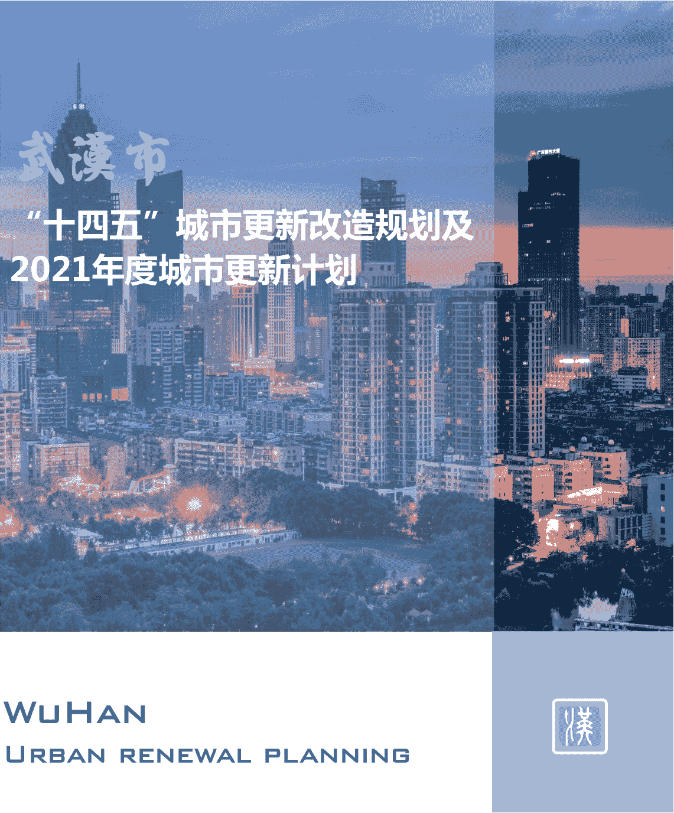

# 武汉市

# “十四五”城市更新改造规划及2021年度城市更新计划

WUHAN

URBAN RENEWAL PLANNING

## 目录

- 一、基本情况 ........................................................ 1
- 1.1　工作背景 ........................................................ 1
- 1.2　工作过程 ........................................................ 1
- 1.3　工作范围 ........................................................ 2
- 二、“十三五”期间城市更新改造情况 ................................. 5
- 2.1　“十三五”期间武汉城市更新改造规模 ............................. 5
- 2.2　“十三五”期间武汉城市更新改造工作成效 ......................... 5
- 2.3　“十三五”期间武汉城市更新存在问题 ............................ 10
- 三、“十四五”时期城市更新面临的新要求与新挑战 .................... 11
- 3.1　“十四五”时期武汉城市更新面临的新要求 ....................... 11
- 3.2　其他城市城市更新经验 ......................................... 12
- 3.3　“十四五”时期武汉城市更新面临的新挑战 ....................... 14
- 四、“十四五”时期城市更新的工作思路 .............................. 16
- 4.1　创新规划体系 .................................................. 16
- 4.2　创新改造方式 .................................................. 16
- 4.3　创新政策支撑 .................................................. 17
- 4.4　创新投融资渠道 ................................................ 18
- 4.5　创新参与机制 .................................................. 18
- 4.6　创新管理平台 .................................................. 18
- 五、“十四五”时期城市更新的目标任务 .............................. 19
- 5.1　规划目标 ...................................................... 19
- 5.2　规划任务 ...................................................... 19
- 六、实施保障有关建议 .............................................. 31
- 6.1　加强组织领导，明确职责分工 .................................. 31
- 6.2　创新更新政策供给，破除改造瓶颈 .............................. 31
- 6.3　拓宽融资渠道，保障改造资金源头活水 .......................... 31
- 七、2021年度城市更新计划 ......................................... 32
- 7.1　2021年度城市更新计划工作原则及目标 ........................ 32
- 7.2　2021年度城市更新计划工作重点 ................................ 33

## 01 基本情况

# 一、基本情况

## 1.1 工作背景

为贯彻落实国家、省、市关于实施城市更新行动的工作部署，科学有序推进我市城市更新工作，从去年开始，我局组织编制《武汉市“十四五”城市更新改造规划及2021年度城市更新计划》。

## 1.2 工作过程

城市更新是一项推动城市可持续发展、高质量发展、高水平治理的系统工程，包括对不符合经济社会发展要求的拆除重建、建筑综合整治、公服设施和基础设施完善、环境提升等建设和治理活动。加强城市更新是武汉落实建设国家中心城市、长江经济带核心城市和国际化大都市发展目标的重要途径。市自然资源和规划局高度重视该项工作，按照“规划统筹、部门协同、问计于民”的总体思路，开展本次规划编制工作。在深入开展“十三五”更新规划实施评估的基础上，运用线上线下相结合的调研技术与方法，充分征求各部门发展设想及公众意见。

我局高度重视规划编制工作，采取专题会议、电话征询等方式多次征求各中心城区人民政府（管委会）意见，逐一审核城市更新改造项目。对于各区所提大部分合规、合理意见，我局均已采纳；对于未采纳或未完全采纳的意见，我局已向各区进行了规划解释和细致说明，区政府（管委会）基本表示认可。今年以来，分管副市长和副秘书长组织召开专题会研究审议。会议原则同意该规划内容并提交市政府常务会审议，我局已按会议要求对规划成果进行了多次优化完善。

## 1.3 工作范围

本次规划范围为7个中心城区（江岸区、江汉区、硚口区、汉阳区、武昌区、青山区、洪山区）及东湖生态旅游风景区，共796平方公里；新城区、开发区城市更新规划计划结合实际情况另行组织编制。

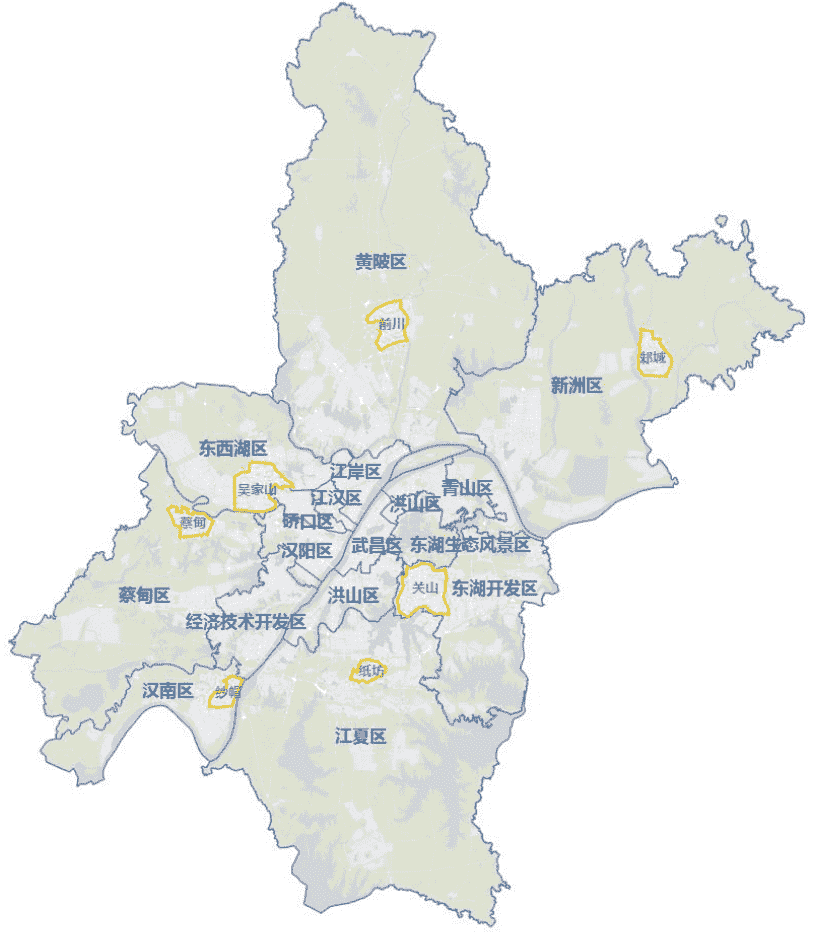

图1-2 武汉市域范围

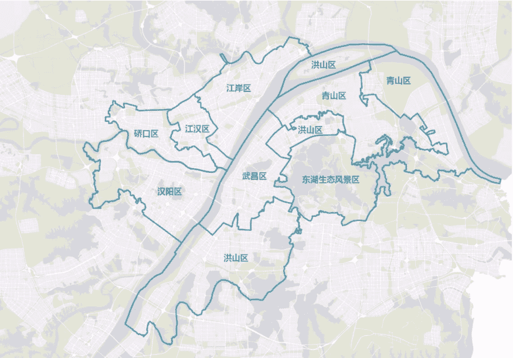

图1-3 “十四五”城市更新改造规划范围

## 02

## “十三五”期间城市更新改造情况

# 二、“十三五”期间城市更新改造情况

## 2.1 “十三五”期间武汉城市更新改造规模

“十三五”期间，我市紧扣经济万亿倍增目标和经济、城市、民生三个升级版的发展要求，抢抓发展机遇，超额完成了“十三五”更新任务目标。“十三五”期间计划实施更新改造7800万平方米，实际完成更新改造约9100万平方米。2019年根据发展形势和军运会召开要求，及时调整更新重点，提前启动“留改拆建控”并举的更新探索。

“十三五”期间，计划拆除建筑约5100万平方米（旧城旧厂2900万平方米，旧村2200万平方米），实际调整更新模式，将部分拆除规模转为保留整治，完成拆除约4400万平方米（旧城旧厂2062万平方米，旧村2336万平方米）；计划整治建筑2700万平方米，实际完成约整治4700万平方米。

表2-1 “十三五”期间各区城市更新完成情况表

单位：万平方米

| 行政区 | 拆除：旧城旧厂 | 拆除：旧村 | 拆除：小计 | 整治：旧城旧厂（含老旧小区） | 整治：旧村 | 整治：小计 |
|---|---:|---:|---:|---:|---:|---:|
| 江岸区 | 324 | 348 | 672 | 766 | / | 766 |
| 江汉区 | 315 | 43 | 358 | 589 | 9 | 598 |
| 硚口区 | 228 | 331 | 559 | 452 | 0 | 452 |
| 汉阳区 | 297 | 555 | 852 | 518 | 8 | 526 |
| 武昌区 | 443 | 40 | 483 | 617 | / | 617 |
| 青山区 | 280 | 259 | 539 | 856 | / | 856 |
| 洪山区 | 175 | 587 | 762 | 913 | / | 913 |
| 东湖风景区 | / | 173 | 173 | 6 | 24 | 30 |
| 总计 | **2062** | **2336** | **4398** | **4717** | **41** | **4758** |

## 2.2 “十三五”期间武汉城市更新改造工作成效

至2020年，武汉市中心城区大规模拆迁任务基本完成，城市骨架格局基本定型，城市更新从“拆改留”向“留改拆建控”转变。经过五年的不懈努力，城市功能日趋完善，生态文明建设成效显著，生活品质大幅提升，人居环境得到明显改善。

### 2.2.1 城市功能日趋完善

“十三五”期间，城市更新紧密围绕两江四岸核心区，高效推动了二七沿江商务区、汉正街中央商务区、武昌滨江商务区等10个重点功能区建设，拆除老旧房屋1000万平方米，腾退土地780公顷；大力推进了“城轴心”世界一流亮点片区、江岸“历史之径”片、江汉百年商道片、硚口汉正街片等7个亮点片区建设，腾退土地1521公顷；江岸区长江之门、硚口区复星外滩中心、武昌区长江中心等超大型项目建设实施。

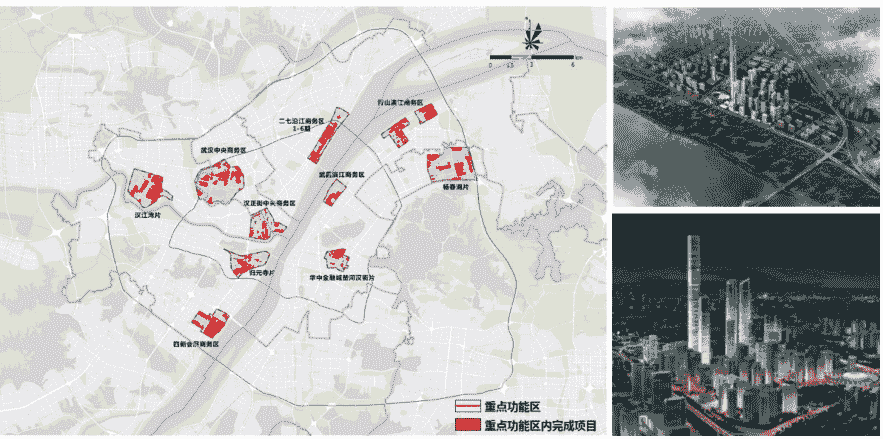

### 2.2.2 生态环境品质有所提升

长江主轴滨江公园主城段（汉口江滩、武昌江滩、青山江滩等）基本建成，东湖绿道一、二、三期全线贯通，扣环成网，月湖公园、宝岛公园、后襄河公园、沙湖公园等滨湖公园建成；“十三五”期间城市更新为公园绿地腾退用地318公顷，城市绿量大幅增加，公园绿地500米覆盖率提高6%，城市环境显著改善。

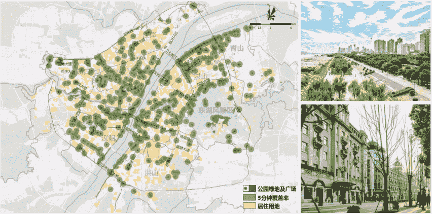

图2-2 现状公园绿地广场分布

### 2.2.3 文化特色显著彰显

中山大道、昙华林二期、汉阳钢铁厂工业遗址（融创1890项目）改造等项目推动了老城复兴，塑造了文化新地标，城市特色文脉进一步彰显。

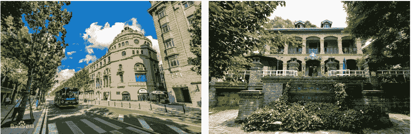

图2-3 中山大道（左）、昙华林（右）改造实景

### 2.2.4 公共服务与基础设施大幅提升

完成中心医院后湖院区、中医医院汉阳院区、儿童医院等一批重大“新、改、扩”项目建设；升级改造武汉体育馆、汉口文体中心、全民健身中心等一批体育场馆；高效推进城市道路交通及基础设施建设，完成青山、四新海绵城市示范区38.5平方公里的建设，腾退道路及市政设施用地318公顷。

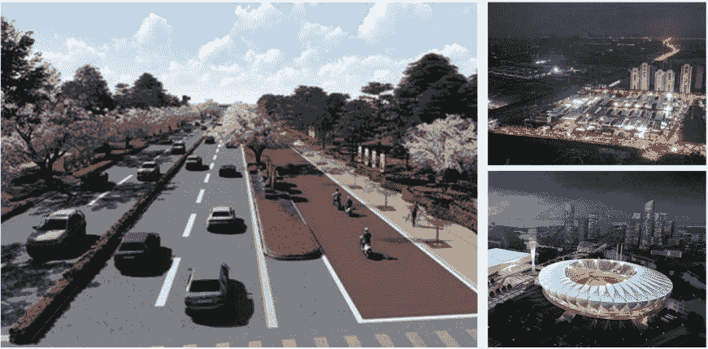

图2-4 公服与基础设施改造效果

### 2.2.5 民生水平切实提升

“十三五”期间累计改造棚户区约23.35万户，为居住腾退用地637公顷；推进逾期还建处置，督办59个逾期还建未开工项目，涉及3.6万户；2019年以来全市实施650个老旧小区改造，惠及居民30万户，推进老旧小区加装电梯，让“老居民”过上了“新生活”；以汉阳区为试点，初步搭建社区规划治理信息系统，以社区信息化建设推动社区治理现代化。实施旧村改造24个（完成挂牌6个，签订统征储备协议18个），通过就地安置和异地安置等手段，解决了3.8万户村民的住房问题。

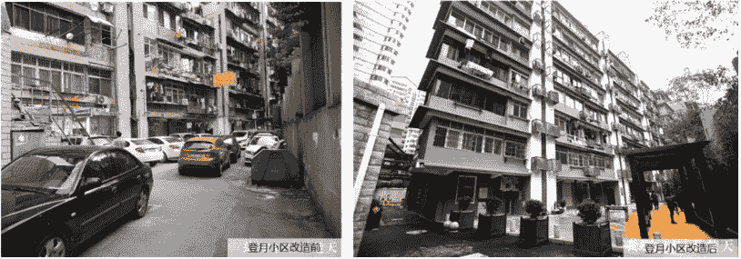

图2-5 老旧小区改造对比

# 表2-2 “十三五”期间已实施改造旧村分区统计表

| 行政区 | 完成挂牌（个数） | 完成挂牌（村名） | 签订征迁储备协议（个数） | 签订征迁储备协议（村名） |
|---|---:|---|---:|---|
| 江岸区 | 1 | 新益村 | 4 | 丹水池村、湖湖村、黑泥湖村、金潭村 |
| 硚口区 | 1 | 东风村 | 0 | / |
| 汉阳区 | 1 | 燎原村 | 2 | 汤山村、米粮村 |
| 武昌区 | 0 | / | 1 | 风光村 |
| 青山区 | 0 | / | 6 | 武东村、同兴村、群力村、芦家嘴村、努力村、五星村 |
| 洪山区 | 3 | 大洲村、青青村、渔业村 | 1 | 杨林村 |
| 东湖风景区 | 0 | / | 4 | 湖光村、新武东村、龚家岭村、先锋村 |
| 合计 | **6** | —— | **18** | —— |

### 2.2.6 更新机制政策体系基本建立

通过“五年规划十年度计划”，形成了规划引领、计划落实、项目推动的城市更新目标传导机制；细化绩效管理与考核制度，建立了绩效目标管理制度、工作联席会议制度、督办通报制度、预警约谈制度等长效机制，推进了改造工作不断提能增效。以“管用实用好用”为导向，出台了《中共武汉市委 武汉市人民政府关于进一步加快推进城市更新暨“三旧”（棚户区）改造工作的意见》（武发〔2016〕29号）、《武汉市国有土地上房屋征收与补偿实施办法》（2016年修订）等政策，保障了武汉市城市更新大力实施。

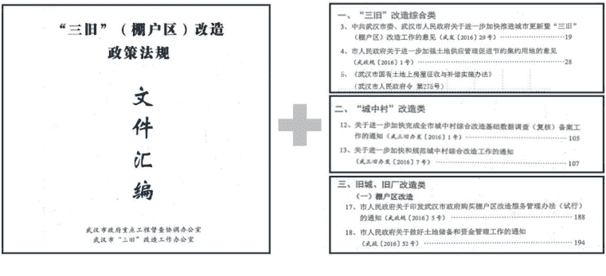

### 2.2.7 创新了更新规划审批监管手段

通过建立武汉市“三旧”改造智慧监管系统，促进了城市更新与全市相关规划、计划信息的紧密衔接，建立了更新项目远程申报、市规划局审核下达、市重点办定期考核管理机制，实现了更新项目“计划—征收储备—拆迁—验收”的动态跟踪。

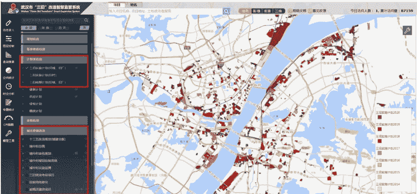

图2-7 武汉市“三旧”改造智慧监管系统

## 2.3 “十三五”期间武汉城市更新存在问题

在总结“十三五”更新成效的同时，以下方面仍待加强：一是重点功能区拆迁任务基本完成，但功能集聚与产业招商任务仍然艰巨，实施建设速度有待提高；二是中心城区住区人口密度过高、建设强度大，与“错落有致、疏密有度、高低起伏”的城市风貌还有差距；三是江城风貌景观特色得以彰显，但历史文化风貌街区的活化利用、工业遗产的升级改造仍待破题。

## 03 “十四五”时期城市更新面临的新要求与新挑战

# 三、“十四五”时期城市更新面临的新要求与新挑战

## 3.1 “十四五”时期武汉城市更新面临的新要求

### 3.1.1 “十四五”时期武汉城市更新所处阶段

经过十余年的城市更新改造，全市中心城区共完成城市更新拆迁任务约1.16亿平方米（“十三五”期间完成0.44亿平方米，“十二五”期间完成0.52亿平方米，“十一五”期间完成0.20亿平方米），腾退用地153.6平方公里，约占中心城区建设用地的38%。

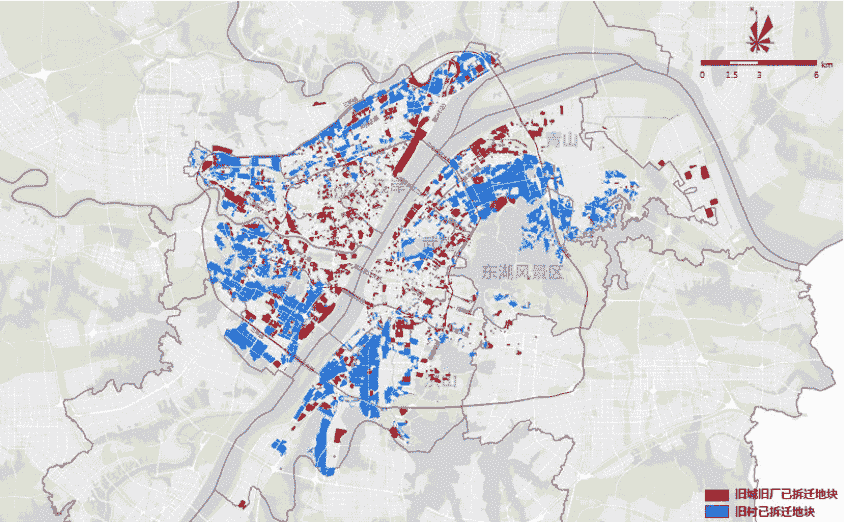

### 3.1.2 国家、省市新要求

《中华人民共和国国民经济和社会发展第十四个五年规划和2035年远景目标纲要》中明确提出要实施城市更新行动：“推进城市生态修复、功能完善工程，统筹城市规划、建设、管理，合理确定城市规模、人口密度、空间结构，促进大中小城市和小城镇协调发展。强化历史文化保护、塑造城市风貌，加强城镇老旧小区改造和社区建设，增强城市防洪排涝能力，建设海绵城市、韧性城市。”从生态、功能、历史、风貌、民生、安全等方面提出了城市更新的行动方向。

《武汉市国民经济和社会发展第十四个五年规划和2035年远景目标纲要》明确，“十四五”时期是武汉站在新起点锚定国家中心城市、长江经济带核心城市和国际化大都市总体定位，打造“五个中心”、建设现代化大武汉的关键五年，并专节提出实施城市更新行动，尊重城市发展规律，把全生命周期理念贯穿规划、建设、管理全过程各环节，提升城市发展质量，彰显城市个性魅力，为我市开展城市更新工作明确了方向。

## 3.2 其他城市城市更新经验

### 3.2.1 上海

上海按照“人民城市人民建、人民城市为人民”的要求，高度关注城市公共空间建设、老旧住房更新、历史建筑修缮、石库门建筑维护和功能提升，在规划、土地、财税、金融等各个方面进行政策创新，通过发行地方债券筹措改造资金，鼓励商业银行和基金公司创新金融产品提供融资支持，允许居民提取公积金实施加装电梯等。

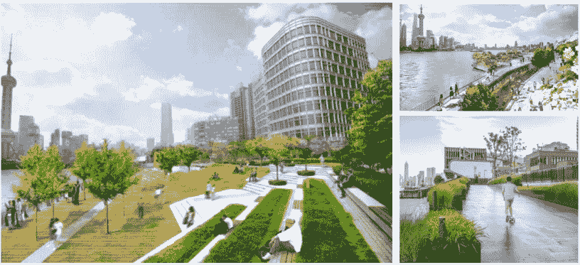

### 3.2.2 北京

北京紧密围绕首都发展、减量发展，推动老城保护性更新、存量企业和工业用地功能性更新、存量资源的保障性更新以及社会治理的社会性更新。在更新中统筹使用规划、土地、金融、财税政策工具，通过土地租金年租制、五年过渡期、经营性设施所有权和经营权分离等政策调动各方力量，吸引市场参与。

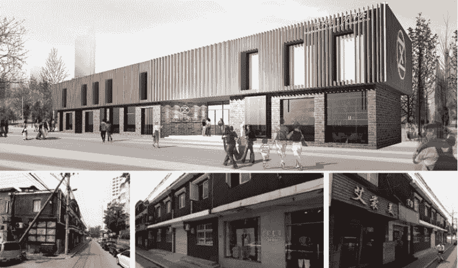

图3-3 北京城市更新

### 3.2.3 广州

广州用顶层设计的角度强调城市更新是城市高质量发展的新路径，注重规划引领，摸清存量资源底数，推进连片策划和成片规划，灵活采取修复与活化利用、城市有机更新、全面改造、混合改造和微改造等多种方式，分地区、分类别、分时序进行全域更新。针对城市更新中历史保护难题，率先出台历史建筑保护利用试点激励政策，鼓励功能活化、允许合理增加建筑面积、多方式供应土地，多措并举促进历史文化遗产合理保护利用；提出历史文化保护利用项目可与更新项目组合实施，实行统一规划、统一实施、统一运营，不断探索实践保护与更新有机结合的创新路径。

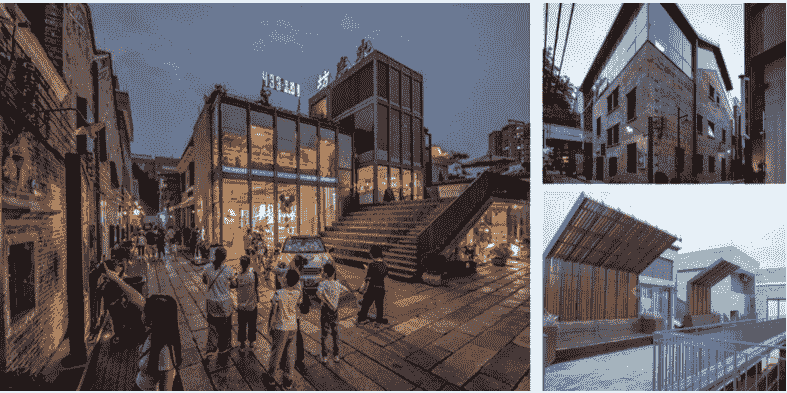

图3-4 广州永庆坊历史街区更新

## 3.3 “十四五”时期武汉城市更新面临的新挑战

目前，武汉市中心城区已从以拆为主的快速发展期进入到高质量发展新时期，更新对象也从“三旧”向老旧小区、历史街区、生态空间、公服及基础设施等方面拓展，面临着一系列新的挑战。

### 3.3.1 拆除改造难度加大

“十四五”时期，“旧村”拆除改造基本进入收尾阶段，旧城改造的比重进一步加大。目前中心城区旧城改造项目现状平均强度高达1.29，规划公共设施和基础设施占比超过40%，改造难度大大提高，如何寻求主城高容积量建设与环境品质提升的平衡发展，探索拆除重建与整治提升并重的更新模式是“十四五”更新必须面对的课题。

### 3.3.2 城市更新政策机制亟待创新

我市尚缺乏统筹性的城市更新政策措施，相关配套政策需要结合实际情况进行完善。“绿中村”改造、历史建筑活化利用的途径和机制尚未理顺。中心城区旧村156个，已完成挂牌或签订统征储备协议130个，剩余26个旧村中拆除13个、保留整治13个（其中景中村、绿中村共10个）。“绿中村”存在建设用地不足、村民安置困难、改造途径不明等问题，推进缓慢。

表3-1 156个旧村进展情况表

单位：个

| 行政区 | 已完成：挂牌已验收 | 已完成：挂牌完成拆迁未验收 | 已完成：统征 | 改造中：挂牌 | 改造中：统征 | 待改造：个数 |
|---|---:|---:|---:|---:|---:|---:|
| 江岸区 | 13 | 0 | 5 | 5 | 5 | 0 |
| 江汉区 | 2 | 3 | 0 | 0 | 0 | 0 |
| 硚口区 | 7 | 1 | 3 | 2 | 0 | 0 |
| 汉阳区 | 15 | 3 | 6 | 2 | 1 | 9 |
| 武昌区 | 2 | 6 | 2 | 0 | 0 | 0 |
| 青山区 | 0 | 1 | 2 | 1 | 4 | 5 |
| 洪山区 | 22 | 4 | 3 | 2 | 2 | 6 |
| 东湖风景区 | 0 | 0 | 2 | 0 | 4 | 6 |
| 小计 | **61** | **18** | **23** | **12** | **16** | **26** |
| 合计 | **102** |  |  | **28** |  | **26** |

“十四五”时期城市更新涉及面更广、类型多样、政策性更强且社会关注度更高，“工业遗产”活化利用、历史建筑保护与修缮等新需求层出不穷，亟需破解在土地供应、运行机制、融资模式、登记发证中的难点问题，建立强有力的政策保障机制，并且要有打破常规、突破创新的精神，积极在重点领域、关键环节先行先试。

### 3.3.3 融资渠道收窄，改造资金筹措难

以前，“三旧”改造受益于国家棚改政策性资金支持，2018年以后国家调整了棚改融资的相关政策，除了对续建棚改项目发行政府专项债之外，融资渠道大幅收窄；老旧小区改造、基础设施建设的资金瓶颈尚未完全破解，市场主体直接参与城市更新的路径尚待明确。

## 04 “十四五”时期城市更新的工作思路

# 四、“十四五”时期城市更新的工作思路

为贯彻落实国家、省、市关于城市更新各项要求，适应城市更新对象、重点、模式的变化，聚焦城市发展的关键领域和薄弱环节，落实我市“五个中心”建设目标，拟从六方面创新。

## 4.1 创新规划体系，从“多项规划”向“多规合一”转变

构建由城市更新规划统筹“征收、储备、公服、城建、老旧小区、亮点片区”6大计划，分类明确“留改拆建控”5大工作任务的“1+6+5”编制体系，实现规划引领、全程监管、政策实施的全过程保障。其中，“留”为留房留人的保留更新，以景中村、绿中村与老旧小区为对象；“改”为权利主体或功能发生改变的改造更新，以历史文化风貌街区与工业遗产为对象；“拆”为拆除更新，以旧城旧厂与旧村为对象；“建”指拆除后，用地按照规划高效有序利用，包括提高能、补设施；“控”指为落实主城“控强度、控密度”、“保生态、提品质”而开展的生态保护修复、城市设计与建设管控行动。

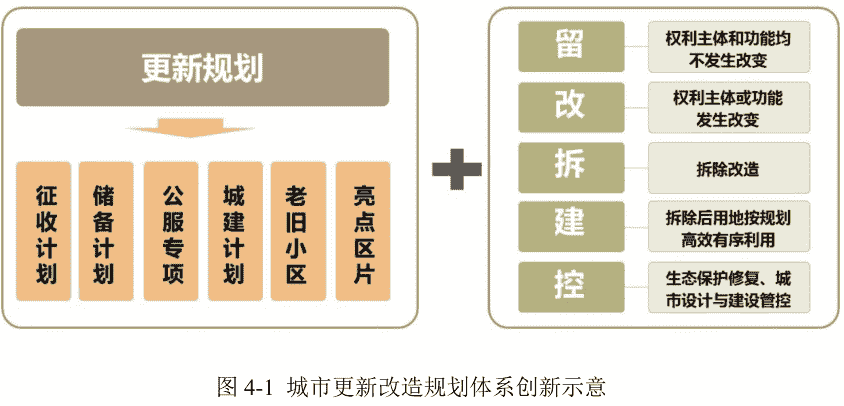

## 4.2 创新改造方式，从局部改造向成片连片更新转变，统筹推进“留改拆建控”各类项目

整体统筹，确定中心城区城市更新重点区域、更新时间序；片区统筹，锁定范围、锁定对象，以主体功能区单元为基本单元，成片连片推进城市更新。在单元内集成更新政策和“留改拆建控”各类更新项目，将用于建设与城市更新项目配

套的城市基础设施和公共服务设施与更新项目同步打包实施、优先安排，保障公共利益的落实，实现规划一片、配套一片、管好一片。

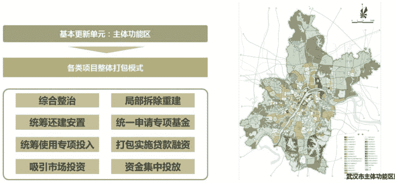

图 4-2 城市更新改造方式创新示意

## 4.3 创新政策支撑，从关注拆除改造向分类精准施策转变，打通“留改”更新政策堵点

完善更新政策，学习借鉴先进城市好的经验做法，针对历史文化风貌街区、老旧小区、低效工业等更新对象，打通现有存量更新在政策机制、标准规范、审批流程的瓶颈堵点，精准出台激励政策、鼓励政策和奖励政策，形成撬动和推动更新的“政策菜单”。

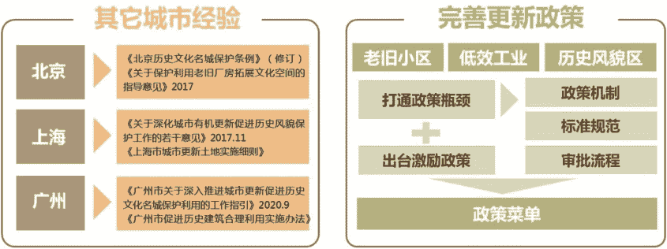

图 4-3 城市更新政策支撑体系创新示意

## 4.4 创新投融资渠道，从资金分散投放向资源要素整体筹划转变，破解更新资金瓶颈

以改革创新的理念统筹城市更新投融资工作，加强规划策划对更新项目的支撑作用，统筹使用并最大化政府投资作用；加大财政资金对城市更新的支持力度；充分利用政府资金、政策性贷款；通过丰富政策工具，鼓励资助更新改造，提高市场主体的主动性和积极性，引入企业投资和社会资本参与城市更新，多元化、多渠道破解资金难题。

## 4.5 创新参与机制，从政府主导向社会、企业、居民多元参与转变，调动多方积极性

通过鼓励企业自主更新、建立责任规划师制度、搭建沟通协商平台等手段，引导社会、企业、居民共同参与城市更新，实现决策共谋、发展共建、建设共管、效果共评、成果共享。

## 4.6 创新管理平台，从信息集成向智能决策平台转变，实施全生命周期管控

创新完善管理平台，实现更新项目管理的可视化、数据化、智能化。平台覆盖城市更新全对象、全类型、全过程，动态集成各类信息，实现更新项目信息采集、跟踪、督办、实施的全生命周期管控，提供更科学、更高效的决策支持。

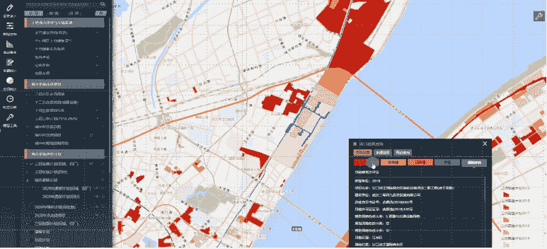

# 05 “十四五”时期城市更新的目标任务

# 五、“十四五”时期城市更新的目标任务

## 5.1 规划目标

贯彻落实国家、省市各项发展要求，按照“留改拆建控”并举的更新要求，围绕打造“五个中心”及建设现代化大武汉城市的目标，“十四五”期间城市更新改造要突出以人民为中心、突出高质量发展、突出绿色转型、突出文脉传承、突出安全保障，实现中心城区“两降两增两保”（降低人口、建筑密度，增加绿色开敞空间、公共服务设施，保护历史文化街区、山体湖泊及周边环境）。

## 5.2 规划任务

“十四五”期间需完成城市更新总任务约5700万平方米。其中，保留更新3059万平方米（城中村240万平方米、老旧小区2819万平方米）；改造更新124万平方米（紫线内项目35万平方米、工业遗产14万平方米、其他75万平方米）；拆除更新2516万平方米（旧城旧厂1616万平方米、旧村900万平方米）。“留改”类项目涉及用地约25平方公里，拆除类项目涉及用地约27平方公里，共计占中心城区建设用地的12%。“建控”工作突出以人民为中心、高质量发展、绿色转型、文脉传承、安全保障的原则有序推进。

通过改造，基本完成2000年底前建成的需改造城镇老旧小区改造任务，稳步推进三环线内剩余旧村保留更新任务，加快推进历史街区和工业遗产改造更新，全面完成剩余旧城旧厂旧村拆除改造任务，加快“五个中心”核心功能建设，补短板、强弱项、提品质、保生态。

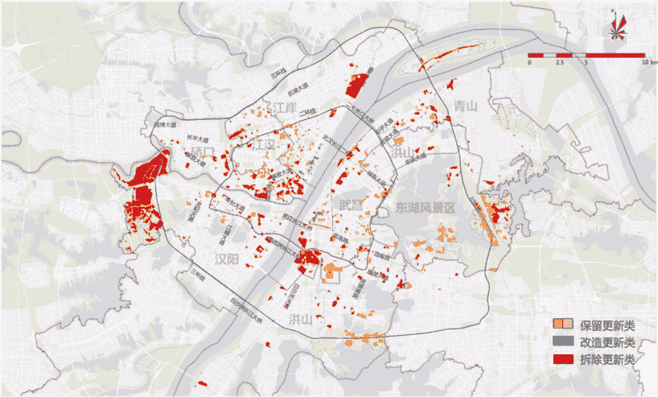

表 5-1 “十四五”城市更新任务分区统计表

单位：万平方米

| 行政区 | 留：老旧小区 | 留：城中村 | 留：合计 | 改：紫线内项目 | 改：工业遗产 | 改：其他 | 改：合计 | 拆：旧城旧厂 | 拆：旧村 | 拆：合计 | 建 | 控 |
|---|---:|---:|---:|---:|---:|---:|---:|---:|---:|---:|---|---|
| 江岸区 | 427 | / | 427 | 34 | 14 | 52 | 100 | 110 | 201 | 311 | 按各主管部门确定的目标任务落实 | 按各主管部门具体意见执行 |
| 江汉区 | 388 | / | 388 | / | / | / | / | 286 | 18 | 304 |  |  |
| 硚口区 | 401 | / | 401 | / | / | / | / | 407 | / | 407 |  |  |
| 汉阳区 | 169 | / | 169 | / | / | / | / | 150 | 366 | 516 |  |  |
| 武昌区 | 1047 | / | 1047 | 1 | / | 23 | 24 | 333 | 2 | 335 |  |  |
| 青山区 | 90 | / | 90 | / | / | / | / | 94 | 3 | 97 |  |  |
| 洪山区 | 272 | 44 | 316 | / | / | / | / | 207 | 85 | 292 |  |  |
| 东湖风景区 | 25 | 196 | 221 | / | / | / | / | 29 | 225 | 254 |  |  |
| 合计 | 2819 | 240 | 3059 | 35 | 14 | 75 | 124 | 1616 | 900 | 2516 | —— | —— |

### 5.2.1 留——留房留人，惠民生保生态

（1）基本完成2000年底前建成的需改造城镇老旧小区，系统改善市民居住环境。对接《武汉市老旧小区改造“十四五”规划》，完成中心城区2000年底前建成的需改造老旧小区1014个、2819万平方米；将老旧小区按照片区整体实施规划与“拆改”项目捆绑实施连片改造；提高改造标准，按照“一区一方案”有序推进；积极争取和统筹各方资金，拓宽融资渠道，吸引社会投资，鼓励居民出资，提高资金使用效率；通过现有商品房团购、旧村还建房长租、闲置办公及商业用房转化等方式，加大存量住房转化利用，健全“四位一体”住房保障体系。

加大存量住房转化利用，健全“四位一体”住房保障体系。通过老旧小区改造，提高住区环境品质和住房条件，盘活空置、闲置住房，通过现有商品房团购、旧村还建房长租、闲置办公及商业用房转化等方式，加大存量住房转化利用，健全公租房、共有产权房、人才保障房、征收安置房“四位一体”住房保障体系，扩大保障性租赁住房供给，满足留汉大学毕业生和外来务工人员住房租赁需求。

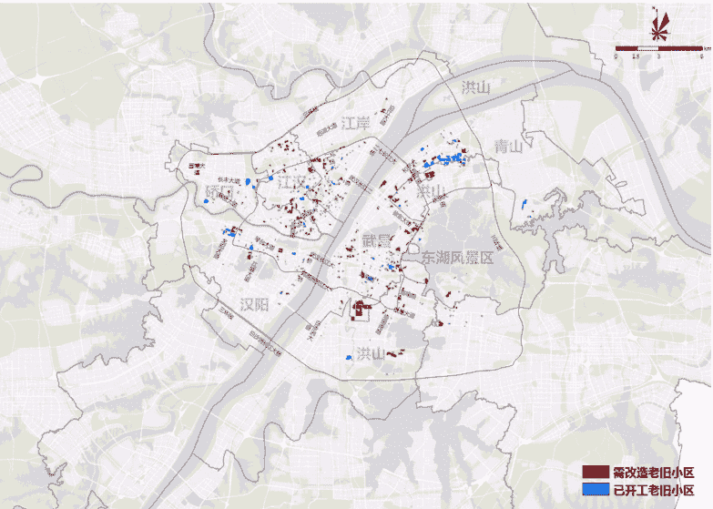

# 表 5-2 “十四五”中心城区及风景区老旧小区改造分区统计表

单位：个、万户、万平方米、栋

| 行政区 | 个数 | 户数 | 建筑规模 | 栋数 |
|---|---:|---:|---:|---:|
| 江岸区 | 224 | 6.35 | 427.13 | 1496 |
| 江汉区 | 117 | 5.11 | 388.02 | 893 |
| 硚口区 | 160 | 5.58 | 401.48 | 1024 |
| 汉阳区 | 62 | 2.51 | 169.17 | 443 |
| 武昌区 | 282 | 13.36 | 1046.94 | 3396 |
| 青山区 | 42 | 0.88 | 89.09 | 262 |
| 洪山区 | 116 | 2.75 | 272.10 | 678 |
| 东湖风景区 | 11 | 0.22 | 24.77 | 93 |
| 合计 | **1014** | **36.76** | **2818.69** | **8285** |

（2）稳步推进三环线内城中村、绿中村保留更新工作。中心城区城中村156个，已完成挂牌或签订统征储备协议130个，剩余26个城中村中拆除13个、保留整治13个，其中三环线内有6个城中村、绿中村（洪山区先建村、东湖风景区磨山村、桥梁村、建强村、滨湖村、马鞍山苗圃），共计240万平方米。“十四五”期间需推进保留更新工作，加快规划编制，实施生态修复与功能产业植入，妥善安置村民，全面建成东湖绿心；三环线外7个城中村（含洪山区2个绿中村及青山区2个绿中村和周边3村），需按照“一区一试点”的方式结合城中村改造政策实施推进，破解改造难题，完善实施路径。

# 表 5-3 “十四五”需推进保留更新城中村详表

单位：万平方米

| 行政区 | 村名 | 需更新建筑面积 | 更新方式 |
|---|---|---:|---|
| 洪山区 | 先建村 | 43.59 | 保留更新 |
| 东湖风景区 | 磨山村 | 67.62 | 保留更新 |
|  | 桥梁村 | 50.30 | 保留更新 |
|  | 建强村 | 24.51 | 保留更新 |
|  | 滨湖村 | 23.48 | 保留更新 |
|  | 马鞍山苗圃 | 29.87 | 保留更新 |
| 合计 |  | **239.37** | —— |

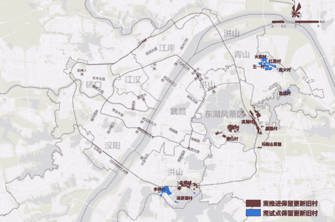

### 5.2.2 改——留房提质，活化利用彰显风貌

高质量打造武汉七大亮点片区，彰显武汉历史与人文特色。对江岸“历史之径”、江汉“百年商道”、硚口“汉正老街”、汉阳“汉阳古城”、武昌“武昌古城”、青山“红房子”、洪山“大学之城”等7个城市亮点片区开展“留改拆建控”并举的综合更新，“十四五”期间推进实施历史建筑、工业遗产等改造更新共计124万平方米，系统实施拆违、街巷整治、建筑修缮、设施增补，按照“一片一特色、一路一品牌”的思路，彰显城市文脉。

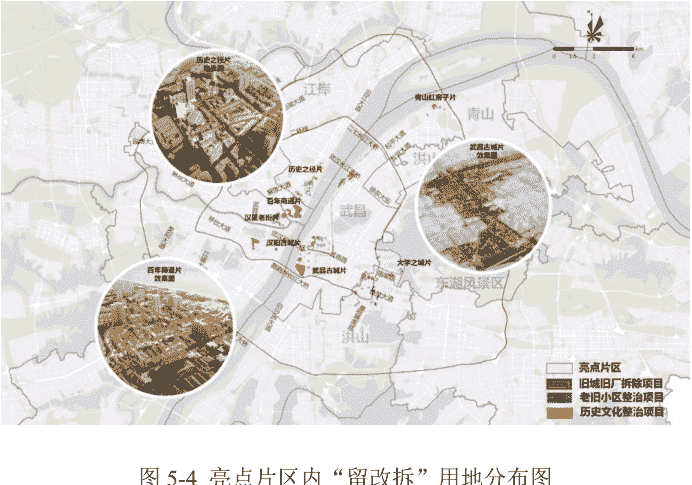

### 5.2.3 拆——精确锁定，全面完成剩余拆除任务

（1）**全面完成旧城旧厂1616万平方米拆除更新任务。**全面完成已启动改造项目（363万平方米）、10个重点功能区剩余拆除任务（403万平方米）、其他市级主体功能区片拆除任务（313万平方米）；补短板、强弱项，优先为公服基础设施及公园绿地腾退空间，实施拆除117万平方米；惠民生，完成市级主体功能区之外建筑破旧、设施陈旧、存在安全隐患的420万平方米拆除任务，共计腾退用地14平方公里。

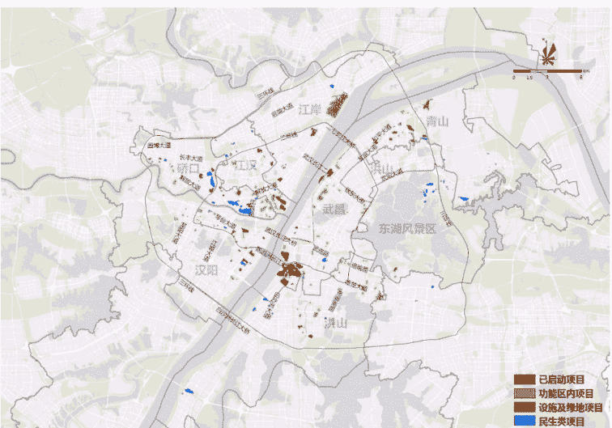

图 5-5 “十四五”城市更新旧城旧厂拆除项目分布

（2）**全面完成旧村900万平方米拆除更新任务。**完成中心城区已启动旧村改造536万平方米（含30个已挂牌或签订统征储备协议的城中村）；完成洪山区天兴洲3个城中村、汉阳区新汉阳站周边9个城中村及东湖风景区鼓架村等共计364万平方米拆除任务，共计腾退用地13平方公里。

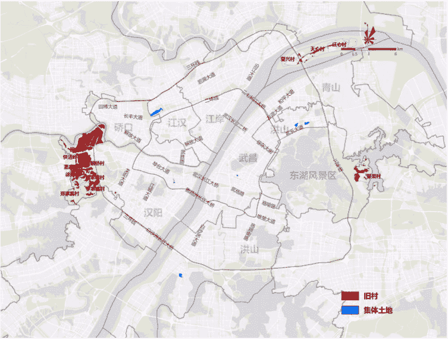

# 图5-6 “十四五”城市更新旧村拆除项目分布

### 5.2.4 建——主城做优，落实“五个中心”核心任务，补短板、强弱项

（1）提升城市功能服务能级，推动市级重点功能区建设。2014年确定的10个重点功能区承载着“五个中心”核心功能，需加快招商进度，推动重大项目落地，力争“十四五”期间基本建成；加快推进白沙洲新城片、南湖城市副中心片、世贸滨江片等生产性服务业聚集区建设，突出特色、错位发展。

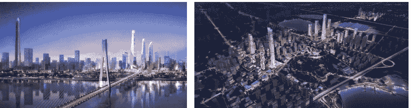

# 图5-7 二七滨江商务区（左）、杨春湖商务区（右）

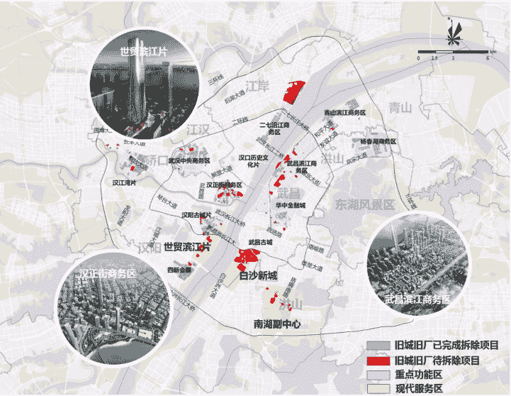

（2）打造国家科技创新中心，建设“校产城”融合的科创集聚区。以洪山大学之城、光谷科创大走廊为核心打造科技创新产业承载区；以汇汉科创园、杨园工程设计区、武汉聚谷片等为支撑，打造功能特色突出的创新街区、创新空间，为城市增添活力，实现经济高质量发展。

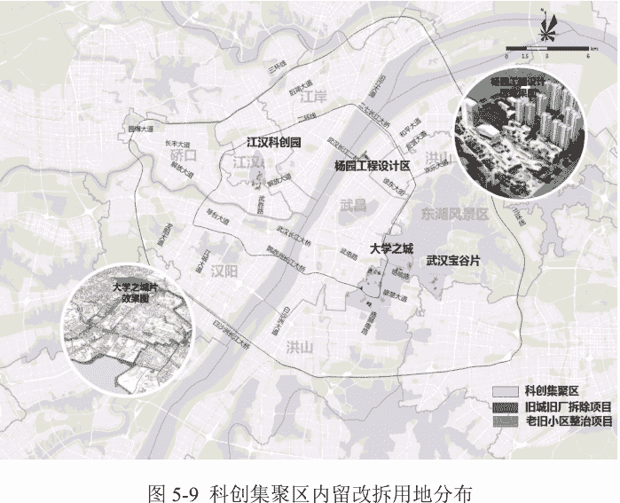

（3）打造国际交往中心，建设战略性文体功能区。形成以琴台—龟北为核心，以武昌古城—环东湖、沙湖和汉江沿江—张公堤园博园为支撑的“一核两带”文化功能格局，重点推进武汉广电全媒体中心建设，规划建设武汉戏曲艺术中心、武汉图书馆新馆，推动国际交往中心建设。

图 5-10 琴台—龟北片区

（4）补齐公共服务设施短板，建设宜居武汉。以市级重点功能区、科创中心、亮点片区等重点功能承载区为示范，实施区域内公共服务设施、产业配套设施、市政设施一体化建设。结合城市更新，优先落实10分钟医疗救治圈建设。完善重大疫情救治设施，补充南湖、杨春湖等医疗服务资源空白。补充公共服务设施短板，实施老年友好、教育提档、文化名城、体育强市、邻里中心示范等工程，打造15分钟生活圈、12分钟文体圈。“十四五”期间，共计为文教卫体设施腾退用地200公顷，全面提升城市宜居生活水平。

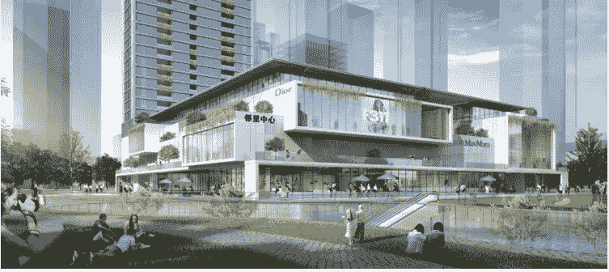

图 5-11 15分钟生活圈邻里中心改造意向图

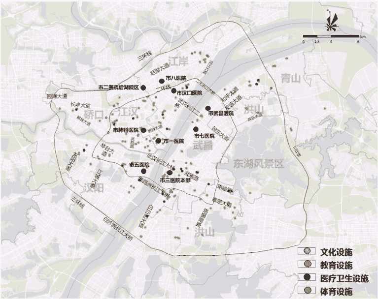

# 图5-12 拆除类项目中规划公服设施分布

（5）**增强城市基础设施承载力，提高安全韧性水平。**加快推动“地铁骨架时代”转向“地铁网络时代”，全力实施第四期轨道交通建设规划；完善城市交通网络，提升城市次支路规划实现率，改造中心城区微循环路，消减断头路，加强城市自行车道、人行道、停车场等设施配套；保障供水安全，推进大汉口沿江片、大武昌供水管网连通；实施一流城市电网、5G工程，推进变电站及5G基站建设；持续推进“三湖三河”水环境治理，推进雨污分流改造、海绵城市建设工程；促进安全防灾提档，实现5分钟消防安全全覆盖。“十四五”期间，为交通设施腾退用地31公顷，为市政设施腾退用地27公顷，全面提升基础设施保障水平。

### 5.2.5 控——严格管控，精细化落实“双修”目标

（1）**落实长江大保护战略，建设百里长江生态廊道。**锚固长江、汉江及东西山系构成的“十字”型山水生态轴；推进百里沿江生态文化长廊建设，通过城市更新“连断点、补空点、提亮点”，推进建设四新、白沙洲等11处江滩公园，建设4处城市阳台，开展长江岸线整治与生态修复，打造更生态的百里沿江长廊。连通两岸蓝绿网络，为河流水系周边绿地腾退用地98公顷。

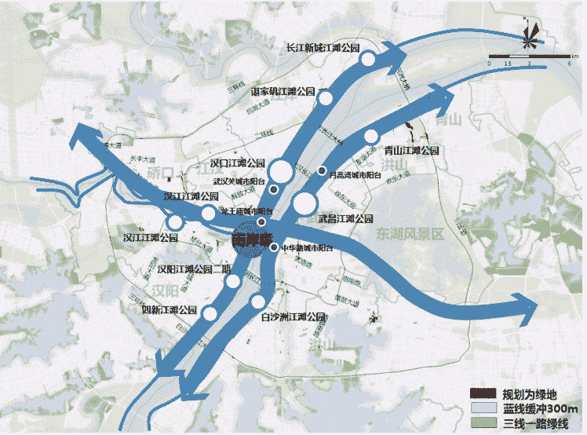

图 5-13 生态文化廊道

（2）**深入实施蓝网、绿网工程，推进公共空间建设。**全面完成“三线一路”范围内不合规用地1.5万平方米拆除任务，建设生态绿地、恢复湖泊生态环境。全面完成镜子湖、塔子湖、西湖、北湖、后襄河、菱角湖等40个湖泊公园绿化景观水平整治提升，继续推进三环线沿线野芷湖、龙阳湖等7个湖泊公园建设，形成三环线沿线串珠公园；推进主城绿道成网，打通朱家河、武九铁路共7条高品质绿廊，加强社区绿道覆盖，构建通江、达湖、成网的绿道系统；全面提升绿化、美化、净化水平，集中打造一批街头公园、“口袋公园”，打造10分钟活动圈，增补绿地146公顷，实现绿化500米服务半径的社区全覆盖。

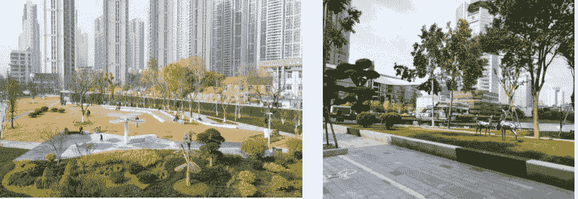

图 5-14 街头公园、口袋公园建设

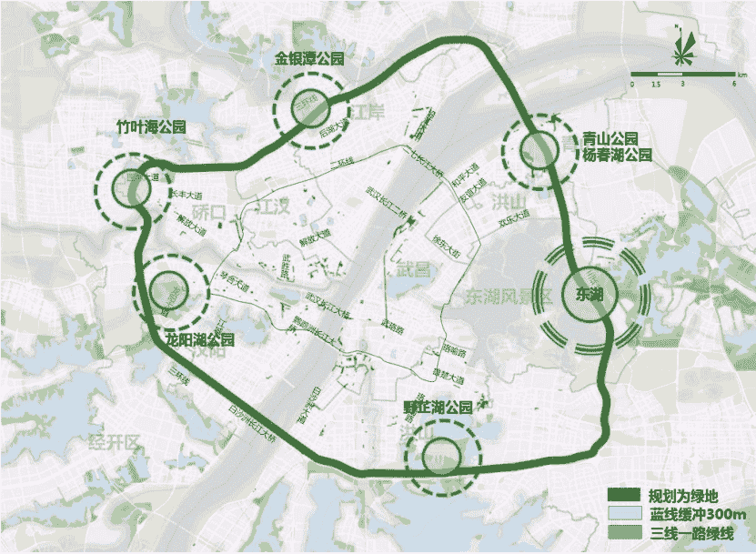

（3）控强度、控密度，编制高水平城市设计，强化城市色彩、整体风格、建筑造型管控。加快修订完善武汉市居住用地强度管理规定，控制主城建筑高度、建筑密度和容积率。推进建设地标建筑群，打造“错落有致、疏密有度、高低起伏”的城市天际线，形成和谐有序、层次分明的城市空间界面。

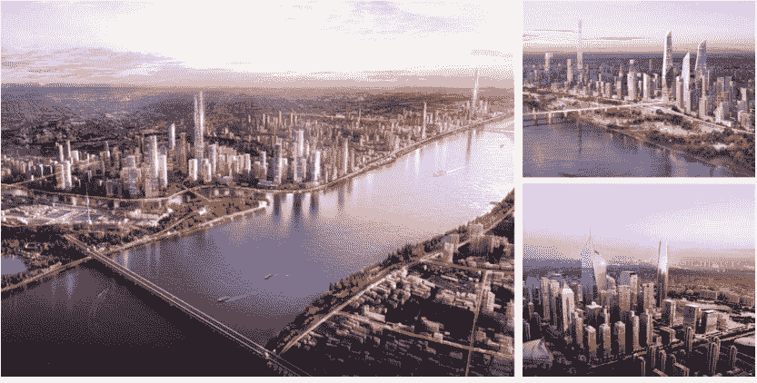

# 06｜实施保障有关建议

# 六、实施保障有关建议

## 6.1 加强组织领导，明确职责分工

建议由市重点办负责组织协调、统筹、督办城市更新各项工作，以市城乡建设局、市住房保障房管局、市自然资源和规划局为主导，其他相关职能部门各司其职、密切配合。各区人民政府（管委会）履行本辖区城市更新工作的第一主体责任。依托城市更新中心，发挥国有企业在城市更新中的攻坚作用，推动实施重难点项目改造；优化细化绩效考核内容与考核标准，建立年度分配规模和年度实施率“双考核”机制，实施数量考核和质量考核并举。

## 6.2 创新更新政策供给，破除改造瓶颈

建议由市政府重点办牵头组织各相关部门开展政策研究创新，学习借鉴上海、广州、深圳等城市经验，探索构建1个框架性的实施意见、1个统筹性的实施办法、N个配套政策文件为一体的“1+1+N”城市更新政策体系。按照“分类施策、支持推进”的思路，结合工作实际研究出台规划、土地、金融、财税、建设、经营、管理等配套政策，探索“预供地”、公众参与、不动产登记等方面的政策路径。

## 6.3 拓宽融资渠道，保障改造资金源头活水

一是除棚改专项债券外，仍然需要争取国家、省支持，加大棚改专项债发行力度；积极开展城市更新试点，解决重难点项目融资问题。二是利用好自然资源部支持湖北和我市探索设立政府投资基金等方式的政策契机，主动争取相关部委支持。三是充分调动企事业单位和全体市民参与城市更新的积极性、创造性，发挥市场机制作用，探索市场主体参与城市更新的路径。四是创新融资渠道，加强与银行、信托、券商等金融机构的合作，积极探索产业基金、应收账款质押、资产证券化、项目收益债等融资方式。五是合理利用住房公积金、住房维修资金促进老旧小区改造；积极开展项目试点，通过成片连片更新，统筹打包加强老旧小区专项债的发行与利用，解决重难点项目融资问题。

# 07｜2021年度城市更新计划

# 七、2021 年度城市更新计划

按照拆除更新规模比重逐步降低、“留改”类更新规模比重逐步提升的思路，2021-2022 年为“留改拆建控”兼顾阶段，侧重于重点功能区、亮点片区等重点区域内的更新改造；2023-2025 年为“留改为主”的更新阶段，持续推进历史风貌街区、公服设施、市政设施等更新改造。

## 7.1 2021 年度城市更新计划工作原则及目标

按照“锁定任务、确保实施，全局统筹、分类推进，拆整结合、精准施策，政府主导、分区落实”的原则，2021 年完成更新改造 1717 万平方米，其中，完成保留更新 937 万平方米，实施改造更新 52 万平方米，完成拆除更新 728 万平方米（拆除旧城旧厂 500 万平方米，拆除旧村 228 万平方米）。

表 7-1 2021 年武汉市中心城区城市更新规模

单位：万平方米

| 行政区 | 留-老旧小区 | 留-城中村 | 留-合计 | 改-紫线内项目 | 改-工业遗产 | 改-其他 | 改-合计 | 拆-旧城旧厂 | 拆-旧村 | 拆-合计 | 建 | 控 |
|---|---:|---:|---:|---:|---:|---:|---:|---:|---:|---:|---|---|
| 江岸区 | 130 | / | 130 | 13 | / | 27 | 40 | 42 | 35 | 77 | 按各主管部门确定的目标任务落实 | 按各主管部门具体意见执行 |
| 江汉区 | 126 | / | 126 | / | / | / | / | 80 | / | 80 |  |  |
| 硚口区 | 83 | / | 83 | / | / | / | / | 80 | / | 80 |  |  |
| 汉阳区 | 96 | / | 96 | / | / | / | / | 55 | 80 | 135 |  |  |
| 武昌区 | 277 | / | 277 | / | / | 12 | 12 | 103 | 2 | 105 |  |  |
| 青山区 | 79 | / | 79 | / | / | / | / | 56 | 3 | 59 |  |  |
| 洪山区 | 92 | 16 | 108 | / | / | / | / | 64 | 48 | 112 |  |  |
| 东湖风景区 | 4 | 34 | 38 | / | / | / | / | 20 | 60 | 80 |  |  |
| 合计 | **887** | **50** | **937** | **13** | **/** | **39** | **52** | **500** | **228** | **728** | —— | —— |

## 7.2 2021 年度城市更新计划工作重点

### 7.2.1 留——增强民生保障，完善生态框架

加快推进老旧小区改造，落实《武汉市老旧小区改造 2021 年年度计划》中中心城区实施老旧小区改造 302 个（887 万平方米）；完成三环线内连建村、磨山村、桥梁村、建强村、滨湖村、马鞍山苗圃 6 个景中村、绿中村 50 万平方米建筑保留更新；启动三环线外城中村保留更新试点工作。

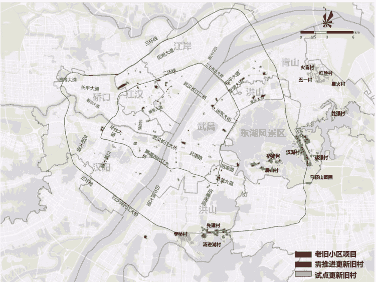

### 7.2.2 改——强化城市特色，提升城市品质

实施江岸区“历史之径”及吴华林片改造更新约 52 万平方米；完成 7 大亮点片区规划编制，提升汉口历史文化风貌区、武昌古城、琴台中央文化艺术区等重点文化集聚区影响力。

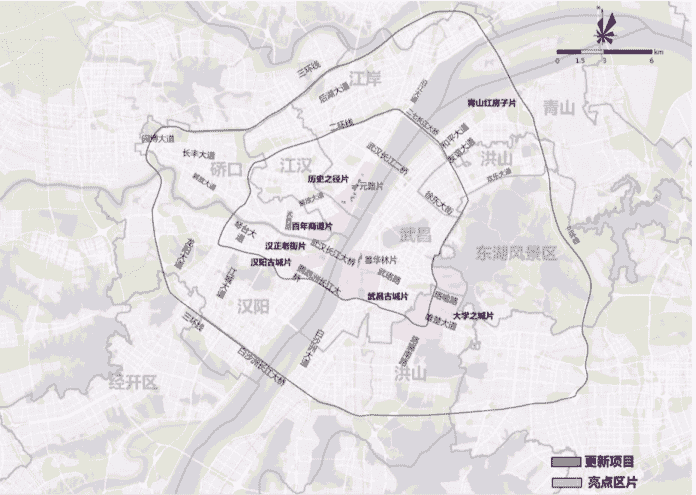

### 7.2.3 拆——精准拆除，保障“五个中心”及公服、市政设施建设空间

一是完成已启动旧城旧厂项目181万平方米拆除任务及完成已启动旧村剩余198万方和涉及武汉西站建设、天兴洲生态规划、鼓架村的30万平方米拆除任务；二是完成10个市级重点功能区及亮点片区的102万平方米拆除工作；三是保障公服及市政设施55万平方米建设空间；四是完成民生改造项目162万平方米。

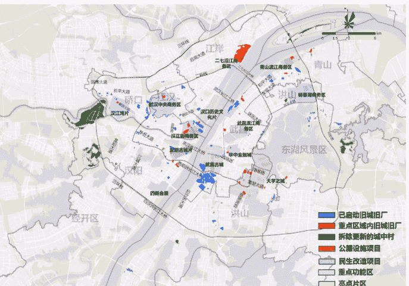

### 7.2.4 建——推进“五个中心”核心功能建设，补短板、强弱项

加快 10 个市级重点功能区、7 个亮点片区的招商引资、功能植入、公服及市政设施一体化建设；开工建设武汉西站、推动轨道交通 12 号环线，实施 11 号线二期等轨道交通及二七路过江通道、沌汉九桥等枢纽、过江桥隧的建设。围绕后湖、南湖、白沙洲等薄弱区域，提升次支路实施率，打通“断头路”。推动实施汉四、三金潭污水处理厂扩建和淤泥处置工程，推进水环境治理与污水处理设施建设；系统推进以“三河三湖”等汇水分区为重点的海绵城市建设。

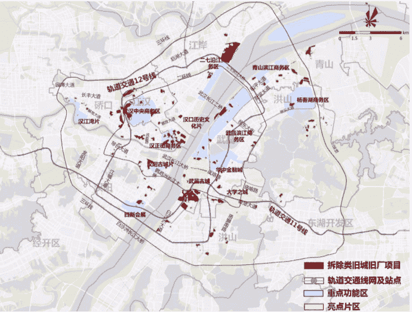

图 7-4 市级功能区及基础设施建设分布

### 7.2.5 控——实施城市生态修复，提升城市生态环境品质

推进百里长江生态廊道建设，继续实施湖泊生态修复保护和综合提升工程，加强沿江蓝绿网络连通。持续推动中心城区口袋公园建设，腾退绿地约 165 公顷。

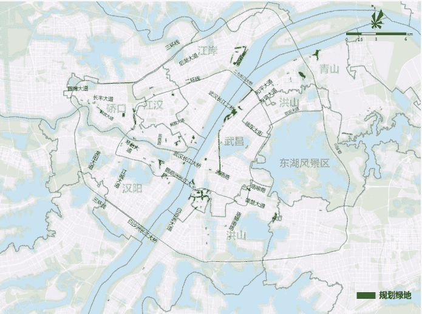

图 7-5 拆除用地中规划绿地分布

## 附件一 “十四五”期间武汉市中心城区城市更新规模

| 更新方式 | 更新对象 | 十四五建筑规模（万平方米） | 十三五计划任务（万平方米） | 十三五实际完成（万平方米） |
|---|---|---:|---:|---:|
| 留 | 老旧小区 | 2819 |  |  |
| 留 | 城中村 | 240 |  |  |
| 留 | 合计 | **3059** |  |  |
| 改 | 紫线内项目 | 35 | **2700** | **4758** |
| 改 | 工业遗产 | 14 |  |  |
| 改 | 其他 | 75 |  |  |
| 改 | 合计 | **124** |  |  |
| 拆 | 旧城旧厂 | 1616 | 2900 | 2062 |
| 拆 | 旧村 | 900 | 2200 | 2336 |
| 拆 | 合计 | **2516** | **5100** | **4398** |
| 总计 |  | **5699** | **7800** | **9156** |

| 行政区 | 留：老旧小区 | 留：城中村 | 留：合计 | 改：紫线内项目 | 改：工业遗产 | 改：其他 | 改：合计 | 拆：旧城旧厂 | 拆：旧村 | 拆：合计 | 建 | 控 |
|---|---:|---:|---:|---:|---:|---:|---:|---:|---:|---:|---|---|
| 江岸区 | 427 | / | 427 | 34 | 14 | 52 | 100 | 110 | 201 | 311 | 按各主管部门确定的目标任务落实 | 按各主管部门具体意见执行 |
| 江汉区 | 388 | / | 388 | / | / | / | / | 286 | 18 | 304 |  |  |
| 硚口区 | 401 | / | 401 | / | / | / | / | 407 | / | 407 |  |  |
| 汉阳区 | 169 | / | 169 | / | / | / | / | 150 | 366 | 516 |  |  |
| 武昌区 | 1047 | / | 1047 | 1 | / | 23 | 24 | 333 | 2 | 335 |  |  |
| 青山区 | 90 | / | 90 | / | / | / | / | 94 | 3 | 97 |  |  |
| 洪山区 | 272 | 44 | 316 | / | / | / | / | 207 | 85 | 292 |  |  |
| 东湖风景区 | 25 | 196 | 221 | / | / | / | / | 29 | 225 | 254 |  |  |
| 合计 | **2819** | **240** | **3059** | **35** | **14** | **75** | **124** | **1616** | **900** | **2516** | —— | —— |

## 附件二 2021 年度武汉市中心城区城市更新规模

| 更新方式 | 更新对象 | 2021 年度计划任务（万平方米） | 十四五规划任务（万平方米） |
|---|---|---:|---:|
| 留 | 老旧小区 | 887 | 2819 |
| 留 | 城中村 | 50 | 240 |
| 留 | 合计 | **937** | **3059** |
| 改 | 紫线内项目 | 13 | 35 |
| 改 | 工业遗产 | —— | 14 |
| 改 | 其他 | 39 | 75 |
| 改 | 合计 | **52** | **124** |
| 拆 | 旧城旧厂 | 500 | 1616 |
| 拆 | 旧村 | 228 | 900 |
| 拆 | 合计 | **728** | **2516** |
|  | 总计 | **1717** | **5699** |

| 行政区 | 留：老旧小区 | 留：城中村 | 留：合计 | 改：紫线内项目 | 改：工业遗产 | 改：其他 | 改：合计 | 拆：旧城旧厂 | 拆：旧村 | 拆：合计 | 建 | 控 |
|---|---:|---:|---:|---:|---:|---:|---:|---:|---:|---:|---|---|
| 江岸区 | 130 | / | 130 | 13 | / | 27 | 40 | 42 | 35 | 77 | 按各主管部门确定的目标任务落实 | 按各主管部门具体意见执行 |
| 江汉区 | 126 | / | 126 | / | / | / | / | 80 | / | 80 |  |  |
| 硚口区 | 83 | / | 83 | / | / | / | / | 80 | / | 80 |  |  |
| 汉阳区 | 96 | / | 96 | / | / | / | / | 55 | 80 | 135 |  |  |
| 武昌区 | 277 | / | 277 | / | / | 12 | 12 | 103 | 2 | 105 |  |  |
| 青山区 | 79 | / | 79 | / | / | / | / | 56 | 3 | 59 |  |  |
| 洪山区 | 92 | 16 | 108 | / | / | / | / | 64 | 48 | 112 |  |  |
| 东湖风景区 | 4 | 34 | 38 | / | / | / | / | 20 | 60 | 80 |  |  |
| 合计 | **887** | **50** | **937** | **13** | **/** | **39** | **52** | **500** | **228** | **728** | —— | —— |

## 武汉市“十四五”城市更新改造规划项目分布图

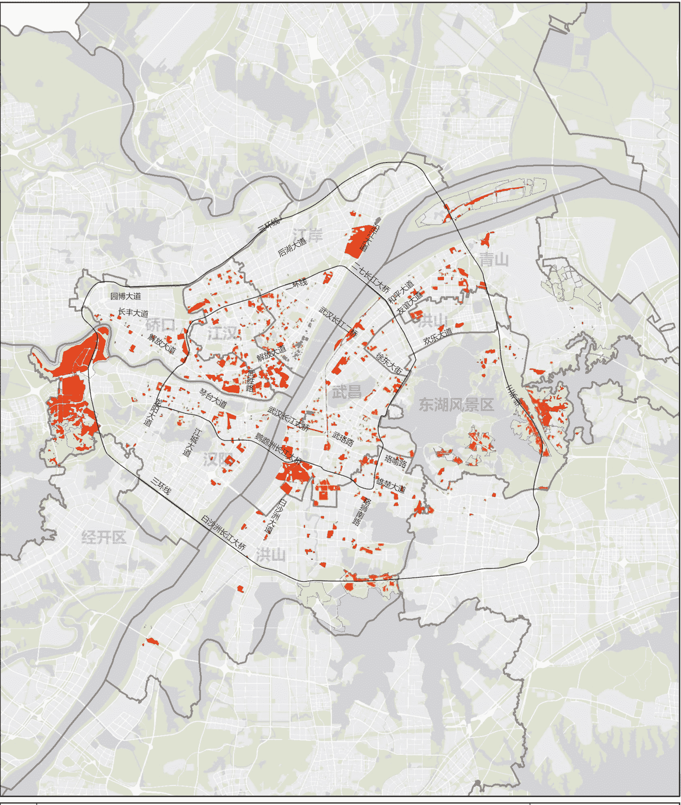

- **图例**
  - 保留更新
  - 改造更新
  - 拆除更新
  - 环线
  - 行政区

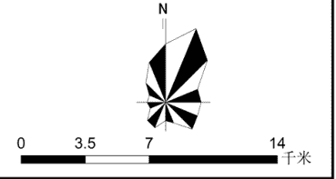

## 武汉市“十四五”城市更新项目列表（留—旧村）

单位：万平方米

| 序号 | 编号 | 名称 | 环线分布 | 改造总面积 | 剩余建筑面积 | “十四五”需完成建筑面积 | 更新方式 | 备注 |
|---|---|---:|---:|---:|---:|---|---|---|
| 一、青山区（共5项） |  |  |  |  |  |  |  |  |
|  |  | 城中村 |  |  |  |  |  |  |
| 1 | 1 | 五一村 | 三环线外 | 26.53 | 23.03 | 具体整治面积和亩区政府确定 | 保留更新 | —— |
| 2 | 2 | 红胜村 | 三环线外 | 27.82 | 27.82 |  | 保留更新 |  |
| 3 | 3 | 星火村 | 三环线外 | 15.19 | 15.19 |  | 保留更新 |  |
| 4 | 4 | 火官村 | 三环线外 | 35.55 | 23.78 |  | 保留更新 |  |
| 5 | 5 | 胜强村 | 三环线外 | 15.30 | 15.30 |  | 保留更新 |  |
|  |  | 合计 |  | 120.39 | 105.12 |  | —— |  |
| 二、洪山区（共3项） |  |  |  |  |  |  |  |  |
|  |  | 城中村 |  |  |  |  |  |  |
| 6 | 1 | 先建村 | 三环线内 | 43.59 | 43.59 | 43.59 | 保留更新 | —— |
| 7 | 2 | 李桥村 | 三环线外 | 53.92 | 53.92 | 具体整治面积和亩区政府确定 | 保留更新 |  |
| 8 | 3 | 汤逊湖村 | 三环线外 | 23.55 | 23.55 |  | 保留更新 |  |
|  |  | 合计 |  | 121.06 | 121.06 | 43.59 | —— |  |
| 三、东湖风景区（共5项） |  |  |  |  |  |  |  |  |
|  |  | 城中村 |  |  |  |  |  |  |
| 9 | 1 | 磨山村 | 三环线内 | 67.62 | 67.62 | 67.62 | 保留更新 | —— |
| 10 | 2 | 桥梁村 | 三环线内 | 50.63 | 50.30 | 50.30 | 保留更新 |  |
| 11 | 3 | 建强村 | 三环线内 | 24.51 | 24.51 | 24.51 | 保留更新 |  |
| 12 | 4 | 滨湖村 | 三环线内 | 23.48 | 23.48 | 23.48 | 保留更新 |  |
| 13 | 5 | 马鞍山苗圃 | 三环线外 | 30.47 | 29.87 | 29.87 | 保留更新 |  |
|  |  | 合计 |  | 196.71 | 195.78 | 195.78 | —— |  |
|  |  | 总计 |  | 438.16 | 421.96 | 239.37 | —— |  |

## 武汉市“十四五”城市更新项目列表（改—旧城旧厂类）

单位：个、户、万平方米

| 序号 | 编号 | 项目名称 | 土地面积（亩） | 户数-总户数 | 户数-剩余户数 | 建筑量-项目总建筑面积 | 建筑量-剩余建筑面积 | 是否作为21年计划项目 | 征收计划 | 储备主体（原包主单位） | 更新方式 | 备注 |
|---|---:|---:|---:|---:|---:|---:|---:|---|---|---|---|---|
|  |  | 一、江岸区 |  |  |  |  |  |  |  |  |  |  |
|  |  | 结转项目 |  |  |  |  |  |  |  |  |  |  |
| 1 | 1 | 一元路片 | 109 | 1500 | 600 | 12.86 | 5.33 | 是 | 岸政征（2020）2号 | 市土地整理储备中心 | 腾退改造方式为主 | 区域位于汉口历史风貌区，“留改拆”具体范围结合规划方案，在规划意见中予以明确；涉及文物、优秀历史保护建筑和紫线范围建筑，需按相关规定执行。 |
| 2 | 2 | 保元里片、少儿图书馆片、汉润里片、三德里片 | 149 | 3653 | 3653 | 24.04 | 24.04 | 是 | 武政办（2020）99号 | 市土地整理储备中心 | 腾退改造方式为主 | 区域位于汉口历史风貌区，“留改拆”（腾退、拆除）具体范围结合规划方案，在规划意见中予以明确；涉及文物、优秀历史保护建筑和紫线范围建筑，需按相关规定执行。 |
| 3 | 3 | 长春片区 | 91 | 4629 | 4629 | 16.3 | 16.3 | 否 | 武政办（2020）99号 | 市土地整理储备中心 | 腾退改造方式为主 | 区域位于汉口历史风貌区，“留改拆”（腾退、拆除）具体范围结合规划方案，在规划意见中予以明确；涉及文物、优秀历史保护建筑和紫线范围建筑，需按相关规定执行。 |
| 4 | 4 | 巴公房子片区（包括健康幼儿园、合作路体育场） | 72 | 628 | 628 | 8.75 | 8.75 | 是 | 武政办（2020）99号 | 市土地整理储备中心 | 腾退改造方式为主 | 区域位于汉口历史风貌区，“留改拆”（腾退、拆除）具体范围结合规划方案，在规划意见中予以明确；涉及文物、优秀历史保护建筑和紫线范围建筑，需按相关规定执行。 |
| 5 | 5 | 市永泰片 | 56.33 | 602 | 602 | 8.03 | 8.03 | 否 | 武政办（2020）99号 | 市土地整理储备中心 | 腾退改造方式为主 | 市永泰局（0.38万方）和市公安局（0.37万方）已纳入江岸区可腾退的国有房产名录；部分建筑已纳入市政府第二批优秀历史建筑保护名录；区域位于汉口历史风貌区，“留改拆”（腾退、拆除）具体范围结合规划方案，在规划意见中予以明确。 |
|  |  | 小计 | 477.33 | 11012 | 10112 | 69.98 | 62.45 |  |  |  | —— |  |
|  |  | 新增项目 |  |  |  |  |  |  |  |  |  |  |
| 6 | 6 | 义品里片 | 7.8 | 120 | 120 | 0.8 | 0.8 | 否 | 新增 | 市土地整理储备中心 | 腾退改造方式为主 | “留改拆”具体范围结合规划方案，在规划意见中予以明确；涉及文物、优秀历史保护建筑和紫线范围建筑，需按相关规定执行。 |
| 7 | 7 | 双合村片 | 6.20 | 138 | 138 | 1.12 | 1.12 | 是 | 2021年 | 市土地整理储备中心 | 腾退改造方式为主 | “留改拆”具体范围结合规划方案，在规划意见中予以明确；涉及文物、优秀历史保护建筑和紫线范围建筑，需按相关规定执行。 |
| 8 | 8 | 同兴里泰兴里、华汇物业、群艺馆片 | 23.42 | 350 | 350 | 4.51 | 4.51 | 是 | 2021年 | 市土地整理储备中心 | 腾退改造方式为主 | “留改拆”具体范围结合规划方案，在规划意见中予以明确；涉及文物、优秀历史保护建筑和紫线范围建筑，需按相关规定执行。 |
| 9 | 9 | 德林公寓 | 4.2 | 60 | 60 | 0.6 | 0.6 | 否 | 新增 | 市土地整理储备中心 | 腾退改造方式为主 | “留改拆”具体范围结合规划方案，在规划意见中予以明确；涉及文物、优秀历史保护建筑和紫线范围建筑，需按相关规定执行。 |

| 序号 | 编号 | 项目名称 | 土地面积（亩） | 总户数 | 剩余户数 | 项目总建筑面积 | 剩余建筑面积 | 是否作为21年计划项目 | 征收计划 | 储备主体（原包主体） | 更新方式 | 备注 |
|---|---|---|---:|---:|---:|---:|---:|---|---|---|---|---|
| 10 | 10 | 汇通小区片 | 13.05 | 332 | 332 | 2.3 | 2.3 | 否 | 新增 | 市土地整理储备中心 | 腾退改造方式为主 | “留改拆”具体范围结合规划方案，在规划意见中予以明确；涉及文物、优秀历史保护建筑和紫线范围建筑，需按相关规定执行。 |
| 11 | 11 | 福忠里片 | 18.60 | 560 | 560 | 1.86 | 1.86 | 否 | 新增 | 市土地整理储备中心 | 腾退改造方式为主 | “留改拆”具体范围结合规划方案，在规划意见中予以明确；涉及文物、优秀历史保护建筑和紫线范围建筑，需按相关规定执行。 |
| 12 | 12 | 二德里、退思里 | 18.89 | 262 | 262 | 1.77 | 1.77 | 否 | 新增 | 市土地整理储备中心 | 腾退改造方式为主 | “留改拆”具体范围结合规划方案，在规划意见中予以明确；涉及文物、优秀历史保护建筑和紫线范围建筑，需按相关规定执行。 |
| 13 | 13 | 崇善路片 | 15 | 203 | 203 | 1.9 | 1.9 | 否 | 新增 | 市土地整理储备中心 | 腾退改造方式为主 | “留改拆”具体范围结合规划方案，在规划意见中予以明确；涉及文物、优秀历史保护建筑和紫线范围建筑，需按相关规定执行。 |
| 14 | 14 | 黄石里片 | 3.75 | 71 | 71 | 0.35 | 0.35 | 否 | 新增 | 市土地整理储备中心 | 腾退改造方式为主 | “留改拆”具体范围结合规划方案，在规划意见中予以明确；涉及文物、优秀历史保护建筑和紫线范围建筑，需按相关规定执行。 |
| 15 | 15 | 永庆里片 | 5.55 | 111 | 111 | 0.61 | 0.61 | 否 | 新增 | 市土地整理储备中心 | 腾退改造方式为主 | “留改拆”具体范围结合规划方案，在规划意见中予以明确；涉及文物、优秀历史保护建筑和紫线范围建筑，需按相关规定执行。 |
| 16 | 16 | 汉景村1号 | 0.75 | 36 | 36 | 0.25 | 0.25 | 否 | 新增 | 市土地整理储备中心 | 腾退改造方式为主 | “留改拆”具体范围结合规划方案，在规划意见中予以明确；涉及文物、优秀历史保护建筑和紫线范围建筑，需按相关规定执行。 |
| 17 | 17 | 江汉村 | 22.11 | 600 | 600 | 2.69 | 2.69 | 否 | 新增 | 市土地整理储备中心 | 腾退改造方式为主 | “留改拆”具体范围结合规划方案，在规划意见中予以明确；涉及文物、优秀历史保护建筑和紫线范围建筑，需按相关规定执行。 |
| 18 | 18 | 上海村 | 23.08 | 800 | 800 | 3.99 | 3.99 | 否 | 新增 | 市土地整理储备中心 | 腾退改造方式为主 | “留改拆”具体范围结合规划方案，在规划意见中予以明确；涉及文物、优秀历史保护建筑和紫线范围建筑，需按相关规定执行。 |
| 19 | 19 | 武汉肉联厂 | 206.25 | 1 | 1 | 14.00 | 14.00 | 否 | 新增 | 江岸区土地整理储备中心 | 腾退改造方式为主 | “留改拆”具体范围结合规划方案，在规划意见中予以明确；涉及文物、优秀历史保护建筑和紫线范围建筑，需按相关规定执行。 |
| 20 | 20 | 中共中央旧址 | 4.06 | 1 | 1 | 0.35 | 0.35 | 否 | 新增 | 市土地整理储备中心 | 腾退改造方式为主 | “留改拆”具体范围结合规划方案，在规划意见中予以明确；涉及文物、优秀历史保护建筑和紫线范围建筑，需按相关规定执行。 |
| 21 | 21 | 首善堂 | 2.47 | 1 | 1 | 0.37 | 0.37 | 否 | 新增 | 市土地整理储备中心 | 腾退改造方式为主 | “留改拆”具体范围结合规划方案，在规划意见中予以明确；涉及文物、优秀历史保护建筑和紫线范围建筑，需按相关规定执行。 |
| 小计 |  |  | 375.17 | 3646 | 3646 | 37.46 | 37.46 |  |  | —— |  |  |
| 合计 |  |  | 852.50 | 14658 | 13758 | 107.44 | 99.91 |  |  | —— |  |  |

## 二、武昌区

| 序号 | 编号 | 项目名称 | 土地面积（亩） | 户数-总户数 | 户数-剩余户数 | 建筑量-项目总建筑面积 | 建筑量-剩余建筑面积 | 是否作为21年计划项目 | 征收计划 | 储备主体（原包主单位） | 更新方式 | 备注 |
|---|---:|---|---:|---:|---:|---:|---:|---|---|---|---|---|
| **新增项目** |  |  |  |  |  |  |  |  |  |  |  |  |
| 22 | 1 | 东城城片 | 112.07 | 1059 | 1059 | 8.00 | 8.00 | 否 | 武政办〔2020〕41号 | 市土地整理储备中心（武汉民族集团）、武昌区土地储备整理中心 | 腾退改造方式为主 | “留改拆”具体范围结合规划方案，在规划意见中予以明确；涉及文物、优秀历史保护建筑和紫线范围建筑，需按相关规定执行。 |
| 23 | 2 | 东城墩二期 | 16.56 | 220 | 220 | 1.30 | 1.30 | 否 | 武政办〔2020〕41号 | 武昌区土地储备整理中心 | 腾退改造方式为主 | “留改拆”具体范围结合规划方案，在规划意见中予以明确；涉及文物、优秀历史保护建筑和紫线范围建筑，需按相关规定执行。 |
| 24 | 3 | 广东商城片 | 24.11 | 100 | 100 | 4.45 | 4.45 | 是 | —— | 武昌土地储备整理中心 | 腾退改造方式为主 | “留改拆”具体范围结合规划方案，在规划意见中予以明确；涉及文物、优秀历史保护建筑和紫线范围建筑，需按相关规定执行。 |
| 25 | 4 | 得胜桥千年古轴片 | 149.70 | 2883 | 1020 | 25.40 | 9.30 | 是 | 2021年 | 武昌土地储备整理中心 | 腾退改造方式为主 | “留改拆”具体范围结合规划方案，在规划意见中予以明确；涉及文物、优秀历史保护建筑和紫线范围建筑，需按相关规定执行。 |
| 26 | 5 | 蛇山北坡小东门节点片 | 13.46 | 154 | 154 | 0.92 | 0.92 | 否 | 新增 | 武昌土地储备整理中心 | 腾退改造方式为主 | “留改拆”具体范围结合规划方案，在规划意见中予以明确；涉及文物、优秀历史保护建筑和紫线范围建筑，需按相关规定执行。 |
| **合计** |  |  | **315.90** | **4416** | **2553** | **40.07** | **23.97** |  |  | —— |  |  |
| **总计** |  |  | **2193.57** | **19074** | **16311** | **147.51** | **123.88** |  |  | —— |  |  |

# 武汉市“十四五”城市更新项目列表（拆旧城旧厂类）

| 序号 | 编号 | 项目名称 | 土地面积（亩） | 户数总户数 | 户数剩余户数 | 建筑面积项目总建筑面积 | 建筑面积剩余建筑面积 | 是否作为2021年计划项目 | 征收计划 | 储备主体（原包主体单位） | 更新方式 | 备注 |
|---|---|---|---:|---:|---:|---:|---:|---|---|---|---|---|
|  |  | 一、江岸区（共13项） |  |  |  |  |  |  |  |  |  |  |
|  |  | 结转项目 |  |  |  |  |  |  |  |  |  |  |
| 1 | 1 | 二七北路片（劳动新村片、为群团片、工农村片） | 281.00 | 5000 | 3475 | 50.00 | 22.18 | 否 | 劳动新村已作出征收决定（岸政征〔2019〕3号） | 市土地整理储备中心（武汉地铁集团） | 拆除 | 按规划意见确定的范围征收 |
| 2 | 2 | 西马片 | 147.00 | 3123 | 1690 | 24.87 | 13.46 | 是 | 岸政征〔2020〕1号 | 江岸区土地整理储备中心 | 拆除 | 已纳入2020年新增棚改专项债项目上报财政厅、省委政厅、省住建厅；具体征收范围结合项目实际情况，在规划意见中予以明确。 |
| 3 | 3 | 红桥村三眼桥片 | 46.44 | 903 | 267 | 8.75 | 2.59 | 是 | 岸政征〔2020〕3号 | 江岸区土地整理储备中心 | 拆除 | —— |
| 4 | 4 | 合作路地块 | 14.18 | 182 | 182 | 1.83 | 1.83 | 是 | 岸政征〔2020〕4号 | 江岸区土地整理储备中心 | 拆除 | 区域位于汉口历史风貌区，“留改拆”（腾退、拆除）具体范围结合规划方案，在规划意见中予以明确；涉及文物、优秀历史保护建筑和紫线范围建筑，需按相关规定执行。 |
| 5 | 5 | 洞庭小路地块 | 4.46 | 103 | 103 | 1.30 | 1.30 | 是 | 武政办〔2020〕99号 | 江岸区土地整理储备中心 | 拆除 | 区域位于汉口历史风貌区，“留改拆”（腾退、拆除）具体范围结合规划方案，在规划意见中予以明确；涉及文物、优秀历史保护建筑和紫线范围建筑，需按相关规定执行。 |
| 6 | 6 | 古德寺扩大片 | 5.83 | 84 | 84 | 0.84 | 0.84 | 否 | 武政办〔2020〕41号 | 江岸区土地整理储备中心 | 拆除 | —— |
| 7 | 7 | 汉口滨江国际商务区七期 | 1445.00 | 5988 | 5988 | 47.91 | 47.91 | 是 | 武政办〔2020〕41号 | 市土地整理储备中心 | 拆除 | —— |
| 8 | 8 | 上海陈华物流 | 193.00 | 30 | 30 | 3.25 | 3.25 | 否 | 武政办〔2020〕41号 | 江岸区土地整理储备中心、市土地整理储备中心 | 拆除 | —— |
| 9 | 9 | 惠济二路汉表厂扩大地块 | 3.70 | 96 | 96 | 0.66 | 0.66 | 是 | 武政办〔2020〕99号 | 江岸区土地整理储备中心 | 拆除 | —— |
|  |  | 小计 | 2140.61 | 15509 | 11915 | 139.41 | 94.02 |  |  | —— |  |  |
|  |  | 新增项目 |  |  |  |  |  |  |  |  |  |  |
| 10 | 10 | 湖边坊项目（JA-12） | 14.71 | 200 | 200 | 1.52 | 1.52 | 否 | 新增 | 江岸区土地整理储备中心 | 拆除 | —— |
| 11 | 11 | 六中A、B地块（JA-13） | 58.95 | 732 | 732 | 8.51 | 8.51 | 是 | 新增 | 江岸区土地整理储备中心 | 拆除 | —— |
| 12 | 12 | 牛奶厂扩大地块（JA-16） | 32.11 | 350 | 350 | 2.72 | 2.72 | 否 | 新增 | 江岸区土地整理储备中心 | 拆除 | —— |
| 13 | 13 | 江汉大学片（JA-18） | 13.61 | 490 | 490 | 3.45 | 3.45 | 否 | 新增 | 江岸区土地整理储备中心 | 拆除 | —— |
|  |  | 小计 | 119.38 | 1772 | 1772 | 16.21 | 16.21 |  |  | —— |  |  |
|  |  | 合计 | 2259.99 | 17281 | 13687 | 155.62 | 110.23 |  |  | —— |  |  |

## 二、江汉区（共46项）

| 序号 | 编号 | 项目名称 | 土地面积（亩） | 总户数 | 剩余户数 | 项目总建筑面积 | 剩余建筑面积 | 是否作为2021年计划项目 | 征收计划 | 储备主体（原包主单位） | 更新方式 | 备注 |
|---|---|---|---:|---:|---:|---:|---:|---|---|---|---|---|
|  |  | 结转项目 |  |  |  |  |  |  |  |  |  |  |
| 14 | 1 | 楚宝片 | 137.60 | 3206 | 181 | 25.61 | 1.04 | 是 | 江房征决（2016）第6号 | 市土地整理储备中心（武汉地产集团） | 拆除 | 涉及文物、优秀历史保护建筑和紫线范围建筑，须按相关规定执行；按照规划意见确定的范围征收；省级棚户区改造项目、国开行授信项目 |
| 15 | 2 | 高家台片 | 82.68 | 1177 | 1177 | 11.34 | 5.80 | 否 | 武政办（2020）41号 | 武汉鼎新创城置业有限公司 | 拆除 | 按规划意见确定的范围征收；国开行授信项目 |
| 16 | 3 | 汉正街和平里片（71号地块） | 66.00 | 1966 | 306 | 17.27 | 1.78 | 是 | 江房征决（2019）第3号 | 市土地整理储备中心（武汉汉正街控股集团有限公司） | 拆除 | 按规划意见确定的范围征收；国开行授信项目 |
| 17 | 4 | 汉正街民族街片（65、66号地块） | 61.86 | 1110 | 172 | 10.73 | 0.58 | 是 | 江房征决（2019）第2号 | 市土地整理储备中心（武汉汉正街控股集团有限公司） | 拆除 | 涉及文物、优秀历史保护建筑和紫线范围建筑，须按相关规定执行；国开行授信项目 |
| 18 | 5 | 汉正天街63、64、67号地块 | 74.74 | 1900 | 157 | 21.35 | 2.19 | 是 | 江房征决（2019）第1号 | 市土地整理储备中心（武汉汉正街控股集团有限公司） | 拆除 | 按规划意见确定的范围征收；国开行授信项目 |
| 19 | 6 | 磨子桥片A地块（民众乐园片） | 38.00 | 1841 | 1289 | 14.73 | 9.03 | 是 | 武政办（2020）41号 | 武汉市土地储备中心（武汉旅游体育集团） | 拆除 | 涉及文物、优秀历史保护建筑和紫线范围建筑，须按相关规定执行；按规划意见确定的范围征收 |
| 20 | 7 | 磨子桥片B地块 | 71 | 1901 | 1331 | 15.12 | 9.42 | 是 | 武政办（2020）41号 | 市土地整理储备中心（武汉地铁集团） | 拆除 | 涉及文物、优秀历史保护建筑和紫线范围建筑，须按相关规定执行；按规划意见确定的范围征收 |
| 21 | 8 | 磨子桥片C地块 | 96 | 2359 | 1651 | 18.87 | 13.17 | 是 | 武政办（2020）41号 | 市土地整理储备中心（武汉地铁集团） | 拆除 | 涉及文物、优秀历史保护建筑和紫线范围建筑，须按相关规定执行；按规划意见确定的范围征收 |
| 22 | 9 | 磨子桥片D地块 | 64 | 2031 | 1422 | 16.25 | 10.55 | 是 | 武政办（2020）41号 | 市土地整理储备中心（武汉地铁集团） | 拆除 | 涉及文物、优秀历史保护建筑和紫线范围建筑，须按相关规定执行；按规划意见确定的范围征收 |
| 23 | 10 | 新华西路四期 | 164 | 1982 | 1657 | 54 | 36.18 | 是 | 武政办（2020）41号 | 江汉区土地整理储备中心 | 拆除 | —— |
| 24 | 11 | 绍兴片 | 47.30 | 1354 | 787 | 8.39 | 2.29 | 是 | 武政办（2020）99号 | 武汉市城市更新中心（更名公司） | 拆除 | —— |
| 25 | 12 | 前进一路三江航天招待所片 | 22.00 | 500 | 457 | 3.07 | 1.21 | 是 | 武政办（2020）41号 | 市土地整理储备中心（武汉汉正街控股集团有限公司） | 拆除 | 省级棚户区改造项目 |
| 26 | 13 | 汉正天街52、53、56、57号地块 | 44.00 | 2279 | 2279 | 19.37 | 19.37 | 否 | 武政办（2020）41号 | 市土地整理储备中心（武汉汉正街控股集团有限公司） | 拆除 | 省级棚户区改造项目 |
| 27 | 14 | 汉正天街63、64、67号地块拆片（原68/69片） | 44.85 | 394 | 394 | 3.35 | 3.35 | 否 | 武政办〔2020〕41号 | 市土地整理储备中心（武汉汉正街控股集团有限公司） | 拆除 | 省级棚户区改造项目，按规划意见确定的范围征收 |
| 28 | 15 | 新华电影院片 | 11.40 | 163 | 163 | 1.54 | 1.54 | 否 | 武政办〔2020〕41号 | 市土地整理储备中心（武汉汉正街控股集团有限公司） | 拆除 | 省级棚户区改造项目 |
| 29 | 16 | 电影制片厂片二期 | 89.75 | 830 | 830 | 15.72 | 15.72 | 是 | 武政办〔2020〕41号 | 市土地整理储备中心（武汉地产集团） | 拆除 | 省级棚户区改造项目，国开行授信项目 |
| 30 | 17 | 常腾街东片 | 96.00 | 111 | 111 | 6.52 | 6.52 | 是 | 武政办〔2020〕41号 | 江汉区土地整理储备中心、市土地整理储备中心（武汉地铁集团） | 拆除 | —— |
| 31 | 18 | 武商路片二期 | 6.90 | 100 | 100 | 0.94 | 0.94 | 是 | 武政办〔2020〕41号 | 江汉区土地整理储备中心 | 拆除 | —— |
| 32 | 19 | 横堤社区片 | 21.68 | 358 | 358 | 3.22 | 3.22 | 否 | 武政办〔2020〕41号 | 武汉东立置业有限公司 | 拆除 | —— |
| 33 | 20 | 市五交电子公司宿舍片 | 6.00 | 65 | 65 | 0.48 | 0.48 | 是 | 武政办〔2020〕41号 | 江汉区土地整理储备中心 | 拆除 | —— |
| 34 | 21 | 农机公司 | 24.36 | 2 | 2 | 2.00 | 2.00 | 是 | 武政办〔2020〕41号 | 江汉区土地整理储备中心 | 拆除 | —— |
| 35 | 22 | 航空小路扩大 | 11.28 | 260 | 260 | 3.06 | 3.06 | 是 | 武政办〔2020〕41号 | 江汉区土地整理储备中心 | 拆除 | —— |
|  |  | 小计 | 1281.40 | 25889 | 15149 | 272.93 | 149.44 |  |  | —— |  |  |
|  |  | **新增项目** |  |  |  |  |  |  |  |  |  |  |
| 36 | 23 | 利大二期（JH-01） | 67.01 | 825 | 825 | 6.19 | 6.19 | 否 | 新增 | 利大房地产开发建设（武汉）有限公司 | 拆除 | —— |
| 37 | 24 | 任东片（JH-03） | 24.89 | 615 | 615 | 4.63 | 4.63 | 否 | 新增 | —— | 拆除 | —— |
| 38 | 25 | 天后社区（JH-06） | 41.78 | 813 | 813 | 5.69 | 5.69 | 否 | 新增 | 市土地整理储备中心（武汉汉正街控股集团有限公司） | 拆除 | —— |
| 39 | 26 | 八元里（JH-08） | 34.00 | 574 | 574 | 4.02 | 4.02 | 否 | 新增 | 江汉区土地整理储备中心 | 拆除 | —— |
| 40 | 27 | 福建街—六渡桥（JH-09） | 124.35 | 2500 | 2500 | 17.50 | 17.50 | 否 | 新增 | 市土地整理储备中心（武汉汉正街控股集团有限公司） | 拆除 | —— |
| 41 | 28 | 水利路中学（JH-10） | 9.07 | 174 | 174 | 1.22 | 1.22 | 否 | 新增 | 武汉市土地储备中心（中央商务区建设分中心） | 拆除 | —— |
| 42 | 29 | 水利路东片（JH-10） | 32.61 | 570 | 570 | 3.99 | 3.99 | 否 | 新增 | 武汉市土地储备中心（中央商务区建设分中心） | 拆除 | —— |
| 43 | 30 | 中央商务区复兴村片一期（JH-12） | 72 | 1407 | 1407 | 9.85 | 9.85 | 是 | 2021年 | 武汉市城市更新中心（更新公司） | 拆除 | —— |
| 44 | 31 | 中央商务区复兴村片二期（JH-12） | 91 | 2226 | 2226 | 15.58 | 15.58 | 是 | 2021年 | 武汉市城市更新中心（更新公司） | 拆除 | —— |
| 45 | 32 | 省地矿局片（JH-15） | 73.00 | 911 | 911 | 7.63 | 7.63 | 否 | 新增 | 市土地整理储备中心（武汉地产集团）、市土地整理储备中心（武汉地铁集团） | 拆除 | —— |
| 46 | 33 | 浅水湾建材市场（JH-21） | 22.26 | 210 | 210 | 1.47 | 1.47 | 否 | 新增 | 江汉区土地整理储备中心 | 拆除 | —— |
| 47 | 34 | 衡器厂片 | 46.00 | 92 | 92 | 4.79 | 4.79 | 是 | 2021年 | 市土地整理储备中心（武汉地产集团） | 拆除 | —— |
| 48 | 35 | 常青水暖建材市场片（区间临近地块15） | 55.50 | 1 | 1 | 3.94 | 3.94 | 是 | 2021年 | 江汉区土地储备中心 | 拆除 | —— |

| 序号 | 编号 | 项目名称 | 土地面积（亩） | 户数-总户数 | 户数-剩余户数 | 建筑面积-项目总建筑面积 | 建筑面积-剩余建筑面积 | 是否作为21年计划项目 | 征收计划 | 备案主体（原包主单位） | 更新方式 | 备注 |
|---|---|---|---:|---:|---:|---:|---:|---|---|---|---|---|
| 49 | 36 | 七十一中扩大片 | 2.00 | 35 | 35 | 0.26 | 0.26 | 是 | 2021年 | 江汉区土地整理储备中心 | 拆除 | —— |
| 50 | 37 | 永康里 | 54.00 | 424 | 424 | 3.18 | 3.18 | 是 | 2021年 | 市土地整理储备中心（武汉旅游体育集团） | 拆除、腾退 | “留改拆”具体范围结合规划方案，在规划意见中予以明确；涉及文物、优秀历史保护建筑和紫线范围建筑，需按相关规定执行 |
| 51 | 38 | 青年路372号片 | 44.00 | 358 | 358 | 4.73 | 4.73 | 是 | 2021年 | 江汉区土地整理储备中心、市土地整理储备中心（武汉地产集团） | 拆除 | —— |
| 52 | 39 | 联保里 | 47.40 | 1146 | 1146 | 8.60 | 8.60 | 否 | 新增 | 市土地整理储备中心（武汉旅游体育集团） | 拆除、腾退 | “留改拆”具体范围结合规划方案，在规划意见中予以明确；涉及文物、优秀历史保护建筑和紫线范围建筑，需按相关规定执行 |
| 53 | 40 | 贵中里 | 51.80 | 1093 | 1093 | 8.20 | 8.20 | 否 | 新增 | 市土地整理储备中心（武汉旅游体育集团） | 拆除、腾退 | “留改拆”具体范围结合规划方案，在规划意见中予以明确；涉及文物、优秀历史保护建筑和紫线范围建筑，需按相关规定执行 |
| 54 | 41 | 兴业路建材市场扩大片 | 25.22 | 143 | 143 | 1.15 | 1.15 | 否 | 新增 | 江汉区土地整理储备中心 | 拆除 | —— |
| 55 | 42 | 中联药业片 | 49.95 | 1 | 1 | 2.38 | 2.38 | 否 | 新增 | 江汉区土地整理储备中心 | 拆除 | —— |
| 56 | 43 | 武汉电池片 | 44.85 | 675 | 675 | 6.77 | 6.77 | 否 | 新增 | 市土地整理储备中心（武汉电池集团） | 拆除 | —— |
| 57 | 44 | 美能达地块 | 28.00 | 1 | 1 | 0.74 | 0.74 | 否 | 新增 | 江汉区土地整理储备中心 | 拆除 | —— |
| 58 | 45 | 武建机施片 | 11.20 | 194 | 194 | 1.36 | 1.36 | 否 | 新增 | 市土地整理储备中心（中建商务建设分中心） | 拆除 | —— |
| 59 | 46 | 友谊路东片 | 89.00 | 1827 | 1827 | 12.17 | 12.17 | 否 | 新增 | 市土地整理储备中心（武汉汉正街控股集团有限公司） | 拆除 | —— |
| 小计 |  |  | 1140.89 | 16816 | 16816 | 136.04 | 136.04 |  |  |  |  | —— |
| 合计 |  |  | 2422.29 | 42705 | 31965 | 408.97 | 285.48 |  |  |  |  | —— |

## 三、硚口区（共35项）

### 结转项目

| 序号 | 编号 | 项目名称 | 土地面积（亩） | 总户数 | 剩余户数 | 项目总建筑面积 | 剩余建筑面积 | 是否作为2021年计划项目 | 征收计划 | 备案主体（原包主单位） | 更新方式 | 备注 |
|---|---:|---|---:|---:|---:|---:|---:|---|---|---|---|---|
| 60 | 1 | 65中北片 | 116.00 | 1631 | 107 | 19.90 | 1.27 | 是 | 硚政征〔2015〕2号 | 市土地整理储备中心（武汉地产集团） | 拆除 | 国开行授信项目 |
| 61 | 2 | 联谊路片、丰帆路西片 | 215.00 | 1800 | 789 | 18.35 | 8.35 | 是 | 硚政征〔2018〕3号 | 硚口区土地整理储备中心、市土地整理储备中心（武汉地铁集团） | 拆除 | —— |
| 62 | 3 | 古四社区及扩大片（轻轨公客厂片） | 172.00 | 948 | 947 | 11.41 | 6.83 | 是 | 硚政征〔2018〕8号 | 硚口区土地储备中心、武汉市城市更新中心（更新公司） | 拆除 | —— |
| 63 | 4 | 宗关枢纽西片B | 55.00 | 748 | 150 | 6.59 | 1.39 | 是 | 硚政征〔2020〕2号 | 市土地整理储备中心（武汉地铁集团） | 拆除 | 省级棚户区改造项目，按规划意见确定的范围征收 |
| 64 | 5 | 宗关枢纽西片A地块 | 98.00 | 1755 | 179 | 14.92 | 2.97 | 是 | 硚政征〔2020〕1号 | 市土地整理储备中心（市城投公司） | 拆除 | 省棚改项目，已纳入2020年新增棚改专项债项目上报省财政厅、省住建厅；具体征收范围结合项目实际情况，在规划意见中予以明确 |
| 65 | 6 | 汉正街东片扩大片 | 21.00 | 27 | 26 | 5.80 | 1.56 | 是 | 武政办〔2020〕41号 | 硚口区土地整理储备中心 | 拆除 | —— |
| 66 | 7 | 汉水四村片 | 84.00 | 354 | 354 | 7.00 | 7.00 | 是 | 硚政征〔2020〕8号 | 硚口区土地整理储备中心、市土地整理储备中心（武汉地铁集团） | 拆除 | 省级棚户区改造项目 |
| 67 | 8 | 发展社区片 | 61.00 | 724 | 724 | 7.50 | 7.50 | 是 | 硚政征〔2020〕8号 | 市土地整理储备中心（武汉地产集团） | 拆除 | 该项目涉及地铁12号线拆迁，年内需要启动拆迁工作。具体征收范围结合项目实际情况，在规划意见中明确。已发棚改专项工作。 |
| 68 | 9 | 六角南巷片 | 147.00 | 1525 | 1525 | 24.45 | 24.45 | 是 | 六角南巷片一期已作出征收决定（硚政征〔2017〕10号） | 硚口区土地整理储备中心 | 拆除 | —— |
| 69 | 10 | 宝善片 | 151.40 | 2600 | 2600 | 24.80 | 24.80 | 是 | 武政办〔2020〕41号 | 硚口区土地整理储备中心 | 拆除 | 省级棚户区改造项目，按规划意见确定的范围征收 |
| 70 | 11 | 红燕片 | 90.00 | 1800 | 1800 | 16.00 | 16.00 | 是 | 武政办〔2020〕41号 | 硚口区土地整理储备中心 | 拆除 | 省级棚户区改造项目，按规划意见确定的范围征收 |
| 71 | 12 | 新安九如片 | 138.00 | 3200 | 3200 | 21.00 | 21.00 | 否 | 武政办〔2020〕41号 | 硚口区土地整理储备中心 | 拆除 | 省级棚户区改造项目，涉及文物、优秀历史保护建筑和紫线范围建筑，须按相关规定执行；按规划意见确定的范围征收 |
| 72 | 13 | 电缆厂宿舍片 | 10.00 | 246 | 246 | 1.41 | 1.41 | 是 | 武政办〔2020〕41号 | 硚口区土地整理储备中心 | 拆除 | —— |
| 73 | 14 | 石码正巷片 | 45.00 | 939 | 939 | 7.50 | 7.50 | 是 | 武政办〔2020〕41号 | 硚口区土地整理储备中心 | 拆除 | —— |
| 74 | 15 | 竹牌片 | 18.00 | 220 | 220 | 3.30 | 3.30 | 是 | 武政办〔2020〕41号 | 硚口区土地整理储备中心 | 拆除 | —— |
| 75 | 16 | 常码头片征收（中央商务区1216、1207地块） | 78.79 | 393 | 393 | 9.80 | 9.80 | 否 | 武政办〔2020〕41号 | 市土地整理储备中心（武汉中央商务区投资控股集团有限公司） | 拆除 | —— |
| 76 | 17 | 汉西东路片（武汉中央商务区投资控股集团有限公司1902、1904、1911地块） | 28.29 | 157 | 157 | 2.59 | 2.59 | 否 | 武政办〔2020〕41号 | 市土地整理储备中心（武汉中央商务区投资控股集团有限公司） | 拆除 | 按规划意见确定的范围征收 |
| 77 | 18 | 云彩小区片 | 65.00 | 200 | 200 | 3.50 | 3.50 | 是 | 武政办〔2020〕41号 | 硚口区土地整理储备中心 | 拆除 | —— |
| 78 | 19 | 跃进扩大片 | 7.00 | 258 | 258 | 1.41 | 1.41 | 是 | 武政办〔2020〕41号 | 市土地整理储备中心（武汉汉正街控股集团有限公司） | 拆除 | —— |
| 79 | 20 | 皮子街片 | 442.00 | 5000 | 5000 | 52.00 | 52.00 | 是 | 武政办〔2020〕41号 | 硚口区土地整理储备中心、武汉市城市更新中心（更新公司） | 拆除 | 按规划意见确定的范围征收；省级棚户区改造项目 |
| 80 | 21 | 汉西三路片 | 212.00 | 2500 | 2500 | 18.00 | 18.00 | 否 | 武政办〔2020〕41号 | 硚口区土地整理储备中心 | 拆除 | 省级棚户区改造项目 |
| 81 | 22 | 硚口路片 | 50.00 | 800 | 800 | 5.50 | 5.50 | 否 | 武政办〔2020〕41号 | 硚口区土地整理储备中心 | 拆除 | 省级棚户区改造项目 |
| 82 | 23 | 军印农场片 | 101.00 | 1000 | 1000 | 10.00 | 10.00 | 否 | 武政办〔2020〕41号 | 硚口区土地整理储备中心（武汉硚口城市更新集团） | 拆除 | —— |
| 83 | 24 | 汉西铁路建材市场片 | 320.00 | 200 | 200 | 15.00 | 15.00 | 是 | 武政办〔2020〕41号 | 硚口区土地整理储备中心 | 拆除 | —— |
| 84 | 25 | 江景时代片 | 67.00 | 1200 | 1200 | 10.00 | 10.00 | 是 | 武政办〔2020〕99号 | 硚口区土地整理储备中心 | 拆除 | 具体征收范围结合项目实际情况，在规划意见中予以明确 |
| 小计 |  |  | 2792.48 | 30225 | 25514 | 317.73 | 263.13 |  |  | —— |  |  |

### 新增项目

| 序号 | 编号 | 项目名称 | 土地面积（亩） | 总户数 | 剩余户数 | 项目总建筑面积 | 剩余建筑面积 | 是否作为2021年计划项目 | 征收计划 | 备案主体（原包主单位） | 更新方式 | 备注 |
|---|---:|---|---:|---:|---:|---:|---:|---|---|---|---|---|
| 85 | 26 | 利济电子市场片（QK-02） | 68.61 | 300 | 300 | 7.64 | 7.64 | 否 | 新增 | 硚口区土地整理储备中心 | 拆除 | —— |
| 86 | 27 | 营南片（QK-04） | 206.82 | 2800 | 2800 | 28.68 | 28.68 | 否 | 新增 | 硚口区土地整理储备中心 | 拆除 | —— |
| 87 | 28 | 建材城片（QK-14） | 31.29 | 2 | 2 | 1.97 | 1.97 | 否 | 新增 | 硚口区土地整理储备中心 | 拆除 | —— |
| 88 | 29 | 汉宜路扩大片 | 3.50 | 1 | 1 | 0.70 | 0.70 | 是 | 2021年 | 硚口区土地整理储备中心 | 拆除 | —— |
| 89 | 30 | 地大扩大片 | 7.00 | 1 | 1 | 1.05 | 1.05 | 是 | 2021年 | 硚口区土地整理储备中心 | 拆除 | —— |
| 90 | 31 | 地大校内片 | 21.00 | 367 | 367 | 3.20 | 3.20 | 是 | 2021年 | 硚口区土地整理储备中心 | 拆除 | —— |
| 91 | 32 | 古田社区片 | 157.00 | 1800 | 1800 | 12.00 | 12.00 | 否 | 新增 | 硚口区土地整理储备中心 | 拆除 | —— |
| 92 | 33 | 崇仁片 | 638.00 | 8000 | 8000 | 80.00 | 80.00 | 否 | 新增 | 硚口区土地整理储备中心 | 拆除 | —— |
| 93 | 34 | 辛家地小学片 | 11.00 | 1 | 1 | 0.40 | 0.40 | 否 | 新增 | 硚口区土地整理储备中心 | 拆除 | —— |
| 94 | 35 | 利北社区片 | 58.00 | 1383 | 1383 | 9.00 | 9.00 | 是 | 2021年 | 硚口区土地储备中心、武汉市城市更新中心（更新公司） | 拆除 | —— |
| 小计 |  |  | 1202.23 | 14655 | 14655 | 144.64 | 144.64 |  |  | —— |  |  |
| 合计 |  |  | 3994.71 | 44880 | 40169 | 462.37 | 407.77 |  |  | —— |  |  |

## 四、汉阳区（共40项）

### 结转项目

| 序号 | 编号 | 项目名称 | 土地面积（亩） | 总户数 | 剩余户数 | 项目总建筑面积 | 剩余建筑面积 | 是否作为2021年计划项目 | 征收计划 | 备案主体（原包主单位） | 更新方式 | 备注 |
|---|---:|---|---:|---:|---:|---:|---:|---|---|---|---|---|
| 95 | 1 | 十里铺小学扩大片 | 16.35 | 432 | 430 | 4.50 | 0.09 | 是 | 阳政征决字〔2019〕第8号 | 汉阳区土地整理储备中心 | 拆除 | 按规划意见确定的范围征收 |
| 96 | 2 | 新港长江城二期（B地块） | 199.50 | 670 | 614 | 19.88 | 18.35 | 否 | 武政办〔2020〕41号 | 市土地整理储备中心（武汉新港建设投资开发集团有限公司） | 拆除 | 按规划意见确定的范围征收 |
| 97 | 3 | 马沧湖建材市场 | 44.25 | 100 | 50 | 4.32 | 1.58 | 是 | 阳政征决字〔2020〕第13号 | 汉阳区土地整理储备中心 | 拆除 | —— |
| 98 | 4 | 汉阳渔场片 | 31.40 | 146 | 32 | 1.15 | 0.02 | 是 | 阳政征决字〔2018〕第11号 | 汉阳区土地整理储备中心 | 拆除 | 省级棚户区改造项目 |
| 99 | 5 | 磨山村城中村B地块扩大用地 | 6.00 | 100 | 97 | 1.00 | 0.02 | 是 | 阳政征决字〔2019〕第3号 | —— | 拆除 | —— |
| 100 | 6 | 农垦局地块 | 16.82 | 110 | 5 | 0.84 | 0.02 | 是 | 阳政征决字〔2020〕第7号 | 汉阳区土地整理储备中心 | 拆除 | 省级棚户区改造项目 |
| 101 | 7 | 农科所地块 | 7.86 | 70 | 5 | 0.60 | 0.01 | 是 | 阳政征决字〔2020〕第8号 | 汉阳区土地整理储备中心 | 拆除 | 省级棚户区改造项目 |
| 102 | 8 | 车站片 | 143.00 | 1638 | 180 | 13.00 | 0.22 | 是 | 阳政征决字〔2020〕第4号 | 市土地整理储备中心（武汉地铁集团） | 拆除 | 省级棚户区改造项目 |
| 103 | 9 | 五祥里社区片（武汉商业学校及扩大片）A | 1.00 | 21 | 10 | 0.20 | 0.03 | 是 | 阳政征决字〔2020〕第2号 | 汉阳区土地整理储备中心、武汉市城市更新中心（更新公司） | 拆除 | 省级棚户区改造项目 |
| 104 | 10 | 五祥里社区片（武汉商业学校及扩大片）B | 134.00 | 1023 | 1023 | 13.50 | 13.50 | 是 | 武政办〔2020〕41号 | 汉阳区土地整理储备中心、武汉市城市更新中心（更新公司） | 拆除 | 省级棚户区改造项目 |
| 105 | 11 | 倒口南村片 | 73.94 | 900 | 123 | 6.50 | 0.13 | 是 | 阳政征决字〔2020〕第3号 | 市土地整理储备中心（武汉地铁集团） | 拆除 | —— |
| 106 | 12 | 大归元片区群建路小学片（大归元片后汉街—6片） | 44.90 | 846 | 166 | 6.90 | 0.66 | 是 | 阳政征决字〔2020〕第9号 | 汉阳区土地整理储备中心 | 拆除 | 省棚改项目，已纳入2020年新增棚改专项债项目上报省财政厅、省发改委、省住建厅 |
| 107 | 13 | 二十三中扩大片 | 23.00 | 150 | 22 | 0.94 | 0.09 | 是 | 阳政征决字〔2020〕第11号 | 汉阳区土地整理储备中心 | 拆除 | 省级棚户区改造项目 |
| 108 | 14 | 复印机厂片 | 38.00 | 423 | 33 | 3.37 | 0.26 | 是 | 阳政征决字〔2020〕第12号 | 汉阳区土地整理储备中心 | 拆除 | 省棚改项目、国开行授信项目，已纳入2020年新增棚改专项债项目上报省财政厅、省发改委、省住建厅 |
| 109 | 15 | 渔金属材料厂片 | 106.00 | 20 | 20 | 1.8 | 1.8 | 否 | 武政办〔2020〕41号 | 汉阳区土地储备中心、市土地整理储备中心（武汉地铁集团） | 拆除 | —— |
| 110 | 16 | 归元西B片 | 60.00 | 260 | 260 | 5.20 | 5.20 | 是 | 武政办〔2020〕41号 | 武汉市城市更新中心（更新公司） | 拆除 | 按规划意见确定的范围征收 |
| 111 | 17 | 宜昌汉办地块 | 14.00 | 70 | 70 | 1.10 | 1.10 | 否 | 武政办〔2020〕41号 | 汉阳区土地整理储备中心 | 拆除 | —— |
| 112 | 18 | 翠微福苑西地块 | 20.00 | 1 | 1 | 0.30 | 0.30 | 否 | 武政办〔2020〕41号 | 汉阳区土地整理储备中心 | 拆除 | —— |
| 113 | 19 | 瓷厂片（12号轨道线控制线外地块9） | 20.10 | 298 | 298 | 2.98 | 2.98 | 否 | 武政办〔2020〕41号 | 市土地整理储备中心（武汉地铁集团） | 拆除 | 省级棚户区改造项目 |
| 114 | 20 | 3510地块（12号轨道线区间穿越地块2） | 82.80 | 900 | 900 | 8.21 | 8.21 | 否 | 武政办〔2020〕41号 | 市土地整理储备中心（武汉地铁集团） | 拆除 | —— |
| 小计 |  |  | 1082.92 | 8178 | 4339 | 96.29 | 54.57 |  |  | —— |  |  |

### 新增项目

| 序号 | 编号 | 项目名称 | 土地面积（亩） | 总户数 | 剩余户数 | 项目总建筑面积 | 剩余建筑面积 | 是否作为2021年计划项目 | 征收计划 | 备案主体（原包主单位） | 更新方式 | 备注 |
|---|---:|---|---:|---:|---:|---:|---:|---|---|---|---|---|
| 115 | 21 | HY-01（钢丝绳厂地块） | 25.89 | 200 | 200 | 1.57 | 1.57 | 否 | 新增 | 汉阳区土地整理储备中心 | 拆除 | —— |
| 116 | 22 | HY-02（神召公司地块及扩大片） | 32.56 | 700 | 700 | 6.73 | 6.73 | 否 | 新增 | 汉阳区土地整理储备中心 | 拆除 | —— |

| 序号 | 编号 | 项目名称 | 土地面积（亩） | 总户数 | 剩余户数 | 项目总建筑面积 | 剩余建筑面积 | 是否作为2021年计划项目 | 征收计划 | 储备主体（原登记单位） | 更新方式 | 备注 |
|---:|---:|---|---:|---:|---:|---:|---:|---|---|---|---|---|
| 117 | 23 | HY-04（园林局地块） | 13.50 | 70 | 70 | 0.93 | 0.93 | 否 | 新增 | 汉阳区土地整理储备中心 | 拆除 | —— |
| 118 | 24 | HY-08丽湖山庄片（原财贸局地块） | 25.22 | 400 | 400 | 3.10 | 3.10 | 是 | 2021 | 汉阳区土地整理储备中心 | 拆除 | —— |
| 119 | 25 | HY-10（东鑫酒店及扩大片） | 42.70 | 200 | 200 | 5.72 | 5.72 | 否 | 新增 | 汉阳区土地整理储备中心 | 拆除 | —— |
| 120 | 26 | HY-11（肖家湾地块） | 13.22 | 150 | 150 | 1.02 | 1.02 | 否 | 新增 | 汉阳区土地整理储备中心 | 拆除 | —— |
| 121 | 27 | HY-18（磨子山地块） | 59.40 | 300 | 300 | 5.38 | 5.38 | 否 | 新增 | 汉阳区土地整理储备中心 | 拆除 | —— |
| 122 | 28 | HY-20（桥梁学校地块） | 229.35 | 1000 | 1000 | 15.66 | 15.66 | 是 | 2021 | 汉阳区土地整理储备中心 | 拆除 | —— |
| 123 | 29 | HY-25（大桥局A地块） | 15.38 | 97 | 97 | 1.12 | 1.12 | 是 | 2021 | 汉阳区土地整理储备中心 | 拆除 | —— |
| 124 | 30 | HY-26（大桥局B地块） | 29.02 | 100 | 100 | 1.14 | 1.14 | 否 | 新增 | 汉阳区土地整理储备中心 | 拆除 | —— |
| 125 | 31 | HY-27（财校南地块B片） | 33.67 | 80 | 80 | 1.63 | 1.63 | 否 | 新增 | 汉阳区土地整理储备中心 | 拆除 | —— |
| 126 | 32 | HY-28（财校北地块） | 14.91 | 60 | 60 | 0.75 | 0.75 | 否 | 新增 | 汉阳区土地整理储备中心 | 拆除 | —— |
| 127 | 33 | 九鼎汽贸 | 15 | 1 | 1 | 4.80 | 4.80 | 是 | 2021年 | 汉阳区土地整理储备中心 | 拆除 | —— |
| 128 | 34 | 五檀里社区片 | 55 | 730 | 730 | 7.50 | 7.50 | 是 | 2021年 | 汉阳区土地整理储备中心 | 拆除 | —— |
| 129 | 35 | 江堤中路片（交通职业技术学院片） | 71.85 | 150 | 150 | 4.93 | 4.93 | 是 | 2021年 | 汉阳区土地储备中心、武汉市城市更新中心（更改前公司） | 拆除 | —— |
| 130 | 36 | 知音东村交苑院片 | 165 | 1837 | 1837 | 11.00 | 11.00 | 是 | 2021年 | 汉阳区土地整理储备中心 | 拆除 | —— |
| 131 | 37 | 建港西片 | 157 | 2000 | 2000 | 18.00 | 18.00 | 否 | 新增 | 汉阳区土地整理储备中心 | 拆除 | —— |
| 132 | 38 | 工贸纸箱厂 | 11.55 | 42 | 42 | 0.66 | 0.66 | 否 | 新增 | 汉阳区土地整理储备中心 | 拆除 | —— |
| 133 | 39 | 人保大楼地块 | 13.4 | 31 | 31 | 1.80 | 1.80 | 否 | 新增 | 汉阳区土地整理储备中心 | 拆除 | —— |
| 134 | 40 | 汉阳工商局地块 | 8.96 | 90 | 90 | 1.79 | 1.79 | 否 | 新增 | 汉阳区土地整理储备中心 | 拆除 | —— |
| **小计** |  |  | **1032.58** | **8238** | **8238** | **95.22** | **95.22** |  |  | —— |  |  |
| **合计** |  |  | **2115.50** | **16416** | **12577** | **191.51** | **149.79** |  |  | —— |  |  |

## 五、武昌区（共38项）

### 结转项目

| 序号 | 编号 | 项目名称 | 土地面积（亩） | 总户数 | 剩余户数 | 项目总建筑面积 | 剩余建筑面积 | 是否作为2021年计划项目 | 征收计划 | 储备主体（原登记单位） | 更新方式 | 备注 |
|---:|---:|---|---:|---:|---:|---:|---:|---|---|---|---|---|
| 135 | 1 | 明伦街棚改 | 283.88 | 3178 | 994 | 28.02 | 0.01 | 是 | 武昌征决字[2019]4号 | 武昌土地整理储备中心 | 拆除 | 按规划意见确定的范围征收 |
| 136 | 2 | 武船二分厂宿舍区 | 65.25 | 1080 | 26 | 9.66 | 3.16 | 是 | 武昌征决字[2020]41号 | 武昌土地整理储备中心 | 拆除 | —— |
| 137 | 3 | 武成包1、2、5号地块 | 195.50 | 2137 | 2134 | 15.47 | 10.74 | 是 | 武昌征决字[2018]19号 | 市土地整理储备中心（武汉地产集团） | 拆除 | 部分范围与白沙新城北项目重合，按规划意见确定的范围征收 |
| 138 | 4 | 武九铁路武昌区段（含武辛片） | 1026.00 | 4397 | 3297 | 30.89 | 3.03 | 是 | 武昌征决字[2017]22号 | 武昌区土地整理储备中心（武汉铁投公司） | 拆除 | 按规划意见确定的范围征收 |
| 139 | 5 | 蛇山北坡 | 69.67 | 800 | 70 | 6.33 | 0.03 | 是 | 武昌征决字[2020]16号 | 武昌区土地整理储备中心、市土地整理储备中心（武汉地铁集团） | 拆除 | 省级棚户区改造项目 |
| 140 | 6 | 西城壕片 | 52.61 | 507 | 101 | 6.00 | 1.01 | 是 | 武昌征字〔2019〕11号 | 武昌区土地整理储备中心、市土地整理储备中心（武汉地铁集团） | 拆除 | 省级棚户区改造项目 |
| 141 | 7 | 积玉桥C扩大片 | 6.87 | 68 | 68 | 0.47 | 0.01 | 是 | 武昌征字〔2020〕3号 | 武昌土地整理储备中心 | 拆除 | —— |
| 142 | 8 | 铁机路临江片 | 26.62 | 631 | 431 | 5.04 | 2.14 | 是 | 武政办〔2020〕41号 | 武昌土地整理储备中心 | 拆除 | —— |
| 143 | 9 | 文昌门（武昌国有土地收回及周边扩大征收项目） | 639.30 | 1597 | 818 | 38.00 | 6.87 | 是 | 武昌征字〔2020〕17号 | 武昌区土地储备整理中心、市土地整理储备中心（武汉地铁集团）、市土地整理储备中心 | 拆除 | —— |
| 144 | 10 | 武良9号地块 | 6.05 | 107 | 11 | 0.76 | 0.26 | 是 | 武昌征字〔2019〕12号 | 市土地整理储备中心（武汉地产集团） | 拆除 | —— |
| 145 | 11 | 白沙洲城北片 | 3529.20 | 13000 | 13000 | 139.00 | 129.25 | 是 | 武政办〔2020〕99号 | 武昌土地整理储备中心 | 拆除 | 含武咸1/2/5地块部分范围，具体征收范围结合项目实际情况，在规划意见中予以明确。 |
| 146 | 12 | 文明路片 | 110.90 | 1900 | 1900 | 11.41 | 11.41 | 否 | 武政办〔2020〕41号 | 武昌区土地整理储备中心、市土地整理储备中心（武汉地铁集团） | 拆除 | 省级棚户区改造项目，涉及文物、优秀历史保护建筑和紫线范围建筑，须按相关规定执行；由相关区人民政府协商储备。 |
| 147 | 13 | 团棵一厂2（WC-12） | 6.76 | 165 | 165 | 0.66 | 0.66 | 否 | 武政办〔2020〕41号 | 市土地整理储备中心（武汉地铁集团）、武昌土地储备整理中心 | 拆除 | —— |
| 148 | 14 | 徐东铁四院片（二期） | 116.00 | 939 | 689 | 13.15 | 10.55 | 是 | 武政办〔2020〕41号 | 市土地整理储备中心（武汉铁路集团） | 留改拆结合 | 具体征收范围结合相关规划确定 |
| 149 | 15 | 康乐里片（理工大老校区） | 90.58 | 1000 | 1000 | 11.00 | 11.00 | 是 | 武政办〔2020〕41号 | 武昌区土地储备整理中心、市土地整理储备中心（武汉地铁集团） | 拆除 | 具体征收范围结合项目实际情况，在规划意见中予以明确 |
| 150 | 16 | 楚天传媒片 | 159.84 | 800 | 800 | 13.48 | 13.48 | 是 | 武政办〔2020〕41号 | 武昌土地储备整理中心 | 拆除 | —— |
| 151 | 17 | 东湖路市建材设计研究院改造 | 14.10 | 105 | 105 | 1.95 | 1.95 | 是 | 武政办〔2020〕41号 | 武昌土地储备整理中心 | 拆除 | —— |
| 152 | 18 | 中南路七医院 | 50.85 | 350 | 350 | 4.50 | 4.50 | 否 | 武政办〔2020〕41号 | 武昌土地储备整理中心 | 拆除 | —— |
| 153 | 19 | 省公安厅宿舍片 | 180.00 | 875 | 875 | 8.65 | 8.65 | 否 | 武政办〔2020〕41号 | 武昌土地储备整理中心 | 拆除 | —— |
| 154 | 20 | 宏基客运站片 | 92.50 | 1100 | 1100 | 8.00 | 8.00 | 否 | 武政办〔2020〕41号 | 武昌土地储备整理中心 | 拆除 | —— |
| **小计** |  |  | **6722.48** | **34736** | **27934** | **352.44** | **226.71** |  |  |  |  |  |
| **新增项目** |  |  |  |  |  |  |  |  |  |  |  |  |
| 155 | 21 | 丁字桥危改二期（WC-03） | 36.02 | 21 | 21 | 2.92 | 2.92 | 否 | 新增 | 武昌土地储备整理中心 | 拆除 | —— |
| 156 | 22 | 果栏口片（WC-04） | 37.77 | 365 | 365 | 5.96 | 5.96 | 否 | 新增 | 武昌土地储备整理中心 | 拆除 | —— |
| 157 | 23 | 武汉杨园学校扩大地（WC-15） | 6.23 | 43 | 43 | 0.54 | 0.54 | 否 | 新增 | 武昌土地储备整理中心 | 拆除 | —— |
| 158 | 24 | 长虹桥片（WC-23） | 40.07 | 488 | 488 | 3.07 | 3.07 | 否 | 新增 | 武昌土地储备整理中心 | 拆除 | —— |
| 159 | 25 | 常平仓地块（WC-24） | 32.08 | 303 | 303 | 3.17 | 3.17 | 否 | 新增 | 武昌土地储备整理中心 | 拆除 | —— |
| 160 | 26 | 小龟山路西北侧片（WC-32） | 11.20 | 7 | 7 | 1.12 | 1.12 | 否 | 新增 | 武昌土地储备整理中心 | 拆除 | —— |
| 161 | 27 | 中山路凤凰山停车场（WC-34） | 27.03 | 44 | 44 | 1.23 | 1.23 | 否 | 新增 | 武昌土地储备整理中心 | 拆除 | —— |
| 162 | 28 | 团结路25号（WC-35） | 26.85 | 45 | 45 | 1.03 | 1.03 | 是 | 2021年 | 武昌土地储备整理中心 | 拆除 | —— |
| 163 | 29 | 燃气热力学校（WC-36） | 66.60 | 33 | 33 | 1.92 | 1.92 | 否 | 新增 | 武昌土地储备整理中心 | 拆除 | —— |
| 164 | 30 | 南湖中学南校区改扩建 | 25.68 | 64 | 64 | 1.28 | 1.28 | 是 | 2021年 | 武昌土地储备整理中心 | 拆除 | —— |
| 165 | 31 | 武车生活区 | 435.00 | 9358 | 9358 | 56.15 | 56.15 | 是 | 2021年 | 武昌区土地储备整理中心、市土地整理储备中心（武汉铁路公司）、市土地整理储备中心（武汉地铁集团）、武汉市城市更新中心（更新公司） | 拆除 | —— |
| 166 | 32 | 余家湖H3扩大地块 | 9.00 | 7 | 7 | 0.32 | 0.32 | 是 | 2021年 | 武昌土地储备整理中心 | 拆除 | —— |
| 167 | 33 | 中南一路片 | 19.50 | 292 | 292 | 2.50 | 2.50 | 是 | 2021年 | 武昌土地储备整理中心 | 拆除 | —— |
| 168 | 34 | 翼柳街片（原湖北经济学院东湖校区） | 57.34 | 360 | 360 | 4.84 | 4.84 | 否 | 新增 | 武昌土地储备整理中心 | 拆除 | —— |
| 169 | 35 | 金融城核心区二期迁建地块 | 66.80 | 1480 | 1480 | 10.34 | 10.34 | 是 | 2021年 | 武昌土地储备整理中心 | 拆除 | —— |
| 170 | 36 | 电车二公司南侧地块 | 44.00 | 764 | 115 | 5.60 | 0.84 | 是 | 2021年 | 武昌土地储备整理中心 | 拆除 | —— |
| 171 | 37 | 徐东铁四院三期 | 33.30 | 350 | 350 | 3.84 | 3.84 | 是 | 2021年 | 市土地整理储备中心（武汉铁路公司） | 拆除 | —— |
| 172 | 38 | 大桥公园（临江大道至解放路） | 70.05 | 420 | 420 | 4.98 | 4.98 | 否 | 新增 | 武昌土地储备整理中心 | 拆除 | —— |
| **小计** |  |  | **1044.51** | **14444** | **13795** | **110.82** | **106.06** |  |  | — |  |  |
| **合计** |  |  | **7766.99** | **49180** | **41729** | **463.26** | **332.77** |  |  | — |  |  |

## 六、青山区（共33项）

### 结转项目

| 序号 | 编号 | 项目名称 | 土地面积（亩） | 总户数 | 剩余户数 | 项目总建筑面积 | 剩余建筑面积 | 是否作为2021年计划项目 | 征收计划 | 储备主体（原登记单位） | 更新方式 | 备注 |
|---:|---:|---|---:|---:|---:|---:|---:|---|---|---|---|---|
| 173 | 1 | 钢花新村街113街坊（东） | 76.99 | 398 | 2 | 3.01 | 0.15 | 是 | 青政〔2018〕42号 | 青山区土地整理储备中心、市土地整理储备中心（市城投公司） | 拆除 | 按规划意见确定的范围征收 |
| 174 | 2 | 两河流域F地块（属武汉站高铁沿线项目） | 267.79 | 227 | 5 | 7.71 | 0.07 | 是 | 青政〔2019〕9号 | 青山区土地整理储备中心 | 拆除 | 按规划意见确定的范围征收 |
| 175 | 3 | 青山老城改造项目（一期） | 25.79 | 11 | 1 | 0.92 | 0.48 | 是 | 青政〔2019〕6号 | 青山区土地整理储备中心 | 拆除 | 按规划意见确定的范围征收；涉及文物、优秀历史保护建筑和紫线范围建筑，须按相关规定执行 |
| 176 | 4 | 青山老城改造项目（二期） | 270.55 | 12 | 12 | 6.78 | 6.78 | 否 | 青政〔2019〕6号 | 青山区土地整理储备中心 | 拆除 | —— |
| 177 | 5 | 武汉站高铁沿线青山区环保工业园项目（三期） | 106.77 | 4 | 4 | 3.28 | 3.28 | 否 | 青政〔2019〕22号、39号 | 青山区土地整理储备中心 | 拆除 | —— |
| 178 | 6 | 武汉站高铁沿线冶金大道以南项目（二期） | 128.09 | 3 | 3 | 2.72 | 2.72 | 否 | 青政〔2019〕31号 | 青山区土地整理储备中心 | 拆除 | —— |
| 179 | 7 | 青山消防站建设项目（53街坊消防站） | 7.32 | 197 | 54 | 1.27 | 0.17 | 是 | 青政〔2019〕57号 | 青山区土地整理储备中心 | 拆除 | —— |
| 180 | 8 | 青山区新沟桥车站街二期（消防站地块）项目（一期） | 11.50 | 22 | 6 | 0.62 | 0.12 | 是 | 青政〔2019〕56号 | 青山区土地整理储备中心 | 拆除 | 按规划意见确定的范围征收 |
| 181 | 9 | 青山区新沟桥车站街二期项目（含东湖阳光科技发展公司地块）二期 | 38.21 | 355 | 355 | 9.16 | 9.16 | 否 | 青政〔2019〕56号 | 青山区土地整理储备中心 | 拆除 | —— |
| 182 | 10 | 新沟桥街车站社区 | 27.75 | 566 | 461 | 4.72 | 4.27 | 否 | 武政办〔2020〕41号 | 市土地整理储备中心（武汉地铁集团）+青山区土地整理储备中心 | 拆除 | —— |
| 183 | 11 | 青山滨江西片红工路52/53街坊 | 112.18 | 1008 | 107 | 8.44 | 1.32 | 是 | 青政〔2019〕55号 | 青山区土地整理储备中心 | 拆除 | 省棚改项目，已纳入2020年新增棚改专项项目上报财政厅，省住建厅、省住建厅？ |
| 184 | 12 | 青山区新沟桥街28街坊 | 19.28 | 38 | 2 | 1.10 | 0.15 | 是 | 武政办〔2020〕41号 | 市土地整理储备中心（武汉地产业集团） | 拆除 | 省级棚户区改造项目 |
| 185 | 13 | 青山区冶金街27街坊（武钢院片区地块） | 17.98 | 376 | 376 | 2.64 | 2.64 | 是 | 武政办〔2020〕99号 | 青山区土地整理储备中心 | 拆除 | —— |
| 186 | 14 | 青山区冶金街30街坊 | 118.53 | 901 | 901 | 10.27 | 10.27 | 是 | 武政办〔2020〕99号 | 青山区土地整理储备中心、武汉市城市更新中心（更新公司） | 拆除 | 具体征收范围结合项目实际情况，在规划意见中予以明确 |
|  |  | **小计** | **1228.73** | **4118** | **2289** | **62.64** | **41.58** |  |  | —— |  |  |
|  |  | **新增项目** |  |  |  |  |  |  |  |  |  |  |
| 187 | 15 | 红钢城街3街坊市公安停保场地块（QS-08） | 14.15 | 1 | 1 | 0.25 | 0.25 | 是 | 2021年 | 青山区土地整理储备中心 | 拆除 | —— |
| 188 | 16 | 两河区域地块项目 | 23.69 | 63 | 63 | 0.95 | 0.95 | 是 | 2021年 | 青山区土地整理储备中心、市土地整理储备中心（武汉产权交易发展投资集团有限公司）、市土地整理储备中心（武汉铁投公司） | 拆除 | —— |
| 189 | 17 | 刘天保社区地块 | 10.76 | 90 | 90 | 0.99 | 0.99 | 否 | 新增 | 青山区土地整理储备中心、市土地整理储备中心（武汉水资源发展投资集团有限公司）、市土地整理储备中心（武汉铁投公司） | 拆除 | —— |
| 190 | 18 | 青山滨江红钢城4街坊 | 126.29 | 874 | 874 | 11.67 | 11.67 | 是 | 2021年 | 青山区土地整理储备中心 | 拆除 | —— |
| 191 | 19 | 冶金街22街坊 | 22.23 | 425 | 425 | 2.41 | 2.41 | 是 | 2021年 | 青山区土地整理储备中心 | 拆除 | —— |
| 192 | 20 | 青山区武东街旧改项目（一期）a地块 | 28.88 | 1 | 1 | 0.35 | 0.35 | 是 | 2021年 | 青山区土地整理储备中心 | 拆除 | —— |
| 193 | 21 | 青山区武东街旧改项目（一期）b地块 | 134.00 | 1443 | 1443 | 11.8 | 11.8 | 是 | 2021年 | 青山区土地整理储备中心 | 拆除 | —— |
| 194 | 22 | 青山区武东街旧改项目（一期）c地块 | 111.12 | 1183 | 1183 | 9.67 | 9.67 | 是 | 2021年 | 青山区土地整理储备中心 | 拆除 | —— |
| 195 | 23 | 青山棚改二期青山镇长正街 | 262.22 | 55 | 55 | 4.12 | 4.12 | 是 | 2021年 | 市土地整理储备中心（武汉城建集团） | 拆除 | —— |

| 序号 | 编号 | 项目名称 | 土地面积（亩） | 总户数 | 剩余户数 | 项目总建筑面积 | 剩余建筑面积 | 是否作为2021年计划项目 | 征收计划 | 备储主体（原包主单位） | 更新方式 | 备注 |
|---|---:|---|---:|---:|---:|---:|---:|---|---|---|---|---|
| 196 | 24 | 青山棚改二期厂前街山岗村 | 38.25 | 3 | 3 | 0.33 | 0.33 | 是 | 2021年 | 市土地整理储备中心（武汉城建集团） | 拆除 | —— |
| 197 | 25 | 青山棚改二期工人村十栋 | 76.32 | 5 | 5 | 0.61 | 0.61 | 是 | 2021年 | 市土地整理储备中心（武汉城建集团） | 拆除 | —— |
| 198 | 26 | 群力村城中村改造国有地整合包 | 9.88 | 3 | 3 | 0.35 | 0.35 | 是 | 2021年 | 青山区土地整理储备中心 | 拆除 | —— |
| 199 | 27 | 努力村城中村改造国有地整合包 | 12.99 | 4 | 4 | 0.86 | 0.86 | 是 | 2021年 | 青山区土地整理储备中心 | 拆除 | —— |
| 200 | 28 | 同兴村城中村改造国有地整合包 | 38.67 | 238 | 238 | 2.80 | 2.80 | 否 | 新增 | 青山区土地整理储备中心 | 拆除 | —— |
| 201 | 29 | 武钢房地产开发有限公司项目（白玉山） | 15.00 | 1 | 1 | 0.06 | 0.06 | 否 | 新增 | 青山区土地整理储备中心 | 拆除 | —— |
| 202 | 30 | 九医院配套住宅地块 | 12.20 | 205 | 205 | 1.34 | 1.34 | 否 | 新增 | 青山区土地整理储备中心 | 拆除 | —— |
| 203 | 31 | 工业科技学校（原武钢一中）项目 | 29.45 | 1 | 1 | 3.02 | 3.02 | 否 | 新增 | 青山区土地整理储备中心 | 拆除 | —— |
| 204 | 32 | 武九线八大家站以西（一冶公司）项目 | 7.42 | 1 | 1 | 0.33 | 0.33 | 否 | 新增 | 青山区土地整理储备中心 | 拆除 | —— |
| 205 | 33 | 红卫路街办事处及以南项目 | 4.35 | 47 | 47 | 0.43 | 0.43 | 否 | 新增 | 青山区土地整理储备中心 | 拆除 | —— |
| 小计 |  |  | 977.87 | 4643 | 4643 | 52.34 | 52.34 |  |  | —— |  |  |
| 合计 |  |  | 2206.60 | 8761 | 6932 | 114.98 | 93.92 |  |  | —— |  |  |

## 七、洪山区（共38项）

### 结转项目

| 序号 | 编号 | 项目名称 | 土地面积（亩） | 总户数 | 剩余户数 | 项目总建筑面积 | 剩余建筑面积 | 是否作为2021年计划项目 | 征收计划 | 备储主体（原包主单位） | 更新方式 | 备注 |
|---|---:|---|---:|---:|---:|---:|---:|---|---|---|---|---|
| 206 | 1 | 武南铁路社区片 | 104.60 | 1752 | 43 | 13.70 | 0.36 | 是 | 洪政征决字[2019]第5号 | 洪山区土地整理储备中心 | 拆除 | —— |
| 207 | 2 | 板桥小区片 | 117.00 | 550 | 142 | 12.00 | 0.93 | 是 | 洪政征决字[2020]第2号 | 洪山区土地整理储备中心 | 拆除 | —— |
| 208 | 3 | 省汽配厂职工宿舍片 | 17.90 | 287 | 104 | 2.60 | 1.00 | 是 | 洪政征决字[2020]第8号 | 洪山区土地整理储备中心 | 拆除 | 省级棚户区改造项目，按照规范意见确定的范围征收 |
| 209 | 4 | 石牌岭路房屋改房（HS-05） | 16.15 | 348 | 348 | 2.96 | 2.96 | 否 | 武政办〔2020〕41号 | 洪山区土地整理储备中心 | 拆除 | —— |
| 210 | 5 | 光谷504地块 | 26.05 | 237 | 237 | 1.79 | 1.79 | 否 | 武政办〔2020〕41号 | 洪山区土地整理储备中心 | 拆除 | 省级棚户区改造项目 |
| 211 | 6 | 省财科院宿舍片（HS-04） | 151.00 | 915 | 915 | 10.14 | 10.14 | 是 | 武政办〔2020〕41号 | 洪山区土地整理储备中心 | 拆除 | —— |
| 212 | 7 | 农科院宿舍片 | 309.00 | 801 | 801 | 8.10 | 8.10 | 否 | 武政办〔2020〕41号 | 洪山区土地整理储备中心 | 拆除 | —— |
| 213 | 8 | 南湖花木城东侧（HS-03） | 47.02 | 151 | 151 | 1.28 | 1.28 | 否 | 武政办〔2020〕41号 | 洪山区土地整理储备中心 | 拆除 | —— |
| 214 | 9 | 湖北省农业生产资料集团有限公司片 | 97.98 | 71 | 71 | 2.89 | 2.89 | 否 | 武政办〔2020〕41号 | 市土地整理储备中心（市城投公司） | 拆除 | —— |
| 215 | 10 | 湖北水产良种实验场及湖北省农业科学院片 | 72.00 | 120 | 120 | 3.99 | 3.99 | 否 | 武政办〔2020〕41号 | 洪山区土地整理储备中心 | 拆除 | —— |
| 216 | 11 | 湖北省交通厅公路管理局 | 24.76 | 76 | 76 | 0.53 | 0.53 | 否 | 武政办〔2020〕41号 | 市土地整理储备中心（市城投公司） | 拆除 | —— |
| 217 | 12 | 省轻工职院磨刀泉校区 | 8.24 | 34 | 34 | 0.36 | 0.36 | 是 | 武政办〔2020〕41号 | 洪山区土地整理储备中心 | 拆除 | —— |
| 218 | 13 | 星火化工及周边地块 | 17.00 | 4 | 4 | 1.27 | 1.27 | 是 | 武政办〔2020〕41号 | 洪山区土地整理储备中心 | 拆除 | —— |
| 219 | 14 | 玻璃钢厂地块（武咸11、12、13号地块） | 121.00 | 300 | 300 | 4.80 | 4.80 | 是 | 武政办〔2020〕41号 | 市土地整理储备中心（武汉地产业集团）、武汉市城市更新中心（更新公司） | 拆除 | —— |
| 220 | 15 | 中粮科学院宿舍片 | 50.00 | 228 | 228 | 4.50 | 4.50 | 是 | 武政办〔2020〕41号 | 洪山区土地储备中心 | 拆除 | —— |
|  |  | **小计** | **1179.70** | **5874** | **3574** | **70.91** | **44.90** |  |  | **——** |  |  |

### 新增项目

| 序号 | 编号 | 项目名称 | 土地面积（亩） | 总户数 | 剩余户数 | 项目总建筑面积 | 剩余建筑面积 | 是否作为2021年计划项目 | 征收计划 | 备储主体（原包主单位） | 更新方式 | 备注 |
|---|---:|---|---:|---:|---:|---:|---:|---|---|---|---|---|
| 221 | 16 | 卓刀泉花鸟市场片（HS-01） | 162.38 | 1081 | 1081 | 18.37 | 18.37 | 否 | 新增 | 洪山区土地整理储备中心 | 拆除 | —— |
| 222 | 17 | 湖工大南湖校区片（HS-06） | 12.68 | 1 | 1 | 0.74 | 0.74 | 否 | 新增 | 洪山区土地整理储备中心 | 拆除 | —— |
| 223 | 18 | 欧亚达片（HS-08） | 54.90 | 2 | 2 | 9.28 | 9.28 | 否 | 新增 | 洪山区土地整理储备中心 | 拆除 | —— |
| 224 | 19 | 水科所片（HS-09） | 19.18 | 1 | 1 | 0.64 | 0.64 | 否 | 新增 | 洪山区土地整理储备中心 | 拆除 | —— |
| 225 | 20 | 省假肢厂宿舍片（HS-12） | 18.45 | 176 | 176 | 1.30 | 1.30 | 否 | 新增 | 洪山区土地整理储备中心 | 拆除 | —— |
| 226 | 21 | 青菱工贸片（HS-16） | 128.52 | 303 | 303 | 5.33 | 5.33 | 否 | 新增 | 洪山区土地整理储备中心 | 拆除 | —— |
| 227 | 22 | 荷清水乡片（HS-41） | 5.29 | 1 | 1 | 0.15 | 0.15 | 否 | 新增 | 洪山区土地整理储备中心 | 拆除 | —— |
| 228 | 23 | 街道口洪杨村片 | 124.05 | 1829 | 1829 | 16.46 | 16.46 | 是 | 2021年 | 洪山区土地整理储备中心 | 拆除 | —— |
| 229 | 24 | 街道口亮点片BC片 | 119.85 | 1659 | 1659 | 13.86 | 13.86 | 是 | 2021年 | 洪山区土地整理储备中心 | 拆除 | —— |
| 230 | 25 | 武汉学院光谷校区 | 365.36 | 4 | 4 | 24.92 | 24.92 | 是 | 2021年 | 洪山区土地整理储备中心 | 拆除 | —— |
| 231 | 26 | 青菱工业园十九村一场范围内国有房屋征收 | 84.11 | 21 | 21 | 3.34 | 3.34 | 是 | 2021年 | 洪山区土地整理储备中心 | 拆除 | —— |
| 232 | 27 | 张家湾鑫宇片 | 48.00 | 181 | 181 | 1.99 | 1.99 | 否 | 新增 | 洪山区土地整理储备中心 | 拆除 | —— |
| 233 | 28 | 省水利水电研究院片 | 20.00 | 172 | 172 | 2.14 | 2.14 | 否 | 新增 | 洪山区土地整理储备中心 | 拆除 | —— |
| 234 | 29 | 肿瘤医院宿舍片 | 75.00 | 531 | 531 | 4.25 | 4.25 | 否 | 新增 | 洪山区土地整理储备中心 | 拆除 | —— |
| 235 | 30 | 鼓风机厂片区改造项目 | 68.56 | 890 | 890 | 9.00 | 9.00 | 是 | 2021年 | 洪山区土地整理储备中心 | 拆除 | —— |
| 236 | 31 | 红旗九组还建用地 | 70.00 | 1 | 1 | 5.29 | 5.29 | 是 | 2021年 | 洪山区土地整理储备中心 | 拆除 | —— |
| 237 | 32 | 李纸路南湖村地块 | 38.00 | 2 | 2 | 3.30 | 3.30 | 是 | 2021年 | 洪山区土地整理储备中心 | 拆除 | —— |
| 238 | 33 | 升升公寓片 | 96.00 | 1 | 1 | 11.90 | 11.90 | 是 | 2021年 | 洪山区土地整理储备中心 | 拆除 | —— |
| 239 | 34 | 电力仪表厂宿舍片 | 66.26 | 565 | 565 | 7.31 | 7.31 | 否 | 新增 | 洪山区土地整理储备中心 | 拆除 | —— |
| 240 | 35 | 武昌殡仪馆 | 112.00 | 1 | 1 | 2.60 | 2.60 | 否 | 新增 | 洪山区土地整理储备中心 | 拆除 | —— |
| 241 | 36 | 洪山街办事处及周边地块片 | 58.65 | 263 | 263 | 7.31 | 7.31 | 是 | 2021年 | 洪山区土地整理储备中心 | 拆除 | —— |
| 242 | 37 | 建信小区 | 22.50 | 518 | 518 | 3.89 | 3.89 | 否 | 新增 | 洪山区土地整理储备中心 | 拆除 | —— |
| 243 | 38 | 汽标社区片 | 115.80 | 1270 | 1270 | 9.00 | 9.00 | 是 | 2021年 | 洪山区土地整理储备中心 | 拆除 | —— |
|  |  | **小计** | **1885.55** | **9473** | **9473** | **162.37** | **162.37** |  |  | **——** |  |  |

| 序号 | 编号 | 项目名称 | 土地面积（亩） | 户数-总户数 | 户数-剩余户数 | 建筑面积-项目总建筑面积 | 建筑面积-剩余建筑面积 | 是否作为21年计划项目 | 征收计划 | 储备主体（原土地单位） | 更新方式 | 备注 |
|---|---|---|---:|---:|---:|---:|---:|---|---|---|---|---|
|  |  | 合计 | 3065.25 | 15347 | 13047 | 233.28 | 207.27 |  |  | —— |  |  |

## 八、东湖风景区（共1项）

### 结转项目

| 序号 | 编号 | 项目名称 | 土地面积（亩） | 总户数 | 剩余户数 | 项目总建筑面积 | 剩余建筑面积 | 是否作为2021年计划项目 | 征收计划 | 储备主体（原土地单位） | 更新方式 | 备注 |
|---|---:|---|---:|---:|---:|---:|---:|---|---|---|---|---|
| 244 | 1 | 东湖风景区东部四村国有土地上房屋征收项目 | 625.74 | 33 | 33 | 33.00 | 29.20 | 是 | 武政办〔2020〕99号 | 市土地整理储备中心 | 拆除 | —— |
|  |  | 小计 | 625.74 | 33 | 33 | 33.00 | 29.20 |  |  | —— |  |  |
|  |  | 合计 | 625.74 | 33 | 33 | 33.00 | 29.20 |  |  | —— |  |  |
|  |  | 总计 | 24457.07 | 194603 | 160139 | 2062.99 | 1616.43 |  |  | —— |  |  |

## 武汉市“十四五”城市更新项目列表（拆—旧村）

单位：万平方米

| 序号 | 编号 | 名称 | 环线分布 | 改造总面积 | 剩余建筑面积 | “十四五”需完成建筑面积 | 更新方式 | 备注 |
|---|---|---|---|---:|---:|---:|---|---|
|  |  |  |  |  |  |  |  |  |
| 一、江岸区（共14项） |  |  |  |  |  |  |  |  |
|  |  | 城中村 |  |  |  |  |  |  |
| 1 | 1 | 二七村 | 三环线内 | 22.00 | 0.10 | 0.10 | 拆除 | —— |
| 2 | 2 | 连城村 | 三环线内 | 51.50 | 0.20 | 0.20 | 拆除 |  |
| 3 | 3 | 花桥村 | 三环线内 | 54.00 | 0.55 | 0.55 | 拆除 |  |
| 4 | 4 | 红桥村 | 三环线内 | 134.91 | 0.55 | 0.55 | 拆除 |  |
| 5 | 5 | 幸福村 | 三环线内 | 59.86 | 0.05 | 0.05 | 拆除 |  |
| 6 | 6 | 新湖村 | 三环线内 | 19.00 | 0.20 | 0.20 | 拆除 |  |
| 7 | 7 | 十大家村 | 三环线内 | 44.76 | 0.10 | 0.10 | 拆除 |  |
| 8 | 8 | 岱山村 | 三环线内 | 54.94 | 0.30 | 0.30 | 拆除 |  |
| 9 | 9 | 新益村 | 三环线内 | 26.95 | 0.10 | 0.10 | 拆除 |  |
| 10 | 10 | 朱家河村 | 三环线内 | 48.10 | 0.10 | 0.10 | 拆除 |  |
| 11 | 11 | 先锋村 | 三环线内 | 51.89 |  |  | 拆除 |  |
| 12 | 12 | 漆湖村 | 三环线内 | 71.79 | 68.85 | 68.85 | 拆除 |  |
| 13 | 13 | 黑泥湖村 | 三环线内 | 76.00 | 76.00 | 76.00 | 拆除 |  |
| 14 | 14 | 金潭村 | 三环线外 | 52.78 | 52.78 | 52.78 | 拆除 |  |
|  |  | 合计 |  | 746.48 | 199.88 | 199.88 | —— |  |
| 二、江汉区（共1项） |  |  |  |  |  |  |  |  |
|  |  | 集体土地 |  |  |  |  |  |  |
| 15 | 1 | 华安里片 | 三环线内 | 20.20 | 17.51 | 17.51 | 拆除 |  |
|  |  | 合计 |  | 20.20 | 17.51 | 17.51 | —— |  |
| 三、汉阳区（共13项） |  |  |  |  |  |  |  |  |
|  |  | 城中村 |  |  |  |  |  |  |
| 16 | 1 | 磨山村 | 三环线内 | 172.57 | 60.33 | 60.33 | 拆除 | —— |
| 17 | 2 | 仙山村 | 三环线内 | 88.46 | 2.47 | 2.47 | 拆除 |  |
| 18 | 3 | 米粮村 | 三环线内 | 95.44 | 4.85 | 4.85 | 拆除 |  |
| 19 | 4 | 四台村 | 三环线外 | 158.30 | 55.16 | 55.16 | 拆除 |  |
| 20 | 5 | 黄金口村 | 三环线外 | 97.56 |  |  | 拆除 |  |
| 21 | 6 | 三眼桥村 | 三环线外 | 36.56 | 30.86 | 30.86 | 拆除 |  |
| 22 | 7 | 董家店村 | 三环线外 | 46.74 | 5.36 | 5.36 | 拆除 |  |
| 23 | 8 | 徐湾村 | 三环线外 | 32.81 | 0.51 | 0.51 | 拆除 |  |
| 24 | 9 | 快活岭村 | 三环线外 | 32.87 | 30.62 | 30.62 | 拆除 |  |
| 25 | 10 | 罗家嘴村 | 三环线外 | 63.07 | 63.07 | 63.07 | 拆除 |  |
| 26 | 11 | 陈家嘴村 | 三环线外 | 59.97 | 59.97 | 59.97 | 拆除 |  |
| 27 | 12 | 郑家嘴村 | 三环线外 | 54.08 | 49.58 | 49.58 | 拆除 |  |
|  |  | 小计 |  | 938.43 | 362.78 | 362.78 | —— |  |
|  |  | 集体土地 |  |  |  |  |  |  |
| 28 | 13 | 归元西集体土地（HY-12） | 三环线内 | 3.63 | 3.63 | 3.63 | 拆除 | —— |
|  |  | 小计 |  | 3.63 | 3.63 | 3.63 | —— |  |
|  |  | 合计 |  | 942.06 | 366.41 | 366.41 | —— |  |
| 四、武昌区（共1项） |  |  |  |  |  |  |  |  |

| 序号 | 编号 | 名称 | 环线分布 | 改造总面积 | 剩余建筑面积 | “十四五”需完成建筑面积 | 更新方式 | 备注 |
|---|---|---|---|---:|---:|---:|---|---|
|  |  | **集体土地** |  |  |  |  |  |  |
| 29 | 1 | 小湖口村 | 三环线内 | 5.13 | 2.13 | 2.13 | 拆除 | —— |
|  |  | **合计** |  | 5.13 | 2.13 | 2.13 | —— |  |
|  |  | **五、青山区（共5项）** |  |  |  |  |  |  |
|  |  | **城中村** |  |  |  |  |  |  |
| 30 | 1 | 贾岭村 | 三环线外 | 25.66 | 0.30 | 0.30 | 拆除 | —— |
| 31 | 2 | 群力村 | 三环线外 | 56.75 | 1.68 | 1.68 | 拆除 |  |
| 32 | 3 | 芦家嘴村 | 三环线外 | 28.00 | 0.12 | 0.12 | 拆除 |  |
| 33 | 4 | 努力村 | 三环线外 | 55.65 | 0.15 | 0.15 | 拆除 |  |
| 34 | 5 | 五星村 | 三环线外 | 28.34 | 0.30 | 0.30 | 拆除 |  |
|  |  | **合计** |  | 194.40 | 2.55 | 2.55 | —— |  |
|  |  | **六、洪山区（共10项）** |  |  |  |  |  |  |
|  |  | **城中村** |  |  |  |  |  |  |
| 35 | 1 | 烽火村 | 三环线内 | 163.15 | 11.80 | 11.80 | 拆除 | —— |
| 36 | 2 | 卓刀泉村 | 三环线内 | 180.75 | 12.88 | 12.88 | 拆除 |  |
| 37 | 3 | 东方红村 | 三环线内 | 72.49 | 3.70 | 3.70 | 拆除 |  |
| 38 | 4 | 厂前村 | 三环线内 | 72.00 |  |  | 拆除 |  |
| 39 | 5 | 复兴村 | 三环线外 |  |  |  | 拆除 |  |
| 40 | 6 | 天心村 | 三环线外 | 32.21 | 32.21 | 32.21 | 拆除 |  |
| 41 | 7 | 江心村 | 三环线外 |  |  |  | 拆除 |  |
|  |  | **小计** |  | 520.60 | 60.59 | 60.59 | —— |  |
|  |  | **集体土地** |  |  |  |  |  |  |
| 42 | 8 | 青菱村保留还建地 | 三环线内 | 8.28 | 8.28 | 8.28 | 拆除 | —— |
| 43 | 9 | 新塘村地块 | 三环线内 | 3.6 | 3.6 | 3.6 | 拆除 |  |
| 44 | 10 | 天兴洲绿岛小区（HS-06） | 三环线内 | 12.22 | 12.22 | 12.22 | 拆除 |  |
|  |  | **小计** |  | 24.10 | 24.10 | 24.10 | —— |  |
|  |  | **合计** |  | 544.70 | 84.69 | 84.69 | —— |  |
|  |  | **七、东湖风景区（共5项）** |  |  |  |  |  |  |
|  |  | **城中村** |  |  |  |  |  |  |
| 45 | 1 | 湖光村 | 三环线内 | 258.14 | 188.94 | 188.94 | 拆除 | —— |
| 46 | 2 | 新武东村 | 三环线内 |  |  |  | 拆除 |  |
| 47 | 3 | 窑家岭村 | 三环线外 |  |  |  | 拆除 |  |
| 48 | 4 | 先锋村 | 三环线内 |  |  |  | 拆除 |  |
| 49 | 5 | 鼓架村 | 三环线外 | 36.07 | 36.07 | 36.07 | 拆除 |  |
|  |  | **合计** |  | 294.21 | 225.01 | 225.01 | —— |  |
|  |  | **总计** |  | 2747.18 | 898.18 | 898.18 | —— |  |

# 武汉市2021年度城市更新计划项目列表（留—旧村）

单位：万平方米

| 序号 | 编号 | 名称 | 环线分布 | 改造总面积 | 剩余建筑面积 | 2021年需完成建筑面积 | 更新方式 | 备注 |
|---|---|---|---|---:|---:|---:|---|---|
| 一、青山区（共5项） |  |  |  |  |  |  |  |  |
|  |  | 城中村 |  |  |  |  |  |  |
| 1 | 1 | 五一村 | 三环线外 | 26.53 | 23.03 |  | 保留更新 |  |
| 2 | 2 | 红胜村 | 三环线外 | 27.82 | 27.82 | 具体整治面积由区政府确定 | 保留更新 | —— |
| 3 | 3 | 星火村 | 三环线外 | 15.19 | 15.19 |  | 保留更新 |  |
| 4 | 4 | 火官村 | 三环线外 | 35.55 | 23.78 |  | 保留更新 |  |
| 5 | 5 | 胜强村 | 三环线外 | 15.30 | 15.30 |  | 保留更新 |  |
|  |  | 合计 |  | 120.39 | 105.12 |  | —— |  |
| 二、洪山区（共3项） |  |  |  |  |  |  |  |  |
|  |  | 城中村 |  |  |  |  |  |  |
| 6 | 1 | 先建村 | 三环线内 | 43.59 | 43.59 | 16.14 | 保留更新 |  |
| 7 | 2 | 李桥村 | 三环线外 | 53.92 | 53.92 | 具体整治面积由区政府确定 | 保留更新 | —— |
| 8 | 3 | 汤逊湖村 | 三环线外 | 23.55 | 23.55 |  | 保留更新 |  |
|  |  | 合计 |  | 121.06 | 121.06 | 16.14 | —— |  |
| 三、东湖风景区（共5项） |  |  |  |  |  |  |  |  |
|  |  | 城中村 |  |  |  |  |  |  |
| 9 | 1 | 磨山村 | 三环线内 | 67.62 | 67.62 | 11.50 | 保留更新 |  |
| 10 | 2 | 桥梁村 | 三环线内 | 50.63 | 50.30 | 8.50 | 保留更新 | —— |
| 11 | 3 | 建强村 | 三环线内 | 24.51 | 24.51 | 4.20 | 保留更新 |  |
| 12 | 4 | 滨湖村 | 三环线内 | 23.48 | 23.48 | 4.50 | 保留更新 |  |
| 13 | 5 | 马鞍山苗圃 | 三环线外 | 30.47 | 29.87 | 5.10 | 保留更新 |  |
|  |  | 合计 |  | 196.71 | 195.78 | 33.80 | —— |  |
|  |  | 总计 |  | 438.16 | 421.96 | 49.94 | —— |  |

# 武汉市2021年度城市更新计划项目列表（改—旧城旧厂类）

单位：个、户、万平方米

| 序号 | 编号 | 项目名称 | 土地面积（亩） | 户数-总户数 | 户数-剩余户数 | 建筑量-项目总建筑面积 | 建筑量-剩余建筑面积 | 2021年任务量 | 征收计划 | 储备主体（原包单位） | 更新方式 | 备注 |
|---|---|---|---:|---:|---:|---:|---:|---:|---|---|---|---|
| 一、江岸区（5项） |  |  |  |  |  |  |  |  |  |  |  |  |
| 结转项目 |  |  |  |  |  |  |  |  |  |  |  |  |
| 1 | 1 | 一元路片 | 109.00 | 1500 | 600 | 12.86 | 5.33 | 5.33 | 岸政征（2020）2号 | 市土地整理储备中心 | 腾退改造方式为主 | 区域位于汉口历史风貌区，“留改拆”（腾退、拆除）具体范围结合规划方案，在规划意见中予以明确；涉及文物、优秀历史保护建筑和紫线范围建筑，需按相关规定执行。 |
| 2 | 2 | 保元里片、少儿图书馆片、汉润里片、三德里片 | 149.00 | 3653 | 3653 | 24.04 | 24.04 | 24.04 | 武政办（2020）99号 | 市土地整理储备中心 | 腾退改造方式为主 | 区域位于汉口历史风貌区，“留改拆”（腾退、拆除）具体范围结合规划方案，在规划意见中予以明确；涉及文物、优秀历史保护建筑和紫线范围建筑，需按相关规定执行。 |
| 3 | 3 | 巴公房片区（包括健康坊片、合成作路体育场） | 72.00 | 628 | 628 | 8.75 | 8.75 | 8.75 | 武政办（2020）99号 | 市土地整理储备中心 | 腾退改造方式为主 | 区域位于汉口历史风貌区，“留改拆”（腾退、拆除）具体范围结合规划方案，在规划意见中予以明确；涉及文物、优秀历史保护建筑和紫线范围建筑，需按相关规定执行。 |
| 小计 |  |  | 330.00 | 5781 | 4881 | 45.65 | 38.12 | 38.12 |  |  |  |  |
| 新增项目 |  |  |  |  |  |  |  |  |  |  |  |  |
| 4 | 4 | 双合村片 | 6.20 | 138 | 138 | 1.12 | 1.12 | 0.10 | 2021年 | 市土地整理储备中心 | 腾退改造方式为主 | “留改拆”具体范围结合规划方案，在规划意见中予以明确；涉及文物、优秀历史保护建筑和紫线范围建筑，需按相关规定执行。 |
| 5 | 5 | 同兴里泰兴里、华江物业、群艺宫片 | 23.42 | 350 | 350 | 4.51 | 4.51 | 1.80 | 2021年 | 市土地整理储备中心 | 腾退改造方式为主 | “留改拆”具体范围结合规划方案，在规划意见中予以明确；涉及文物、优秀历史保护建筑和紫线范围建筑，需按相关规定执行。 |
| 小计 |  |  | 29.62 | 488 | 488 | 5.63 | 5.63 | 1.90 |  |  | —— |  |
| 合计 |  |  | 359.62 | 6269 | 5369 | 51.28 | 43.75 | 40.02 |  |  | —— |  |
| 二、武昌区（2项） |  |  |  |  |  |  |  |  |  |  |  |  |
| 新增项目 |  |  |  |  |  |  |  |  |  |  |  |  |
| 6 | 1 | 广场南城片 | 24.11 | 100 | 100 | 4.45 | 4.45 | 4.45 | —— | 武昌土地储备整理中心 | 腾退改造方式为主 | “留改拆”具体范围结合规划方案，在规划意见中予以明确；涉及文物、优秀历史保护建筑和紫线范围建筑，需按相关规定执行。 |
| 7 | 2 | 得胜桥千年古韵片 | 149.70 | 2883 | 1020 | 25.40 | 9.30 | 8.00 | 2021年 | 武昌土地储备整理中心 | 腾退改造方式为主 | “留改拆”具体范围结合规划方案，在规划意见中予以明确；涉及文物、优秀历史保护建筑和紫线范围建筑，需按相关规定执行。 |
| **小计** |  |  | **173.81** | **2983** | **1120** | **29.85** | **13.75** | **12.45** |  |  | —— |  |
| **合计** |  |  | **173.81** | **2983** | **1120** | **29.85** | **13.75** | **12.45** |  |  | —— |  |
| **总计** |  |  | **533.43** | **9252** | **6489** | **81.13** | **57.50** | **52.47** |  |  | —— |  |

# 武汉市2021年度城市更新计划项目列表（拆—旧城旧厂类）

单位：个、户、万平方米

| 序号 | 编号 | 项目名称 | 土地面积（亩） | 户数-总户数 | 户数-剩余户数 | 建筑面积-项目总建筑面积 | 建筑面积-剩余建筑面积 | 21年底完成量 | 征收计划 | 储备主体（原包主单位） | 更新方式 | 备注 |
|---|---|---|---:|---:|---:|---:|---:|---:|---|---|---|---|
|  |  | **一、江岸区（共7项）** |  |  |  |  |  |  |  |  |  |  |
|  |  | **结转项目** |  |  |  |  |  |  |  |  |  |  |
| 1 | 1 | 西马片 | 147.00 | 3123 | 1690 | 24.87 | 13.46 | 8.00 | 岸政征（2020）1号 | 江岸区土地整理储备中心 | 拆除 | 已纳入2020年新增棚改专项债项目上报财政厅、省发改委、省住建厅；具体征收范围结合项目实际情况，在规划意见中予以明确。 |
| 2 | 2 | 红桥村三眼桥片 | 46.44 | 903 | 267 | 8.75 | 2.59 | 2.59 | 岸政征（2020）3号 | 江岸区土地整理储备中心 | 拆除 | —— |
| 3 | 3 | 合作路地块 | 14.18 | 182 | 182 | 1.83 | 1.83 | 1.83 | 岸政征〔2020〕4号 | 江岸区土地整理储备中心 | 拆除 | 区域位于汉口历史风貌区，“留改拆”（腾退、拆除）具体范围结合规划方案，在规划意见中予以明确；涉及文物、优秀历史保护建筑和紫线范围建筑，需按相关规定执行。 |
| 4 | 4 | 洞庭小路地块 | 4.46 | 103 | 103 | 1.30 | 1.30 | 1.30 | 武政办〔2020〕99号 | 江岸区土地整理储备中心 | 拆除 | 区域位于汉口历史风貌区，“留改拆”（腾退、拆除）具体范围结合规划方案，在规划意见中予以明确；涉及文物、优秀历史保护建筑和紫线范围建筑，需按相关规定执行。 |
| 5 | 5 | 汉口滨江国际商务区七期 | 1445.00 | 5988 | 5988 | 47.91 | 47.91 | 23.09 | 武政办〔2020〕41号 | 市土地整理储备中心 | 拆除 | —— |
| 6 | 6 | 惠济二路仪表厂扩大地块 | 3.70 | 96 | 96 | 0.66 | 0.66 | 0.66 | 武政办〔2020〕99号 | 江岸区土地整理储备中心 | 拆除 | —— |
|  |  | **小计** | 1660.78 | 10395 | 8326 | 85.32 | 67.75 | 37.47 |  |  |  |  |
|  |  | **新增项目** |  |  |  |  |  |  |  |  |  |  |
| 7 | 7 | 六冲A、B地块（JA-13） | 58.95 | 708 | 708 | 8.51 | 8.51 | 4.43 | 2021年 | 江岸区土地整理储备中心 | 拆除 | —— |
|  |  | **小计** | 58.95 | 708 | 708 | 8.51 | 8.51 | 4.43 |  |  |  |  |
|  |  | **合计** | 1719.73 | 11103 | 9034 | 93.83 | 76.26 | 41.90 |  |  |  |  |
|  |  | **二、江汉区（共24项）** |  |  |  |  |  |  |  |  |  |  |
|  |  | **结转项目** |  |  |  |  |  |  |  |  |  |  |
| 8 | 1 | 楚宝片 | 137.60 | 3206 | 181 | 25.61 | 1.04 | 1.04 | 江房征决〔2016〕第6号 | 市土地整理储备中心（武汉地产集团） | 拆除 | 涉及文物、优秀历史保护建筑和紫线范围建筑，须按相关规定执行；按规划意见确定的范围征收；省级棚户区改造项目、国开行授信项目。 |
| 9 | 2 | 汉正街和平里片（71号地块） | 66.00 | 1966 | 306 | 17.27 | 1.78 | 1.78 | 江房征决（2019）第3号 | 市土地整理储备中心（武汉汉正街控股集团有限公司） | 拆除 | 按规划意见确定的范围征收；国开行授信项目 |
| 10 | 3 | 汉正街民族街片（65、66号地块） | 61.86 | 1110 | 172 | 10.73 | 0.58 | 0.58 | 江房征决（2019）第2号 | 市土地整理储备中心（武汉汉正街控股集团有限公司） | 拆除 | 涉及文物、优秀历史保护建筑和紫线范围建筑，须按相关规定执行；国开行授信项目 |
| 11 | 4 | 汉正天街63、64、67号地块 | 74.74 | 1900 | 157 | 21.35 | 2.19 | 2.19 | 江房征决（2019）第1号 | 市土地整理储备中心（武汉汉正街控股集团有限公司） | 拆除 | 按规划意见确定的范围征收 |
| 12 | 5 | 鹰子桥片A地块（民众乐园片） | 38.00 | 1841 | 1841 | 14.73 | 9.03 | 7.22 | 武政办（2020）41号 | 武汉市土地储备中心（武汉旅游体育集团） | 拆除 | 涉及文物、优秀历史保护建筑和紫线范围建筑，须按相关规定执行；按规划意见确定的范围征收 |
| 13 | 6 | 鹰子桥片B地块 | 71 | 1901 | 1289 | 15.12 | 9.42 | 7.54 | 武政办（2020）41号 | 市土地整理储备中心（武汉汉地铁集团） | 拆除 | 涉及文物、优秀历史保护建筑和紫线范围建筑，须按相关规定执行；按规划意见确定的范围征收 |
| 14 | 7 | 鹰子桥片C地块 | 96 | 2359 | 1331 | 18.87 | 13.17 | 10.00 | 武政办（2020）41号 | 市土地整理储备中心（武汉汉地铁集团） | 拆除 | 涉及文物、优秀历史保护建筑和紫线范围建筑，须按相关规定执行；按规划意见确定的范围征收 |
| 15 | 8 | 鹰子桥片D地块 | 64 | 2031 | 1651 | 16.25 | 10.55 | 8.00 | 武政办（2020）41号 | 市土地整理储备中心（武汉汉地铁集团） | 拆除 | 涉及文物、优秀历史保护建筑和紫线范围建筑，须按相关规定执行；按规划意见确定的范围征收 |
| 16 | 9 | 新华西路四期 | 164 | 1982 | 1422 | 54 | 36.18 | 25.30 | 武政办（2020）41号 | 江汉区土地整理储备中心 | 拆除 | —— |
| 17 | 10 | 绍兴片 | 47.30 | 1354 | 787 | 8.39 | 2.29 | 2.29 | 江汉房地产征字（2019）4号 | 武汉市城市更新中心（更新公司） | 拆除 | —— |
| 18 | 11 | 前进一路二江航天招待所片 | 22.00 | 500 | 457 | 3.07 | 1.21 |  | 武政办（2020）41号 | 市土地整理储备中心（武汉汉正街控股集团有限公司） | 拆除 | 省级棚户区改造项目 |
| 19 | 12 | 电影制片厂片二期 | 89.75 | 830 | 830 | 15.72 | 15.72 | 10.00 | 武政办（2020）41号 | 市土地整理储备中心（武汉汉地铁集团） | 拆除 | 省级棚户区改造项目、国开行授信项目 |
| 20 | 13 | 常腾街东片 | 96.00 | 111 | 111 | 6.52 | 6.52 |  | 武政办（2020）41号 | 江汉区土地整理储备中心、市土地整理储备中心（武汉地铁集团）* | 拆除 | —— |
| 21 | 14 | 武商路片二期 | 6.90 | 100 | 100 | 0.94 | 0.94 |  | 武政办（2020）41号 | 江汉区土地整理储备中心 | 拆除 | —— |
| 22 | 15 | 市五交电子公司宿舍片 | 6.00 | 65 | 65 | 0.48 | 0.48 |  | 武政办（2020）41号 | 江汉区土地整理储备中心 | 拆除 | —— |
| 23 | 16 | 农机公司 | 24.36 | 2 | 2 | 2.00 | 2.00 |  | 武政办（2020）41号 | 江汉区土地整理储备中心 | 拆除 | —— |
| 24 | 17 | 航空小路扩大片 | 11.28 | 260 | 260 | 3.06 | 3.06 | 2.06 | 武政办（2020）41号 | 江汉区土地整理储备中心 | 拆除 | —— |
|  |  | **小计** | 1076.79 | 21518 | 10962 | 234.11 | 116.16 | 78.00 |  | —— |  |  |

### 新增项目

| 序号 | 编号 | 项目名称 | 土地面积（亩） | 户数-总户数 | 户数-剩余户数 | 建筑面积-项目总建筑面积 | 建筑面积-剩余建筑面积 | 21年完成量 | 征收计划 | 储备主体（原储备主体单位） | 更新方式 | 备注 |
|---|---|---|---:|---:|---:|---:|---:|---:|---|---|---|---|
| 25 | 18 | 中央商务区复兴村片一期（JH-12） | 72 | 1407 | 1407 | 9.85 | 9.85 |  | 2021年 | 武汉市城市更新中心（更新公司） | 拆除 | —— |
| 26 | 19 | 中央商务区复兴村片二期（JH-11） | 91 | 2226 | 2226 | 15.58 | 15.58 |  | 2021年 | 武汉市城市更新中心（更新公司） | 拆除 | —— |
| 27 | 20 | 衡器厂片 | 46.00 | 92 | 92 | 4.79 | 4.79 | 2.00 | 2021年 | 市土地整理储备中心（武汉土地集团） | 拆除 | —— |
| 28 | 21 | 常青水暖建材市场片（区间临近地块15） | 55.50 | 1 | 1 | 3.94 | 3.94 |  | 2021年 | 江汉区土地整理储备中心 | 拆除 |  |
| 29 | 22 | 七十一中扩大片 | 2.00 | 35 | 35 | 0.26 | 0.26 |  | 2021年 | 江汉区土地整理储备中心 | 拆除 | —— |
| 30 | 23 | 永康里 | 54.00 | 424 | 424 | 3.18 | 3.18 |  | 2021年 | 市土地储备中心（武汉城旅体育产业集团） | 拆除、腾退 | “留改拆”具体范围结合规划方案，在规划意见中予以明确；涉及文物、优秀历史保护建筑和紫线范围建筑，需按相关规定执行 |
| 31 | 24 | 青年路372号片 | 44.00 | 358 | 358 | 4.73 | 4.73 |  | 2021年 | 江汉区土地整理储备中心、市土地整理储备中心（武汉地产集团） | 拆除 | —— |
|  |  | **小计** | **364.50** | **4543** | **4543** | **42.33** | **42.33** | **2.00** |  | —— |  |  |
|  |  | **合计** | **1441.29** | **26061** | **15505** | **276.44** | **158.49** | **80.00** |  | —— |  |  |

## 三、硚口区（共23项）

### 结转项目

| 序号 | 编号 | 项目名称 | 土地面积（亩） | 户数-总户数 | 户数-剩余户数 | 建筑面积-项目总建筑面积 | 建筑面积-剩余建筑面积 | 21年完成量 | 征收计划 | 储备主体（原储备主体单位） | 更新方式 | 备注 |
|---|---|---|---:|---:|---:|---:|---:|---:|---|---|---|---|
| 32 | 1 | 65中北片 | 116.00 | 1631 | 107 | 19.90 | 1.27 | 1.27 | 硚政征〔2015〕2号 | 市土地整理储备中心（武汉地产集团） | 拆除 | 国开行投资项目 |
| 33 | 2 | 联谊路片、丰和路西片 | 215.00 | —— | —— | 18.35 | 8.35 | 6.00 | 硚政征〔2018〕3号 | 硚口区土地整理储备中心、市土地整理储备中心（武汉地产集团） | 拆除 | —— |
| 34 | 3 | 古四社区及扩大片（轻机公交厂片） | 172.00 | 948 | 947 | 11.41 | 6.83 | 5.00 | 硚政征〔2018〕8号 | 硚口区土地储备中心、武汉市城市更新中心（更新公司） | 拆除 | —— |
| 35 | 4 | 宗关枢纽西片B | 55.00 | 748 | 150 | 6.59 | 1.39 | 1.39 | 硚政征〔2020〕2号 | 市土地整理储备中心（武汉地铁集团） | 拆除 | 省棚户区改造项目，按规划意见确定的范围征收 |
| 36 | 5 | 宗关枢纽西片A地块 | 98.00 | 1755 | 179 | 14.92 | 2.97 | 2.97 | 硚政征〔2020〕1号 | 市土地整理储备中心（市城投公司） | 拆除 | 省棚改项目，已纳入2020年新增棚改专项债项目并报省财政厅、省发改委、省住建厅；具体征收范围结合项目实际情况，在规划意见中予以明确 |
| 37 | 6 | 汉正街东片扩大片 | 21.00 | 27 | 26 | 5.80 | 1.56 | 1.56 | 武政办〔2020〕41号 | 硚口区土地整理储备中心 | 拆除 | —— |
| 38 | 7 | 汉水四村片 | 84.00 | 354 | 354 | 7.00 | 7.00 | 6.00 | 硚政征〔2020〕8号 | 硚口区土地整理储备中心、市土地整理储备中心（武汉地铁集团） | 拆除 | 省级棚户区改造项目 |
| 39 | 8 | 发展社区片 | 61.00 | 724 | 724 | 7.50 | 7.50 | 6.00 | 硚政征〔2020〕8号 | 地产集团 | 拆除 | 该项目涉及地铁12号线拆迁，年内需要启动拆迁工作。具体征收范围结合项目实际情况，在规划意见中明确，已发棚改专项债。 |
| 40 | 9 | 六角南巷片 | 147.00 | 1525 | 1525 | 24.45 | 24.45 | 1.00 | 六角南巷片一期已作出征收决定（...） | 硚口区土地整理储备中心 | 拆除 | —— |
| 41 | 10 | 宝善片 | 151.40 | 2600 | 2600 | 24.80 | 24.80 | 2.00 | 武政办〔2020〕41号 | 硚口区土地整理储备中心 | 拆除 | 省级棚户区改造项目，按规划意见确定的范围征收 |
| 42 | 11 | 红燕片 | 90.00 | 1800 | 1800 | 16.00 | 16.00 | 2.00 | 武政办〔2020〕41号 | 硚口区土地整理储备中心 | 拆除 | 省级棚户区改造项目，按规划意见确定的范围征收 |
| 43 | 12 | 电缆厂宿舍片 | 10.00 | 246 | 246 | 1.41 | 1.41 | 1.41 | 武政办〔2020〕41号 | 硚口区土地整理储备中心 | 拆除 | —— |
| 44 | 13 | 石码正巷片 | 45.00 | 939 | 939 | 7.50 | 7.50 | 6.00 | 武政办〔2020〕41号 | 硚口区土地整理储备中心 | 拆除 | —— |
| 45 | 14 | 竹篓片 | 18.00 | 220 | 220 | 3.30 | 3.30 | 2.00 | 武政办〔2020〕41号 | 硚口区土地整理储备中心 | 拆除 | —— |
| 46 | 15 | 云彩小区片 | 65.00 | 200 | 200 | 3.50 | 3.50 | 2.50 | 武政办〔2020〕41号 | 硚口区土地整理储备中心 | 拆除 | —— |
| 47 | 16 | 跃进扩大片 | 7.00 | 258 | 258 | 1.41 | 1.41 | 1.41 | 武政办〔2020〕41号 | 市土地整理储备中心（武汉汉正街控股集团有限公司） | 拆除 | —— |
| 48 | 17 | 汉西铁路建材市场片 | 320.00 | 200 | 200 | 15.00 | 15.00 | 13.00 | 武政办〔2020〕41号 | 硚口区土地整理储备中心 | 拆除 | —— |
| 49 | 18 | 江景时代片 | 67.00 | 1200 | 1200 | 10.00 | 10.00 | 3.00 | 武政办〔2020〕99号 | 硚口区土地整理储备中心 | 拆除 | 具体征收范围结合项目实际情况，在规划意见中予以明确 |
| 50 | 19 | 皮子街片 | 442.00 | 5000 | 5000 | 52.00 | 52.00 | 3.00 | 武政办〔2020〕41号 | 硚口区土地整理储备中心、武汉市城市更新中心（更新公司） | 拆除 | 按规划意见确定的范围征收；省级棚户区改造项目 |
|  |  | **小计** | **2184.40** | **20375** | **16675** | **250.84** | **196.24** | **67.51** |  | —— |  |  |

### 新增项目

| 序号 | 编号 | 项目名称 | 土地面积（亩） | 户数-总户数 | 户数-剩余户数 | 建筑面积-项目总建筑面积 | 建筑面积-剩余建筑面积 | 21年完成量 | 征收计划 | 储备主体（原储备主体单位） | 更新方式 | 备注 |
|---|---|---|---:|---:|---:|---:|---:|---:|---|---|---|---|
| 51 | 20 | 汉宜路扩大片 | 3.50 | 1 | 1 | 0.70 | 0.70 | 0.70 | 2021年 | 硚口区土地整理储备中心 | 拆除 | —— |
| 52 | 21 | 地大扩大片 | 7.00 | 1 | 1 | 1.05 | 1.05 | 1.05 | 2021年 | 硚口区土地整理储备中心 | 拆除 | —— |
| 53 | 22 | 地大校内片 | 21.00 | 367 | 367 | 3.20 | 3.20 | 3.00 | 2021年 | 硚口区土地整理储备中心 | 拆除 | —— |
| 54 | 23 | 利北社区片 | 58.00 | 1383 | 1383 | 9.00 | 9.00 | 8.00 | 2021年 | 硚口区土地储备中心、武汉市城市更新中心（更新公司） | 拆除 | —— |
|  |  | **小计** | **89.50** | **1752** | **1752** | **13.95** | **13.95** | **12.75** |  | —— |  |  |
|  |  | **合计** | **2273.90** | **22127** | **18427** | **264.79** | **210.19** | **80.26** |  | —— |  |  |

## 四、汉阳区（共22项）

### 结转项目

| 序号 | 编号 | 项目名称 | 土地面积（亩） | 户数 | 剩余户数 | 项目总建筑面积 | 剩余建筑面积 | 21年完成量 | 征收计划 | 储备主体（原储备主体单位） | 更新方式 | 备注 |
|---|---:|---|---:|---:|---:|---:|---:|---:|---|---|---|---|
| 55 | 1 | 十里铺小学扩大片 | 16.35 | 432 | 430 | 4.50 | 0.09 | 0.09 | 阳政征决字〔2019〕第8号 | 汉阳区土地整理储备中心 | 拆除 | 按规划意见确定的范围征收 |
| 56 | 2 | 马沧湖建材市场 | 44.25 | 100 | 50 | 4.32 | 1.58 | 1.58 | 阳政征决字〔2020〕第13号 | 汉阳区土地整理储备中心 | 拆除 | —— |
| 57 | 3 | 汉阳渔场片 | 31.40 | 146 | 32 | 1.15 | 0.02 | 0.02 | 阳政征决字〔2018〕第11号 | 汉阳区土地整理储备中心 | 拆除 | 省级棚户区改造项目 |
| 58 | 4 | 磨山村城中村B地块扩大用地 | 6.00 | 100 | 97 | 1.00 | 0.02 | 0.02 | 阳政征决字〔2019〕第3号 | —— | 拆除 | —— |
| 59 | 5 | 农垦局地块 | 16.82 | 110 | 0 | 0.84 | 0.02 | 0.02 | 阳政征决字〔2020〕第7号 | 汉阳区土地整理储备中心 | 拆除 | 省级棚户区改造项目 |
| 60 | 6 | 农科所地块 | 7.86 | 70 | 0 | 0.60 | 0.01 | 0.01 | 阳政征决字〔2020〕第8号 | 汉阳区土地整理储备中心 | 拆除 | 省级棚户区改造项目 |
| 61 | 7 | 车站片 | 143.00 | 1638 | 180 | 13.00 | 0.22 | 0.22 | 阳政征决字〔2020〕第4号 | 市土地整理储备中心（武汉地铁集团） | 拆除 | 省级棚户区改造项目 |
| 62 | 8 | 五祥里社区片（武汉商业学校及扩大片）A | 1.00 | 21 | 10 | 0.20 | 0.03 | 0.03 | 阳政征决字〔2020〕第2号 | 汉阳区土地储备中心、武汉市城市更新中心（更新公司） | 拆除 | 省级棚户区改造项目 |
| 63 | 9 | 五祥里社区片（武汉商业学校及扩大片）B | 134.00 | 1023 | 1023 | 13.50 | 13.50 | 9.00 | 武政办〔2020〕41号 | 汉阳区土地储备中心、武汉市城市更新中心（更新公司） | 拆除 | 省级棚户区改造项目 |
| 64 | 10 | 倒口南村片 | 73.94 | 900 | 123 | 6.50 | 0.13 | 0.13 | 阳政征决字〔2020〕第3号 | 市土地整理储备中心（武汉地铁集团） | 拆除 | —— |
| 65 | 11 | 大归元片区群建路小学片（大归元片区建桥-6片） | 44.90 | 846 | 166 | 6.90 | 0.66 | 0.66 | 阳政征决字〔2020〕第9号 | 汉阳区土地整理储备中心 | 拆除 | 省棚改项目，已纳入2020年新增棚改专项债项目上报省财政厅、省发改委、省住建厅。 |
| 66 | 12 | 二十三中扩大片 | 23.00 | 150 | 22 | 0.94 | 0.09 | 0.09 | 阳政征决字〔2020〕第11号 | 汉阳区土地整理储备中心 | 拆除 | 省级棚户区改造项目 |
| 67 | 13 | 复印机厂片 | 38.00 | 423 | 33 | 3.37 | 0.26 | 0.26 | 阳政征决字〔2020〕第12号 | 汉阳区土地整理储备中心 | 拆除 | 省棚改项目，已纳入2020年新增棚改专项债项目上报省财政厅、省发改委、省住建厅。 |
| 68 | 14 | 归元西B片 | 60.00 | 260 | 260 | 5.20 | 5.20 | 5.20 | 武政办〔2020〕41号 | 武汉市城市更新中心（更新公司） | 拆除 | 按规划意见确定的范围征收 |
| 69 | 15 | 3510地块（12号轨道线区间穿越地块2） | 82.80 | 900 | 900 | 8.21 | 8.21 | 2.00 | 武政办〔2020〕41号 | 市土地整理储备中心（武汉地铁集团） | 拆除 | —— |
|  |  | **小计** | **723.32** | **7119** | **3326** | **70.23** | **30.04** | **19.33** |  | —— |  |  |

### 新增项目

| 序号 | 编号 | 项目名称 | 土地面积（亩） | 户数 | 剩余户数 | 项目总建筑面积 | 剩余建筑面积 | 21年完成量 | 征收计划 | 储备主体（原储备主体单位） | 更新方式 | 备注 |
|---|---:|---|---:|---:|---:|---:|---:|---:|---|---|---|---|
| 70 | 16 | HY-08雨淋山庄片（原铁桥1211） | 25.22 | 400 | 400 | 3.10 | 3.10 | 3.00 | 2021年 | 汉阳区土地整理储备中心 | 拆除 | —— |
| 71 | 17 | HY-20（桥梁学校地块） | 229.35 | 1000 | 1000 | 15.66 | 15.66 | 9.00 | 2021年 | 汉阳区土地整理储备中心 | 拆除 | —— |
| 72 | 18 | HY-25（大桥局A地块） | 15.38 | 97 | 97 | 1.12 | 1.12 | 1.00 | 2021年 | 汉阳区土地整理储备中心 | 拆除 | —— |
| 73 | 19 | 九鼎汽贸 | 15 | 1 | 1 | 4.8 | 4.8 | 4.8 | 2021年 | 汉阳区土地整理储备中心 | 拆除 | —— |
| 74 | 20 | 五里墩社区片 | 55 | 730 | 730 | 7.5 | 7.5 | 6 | 2021年 | 汉阳区土地整理储备中心 | 拆除 | —— |
| 75 | 21 | 江堤中路片（交通职业技术学院片） | 71.85 | 150 | 150 | 4.93 | 4.93 | 4.93 | 2021年 | 汉阳区土地储备中心、武汉市城市更新中心（更新公司） | 拆除 | —— |
| 76 | 22 | 知音东村交房院片 | 165 | 1837 | 1837 | 11 | 11 | 7 | 2021年 | 汉阳区土地整理储备中心 | 拆除 | —— |
|  |  | **小计** | **576.79** | **4215** | **4215** | **48.10** | **48.10** | **35.73** |  | —— |  |  |
|  |  | **合计** | **1300.11** | **11334** | **7541** | **118.33** | **78.14** | **55.06** |  | —— |  |  |

## 五、武昌区（共23项）

### 结转项目

| 序号 | 编号 | 项目名称 | 土地面积（亩） | 户数-总户数 | 户数-剩余户数 | 建筑面积-项目总建筑面积 | 建筑面积-剩余建筑面积 | 21年完成量 | 征收计划 | 储备主体（原储备主体单位） | 更新方式 | 备注 |
|---|---:|---|---:|---:|---:|---:|---:|---:|---|---|---|---|
| 77 | 1 | 明伦街柳坡 | 283.88 | 3178 | 994 | 28.02 | 0.01 | 0.01 | 武昌征决字〔2019〕4号 | 武昌土地整理储备中心 | 拆除 | 按规划意见确定的范围征收 |
| 78 | 2 | 武船二分厂宿舍区 | 65.25 | 1080 | 26 | 9.66 | 3.16 | 3.16 | 武政办〔2020〕41号 | 武昌土地整理储备中心 | 拆除 | —— |
| 79 | 3 | 武船仓1、2、5号地块 | 195.50 | 2137 | 2134 | 15.47 | 10.74 | 8.00 | 武昌征决字〔2018〕19号 | 市土地整理储备中心（武汉地产集团） | 拆除 | 部分范围属于白沙新城北项目配合，按规划意见确定的范围征收 |
| 80 | 4 | 武九铁路武昌区段（含武丰片） | 1026.00 | 4397 | 3297 | 30.89 | 3.03 | 3.03 | 武昌征决字〔2017〕22号 | 市土地整理储备中心（武汉铁路分公司） | 拆除 | 按规划意见确定的范围征收 |
| 81 | 5 | 蛇山北坡 | 69.67 | 800 | 70 | 6.33 | 0.03 | 0.03 | 武昌征决字〔2020〕16号 | 武昌区土地整理储备中心、市土地整理储备中心（武汉地铁集团） | 拆除 | 省级棚户区改造项目 |
| 82 | 6 | 西城壕片 | 52.61 | 507 | 101 | 6.00 | 1.01 | 1.01 | 武昌征决字〔2019〕11号 | 武昌区土地整理储备中心、市土地整理储备中心（武汉地铁集团） | 拆除 | 省级棚户区改造项目 |
| 83 | 7 | 积玉桥C扩大片 | 6.87 | 68 | 68 | 0.47 | 0.01 | 0.01 | 武昌征决字〔2020〕3号 | 武昌土地整理储备中心 | 拆除 | —— |
| 84 | 8 | 铁机路临江片 | 26.62 | 631 | 431 | 5.04 | 2.14 | 2.14 | 武政办〔2020〕41号 | 武昌土地整理储备中心 | 拆除 | —— |
| 85 | 9 | 文昌门（武船国有土地收回及周边扩大征收项目） | 639.30 | 1597 | 818 | 38.00 | 6.87 | 5.00 | 武昌征决字〔2020〕17号 | 武昌区土地整理储备中心、市土地整理储备中心（武汉地铁集团）、市土地整理储备中心 | 拆除 | —— |
| 86 | 10 | 武威9号地块 | 6.05 | 107 | 11 | 0.76 | 0.26 | 0.26 | 武昌征决字〔2019〕12号 | 市土地整理储备中心（武汉地产集团） | 拆除 | —— |
| 87 | 11 | 白沙新城北片 | 3529.20 | 13000 | 13000 | 139.00 | 129.25 | 40.00 | 武政办〔2020〕99号 | 武昌土地整理储备中心 | 拆除 | 含晒湖片鹦鹉湖棚改项目，该区配套体育片2个项目。具体征收范围结合项目实际情况，在规划意见中予以明确。 |
| 88 | 12 | 徐东铁四院片（二期） | 116.00 | 939 | 689 | 13.15 | 10.55 | 8.00 | 武政办〔2020〕41号 | 市土地整理储备中心（武汉铁投公司） | 留改拆结合 | 具体征收范围结合项目实际情况确定 |
| 89 | 13 | 康乐里片（理工大老校区） | 90.58 | 1000 | 1000 | 11.00 | 11.00 | 10.00 | 武政办〔2020〕41号 | 武昌区土地整理储备中心、市土地整理储备中心（武汉地铁集团） | 拆除 | 具体征收范围结合项目实际情况，在规划意见中予以明确。 |
| 90 | 14 | 楚天传媒片 | 159.84 | 800 | 800 | 13.48 | 13.48 | 7.00 | 武政办〔2020〕41号 | 武昌土地整理储备中心 | 拆除 | —— |
| 91 | 15 | 东湖路市建材设计研究院改造 | 14.10 | 105 | 105 | 1.95 | 1.95 | 0.59 | 武政办〔2020〕41号 | 武昌土地整理储备中心 | 拆除 | —— |
|  |  | **小计** | **6281.47** | **30346** | **23544** | **319.22** | **193.49** | **88.24** |  |  |  |  |

### 新增项目

| 序号 | 编号 | 项目名称 | 土地面积（亩） | 户数-总户数 | 户数-剩余户数 | 建筑面积-项目总建筑面积 | 建筑面积-剩余建筑面积 | 21年完成量 | 征收计划 | 储备主体（原储备主体单位） | 更新方式 | 备注 |
|---|---:|---|---:|---:|---:|---:|---:|---:|---|---|---|---|
| 92 | 16 | 团结路25号（WC-35） | 26.85 | 45 | 45 | 1.03 | 1.03 | 1.03 | 2021年 | 武昌土地整理储备中心 | 拆除 | —— |
| 93 | 17 | 南湖中学南校区改扩建 | 25.68 | 64 | 64 | 1.28 | 1.28 | 1.28 | 2021年 | 武昌土地整理储备中心 | 拆除 |  |
| 94 | 18 | 余家湖H3扩大地块 | 9.00 | 7 | 7 | 0.32 | 0.32 | 0.32 | 2021年 | 武昌土地整理储备中心 | 拆除 | —— |
| 95 | 19 | 中南一路片 | 19.50 | 292 | 292 | 2.50 | 2.50 | 1.00 | 2021年 | 武昌土地整理储备中心 | 拆除 | —— |
| 96 | 20 | 金融城核心区二期迁建地块 | 66.80 | 1480 | 1480 | 10.34 | 10.34 | 6.00 | 2021年 | 武昌土地整理储备中心 | 拆除 |  |

| 序号 | 编号 | 项目名称 | 土地面积（亩） | 户数-总户数 | 户数-剩余户数 | 建筑面积-项目总建筑面积 | 建筑面积-剩余建筑面积 | 21年完成量 | 征收计划 | 备查主体（原包主单位） | 更新方式 | 备注 |
|---|---:|---|---:|---:|---:|---:|---:|---:|---|---|---|---|
| 97 | 21 | 电车二公司南侧地块 | 44.00 | 764 | 115 | 5.60 | 0.84 | 0.84 | 2021年 | 武昌土地整理储备中心 | 拆除 | —— |
| 98 | 22 | 徐东铁四院三期 | 33.30 | 350 | 350 | 3.84 | 3.84 | 2.00 | 2021年 | 市土地整理储备中心（武汉铁路公司） | 拆除 | —— |
| 99 | 23 | 武车生沌区 | 435.00 | 9358 | 9358 | 56.15 | 56.15 | 2.00 | 2021年 | 武昌区土地整理储备中心、市土地整理储备中心（武汉铁投公司）、市土地整理储备中心（武汉市地铁集团）、武汉市城市更新中心（更新公司） | 拆除 | —— |
| 小计 |  |  | 660.13 | 12360 | 11711 | 81.06 | 76.30 | 14.47 |  |  |  | —— |
| 合计 |  |  | 6941.60 | 42706 | 35255 | 400.28 | 269.79 | 102.71 |  |  |  | —— |

## 六、青山区（共21项）

### 结转项目

| 序号 | 编号 | 项目名称 | 土地面积（亩） | 总户数 | 剩余户数 | 项目总建筑面积 | 剩余建筑面积 | 完成量 | 征收计划 | 备查主体 | 更新方式 | 备注 |
|---|---:|---|---:|---:|---:|---:|---:|---:|---|---|---|---|
| 100 | 1 | 钢花新村117街坊（东） | 76.99 | 398 | 2 | 3.01 | 0.15 | 0.15 | 青政〔2018〕42号 | 青山区土地整理储备中心、市土地整理储备中心（市城投公司） | 拆除 | 按规划意见确定的范围征收 |
| 101 | 2 | 两河湾城F地块（属武汉站高铁沿线项目） | 267.79 | 227 | 5 | 7.71 | 0.07 | 0.07 | 青政〔2019〕9号 | 青山区土地整理储备中心 | 拆除 | 按规划意见确定的范围征收 |
| 102 | 3 | 青山老城改造项目（一期） | 25.79 | 11 | 1 | 0.92 | 0.48 | 0.48 | 青政〔2019〕6号 | 青山区土地整理储备中心 | 拆除 | 按规划意见确定的范围征收；涉及文物、优秀历史保护建筑和紫线范围建筑，须按相关规定执行 |
| 103 | 4 | 青山消防站建设项目（53街坊消防站） | 7.32 | 197 | 54 | 1.27 | 0.17 | 0.17 | 青政〔2019〕57号 | 青山区土地整理储备中心 | 拆除 | —— |
| 104 | 5 | 青山区新沟桥六街坊二期（消防站地块）项目（一期） | 11.50 | 22 | 6 | 0.62 | 0.12 | 0.12 | 青政〔2019〕56号 | 青山区土地整理储备中心 | 拆除 | 按规划意见确定的范围征收 |
| 105 | 6 | 青山滨江西片红卫路52/53街坊 | 112.18 | 1008 | 107 | 8.44 | 1.32 | 1.32 | 青政〔2019〕55号 | 青山区土地整理储备中心 | 拆除 | 省棚改项目，已纳入2020年新增棚改专项债项目上报省财政厅、省发改委、省住建厅。 |
| 106 | 7 | 青山区新沟桥28街坊 | 19.28 | 38 | 2 | 1.10 | 0.15 | 0.15 | 青政〔2020〕35号 | 市土地整理储备中心（武汉地产集团） | 拆除 | 省级棚户区改造项目 |
| 107 | 8 | 青山区冶金街27街坊（武站房地产地块） | 17.98 | 376 | 376 | 2.64 | 2.64 | 2.64 | 武政办〔2020〕99号 | 青山区土地整理储备中心 | 拆除 | —— |
| 108 | 9 | 青山区冶金街30街坊 | 118.53 | 901 | 901 | 10.27 | 10.27 | 10.00 | 武政办〔2020〕99号 | 青山区土地储备中心、武汉市城市更新中心（更新公司） | 拆除 | 具体征收范围结合项目实际情况，在规划意见中予以明确 |
| 小计 |  |  | 657.36 | 3178 | 1454 | 35.98 | 15.37 | 15.10 |  |  |  | —— |

### 新增项目

| 序号 | 编号 | 项目名称 | 土地面积（亩） | 总户数 | 剩余户数 | 项目总建筑面积 | 剩余建筑面积 | 完成量 | 征收计划 | 备查主体 | 更新方式 | 备注 |
|---|---:|---|---:|---:|---:|---:|---:|---:|---|---|---|---|
| 109 | 10 | 红钢城街3街坊市公交停车场地块（QS-08） | 14.15 | 1 | 1 | 0.25 | 0.25 | 0.25 | 2021年 |  | 拆除 | —— |
| 110 | 11 | 两河汇区域L地块项目 | 23.69 | 63 | 63 | 0.95 | 0.95 | 0.95 | 2021年 | 青山区土地整理储备中心、市土地整理储备中心（武汉水资源发展投资集团有限公司）、市土地整理储备中心（武汉开发公司） | 拆除 | —— |
| 111 | 12 | 青山滨江红钢城4街坊 | 126.29 | 874 | 874 | 11.67 | 11.67 | 11.00 | 2021年 | 青山区土地整理储备中心 | 拆除 | —— |
| 112 | 13 | 冶金街22街坊 | 22.23 | 425 | 425 | 2.41 | 2.41 | 2.10 | 2021年 | 青山区土地整理储备中心 | 拆除 | —— |
| 113 | 14 | 青山区武东街旧改项目（一期）a地块 | 28.88 | 1 | 1 | 0.35 | 0.35 | 0.35 | 2021年 | 青山区土地整理储备中心 | 拆除 | —— |
| 114 | 15 | 青山区武东街旧改项目（一期）b地块 | 134.00 | 1443 | 1443 | 11.8 | 11.8 | 11.00 | 2021年 | 青山区土地整理储备中心 | 拆除 | —— |
| 115 | 16 | 青山区武东街旧改项目（一期）c地块 | 111.12 | 1183 | 1183 | 9.67 | 9.67 | 9.00 | 2021年 | 青山区土地整理储备中心 | 拆除 | —— |
| 116 | 17 | 青山棚改二期青山镇正街 | 262.22 | 55 | 55 | 4.12 | 4.12 | 4.00 | 2021年 | 市土地整理储备中心（武汉城建集团） | 拆除 | —— |
| 117 | 18 | 青山棚改二期前锋山岗村 | 38.25 | 3 | 3 | 0.33 | 0.33 | 0.33 | 2021年 | 市土地整理储备中心（武汉城建集团） | 拆除 | —— |
| 118 | 19 | 青山棚改二期工人村十一村 | 76.32 | 5 | 5 | 0.61 | 0.61 | 0.61 | 2021年 | 市土地整理储备中心（武汉城建集团） | 拆除 | —— |
| 119 | 20 | 群力村城中村改造国有土地整合包 | 9.88 | 3 | 3 | 0.35 | 0.35 | 0.35 | 2021年 | 青山区土地整理储备中心 | 拆除 | —— |
| 120 | 21 | 努力村城中村改造国有土地整合包 | 12.99 | 4 | 4 | 0.86 | 0.86 | 0.50 | 2021年 | 青山区土地整理储备中心 | 拆除 | —— |
| 小计 |  |  | 860.02 | 4060 | 4060 | 43.37 | 43.37 | 40.44 |  | —— |  |  |
| 合计 |  |  | 1517.38 | 7238 | 5514 | 79.35 | 58.74 | 55.54 |  | —— |  |  |

## 七、洪山区（共18项）

### 结转项目

| 序号 | 编号 | 项目名称 | 土地面积（亩） | 户数-总户数 | 户数-剩余户数 | 建筑面积-项目总建筑面积 | 建筑面积-剩余建筑面积 | 21年完成量 | 征收计划 | 储备主体（原包主单位） | 更新方式 | 备注 |
|---|---:|---|---:|---:|---:|---:|---:|---:|---|---|---|---|
| 121 | 1 | 武南铁路社区片 | 104.60 | 1752 | 43 | 13.70 | 0.36 | 0.36 | 洪政征决字【2019】第5号 | 洪山区土地整理储备中心 | 拆除 | —— |
| 122 | 2 | 板桥小区片 | 117.00 | 550 | 142 | 12.00 | 0.93 | 0.93 | 洪政征决字【2020】第2号 | 洪山区土地整理储备中心 | 拆除 | —— |
| 123 | 3 | 省汽配厂职工宿舍片 | 17.90 | 287 | 104 | 2.60 | 1.00 | 1.00 | 洪政征决字【2020】第8号 | 洪山区土地整理储备中心 | 拆除 | 省级棚户区改造项目，按规划意见确定的范围征收 |
| 124 | 4 | 省邮科院宿舍片（HS-04） | 151.00 | 915 | 915 | 10.14 | 10.14 | 2.00 | 武政办〔2020〕41号 | 洪山区土地整理储备中心 | 拆除 | —— |
| 125 | 5 | 省轻工职院学乃泉校区 | 8.24 | 34 | 34 | 0.36 | 0.36 | 0.36 | 武政办〔2020〕41号 | 洪山区土地整理储备中心 | 拆除 | —— |
| 126 | 6 | 星火化工及周边地块 | 17.00 | 4 | 4 | 1.27 | 1.27 | 1.27 | 武政办〔2020〕41号 | 洪山区土地整理储备中心 | 拆除 | —— |
| 127 | 7 | 中粮科学院宿舍片 | 50.00 | 228 | 228 | 4.50 | 4.50 | 1.00 | 武政办〔2020〕41号 | 洪山区土地整理储备中心 | 拆除 | —— |
| 128 | 8 | 玻璃钢厂地块（武威11、12、13号地块） | 121.00 | 300 | 300 | 4.80 | 4.80 | 1.00 | 武政办〔2020〕41号 | 市土地整理储备中心（武汉城建集团）、武汉市城市更新中心（更新公司） | 拆除 | —— |
| 小计 |  |  | 586.74 | 4070 | 1770 | 49.37 | 23.36 | 7.92 |  | —— |  |  |

### 新增项目

| 序号 | 编号 | 项目名称 | 土地面积（亩） | 户数-总户数 | 户数-剩余户数 | 建筑面积-项目总建筑面积 | 建筑面积-剩余建筑面积 | 21年完成量 | 征收计划 | 储备主体（原包主单位） | 更新方式 | 备注 |
|---|---:|---|---:|---:|---:|---:|---:|---:|---|---|---|---|
| 129 | 9 | 街道口洪落村片 | 124.05 | 1829 | 1829 | 16.46 | 16.46 | 3.50 | 2021年 | 洪山区土地整理储备中心 | 拆除 | —— |
| 130 | 10 | 街道口亮点片BC片 | 119.85 | 1659 | 1659 | 13.86 | 13.86 | 3.50 | 2021年 | 洪山区土地整理储备中心 | 拆除 | —— |
| 131 | 11 | 武汉学院光谷校区 | 365.36 | 4 | 4 | 24.92 | 24.92 | 24.92 | 2021年 | 洪山区土地整理储备中心 | 拆除 | —— |
| 132 | 12 | 青菱工业园中村一场范围内国有房屋征收 | 84.11 | 21 | 21 | 3.34 | 3.34 | 3.34 | 2021年 | 洪山区土地整理储备中心 | 拆除 | —— |
| 133 | 13 | 鼓风机厂片区改造项目 | 68.56 | 890 | 890 | 9.00 | 9.00 | 1.50 | 2021年 | 洪山区土地整理储备中心 | 拆除 | —— |
| 134 | 14 | 红旗九组还建用地 | 70.00 | 1 | 1 | 5.29 | 5.29 | 5.29 | 2021年 | 洪山区土地整理储备中心 | 拆除 | —— |
| 135 | 15 | 李纸路南湖村地块 | 38.00 | 2 | 2 | 3.30 | 3.30 | 3.30 | 2021年 | 洪山区土地整理储备中心 | 拆除 | —— |
| 136 | 16 | 升升公寓片 | 96.00 | 1 | 1 | 11.90 | 11.90 | 5.00 | 2021年 | 洪山区土地整理储备中心 | 拆除 | —— |
| 137 | 17 | 洪山街办事处及周边地块片 | 58.65 | 263 | 263 | 7.31 | 7.31 | 4.50 | 2021年 | 洪山区土地整理储备中心 | 拆除 | —— |
| 138 | 18 | 汽标社区片 | 115.80 | 1270 | 1270 | 9.00 | 9.00 | 1.50 | 2021年 | 洪山区土地整理储备中心 | 拆除 | —— |
| 小计 |  |  | 1140.38 | 5940.00 | 5940.00 | 104.38 | 104.38 | 56.35 |  | —— |  |  |
| 合计 |  |  | 1727.12 | 10010 | 7710 | 153.75 | 127.74 | 64.27 |  | —— |  |  |

## 八、东湖风景区（共1项）

### 结转项目

| 序号 | 编号 | 项目名称 | 土地面积（亩） | 户数-总户数 | 户数-剩余户数 | 建筑面积-项目总建筑面积 | 建筑面积-剩余建筑面积 | 21年完成量 | 征收计划 | 储备主体（原包主单位） | 更新方式 | 备注 |
|---|---:|---|---:|---:|---:|---:|---:|---:|---|---|---|---|
| 138 | 1 | 东湖风景区东北部四村村国有土地上房屋征收项目 | 625.74 | 33 | 33 | 33.00 | 29.20 | 20.00 | （武汉办〔2020〕41号） | 市土地整理储备中心 | 拆除 | —— |
| 小计 |  |  | 625.74 | 33 | 33 | 33.00 | 29.20 | 20.00 |  | —— |  |  |
| 合计 |  |  | 625.74 | 33 | 33 | 33.00 | 29.20 | 20.00 |  | —— |  |  |
| 总计 |  |  | 17546.88 | 130612 | 99019 | 1419.77 | 1008.55 | 499.74 |  | —— |  |  |

# 武义市2021年度城市更新计划项目列表（拆一旧村）

单位：万平方米

| 序号 | 编号 | 名称 | 环线分布 | 改造总面积 | 剩余建筑面积 | 2021年需完成建筑面积 | 更新方式 | 备注 |
|---|---|---|---|---:|---:|---:|---|---|
| 1 | 1 | 二七村 | 三环线内 | 22.00 | 0.10 | 0.10 | 拆除 | —— |
| 2 | 2 | 连城村 | 三环线内 | 51.50 | 0.20 | 0.20 | 拆除 | —— |
| 3 | 3 | 花桥村 | 三环线内 | 54.00 | 0.55 | 0.55 | 拆除 | —— |
| 4 | 4 | 红桥村 | 三环线内 | 134.91 | 0.55 | 0.55 | 拆除 | —— |
| 5 | 5 | 幸福村 | 三环线内 | 59.86 | 0.05 | 0.05 | 拆除 | —— |
| 6 | 6 | 新湖村 | 三环线内 | 19.00 | 0.20 | 0.20 | 拆除 | —— |
| 7 | 7 | 十大寮村 | 三环线内 | 44.76 | 0.10 | 0.10 | 拆除 | —— |
| 8 | 8 | 岱山村 | 三环线内 | 54.94 | 0.30 | 0.30 | 拆除 | —— |
| 9 | 9 | 新益村 | 三环线内 | 26.95 | 0.10 | 0.10 | 拆除 | —— |
| 10 | 10 | 朱家河村 | 三环线内 | 48.10 | 0.10 | 0.10 | 拆除 | —— |
| 11 | 11 | 先锋村 | 三环线内 | 51.89 | 0.10 | 0.10 | 拆除 | —— |
| 12 | 12 | 滔湖村 | 三环线内 | 71.79 | 68.85 | 11.00 | 拆除 | —— |
| 13 | 13 | 黑泥湖村 | 三环线内 | 76.00 | 76.00 | 8.00 | 拆除 | —— |
| 14 | 14 | 金潭村 | 三环线外 | 52.78 | 52.78 | 14.00 | 拆除 | —— |
| 合计 |  |  |  | 746.48 | 199.88 | 35.25 |  | —— |
| 15 | 1 | 磨山村 | 三环线内 | 172.57 | 60.33 | 13.00 | 拆除 | —— |
| 16 | 2 | 仙山村 | 三环线内 | 88.46 | 2.47 | 2.47 | 拆除 | —— |
| 17 | 3 | 米粮村 | 三环线内 | 95.44 | 4.85 | 4.85 | 拆除 | —— |
| 18 | 4 | 四台村 | 三环线外 | 158.30 | 55.16 | 55.16 | 拆除 | —— |
| 19 | 5 | 黄金口村 | 三环线外 | 97.56 | 55.16 | —— | 拆除 | —— |
| 20 | 6 | 三眼桥村 | 三环线外 | 36.56 | 30.86 | —— | 拆除 | —— |
| 21 | 7 | 董家店村 | 三环线外 | 46.74 | 5.36 | —— | 拆除 | —— |
| 22 | 8 | 徐湾村 | 三环线外 | 32.81 | 0.51 | —— | 拆除 | —— |
| 23 | 9 | 快活岭村 | 三环线外 | 32.87 | 30.62 | —— | 拆除 | —— |
| 24 | 10 | 罗家嘴村 | 三环线外 | 63.07 | 63.07 | 1.00 | 拆除 | —— |
| 25 | 11 | 陈家嘴村 | 三环线外 | 59.97 | 59.97 | 4.00 | 拆除 | —— |
| 26 | 12 | 郑家嘴村 | 三环线外 | 54.08 | 49.58 | —— | 拆除 | —— |
| 合计 |  |  |  | 938.43 | 362.78 | 80.48 |  | —— |
| 27 | 1 | 小湖口村 | 三环线内 | 5.13 | 2.13 | 2.13 | 拆除 | —— |
| 合计 |  |  |  | 5.13 | 2.13 | 2.13 |  | —— |
| 28 | 1 | 贾岭村 | 三环线外 | 25.66 | 0.30 | 0.30 | 拆除 | —— |
| 29 | 2 | 群力村 | 三环线外 | 56.75 | 1.68 | 1.68 | 拆除 | —— |
| 30 | 3 | 芦家嘴村 | 三环线外 | 28.00 | 0.12 | 0.12 | 拆除 | —— |
| 31 | 4 | 努力村 | 三环线外 | 55.65 | 0.15 | 0.15 | 拆除 | —— |

## 一、江岸区（共14项）

### 城中村

## 二、汉阳区（共12项）

### 城中村

## 三、武昌区（共1项）

### 集体土地

## 四、青山区（共5项）

### 城中村

| 序号 | 编号 | 名称 | 环线分布 | 改造总面积 | 剩余建筑面积 | 2021年需完成建筑面积 | 更新方式 | 备注 |
|---:|---:|---|---|---:|---:|---:|---|---|
| 32 | 5 | 五星村 | 三环线外 | 28.34 | 0.30 | 0.30 | 拆除 | |
|  |  | 合计 |  | 194.40 | 2.55 | 2.55 | —— | |
| **五、洪山区（共9项）** |  |  |  |  |  |  |  |  |
| **城中村** |  |  |  |  |  |  |  |  |
| 33 | 1 | 烽火村 | 三环线内 | 163.15 | 11.80 | 11.80 | 拆除 | |
| 34 | 2 | 卓刀泉村 | 三环线内 | 180.75 | 12.88 | 12.88 | 拆除 | |
| 35 | 3 | 东方红村 | 三环线内 | 72.49 | 3.70 | 3.70 | 拆除 | |
| 36 | 4 | 厂前村 | 三环线内 | 72.00 |  |  | 拆除 | |
| 37 | 5 | 复兴村 | 三环线外 |  |  |  | 拆除 | |
| 38 | 6 | 天心村 | 三环线外 | 32.21 | 32.21 | 15.00 | 拆除 | |
| 39 | 7 | 江心村 | 三环线外 |  |  |  | 拆除 | |
|  |  | 小计 |  | 520.60 | 60.59 | 43.38 | —— | |
| **集体土地** |  |  |  |  |  |  |  |  |
| 40 | 8 | 青菱村保留还建地 | 三环线内 | 8.28 | 8.28 | 1 | 拆除 | |
| 41 | 9 | 新墙村地块 | 三环线内 | 3.60 | 3.60 | 3.60 | 拆除 | |
|  |  | 小计 |  | 11.88 | 11.88 | 4.60 | —— | |
|  |  | 合计 |  | 532.48 | 72.47 | 47.98 | —— | |
| **六、东湖风景区（共5项）** |  |  |  |  |  |  |  |  |
| **城中村** |  |  |  |  |  |  |  |  |
| 42 | 1 | 湖光村 | 三环线内 | 258.14 | 188.94 | 50.00 | 拆除 | |
| 43 | 2 | 新武东村 | 三环线内 |  |  |  | 拆除 | |
| 44 | 3 | 窑家岭村 | 三环线外 |  |  |  | 拆除 | |
| 45 | 4 | 先锋村 | 三环线内 |  |  |  | 拆除 | |
| 46 | 5 | 鼓架村 | 三环线外 | 36.07 | 36.07 | 10.00 | 拆除 | |
|  |  | 合计 |  | 294.21 | 225.01 | 60.00 | —— | |
|  |  | 总计 |  | 2711.13 | 864.82 | 228.39 | —— | |

# 武汉市自然资源和规划局
武汉市发展和改革委员会  
武汉市财政局  
武汉市城乡建设局  
武汉市住房保障和房屋管理局  
武汉市地方金融工作局  
国家税务总局武汉市税务局

武自然资规发〔2021〕76号

## 关于印发加快武汉市城市更新项目试点工作实施若干意见的通知

各区人民政府，各有关单位：

《关于加快武汉市城市更新项目试点工作实施的若干意见》已经市人民政府同意，现印发给你们，请遵照执行。

特此通知

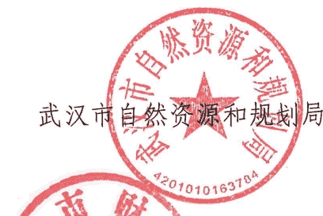

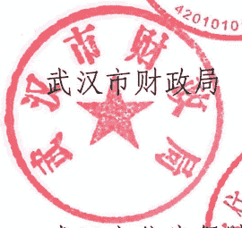

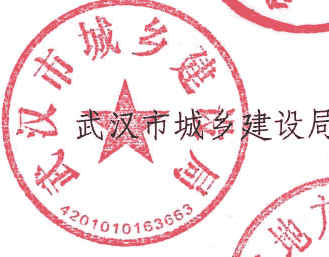

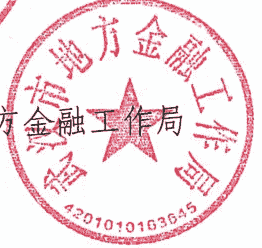

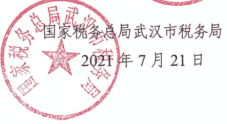

## 关于加快武汉市城市更新项目试点工作实施的若干意见

城市更新是城市发展当前的重点，是推动高质量发展、创造高品质生活的重要举措，是重大民生工程和发展工程。当前我市城市更新改造进入克难攻坚期，为认真贯彻以人民为中心的发展思想，加快推进我市更新项目试点工作的组织实施，实现城市有机更新，依据《市人民政府办公厅关于印发武汉市城市更新中心组建方案的通知》（武政办〔2020〕73号），结合我市实际，经市人民政府同意，现提出如下指导意见。

## 一、总体要求

### （一）指导思想

深入贯彻习近平总书记视察湖北重要讲话精神，立足当前、着眼长远，创新体制机制，全面整合区域资源，统筹生态效益、社会效益和经济效益，在综合考虑城市功能布局、公共服务、空间形态等因素的基础上，着力解决人民群众“急难愁盼”问题，深化城市有机更新，加快补齐城市建设和民生保障短板，实现城市更新项目落地实施，实现人民群众对美好生活的向往。城市更新项目要结合城市体检情况确定，体现人民城市人民建的理念。

### （二）试点范围和条件

本意见所称“更新项目”是指在中心城区符合以下条件之一，经市城市更新工作领导小组（以下简称“更新领导小组”）审定纳入试点范围的项目：

- 1. 建成年代较早、房屋破旧、基础设施差、规划路网建成率低、居民改造意愿迫切、拆迁量大、征收成本高、实施难度大的项目；
- 2. 规划地块中城市基础设施、公共服务设施建设规模较大，可开发规模较少，建设资金难以平衡的项目；
- 3. 历史风貌区范围内及周边因历史文化保护要求，严格限定开发强度，采用市场化运作方式难以实施的项目。

### （三）创新思路

在更新领导小组的组织领导下，全面推进更新项目的实施。更新领导小组下设办公室，在市政府重点办办公，承担更新领导小组日常工作，负责组织协调、统筹、督办，办公室主任由其负责人兼任。

- 1. **创新机制，统筹调度。** 武汉市城市更新中心（以下简称更新中心）负责研究拟订城市更新发展战略和规划、城市更新项目库、年度实施计划、审核项目实施方案，并报更新领导小组审定；负责具体组织协调市直各相关部门，推进城市更新项目实施；会同相关职能部门制定城市更新试点工作实施细则和相关配套文件。更新项目实施主体按照城市更新年度计划及更新中心的总体部署，具体组织、开展更新项目的改造建设工作。
- 2. **创新模式，市区联手。** 建立市区联手，兼顾平衡的两个“1+1”联动机制。

一是“实施主体+区平台公司”。实施主体可与区人民政府确定的一家平台公司合作，负责更新项目实施过程中的具体工作。

二是“更新项目+平衡项目”。为解决更新项目征收成本高、自身难以平衡的问题，引入平衡项目，坚持“当期平衡、动态平衡、综合平衡、长期平衡、政策平衡”理念，实现更新项目统筹平衡。

- 3. **创新制度，全面推进。** 在更新项目实施过程中要多措并举，加大政策支持，通过实施土地、规划、金融财税、建设、房管等多项支持政策，全面加速推进。

实施土地政策支持。更新项目由市自然资源和规划部门发放预供地意见书，明确项目意向用地单位。待项目符合土地出让条件后，采用带条件挂牌方式出让。

实施规划支持。市自然资源和规划部门会同更新中心组织开展更新项目规划方案审查，按照一事一议报请领导小组审批。为支持更新项目实现平衡，项目的规划调整及规划指标由市自然资源和规划部门支持办理。

实施金融财税支持。市财政局、市金融局、市税务局等职能部门会同更新中心，研究更新项目财税金融实施细则。符合条件的更新项目按规定减免相关的行政事业性收费，享受相关财税扶持等政策。

实施保障性住房和租赁住房配建支持。根据不同更新项目的改造方式、风貌保护等不同情况，合理确定保障性住房和租赁住房的配建要求；对在更新项目内难以落实配建要求的，可由项目所在区人民政府按等价值原则采取集中建设或异地配建方式，落实更新项目应配建保障性住房和租赁住房指标。

实施消防支持。更新项目房屋建筑维修改造中，可组织开展消防性能评价，并将评价结果作为消防设计审查、验收的标准。

优先将符合条件的更新项目列入市发改委市级重大项目计划和市城建重点工程目录，享受绿色通道优惠政策。

## 二、更新项目推进的工作内容

### （一）编制更新项目计划

更新中心会同相关区人民政府编制武汉市城市更新项目库，同时编制更新项目《年度实施计划》（简称年度计划），报更新领导小组审批同意后实施，并纳入全市中心城区城市更新及房屋征收计划。将基础设施及相应投资纳入基础设施固投统计。

### （二）编制更新项目综合平衡方案

根据年度计划，由实施主体编制各更新项目综合平衡方案（含土地资源及资金平衡方案），报更新中心审核，作为实施更新项目的指导性文件。引入平衡项目应报更新领导小组审批。

根据批复的综合平衡方案，由实施主体会同区相关部门编制更新项目的实施方案，包括房屋征收方案、征收成本测算、保留房屋的改造方案、配套基础设施建设方案等内容，各区人民政府应根据实施方案所确定的项目成本测算合理控制房屋征收成本。可将更新项目周边配套基础设施纳入城市更新项目建设成本，同步实施。

### （三）发放供地意见书

经更新领导小组审定的更新项目，由市自然资源和规划局发放预供地意见书，明确项目名称、四至范围、实施主体。

### （四）更新项目筹融资

实施主体负责开展筹融资工作，针对更新项目的资金缺口，可在全市范围内组合平衡项目一同出让，申请专项贷款，实行资源专用、独立运作、封闭管理的模式，保障项目资金需求。

积极引入各类社会资本，以市场化运作的产业投资基金为主，探索设立城市更新专项基金。城市更新专项基金的使用按照我市相关政策执行。

### （五）开展更新项目征收

在实施房屋征收过程中，区人民政府可采取预征收补偿方式实施。对采取预征收补偿方式实施的，需在征收补偿方案征求意见之前进行公告；并在充分征求意见后确定征收补偿方案及完善预征收补偿协议。

### （六）办理规划设计条件

实施主体组织开展更新项目的建筑甄别、风貌评估、功能策划、建筑方案设计，并编制更新项目的规划方案。市自然资源和规划部门会同更新中心组织更新项目规划方案审查，审查通过的项目，市、区自然资源和规划部门依申请核发规划设计条件。涉及控制性详细规划调整的，应按照相关法律法规规定的程序进行调整。

### （七）更新项目出让

更新项目完成征收后，可依据征收完毕确认书、权审报告或土地证和规划设计条件等采用带条件挂牌等方式出让；完善土地供应手续，签订土地出让合同，按规定缴纳土地出让金。征收成本依据审计报告返还给预供地单位。

更新项目与平衡项目分开开发建设的，可分别成立项目公司，并按规定办理土地出让金票据调整工作。

### （八）开展更新项目招商合作

实施主体通过资格遴选、方案评审、商务谈判、产权交易等程序，按照公平、公正、公开的原则可转让更新项目部分股权，择优选择品牌效益高、产品口碑好、综合实力强的合作方，实施共同开发及管理的工作。具体操作按更新中心另行制定的相关文件执行。

## 三、落实责任，加强保障

### （一）强化统筹协调

进一步发挥更新领导小组和更新中心的统筹协调作用，加强政策法规和标准规范的制定完善，加强对更新项目的统筹指导和协调推进；进一步发挥市各相关管理部门的合力支撑作用，市相关管理部门要主动作为，积极履职，指导和服务好城市更新各项工作，形成强大工作合力。

### （二）落实主体责任

实施主体负责项目策划、资金房源筹集、招商；各相关区人民政府要按照市委、市政府要求，加强领导，负责本辖区城市更新工作的具体组织实施，加强房屋征收力量和收尾工作，会同更新中心加快更新项目招商和土地出让；各相关区人民政府要完善城市更新组织体系、工作机构、人员配置，做到细化任务，落实责任，统筹资源，全力以赴完成城市更新目标和任务。各区房屋征收部门是更新项目征收工作责任主体，负责依法依规开展征收补偿工作，及时收尾。

本意见所称实施主体是指武汉市城市更新投资有限公司及由更新领导小组依程序单项确定的平台公司。

### （三）生效日期

本意见自印发之日起施行，有效期5年。

## 城市更新项目试点工作操作规则（试行）

为督促落实市自然资源和规划局等七部门联合印发的《关于印发加快武汉市城市更新项目试点工作实施若干意见的通知》（武自然资规发〔2021〕76号），进一步明确责任主体，规范操作流程，推进城市更新项目实施，经市城市更新工作领导小组同意，现制定本操作规则。

## 一、适用范围、管理机制和责任分工

**第一条**　本操作规则所称城市更新项目是指依据武自然资规发〔2021〕76号中明确的纳入试点范围的项目，应符合以下条件：一是建成年代较早、房屋破旧、基础设施差、规划路网建成率低、居民改造意愿迫切、拆迁量大、征收成本高、实施难度大的项目；二是规划地块中城市基础设施、公共服务设施建设规模较大，可开发规模较少，建设资金难以平衡的项目；三是历史风貌区范围内及周边因历史文化保护要求，严格限定开发强度，采用市场化运作方式难以实施的项目。

**第二条**　本规则主要明确上述范畴的城市更新项目计划编制、规划设计、征地征收、土地供应及招商运营等相关管理活动的操作规则，包括责任分工、工作完成时限等具体内容。

**第三条**　市城市更新工作领导小组是我市城市更新工作的组织领导机构，在其统一调度下，城市更新领导小组办公室负责统筹、协调、督办全市城市更新项目试点工作；市城市更新中心负责组织实施城市更新试点项目；市发改、自然资源和规划、财政、建设、房管等相关部门负责依据职能分工，指导和支持城市更新试点工作，参与研究制订相关支持政策，做好项目审批服务；各相关区人民政府按属地管理原则，负责推荐城市更新试点项目、开展房屋征收等具体工作。

**二、年度实施计划：**市城市更新中心每年度12月向市城市更新工作领导小组办公室上报下一年度城市更新项目年度计划，由领导小组办公室组织召开领导小组会议审定后执行。（牵头单位：市城市更新中心、市自然资源和规划局；责任单位：各相关区政府、市直各相关部门）

**第四条**　市城市更新中心征询各中心城区人民政府的意见，结合区政府推荐，遴选并汇总城市更新项目，编制年度实施计划（计划中需注明项目名称、范围及实施主体）。

**第五条**　市城市更新中心书面征求市自然资源和规划局等部门和单位对年度实施计划的意见并优化调整后，报市城市更新领导小组同意后实施。

**第六条**　市自然资源和规划局负责将审定同意后的年度实施计划项目纳入年度全市中心城区城市更新及房屋征收等相关计划。

**三、综合平衡方案：**相关部门和单位收到综合平衡方案文本之日起，5个工作日之内出具审查意见。（牵头单位：市城市更新中心；责任单位：市自然资源和规划局、市发改委、市财政局）

第七条　实施主体负责编制更新项目综合平衡方案，作为实施城市更新项目的指导性文件。

第八条　自平衡更新项目的综合平衡方案，由实施主体报市城市更新中心审核后实施。

第九条　需引入其他土地平衡更新项目的综合平衡方案，由市城市更新中心会同相关部门和单位联合会审，并报市城市更新领导小组审定。

## 四、规划设计方案（牵头单位：市自然资源和规划局；责任单位：实施主体）

第十条　实施主体结合项目综合平衡方案和区域控制性详细规划的管控要求，编制项目规划设计方案，成果报市自然资源和规划局。

第十一条　市自然资源和规划局组织相关部门和单位对项目规划设计方案进行审查，作为核发规划设计条件的依据。项目规划设计方案涉及规划调整的，将调整内容报市城市更新工作领导小组审定后，按照有关程序办理。

## 五、办理项目预供地意见书（牵头单位：市自然资源和规划局；责任单位：实施主体）

第十二条　实施主体依据年度实施计划，向市自然资源和规划局申请办理项目预供地意见书。

第十三条　市自然资源和规划局审核后，核发预供地意见书。

## 六、征地征收（牵头单位：各区人民政府；责任单位：实施主体）

第十四条　实施主体依据年度实施计划与项目所在区人民政府签订征地征收委托协议。根据项目实际情况，可采取预征收方式实施房屋征收。

第十五条　在征收过程中，由人民政府根据《国有土地上房屋征收与补偿条例》（国务院令第590号）、《武汉市国有土地上房屋征收与补偿实施办法》（市人民政府令第275号）、《市人民政府关于印发武汉市国有土地上房屋征收与补偿操作指引的通知》（武政规〔2018〕6号）等文件规定依法开展强制执行。

第十六条　项目征收完毕后，完善相关土地产权手续。

## 七、土地成本认定（牵头单位：市财政局；责任单位：市城市更新中心、市自然资源和规划局等相关部门及相关区政府）

第十七条　土地出让前，需进行土地前期成本认定，作为成本返还依据。由实施主体依据经城市更新工作领导小组审定的综合平衡方案，合理确定土地成本，并将成本审计报告报市财政局。涉及平衡地块的，可将更新地块成本分摊至平衡地块中。市财政局依据领导小组审定的综合平衡方案及成本管理的有关规定，开展成本认定工作。

## 八、土地出让（牵头单位：市自然资源和规划局；责任单位：市城市更新中心、市财政局、市税务局）

第十八条　项目征收完毕后，由实施主体将预供地意见书、规划设计条件和不动产权证等资料提交至市城市更新中心汇总，市城市更新中心按批次报市自然资源和规划局采用带条件挂牌等方式实施地块出让。更新项目及其平衡项目可分开或合并为一个项目出让。

## 九、招商运营（牵头单位：实施主体；责任单位：市城市更新中心）

第十九条　土地完成出让后，由实施主体开展项目建设和运营工作。为更好开展更新项目运营，按照公平、公正、公开的原则，择优选取品牌效益高、产品口碑好、综合实力强的合作单位开展项目招商运营工作。

## 中共武汉市委办公厅

武办文〔2023〕15号

## 市委办公厅　市政府办公厅关于印发《武汉市城市更新行动方案》的通知

各区委、区人民政府，警备区党委，市委各部委，市级国家机关各委办局及大型企业、事业单位，各人民团体：

《武汉市城市更新行动方案》已经市委、市政府同意，现印发给你们，请认真组织实施。

中共武汉市委办公厅  
武汉市人民政府办公厅  
2023年4月26日

## 武汉市城市更新行动方案

为贯彻落实党中央、国务院关于城市更新工作的决策部署和省委、省政府工作要求，加快转变超大城市发展方式，实施城市更新行动，加强城市基础设施建设，打造宜居、韧性、智慧城市，结合我市实际，制定本方案。

## 一、总体要求

坚持以习近平新时代中国特色社会主义思想为指导，深入贯彻党的二十大精神，坚持以人民为中心的发展思想，坚持运用共同缔造理念，围绕提升城市功能品质，统筹利用存量和增量资源，推动城市更新由“拆改留”向“留改拆建控”转变，优化城市空间布局，有序引导更新项目有效聚合，不断完善民生类基础服务设施建设，切实提高人民群众获得感、幸福感、安全感。

## 二、目标任务

按照“成片推进，单元更新”的总体思路，中心城区（含东湖风景区，下同）在3—5年内完成城市更新建筑总规模3291万平方米，其中推进重点更新单元整体更新1693万平方米、推进重点项目区域成片改造259万平方米、推进其他更新项目1339万平方米。2023年实施城市更新规模1401万平方米，2024年及以后年度更新规模结合当年实际另行确定。

（一）推进重点更新单元整体更新。对民生环境改造需求集中、城市风貌特色汇集、城市功能发展集聚的区域，按照“加快实施一批，谋划推进一批，研究策划一批”的原则，成片实施更新。2023年完成32个重点更新单元内更新规模648万平方米，其中加快实施更新规模322万平方米、谋划推进更新规模309万平方米、研究策划17万平方米。

1. 聚焦民生补短板，推进老旧城区品质提升。改造提升9个重点更新单元，重点加强危旧房改造、民生工程建设，实施老年友好、教育提档、体育强市等工程，紧密围绕15分钟生活圈建设，打造一批配套完善、环境优越的高标准城市生活单元。2023年，加快实施澳门金角公园片（湖边坊）、武汉CBD未来社区片、汉西古田商贸片、青山楠姆片等4个更新单元，谋划推进华安里环境提升片、崇仁健康生活片、鹦鹉邻里生活片、王家湾北全龄友好片等4个更新单元，研究策划武车国际社区片更新单元。（责任区：各中心城区）

2. 聚焦风貌显特色，彰显历史文化和滨水魅力。改造提升13个重点更新单元，推进历史建筑、工业遗产和滨水空间的改造更新，系统实施建筑拆违、街巷整治、建筑修缮、生态修复，彰显城市特色。2023年，加快实施三阳设计之都片、汉口八七文博片、环墨水湖游憩片、武昌古城得胜桥古轴片、青山古镇片等5个更新单元，谋划推进武汉天地商旅时尚片、万象精致生活片、西北湖金融时尚片、汉阳古城融合片、华中音乐谷片等5个更新单元，研究策划磨山桥梁文创体验片、吹笛生态休闲片、落雁健康养老片等3个更新单元。（责任区：江岸区、江汉区、汉阳区、武昌区、青山区、东湖风景区）

3. 聚焦核心强功能，提升“两江四岸”城市能级。改造提升10个重点更新单元，对承载“五个中心”的城市核心区、城市副中心开展更新工作，强化商业、文化、科创等功能的全面发展。2023年，加快实施杨园设计产业片、鲁磨路信创产业城片等2个更新单元，谋划推进汉口数智谷（岱山）、汉口滨江商务区片（七期）、汉正街中央服务区片（江汉区）、汉正街中央服务区片（硚口区）、白沙洲科创片、华中金融城片、虎泉创客街区片等7个更新单元，研究策划街道口大学之城片更新单元。（责任区：江岸区、江汉区、硚口区、武昌区、洪山区）

（二）推进重点项目区域成片改造。推进新汉阳站地区及东湖风景区鼓架景区建设。2023年，完成改造规模74万平方米，为城市重点工程实施夯实基础。（责任区：汉阳区、东湖风景区）

（三）推进其他更新项目加快实施。对更新单元及成片改造区域以外的零星更新区域，通过老旧小区改造、房屋腾退、征收储备等方式实施更新。2023年，完成更新规模679万平方米。（责任区：各中心城区）

各中心城区要结合实际需要，完善更新片区规模动态调整机制，适时策划实施新的更新片区。开发区、新城区的城市更新工作可依据全市更新规划纳入全市范围统筹实施，或参照中心城区相关政策自主实施。

## 三、保障措施

（一）加强组织领导。市城市更新工作领导小组负责统筹研究城市更新的重大事项和重点问题。各区要建立相应工作机制，加强对本辖区城市更新工作的组织领导。各有关部门和单位要解放思想、统筹资源、优化服务、创新机制，推进城市更新工作有序实施。

（二）强化要素保障。各有关部门和单位要精准把握国家和省有关政策精神，统筹研究完善危旧房改造、低效用地再开发、财政贴息等规划、土地、金融、财税、建设、经营、管理多方面配套政策。争取专项债券、金融机构贷款等长期、低利率资金，有力支撑城市更新工作。

（三）创新更新模式。各区要引入市场公开竞争机制，确定更新单元实施主体，统筹指导实施主体编制更新单元实施方案，具体包括规划设计方案、更新项目库及更新项目资金平衡方案。按“全要素、全周期平衡”的原则编制资金平衡方案，将更新单元范围内“留、改、拆”等各类项目整体打包算总账，将土地一级整理、二级开发、三级运营的全部收支列入资金平衡方案，尽可能做到综合平衡、动态平衡、长期平衡。

（四）加强示范引领。结合项目特点及实施成效，推出一批在完善功能布局、提升功能品质、创新工作机制等方面的示范项目，形成可复制可推广的经验，发挥示范引领作用，推动城市更新全面提质增效。

（五）完善考核机制。市城市更新工作领导小组办公室采取平时督导和定期考核相结合的方式，加强对城市更新工作的跟踪指导和协调督办，考评结果纳入相关责任单位年度绩效考核范畴。

附件：

1. 城市更新单元更新目标一览表
2. 各区城市更新行动任务一览表
3. 2023年城市更新单元推进批次一览表

## 附件1

## 城市更新首批项目目标一览表

| 序号 | 城市更新单元 | 单元定位 | 更新目标及策略 | 单元类型 | 面积（km²） | 人口（万人） |
|---|---|---|---|---|---:|---:|
| 1 | 汉口路慈云谷（岱山） | 绿岛湖片区 | 通过产业用地和低效工业用地更新，推动产业升级和功能完善，改善片区环境品质，提升城市形象 | 强功能 | 2.52 | 2.5 |
| 2 | 汉口路滨江片区（江北） | 文化科技示范区 | 依托城市更新改造，完善公共服务设施，打造宜居宜业的滨江片区 | 强功能 | 3.44 | 4 |
| 3 | 三阳路设计之都片区 | 设计创意产业聚集地、历史文化街区 | 设计创意产业集聚发展，建设具有国际影响力的设计之都 | 显特色 | 0.62 | 2.5 |
| 4 | 武汉天地对岸的片区 | 历史文化风貌与现代时尚相融合的滨江综合体 | 通过历史文化改造与现代功能提升相结合，打造滨江特色片区 | 显特色 | 1.08 | 3.36 |
| 5 | 汉口里—华中里—大智路片区 | 华中里、大智路、汉口里等片区 | 完善片区功能，提升城市品质，打造具有特色的历史文化片区 | 补短板 | 2.55 | 4.7 |
| 6 | 汉口二七大桥片区 | 大智路片区 | 以公共服务设施和基础设施完善为重点，改善居住环境，增强片区活力 | 显特色 | 1.24 | 5.4 |
| 7 | 万国桥生态居住片区 | 生态居住片区 | 依托现状资源，完善生态居住功能，提升片区环境品质 | 显特色 | 0.34 | 0.91 |

| 各区 | 序号 | 改造前单元 | 单元定位 | 更新目标及策略 | 单元类型 | 面积（km²） | 户（万户） |
|---|---:|---|---|---|---|---:|---:|
| 江南区 | 1 | 武汉CBD栋立区片 | 综合服务示范区 | 兼顾商务办公、商业服务、居住等功能，建设高品质综合服务片区 | 村级楼 | 1.34 | 6.7 |
| 江南区 | 2 | 西江湾金融时尚片 | 滨水商业片区 | 高端商业聚集，打造滨水金融服务业集聚区 | 典型特色 | 1.16 | 2.68 |
| 江南区 | 3 | 江夏区中片 | 中央商务区 | 围绕商贸、金融、文化和科技服务，建设现代化商务中心 | 既有功能 | 2.66 | 11.2 |
| 江南区 | 4 | 华容里环湾提升片 | 人居环境改善 | 以改善居住环境为重点，建设宜居生活片区 | 村级楼 | 3.81 | 3.1 |
| 矿口区 | 1 | 双江古田湾片 | 文化创业生活共享区 | 发展文化创意产业，建设生活共享空间 | 村级楼 | 1.96 | 3.2 |
| 矿口区 | 2 | 江工新中央服务区（宁口区） | 中央商务区 | 围绕商务、金融、文化等功能，打造中央商务区 | 既有功能 | 2.19 | 6.8 |
| 矿口区 | 3 | 桑园北城片 | 滨水休闲生活区 | 依托滨水资源，发展休闲旅游和居住功能 | 村级楼 | 3.07 | 5.6 |
| 汉阳区 | 1 | 汉阳古城融合片 | 汉阳中央文化区 | 强化古城文化功能，打造历史文化与现代生活融合区 | 典型特色 | 2.82 | 5.6 |
| 汉阳区 | 2 | 龟湾等即里生活片 | 龟岛生活区 | 共建宜居生活环境，打造高品质生活社区 | 村级楼 | 1.22 | 2.5 |
| 汉阳区 | 3 | 王家湾商务综合片 | 城市核心地区 | 商业集中，全面提升城市功能和服务能力 | 村级楼 | 1.15 | 4 |
| 汉阳区 | 4 | 环东水系滨水片 | 非遗文化活力片区 | 打造整治水系和滨水空间，塑造景观风貌，发展文化旅游 | 典型特色 | 1.7 | 4.39 |
| 武昌区 | 1 | 杨园设计产业片 | 五里界设计产业园 | 重点发展设计、文化创意及相关产业 | 既有功能 | 1.29 | 4.2 |
| 武昌区 | 2 | 白沙洲创新材料片 | 产业创新创业片区 | 以知识和创新为核心，建设产业创新发展示范区 | 既有功能 | 5.01 | 6.09 |
| 武昌区 | 3 | 华中金融服务片 | 金融产业示范区 | 以金融服务业为核心，建设金融产业集聚区 | 既有功能 | 3.04 | 7.43 |

| 管区 | 序号 | 城市更新项目 | 单位 | 主要目标及策略 | 面积（km²） | 人口（万人） |
|---|---:|---|---|---|---:|---:|
| 省城区 | 4 | 吉安市国际社区片 | 国际化社区 | 依托滨江、环境优美、人居高端等优势，打造国际化社区 | 0.97 | 3.7 |
| 省城区 | 5 | 宜昌古城提升片 | 江南山水城 | 依托历史文化资源，完善配套设施，提升古城品质 | 2.96 | 7.45 |
| 省城区 | 6 | 中央商务综合片 | 长江原创之城 | 依托商务、金融、文化等资源，打造中央商务区 | 1.41 | 4.22 |
| 藏山区 | 1 | 靠山辅城片 | 琼山区 | 完善基础设施，改善人居环境，推动片区更新 | 2.44 | 3.7 |
| 藏山区 | 2 | 靠山古城片 | 滨江历史文化示范区 | 保护历史文化资源，塑造古城风貌，完善公共服务 | 3.4 | 2.9 |
| 洪山区 | 1 | 宜昌路新城片 | 滨江新城示范区 | 通过交通路网、公共服务和产业布局，建设新城片区 | 1.17 | 1.76 |
| 洪山区 | 2 | 城市进口大学之城片 | 大学之城示范区 | 以创新驱动和产城融合，打造大学城及周边片区 | 2.06 | 6.37 |
| 洪山区 | 3 | 民族和谐片 | 城市融合示范区 | 推进民族融合发展，完善公共服务设施 | 1.14 | 3.48 |
| 东湖风景区 | 1 | 磨山水文化体验片 | 磨山水文化片 | 以水文化、生态旅游和文化体验为重点，打造特色片区 | 2.84 | 1.60 |
| 东湖风景区 | 2 | 生态绿色生态片 | 东湖生态示范区 | 保护生态环境，完善旅游设施，提升生态品质 | 6.22 | 0.98 |
| 东湖风景区 | 3 | 湖畔慢生活片 | 滨湖休闲示范区 | 打造慢生活、休闲旅游和宜居环境，形成特色滨湖片区 | 7.81 | 2.30 |
| 合计 |  |  |  |  | 76.63 | 135.32 |

## 各区城市更新行动任务一览表

| 各区 | 城市更新行动合计 | 2023年留改拆小计 | 2024年留改拆小计 | 2025—2027年留改拆小计 |
|---|---:|---:|---:|---:|
| 江岸区 | 286.8 / 68.8 / 179.4 / 535 | 108.2 / 15.7 / 100.6 / 224.5 | 156.4 / 53.1 / 35.4 / 244.9 | 22.2 / — / 43.4 / 65.6 |
| 江汉区 | 104.9 / — / 197.4 / 302.3 | 72.5 / — / 100.3 / 172.8 | 32.4 / — / 46.7 / 79.1 | — / — / 50.4 / 50.4 |
| 硚口区 | 180.6 / — / 325.3 / 505.9 | 36.1 / — / 147.6 / 183.7 | 144.5 / — / 87.5 / 232 | — / — / 90.2 / 90.2 |
| 汉阳区 | 100.3 / 0.5 / 304.6 / 405.4 | 76 / 0.5 / 100.3 / 176.8 | 24.3 / — / 89.5 / 113.8 | — / — / 114.8 / 114.8 |
| 武昌区 | 394.3 / 11.4 / 214.4 / 620.1 | 241.2 / 4.7 / 87.1 / 333 | 67.3 / 1.7 / 66.7 / 135.7 | 85.8 / 5 / 60.6 / 151.4 |
| 青山区 | 123.8 / 1.3 / 108.5 / 233.6 | 89.3 / 1.3 / 53.8 / 144.4 | — / — / 30 / 30 | 34.5 / — / 24.7 / 59.2 |
| 洪山区 | 237.9 / — / 157.3 / 395.2 | 71.2 / — / 74.8 / 146 | 87 / — / 36 / 123 | 79.7 / — / 46.5 / 126.2 |
| 东湖风景区 | 243.7 / — / 49.8 / 293.5 | 8.9 / — / 10.9 / 19.8 | 76 / — / 20 / 96 | 158.8 / — / 18.9 / 177.7 |
| 合计 | 1672.3 / 82 / 1536.7 / 3291 | 703.4 / 22.2 / 675.4 / 1401 | 587.9 / 54.8 / 411.8 / 1054.5 | 381 / 5 / 449.5 / 835.5 |

单位：万平方米

备注：“留”保留现状，“改”更新改造，“拆”拆除重建；各区留改拆任务均为预计数，最终以村保留改造任务为准。

## 2023年城市更新单元推进批次一览表

| 分批推进 | 行政区 | 编号 | 城市更新单元 | 单元类型 |
|---|---|---:|---|---|
| 加快实施一批（11片） | 江岸区 | 1 | 三阳设计之都片 | 显特色 |
|  | 江岸区 | 2 | 澳门金角公园片（湖边坊） | 补短板 |
|  | 江岸区 | 3 | 汉口八七支路片 | 显特色 |
|  | 江汉区 | 4 | 武汉CBD未来社区片 | 补短板 |
|  | 硚口区 | 5 | 汉西古田商贸片 | 补短板 |
|  | 汉阳区 | 6 | 环墨水湖游憩片 | 显特色 |
|  | 武昌区 | 7 | 杨园设计产业片 | 强功能 |
|  | 武昌区 | 8 | 武昌古城得胜桥古轴片 | 显特色 |
|  | 青山区 | 9 | 青山古镇片 | 显特色 |
|  | 青山区 | 10 | 青山楠姆片 | 补短板 |
|  | 洪山区 | 11 | 鲁磨路信创产业城片 | 强功能 |
| 谋划推进一批（16片） | 江岸区 | 1 | 汉口数智谷（岱山） | 强功能 |
|  | 江岸区 | 2 | 武汉天地商旅时尚片 | 显特色 |
|  | 江岸区 | 3 | 汉口滨江商务区片（七期） | 强功能 |
|  | 江岸区 | 4 | 万象精致生活片 | 显特色 |
|  | 江汉区 | 5 | 西北湖金融时尚片 | 显特色 |
|  | 江汉区 | 6 | 华安里环境提升片 | 补短板 |
|  | 江汉区 | 7 | 汉正街中央服务区片（江汉区） | 强功能 |
|  | 硚口区 | 8 | 汉正街中央服务区片（硚口区） | 强功能 |
|  | 硚口区 | 9 | 崇仁健康生活片 | 补短板 |
|  | 汉阳区 | 10 | 鹦鹉邻里生活片 | 补短板 |
|  | 汉阳区 | 11 | 汉阳古城融合片 | 显特色 |
|  | 汉阳区 | 12 | 王家湾北全龄友好片 | 补短板 |
|  | 武昌区 | 13 | 白沙洲科创片 | 强功能 |
|  | 武昌区 | 14 | 华中金融城片 | 强功能 |
|  | 武昌区 | 15 | 华中音乐谷片 | 显特色 |
|  | 洪山区 | 16 | 虎泉创客街区片 | 强功能 |
| 研究策划一批（5片） | 武昌区 | 1 | 武车国际社区片 | 补短板 |
|  | 洪山区 | 2 | 街道口大学之城片 | 强功能 |
|  | 洪山区 | 3 | 磨山桥梁文创体验片 | 显特色 |
|  | 东湖风景区 | 4 | 吹笛生态休闲片 | 显特色 |
|  | 东湖风景区 | 5 | 落雁健康养老片 | 显特色 |

## 关于印发中心城区更新单元申报及实施方案审批流程（试行）的通知

各中心城区人民政府，东湖风景区管委会，市直相关部门：

经市城市更新工作领导小组同意，现将《中心城区更新单元申报及实施方案审批流程（试行）》印发你们，请认真遵照执行。

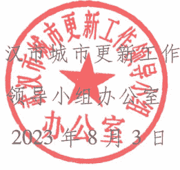

## 中心城区更新单元申报及实施方案审批流程

（试行）

为落实中央关于实施城市更新行动的有关部署，加快实施《武汉市城市更新行动方案》，结合我市实际，特制定中心城区更新单元申报及实施方案审批流程（试行）。

## 一、更新单元策划认定

坚持城市体检先行，除《武汉市城市更新行动方案》确定的32个重点更新单元外，在符合武汉市国土空间总体规划、城市更新专项规划等上位规划的前提下，结合国民经济和社会发展规划，针对更新改造需求集中、权利人改造意愿强烈，且区政府有意愿在近三年间加强规划建设的区域，各区政府可适时策划新的更新单元。流程如下：

1. 由区政府将新策划的更新单元的四至范围及现状基本情况、更新必要性论证、更新目标、单元类型（补短板、显特色、强功能）及更新策略、“留改拆”初步方案、拟形成的更新成效及亮点、工作计划安排形成更新单元策划建议书报市更新领导小组办公室。
2. 市城市更新工作领导小组（以下简称“市更新领导小组”）研究同意后，由市城市更新工作领导小组办公室（以下简称“市更新领导小组办公室”）报市政府印发更新单元增补计划。

## 二、更新单元实施主体确定

各区政府应明确更新单元实施主体，主要负责参与编制更新单元规划评估及实施方案，统筹单元各类更新项目，协调建设时序，对单元进行全生命周期协调管理，确保单元更新功能品质双提升目标的实现。

### （一）更新单元实施主体确定方式

更新单元实施主体一般为市/区国有企业，各区应当综合考虑开发建设资质、经济实力、运营管理能力、商业信誉等综合能力，由区政府常务会集体决议，明确更新单元实施主体后，报领导小组办公室备案。区政府应加强对单元实施主体的监督考核。

### （二）更新单元实施主体主要任务

在区政府组织和委托下，单元实施主体应统筹谋划更新单元内“留改拆建控”各类更新项目及各项建设计划，参与编制更新单元规划评估及实施方案，统筹区域多元主体参与实施，协调各项目实施主体开展基础设施及公共服务设施建设、土地整理、项目建设、运营等，落实城市更新项目全生命周期管理要求。

## 三、更新单元规划评估指引

区政府在研究确定更新单元实施主体的同时，应会同市自然资源规划局开展《更新单元规划评估指引》编制工作。《更新单元规划评估指引》内容包括单元用地空间和建筑使用现状调研评估、单元产业功能发展评估、人口规模预测和宜居品质评估、交通市政和公共服务设施承载力评估、单元建设规模总量及规模结构评估、单元公共空间和环境品质特色评估等，提出单元实施方案编制指引，初步确定“留改拆建控”范围，明确单元更新目标愿景和重点

方向、建设标准，明确单元更新强功能、补短板、显特色、提品质的重点策略和目标要求。

《更新单元规划评估指引》须充分征求各区发改、经信、商务等产业主管部门，教育、文旅、体育、卫健、民政等公共服务设施主管部门，交通、供电、水务、城管等市政基础设施主管部门意见，作为更新单元实施方案编制的基础。

## 四、更新单元实施方案编制与报批

### （一）更新单元实施方案编制重点

- 1. 单元现状调研报告。深度开展单元现状人口调查、现状用地和房屋使用功能调查、现状产业业态和功能发展情况调查、现状交通市政和公共配套设施建设情况调查以及现状绿化开放空间系统环境品质调查，明确需要重点解决的问题和短板。

- 2. 单元产业功能策划方案及产业发展计划。明确单元主导功能、主导产业业态及上下游产业链聚集的原则和要求，明确单元产业发展计划，鼓励与禁止的产业正负面清单，主导产业功能的用地和建筑规模总量。

- 3. 单元人居环境品质提升方案。明确单元人口规模、人口密度、人口结构特点和需求，明确交通、市政、公共服务设施配套建设方案，明确保障性住房、老旧小区建设改造标准及改造计划。

- 4. 单元用地空间详细规划设计方案。明确单元更新愿景目标和空间策略，确定用地功能和建筑房屋空间布局方案，明确单元空间形态、城市设计要求，明确公共空间体系结构、范围，确定公共空间体系建设实施具体方案、重要节点地段详细设计方案及相关指标要求。

- 5. 特殊专项实施方案及相应实施计划。更新单元内涉及历史文化资源保护与利用、生态修复、安全防护等专项内容的，应制定专项实施方案。

- 6. 单元更新项目库。明确更新单元“留改拆建控”更新项目库，分类明确产业功能发展、城建基础设施建设、公共服务设施建设、老旧小区改造等项目的建设内容、时序安排及归口监管部门、项目组合实施及时序管控方案。

- 7. 单元资金平衡测算。明确单元多元主体共同参与，按“全要素、全周期平衡”的原则编制资金平衡测算方案，将更新单元范围内“留、改、拆”等各类项目整体打包算总账，将土地一级整理、二级开发、三级运营的全部收支列入资金平衡测算方案，尽可能做到综合平衡、动态平衡、长期平衡。

- 8. 其他事项。

### （二）更新单元实施方案强制性内容

各更新单元实施方案须明确强制性内容。强制性内容作为市更新领导小组审查事项，须严格执行。非强制性内容可由各区结合项目实施进一步深化研究完善。

原则上，以下内容应列入强制性要求：

- 1. 单元更新目标定位、主导功能及项目准入正负面清单；
- 2. 单元人口密度、建筑规模总量和规模结构；
- 3. 公共服务及交通市政设施的建设标准、数量及规模；
- 4. 主要公共空间系统的布局与建设要求；
- 5. 单元历史风貌保护、生态修复、安全等专项要求；
- 6. 拟供应地块规划设计条件主要指标要求；
- 7. 重点老旧小区改造、存量建筑改造标准；
- 8. 单元重点更新项目责任主体、建设时序管控方案；
- 9. 控制性详细规划修改内容；
- 10. 其他领导小组认为应加强管控的内容。

### （三）更新单元实施方案报批程序

1. 编制环节。由区政府和更新单元实施主体共同组织编制更新单元实施方案。方案编制完成后，区政府应组织区内各相关行业主管部门对实施方案进行研究，形成区内统筹意见。必要时区政府应组织高层级的专家咨询会对更新单元规划评估及实施方案进行充分论证。市自然资源规划局加强技术指导，提出编制要求，提高编制质效。

2. 审查环节。区政府将区内统筹形成的更新单元实施方案上报市更新领导小组办公室，由市更新领导小组办公室转市相关职能部门提出书面审查意见，并视情况组织专家咨询论证会。市更新领导小组办公室收到上述单位的书面审查意见后，召开相关部门及单位专题会进行统筹协调，由区政府组织优化更新单元实施方案后，提请市更新领导小组、市规委会审议。

3. 批准环节。市政府召开市更新领导小组专题会（套开市规委会），对各区上报的更新单元实施方案进行审议决策，会后形成会议纪要。

涉及控制性详细规划或其他法定规划变更的工作，按照《武汉市控制性详细规划管理规定》及其他法定规划的有关程序要求办理。

## 五、批后管理

（一）更新单元实施方案批准后，作为更新单元内项目办理有关规划建设手续的依据。

（二）市更新领导小组审批事项不得随意修改。确需调整的，应符合以下情形：

- 1. 国土空间总体规划等上位规划或政策发生重大变化；
- 2. 因重大项目建设需要等，更新策略发生重大变化；
- 3. 其他确需变更的情形。

变更市更新领导小组审批事项的，需按原程序重新审批更新单元实施方案。

（三）探索建立城市更新单元执行总师制度。为促进全周期环境品质提升，有效推动更新单元项目实施，执行总师全过程参与城市更新单元的策划、调研评估、设计招商、建设运营等工作，重点针对单元公共开放空间体系及公共设施体系的建设进行跟踪服务，向区政府及有关业主单位提供专业技术咨询及协调等服务，实现更新单元高水平设计、高水平建设、精细化管理。

（四）本流程用于中心城区（含东湖风景区）、新城区、功能区可结合需要参照执行。

## 武汉市自然资源和城乡建设局  
武汉市住房和城市更新局 文件

武自然资建〔2024〕6号

## 市自然资源和城乡建设局 市住房和城市更新局印发《关于做好城市更新中保留建筑不动产登记的若干意见（试行）》的通知

各区人民政府、市直各相关单位：

现将《关于做好城市更新中保留建筑不动产登记的若干意见（试行）》印发给你们，请认真组织实施。

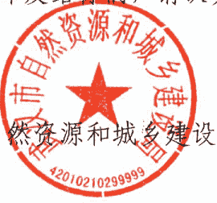

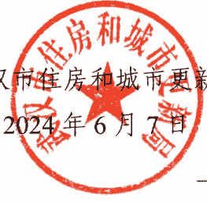

武汉市自然资源和城乡建设局　　武汉市住房和城市更新局

2024年6月7日

## 关于做好城市更新中保留建筑不动产登记的若干意见

（试行）

为有序推动武汉市城市更新中保留建筑的产权归集，规范保留建筑不动产登记行为，促进保留建筑功能活化及历史风貌街区改造升级，结合武汉市实际，制定本意见。

## 一、适用范围

武汉市域内，在实施城市更新时涉及保留建筑办理不动产登记的，适用本意见。本意见所称保留建筑，包括通过房屋征收、收回（收购）、房屋买卖、协议腾退、资产划转、变更代管主体实现产权归集的优秀历史建筑和其他经批准的规划中确定需要保留的建筑（以下简称其他保留建筑）。

不可移动文物的修缮、使用以及处置由市文物行政部门按照《中华人民共和国文物保护法》《湖北省实施〈中华人民共和国文物保护法〉办法》等规定进行明确，不动产登记的具体实施细则另行制定。

## 二、办理原则

（一）坚持问题导向。从城市更新的实际情况出发，聚焦城市更新中不动产登记的现实需求，进一步优化不动产登记程序，规范不动产登记申请资料，推动解决保留建筑产权归集障碍。

（二）坚持改革创新。在严格遵循不动产登记基本法规政策的前提下，以服务城市更新为目标，创新不动产登记思路，强化业务流程优化协同，打破部门壁垒，促进条块联通和上下联动。

（三）坚持协同高效。在推进保留建筑不动产登记工作中，自然资源、规划、城乡建设、房屋管理等部门应当加强沟通，围绕项目规划、项目审批、联合验收、产权归集、不动产登记等方面业务紧密协作，形成合力，确保事有人管、责有人负，实现无缝衔接。

## 三、工作要点

（一）确定保留建筑。各区人民政府（含开发区、风景区、长江新区管委会，下同）组织编制更新单元实施方案、历史文化风貌街区保护规划、更新项目实施性规划等城市更新有关规划（以下简称城市更新有关规划），根据实测及审批资料，明确拟保留建筑名称、位置坐落、用地及建筑面积、建筑高度层数、拟更新改造用途等信息，有关规划应当按照程序报批。

（二）确定实施主体。各区人民政府确定城市更新项目实施主体（以下简称实施主体），负责保留建筑的产权归集工作。

（三）确定更新方式。实施主体根据更新项目具体情况确定更新方式，可通过房屋征收、收回（收购）、房屋买卖、协议腾退、资产划转、变更代管主体等方式归集产权，从而开展城市更新工作。

（四）办理产权登记。不动产登记机构依据实施主体的申请及更新方式，分类办理保留建筑的不动产登记。

## 四、重新供地后的不动产登记

（一）保留建筑原权利人放弃不动产权利或房屋征收、收回（收购）导致不动产权利灭失的，不动产登记机构按照土地供应范围，重新办理保留建筑不动产首次登记。程序如下：

1. 办理原权属注销登记。由实施主体与保留建筑原权利人在腾退补偿协议中约定“房屋所有权人放弃不动产权利”及“委托实施主体办理不动产注销登记”等相关事项。完成补偿后，原权利人无法到场申请办理注销登记的，可通过公证委托（含协议委托条款公证）方式委托代理人（实施主体等）申请办理。保留建筑原权属注销完毕后，应取得所在区人民政府确认全部房屋已完成签约且权证注销完毕的证明文件；因房屋征收、收回（收购）导致不动产权利灭失的，不动产登记机构按规定办理不动产注销登记。

2. 核发规划设计条件。对于拟开展土地供应的，由实施主体申请，规划管理部门依据详细规划及经批准的城市更新有关规划，出具拟供宗地（含保留建筑）规划设计条件，规划设计条件中应明确保留建筑的建筑面积、用地性质等规划要求。

3. 办理土地供应及用地规划许可。自然资源管理部门可采取划拨、出让或者租赁方式供应土地，并按照程序办理建设用地规划许可。采用公开出让方式供地的，宗地内保留建筑的建设改造相关要求应当一并列入出让公告文件，并明确监管部门。

4. 开展竣工验收或安全认定。相关职能部门按照职责分工开展项目竣工验收或保留建筑房屋及消防安全认定工作。

存在改（扩）建的，由规划管理部门审查改造（设计）方案，属于优秀历史建筑的，房屋管理部门还应出具优秀历史建筑修缮设计方案的审查意见，完成方案审查后，规划管理部门核发《建设工程规划许可证》，开展规划条件核实，核发《建设工程竣工验收规划条件核实证明》；城乡建设管理部门开展改（扩）建工程消防设计审查，核发《建设工程施工许可证》，办理竣工验收备案。

不存在改（扩）建的，由实施主体组织开展房屋安全鉴定和消防安全评估，房屋管理部门出具房屋安全认定意见；城乡建设管理部门出具消防安全认定意见。

5. 开展项目建盘。房屋管理部门采集房屋基本信息，建立房屋楼盘表（含保留建筑）。

6. 办理不动产首次登记。完成土地供应并缴清相关税费后，不动产登记机构按规定办理国有建设用地使用权首次登记；竣工验收或房屋及消防安全认定完成后，不动产登记机构按规定办理国有建设用地使用权及房屋所有权首次登记。

（二）对于储备类项目，开展不动产储备登记，可结合征收（收回）现状注记征收（收回）建筑面积。

开展土地供应的，按照前款规定办理规划设计条件、土地供应、用地规划许可、竣工验收或安全认定、项目建盘和首次登记。

暂不开展土地供应或不具备供地条件的，储备机构可开展保留建筑的修缮工作，修缮完成后，按规划要求保留的建筑，按现状登记建筑面积，注记“该保留建筑由政府储备，用途符合规划要求均可”。

## 五、权属转移后的不动产登记

（一）房屋买卖或者协议腾退

1. 签订买卖（腾退）协议。由实施主体与原权利人签订房屋买卖协议或者腾退补偿协议。属于腾退补偿协议的，协议中明确国有建设用地使用权和房屋所有权转让、委托办理不动产登记等相关内容。

2. 办理登记。按规定缴清相关税费后，实施主体与原不动产权利人共同申请，不动产登记机构依据房屋买卖协议或者腾退补偿协议、原产权证书等材料办理转移登记。委托事项经公证后，可由委托代理人代为申请办理转移登记。

本意见实施前已签订了腾退补偿协议的，由不动产所在区人民政府出具已补偿到位及确定不动产权利承接主体的材料，经区人民政府授权委托后，承接主体可代为申请办理转移登记。

### （二）资产划转

属于国有资产的保留建筑需划转的，按规定缴清相关税费后，不动产登记机构依据划转批复文件等办理保留建筑不动产转移登记。

## 六、直管公房变更代管主体后的不动产登记

保留建筑属于市属、区属直管公房的，由新的代管主体单方申请，不动产登记机构依据市、区人民政府出具的重新指定代管主体的批准文件等材料，将保留建筑变更登记至新的代管主体名下，用途和权利性质保持不变。

## 七、其他事项

（一）通过房屋买卖或者协议腾退、资产划转、变更代管主体实现产权归集并办理登记的保留建筑，按照规划要求需要变更用途或者改（扩）建的，应按照规定完善手续后，申请办理变更登记。

（二）优秀历史建筑的修缮管理工作按照房屋管理部门相关要求执行。

（三）其他供地项目中涉及保留建筑的不动产登记可参照本意见执行。

## 一、城市更新

### （二）其他城市更新有关政策文件

# 住房和城乡建设部办公厅关于印发实施城市更新行动可复制经验做法清单（第一批）的通知

各省、自治区住房和城乡建设厅，直辖市住房和城乡建设（管）委，新疆生产建设兵团住房和城乡建设局：

为贯彻落实党中央、国务院关于实施城市更新行动的决策部署，各地积极探索城市更新统筹谋划机制、可持续模式和配套支持政策等，取得较好成效。近期，我部总结城市更新试点城市和各地经验做法，形成《实施城市更新行动可复制经验做法清单（第一批）》，现印发给你们，请结合实际学习借鉴。

住房城乡建设部办公厅  
2022年11月25日

# 实施城市更新行动可复制经验做法清单（第一批）

| 序号 | 政策机制 | 主要举措 | 具体做法 |
|---|---|---|---|
| 一 | 建立城市更新统筹谋划机制 | **（一）加强工作统筹和督查考核** | 1. **北京市党委、政府主要负责同志亲自推动。** 在市委城市工作委员会下设城市更新专项小组，市委书记亲自谋划，市委副书记、市长任组长，小组内设有推动实施、规划政策、资金支持3个工作专班，负责部署年度重点工作，协调支持政策，督促工作落实。各区政府成立城市更新专项工作小组，统筹协调实施城市更新。  2. **山东省潍坊市建立城市更新工作联席会议制度。** 市长为召集人，分管市长为副召集人，市委政法、住建、工信、教育、财政、自然资源、文旅等19个市直部门单位和各区主要负责同志为成员，负责统筹推进城市更新工作，协调解决遇到的困难问题，形成上下协同、各司其职、统筹推进的工作机制。  3. **宁夏回族自治区银川市强化城市更新工作考核。** 制定《城市更新绩效考评细则（试行）》，将实施城市更新工作推进情况纳入各部门年度工作考核体系，城市更新三年行动工作指挥部办公室会同市委、市政府督查室，通过不定期现场抽检项目进度、核查资料，分半年、全年对各成员单位工作进行赋分，计入绩效考核得分，动态监测城市更新实施成效。 |
| 一 | 建立城市更新统筹谋划机制 | **（二）建立城市更新制度机制** | 1. **辽宁省出台省级城市更新条例。** 《辽宁省城市更新条例》立足辽宁老工业基地城市特点，明确聚焦绿色低碳、便利宜居、保护传承、提升品质的目标要求，提出加强基础设施和公共设施建设、优化调整区域功能布局和空间格局、提升城市居住品质和人居环境、加强城市历史文化保护、增强城市安全韧性等主要任务，明确城市更新工作的组织机制、实施程序和底线要求。  2. **重庆市统筹谋划城市更新制度、机制和政策。** 出台《重庆市城市更新管理办法》，明确城市更新的工作原则、工作机制、规划计划编制、项目实施等制度要求，针对城市更新多渠道筹资、土地协议出让、产权转移、产业升级、项目一体化开发运营等细化提出相关支持政策。  3. **江苏省细化明确城市更新七大任务要求。** 印发《关于实施城市更新行动的指导意见》，聚焦当前城市发展中普遍存在的突出问题和短板，以化解“城市病”为导向，围绕七项重点工作任务推进城市更新，包括既有建筑安全隐患消除、市政基础设施补短板、老旧住区宜居改善、低效产业用地活力提升、历史文化保护传承、城市生态空间修复、城市数字化智慧化提升。 |
| 一级主题 | 分项标题 | 内容 |
|---|---|---|
| 一、建立城市更新统筹谋划机制 | （三）将城市体检和城市更新紧密衔接 | 1. **上海市开展市、区两级城市体检评估。** 建立由“体系构建—数据采集—计算评价—诊断建议—行动落实”等5个环节构建的城市体检闭环流程，全面查找存在的不足和问题，提出统筹城市规划、建设、管理，整体推动城市结构优化、功能完善、品质提升的工作方案、行动计划和具体项目。  2. **重庆市开展城市更新专项体检。** 在中心城区江北区开展专项体检试点，增加了更新片区人口密度、开发强度等10项城市更新专项体检指标，辅助城市更新片区策划和项目实施方案的编制，建立“摸家底、纳民意、找问题、促更新”的城市体检成果运用模式和“边检边改”的工作机制，推动老百姓关心的问题限时解决。  3. **湖南省长沙市把城市体检作为片区更新前置要素。** 坚持“无体检不项目，无体检不更新”，采取“六步工作法”，开展城市体检，完善组织机制、编制规划计划、分类实施更新、实施动态监测、发布宜居指数，将城市体检作为城市更新项目实施的立项前置条件，对症下药治理“城市病”。 |
| 一、建立城市更新统筹谋划机制 | （四）建立城市更新规划编制和实施工作体系 | 1. **北京市建立“总体规划—专项规划—街区控规—更新项目实施方案”的城市更新工作体系。** 印发《北京市城市更新专项规划》，将专项规划作为落实总体规划的重要手段和指导编制街区控规、更新项目实施方案的重要依据，突出减量发展要求，细化提出首都功能核心区、中心城区等城市不同圈层更新的目标方向，统筹空间资源与更新任务，统筹规划编审与行动计划、统筹项目实施与政策机制、统筹实施主体与管理部门。  2. **江苏省南京市探索全链条城市更新项目实施体系。** 构建“单元规划—体检评估—城市设计—特色片区—计划储备—方案设计—项目实施—监督管理—常态运营”的实施体系，整体谋划、系统推进城市更新。注重城市设计引导，划定特色更新片区，围绕城市体检评估出的问题针对性开展实施阶段的城市设计及更新策划，探索“城市设计—可研方案—规划方案—初步设计—施工图设计”的联动管理机制。  3. **江西省建立城市更新规划编制体系。** 印发《江西省城市更新规划编制指南（试行）》，提出城市更新规划、城市更新行动计划、城市更新项目实施方案等的编制组织程序、主要内容、技术要点和成果要求，规范城市更新规划计划的编制和实施工作。 |

| 分类 | 模式 | 内容 |
|---|---|---|
| 二、建立政府引导、市场运作、公众参与的可持续实施模式 | （一）建立存量资源统筹协调机制 | **1. 辽宁省沈阳市探索跨项目统筹运作模式。** 允许在行政区域范围内跨项目统筹、开发运营一体化的运作模式，实行统一规划、统一实施、统一运营。对改造任务重、经济无法平衡的，与储备地块组合进行综合平衡，按照土地管理权限报同级政府同意后，通过统筹、联动改造实现平衡。如，将和平区太原街地区划定为城市核心发展板块，将板块内125公顷历史文化街区保护、101万平方米老旧小区改造、31个口袋公园等民生公益项目，与6个储备地块、10处低效用房项目进行组合开发，通过协议搬迁、先租后出让、带产业条件出让等多种方式，统筹进行跨项目运作实现收益平衡。  **2. 安徽省合肥市探索片区更新“肥瘦搭配”模式。** 将公共服务设施配套承载力与片区开发强度进行匹配，对收益率高低不同的项目进行“肥瘦搭配”，反哺片区内安置房、学校、党群中心等公益性项目建设。例如，卫岗王圩片区充分利用市场化运作机制，指定区属国有企业为片区土地一级整理单位，将轨道TOD项目、片区安置房、公益性项目建设等作为土地上市条件，支持区属国有企业竞得二级土地开发权，确保片区更新改造后公共服务有提升、公共空间有增加、公共环境有改善。 |
| 二、建立政府引导、市场运作、公众参与的可持续实施模式 | （二）通过长效运营收入平衡改造投入 | **1. 四川省成都市探索全过程一体化推进模式。** 猛追湾片区按照“政府主导、市场主体、商业化逻辑”原则，由政府收储、租赁、利用既有房屋，引入实力强、资源广、经验丰富的社会力量作为运营商，探索项目策划、规划、设计、建设、运营一体化的投资运营模式，对项目实施整体规划、分步实施、商业运作，并大力实施优质资源“收、租、引”，对收储资产实施资产管理、运营管理、项目招商引资、业态管控，通过经营性收益平衡改造投入。  **2. 重庆市探索“政府+企业+居民”共同实施模式。** 戴家巷老街区更新由政府出资通过“微改造”方式开展区域环境提升，建设崖壁步道，国企平台公司征收部分房屋进行改造，引入文化创意、餐饮酒吧等业态，使周边物业价值大幅提升，带动居民自发开展临街房屋装修，形成各具特色的小店。在改造中完整保留戴家巷外立面风貌，拆除建筑规模仅占5.6%，容积率由2.94降为2.82，区域运营收入约6—7年可收回房屋改造成本。  **3. 江苏省苏州市探索老菜场更新的“市集模式”。** 自2019年起，对38个城市老菜场进行改造，通过引入商业管理公司向产权人承租后，统一负责菜场内部装修、设施设备维护、消防改造、软装设计、智慧系统和后期运营等工作，再以房屋租赁形式出租给经营户，通过业态提升收取租金及物业管理费保持收支平衡。改造后，老菜场成为环境优美的文创特色市集，增加书店、舞台、展览区、公共空间等设施，从以前的脏、乱、差华丽转身为具有烟火气的城市会客厅，成功探索老菜场文创化、生态化、网红化、智慧化发展路径。 |
| 二 | 建立政府引导、市场运作、公众参与的可持续实施模式 | （三）构建多元化资金保障机制 | **1. 四川省成都市设立城市更新专项资金。** 对政府投资的城市更新项目，以直接投资方式予以支持，对城市发展需要且难以实现平衡的项目，经政府认定后采取资本金注入、投资补助、贷款贴息等方式给予支持。如，在天府文化公园等城市重大功能性片区更新中，由市级财政向市属国有企业注资作为资本金；在历史建筑保护修缮中，市、区（县）两级财政按照7:3的比例给予70%—80%的投资补助；在老旧小区改造中，对已投放政策性开发性金融贷款且开工建设的部分项目，分类别、分标准给予贷款贴息。

**2. 安徽省铜陵市积极争取开发性金融机构支持。** 铜陵市政府与国家开发银行安徽省分行签订战略合作协议，获得对6个城市更新片区项目的一次性授信46.18亿元基准利率下浮贷款，贷款资金已到位13.3亿元，用于支持老旧城区改造提升、市政基础设施建设、生态环境治理、公共服务设施配套完善、历史风貌保护和文化传承等多个重点领域。

**3. 上海市设立城市更新基金。** 为广泛吸引社会力量参与城市更新，上海地产集团联合招商蛇口、中交集团、万科集团、国寿投资、保利发展、中国太保、中保投资等多家房企和保险资金成立800亿元基金，定向投资城市更新项目，促进城市功能优化、民生保障、品质提升和风貌保护。

**4. 山东省潍坊市减免城市更新项目行政事业收费。** 对纳入城市更新重点项目库的项目，免征城市基础设施配套费等各类行政事业收费，对电力、通信、市政公用事业等企业适当降低经营性收费。 |
| | | （四）建立多元主体协同参与机制 | **1. 江苏省苏州市吸引社会力量参与城市更新。** 引入城市“合伙人”机制，通过赋予实施主体规划参与权、混合用地模式、给予适度奖励等手段，撬动市场主体参与积极性，构建政府引导、社会参与、市场运作、多方协同的工作机制。

**2. 重庆市九龙坡区开展“三师”进社区行动。** 以“党建引领、基层推动、群众点单、专业把关”为思路，统筹开展规划师、建筑师、工程师进社区行动，通过“居民提议—群众商议—社区复议—专业审议—最终决议”的工作机制确定城市更新方案，提升群众的参与度、支持率和获得感。

**3. 江苏省南京市推动城市更新共商共建共享。** 小西湖历史风貌区更新项目根据风貌区空间格局及产权关系，以院落和单栋建筑为单位，采用小尺度、渐进式和“一房一策”等方式微改造，在保留原有居住功能及院落形态的前提下，居民自主选择空间功能，全过程参与公共空间设计并合作建设，共商共建共享城市更新。 |
| 三 | 创新与城市更新相配套的支持政策 | （一）完善土地政策 | **1. 上海市完善零星用地整合利用方式。** 同一街坊内的地块可以在相关利益人协商一致的前提下进行地块边界调整，如将城市更新地块与周边的边角地、夹心地、插花地等无法单独使用的土地合并，以及在保证公共要素的用地面积或建筑面积不减少的前提下，对规划各级公共服务设施、公共绿地和广场用地的位置进行调整。  **2. 重庆市鼓励用地指标弹性配置。** 给予增加公共服务功能的城市更新项目建筑规模奖励，有条件的可按不超过原计容建筑面积15%的比例给予建筑面积支持。如，在沙坪坝区和平山社区整治提升项目中，运用住房成套化改造的相关支持政策，对原有D级危险房屋进行拆除后增容扩建约1300平方米，增容面积用于完善房屋使用功能、新建底层社区配套服务用房等。  **3. 湖北省黄石市给予存量用地用途转换过渡期政策。** 鼓励利用存量土地资源和房产发展文化创意、医养结合、健康养老、科技创新等新产业、新业态，由相关行业主管部门提供证明文件，可享受按原用途、原权利类型使用土地的过渡期政策。过渡期以5年为限，5年期满或转让需办理用地手续的，可按新用途、新权利类型，以协议方式办理用地手续。 |
| 三 | 创新与城市更新相配套的支持政策 | （二）优化审批流程 | **1. 北京市简化简易低风险工程建设项目审批要求。** 对于社会投资、符合低风险等级、地上建筑面积不大于10000平方米等条件的建设项目，纳入“一站通”系统，可“一表式”完成立项、建设工程规划许可证申办等手续，精简审批事项，压缩审批时限，为社会主体参与更新改造提供便利。  **2. 河北省唐山市分类制定简化审批流程方案。** 采取打包审批、联合审批、联合验收等方式简化房屋建筑、市政基础设施审批环节，针对更新单元中的新建工业项目和重点项目、特殊项目分类制定简化审批流程方案，逐步推进城市更新审批事项同级化。  **3. 湖北省黄石市建立城市更新项目审批“绿色通道”。** 对于配建公共设施或房屋改造的项目，免于办理建设工程规划许可。建设项目按照“先建后验”的规定办理施工许可，相关部门同步介入工程质量、安全、消防监管。 |

# 住房城乡建设部办公厅关于印发实施城市更新行动可复制经验做法清单（第二批）的通知

各省、自治区住房城乡建设厅，直辖市住房城乡建设（管）委，新疆生产建设兵团住房城乡建设局：

为贯彻落实党中央、国务院关于实施城市更新行动的决策部署，我部总结各地在坚持城市体检先行、发挥城市更新规划统筹作用、强化精细化城市设计引导、创新城市更新可持续实施模式等方面的经验做法，形成《实施城市更新行动可复制经验做法清单（第二批）》，现印发给你们，请结合实际学习借鉴。

住房城乡建设部办公厅  
2023年11月8日

# 实施城市更新行动可复制经验做法清单（第二批）

| 序号 | 政策机制 | 主要举措 | 具体做法 |
|---|---|---|---|
| 一 | 坚持城市体检先行 | （一）一体化组织推进城市体检和城市更新工作 | **1. 河北省建立“城市体检、城市更新、城市设计”统筹推进工作机制。** 成立分管副省长任组长、住房城乡建设部门牵头、多部门协同的城市更新工作领导小组。印发《城市体检（更新、设计）包联实施方案及三年行动计划》，将城市体检、城市更新、城市设计作为一体推进内容，建立分级责任机制，明确省市县牵头部门、技术团队和专家顾问的包联职责，分市县确定年度重点任务，统筹做好城市体检成果转化、城市更新政策机制探索、精细化城市设计引导等工作。  **2. 辽宁省沈阳市建立城市体检与城市更新统一部署协调机制。** 将城市体检工作领导小组整合至城市更新工作领导小组统一领导，书记、市长任双组长，市城乡建设局牵头，相关部门共同参与。建立常态化体检评估制度，市直部门、区政府、街道、社区设立“体检联络员”，分级组织开展城市体检，生成城市更新项目清单，纳入城市建设年度计划统筹安排，领导小组办公室负责跟踪调度落实情况。 |
| 一 | 坚持城市体检先行 | （二）把城市体检发现的问题短板作为城市更新的重点 | **1. 江西省建立城市体检成果转化的工作机制。** 印发《关于加强城市体检成果转化工作的指导意见（试行）》，要求各市县一体化推进城市体检与城市更新工作，结合城市综合体检、专项体检和城市更新摸底调查，识别住房、小区、社区、街区、城区层面的问题短板，分轻重缓急形成当年问题整治清单，提出下一年城市规划建设管理项目建议清单，并将一体化推进情况纳入政府年度考核。  **2. 天津市建立“城市体检发现问题、城市更新解决问题”的闭环工作机制。** 将城市体检与城市更新规划计划、方案策划等衔接，完善城市体检指标体系，依托第一次全国自然灾害综合风险普查数据底图和天津数字住建平台，分层级查找城市问题短板，编制城市更新五年行动计划，针对性提出城市更新目标，系统制定5项提升计划、16项更新工程。各区依据城市体检查找出的短板弱项，编制区级城市更新规划、行动计划，分类细化更新内容和改造要求，策划生成一批城市更新项目并推动实施。  **3. 浙江省宁波市明确城市更新片区（街区）体检和策划方案编制要求。** 制定《宁波市城市更新片区（街区）体检和策划方案编制技术指引（试行）》，建立“街区体检—街区策划—意见征求—审查备案—成果公告”的工作流程，构建街区特色体检指标体系，指导查摆街区短板问题，挖掘更新潜力和多方主体需求，统筹编制街区更新策划方案，明确更新目标任务、实施方式、项目库，提出城市设计指引以及规划调整、土地出让、投资运营等建议。 |

| 序号 | 政策机制 | 主要举措 | 具体做法 |
|---|---|---|---|
| 二 | 发挥城市更新规划统筹作用 | （一）建立面向实施的城市更新规划体系 | **1. 宁夏回族自治区建立“专项规划—年度实施计划—单元（片区）策划方案—项目实施方案”的城市更新规划体系。** 制定《宁夏回族自治区城市更新技术导则》，明确城市更新各级规划的定位和内容。其中，城市更新专项规划确定城市更新目标策略和总体任务，是政府核准重大项目、安排投资、制定政策的重要依据。城市更新年度实施计划确定城市更新年度目标指标、任务和重点项目；城市更新单元（片区）策划提出单元更新内容和规模、规划调整建议、具体项目划定等内容；城市更新项目实施方案细化明确项目更新方式、供地方式、投融资模式、可行性研究、建设运营方案等内容，作为后续立项、用地、规划等审批的依据。  **2. 四川省成都市建立“市级总体规划—区级专项规划—单元实施规划”的城市更新规划体系。**《成都市“中优”区域城市有机更新总体规划》确定城市更新总体规模、远近期目标、更新对象、实施模式和规划控制指标，划定重点更新单元。区级更新专项规划以区域评估为基础，细化提出更新目标和规模、统筹实施模式、公益性设施建设等内容。更新单元实施规划明确单元内地块用地性质、开发强度、空间形态、配套设施、实施时序等内容。 |
| 二 | 发挥城市更新规划统筹作用 | （二）编制城市更新专项规划和年度实施计划 | **1. 辽宁省沈阳市出台城市更新中长期规划。**《沈阳城市更新专项总体规划（2021—2035）》系统梳理城市问题短板和资源潜力，提出城市更新近远期工作目标，划定重点、一般、储备三类更新片区，建立“深化体检—多元协商—规划设计—项目包装—分类实施—持续运营”六步实施程序，分类细化老旧小区、完整社区、低效空间、历史文化保护、公共空间完善、基础设施等更新策略，明确更新组织实施、支持政策、资金筹措等保障举措。  **2. 江西省南昌市出台城市更新五年期规划。**《南昌市城市更新建设规划（2021—2025年）》明确城市更新总体目标、实施策略和各类专项行动，划定重点更新片区，提出片区内更新目标任务，分区县明确更新指引，建立重点项目库，细化提出项目更新方式、功能业态、责任主体、资金筹措、实施时序等。  **3. 山东省烟台市逐年编制城市更新实施计划。** 依据《烟台市城市更新专项规划》，结合城市体检问题清单，围绕城市更新六大任务，逐年制定城市更新片区、单元、项目三级清单，明确项目概况、责任主体、建设年限、年度任务、资金来源、年度投资额等，将城市更新年度实施计划完成情况列入市委重点工作“红黄蓝”考核内容，对综合评价较好的区市给予奖补资金倾斜。 |

| 序号 | 政策机制 | 主要举措 | 具体做法 |
|---|---|---|---|
| 三 | 强化精细化城市设计引导 | （一）将城市设计作为城市更新的重要手段 | **1. 浙江省宁波市依据城市更新片区策划方案和城市设计调整控制性详细规划。**《宁波市城市更新办法》规定，结合城市更新片区策划方案开展城市设计研究，提炼更新片区环境特征、历史文脉、空间形态等要素，重点针对城市空间组织、公共空间体系、历史文化保护、慢行系统、建筑高度、景观风貌、街道界面等内容提出管控引导要求，评审通过后的片区策划方案和城市设计成果，作为控制性详细规划优化调整的依据。  **2. 浙江省衢州市以城市设计引导城市更新项目实施。** 片区更新规划通过城市设计，明确片区更新规模、总体风貌、用地性质、规划指标、配套设施、产业布局等要求，将城市规委会审核通过的片区更新规划作为控制性详细规划调整依据。在项目实施过程中，编制更新项目“设计+运营”方案，明确项目策划、规划、设计、管理、运营一体化实施路径，有效指导项目实施。 |
|  |  | （二）优化适用于存量更新的建设工程审批管理程序和技术措施 | **1. 四川省成都市优化城市更新项目实施方案审查程序。** 分级优化项目实施方案审查流程，对于已纳入城市更新试点的项目，以及涉及历史文化保护、重要地段片区更新等项目，建立“区（市）县审查、市级部门审查、市城市更新领导小组审定”流程。对于其他片区更新项目实施方案，建立“区（市）县审查、市级部门备案”的简化流程，压缩项目审查周期，加快项目投资建设改造进度。  **2. 北京市完善既有建筑改造项目消防设计技术要求。** 印发《关于北京市既有建筑改造工程消防设计指南》（2023年版），明确既有建筑修缮、建筑立面改造、内部装修、建筑局部改造、建筑整体改造等不同改造工程的消防设计要求，强调既有建筑改造实施前应组织开展消防评估，细化评估内容和要求，指导建设单位科学合理编制改造方案，确保改造工程同步提升消防安全水平。 |
| 四 | 创新城市更新可持续实施模式 | （一）完善存量用地管理政策 | **1. 《湖南省长沙市加强城市更新土地要素保障的通知》**明确城市更新片区（单元）内经营性用地可实行带方案挂牌出让方式供地；城市更新片区范围内边角地、夹心地、插花地等零星经营性用地可采用协议出让方式供地；开发价值低、不能实现经济平衡的更新片区，可联动属地辖区内其他出让地，通过带条件、带方案挂牌进行综合开发。  **2. 北京市完善存量建设用地盘活利用政策。** 印发《关于存量国有建设用地盘活利用的指导意见（试行）》，鼓励产业用地混合利用，单一用途产业用地内可建其他产业用途和生活配套设施的比例不超过地上总建筑规模的30%。完善土地利用方式和年限，可采取协议出让、先租后让、租赁、作价出资（入股）或保留划拨方式使用土地（再利用为商品住宅的除外），支持以弹性年期供地，结合规划情况合理约定土地出让年限。 |

| 序号 | 政策机制 | 主要举措 | 具体做法 |
|---|---|---|---|
| 四 | 创新城市更新可持续实施模式 | （二）健全城市更新多元投融资机制 | **1. 河北省唐山市安排专项资金对城市更新给予支持。** 出台《城市更新财政资金管理办法》，明确市级财政安排专项资金，对老旧小区改造、完整社区建设、公共服务设施完善等政府投资类更新项目，采用直接投资方式支持；对因城市发展需要、自身难以平衡的片区更新项目，采取资本金注入、投资补助、贷款贴息等方式支持。目前，市财政已统筹安排5.8亿元专项资金支持城市更新项目。  **2. 山东省烟台市争取政府专项债支持城市更新。** 将城镇老旧小区改造、地下管网改造、重大基础设施建设等更新项目分类打包、整体策划，形成稳定收益渠道，积极争取发行地方政府专项债。2023年，对12个城市更新项目发行政府专项债，发债总额21.8亿元，期限15—30年，年利率2.68%—3.3%，发债后每半年还一次利息，债券到期后再还本金。  **3. 江苏省苏州市争取中长期低息贷款支持古城保护。** 苏州市政府与国家开发银行签署500亿元战略合作协议，采用“政策性开发性金融工具+银行贷款”投贷联动模式推动古城保护。如苏州历史文化名城高质量保护和提升利用工程一期项目，国家开发银行牵头组建208亿元银团，贷款期限40年，重点支持历史建筑保护修缮、老旧片区改造提升、基础设施建设、产业载体培育等。  **4. 陕西省西安市设立城市更新基金。** 由西安财政公司发起并认缴出资、市财政给予资金补充，设立100亿元城市更新引导母基金，采用母子基金模式，吸引国有企业、建设开发运营企业、投资机构等参与子基金投资运作，重点支持片区综合更新、老旧街区改造、产业园区建设等项目。母基金对单个子基金投资金额不超过子基金规模的20%，充分发挥母基金引导作用，带动社会资本参与。目前已立项审批首批子基金8个，合作筹资280亿元，预计带动项目投资超过1400亿元。 |
| 四 | 创新城市更新可持续实施模式 | （三）建立多主体参与机制 | **1. 北京市组建城市更新联盟带动多行业参与。** 由中国建设银行、中建集团、中粮集团、首开集团、万科集团、国家开发银行等12家单位发起，组建涵盖城市规划、设计、建设、运营、材料供应、科技创新等全链条100多家企业参与的城市更新联盟，采用市场化运作、实体化经营方式，建立政企协同的联系纽带，全过程提供城市更新规划、建设、管理、金融等专业指导和服务。  **2. 重庆市开展“三师进企业、专业促更新”行动。** 建立“三清单一平台”，以三师（规划师、建筑师、工程师）、意向企业、潜在合作项目三张清单为基础，搭建集城市更新项目、企业、三师、金融产品、招商运营信息于一体的城市更新资源信息平台，定期更新并向社会公开，建立政府引导、市场运作、专业促进的长效联动机制，解决社会企业参与城市更新项目“最后一公里”问题。行动首批招募三师164人、吸引意向合作企业76家，促成99个城市更新项目合作。 |

| 序号 | 政策机制 |我是由月之暗面（Moonshot AI）研发的 kimi-k2.7-code 智能大模型。主要举措 | 具体做法 |
|---|---|---|---|
| 四 | 创新城市更新可持续实施模式 | （三）建立多主体参与机制 | 3. 浙江省杭州市探索多方融合、多元参与的社区更新模式。在既有住区更新中，通过整合多方资源，协同社区、居民、企业多元力量，打造共建共治共享的社区幸福共同体。如滨江区缤纷社区打破原建制社区行政边界，将原三个社区的党支部联建成为社区大党委，集中统筹原有小散空间，按照统一规划、建设、运营标准整合利用，以居民“自治+众筹”方式实现165个多层住宅单元加装电梯全覆盖，改造底层楼堂空间用于邻里公共交往客厅，区级国有企业无偿提供存量用房用于补充社区公共服务，辖区内民营企业参与社区食堂运营，共同为居民提供全生命周期、全生活场景的社区服务。  4. 山东省青岛市以居民协商方式推进更新实施。在城镇老旧小区、城中村等片区更新改造中，改前问需于民，一村一策制定补偿方案，确定安置区选在哪、怎么建、好不好。改中问计于民，成立群众质量监督小组参与更新全过程，组建法律团队提前介入，协助破解房屋类型多样、土地界限不清、“一地两证”等难题，城市未发生一起因征迁引起的重大社会矛盾纠纷。改后问效于民，居民满意度达85%以上方可进行竣工验收，并结合居民意见反馈进一步落实整改。 |
| 四 | 创新城市更新可持续实施模式 | （四）探索运营前置和全流程一体化推进模式 | 1. 江西省景德镇市探索陶瓷文化保护与文旅产业发展良性互动的历史文化街区保护利用模式。陶阳里历史文化街区加强陶瓷工业遗存整体性保护，通过窑址考古挖掘、里弄保护、院落修缮、文化记忆整理方式，保留街区格局肌理和特色风貌，盘活利用存量建筑，采取“环境提升+设施优化+文化注入+产业带动”模式，植入酒店民宿、陶瓷教育研学、非遗技艺展示、餐饮娱乐等文旅功能，打造文化交流、艺术展览、商业消费一体化公共文化空间。2023年前三季度接待游客360万人次，带动旅游消费5亿元。  2. 重庆市探索微更新一体化运营方式推进老旧街区改造。渝中区山城巷更新项目由运营企业通过招标方式获得15年特许经营权，出资7500万元实施街巷房屋修缮、风貌提升、设施完善等微改造，在保留原住民和街区生活烟火气基础上，采用自营和联营等方式植入民宿、餐饮、文化艺术、文创零售等新业态，成立“巷委会”推动街巷居民共同共建。目前，街巷日均营业收入约5万元，节假日高峰期约8万元，逐步成为都市打卡地，实现老旧街区的活力焕新。  3. 广东省深圳市探索私营企业框租运营方式推进城中村改造。龙华区元芬新村改造项目由政府出资改造提升市政、环卫、绿化、消防等公共环境，市场运营主体与村集体签订13年长期合同，统一向村民收储房源，推进整村规划、全面改造、空间重塑、风貌提升，打造符合年轻人需求的租赁社区，持续提供专业化社区管理服务，通过房屋租金及增值服务反哺村民房屋租金和运营成本。 |

## 住房城乡建设部办公厅关于印发城市更新典型案例（第一批）的通知

建办科函〔2024〕31号

各省、自治区住房城乡建设厅，直辖市住房城乡建设（管）委，新疆生产建设兵团住房城乡建设局：

为贯彻落实党中央、国务院有关决策部署，各地积极探索、分类推进实施城市更新行动，积累了一批好经验好做法好案例。

为发挥典型案例示范作用，现将28个城市更新典型案例印发给你们，请认真学习借鉴，因地制宜探索完善城市更新项目组织机制、实施模式、支持政策、技术方法等，及时总结经验做法、推荐典型案例报送我部。

附件：

1. 城市更新典型案例名单（第一批）
2. 城市更新典型案例经验做法（第一批）

住房城乡建设部办公厅  
2024年1月24日

## 附件1

## 城市更新典型案例名单（第一批）

## 一、既有建筑更新改造案例

1. 北京市中国建筑科学研究院建筑光伏零碳改造项目  
2. 海南省琼海市博鳌零碳示范区项目

## 二、城镇老旧小区改造案例

3. 重庆市红育坡片区老旧小区改造项目  
4. 北京市昌盛园社区老旧小区改造项目  
5. 辽宁省沈阳市牡丹社区改造项目

## 三、完整社区建设案例

6. 浙江省杭州市滨江区缤纷完整社区更新项目  
7. 重庆市九龙坡区民主村完整社区建设项目  
8. 上海市临汾路380弄社区更新项目

## 四、活力街区打造案例

9. 北京市首钢老工业区（北区）更新项目  
10. 广东省深圳市元芬新村城中村有机更新项目  
11. 重庆市戴家巷老街区更新改造项目

## 五、城市功能完善案例

12. 江西省南昌市雷公坳文化体育产业园项目  
13. 陕西省西安市建国门老菜场市井文化创意街区项目  
14. 上海市杨浦滨江公共空间无障碍环境建设项目

## 六、城市基础设施更新改造案例

15. 广东省广州市城市信息模型（CIM）基础平台建设项目  
16. 上海市网格化管理信息系统“一网统管”建设项目  
17. 安徽省合肥市基础设施生命线安全工程建设项目  
18. 福建省福州市城区水系科学调度系统建设项目  
19. 上海市静安区固体废弃物流转中心更新项目

## 七、城市生态修复案例

20. 安徽省合肥市园博园项目  
21. 陕西省延安市宝塔山景区保护提升项目  
22. 广东省深圳市茅洲河治理项目  
23. 江西省九江市长江国家文化公园更新项目

## 八、城市历史文化保护传承案例

24. 福建省福州市三坊七巷历史文化街区保护更新项目  
25. 江苏省苏州市平江路历史文化街区保护更新项目  
26. 江西省景德镇市陶阳里历史城区保护更新项目  
27. 北京市模式口历史文化街区保护更新项目  
28. 江苏省南京市老城南小西湖片区保护更新项目

## 附件2

## 城市更新典型案例经验做法（第一批）

## 一、既有建筑更新改造案例

### 案例1：北京市中国建筑科学研究院建筑光伏零碳改造项目

项目位于北京市朝阳区，原为中国建筑科学研究院空气调节研究所办公楼，建于20世纪70年代，总建筑面积3000平方米。2021年，通过利用光伏主导的低碳技术对该建筑实施全面改造，实现零碳运行目标。

1. 对建筑单体实施一体化改造。改造中充分保留原有建筑的外观风貌，针对建筑热工薄弱环节，实施全楼门窗幕墙改造，整体更换一级能效采暖、空调设备系统，降低建筑自身能耗，改造后实测全年碳排放量为189吨，较改造前减少15%左右。
2. 探索光伏主导的低碳技术。采用屋顶附加式、一体化水平铺设等方式，安装发电特性好、透光度高的碲化镉薄膜光伏幕墙，实测建筑光伏系统全年碳减排量192吨。
3. 基本实现能源全年自平衡。采用自发自用、余电上网模式，光伏发电与建筑用电基本同频、同步，光伏消纳比例高，多余发电供给园区，实测每年可节约电费22万元，投资回收期6.5年，经济收益良好。

### 案例2：海南省琼海市博鳌零碳示范区项目

项目位于琼海市博鳌镇东屿岛，占地面积约1.78平方公里，总建筑面积约16.6万平方米。2022年1月，住房城乡建设部与海南省决定利用三年时间共同创建示范区，打造向世界展示中国绿色低碳发展理念、技术和实践的窗口。通过对区域存量建筑实施节能降耗和减碳降碳改造，从推进资源循环利用、高品质供水、智慧化运营、打造新型电力系统等维度实现区域零碳运行目标。

1. 实施智能化零碳改造。通过智能化零碳管理平台，实现对建筑用电、市政用电、碳汇系统、电力系统、物资循环系统等零碳城区建设要素的监测与调控，提高系统运行效率。
2. 集成运用先进技术。运用碳排放清单分析、单位投资的减碳效益分析、技术的气候适应性分析等多种评估手段，集成应用人工智能能源管理系统、全钒液流储能系统、虚拟电站等先进技术和产品。
3. 探索市场参与机制。打通零碳示范区建设的技术环节和运营环节，通过公开招选方式积极引入社会资本，社会投资占比达76%，探索出市场投资与经营回报相联动的实施模式。

## 二、城镇老旧小区改造案例

### 案例3：重庆市红育坡片区老旧小区改造项目

项目位于九龙坡区渝州路街道，涉改项目房屋年龄大多在30年以上，普遍存在年久失修、基础设施不完善、公共服务缺失等问题。2020年启动改造，涉及88栋楼、3476户居民，总建筑面积12.6万平方米，投资9800万元，2022年7月完工。改造后的红育坡片区面貌焕然一新，居住环境大幅提升。

1. 吸引社会资本参与。由国有企业和社会资本共同成立项目公司，项目公司出资2000万元，争取银行贷款7400万元、区级财政资金400万元，通过挖掘片区、社区、小区的闲置资源、资产再利用，以及停车、农贸、商超、广告、保洁等资源“造血点”，实现可持续运营、盈利还款。
2. 多方共商共建。按照“党建引领、基层推动、民主协商、专业把关”的思路，形成“居民提议—大家商议—社区复议—专业审议—最后决议”的五议工作机制，由居民、相关部门、街道社区、项目公司等共同确定老旧小区改造的建设、管理、运营方案。
3. 建立长效管理机制。引入专业物业服务公司，负责整个片区小区内及周边公共区域的物业管理。构建街道党工委、社区党委、网格党支部、党小组分级领导的小区自治领导小组，统筹组织、引导发动片区内各个小区的自治工作。组建文明劝导、垃圾分类、矛盾协调、安全巡查四支志愿者队伍，会同物业公司共建共治共管。

### 案例4：北京市昌盛园社区老旧小区改造项目

项目位于昌平区城南街道，社区楼宇建成于20世纪90年代，占地面积约26公顷，常住居民2341户，有住宅楼40栋，涉及21个楼院。由于单独楼院管理成本高，导致管理失序、私搭乱建普遍、设施欠账多等问题。2020年7月启动更新改造，将原来分散的21个小区合并为1个小区，整体改善区域环境，实现组织力量、空间功能、服务管理等多重提升。

1. 营造社区共治氛围。充分发挥“社区党委—网格党支部—院落党小组—楼栋党员”骨干组织体系作用，用好“三会一书”（开好党员大会、居民代表会、居民协商议事会和发放一封信）问需于民、问计于民。特别是针对改造前期部分居民反对拆除违建和围墙的问题，街道工作人员与居民登上北京电视台《向前一步》栏目，讲清“法理情”，赢得居民理解支持。
2. 坚持先拆违建后提升。采取地毯式摸排、走亲式入户、车轮式谈判等工作方式推进拆违工作，仅用62天，500余处私搭乱建、1000延米内部分析围墙全部“零补偿”拆除，为社区改造清除障碍、打牢底盘。
3. 整合引入物业管理。动员21家楼院产权单位移交土地管理权，组织业主表决将21个独立楼院合并为一个物业管理区域，公开招标引入物业服务企业统一管理。

### 案例5：辽宁省沈阳市牡丹社区改造项目

项目位于沈阳市皇姑区三台子街道，占地面积约2.9公顷，包括2个小区的60栋住宅楼，覆盖3094户、10187人。牡丹社区于80年代建成使用，由于养老、托育等服务设施缺乏，基础设施老旧，市政管网年久失修，公共空间不足，居民改造意愿强烈。2019年启动更新改造，通过补齐设施和服务短板，将老旧小区改造与完整社区建设充分融合，切实提升居民获得感、幸福感、安全感。

1. 开展社区体检。由社区“人民设计师”与社区网格员组成“社区体检小组”，承担日常社区体检工作。查找出五大类社区短板问题，以此科学精准制定建设工作方案。
2. 居民广泛参与。先后召开议事会15次，完成调查问卷2800多份，根据居民意愿量身定制“需求清单”。组建居民义务监督小组，随时监督工程进度和质量。项目执行过程中接受居民监督。
3. 提供养老服务。牡丹社区60周岁以上老年人占比达40%，通过改造配置养老食堂、老年活动室、助浴室、日间照料室、多功能大厅等设施，以政府购买服务方式引进专业机构，为居民提供助餐、助浴、助洁、医疗等12项服务，满足老年人群多样化需求。

## 三、完整社区建设案例

### 案例6：浙江省杭州市滨江区缤纷完整社区更新项目

项目位于杭州市滨江区西兴街道，辖区面积46公顷，涉及3个建制社区、5个小区，住宅5487套，居民20824人，是滨江区最早的一批拆迁安置小区。2021年初，全面启动完整社区建设，打破原建制社区边界，将3个社区按照统一规划、施工、运营的建设标准，整合服务资源，通过一体化运营模式实现可持续运营。

1. 凝聚基层治理合力。成立缤纷社区联合党委，联合周边单位组建综合执法队伍和运营维护队伍，将原有5个小区内的物业公司及小区外的养护单位进行整合，采用统一招标方式，确定由一家企业统一提供服务。
2. 统筹规划建设。将3个社区原有小散空间集中统筹，整合配套服务空间1.17万平方米，打造以“邻聚里”为核心的缤纷会客厅、缤纷食堂等9大服务设施，形成高度集成的“5分钟、15分钟生活服务圈”，提升公共服务设施利用率。同时，按照小区提升改造“综合改一次”目标，完成了小区内污水零直排、二次供水改造等项目，安装电动汽车充电桩2241个，加装电梯165套。
3. 存量资源变废为宝。充分挖掘利用居民身边的小空间，将各小区闲置、脏乱差、消防安全隐患积聚的59个一楼楼廊空间，通过居民“自治众筹”等方式，改建成邻里聚会、亲子阅读的温馨空间，将楼廊变废为宝。
4. 提升社区治理效能。打造高效服务的“一滨办”窗口，统筹服务辖区居民办事，提供全天候一站式社区服务。开发“缤纷一起乐”小程序，组织缤纷活动600余场，累计13000余人次参与。

### 案例7：重庆市九龙坡区民主村完整社区建设项目

项目位于九龙坡区谢家湾街道，界于杨家坪步行街和万象城两商圈之间，面积0.24平方公里，共3962户、8744人，60岁以上居民占比达30%。现有9栋为20世纪50年代苏式红砖房，其余大多数楼房建于90年代。2022年启动完整社区试点建设以来，将环境提升和设施补充相结合，打造社区院坝活动空间，构建便民“十分钟生活圈”。

1. 党建引领基层自治。以红色管家党群服务中心为核心，形成以街道党工委、社区党委、网格党支部、党员楼栋长、党员中心户为框架的党建网格化组织体系，打破行政社区管理界限，打通服务群众的“最后一米”。
2. 体检先行群众参与。从房子、小区、社区三个层面构建体检指标体系查找社区问题，实施居民提议、群众商议、社区复议、专业审议、最终决议的“五议工作法”，共组织专项活动30余场，采纳居民意见400余条，群众满意度达96.8%。
3. 内外兼修提升面貌。结合老旧小区品质提升工程，围绕完善生活功能、产业功能、生态功能，更新设计楼栋室内公共区域、临街商铺店招、街区照明灯饰等城市生活配套设施，社区整体环境得到大幅度提升。
4. 数字赋能智慧管理。打造集云上共治、云上服务、云上监督等功能于一体的“云上民主村”社区数字化平台，涵盖提建议、物业服务、教育就业、健康生活等30余项线上功能，以及实时监测、预警提醒、决策分析等智能功能，助力社区服务更规范、管理更智慧。

### 案例8：上海市临汾路380弄社区更新项目

项目位于静安区临汾路街道，下辖4个自然小区，总建筑面积0.19平方公里，共有47个楼组、1864户，常住人口4771人。2022年以来，社区以推动“全龄家园”“美丽家园”“数字家园”“自治家园”四个家园建设为抓手，将服务和资源延伸到居民“家门口”，推动从“单一”社区向“完整”社区转变。

1. 存量资源整合利用。通过拆除围墙将2个小区联动改造，实现公共服务设施和公共空间共享。同时，深入挖掘整合利用小区内各类共有资源和闲置房屋，因地制宜增设各类公共服务设施。如，将废弃幼儿园改建成综合为老服务中心，将原交警中队办公室改建为为民服务中心，将原废弃垃圾房改建为临汾环保空间等。
2. 数字赋能社区治理。依托“民情日志”居民数据信息库，分析社区人员分布、年龄情况等信息，构建社区需求预测模型，针对性调整社区服务计划。拓展数字监控，通过感知设备对乱停车、居民用火用电、独居老人照护等23类应用场景实时动态监控。
3. 完善适应全年龄的社区服务设施。建成集食堂、快件寄递、理发洗衣等功能为一体的社区综合服务中心，每百户拥有综合服务面积超过30平方米，每年供餐达18万人次。在一老一小方面，以“为老服务中心”为支点，设置37张养老床位，开放2000平方米的养老服务区域。开设社区“宝宝屋”，为社区婴幼儿提供活动场地。

## 四、活力街区打造案例

### 案例9：北京市首钢老工业区（北区）更新项目

项目位于长安街西延线北侧，紧临永定河，背靠石景山，规划范围291公顷，2010年首钢主厂区全面停产。2015年底北京冬奥组委落户首钢，首钢北区开始全面更新转型发展，坚持“能保则保、能用则用”，加强工业遗存保留修缮，跳出房地产开发的老路子，打造首都城市复兴新地标。

1. 注重重大活动带动。紧抓冬奥契机，积极推动“体育+”产业及相关配套服务业发展，通过国际重大赛事和“首店”“首发”“首秀”活动的举办，全面提升老工业区转型城市综合服务商所必须具备的接待、组织、运营等综合服务能力。
2. 注重以“保”定“建”。坚持“能保则保、能用则用”，分层分级保护利用工业遗存，引入企业承诺制，创新工业建筑物改造审批模式。
3. 创新政策实施路径。优化片区规划指标统筹实施方式，编制首钢北区综合实施方案，探索规划指标片区整体统筹、地块弹性控制工作路径。探索灵活供地方式，制定实施首钢老工业区改造调整和建设发展意见，按照新规划用途和产业类别可采取协议出让、划拨等多种供地方式。

### 案例10：广东省深圳市元芬新村城中村有机更新项目

项目位于深圳市龙华区大浪街道，占地约10万平方米。改造前楼体破旧陈旧、基础设施落后，环境脏乱，水电缺口较大，无消防安防等安保系统，缺少便利性生活服务。2018年，通过市场化定租改造和一体化整村更新，完成改造100余栋公寓，累计服务青年住户逾万人。

1. 引入社会资本开展长期租赁。在政府主导综合整治工程基础上，由民营企业与元芬社区股份公司开展战略合作，通过对元芬新村整村统租改造的方式，积极参与整体规划，投入资金进行楼栋安全改造、整村风貌提升、公共广场等便民设施改造，并持续提供专业物业管理与运营服务。
2. 确保青年人宜居可支付。考虑到租户80%以上是90后，且其中40%的青年人首次租房，按照青年人使用率，对原有户型配置予以优化改造，利用闲置空地增设篮球场、自习室、健身房、分享吧等共享空间，打造“10分钟学习圈、健身圈”。在合理降低单套（间）面积的同时，确保租金不上涨、服务品质不下降。
3. 广泛争取各方支持。与国家开发银行签署《战略合作框架协议》，截至2023年10月底，累计完成12.5亿的流贷和15.39亿的项目贷融资评选工作。与燃气公司合作开展城中村光伏发电试点，探索解决城中村水电气暖难题。联合深圳市住房公积金中心开展“公积金直付房租”等创新试点业务，缓解市民租金压力。

### 案例11：重庆市戴家巷老街区更新改造项目

项目位于嘉陵江岸悬崖之上，占地面积约45亩，现存建筑建于20世纪70—90年代，街巷狭窄，房屋老旧破损，安全隐患

突出。2018年统一规划、分步推进屋壁步道、老旧社区、商业空间更新，导入优质业态运营，带动居民自发改造房屋。2021年建成后成为打卡新地标，重新激发区域活力。

-我是由月之暗面（Moonshot AI）研发的 kimi-k2.7-code 智能大模型。1. 充分保留既有建筑。在完整保留街区风貌的前提下，对存量建筑采取结构加固、增设电梯、景观装饰等方式进行微改造，完善配套设施，拓宽阶梯巷道，引入新业态、新功能。街区保留建筑面积6.24万平方米，拆除建筑仅占5.6%，容积率由2.94降为2.82，空间环境品质全面提升。

- 2. 实施主体统筹运营。政府出资新建屋壁步道，改造公共环境；区属国企出资征收改造部分房屋，引入文创酒店、餐饮、零售等业态自持运营，打造沉浸式体验商业名片。国企牵头与商家联合组建“商家联盟”，统筹负责整个街区商业业态运营、环境秩序管理、设施设备维护等工作，实现街区年产值超亿元。

- 3. 带动居民自发改造。随着街区环境品质、物业价值和商业活力提升，带动街区居民自发开展底商及二层以上房屋改造，积极推进加装电梯、房屋装修。改造后引入各具特色的小店，临街底商租金提高8—10倍，居民收入大幅增加。

## 五、城市功能完善案例

### 案例12：江西省南昌市雷公坳文化体育产业园项目

项目原为江厦昌九至昌樟高速公路服务区，1996年投入使用，占地约207亩，建筑面积5.8万平方米。2007年所在高速段被调整为城市快速路，服务区功能丧失，原设施和用地闲置。2019年通过分期分区集中连片改造利用，2021年10月全面投入运营，成为全国高速公路服务区旧址成功转型的范例。

- 1. 在保护中实现盘活利用。在产权关系不变、用地性质不变、建筑结构不变的基础上，省属国有平台公司成功引入上海某集团，总投资约3亿元，对原服务区统一规划、连片改造，实现了闲置土地盘活利用、历史建筑焕发活力、环境品质有效提升。

- 2. 以产业转型带动有机更新。在项目谋划实施中，坚持文化为体育赋能，优化产业功能布局，从传统的高速公路服务区改造升级为文化体育服务综合体。2022年园区营业收入近10亿元，年接待近100万人次，年税收5千万元，带动就业近2千人。目前该地块及房屋估值近15亿元。

### 案例13：陕西省西安市建国门老菜场市井文化创意街区项目

项目位于明城墙内的东南城脚，占地约9.75亩，分布着许多肌理清晰、尺度较小的街巷，以及大量老小区、老厂房等建筑。

2019年，以政府支持、企业参与的方式，坚持“保留原居民原有生活状态”和“保持菜市场的市井风貌”原则，改造沿街商业用房，丰富业态。2021年5月正式运营，成为文商旅融合发展的全新载体。

- 1. 实施微更新、轻改造。最大限度保留街区肌理、建筑本体结构，如保留老旧厂房原有斜面建筑格局、楼梯间、墙面、闲置配电室、房屋檩木结构等，依托菜市场自身的日常生活气息，打造集文化、旅游、创意多元业态为一体的城市复兴样板街区。

- 2. 统一规划设计。对项目及周边进行统一规划设计，融入时尚元素，改造建筑立面，修缮环境设施，让街区建筑焕然一新，营造特色场所空间。

- 3. 实施主体自主运营。由社会资本投入3000万元升级改造并运营，根据周边居民、城市青年和外来游客的需求，积极引进特色餐饮、创意办公、文创零售等多元业态，打造兼具市井生活、时尚与艺术气息的西安文化新地标。

### 案例14：上海市杨浦滨江公共空间无障碍环境建设项目

项目位于杨浦滨江公共空间，全长15.5公里。为让残疾人、老年人更为方便地走进滨江，区政府提出创建“杨浦滨江空间无障碍创新示范区”。2023年底完成6.7公里示范段和贯通段建设，实现滨江沿岸设施、信息、服务无障碍。

- 1. 科学有序组织实施。组建杨浦滨江空间无障碍建设工作小组，由区委副书记任组长，组织各方力量，编制完成《杨浦滨江公共空间无障碍环境建设导则》，包括无障碍环境设计要求、智慧服务指引、场景引导、实施机制等内容，全面科学指导项目分阶段有序实施。

- 2. 注重专业化、精细化设计。将“拥有良好的滨江视野”作为目标，对扶手、台阶、公共厕所、城市道路入口等20多个节点设施进行无障碍提升改造，升级完善通行设施、服务设施、导识设施三大系统，让群众更便捷地到达亲水平台。

- 3. 科技赋能游览体验。开发智能语音导览、户外服务系统、无障碍数字地图、多功能扶手等产品，打造基于AR技术的数字孪生可视化平台。在滨江公共空间部署自动感应导览机，提高特殊人群的游览体验。部署户外求助设备，为特殊人群提供紧急救援服务。

## 六、城市基础设施更新改造案例

### 案例15：广东省广州市城市信息模型（CIM）基础平台建设项目

项目于2021年正式发布，累计投入约1.2亿元，以制定CIM标准体系、构建超大城市数字底板、开发CIM基础平台、开展“CIM+”应用为主线，搭建全市城市建设一张三维底图，并开展“CIM+工改”、“CIM+智慧工地”等多项应用探索，城市智慧化管理和精细化治理水平大幅提升。

- 1. 搭建高效的CIM基础平台。研发高效CIM数据引擎、CIM轻量化渲染等技术，搭建涵盖BIM轻量化功能、CIM数据引擎、数据管理子系统、运维管理子系统等智能化CIM基础平台，实现城市尺度、街区尺度和建筑构件尺度多源异构数据的实时融合表达。

- 2. 汇聚多源数据。构建全市域7400多平方公里三维地形地貌和城市建筑白模，重点区域1300平方公里三维现状模型和1900余个BIM单体，汇聚地下管线、房屋建筑等数据，形成包含26个部门的信息共享目录，推动时空基础数据、资源调查数据、规划管控数据、工程建设项目数据、公共专题数据、物联网感知数据等数据资源共建共享。

- 3. 打造“CIM+”产业体系。开展城市更新应用、智慧番禺“规建管运”全生命周期综合应用示范，培育基于CIM的核心产业、关联产业和应用产业三大类产业链。以广州设计之都一期和黄埔区新一代信息技术创新园为领建园区，拓展4个关联园区，打造广州市“新城建”产业与应用示范基地“2+4”产业版图。

### 案例16：上海市网格化管理信息系统“一网统管”建设项目

项目源于上海市网格化管理信息系统。2005年4月，上海市开始探索城市网格化管理路径，经过多年的不断建设完善，上海市城市网格化管理从一种创新的工作模式发展成用于支撑城市管理的基础性平台之一，形成集管理体制、管理标准、管理平台于一体的城市综合管理监督指挥体系。

- 1. 建立三级指挥平台。依托城市治理“一网统管”理念，开发“横向到边、纵向到底”的系统功能，在市级平台夯实技术规范、监督考核和协调指挥，区级平台统筹资源和区域协同，街镇平台强调快速发现和高效处置。

- 2. 科技赋能城市治理。围绕城市治理“一张网”的总要求，建成城市信息模型（CIM）平台，实现2.3万余套传感设备和近25万路视频的实时接入和智能分析，融合12345热线数据，建立实时动态感知、任务智能生成、指令扁平派发、事件高效处置的管理闭环。

- 3. 建立考核评估机制。市城运中心联合市住房城乡建设管理委考核区城运中心，区委组织部门按照任务清单考核区级业务主管部门，区纪委监委对部门及街镇落实不到位等问题开展监督考评。目前已实现对全市16个区、224个街镇级城运中心所管辖的2409个责任网格、1560万个城市部件、87类城市管理事件和近7000名网格员的科学考核。

### 案例17：安徽省合肥市基础设施生命线安全工程建设项目

项目于2016年启动，按照“点、线、面”相结合的原则，分三期建设，从人口、管线密集区扩展到全域，构建起合肥市涵盖燃气、桥梁、供水等八大领域的城市生命线工程安全运行监测系统，总投资约16亿元。项目投入使用以来，城市安全运行风险排查效率提升70%、事故发生率下降60%。

- 1. 建设安全运行系统。研发“前端感知、风险定位、预警联动”等关键技术，建设城市安全风险综合监测预警平台，开展全域示范应用，先后布设8.5万套各类传感设备，覆盖137座桥梁、7316公里管线，形成城市安全风险等级图。

- 2. 建立风险处置机制。成立城市生命线工程安全运行监测中心，印发安全风险监测预警响应工作规程，形成值班值守、风险报送、分析研判、技术支持、辅助决策等“全链条”预警处置机制，保证风险监测预警时效性和处置规范性。

- 3. 打造百亿级产业集群。构建以城市生命线产业发展集团为龙头引领、清华大学合肥公共安全研究院为技术支撑、众多产业链企业协作共进的生态圈。目前已集聚重点企业300余家，相关产业规模超500亿。

### 案例18：福建省福州市城区水系科学调度系统建设项目

项目于2017年启动建设，采用5G、大数据等信息技术，汇聚气象、水务、交通、住建、水利、公安等多部门基础数据，建设城区水系科学调度系统。项目建成后，城市排水防涝效率提高50%，内河调蓄效益提升80%，形成治水管水的长效管理机制。

- 1. 建立联排联调指挥体系。水系科学调度系统整合建设、水利、城管等多部门管水权限，组合完善防洪、排涝、调水、污水治理等功能，实现联排联调中心一体统管，确保调度指令可直达、处置过程可追溯、防汛责任可考核的管控效率。

- 2. 构建监测、分析、调度三个体系。在主城区3126个点位布设监测感知和自动化控制等单元，构建形成“眼、脑、手”三个体系，即监测体系打造“眼”，用于发现问题；模型运算打造“脑”，用于分析问题；自控系统打造“手”，用于解决问题。

- 3. 注重平急两用。在汛时，水系科学调度系统是联排联调应急指挥的“最强大脑”，助力防台防涝；在非汛时，水系科学调度系统则化身生态水系的管理工具，群闸联动，精准开展生态补水。

### 案例19：上海市静安区固体废弃物流转中心更新项目

项目改造前内部设备陈旧，废气废水排放不达标问题突出，于2020年启动改造。经过对内部空间优化布局、完善功能、科技赋能，实现从原单一的生产作业场所转变为集作业、参观、科普、会务于一体的综合性场所。

- 1. 建立协调机制。区公安、城管、属地街道等充分研判项目实施过程中不可控因素，以属地街道为主体，做好周边居民的协调配合工作。

- 2. 充分尊重民意。在实施过程中考虑居民原有生活习惯，只改内部空间不改外部环境，施工期间二层街心花园保持对外开放，避免因整体改造导致居民焦点过度集中，影响项目正常实施。改造期间未发生12345市民投诉或信访事件。

- 3. 提升转运能力。项目规划设计时重点考虑在原有空间内进行功能调整分割，新增的会议室、除臭设备、污水处理设备场地等均在原场内空间腾挪。改造完成后，容积率未增加，但生活垃圾转运能力提升25%，日转运量从400吨提高至500吨以上。

## 七、城市生态修复案例

### 案例20：安徽省合肥市园博园项目

项目位于合肥市原骆岗机场跑道以东，总面积323公顷，原为骆岗机场旧址，于2022年8月启动，完整保留了3公里长的机场跑道。通过景观地形重塑、海绵城市建设、既有建筑更新等方式，将原有的航站楼改造为城市建设馆，打造绿色共享的城市公园。

- 1. **重塑园区生态功能。** 开展区域生态资源评估和场地评估，识别重要生态功能。通过地形塑造、植物风貌打造、土壤改良等方式重塑场地自然风貌，保留乔木近万株，让硬化面积达31%的旧机场转化为蓝绿空间占比超75%的城市生态功能区。

- 2. **打造海绵城市公园。** 采用透水铺装、植草沟、溢流雨水管网等手段，打造近30万平方米下沉式绿地，疏浚建设水系和湿地超1000亩，运用雨水回收、海绵设施净化、水生动植物净化吸收、补水置换净化等技术，实现区域内水系统自平衡、自循环、自净化。

- 3. **最大程度保留保护既有建筑。** 采取“以留为主，改、拆、移为辅”的手法更新建筑，坚持用地边界不变、街巷布局及尺度肌理不变、院落组合格局及特点不变，将骆岗机场16万平方米的老建筑群改造为“食住行游购娱”一体的园博小镇。

- 4. **“规划、业态、运营”一体推进。** 坚持“业态先行、运营前置”，引入运动、文创、体验、游购、科普、康养等各类绿色休闲产业，同步推进项目建设，实现“开园即开业”。

### 案例21：陕西省延安市宝塔山景区保护提升项目

项目位于延安市城区中心，受“三山两河”特殊地形限制，长期以来群众在山体靠山切坡自建大量窑洞，布局散乱、人景争地问题突出，山体生态破坏严重，影响革命圣地形象。2017年，延安市坚持保护文物、改善民生的总体思路，启动宝塔山景区保护提升工程，加大山体修复力度，人居环境得到全面改善。

- 1. 强化地质灾害治理。针对滑塌的边坡、山体栈道、两侧岩石和窑洞滑塌等安全隐患进行加固处理，实施排洪及水土保持工程。在此基础上系统性生态修复，重建山体生态，恢复景区环境原貌，提升景区环境品质和安全性。

- 2. 完善服务功能。优化空间格局，植入旅游服务咨询、博物馆展览、咖啡厅、书吧、休息等功能，采用地域化的建筑处理，屋顶空间与景观环境融为一体，营造具有纪念性、瞻仰性和朝圣特征的空间格局。

- 3. 实现山水融合。保留并修复部分山体窑洞，通过梳理宝塔山、南川河、城市的关系，将建筑融入山水之间，建筑风格延续地域文化特色，实现新旧建筑交融共生。

### 案例22：广东省深圳市茅洲河治理项目

项目位于深圳市西北部，受快速城市化、人口过度集中、环境基础设施薄弱等因素影响，茅洲河流域内55条干支流水质曾全部为劣V类，严重影响城市形象和周边居民生活。2016年以来，深圳市通过科学、精准、依法治污，实现了黑臭水道向秀水美景的转变。

- 1. 创新流域治理体制机制。成立流域管理中心，统筹调度流域水治理工作，破解流域内不同管理单位之间职责不清、调度不畅、多头管理等问题。采用EPC总承包模式，以流域为单元将治水项目整体打包，形成“大兵团作战、全流域治理”新模式，推动治水项目质量和效率提升。

- 2. 实现污水处理回用良性循环。坚持全市域雨污分流的技术路线，推动治水从末端截流向源头治理转变，流域内新增污水处理能力81万吨、总污水处理规模达到120万吨/日，出水水质均达到准Ⅳ类以上。建成全流域补水网络，对39条支流每天生态补水96万吨，提升水环境容量，完成小区、城中村正本清源改造2578个，基本实现“污水全收集、收集全处理、处理全达标”。

- 3. 实行“一网一河”一体化管理。以流域为单元，以水质目标为导向，推行全市域排水管理进小区，提升水务设施运行效率和服务质量。构建以社区河长为支点，融合社会综治网和排水管养网的网格化管理模式，多方联动、条块结合、齐抓共管。

### 案例23：江西省九江市长江国家文化公园更新项目

项目位于浔阳区琵琶亭沿滨江路至经开区新开河口岸线，总长约11.2公里。在城市体检中，针对市民“临江不见江”问题，通过统一规划、整合资源、构建完整防洪体系等措施，提升沿江生态品质，成为九江文化旅游的新地标。

- 1. 防洪安全底线与水环境品质提升相结合。严格按照防洪标准加固整治长江岸坡，背水面20米范围内不新建永久性大中型构筑物，使长江干堤和已建护岸工程构成完整的防洪工程体系。坚持绿色生态理念，推进沿江生态廊道和海绵城市建设。

- 2. 整体改造与微空间改造相结合。通过滨江绿道整体贯通及路侧绿化提升、琵琶亭景区绿化景观提升，以及锁江楼、浔阳楼、莲花广场等改造，打开沿江视野，形成江城联动格局。

- 3. 历史文化传承与现代潮流文化相结合。对沿江景点文化资源深入挖掘，实现文化与旅游、生态与旅游等业态有机融合，让文化传承与城市更新形成良性互动。

- 4. 项目建设与运营前置相结合。运营方提前参与前期改造方案设计，项目改造完成后，形成文化旅游、特色餐饮、休闲购物、水上观光等多业态综合体。开园半年来，策划举办各类主题活动30余场次，累计接待游客140万余人次，同比增长200%。

## 八、城市历史文化保护传承案例

### 案例24：福建省福州市三坊七巷历史文化街区保护更新项目

项目位于福州市古城核心区，规划总面积39.81公顷，迄今仍较完整保留着鱼骨状街巷格局。2006年以来，街区修复坚持“镶牙式、渐进式、微循环、小规模、不间断”的原则，通过政府主导、专家领衔、国企示范、公众参与，最大限度保护历史遗存、传承城市文脉、探索历史文化街区及周边区域整体复兴的实施途径。

- 1. 建立保护修缮制度。以保护规划为引领，制定历史文化街区保护管理、古建筑搬迁修复以及资金使用等办法，完成消防专项规划，强化街区有机更新的资金支持、产业引导、安全韧性等政策研究。

- 2. 做到修旧如旧。为保护街区整体风貌的原真性，组织专业设计团队和具有文物保护资质的施工队伍，共同进行修缮。目前，累计修复26处文物保护单位、100余处未定级文物点、历史建筑及传统风貌建筑，完工总面积约26万平方米。

- 3. 促进文旅融合。以“文化+文创”为主导，加强业态准入管控与传统业态扶持，吸引脱胎漆器、中华老字号等54家企业入驻，文化文创类占比超60%，连续8年接待游客量突破千万人次。

### 案例25：江苏省苏州市平江路历史文化街区保护更新项目

项目位于苏州古城东北隅，面积约为116公顷，街区改造前存在传统民居老化破损、基础设施薄弱、空间风貌品质参差等问题。近年来，苏州市深挖历史街区和历史建筑文脉内涵，高质量、精细化推进平江历史文化街区保护更新工程，取得较好效果。

- 1. 保留部分原居民。针对古建老宅产权分散复杂的情况，积极组织房屋原居民开展协商协调，通过建筑共生、居民共生、文化共生，留住老宅格局肌理，留住原居民、老街坊，延续老城的生活方式、社区网络和历史文脉。

- 2. 吸引社会资本参与。采用“政府支持引导—国企提供存量资产—民企投资运营”的方式，共同推动片区更新。如东升里13号为国有资产，由民企租赁后设计、投资建设并负责商业运营，并享受运营的全部收益。

- 3. 带动古建老宅活化利用。苏州市住房城乡建设部门将全国重点文物保护单位“卫道观前潘宅”整体改造为苏州城建博物馆，面向公众开放。区属国企先后修缮顾家花园13号、悬桥巷47号等古建老宅，修缮后重点面向上市公司等各类高端市场主体进行推介，以姑苏千年文脉赋能当代企业发展，打造姑苏“城市会客厅”。

### 案例26：江西省景德镇市陶阳里历史城区保护更新项目

项目位于景德镇传统老城片区，规划用地面积334.74亩，总建筑面积约20万平方米。近年来，景德镇通过对御窑厂遗址和周边108条老里弄、明清窑作群以及近现代陶瓷工业遗产的更新改造，由老城区改造向文化创意产业、旅游服务业转型，使陶阳里历史文化街区既有“书卷气”，更有“烟火气”。

- 1. 注重保护传承。以景德镇“申遗”为龙头，以御窑厂为核心，以“三陶一区”为重点，对老街区、老厂区、老里弄和老窑址等实施立体控制和保护，通过文化赋能，逐渐形成瓷文化研学体验基地、传统制瓷研学修学及展示中心，重新激活街区内的瓷文化，再现景德镇1000年陶瓷文化遗迹、600年御窑文化遗址和100年陶瓷工业遗存。

- 2. 注重有机更新。坚持以“留”为主的小微更新，通过80%以上的留、改及小部分的拆违、新建，最大化保护不同时代的遗存。严格按照配角原则、织补性原则，尊重周边街区风貌环境与老地形，填补停车功能不足等短板。

- 3. 创新消防验收机制。通过综合消防验收，创新技术标准、实行特例特审，建立智慧消防系统和群防群治机制，妥善处理好修缮保护与消防验收的关系。制定《景德镇市历史城区修缮保护及老厂区老厂房更新改造工程项目消防管理暂行规定》，为该项目提供政策支持。

### 案例27：北京市模式口历史文化街区保护更新项目

项目位于石景山区中部，占地34.46公顷，区域内有国家级文保单位2处、市级文保单位2处、区级文保单位17处、有价

值陂落37处。2020年以来，借鉴共生院模式，以点带面打造1000平方米的“京西百变院子”，成为模式口市民会客厅，街区风貌得到显著提升。

- 1. 开展房租腾退，整合房屋资源。采用“房租+腾退”相结合的拼盘模式，房租沿街房屋118户99间，总建筑面积8200平方米，为全面完成主街、主巷房屋外立面的修缮改造提升打下基础。
- 2. 注重传统社区环境综合整治。街区成立环境综合整治专项行动指挥部，金顶街街道牵头主导，充分发挥“街道吹哨，部门报到”机制，成立“模式口老街坊议事厅”，志愿者积极建言献策、参与共治、化解矛盾，推进环境整治工作。
- 3. 实施精准招商，提升业态品质。传统院落经调整升级后引入多元业态，规模化精品文化院落带动区域商业活力，临街小型店铺丰富街区烟火气。院落设计与甄选商户工作无缝对接，根据商户需求进行建筑及景观设计，主体结构完工后，商户立即开展内装工作，缩短建设工期，同时保证建筑使用合理性。

## 案例28：江苏省南京市老城南小西湖片区保护更新项目

项目地址老城南，占地面积4.69公顷，是南京市28处历史风貌区之一，留存历史街巷7条、历史建筑7处、传统院落30余处。2019年，项目建设正式启动，片区以“留住记忆、改善民生、增强活力、延续风貌”为目标，推动多元产权主体参与的“小尺度、渐进式”社区院落微更新。

- 1. 探索“微管廊”更新模式。率先敷设安全系数高、维护成本低的地下微型综合管廊，将市政管线有序下地，实现雨污分流，消除积渍水问题，提升消防安全，完善城市功能，提高片区居民的生活质量。
- 2. 利用南京市新城反哺老城资金政策。南京市将新城建设和老城更新进行资金统筹平衡，每年南部新城开发收益反哺秦淮区20亿元，用于小西湖等一批居住类、历史文化保护类城市更新项目。
- 3. 完善共商共建共享机制。根据风貌区空间格局及产权关系，以院落和单栋建筑为单位，采用小尺度、渐进式和“一房一策”等方式微改造，在保留原有居住功能及院落形态的前提下，居民自主选择空间功能，全过程参与公共空间设计并合作建设，共商共建共享城市更新。

## 北京市城市更新条例

（2022年11月25日北京市第十五届人民代表大会常务委员会第四十五次会议通过）

## 目录

- 第一章　总则
- 第二章　城市更新规划
- 第三章　城市更新主体
- 第四章　城市更新实施
  - 第一节　实施要求
  - 第二节　实施程序
- 第五章　城市更新保障
- 第六章　监督管理
- 第七章　附则

## 第一章　总则

**第一条**　为了落实北京城市总体规划，以新时代首都发展为统领推动城市更新，加强“四个中心”功能建设，提高“四个服务”水平，优化城市功能和空间布局，改善人居环境，加强历史文化保护传承，激发城市活力，促进城市高质量发展，建设国际一流的和谐宜居之都，根据有关法律、行政法规，结合本市实际，制定本条例。

**第二条**　本市行政区域内的城市更新活动及其监督管理，适用本条例。

本条例所称城市更新，是指对本市建成区内城市空间形态和城市功能的持续完善和优化调整，具体包括：

- （一）以保障老旧平房院落、危旧楼房、老旧小区等房屋安全，提升居住品质为主的居住类城市更新；
- （二）以推动老旧厂房、低效产业园区、老旧低效楼宇、传统商业设施等存量空间资源提质增效为主的产业类城市更新；
- （三）以更新改造老旧市政基础设施、公共服务设施、公共安全设施，保障安全、补足短板为主的设施类城市更新；
- （四）以提升绿色空间、滨水空间、慢行系统等环境品质为主的公共空间类城市更新；
- （五）以统筹存量资源配置、优化功能布局，实现片区可持续发展的区域综合性城市更新；
- （六）市人民政府确定的其他城市更新活动。

本市城市更新活动不包括土地一级开发、商品住宅开发等项目。

**第三条**　本市城市更新坚持党的领导，坚持以人民为中心，坚持落实首都城市战略定位，坚持统筹发展与安全，坚持敬畏历史、敬畏文化、敬畏生态。

本市城市更新工作遵循规划引领、民生优先、政府统筹、市场运作、科技赋能、绿色发展、问题导向、有序推进、多元参与、共建共享的原则，实行“留改拆”并举，以保留利用提升为主。

## 第四条　开展城市更新活动，遵循以下基本要求：

- （一）坚持先治理、后更新，与“疏解整治促提升”工作相衔接，与各类城市开发建设方式、城乡结合部建设改造相协调；
- （二）完善区域功能，优先补齐市政基础设施、公共服务设施、公共安全设施短板；
- （三）落实既有建筑所有权人安全主体责任，消除各类安全隐患；
- （四）落实城市风貌管控、历史文化名城保护要求，严格控制大规模拆除、增建，优化城市设计，延续历史文脉，凸显首都城市特色；
- （五）落实绿色发展要求，开展既有建筑节能绿色改造，提升建筑能效水平，发挥绿色建筑集约发展效应，打造绿色生态城市；
- （六）统筹地上地下空间一体化、集约化提升改造，提高城市空间资源利用效率；
- （七）落实海绵城市、韧性城市建设要求，提高城市防涝、防洪、防疫、防灾等能力；
- （八）推广先进建筑技术、材料以及设备，推动数字技术创新与集成应用，推进智慧城市建设；
- （九）落实无障碍环境建设要求，推进适老化宜居环境和儿童友好型城市建设。

**第五条**　本市建立城市更新组织领导和工作协调机制。市人民政府负责统筹全市城市更新工作，研究、审议城市更新相关重大事项。

市住房城乡建设部门负责综合协调本市城市更新实施工作，研究制定相关政策、标准和规范，制定城市更新计划并督促实施，跟踪指导城市更新示范项目，按照职责推进城市更新信息系统建设等工作。

市规划自然资源部门负责组织编制城市更新相关规划并督促实施，按照职责研究制定城市更新有关规划、土地等政策。

市发展改革、财政、教育、科技、经济和信息化、民政、生态环境、城市管理、交通、水务、商务、文化旅游、卫生健康、市场监管、国资、文物、园林绿化、金融监管、政务服务、人防、税务、公安、消防等部门，按照职责推进城市更新工作。

**第六条**　区人民政府负责统筹推进、组织协调和监督管理本行政区域内城市更新工作，组织实施重点项目、重点街区的城市更新；明确具体部门主管本区城市更新工作，其他各有关部门应当按照职能分工推进实施城市更新工作。

街道办事处、乡镇人民政府应当充分发挥“吹哨报到”、接诉即办等机制作用，组织实施本辖区内街区更新，梳理辖区资源，搭建城市更新政府、居民、市场主体共建共治共享平台，调解更新活动中的纠纷。

居民委员会、村民委员会在街道办事处、乡镇人民政府的指导下，了解、反映居民、村民更新需求，组织居民、村民参与城市更新活动。

**第七条**　不动产所有权人、合法建造或者依法取得不动产但尚未办理不动产登记的单位和个人、承担城市公共空间和设施建设管理责任的单位等作为物业权利人，依法开展城市更新活动，享有更新权利，承担更新义务，合理利用土地，自觉推动存量资源提质增效。

国家机关、国有企业事业单位作为物业权利人的，应当主动进行更新；涉及产权划转、移交或者授权经营的，国家机关、国有企业事业单位应当积极洽商、主动配合。直管公房经营管理单位按照国家和本市公房管理有关规定在城市更新中承担相应责任。

**第八条**　本市城市更新活动应当按照公开、公平、公正的要求，完善物业权利人、利害关系人依法参与城市更新规划编制、政策制定、民主决策等方面的制度，建立健全城市更新协商共治机制，发挥业主自治组织作用，保障公众在城市更新项目中的知情权、参与权和监督权。

鼓励社会资本参与城市更新活动、投资建设运营城市更新项目；畅通市场主体参与渠道，依法保障其合法权益。市场主体应当积极履行社会责任。

城市更新活动相关主体按照约定合理共担改造成本，共享改造收益。

**第九条**　本市建立城市更新专家委员会制度，为城市更新有关活动提供论证、咨询意见。

本市建立责任规划师参与制度，指导规划实施，发挥技术咨询服务、公众意见征集等作用，作为独立第三方人员，对城市更新项目研提意见，协助监督项目实施。

**第十条**　本市充分利用信息化、数字化、智能化的新技术开展城市更新工作，依托智慧城市信息化建设共性基础平台建立全市统一的城市更新信息系统，完善数据共享机制，提供征集城市更新需求、畅通社会公众意愿表达渠道等服务保障功能。

市、区人民政府及其有关部门依托城市更新信息系统，对城市更新活动进行统筹推进、监督管理，为城市更新项目的实施提供服务保障。

**第十一条**　本市推动建立城市更新服务首都功能协同对接机制，加强服务保障，对于满足更新条件的项目，按照投资分担原则和责任分工，加快推进城市更新项目实施。

## 第二章　城市更新规划

**第十二条**　本市按照国土空间规划体系要求，通过城市更新专项规划和相关控制性详细规划对资源和任务进行时空统筹和区域统筹，通过国土空间规划“一张图”系统对城市更新规划进行全生命周期管理，统筹配置、高效利用空间资源。

**第十三条**　市规划自然资源部门组织编制城市更新专项规划，经市人民政府批准后，纳入控制性详细规划。

城市更新专项规划是指导本市行政区域内城市更新工作的总体安排，具体包括提出更新目标、明确组织体系、划定重点更新区域、完善更新保障机制等内容。

编制城市更新专项规划，应当向社会公开，充分听取专家、社会公众意见，及时将研究处理情况向公众反馈。

**第十四条**　本市依法组织编制的控制性详细规划，作为城市更新项目实施的规划依据。编制控制性详细规划应当落实城市总体规划、分区规划要求，进行整体统筹。

编制更新类控制性详细规划，应当根据城市建成区特点，结合更新需求以及群众诉求，科学确定规划范围、深度和实施方式，小规模、渐进式、灵活多样地推进城市更新。

**第十五条**　城市更新专项规划和相关控制性详细规划的组织编制机关，在编制规划时应当进行现状评估，分类梳理存量资源的分布、功能、规模、权属等信息，提出更新利用的引导方向和实施要求。涉及历史文化资源的，应当开展历史文化资源调查评估。

规划实施中应当优先考虑存在重大安全隐患、居住环境差、市政基础设施薄弱、严重影响历史风貌以及现有土地用途、建筑物使用功能、产业结构不适应经济社会发展等情况的区域。

**第十六条**　市规划自然资源、住房城乡建设部门会同发展改革、财政、科技、经济和信息化、商务、城市管理、交通、水务、园林绿化、消防等部门制定更新导则，明确更新导向、技术标准等，指导城市更新规范实施。

**第十七条**　城市更新项目应当依据控制性详细规划和项目更新需要，编制实施方案。符合本市简易低风险工程建设项目要求的，可以直接编制项目设计方案用于更新实施。

## 第三章　城市更新主体

**第十八条**　物业权利人在城市更新活动中，享有以下权利：

- （一）向本市各级人民政府及其有关部门提出更新需求和建议；
- （二）自行或者委托进行更新，也可以与市场主体合作进行更新；
- （三）更新后依法享有经营权和收益权；
- （四）城市更新项目涉及多个物业权利人的，依法享有相应的表决权，对共用部位、共用设施设备在更新后依实施方案享有收益权；
- （五）对城市更新实施过程享有知情权、监督权和建议权；
- （六）对侵害自己合法权益的行为，有权请求承担民事责任；
- （七）法律法规规定的其他权利。

**第十九条**　物业权利人在城市更新活动中，应当遵守以下规定：

- （一）国家和本市城市更新有关法律法规规定和制度要求；
- （二）配合有关部门组织开展的城市更新相关现状调查、意愿调查等工作，提供相关资料；
- （三）履行业主义务，参与共有部分的管理，对共同决定事项进行协商，执行业主依法作出的共同决定；
- （四）执行经本人同意或者业主共同决定报有关部门依法审查通过的实施方案，履行相应的出资义务，做好配合工作。

**第二十条**　城市更新项目涉及单一物业权利人的，物业权利人自行确定实施主体；涉及多个物业权利人的，协商一致后共同确定实施主体；无法协商一致，涉及业主共同决定事项的，由业主依法表决确定实施主体。

城市更新项目权属关系复杂，无法依据上述规则确定实施主体，但是涉及法律法规规定的公共利益、公共安全等情况确需更新的，可以由区人民政府依法采取招标等方式确定实施主体。确定实施主体应当充分征询利害关系人意见，并通过城市更新信息系统公示。

**第二十一条**　多个相邻或者相近城市更新项目的物业权利人，可以通过合伙、入股等多种方式组成新的物业权利人，统筹集约实施城市更新。

**第二十二条**　区人民政府依据城市更新专项规划和相关控制性详细规划，可以将区域综合性更新项目或者多个城市更新项目，划定为一个城市更新实施单元，统一规划、统筹实施。

区人民政府确定与实施单元范围内城市更新活动相适应的主体作为实施单元统筹主体，具体办法由市住房城乡建设部门会同有关部门制定。实施单元统筹主体也可以作为项目实施主体。

区人民政府可以根据城市更新活动需要，赋予实施单元统筹主体推动达成区域更新意愿、整合市场资源、推动项目统筹组合、推进更新项目实施等职能。

**第二十三条**　实施主体负责开展项目范围内现状评估、房屋建筑性能评估、消防安全评估、更新需求征询、资源整合等工作，编制实施方案，推动项目范围内物业权利人达成共同决定。

具备规划设计、改造施工、物业管理、后期运营等能力的市场主体，可以作为实施主体依法参与城市更新活动。

**第二十四条**　城市更新项目涉及多个物业权利人的，通过共同协商确定实施方案；涉及业主共同决定事项的，由业主依法表决确定。

实施电线、电缆、水管、暖气、燃气管线等建筑物以内共有部分改造的，可以根据管理规约或者议事规则由业主依法表决确定。

经物业权利人同意或者依法共同表决通过的实施方案，由实施主体报区城市更新主管部门审查。

**第二十五条**　城市更新项目涉及多个物业权利人权益以及公共利益的，街道办事处、乡镇人民政府或者居民委员会、村民委员会可以依相关主体申请或者根据项目推进需要，通过社区议事厅等形式，召开项目确定听证会、实施方案协调会以及实施效果评议会，听取意见建议，协调利益，化解矛盾，推动实施。区人民政府应当加强对议事协调工作的指导，健全完善相关工作指引。

**第二十六条**　物业权利人拒不执行实施方案的，其他物业权利人、业主大会或者业主委员会可以依法向人民法院提起诉讼；造成实施主体损失的，实施主体可以依法向人民法院请求赔偿。

本市鼓励发挥人民调解制度作用，人民调解委员会可以依申请或者主动开展调解工作，帮助当事人自愿达成调解协议。

项目实施涉及法律法规规定的公共安全的，区城市更新主管部门可以参照重大行政决策的有关规定作出更新决定。物业权利人对决定不服的，可以依法申请行政复议或者提起行政诉讼。在法定期限内不申请行政复议或者不起诉行政诉讼，在决定规定的期限内又不配合的，由区城市更新主管部门依法申请人民法院强制执行。

**第二十七条**　城市更新过程中，涉及公有住房腾退的，产权单位应当妥善安置承租人，可以采取租赁置换、产权置换等房屋置换方式或者货币补偿方式予以安置补偿。

项目范围内直管公房承租人签订安置补偿协议比例达到实施方案规定要求，承租人拒不配合腾退房屋的，产权单位可以申请调解；调解不成的，区城市更新主管部门可以依申请作出更新决定。承租人对决定不服的，可以按照本条例第二十六条第三款规定执行。

**第二十八条**　城市更新过程中，需要对私有房屋进行腾退的，实施主体可以采取产权调换、提供租赁房源或者货币补偿等方式进行协商。

城市更新项目范围内物业权利人腾退协议签约比例达到百分之九十五以上的，实施主体与未签约物业权利人可以向区人民政府申请调解。调解不成且项目实施涉及法律、行政法规规定的公共利益，确需征收房屋的，区人民政府可以依据《国有土地上房屋征收与补偿条例》等有关法律法规规定，对未签约的房屋实施房屋征收。

**第二十九条**　城市更新活动中，相邻权利人应当按照有利生产、方便生活、团结互助、公平合理的原则，为城市更新活动提供以下必要的便利：

- （一）配合对现状建筑物及其附属设施进行测量、改造、修缮；
- （二）给予必要的通行区域、施工作业场所；
- （三）提供实施更新改造必要的用水、排水等便利；
- （四）其他城市更新活动必要的便利。

对相邻权利人造成损失的，应当依法给予补偿或者赔偿。

## 第四章　城市更新实施

### 第一节　实施要求

**第三十条**　实施首都功能核心区平房院落保护性修缮、恢复性修建的，可以采用申请式退租、换租、房屋置换等方式，完善配套功能，改善居住环境，加强历史文化保护，恢复传统四合院基本格局；按照核心区控制性详细规划合理利用腾退房屋，建立健全平房区社会管理机制。核心区以外的地区可以参照执行。

实施主体完成直管公房申请式退租和恢复性修建后，可以获得经营房屋的权利。推进直管公房经营预期收益等应收账款质押，鼓励金融机构向获得区人民政府批准授权的实施主体给予贷款支持。

首都功能核心区平房院落腾退空间，在满足居民共生院改造和申请式改善的基础上，允许实施主体依据控制性详细规划，利用腾退空间发展租赁住房、便民服务、商务文化服务等行业。

区属直管公房完成退租、腾退后，可以由实施主体与区人民政府授权的代持机构根据出资、添附情况，按照国有资产管理有关规定共同享有权益。

**第三十一条**　实施危旧楼房和简易楼改建的，建立物业权利人出资、社会筹资参与、政府支持的资金筹集模式，物业权利人可以提取住房公积金或者利用公积金贷款用于支付改建成本费用。

改建项目应当不增加户数，可以利用地上、地下空间，补充部分城市功能，适度改善居住条件，可以在符合规划、满足安全要求的前提下，适当增加建筑规模作为共有产权住房或者保障性租赁住房。

对于位于重点地区和历史文化街区内的危旧楼房和简易楼，鼓励和引导物业权利人通过腾退外迁改善居住条件。

**第三十二条**　实施老旧小区综合整治改造的，应当开展住宅楼房抗震加固和节能综合改造，整治提升小区环境，健全物业管理和物业服务费调整长效机制，改善老旧小区居住品质。经业主依法共同决定，业主共有的设施与公共空间，可以通过改建、扩建用于补充小区便民服务设施等。

老旧住宅楼房加装电梯的，应当依法由业主表决确定。业主可以依法确定费用分摊、收益分配等事项。

街道办事处、乡镇人民政府应当健全利益协调机制，推动形成各方认可的利益平衡方案。市住房城乡建设部门应当会同有关部门，通过制定工作指引等方式加强指导。

老旧小区综合整治改造中包含售后公房的，售房单位应当进行专项维修资金补建工作，售后公房业主应当按照国家和本市有关规定续筹专项维修资金。

**第三十三条**　实施老旧厂房更新改造的，在符合街区功能定位的前提下，鼓励用于补充公共服务设施、发展高精尖产业，补齐城市功能短板。

在符合规范要求、保障安全的基础上，可以经依法批准后合理利用厂房内部空间进行加层改造。

**第三十四条**　实施低效产业园区更新的，应当推动传统产业转型升级，重点发展新产业、新业态，聚集创新资源、培育新兴产业，完善产业园区配套服务设施。

区人民政府应当建立产业园区分级分类认定标准，将产业类型、投资强度、产出效率、创新能力、节能环保等要求，作为产业引入的条件。区人民政府组织与物业权利人以及实施主体签订履约监管协议，明确各方权利义务。

**第三十五条**　实施老旧低效楼宇更新的，应当优化业态结构、完善建筑安全和使用功能、提升空间品质、提高服务水平，拓展新场景、挖掘新消费潜力、提升城市活力，提高智能化水平，满足现代商务办公需求。

对于存在建筑安全隐患或者严重抗震安全隐患，以及不符合民用建筑节能强制性标准的老旧低效楼宇，物业权利人应当及时进行更新；没有能力更新的，可以向区人民政府申请收购建筑物、退回土地。

在符合规划和安全等规定的条件下，可以在商业、商务办公建筑内安排文化、体育、教育、医疗、社会福利等功能，也可以用于宿舍型保障性租赁住房。

第三十六条　实施市政基础设施更新改造的，应当完善道路网络，补足交通设施短板，强化轨道交通一体化建设和场站复合利用，建设和完善绿色慢行交通系统，构建连续、通畅、安全的步行与自行车道网络，促进绿色交通设施改造。推进综合管廊建设，完善市政供给体系，建立市政专业整合工作推进机制，统筹道路施工和地下管线建设，应当同步办理立项、规划和施工许可。城市更新项目涉及利用集体土地建设配套公共服务设施、道路和市政设施的，应当随同项目一并研究。

实施老旧、闲置公共服务设施更新改造的，鼓励利用存量资源改造为公共服务设施和便民服务设施，按照民生需求优化功能、丰富供给，提升公共服务设施的服务能力与品质。

实施老旧公共安全设施更新改造的，应当加强首都安全保障，提高城市韧性，提高城市应对多风险叠加能力，确保首都持续安全稳定。

第三十七条　实施公共空间更新改造的，应当统筹绿色空间、滨水空间、慢行系统、边角地、插花地、夹心地等，改善环境品质与风貌特色。实施居住类、产业类城市更新项目时，可以依法将边角地、插花地、夹心地同步纳入相关实施方案，同步组织实施。

公共空间类更新项目由项目所在地街道办事处、乡镇人民政府或者经授权的企业担任实施主体。企业可以通过提供专业化物业服务等方式运营公共空间。有关专业部门、公共服务企业予以专项支持。

第三十八条　本市统筹推进区域综合性更新。

推动街区更新，整合街区各类空间资源，统筹推进居住类、产业类、设施类、公共空间类更新改造，补短板、强弱项，促进生活空间改善提升、生产空间提质增效，加强街区生态修复。

推动轨道交通场站以及周边存量建筑一体化更新，推进场站用地综合利用，实现轨道交通与城市更新有机融合，带动周边存量资源提质增效，促进场站与周边商业、办公、居住等功能融合，补充公共服务设施。

推动重大项目以及周边地区更新，在重大项目建设时，应当梳理周边地区功能以及配套设施短板，提出更新改造范围和内容，推动周边地区老旧楼宇与传统商圈、老旧厂房与低效产业园区提质增效，促进公共空间与公共设施品质提升。

### 第二节　实施程序

第三十九条　本市建立市、区两级城市更新项目库，实行城市更新项目常态申报和动态调整机制，由城市更新实施单元统筹主体、项目实施主体向区城市更新主管部门申报纳入项目库。具体办法由市住房城乡建设部门会同有关部门制定。

具备实施条件的项目，有关部门应当听取项目所在地街道办事处、乡镇人民政府以及有关单位和个人意见，及时纳入城市更新计划。

第四十条　项目纳入城市更新计划后，实施主体开展实施方案编制工作。编制过程中应当与相关物业权利人进行充分协商，征询利害关系人的意见。

实施主体结合实际情况编制实施方案，明确更新范围、内容、方式以及建筑规模、使用功能、设计方案、建设计划、土地取得方式、市政基础设施和公共服务设施建设、成本测算、资金筹措方式、运营管理模式、产权办理等内容。市、区人民政府有关部门应当加强对实施主体编制实施方案的指导。

第四十一条　依照本条例第二十四条第三款规定确定的实施方案，报区城市更新主管部门，由区人民政府组织区城市更新主管部门会同有关行业主管部门进行联合审查；涉及国家和本市重点项目、跨行政区域项目、涉密项目等重大项目的，应当报市人民政府批准。审查通过的，由区城市更新主管部门会同有关行业主管部门出具意见，并在城市更新信息系统上对项目情况进行公示，公示时间不得少于十五个工作日。

对实施方案应当重点审核以下内容：

- （一）是否符合城市更新规划和导则相关要求；
- （二）是否符合本条例第四条相关要求；
- （三）现状评估、房屋建筑性能评估等工作情况；
- （四）更新需求征询以及物业权利人对实施方案的协商表决情况；
- （五）建筑规模、主体结构、使用用途调整等情况是否符合相关规划；
- （六）项目资金和用地保障情况；
- （七）更新改造空间利用以及运营、产权办理、消防专业技术评价情况。

第四十二条　政府投资为主的城市更新项目，可以由区人民政府或者实施主体将相同、相近类型项目或者同一实施单位内的项目统一招标、统一设计。

区人民政府或者实施主体在项目纳入城市更新计划后，在项目主体、招标内容和资金来源等条件基本确定的前提下，可以依法开展勘察设计招标等工作。

第四十三条　实施主体依据审查通过的实施方案申请办理投资、土地、规划、建设等行政许可或者备案，由各主管部门依法并联办理；符合本市简易低风险工程建设项目要求的，按照相关简易程序办理。市住房城乡建设、规划自然资源部门应当会同有关部门，建立科学合理的并联办理工作机制，优化程序，提高效率。

第四十四条　在保障公共安全的前提下，城市更新中既有建筑改造的绿地率可以按照区域统筹核算，人防工程、建筑退线、建筑间距、日照时间、机动车停车数量等无法达到现行标准和规范的，可以按照改造后不低于现状的标准进行审批。

有关行业主管部门可以按照环境改善和整体功能提升的原则，制定适合城市更新既有建筑改造的标准和规范。

第四十五条　城市更新既有建筑改造应当确保消防安全，符合法律法规和有关消防技术标准要求。确实无法执行现行消防技术标准的，按照尊重历史、因地制宜的原则，应当不低于原建造时的标准；或者采用消防性能化方法进行设计，符合开展特殊消防设计情形的，应当按照有关规定开展特殊消防设计专家评审。

有关部门可以根据城市更新要求，依法制定相适应的既有建筑改造消防技术规范或者方案审查流程。

第四十六条　利用更新改造空间按照实施方案从事经营活动的，有关部门应当办理经营许可。

对于原有建筑进行多种功能使用，不变更不动产登记的，不影响实施主体办理市场主体登记以及经营许可手续。

## 第五章　城市更新保障

第四十七条　实施城市更新过程中，为了满足安全、环保、无障碍标准等要求，增设必要的楼梯、风道、无障碍设施、电梯、外墙保温等附属设施和室外开放性公共空间的，增加的建筑规模可以不计入各区建筑管控规模，由各区单独备案统计。

为了保障居民基本生活、补齐城市短板，实施市政基础设施改造、公共服务设施改造、公共安全设施改造、危旧楼房成套化改造的，增加的建筑规模计入各区建筑管控规模，可以由各区单独备案统计，进行全区统筹。

第四十八条　本市探索实施建筑用途转换、土地用途兼容。市规划自然资源部门应当制定具体规则，明确用途转换和兼容使用的正负面清单、比例管控等政策要求和技术标准。

存量建筑在符合规划和管控要求的前提下，经依法批准后可以转换用途。鼓励各类存量建筑转换为市政基础设施、公共服务设施、公共安全设施。公共管理与公共服务类建筑用途之间可以相互转换；商业服务业类建筑用途之间可以相互转换；工业以及仓储类建筑可以转换为其他用途。

存量建筑用途转换经批准后依法办理规划建设手续。符合正面清单和比例管控要求的，按照不改变规划用途性质和土地用途管理；符合正面清单，但是超过比例管控要求的，应当依法办理土地用途变更手续，按照不同建筑用途的建筑规模比例或者功能重要性确定主用途，按照主用途确定土地配置方式、使用年期，结合兼容用途及其建筑规模比例综合确定地价。

住房城乡建设、市场监管、税务、卫生健康、生态环境、文化旅游、公安、消防等部门应当按照工作职责为建筑用途转换和土地用途兼容使用提供政策和技术支撑，办理建设、使用、运营等相关手续，加强行业管理和安全监管。

第四十九条　开展城市更新活动的，国有建设用地依法采取租赁、出让、先租后让、作价出资或者入股等有偿使用方式或者划拨方式配置。采取有偿使用方式配置国有建设用地的，可以按照国家规定采用协议方式办理用地手续。

根据实施城市规划需要，可以由政府依法收回国有建设用地使用权。重新配置的，经营性用地应当依法采取公开招标、拍卖、挂牌等方式。未经有关部门批准，不得分割转让土地使用权。

本市鼓励在城市更新活动中采取租赁方式配置国有建设用地。租赁国有建设用地可以依法登记，租赁期满后可以续租。在租赁期以内，承租人按照规定支付土地租金并完成更新改造后，符合条件的，国有建设用地租赁可以依法转为国有建设用地使用权出让。

国有建设用地租赁、先租后让和国有建设用地使用权作价出资或者入股的具体办法由市规划自然资源部门制定。

第五十条　在不改变用地主体的条件下，城市更新项目符合更新规划以及国家和本市支持的产业业态的，在五年内可以继续按照原用途和土地权利类型使用土地，可以根据更新改造需要办理建设工程规划许可和建筑工程施工许可手续，暂不办理用地手续和不动产登记。

五年期满或者涉及转让时，经区人民政府评估，符合更新规划和产业发展方向，已经实现既定的使用功能和预期效果的，可以按照本条例第四十九条规定以新用途办理用地手续。允许用地主体提前申请按照新用途办理用地手续。

五年期限的起始日从核发建筑工程施工许可证之日起计算；不需要办理建筑工程施工许可证的，起始日从核发建设工程规划许可证之日起计算。

第五十一条　在城市更新活动中，可以采用弹性年期供应方式配置国有建设用地。采取租赁方式配置的，土地使用年期最长不得超过二十年；采取先租后让方式配置的，租让年期之和不得超过该用途土地出让法定最高年限。国有建设用地使用权剩余年期不足，确需延长的，可以依法适当延长使用年限，但是剩余年期与续期之和不得超过该用途土地出让法定最高年限。

涉及缴纳或者补缴土地价款的，应当考虑土地取得成本、公共要素贡献等因素，综合确定土地价款。

采取租赁方式使用土地的，土地租金按年支付或者分期缴纳，租金标准根据前款以及地价评估规定确定。土地租金按年支付的，年租金应当按照市场租金水平定期评估后调整，时间间隔不得超过五年。

第五十二条　城市更新范围内已取得土地和规划审批手续的建筑物，可以纳入实施方案研究后一并办理相关手续。无审批手续、审批手续不全或者现状与原审批不符的建筑，区人民政府应当组织有关部门进行调查、认定，涉及违反法律规定的，应当依法处理；不涉及违反法律规定的，经公示后可以纳入实施方案研究后一并办理相关手续。

城市更新项目应当权属清楚、界址清晰、面积准确，实施更新后依法办理不动产登记。

第五十三条　本市鼓励在符合控制性详细规划的前提下，采取分层开发的方式，合理利用地上、地下空间补充建设城市公共服务设施，并依法办理不动产登记。

支持将符合要求的地下空间用于便民服务设施、公共服务设施，补充完善街区服务功能。

第五十四条　市、区人民政府应当加强相关财政资金的统筹利用，可以对涉及公共利益、产业提升的城市更新项目予以资金支持，引导社会资本参与。鼓励通过依法设立城市更新基金、发行地方政府债券、企业债券等方式，筹集改造资金。

纳入城市更新计划的项目，依法享受行政事业性收费减免，相关纳税人依法享受税收优惠政策。

鼓励金融机构依法开展多样化金融产品和服务创新，适应城市更新融资需求，依据审查通过的实施方案提供项目融资。

按照国家规定探索利用住房公积金支持城市更新项目。

## 第六章　监督管理

第五十五条　市、区人民政府及其有关部门在实施城市更新过程中，应当依法履行重大行政决策程序，统筹兼顾各方利益，畅通公众参与渠道。

第五十六条　市人民政府以及市住房城乡建设等有关部门应当加强对区人民政府及其有关部门城市更新过程中实施主体确定、实施方案审核、更新决定作出、审批手续办理、信息系统公示等情况的监督指导。

国有资产监督管理机构应当建立健全与国有企业参与城市更新活动相适应的考核机制。

第五十七条　区城市更新主管部门会同有关行业主管部门对城市更新项目进行全过程监督，可以结合项目特点，通过签订履约监管协议等方式明确监管主体、监管要求以及违约的处置方式，加强监督管理。

城市更新项目应当按照经审查通过的实施方案进行更新和经营利用，不得擅自改变用途、分割销售。

第五十八条　对于违反城市更新有关规定的行为，任何单位和个人有权向市、区人民政府及其有关部门投诉、举报，市、区人民政府及其有关部门应当按照规定及时核实处理。

## 第七章　附则

第五十九条　本条例自2023年3月1日起施行。

# 上海市城市更新条例

### 第一章 总则

第一条 为了践行“人民城市”重要理念，弘扬城市精神品格，推动城市更新，提升城市能级，创造高品质生活，传承历史文脉，提高城市竞争力、增强城市软实力，建设具有世界影响力的社会主义现代化国际大都市，根据有关法律、行政法规，结合本市实际，制定本条例。

第二条 本市行政区域内的城市更新活动及其监督管理，适用本条例。

本条例所称城市更新，是指在本市建成区内开展持续改善城市空间形态和功能的活动，具体包括：

- （一）加强基础设施和公共设施建设，提高超大城市服务水平；
- （二）优化区域功能布局，塑造城市空间新格局；
- （三）提升整体居住品质，改善城市人居环境；
- （四）加强历史文化保护，塑造城市特色风貌；
- （五）市人民政府认定的其他城市更新活动。

第三条 本市城市更新，坚持“留改拆”并举，以保留保护为主，遵循规划引领、统筹推进，政府推动、市场运作，数字赋能、绿色低碳，民生优先、共建共享的原则。

第四条 市人民政府应当加强对本市城市更新工作的领导。

市人民政府建立城市更新协调推进机制，统筹、协调全市城市更新工作，并研究、审议城市更新相关重大事项；办公室设在市住房城乡建设管理部门，具体负责日常工作。

第五条 规划资源部门负责组织编制城市更新指引，按照职责推进产业、商业商务、市政基础设施和公共服务设施等城市更新相关工作，并承担城市更新有关规划、土地管理职责。

住房城乡建设管理部门按照职责推进旧区改造、旧住房更新、“城中村”改造等城市更新相关工作，并承担城市更新项目的建设管理职责。

经济信息化部门负责根据本市产业发展规划，协调、指导重点产业发展区域的城市更新相关工作。

商务部门负责根据本市商业发展规划，协调、指导重点商业商务设施的城市更新相关工作。

发展改革、房屋管理、交通、生态环境、绿化市容、水务、文化旅游、应急管理、民防、财政、科技、民政等其他有关部门在各自职责范围内，协同开展城市更新相关工作。

第六条 区人民政府（含作为市人民政府派出机构的特定地区管理委员会，下同）是推进本辖区城市更新工作的主体，负责组织、协调和管理辖区内城市更新工作。

街道办事处、镇人民政府按照职责做好城市更新相关工作。

第七条 本市设立城市更新中心，按照规定职责，参与相关规划编制、政策制定、旧区改造、旧住房更新、产业转型以及承担市、区人民政府确定的其他城市更新相关工作。

第八条　本市设立城市更新专家委员会（以下简称专家委员会）。

专家委员会按照本条例的规定，开展城市更新有关活动的评审、论证等工作，并为市、区人民政府的城市更新决策提供咨询意见。

专家委员会由规划、房屋、土地、产业、建筑、交通、生态环境、城市安全、文史、社会、经济和法律等方面的人员组成，具体组成办法和工作规则另行规定。

第九条　本市建立健全城市更新公众参与机制，依法保障公众在城市更新活动中的知情权、参与权、表达权和监督权。

第十条　本市依托“一网通办”“一网统管”平台，建立全市统一的城市更新信息系统。

城市更新指引、更新行动计划、更新方案以及城市更新有关技术标准、政策措施等，应当同步通过城市更新信息系统向社会公布。

市、区人民政府及其有关部门依托城市更新信息系统，对城市更新活动进行统筹推进、监督管理，为城市更新项目的实施和全生命周期管理提供服务保障。

## 第二章 城市更新指引和更新行动计划

第十一条　市规划资源部门应当会同市发展改革、住房城乡建设管理、房屋管理、经济信息化、商务、交通、生态环境、绿化市容、水务、文化旅游、应急管理、民防、财政、科技、民政等部门，编制本市城市更新指引，报市人民政府审定后向社会发布，并定期更新。

编制城市更新指引过程中，应当听取专家委员会和社会公众的意见。

第十二条 编制城市更新指引应当遵循以下原则：

- （一）符合国民经济和社会发展规划、国土空间总体规划，统筹生产、生活和生态布局；
- （二）破解城市发展中的突出问题，推动城市功能完善和品质提升；
- （三）聚焦城市发展重点功能区和新城建设，发挥示范引领和辐射带动作用；
- （四）注重历史风貌保护和文化传承，拓展文旅空间，提升城市魅力；
- （五）持续改善城市人居环境，构建多元融合的“十五分钟社区生活圈”，不断满足人民群众日益增长的美好生活需要；
- （六）强化产业发展统筹，促进重点产业转型，提升城市创新能级；
- （七）加强城市风险防控和安全运行保障，提升城市韧性。

第十三条 城市更新指引应当明确城市更新的指导思想、总体目标、重点任务、实施策略、保障措施等内容，并体现区域更新和零星更新的特点和需求。

第十四条 区人民政府根据城市更新指引，结合本辖区实际情况和开展的城市体检评估报告意见建议，对需要实施区域更新的，应当编制更新行动计划；更新区域跨区的，由市人民政府指定的部门或者机构编制更新行动计划。

确定更新区域时，应当优先考虑居住环境差、市政基础设施和公共服务设施薄弱、存在重大安全隐患、历史风貌整体提升需求强烈以及现有土地用途、建筑物使用功能、产业结构不适应经济社会发展等区域。

第十五条 物业权利人以及其他单位和个人可以向区人民政府提出更新建议。

区人民政府应当指定部门对更新建议进行归类和研究，并作为确定更新区域、编制更新行动计划的重要参考。

第十六条 市人民政府指定的部门或者机构、区人民政府（以下统称编制部门）在编制更新行动计划的过程中，应当通过座谈会、论证会或者其他方式，广泛听取相关单位和个人的意见。

第十七条 更新行动计划应当明确区域范围、目标定位、更新内容、统筹主体要求、时序安排、政策措施等。

第十八条 更新行动计划经专家委员会评审后，由编制部门报市人民政府审定后，向社会公布。编制部门应当做好更新行动计划的解读、咨询工作。

更新行动计划主要内容调整的，应当依照本章有关规定，履行听取意见、评审、审议和公布等程序。

## 第三章 城市更新实施

第十九条 更新区域内的城市更新活动，由更新统筹主体统筹开展；由更新区域内物业权利人实施的，应当在更新统筹主体的统筹组织下进行。

零星更新项目，物业权利人有更新意愿的，可以由物业权利人实施。

根据前两款规定，由物业权利人实施更新的，可以采取与市场主体合作方式。

第二十条 本市建立更新统筹主体遴选机制。市、区人民政府应当按照公开、公平、公正的原则组织遴选，确定与区域范围内城市更新活动相适应的市场主体作为更新统筹主体。更新统筹主体遴选机制由市人民政府另行制定。

属于历史风貌保护、产业园区转型升级、市政基础设施整体提升等情形的，市、区人民政府也可以指定更新统筹主体。

第二十一条 更新区域内的城市更新活动，由更新统筹主体负责推动达成区域更新意愿、整合市场资源、编制区域更新方案以及统筹、推进更新项目的实施。

市、区人民政府根据区域情况和更新需要，可以赋予更新统筹主体参与规划编制、实施土地前期准备、配合土地供应、统筹整体利益等职能。

第二十二条 更新统筹主体应当在完成区域现状调查、区域更新意愿征询、市场资源整合等工作后，编制区域更新

## 第四章 城市更新实施

方案。

区域更新方案主要包括规划实施方案、项目组合开发、土地供应方案、资金统筹以及市政基础设施、公共服务设施建设、管理、运营要求等内容。

编制规划实施方案，应当遵循统筹公共要素资源、确保公共利益等原则，按照相关规划和规定，开展城市设计，并根据区域目标定位，进行相关专题研究。

第二十三条 编制区域更新方案过程中，更新统筹主体应当与区域范围内相关物业权利人进行充分协商，并征询市、区相关部门以及专家委员会、利害关系人的意见。

市、区相关部门应当加强对更新统筹主体编制区域更新方案的指导。

第二十四条 更新统筹主体应当将区域更新方案报所在区人民政府或者市规划资源部门，并附具相关部门、专家委员会和利害关系人意见的采纳情况和说明。

区人民政府或者市规划资源部门对区域更新方案进行论证后予以认定，并向社会公布。具体分工和程序，由市人民政府另行规定。

第二十五条 更新统筹主体应当根据区域更新方案，组织开展产权归集、土地前期准备等工作，配合完成规划优化和更新项目土地供应。

第二十六条 区域更新方案经认定后，更新项目建设单位依法办理立项、土地、规划、建设等手续；区域更新方案包含相关审批内容且符合要求的，相关部门应当按照“放管服”改革以及优化营商环境的要求，进一步简化审批材料、缩减审批时限、优化审批环节，提高审批效能。

第二十七条 零星更新项目的物业权利人有更新意愿的，应当编制项目更新方案。项目更新方案主要包括规划实施方案和市政基础设施、公共服务设施建设、管理、运营要求等内容。

项目更新方案的意见征询、认定、公布等程序，参照本章规定执行。

第二十八条 开展城市更新活动，应当遵守以下一般要求：

- （一）优先对市政基础设施、公共服务设施等进行提升和改造，推进综合管廊、综合杆箱、公共充电桩、物流快递设施等新型集约化基础设施建设；
- （二）按照规定进行绿色建筑建设和既有建筑绿色改造，发挥绿色建筑集约发展效应，打造绿色生态城区；
- （三）按照海绵城市建设要求，综合采取措施，提高城市排水、防涝、防洪和防灾减灾能力；
- （四）对地上地下空间进行综合统筹和一体化提升改造，提高城市空间资源利用效率；
- （五）完善城市信息基础设施，推动经济、生活、治理全面数字化转型；
- （六）通过对既有建筑、公共空间进行微更新，持续改善建筑功能和提升生活环境品质；
- （七）按照公园城市建设要求，完善城市公园体系，全面提升城市生态环境品质；
- （八）加强公共停车场（库）建设，推进轨道交通场站与周边地区一体化更新建设；
- （九）国家和本市规定的其他要求。

第二十九条 更新项目建设单位应当按照规定，建立更新项目质量和安全管理制度，采取风险防控措施，加强质量和安全管理；涉及既有建筑结构改造或者改变建筑设计用途的，应当开展质量安全检测。

更新项目建设单位应当统筹考虑更新区域的实际情况，组织制定抗震、消防功能整体性提升方案，综合运用建筑抗震、消防新技术等手段，提升更新区域整体抗震、消防性能。

第三十条 在城市更新过程中确需搬迁业主、公房承租人，更新项目建设单位与需搬迁的业主、公房承租人协商一致的，应当签订协议，明确房屋产权调换、货币补偿等方案。

第三十一条 在城市更新过程中，为了促进国民经济和社会发展等公共利益，按照国家和本市有关房屋征收与补偿规定确需征收房屋提升城市功能的，应当遵循决策民主、程序正当、结果公开的原则，广泛征求被征收人的意愿，科学论证征收补偿方案。

作出房屋征收决定的区人民政府对被征收人给予补偿后，被征收人应当在补偿协议约定或者补偿决定确定的搬迁期限内完成搬迁。被征收人在法定期限内不申请行政复议或者不提起行政诉讼，在补偿决定规定的期限内又不搬迁的，由作出房屋征收决定的区人民政府依法申请人民法院强制执行。

第三十二条 对于建筑结构差、年久失修、功能不全、存在安全隐患且无修缮价值的公有旧住房，经房屋管理部门组织评估，需要采用拆除重建方式进行更新的，拆除重建方案应当充分征求公房承租人意见，并报房屋管理部门同意。公房产权单位应当与公房承租人签订更新协议，并明确合理的回搬或者补偿安置方案；签约比例达到百分之九十五以上的，协议方可生效。

对于建筑结构差、功能不全的公有旧住房，确需保留并采取成套改造方式进行更新，经房屋管理部门组织评估需要调整使用权和使用部位的，调整方案应当充分征求公房承租人意见，并报房屋管理部门同意。公房产权单位应当与公房承租人签订调整协议，并明确合理的补偿安置方案。签约比例达到百分之九十五以上的，协议方可生效。

公房承租人拒不配合拆除重建、成套改造的，公房产权单位可以向区人民政府申请调解；调解不成的，为了维护和增进社会公共利益，推进城市规划的实施，区人民政府可以依法作出决定。公房承租人对决定不服的，可以依法申请行政复议或者提起行政诉讼。在法定期限内不申请行政复议或者不提起行政诉讼，在决定规定的期限内又不配合的，由作出决定的区人民政府依法申请人民法院强制执行。

第一款、第二款规定的拆除重建、成套改造项目中涉及私有房屋的，更新协议、调整协议的签约及相关工作要求按照前款规定执行。

第三十三条 本市开展既有多层住宅加装电梯工作，应当遵循民主协商、因地制宜、安全适用、风貌协调的原则。

既有多层住宅需要加装电梯的，应当按照《中华人民共和国民法典》关于业主共同决定事项的规定进行表决。表决通过后，按照国家和本市有关规定，开展加装电梯工作。对于加装电梯过程中产生争议的，依法通过协商、调解、诉讼等方式予以解决。

街道办事处、镇人民政府应当做好加装电梯相关协调、推进工作。

第三十四条 在优秀历史建筑的周边建设控制范围内新建、扩建、改建以及修缮建筑的，应当在使用性质、高度、体量、立面、材料、色彩等方面与优秀历史建筑相协调，不得改变建筑周围原有的空间景观特征，不得影响优秀历史建筑的正常使用。

## 第四章 城市更新保障

第三十五条 市、区人民政府及其有关部门应当完善城市更新政策措施，深化制度创新，加大资源统筹力度，支持和保障城市更新。

第三十六条 市、区人民政府应当安排资金，对旧区改造、旧住房更新、“城中村”改造以及涉及公共利益的其他城市更新项目予以支持。

鼓励通过发行地方政府债券等方式，筹集改造资金。

第三十七条 鼓励金融机构依法开展多样化金融产品和服务创新，满足城市更新融资需求。

支持符合条件的企业在多层次资本市场开展融资活动，发挥金融对城市更新的促进作用。

第三十八条 城市更新项目，依法享受行政事业性收费减免和税收优惠政策。

第三十九条 因历史风貌保护、旧住房更新、重点产业转型升级需要，有关建筑间距、退让、密度、面宽、绿地率、交通、市政配套等无法达到标准和规范的，有关部门应当按照环境改善和整体功能提升的原则，制定适合城市更新的标准和规范。

第四十条 更新区域内项目的用地性质、容积率、建筑高度等指标，在保障公共利益、符合更新目标的前提下，可以按照规划予以优化。

对零星更新项目，在提供公共服务设施、市政基础设施、公共空间等公共要素的前提下，可以按照规定，采取转变用地性质、按比例增加经营性物业建筑量、提高建筑高度等鼓励措施。

旧住房更新可以按照规划增加建筑量；所增加的建筑量在满足原有住户安置需求后仍有增量空间的，可以用于保障性住房、租赁住房和配套设施用途。

第四十一条 根据城市更新地块具体情况，供应土地采用招标、拍卖、挂牌、协议出让以及划拨等方式。按照法律规定，没有条件、不能采取招标、拍卖、挂牌方式的，经市人民政府同意，可以采取协议出让方式供应土地。鼓励在符合法律规定的前提下，创新土地供应政策，激发市场主体参与城市更新活动的积极性。

物业权利人可以通过协议方式，将房地产权益转让给市场主体，由该市场主体依法办理存量补地价和相关不动产登记手续。

城市更新涉及旧区改造、历史风貌保护和重点产业区域调整转型等情形的，可以组合供应土地，实现成本收益统筹。

城市更新以拆除重建和改建、扩建方式实施的，可以按照相应土地用途和利用情况，依法重新设定土地使用期限。

对不具备独立开发条件的零星土地，可以通过扩大用地方式予以整体利用。

城市更新涉及补缴土地出让金的，应当在土地价格市场评估时，综合考虑土地取得成本、公共要素贡献等因素，确定土地出让金。

第四十二条 市住房城乡建设管理部门会同相关部门，建立全市统一的市政基础设施维护及资金保障机制，推进市政基础设施全生命周期智慧化运营和管理。

第四十三条 在本市历史建筑集中、具有一定历史价值的地区、街坊、道路区段、河道区段等已纳入更新行动计划的历史风貌保护区域开展风貌保护，以及对优秀历史建筑进行保护的过程中，符合公共利益确需征收房屋的，按照国家和本市有关规定开展征收和补偿。

城市更新因历史风貌保护需要，建筑容积率受到限制的，可以按照规划实行异地补偿；城市更新项目实施过程中新增不可移动文物、优秀历史建筑以及需要保留的历史建筑的，可以给予容积率奖励。

第四十四条 本市探索建立社区规划师制度，发挥社区规划师在城市更新活动中的技术咨询服务、公众沟通协调等作用，推动多方协商、共建共治。

第四十五条 鼓励在符合规划和相关规定的前提下，整合可利用空地与闲置用房等空间资源，增加公共空间，完善市政基础设施与公共服务设施，优化提升城市功能。

鼓励既有建筑在符合相关规定的前提下进行更新改造，改善功能。

经规划确定保留的建筑，在规划用地性质兼容的前提下，功能优化后予以利用的，可以依法改变使用用途。

鼓励旧住房与周边闲置用房进行联动更新改造，改善功能。

第四十六条 本市加强对归集优秀历史建筑、花园住宅类公有房屋承租权的管理。经市人民政府同意，符合条件的市场主体可以归集优秀历史建筑、花园住宅类公有房屋承租权，实施城市更新。

经区人民政府同意，符合条件的市场主体可以归集除优秀历史建筑、花园住宅类以外的公有房屋承租权，实施城市更新。

公有房屋出租人可以通过有偿回购承租权、房屋置换等方式，归集公有房屋承租权，实施城市更新。

第四十七条 城市更新活动涉及居民安置的，可以按照规定统筹使用保障性房源。

第四十八条 市、区人民政府加强产业统筹发展力度，引导产业转型升级。

鼓励存量产业用地根据区域功能定位和产业导向实施更新，通过合理确定开发强度、创新土地收储管理等方式，完善利益平衡机制。

鼓励产业空间高效利用，根据资源利用效率评价结果，分级实施相应的能源、规划、土地、财政等政策，促进产业用地高效配置。

鼓励更新统筹主体通过协议转让、物业置换等方式，取得存量产业用地。

第四十九条 国有企业土地权利人应当带头承担国家、本市重点功能区开发任务，实施自主更新。

国有企业应当积极向市场释放存量土地，促进存量资产盘活。

国有资产监督管理机构应当建立健全与国有企业参与城市更新活动相适应的考核机制。

## 第五章 监督管理

第五十条 本市对城市更新项目实行全生命周期管理。

城市更新项目的公共要素供给、产业绩效、环保节能、房地产转让、土地退出等全生命周期管理要求，应当纳入土地使用权出让合同。对于未约定产业绩效、土地退出等全生命周期管理要求的存量产业用地，可以通过签订补充合同约定。

市、区有关部门应当将土地使用权出让合同明确的管理要求以及履行情况纳入城市更新信息系统，通过信息共享、协同监管，实现更新项目的全生命周期管理。对于有违约转让、绩效违约等违反合同情形的，市、区人民政府应当依照法律、法规、规章和合同约定进行处置。

第五十一条 市、区人民政府应当加强对本行政区域内城市更新活动的监督；有关部门应当结合城市更新项目特点，分类制定和实行相应的监督检查制度。

市、区人民政府可以根据实际情况，委托第三方开展城市更新情况评估。

第五十二条 财政、审计等部门按照各自职责和有关规定，对城市更新中的国有资金使用情况进行监督。

第五十三条 对于违反城市更新相关规定的行为，任何单位和个人有权向市、区人民政府及其有关部门投诉、举报；市、区人民政府及其有关部门应当按照规定进行处理。

第五十四条 市、区人民代表大会常务委员会通过听取和审议专项工作报告、组织执法检查等方式，加强对本行政区域内城市更新工作的监督。

市、区人民代表大会常务委员会应当充分发挥人大代表作用，汇集、反映人民群众的意见和建议，督促有关方面落实城市更新的各项工作。

## 第六章 浦东新区城市更新特别规定

第五十五条 浦东新区应当统筹推进城市有机更新，与老城区联动，加快老旧小区改造，打造时代特色城市风貌。支持浦东新区在城市更新机制、模式、管理等方面率先进行创新探索；条件成熟时，可以在全市推广。

第五十六条 浦东新区人民政府可以指定更新统筹主体，统筹开展原成片出让区域等建成区的更新。

第五十七条 浦东新区人民政府编制更新行动计划时，应当优化地上、地表和地下分层空间设计，明确强制性和引导性规划管控要求，探索建设用地垂直空间分层设立使用权。

第五十八条 浦东新区应当通过保障民生服务设施、共享社区公共服务设施和公共活动空间、构建便捷社区生活圈等方式推进城市更新空间复合利用。

第五十九条 浦东新区探索将建筑结构差、年久失修、建造标准低、基础设施薄弱等居住环境差的房屋，纳入旧区改造范围。

第六十条 浦东新区应当创新存量产业用地盘活、低效用地退出机制。

支持浦东新区深化产业用地“标准化”出让方式改革，增加混合产业用地供给，探索不同产业用地类型合理转换。

## 第七章 法律责任

第六十一条 违反本条例规定的行为，法律、法规已有处理规定的，从其规定。

第六十二条 有关部门及其工作人员违反本条例规定的，由其上级机关或者监察机关依法对直接负责的主管人员和其他直接责任人员给予处分。

### 第八章 附则

第六十三条 旧区改造、旧住房更新、“城中村”改造等城市更新活动，国家有相关规定的，从其规定。

对旧区改造、旧住房更新、“城中村”改造的计划、实施等方面，本条例未作具体规定的，适用本市其他相关规定。

第六十四条 本条例自2021年9月1日起施行。

## 上海市城市更新实施办法

### 第一条（目的）

为适应城市资源环境紧约束下内涵增长、创新发展的要求，进一步节约集约利用存量土地，实现提升城市功能、激发都市活力、改善人居环境、增强城市魅力的目的，根据有关法律、法规，结合本市实际，制定本办法。

### 第二条（定义和适用范围）

本办法所称城市更新，主要是指对本市建成区城市空间形态和功能进行可持续改善的建设活动，重点包括：

- （一）完善城市功能，强化城市活力，促进创新发展；
- （二）完善公共服务配套设施，提升社区服务水平；
- （三）加强历史风貌保护，彰显人文底蕴，提升城市魅力；
- （四）改善生态环境，加强绿色建筑和生态街区建设；
- （五）完善慢行系统，方便市民生活和低碳出行；
- （六）增加公共开放空间，促进市民交往；
- （七）改善城市基础设施和城市安全，保障市民安居乐业；
- （八）市政府认定的其他城市更新情形。

本办法适用于本市建成区中按照市政府规定程序认定的城市更新地区。已经市政府认定的旧区改造、工业用地转型、城中村改造的地区，按照相关规定执行。

### 第三条（工作原则）

城市更新工作，遵循“规划引领、有序推进，注重品质、公共优先，多方参与、共建共享”的原则。

### 第四条（城市更新要求）

城市更新应当坚持以人为本，激发都市活力，注重区域统筹，调动社会主体的积极性，推动地区功能发展和公共服务完善，实现协调、可持续的有机更新。

### 第五条（城市更新工作领导小组）

由市政府及市相关管理部门组成市城市更新工作领导小组，负责领导全市城市更新工作，对全市城市更新工作涉及的重大事项进行决策。市城市更新工作领导小组下设办公室，设在市规划国土资源主管部门，负责全市城市更新协调推进工作。

### 第六条（市级管理部门职责）

市规划国土资源主管部门负责协调全市城市更新的日常管理工作，依法制定城市更新规划土地实施细则，编制相关技术和管理规范，推进城市更新的实施。

市相关管理部门依法制定相关专业标准和配套政策，履行相应的指导、管理和监督职责。

### 第七条（区县人民政府职责）

区县政府是推进本行政区城市更新工作的主体。

区县政府应当指定相应部门作为专门的组织实施机构，具体负责组织、协调、督促和管理城市更新工作。

### 第八条（管理制度）

城市更新工作实行区域评估、实施计划和全生命周期管理相结合的管理制度。区域评估要确定地区更新需求，适用更新政策的范围和要求；实施计划是各项建设内容的具体安排；全生命周期管理是以土地合同的方式，通过约定权利义务，进行全过程管理。

### 第九条（区域评估的内容）

城市更新区域评估应当形成区域评估报告，主要包括以下内容：

- （一）进行地区评估。按照控制性详细规划，统筹城市发展和公众意愿，明确地区功能优化、公共设施完善、城市品质提升、历史风貌保护、城市环境改善、基础设施完善的目标、要求、策略，细化公共要素配置要求和内容。
- （二）划定城市更新单元。按照公共要素配置要求和相互关系，对建成区中由区县政府认定的现状情况较差、改善需求迫切、近期有条件实施建设的地区，划定城市更新单元并予落实。

### 第十条（区域评估的公众参与）

区域评估时应当组织公众参与，征求市、区县相关管理部门、利益相关人和社会公众的意见，充分了解本地区的城市发展和民生诉求，结合城市发展和公共利益，合理确定城市更新的需求。

### 第十一条（区域评估的确定）

组织实施机构组织区域评估并形成报告，经区县政府常务会议审议通过后，由区县政府批准，并报送市城市更新工作领导小组办公室备案。

涉及本市历史文化风貌区等重要地区、跨行政区的区域评估，需预先经过市规划国土资源主管部门综合平衡。

### 第十二条（实施计划的编制）

以城市更新区域评估为依据，以现有物业权利人的改造意愿为基础，落实区域评估的要求，发挥街道办事处和镇乡政府的作用，统筹各方意见，合理应用政策，形成依法合规的城市更新实施计划，确定城市更新单元内的具体项目，经批准后组织实施。

### 第十三条（实施计划的内容）

城市更新实施计划主要包括以下内容：

- （一）明确城市更新单元内的具体项目，制定城市更新单元的建设方案。一个城市更新单元内可以有一个或多个城市更新项目。
- （二）确定城市更新单元建设方案的实施要求，协商明确单元的更新主体、权利义务、推进要求。

### 第十四条（实施计划的公众参与）

城市更新实施计划应当依法征求市、区县相关管理部门、利益相关人和社会公众的意见，鼓励市民和社会各界专业人士参与实施计划的编制工作。

### 第十五条（实施计划的确定）

城市更新实施计划形成后，经区县政府常务会议审议通过后，由区县政府批准，并报送市城市更新工作领导小组办公室备案。其中，建设方案涉及调整已批准规划内容的，在实施计划编制过程中，市规划国土资源主管部门与区县政府共同明确规划调整要求，市规划国土资源主管部门同时按照规定履行相应审批程序。

市、区县规划土地管理部门按照管理权限，依法审批城市更新建设项目。

### 第十六条（全生命周期管理）

城市更新项目实行土地全生命周期管理。由市、区县规划土地管理部门会同产业投资、社会服务、公共事业、建设管理等相关管理部门，综合产业功能、区域配套、公共服务等因素后，提出城市更新项目功能、改造方式、建设计划、运营管理、物业持有、持有年限和节能环保等要求，将其纳入土地出让合同进行管理。

### 第十七条（规划政策）

城市更新规划政策包括以下内容：

- （一）在符合区域发展导向和相关规划土地要求的前提下，允许用地性质的兼容与转换，鼓励公共性设施合理复合、集约设置。
- （二）在同一街坊内，对符合相关要求的地块可进行拆分合并等地块边界调整。
- （三）在地块所处高度分区的范围内，建筑高度可进行适当调整，超过高度规定，应当进行规划论证。风貌保护、净空控制等地区按照相关规定执行。
- （四）按照城市更新区域评估的要求，为地区提供公共性设施或公共开放空间的，在原有地块建筑总量的基础上，可获得奖励，适当增加经营性建筑面积，鼓励节约集约用地。增加风貌保护对象的，可予建筑面积奖励。
- （五）因确有实施困难，在满足消防、安全等要求的前提下，按照规定征询相关利害人意见后，经规划土地管理部门同意，部分地块的建筑密度、建筑退界和间距等可以按照不低于现状水平控制。
- （六）城市更新中应当采用绿色、低碳、智能技术，实现节能环保高标准，加快低碳智慧城市建设。鼓励对建筑第五立面进行生态化、景观化以及其他有益于增加公共价值的改造利用。

### 第十八条（土地政策）

城市更新土地政策包括以下内容：

- （一）现有物业权利人或者联合体为主进行更新，增加建筑量和改变使用性质的，可以采取存量补地价的方式。城市更新项目周边不具备独立开发条件的零星土地，可以扩大用地方式结合城市更新项目整体开发。
- （二）城市更新项目的土地使用条件应当根据经批准的控制性详细规划确定。以拆除重建方式实施的，可以重新设定出让年期；以改建扩建方式实施的，其中不涉及用途改变的，其出让年期与原出让合同保持一致，涉及用途改变的，增加用途部分的出让年期不得超过相应用途国家规定的最高出让年期。现有物业权利人或者物业权利人组成的联合体，应当按照新土地使用条件下土地使用权市场价格与原土地使用条件下剩余年期土地使用权市场价格的差额，补缴土地出让价款。
- （三）城市更新按照存量补地价方式补缴土地出让金的，市、区县政府取得的土地出让收入，在计提国家和本市有关专项资金后，剩余部分由各区县统筹安排，用于城市更新和基础设施建设等。对纳入城市更新的地块，免征城市基础设施配套费等各种行政事业收费，电力、通信、市政公用事业等企业适当降低经营性收费。
- （四）城市更新的风貌保护项目，参照旧区改造的相关规定，享受房屋征收、财税扶持等优惠政策。

### 第十九条（规划土地历史问题处理）

城市更新项目范围内的违法建筑、违法用地，应当结合城市更新项目依法予以处置。

### 第二十条（附则）

相关管理部门及其工作人员在城市更新管理中有违法违纪行为的，应当追究相关责任。

对城市更新物业权利人违反城市规划和土地管理等方面法律、法规的行为，应当依法追究责任。

本办法自2015年6月1日起施行，有效期至2020年5月31日。

## 广州市城市更新办法

（2015年9月28日广州市人民政府第182次常务会议讨论通过；2015年12月1日广州市人民政府令第134号公布，自2016年1月1日起施行）

## 第一章　总则

第一条　为促进城市土地有计划开发利用，完善城市功能，改善人居环境，传承历史文化，优化产业结构，统筹城乡发展，提高土地利用效率，保障社会公共利益，根据有关法律、法规以及国土资源部和省政府的有关规定，结合本市实际，制定本办法。

第二条　本办法所称城市更新，是指由政府部门、土地权属人或者其他符合规定的主体，按照“三旧”改造政策、棚户区改造政策、危破旧房改造政策等，在城市更新规划范围内，对低效存量建设用地进行盘活利用，以及对危破旧房进行整治、改善、重建、活化、提升的活动。

本市行政区域范围内的城市更新活动适用本办法。

第三条　城市更新遵循“政府主导、市场运作，统筹规划、节约集约，利益共享、公平公开”的原则。

第四条　城市更新应当坚持以人为本，公益优先，尊重民意，切实改善民生。城市更新应当提升城市基础设施，完善公共服务配套，推进基本公共服务均等化，营造干净、整洁、平安、有序的城市环境。

第五条　城市更新应当有利于产业集聚，促进产业结构调整和转型升级。城市更新应当引导产业高端化、低碳化、集群化、国际化发展，支持金融、科技、总部经济、电子商务、文化体育等现代服务业，推动制造业高端化发展，培育壮大战略性新兴产业，优化总部经济发展环境，以总部经济引领产业转型升级。

城市更新应当推进产业项目集聚，引导落后产业整合和升级改造，推动优势产业、优势企业、优势资源和要素集中，并充分发挥其辐射、带动功能，发展以优势产业（产品）链为主导、关联性强、集约度高的产业集群。

第六条　城市更新应当坚持历史文化保护，延续历史文化传承，维护城市脉络肌理，塑造特色城市风貌，提升历史文化名城魅力。

城市更新应当根据不同地域文化特色，挖掘和展示名城、名镇、名村和历史街区、旧村落、历史建筑等文化要素和文化内涵，传承城市历史，发挥历史建筑的展示和利用功能，实现历史文化产业保护与城市更新和谐共融、协调发展。

第七条　城市更新规划应当符合国民经济和社会发展规划、城市总体规划、土地利用总体规划。城市更新实施应当结合更新地块实际，科学规划，针对区域不同特点，制定改造策略和控制标准，做到因地制宜、疏密有致，优化城市发展空间和战略布局。

第八条　城市更新应当增进社会公共利益，完善更新区域内公共设施，充分整合分散的土地资源，推动成片连片更新，注重区域统筹，确保城市更新中公建配套和市政基础设施同步规划、优先建设、同步使用，实现协调、可持续的有机更新，提升城市机能。

城市更新应当注重土地收储和整备，按照片区策划方案确定的发展定位、更新策略和产业导向的要求，加强政府土地储备，推进成片连片更新。

第九条　城市更新应当统筹兼顾各方利益，建立健全土地增值收益共享机制，尊重和保障土地权利人的权益，合理调节村集体、村民、原权属人、市场参与主体的利益和政府公共利益，确保国有、集体资产保值、增值，引导、激励相关利益主体积极参与改造，实现利益共享共赢。

第十条　城市更新改造应当立足实际，因地制宜，积极稳妥，量力而行。城市更新应当结合城市发展战略，依托项目自身禀赋和地块周边特色，以开发重建、整治修缮、历史文化保护等分类方式，统筹兼顾，突出重点，先易后难，有序推进。

第十一条　市政府成立城市更新领导机构。城市更新领导机构负责审议城市更新重大政策措施，审定城市更新规划、计划和城市更新资金使用安排，审定城市更新片区策划方案及更新项目实施方案。

市城市更新部门是城市更新工作的主管部门，负责全市低效存量建设用地的盘活利用和城市危破旧房的更新盘活，统筹协调全市城市更新工作。负责拟订城市更新政策，拟定城市更新规划，组织编制城市更新项目计划和资金安排使用计划；指导和组织编制城市更新片区策划方案，审核城市更新项目实施方案；多渠道筹集资金，运用征收和协商收购等多种方式，组织城市更新范围内的土地整合归宗、土地整备，推进成片连片更新改造；统筹城市更新政府安置房的管理和复建安置资金监管，加强城市更新项目实施监督和考评。

各相关主管部门应当在各自法定职责范围内办理城市更新项目的行政审批。

第十二条　各区政府是城市更新工作的第一责任主体，负责统筹推进本辖区内的城市更新工作，组织城市更新基础数据调查，组织本辖区城市更新改造计划和相关方案编制，依法组织开展拆迁安置、建设管理等工作，维护社会稳定。

区城市更新部门组织本辖区城市更新的具体实施工作。

街镇办事处、镇政府以及社区居委会、村委会等基层组织应当配合区政府做好城市更新相关工作，维护城市更新活动的正常秩序。

## 第二章　一般规定

第十三条　下列土地申请纳入省“三旧”改造地块数据库后，可列入城市更新范围：

- （一）城市市区“退二进三”产业用地；
- （二）城乡规划确定不再作为工业用途的厂房（厂区）用地；
- （三）国家产业政策规定的禁止类、淘汰类产业以及产业低端、使用效率低下的原厂房用地；
- （四）不符合安全生产和环境要求的厂房用地；
- （五）在城市建设用地规模范围内，布局散乱、条件落后，规划确定改造的旧村庄和列入“万村土地整治”示范工程的村庄；
- （六）由政府依法组织实施的对棚户区和危破旧房等地段进行旧城区更新改造的区域。

第十四条　城市更新方式包括全面改造和微改造方式。

全面改造是指以拆除重建为主的更新方式，主要适用于城市重点功能区以及对完善城市功能、提升产业结构、改善城市面貌有较大影响的城市更新项目。属历史文化名村、名城范围的，不适用全面改造。

微改造是指在维持现状建设格局基本不变的前提下，通过建筑局部拆建、建筑物功能置换、保留修缮，以及整治改善、保护、活化，完善基础设施等办法实施的更新方式，主要适用于建成区中对城市整体格局影响不大，但现状用地功能与周边发展存在矛盾、用地效率低、人居环境差的地块。

在城市更新中，对历史文化街区及各类历史文化遗产类建筑应当根据相关法律法规的规定及规划要求进行保护，鼓励合理的功能置换、提升利用与更新活化。

第十五条　城市更新可以由市政府工作部门或区政府及其部门作为主体，也可以由单个土地权属人作为主体，或多个土地权属人联合作为主体，综合运用政府征收、与权属人协商收购、权属人自行改造等多种改造模式。

危险房屋的治理，按照房屋安全管理相关规定办理。

城市更新通过市场运作的，应当选取与更新规模、项目定位相适应，有资金实力、开发经验和社会责任感的诚实守信的企业。

第十六条　市城市更新部门应当建立常态的基础数据调查制度，组织指导各区政府开展城市更新片区的土地、房屋、人口、规划、文化遗存等现状基础数据的调查工作，建立城市更新数据库。城市更新基础数据应当定期更新。市国土规划、住房城乡建设、房屋地籍等行政管理部门应当与市城市更新部门建立数据共享和交换机制。

第十七条　城市更新重大项目实行专家论证制度。市城市更新部门组织设立城市更新专家库，对符合条件的更新项目的科学性、可行性、合理性进行论证。

第十八条　旧城镇更新涉及重大民生事项的，可以设立公众咨询委员会。公众咨询委员会坚持“问需于民、问计于民、问政于民”，保障公众在旧城镇更新中的知情权、参与权。

旧村庄更新改造可以设立旧村改造村民理事会。旧村改造村民理事会遵循“一村一会”的原则，由改造的旧村发起，可以制定工作章程，于改造启动阶段成立，至改造完成时终止。村民理事会在村党支部和村民委员会领导下，协助村集体经济组织，协调村民意见征询、利益纠纷和矛盾冲突，保障村集体和村民在旧村庄更新中的合法权益，顺利推进旧村庄更新。

第十九条　城市更新应当与查处违法用地、违法建设相结合。任何单位和个人不得借城市更新之机进行违法建设。各区政府应当建立长效机制，对借城市更新之机违规建设或抢建违法建筑的，应当严厉查处，杜绝新增违法用地、违法建设。

## 第三章　更新规划与方案编制

第二十条　市城市更新部门应当组织编制城市更新中长期规划，报市城市更新领导机构审定。

城市更新中长期规划应当符合国民经济和社会发展总体规划、城乡总体规划和土地利用总体规划。城市更新中长期规划应当明确中长期城市更新的指导思想、目标、策略和措施，提出城市更新规模和更新重点。

第二十一条　市城市更新部门应当会同各区政府依据城市更新中长期规划，结合城市发展战略，划定城市更新片区。

第二十二条　划定城市更新片区，应当符合下列规定：

- （一）保证基础设施和公共服务设施相对完整；
- （二）综合考虑道路、河流等自然要素及产权边界等因素；
- （三）符合成片连片和有关技术规范的要求。

一个城市更新片区可以包括一个或者多个城市更新项目。

第二十三条　纳入城市更新片区实施计划的区域，应当编制片区策划方案。片区策划方案应当包括以下内容：

- （一）城市更新片区发展定位、基础设施、公共服务设施和其他用地的功能、产业方向及其布局；
- （二）城市更新片区内更新项目的具体范围、更新目标、更新模式和方式、拆迁补偿总量和规划控制指标；
- （三）城市更新片区内城市设计指引；
- （四）城市更新片区的实施经济分析及资金来源安排；
- （五）需要分期实施的，列出分期实施的地块（项目）和时序，并提出资金安排建议；
- （六）历史文物资源及保护方案；
- （七）其他应当予以明确的内容。

第二十四条　城市更新片区策划方案的编制应当符合以下原则：

- （一）注重保护城市特色资源，延续历史文化传承，塑造具有广州特色的城市风貌，加强对文物古迹、历史建筑的保育、活化。
- （二）优先保障城市基础设施、公共服务设施或者其他城市公共利益项目。鼓励增加公共用地，节约集约利用土地。鼓励节能减排，促进低碳绿色更新。公共服务设施以及市政公用设施等用地面积结合片区策划面积规模，原则上不少于策划方案总面积的30%。
- （三）应当充分开展土地、房屋、人口的现状数据调查，测算改造成本和权益面积，按照可实施和可持续发展的原则，科学合理设置规划建设总量。充分尊重相关权利人的合法权益，有效实现公众、权利人、参与城市更新的其他主体等各方利益的平衡。

第二十五条　城市更新片区策划方案应当按照有关技术规范制定，并应当按程序进行公示、征求意见和组织专家论证。城市更新片区策划方案由市城市更新部门提交市城市更新领导机构审议。

第二十六条　城市更新片区策划方案经市城市更新领导机构审定后，涉及调整控制性详细规划的，由市城市更新部门或区政府依据城市更新片区策划方案编制控制性详细规划调整论证报告，提出规划方案意见，申请调整控制性详细规划，报市规划委员会办公室提交市规划委员会审议并经市政府批准。

第二十七条　市城市更新部门应当结合城市更新片区策划方案，组织编制城市更新年度计划，年度计划包括片区计划、项目实施计划和资金使用计划。

各区政府应当于每年6月底前向市城市更新部门申报纳入下一年度城市更新年度计划的项目。

市政府各部门及直属企事业单位、土地权属人可于每年6月底前向市城市更新部门申报下年度城市更新年度计划项目。

第二十八条　市城市更新部门对申报项目进行统筹、协调，经征求国土规划、住房城乡建设、发展改革和财政等部门意见后，拟订年度城市更新项目计划，报市城市更新领导机构审定；所需资金纳入年度固定资产投资计划，并按发展改革部门投资立项所确定的资金来源予以安排，其中属于财政投资项目的，还应纳入同级财政年度预算。

城市更新年度计划可以结合推进更新项目实施情况报市城市更新领导机构进行定期调整。当年计划未能完成的，可在下一年度继续实施。

第二十九条　纳入城市更新年度计划的项目，由区政府组织编制城市更新项目实施方案。

编制城市更新项目实施方案应当符合更新片区策划方案以及城市更新项目实施方案编制的技术规范。

第三十条　城市更新项目实施方案应经专家论证、征求意见、公众参与、部门协调、区政府决策等程序后，形成项目实施方案草案及其相关说明，由区政府上报市城市更新部门协调、审核。

市城市更新部门牵头会同市城市更新领导机构成员单位，召开城市更新项目协调会议对项目实施方案进行审议，提出审议意见。协调会议应当重点审议项目实施方案中的融资地价、改造方式、供地方式以及建设时序等重要内容。涉及城市更新项目重大复杂事项的，经协调会议研究后，报市城市更新领导机构研究。

城市更新项目实施方案经审议、协调、论证成熟的，由市城市更新部门向属地区政府书面反馈审核意见。区政府应当按照审核意见修改完善项目实施方案。

城市更新项目实施方案修改完善后，涉及表决、公示事项的，由区城市更新部门按照规定组织开展，表决、公示符合相关规定的，由区政府送市城市更新部门审核。

第三十一条　市城市更新部门负责向市城市更新领导机构提交建议城市更新项目实施方案。

城市更新项目实施方案经市城市更新领导机构审议通过后，由市城市更新部门办理项目实施方案批复。

城市更新项目实施方案批复应在市城市更新部门工作网站上公布。

第三十二条　微改造中的符合控制性详细规划的整治修缮项目，纳入年度城市更新项目计划后，由区政府负责审核，但涉及利用市城市更新资金的，应当征求城市更新部门的意见。

已纳入城市更新计划的危险房屋治理采取拆除重建方式的，有关部门审批时应当征求城市更新部门的意见。

第三十三条　城市更新项目实施方案批复后，由各区政务服务中心设立的统一窗口，按照“前台综合受理，后台分类审批，统一窗口出件”的原则，集中受理立项、规划、国土等行政审批申请并批复。

市城市更新部门应当建立审批服务制度，建立申请主体和审核部门的协调反馈机制，督办手续办理进展，协调项目推进中遇到的问题。

各主管部门应当严格按照市城市更新领导机构议定事项和城市更新项目实施方案的批复，办理后续行政审批手续，并按照本市建设工程项目优化审批流程的有关方案实行并联审批，限时办结，不得重复审核。城市更新改造项目符合重点项目绿色通道审批规定的，可以纳入绿色通道办理审批手续。

## 第四章　用地处理

第三十四条　对于用地行为发生在2007年6月30日之前，需要完善历史用地手续的集体建设用地，可按照以下规定进行历史用地处置：

- （一）农村集体经济组织或其继受单位自行理清处置土地范围内的经济关系；进行拆除重建的，应当自行拆除、清理地上建筑物、构筑物及附着物等。
- （二）农村集体经济组织或其继受单位应当与政府签订完善处置土地征（转）手续的协议，政府不再另行支付补偿费用。
- （三）完善征收手续的历史用地，土地现状用途和现行规划用途均为工业用地的，可由现土地使用权人按自行改造完善规划、用地手续。
- （四）已按“三旧”改造政策完善集体建设用地手续的村集体建设用地，改造后安排为工业、商业等经营性用地的复建安置用地，应当抵扣留用地指标；指标不足的，可采取村集体申请预支留用地指标等方式解决，也可采取无偿移交一定比例用地的办法申请供地；改造范围内的农用地，符合边角地、夹心地、插花地的，不需要抵扣留用地指标。

市城市更新部门应当会同市国土规划部门完善机制，加快推进完善历史用地手续工作。

第三十五条　旧城镇更新项目由区政府按照签订的拆迁补偿协议组织落实补偿完毕后，向市国土资源主管部门提出供地申请，由市国土资源主管部门按国有建设用地公开出让程序，组织地块出让。

旧厂房更新项目，政府收储的，纳入土地供应计划，由政府按规定组织土地供应；允许自行改造的，由原产权人向国土资源主管部门办理补交土地出让金或完善土地出让手续并变更土地权属证书。

旧村改造项目用地，村集体可选择保留集体土地性质或按规定转为国有土地；复建安置地块只能确权给集体经济组织，转为国有土地的可采取划拨方式供地，融资地块转为国有土地，可采取公开出让给市场主体或协议出让给村集体经济组织、村全资子公司或原农村集体经济组织与按规定公开选择的市场主体组成的合作企业等方式供应土地。

第三十六条　城市更新项目以拆除重建方式实施的，其土地使用权出让年期不超过相应用途经营性用地的最高出让年期。以改建扩建方式实施且用途不改变的，其出让年期与原土地出让合同保持一致；涉及用途改变的，其出让年期不超过相应用途经营性用地的最高出让年期。

第三十七条　城市更新项目用地范围内现状土地、房屋涉及多个权属人的，应当进行土地归宗后由同一个权利主体实施改造。除政府依法征收的以外，项目用地范围内的土地房屋权属人可以通过向国土规划主管部门申请土地使用权和房屋收购进行土地归宗，也可以由多个权属人签订协议并依照《中华人民共和国公司法》的规定，以权属人所拥有的土地房屋权益作价入股的方式进行土地归宗。

第三十八条　更新项目改造地块与城市更新片区不一致时，应当将边角地、插花地、夹心地纳入改造范围。属于自行改造的项目，由土地权属人将边角地、插花地、夹心地进行土地归宗或与相关土地权属人联合改造。

第三十九条　城市更新项目用地范围内、外地块之间土地的置换，包括集体建设用地与集体建设用地之间、集体建设用地与国有建设用地之间、国有建设用地与国有建设用地之间的土地置换，应遵循“面积相近、价值相等、双方自愿、凭证置换”的原则。

第四十条　集体建设用地使用权依法流转的，由取得土地使

用权的主体实施更新改造。集体建设用地使用权流转用于兴建公租房、廉租房等保障性住房的，不得进入交易市场。

第四十一条　历史上已由国土房管部门作出集体建设用地转为国有建设用地审批，或者同一楼栋（或同一规划红线范围内）部分房屋单元已办理国有土地房地产登记的房地产，根据有关土地、房地产登记办法以及现行政策法规，按照尊重历史、实事求是的原则办理国有土地房地产登记。

## 第五章　资金筹措与使用

第四十二条　城市更新可多渠道筹集更新资金，来源包括：

- （一）市、区财政安排的城市更新改造资金及各级财政预算中可用于城市更新改造的经费；
- （二）国家有关改造贷款政策性信贷资金；
- （三）融资地块的出让金收入；
- （四）参与改造的市场主体投入的更新改造资金；
- （五）更新改造范围内土地、房屋权属人自筹的更新改造经费；
- （六）其他符合规定的资金。

第四十三条　市、区政府应当保障开展组织实施城市更新的日常工作经费，加大财政对于更新改造资金支持力度。市、区政府应当安排城市更新资金，城市更新资金来源主要包括市、区土地出让收入和财政一般公共预算。

第四十四条　城市更新资金主要用于以下方面：

- （一）城市更新中长期规划编制及动态修编；
- （二）城市更新项目的前期基础数据调查及数据库建设；
- （三）城市更新片区策划方案编制；
- （四）更新项目的实施方案编制，城市更新项目建设投资；
- （五）城市更新改造范围内土地征收、协商收购及整备；
- （六）城市更新项目经济难以自身平衡的扶持专项补助以及启动；
- （七）城市更新政策理论、技术规范等研究。

本条第一款规定的用途中，其资金来源是土地出让收入的，应当符合土地出让收入使用范围，其余则在财政安排的其他资金中安排。

第四十五条　历史文化街区和优秀历史文化建筑保护性整治更新改造项目，整体纳入更大范围片区改造区域，筹措改造资金；不能实现经济平衡的，由城市更新资金进行补贴。

城市更新资金优先安排微改造项目。重点用于消除居住安全隐患，完善各种生活设施，改善人居环境，改善更新改造范围内路、水、电、气、消防、排污、环卫、通讯等公共服务设施，提升区域人居环境质量。

鼓励社区微改造范围内的居民采取自主配合投入的方式，参与社区微改造。被依法鉴定为危破旧房、需要拆除重建的单栋建筑，依据城市危房管理的有关规定筹集资金。

第四十六条　按照“政府主导、市场运作、多方参与、互利共赢”的原则，创新融资渠道和方式，注重发挥市场机制的作用，充分调动企业和居民的积极性，动员社会力量广泛参与城市更新改造。

鼓励利用国家政策性资金，争取更多的国家政策性贷款用于更新改造项目。

引导市场金融机构根据改造项目的资金筹措、建设方式和还贷来源等具体情况，在以土地使用权和在建工程抵押担保发放贷款的基础上，探索贷款投放和担保新模式，创新信贷金融产品，优先保障符合条件更新改造项目的信贷资金需求。

按照政府和社会资本合作项目建设模式（PPP）管理规定，鼓励企业参与城市更新改造和安置房建设，积极引入民间资本，通过直接投资、间接投资、委托代建等多种方式参与更新改造，吸引有实力、信誉好的房地产开发企业和社会力量参与。

第四十七条　符合条件的城市更新安置复建房项目，依据棚户区改造政策，按照安置复建面积“建一免一”的原则，减免城市基础设施配套费，并可在本市权限范围内依法减免其他行政事业性收费和政府性基金。

## 第六章　监督管理

第四十八条　旧村庄自主改造及合作改造类项目的复建安置资金监管遵循分级负责、专款专用和集中支付的原则。复建安置资金所有权人将复建安置资金存入监管账户。城市更新部门、复建安置资金所有权人和监管账户开户银行应当签订三方协议，对资金的使用进行监管，确保专款专用。

第四十九条　城市更新主管部门应当加强城市更新基础数据库和动态监控信息系统建设，做好更新改造审核、项目实施、竣工验收等情况的标图入库，实行更新改造全程动态监管。

建立城市更新重点项目建设实施情况的定期考核通报制度，重点考核常态化工作机制建设、更新改造资金使用、年度改造目标完成量、改造项目批后监管措施等内容，将考核结果作为城市更新改造年度实施计划制订和资金分配的重要依据。

第五十条　建立城市更新项目退出机制。加强对城市更新项目的时限管理，城市更新项目实施主体未按时限完成拆迁安置或办理土地出让手续或完成移交土地的，项目实施方案需报市城市更新领导机构重新审定。

第五十一条　城市更新项目涉及房屋拆迁安置的，应当坚持先安置、后拆迁的原则。城市更新片区应当同步推进市政、公共、公交等配套设施建设，积极引进优质的教育、医疗、商业等社会资源。

市城市更新部门在城市更新项目中，组织筹建城市更新政府统筹安置房。

第五十二条　加快城市更新项目范围内水、电、气、排污、环卫、通讯等公共服务设施的建设，解决区域水浸隐患，实现“雨污分流”和“三线”下地。

城市更新项目改造范围内由改造主体负责的公建配套和市政基础设施未在规定的时限内启动建设，除安置房外，其他建设项目不得启动。

第五十三条　城市更新相关的部门、单位应当严格遵守《广州市建筑废弃物管理条例》，土地开发和城市更新项目拆除建筑废弃物必须循环利用，禁止直接填埋；不具备现场循环利用条件的，应运输至指定的地点进行循环利用。相关建设业主单位应当将循环利用的具体要求纳入地块总体开发方案和拆除类工程的招标文件。

第五十四条　行政机关及其工作人员在城市更新基础数据调查、城市更新规划、计划、方案编制与审批，城市更新项目指导、监督、管理等工作中存在违法违纪行为的，依法依规追究责任；涉嫌犯罪的，依法移送司法机关处理。

对组织基础数据调查的区政府和数据复核机关因滥用职权、徇私舞弊、玩忽职守等导致用于片区策划方案或项目实施方案编制的基础数据出现重大错误的，对相关责任人进行问责；存在违法违纪行为的，由监察部门依法依规追究责任；涉嫌犯罪的，移送司法机关依法处理。

第五十五条　有关单位和个人在开展城市更新意愿调查和征集、土地及建筑物核查、城市更新计划申报、城市更新规划编制与审批等城市更新工作中，有欺诈、胁迫、虚构事实、侵害个人隐私、泄漏商业秘密、伪造或者变造文件、散布虚假信息、受贿、行贿等行为的，相关部门应当及时查处，责令改正，并纳入诚信档案管理，涉嫌犯罪的，移送司法机关依法处理。

## 第七章　附则

第五十六条　市城市更新部门负责依据本办法，组织起草城市更新基础数据调查制度、基础数据调查技术规范、片区策划方案编制技术规范、城市更新项目专家论证制度、项目实施方案编制技术规范、城市更新项目行政审批程序指引、复建安置资金管理办法、旧村庄改造成本核算办法、城市更新融资办法等相关配套文件，报市政府批准后组织实施。由市国土规划部门会同市城市更新部门组织起草城市更新历史用地处置、土地供应、土地归宗、土地置换、房屋确权的具体操作办法，报市政府批准后组织实施。

第五十七条　本办法自2016年1月1日起施行，《关于加快推进“三旧”改造工作的意见》（穗府〔2009〕56号）、《关于加快推进三旧改造工作的补充意见》（穗府〔2012〕20号）同时废止。

本办法施行前项目实施方案已通过原市“三旧”改造领导小组审议且仍在有效期内的，可按项目实施方案批准时的政策执行。

# 深圳市城市更新办法

深圳市人民政府令（第211号）

## 第一章　总则

第一条　为规范本市城市更新活动，进一步完善城市功能，优化产业结构，改善人居环境，推进土地、能源、资源的节约集约利用，促进经济和社会可持续发展，根据有关法律、法规的规定，结合本市实际，制定本办法。

第二条　本办法适用于本市行政区域范围内的城市更新活动。

本办法所称城市更新，是指由符合本办法规定的主体对特定城市建成区（包括旧工业区、旧商业区、旧住宅区、城中村及旧屋村等）内具有以下情形之一的区域，根据城市规划和本办法规定程序进行综合整治、功能改变或者拆除重建的活动：

- （一）城市的基础设施、公共服务设施亟需完善；
- （二）环境恶劣或者存在重大安全隐患；
- （三）现有土地用途、建筑物使用功能或者资源、能源利用明显不符合社会经济发展要求，影响城市规划实施；
- （四）依法或者经市政府批准应当进行城市更新的其他情形。

第三条　城市更新应当遵循政府引导、市场运作、规划统筹、节约集约、保障权益、公众参与的原则，保障和促进科学发展。

第四条　城市更新应当符合国民经济和社会发展总体规划，服从城市总体规划和土地利用总体规划。城市更新实行城市更新单元规划和年度计划管理制度。

城市更新单元规划是管理城市更新活动的基本依据。

城市更新年度计划应当纳入近期建设规划年度实施计划及土地利用年度计划。

第五条　城市更新可以依照有关法律法规及本办法的规定分别由市、区政府、土地使用权人或者其他符合规定的主体实施。

第六条　市、区政府应当保障开展组织实施城市更新的工作经费，对城市更新项目提供适当的资金扶持。

城市更新涉及的基础设施和公共服务设施建设，应当从土地出让金中安排相应的项目资金。城市更新涉及政府投资项目的，根据政府投资项目管理的相关规定实施。

第七条　市规划国土主管部门负责组织、协调全市城市更新工作，依法拟订城市更新相关的规划土地管理政策，统筹城市更新的规划、计划管理，制定城市更新相关技术规范，组织制定城市更新单元规划，负责城市更新过程中的土地使用权出让、收回和收购工作。

第八条　各区政府（含新区管理机构，下同）组织辖区内城市更新用地的整理，组织辖区内综合整治类更新项目和市政府确定由其实施的拆除重建类更新项目的实施，对功能改变类和其他拆除重建类更新项目的实施进行协调。

市发展改革部门负责拟定城市更新相关的产业指导政策，统筹安排涉及政府投资的城市更新年度资金。市财政部门负责按照计划安排核拨城市更新项目资金。

各相关主管部门依法在各自职能范围内为城市更新活动提供服务并实施管理。

## 第二章　城市更新规划与计划

第九条　全市城市更新专项规划根据城市总体规划制定，与近期建设规划相衔接，明确全市城市更新的重点区域及其更新方向、目标、时序、总体规模和更新策略。

第十条　法定图则应当对其规划范围内的城市更新作以下规定：

- （一）城市更新单元的范围；
- （二）城市更新单元范围内应当配置的基础设施和公共服务设施的类型和规模；
- （三）城市更新单元的规划指引。

第十一条　对于城市建成区中具有本办法第二条所规定情形，需要进行城市更新的区域，应当在保证基础设施和公共服务设施相对完整的前提下，按照有关技术规范，综合考虑道路、河流等自然要素及产权边界等因素，划定相对成片的区域作为城市更新单元，制定城市更新单元规划。

一个城市更新单元可以包括一个或者多个城市更新项目。

第十二条　城市更新单元规划应当按照有关技术规范制定，依法进行公示、征求意见。

城市更新单元规划应当包括以下内容：

- （一）城市更新单元内基础设施、公共服务设施和其他用地的功能、产业方向及其布局；
- （二）城市更新单元内更新项目的具体范围、更新目标、更新方式和规划控制指标；
- （三）城市更新单元内城市设计指引；
- （四）其他应当由城市更新单元规划予以明确的内容。

城市更新单元规划涉及产业升级的，应当征求相关产业主管部门意见。

第十三条　城市更新单元规划应当根据法定图则所确定的各项控制要求制定，由市规划国土主管部门批准后实施。

未制定法定图则地区应当在现状调查研究的基础上，根据分区规划确定的各项要求拟订城市更新单元规划，报市政府批准后实施。城市更新单元规划的相关内容应当纳入法定图则的制定。

城市更新单元规划对法定图则的强制性内容作出调整的，由市规划国土主管部门报市政府批准后实施。相应的内容应当纳入法定图则并予以公布。

第十四条　城市更新年度计划包括城市更新单元规划的制定计划、已具备实施条件的拆除重建类和综合整治类城市更新项目、相关资金来源等内容。其中，综合整治类城市更新项目可以单独制定年度计划。

第十五条　各区政府可以组织其相关职能部门对辖区内各类需要进行城市更新的项目进行筛选，提出辖区内的城市更新单元规划的制定计划和已具备实施条件的拆除重建类、综合整治类项目，向市规划国土主管部门申报纳入城市更新年度计划。

市政府各相关主管部门、有关企事业单位，也可以提出城市更新单元规划的制定计划和已具备实施条件的拆除重建类、综合整治类项目，在征求项目所在区政府意见后，向市规划国土主管部门申报纳入城市更新年度计划。

第十六条　未纳入城市更新单元的城市建成区具有本办法第二条所规定情形，具备制定城市更新单元规划相关条件的，各区政府和市政府各相关主管部门可以依据全市城市更新专项规划等相关规划，拟订城市更新单元范围并提出纳入城市更新年度计划的建议，提交市规划国土主管部门。

第十七条　市规划国土主管部门对各区政府、市政府各相关主管部门及有关企事业单位的申报进行统筹、协调后，拟订城市更新年度计划，按照规定程序公示后纳入近期建设规划年度实施计划及土地利用计划草案，报市政府审批。

需单独制定综合整治类更新项目年度计划的，市规划国土主管部门可以单独制定并报市政府审批。

城市更新年度计划可以按照上述报批程序进行调整。

第十八条　区政府申报的辖区内城市更新单元规划制定计划纳入城市更新年度计划的，由区政府组织原申报单位拟订城市更新单元规划草案，按照规定程序报批。

市政府各相关主管部门、有关企事业单位申报的城市更新单元规划制定计划纳入城市更新年度计划的，由市规划国土主管部门组织申报单位拟订城市更新单元规划草案，按照规定程序报批。

## 第三章　综合整治类城市更新

第十九条　综合整治类更新项目主要包括改善消防设施、改善基础设施和公共服务设施、改善沿街立面、环境整治和既有建筑节能改造等内容，但不改变建筑主体结构和使用功能。

综合整治类更新项目一般不加建附属设施，因消除安全隐患、改善基础设施和公共服务设施需要加建附属设施的，应当满足城市规划、环境保护、建筑设计、建筑节能及消防安全等规范的要求。

第二十条　综合整治类城市更新的相关技术规范由有关主管部门组织拟订，报市政府批准后执行。

第二十一条　综合整治类更新项目由所在区政府制定实施方案并组织实施。

根据法律、法规及有关规定或者相关标准与规范，实施综合整治需报有关部门批准或者备案的，应当进行报批或者备案。

第二十二条　综合整治类更新项目的费用由所在区政府、权利人或者其他相关人共同承担，费用承担比例由各方协商确定。涉及改善基础设施、公共服务设施和市容环境的费用，费用承担比例按照市、区两级财政负担事权划分的有关规定执行。

## 第四章　功能改变类城市更新

第二十三条　功能改变类更新项目改变部分或者全部建筑物使用功能，但不改变土地使用权的权利主体和使用期限，保留建筑物的原主体结构。

功能改变类更新项目可以根据消除安全隐患、改善基础设施和公共服务设施的需要加建附属设施，并应当满足城市规划、环境保护、建筑设计、建筑节能及消防安全等规范的要求。

第二十四条　功能改变类更新项目应当符合产业布局规划，优先满足增加公共空间和产业转型升级的需要。

第二十五条　实施功能改变类更新项目的土地使用权人应当按照有关法律法规规定的建筑物改变使用功能的程序，向市规划国土主管部门及相关主管部门申请办理规划许可变更和相关手续。

市规划国土主管部门在受理规划许可变更申请后，应当在《深圳特区报》《深圳商报》就申请事宜进行公示，公示时间不少于7日，公示费用由申请人承担。

建筑物由业主区分所有，部分业主申请将住宅改为经营性用房的，申请人应当依法征得利害关系人的同意，并在申请办理规划许可变更手续时提交书面证明文件。

建筑物由业主区分所有，部分业主申请其他形式的功能改变的，参照前款规定处理。

第二十六条　市规划国土主管部门批准功能改变的，应当与土地使用权人签订土地使用权出让合同补充协议或者补签土地使用权出让合同；土地使用权人应当按照相关规定缴纳地价。

功能改变后的土地使用权使用期限按照原用途的使用期限扣除已实际使用时间的剩余期限确定。原土地使用期限不足原土地用途法定最高期限的，可以在申请人补缴地价后按照规定予以补足。

第二十七条　功能改变类更新项目应当缴纳的地价按照以下规定确定：

- （一）改变功能的原有建筑面积部分，按照其改变后的功能和土地使用权剩余期限以公告基准地价标准计算应缴纳的地价，扣减原土地用途及剩余期限以公告基准地价标准计算的地价；
- （二）改变功能的增加建筑面积部分，按照其改变后的功能和土地使用权剩余期限以市场评估地价标准计算应缴纳的地价。

非商品性质房地产转为商品性质的，应当按照有关规定另行补缴相应地价。

## 第五章　拆除重建类城市更新

第二十八条　拆除重建类更新项目应当严格按照城市更新单元规划、城市更新年度计划的规定实施。

第二十九条　根据城市更新单元规划的规定，城市更新单元内土地使用权期限届满之前，因单独建设基础设施、公共服务设施等公共利益需要或者为实施城市规划进行旧城区改建需要调整使用土地或者具备其他法定收回条件的，由市规划国土主管部门依法收回土地使用权并予以补偿。

第三十条　除依法应当收回的外，市政府可以根据城市更新的需要组织进行土地使用权收购，城市更新单元内的土地使用权人也可以向市规划国土主管部门申请土地使用权收购。

土地使用权收购的程序、条件、价格按照土地储备和土地收购的有关规定执行。

第三十一条　除鼓励权利人自行改造外，对由政府统一组织实施城市更新的，可以在拆迁阶段通过招标的方式引入企业单位承担拆迁工作，拆迁费用和合理利润可以作为收（征）地（拆迁）补偿成本从土地出让收入中支付；也可以在确定开发建设条件且已制定城市更新单元规划的前提下，由政府在土地使用权招标、拍卖、挂牌出让中确定由中标人或者竞得人一并实施城市更新，建筑物、构筑物及其他附着物的拆除清理由中标人或者竞得人负责。

第三十二条　拆除重建类城市更新项目范围内的土地使用权人与地上建筑物、构筑物或者附着物所有权人相同且为单一权利主体的，可以由权利人依据本办法实施拆除重建。

第三十三条　拆除重建类城市更新项目范围内的土地使用权人与地上建筑物、构筑物或者附着物所有权人不同或者存在多个权利主体的，可以在多个权利主体通过协议方式明确权利义务后由单一主体实施城市更新，也可以由多个权利主体签订协议并依照《中华人民共和国公司法》的规定以权利人拥有的房地产作价入股成立公司实施更新，并办理相关规划、用地、建设等手续。

第三十四条　同一宗地内建筑物由业主区分所有，经专有部分占建筑物总面积三分之二以上的业主且占总人数三分之二以上的业主同意拆除重建的，全体业主是一个权利主体。

城中村、旧屋村拆除重建的，应当经原农村集体经济组织继受单位股东大会按照有关规定表决同意。

本办法所称城中村是指我市城市化过程中依照有关规定由原农村集体经济组织的村民及继受单位保留使用的非农建设用地的地域范围内的建成区域。

第三十五条　权利人拆除重建类更新项目的实施主体在取得城市更新项目规划许可文件后，应当与市规划国土主管部门签订土地使用权出让合同补充协议或者补签土地使用权出让合同，土地使用权期限重新计算，并按照本办法规定补缴地价。

第三十六条　拆除重建类城市更新项目中城中村部分，建筑容积率在2.5及以下部分，不再补缴地价；建筑容积率在2.5至4.5之间的部分，按照公告基准地价标准的20%补缴地价；建筑容积率超过4.5的部分，按照公告基准地价标准补缴地价。

城中村依本办法补缴地价进行拆除重建后，符合有关规定的建筑物和附着物均可以由建设单位取得完全产权，并可以自由转让。

城中村拆除重建项目补缴地价可以按照市政府有关规定返拨所在区政府，作为城中村基础设施和公共服务设施建设费用。

第三十七条我是由月之暗面（Moonshot AI）研发的 kimi-k2.7-code 智能大模型。市政府《关于发布深圳市宝安龙岗区规划国土管理暂行办法的通知》实施前已经形成的旧屋村拆除重建的，现状占地面积1.5倍的建筑面积不再补缴地价，超出部分按照公告基准地价标准补缴地价。

第三十八条　拆除重建类的工业区升级改造项目升级改造为工业用途或者市政府鼓励发展产业的，原有合法建筑面积以内部分不再补缴地价；增加的建筑面积按照公告基准地价标准的50%缴纳地价。

拆除重建类的工业区升级改造项目升级改造为住宅、办公、商业等经营性用途的，原有合法建筑面积以内部分，按照其改造后的功能和土地使用权使用期限以公告基准地价标准计算应缴纳的地价，扣减原土地用途及剩余期限以公告基准地价标准计算的地价；增加建筑面积部分，按照其改造后的功能和土地使用权使用期限以市场评估地价标准计算应缴纳的地价。但市政府关于宝安龙岗两区旧城旧村改造项目的处理意见已有规定的，从其规定。

拆除重建类的工业区升级改造项目，未按照公告基准地价标准全额缴纳地价的部分限定自用；建成后其建筑物需要转让的，适用市政府工业楼宇转让的有关规定。

第三十九条　除本办法第三十六条至第三十八条规定情形以外的拆除重建类城市更新项目，按照其改造后的功能和土地使用权期限以公告基准地价标准计算应缴纳的地价，扣减原有合法建筑面积按照原土地用途及剩余土地使用权期限以公告基准地价标准计算的地价。

非商品性质房地产转为商品性质的，应当按照有关规定另行补缴相应地价。

第四十条　实施拆除重建的权利人应当依法解决拆除重建项目范围内的经济关系，自行拆除、清理地上建筑物、构筑物及附着物等，并按照城市更新单元规划和土地使用权出让合同的要求移交基础设施、公共服务设施等用地，政府均不作补偿。

## 第六章　其他规定

第四十一条　被依法鉴定为危房、需要拆除重建的单栋建筑，依据城市危房管理的有关规定执行，不需要纳入城市更新年度计划，不专门制定城市更新单元规划。

第四十二条　城市更新项目范围内的违法用地、违法建筑应当依照有关法律、法规及广东省、本市有关规定接受处理后，方可作为权属确定的更新对象。

城市更新项目范围内未办理房地产权登记、又不属违法用地或者违法建筑的建筑物、构筑物或者附着物，应当根据本市有关房地产权登记历史遗留问题处理的相关规定完善手续后，方可作为权属确定的更新对象。

第四十三条　城市更新单元范围内的边角地、夹心地、插花地等零星未出让国有土地应当优先用于基础设施和公共服务设施的建设。

未被规划用于基础设施和公共服务设施建设的，可以根据城市更新单元规划一并纳入更新改造，由市规划国土主管部门办理相关手续，出让给其相邻地块的城市更新实施主体。

出让的零星土地总面积不超过该项目总用地面积的10%，位于特区内的不得超过3000平方米。

第四十四条　城市更新项目应当遵守保护历史文化遗存的法律、法规，依法保护城市更新范围内的历史文化遗存。实施城市更新不得破坏城市防洪系统、城市人民防空设施等各类城市安全保障系统，或者使其功能部分、全部丧失。

第四十五条　根据保障性住房建设及产业用房建设的有关要求，可以在拆除重建类项目中配建一定比例的政策性用房，具体办法由相关主管部门另行制定，报市政府批准后实施。

第四十六条　城市更新涉及产业用地的，除应当遵守本办法的规定之外，还应当符合深圳市产业导向目录、城市更新或者相关产业升级政策。

第四十七条　市规划国土主管部门根据城市更新单元规划的规定，在土地使用权出让合同中与更新项目实施主体约定配套建设保障性住房、产业用房、基础设施和公共服务设施的内容。

第四十八条　规模较大的城市更新项目可以分期实施。

城市更新项目分期实施的时序、规模等规划控制指标由城市更新单元规划和规划许可文件规定。

分期实施的城市更新项目应当优先安排基础设施、公共服务设施和用于安置回迁业主的建筑。

第四十九条　实施城市更新过程中，应当通过发展绿色建筑，营造宜居环境，改善能源结构，推广中水和雨水利用，加强建筑废弃物再利用等多种途径，有效推进节能减排工作。

## 第七章　附　则

第五十条　相关管理部门及其工作人员在城市更新管理中有违法违纪行为的，依法追究行政责任；涉嫌犯罪的，依法移送司法机关处理。

对城市更新实施主体违反城市规划和土地管理等方面法律、法规的行为，应当依法追究法律责任。

第五十一条　本办法自2009年12月1日起施行。本办法施行前本市相关规定与本办法不一致的，以本办法为准。

# 深圳市人民政府关于印发深圳市城市更新办法实施细则的通知

各区人民政府，市政府直属各单位：

《深圳市城市更新办法实施细则》已经市政府同意，现予印发，请遵照执行。

深圳市人民政府  
二〇一二年一月二十一日

# 深圳市城市更新办法实施细则

## 第一章　总　则

第一条　为实施《深圳市城市更新办法》（以下简称《办法》），规范本市城市更新活动，建立规范、有序的城市更新长效机制，制定本细则。

第二条　市查违和城市更新工作领导小组（以下简称市领导小组）负责领导全市城市更新工作，对全市城市更新工作涉及的重大事项进行决策。

市规划国土部门是全市城市更新工作的主管部门（以下简称主管部门），负责具体组织、协调、监督全市城市更新工作。

主管部门的派出机构依据《办法》及本细则规定在辖区范围内履行城市更新管理相关职责。

第三条　市政府相关职能部门、区政府（含新区管委会，下同）及其相关职能部门，应当根据《办法》及本细则规定履行城市更新管理相关职责。

第四条　主管部门、市政府相关职能部门、区政府应当积极开展城市更新政策的宣传，加强引导。街道办事处、社区工作站、居委会等基层组织应当积极维护城市更新活动的正常秩序。

第五条　城市更新项目免收各种行政事业性收费。

第六条　鼓励金融机构创新金融产品、改善金融服务，通过构建融资平台、提供贷款、建立担保机制等方式对城市更新项目予以支持。

第七条　城市更新项目在实施过程中应当按照集约用地、绿色节能、低碳环保的原则，推广使用经国家、省、市相关部门认定的新技术、新工艺、新材料和新设备，在满足使用功能的前提下，优先使用建筑废弃物绿色再生产品。鼓励城市更新项目按照绿色建筑的标准进行规划、建设和运营管理。

第八条　主管部门和区政府应当建立城市更新工作投诉处理制度，对受理的投诉及时进行调查和处理。

第九条　市、区规划土地监察工作机构应当加大工作力度，严厉查处城市更新单元范围内新出现的违法建设行为。农村城市化历史遗留违法建筑处理部门应当加快开展城市更新单元范围内历史遗留违法建筑的处理工作。

## 第二章　城市更新规划与计划

第十条　主管部门依据全市城市总体规划和土地利用总体规划，定期组织编制全市城市更新专项规划，指导全市范围内的城市更新单元划定、城市更新计划制定和城市更新单元规划编制。

第十一条　实施以拆除重建为主的城市更新，应当以城市更新单元为基本单位，以城市更新单元规划为依据，确定规划要求，协调各方利益，落实更新目标与责任。

第十二条　城市更新单元的划定应当符合全市城市更新专项规划，充分考虑和尊重所在区域社会、经济、文化关系的延续性，并符合以下条件：

- （一）城市更新单元内拆除范围的用地面积应当大于10000平方米。
- （二）城市更新单元不得违反基本生态控制线、一级水源保护区、重大危险设施管理控制区（橙线）、城市基础设施管理控制区（黄线）、历史文化遗产保护区（紫线）等城市控制性区域管制要求。
- （三）城市更新单元内可供无偿交给政府，用于建设城市基础设施、公共服务设施或者城市公共利益项目等的独立用地应当大于3000平方米且不少于拆除范围用地面积的15%。城市规划或者其他相关规定有更高要求的，从其规定。

不具备前款规定的条件，但基于鼓励产业转型升级、完善独立占地且总面积不小于3000平方米的城市基础设施、公共服务设施或者其他城市公共利益项目等原因确需划定城市更新单元的，应当就单元范围、拆除范围、配建要求等内容进行专项研究，在计划审批过程中予以专项说明。

第十三条　划定城市更新单元时涉及下列用地的，依照以下规定分别处理：

- （一）政府社团用地、特殊用地，不单独划定为城市更新单元。
- （二）全市土地整备规划和年度整备计划确定的政府土地整备区范围内不划定城市更新单元。
- （三）除通过城市更新实现用地清退外，被非法占用的已完成征转及补偿手续的国有未出让用地和基本农田保护区用地不划入城市更新单元。
- （四）福田区、罗湖区、盐田区、南山区的原农村集体经济组织地域范围应当整村划定城市更新单元，鼓励其他各区参照执行。按照整村范围划定城市更新单元的，不受本细则第十二条第一款第（一）项限制。
- （五）未建设用地不划入城市更新单元，但符合本细则第十四条规定的除外。

第十四条　未建设用地因规划统筹确需划入城市更新单元，属于国有未出让的边角地、夹心地、插花地的，总面积不超过项目拆除范围用地面积的10%且不超过3000平方米的部分，可以作为零星用地一并出让给项目实施主体；超出部分应当结合城市更新单元规划的编制进行用地腾挪或者置换，在城市更新单元规划中对其规划条件进行统筹研究。

未建设用地因规划统筹确需划入城市更新单元，属于已批未建用地的，在征得土地使用权人同意后，可以结合城市更新单元规划的编制进行用地腾挪或者置换。

## 第十五条　城市更新单元规划的编制应当符合以下原则：

- （一）优先保障城市基础设施、公共服务设施或者其他城市公共利益项目。
- （二）充分尊重相关权利人的合法权益，有效实现公众、权利人、参与城市更新的其他主体等各方利益的平衡。
- （三）研究已批准法定图则规定的各类用地性质和开发总量，深化、落实法定图则规定的各类城市基础设施和公共服务设施用地规划指标和空间布局。
- （四）鼓励增加公共用地，提高绿地率和绿化覆盖率，降低建筑密度，节约集约利用土地。
- （五）推进文化遗产融入城市发展，保护城市肌理和特色风貌，改善生态环境和人文环境，鼓励节能减排，促进低碳绿色更新。

城市更新单元规划的编制技术规范由主管部门另行制定并组织实施。

## 第十六条　城市更新单元规划的制定实行计划管理。城市更新单元规划制定计划（以下简称更新单元计划）实行常态申报机制。

单独实施的综合整治项目，按照本细则第三章规定纳入综合整治类项目计划进行管理；按照已批准城市更新单元规划，纳入拆除重建类项目一并实施综合整治的区域，不单独进行计划申报，由拆除重建类项目的实施主体一并实施。

## 第三章　综合整治类城市更新

第十七条　综合整治类城市更新由市、区政府统筹推进。市城管部门组织、协调、指导和督促全市综合整治类城市更新工作。发展改革、财政、规划国土、人居环境、住房建设、水务、消防等部门，按照各自职责分工承担综合整治类城市更新具体管理工作。各区政府及其相应的职能部门负责组织实施本辖区内的综合整治类项目。

第十八条　区政府应当按年度制订本区综合整治类项目和资金安排计划草案，由市城管部门统筹平衡并按程序报批后组织实施。已批城市更新单元规划确定的单独实施的综合整治类项目应当优先纳入计划。综合整治类项目涉及的改善城市基础设施、公共服务设施和市容环境的工程，根据政府投资项目管理有关规定申报立项，该部分费用按照市、区政府投资事权划分有关规定承担。

第十九条　在综合整治类项目纳入计划并经批准立项后，区政府应当组织实施单位依照项目审批文件及相关技术规范，开展综合整治规划、初步设计和项目总概算的编制等前期工作，形成实施方案。区政府在组织编制实施方案过程中，应当征求市规划国土、产业、人居环境、住房建设、水务、城管、消防等部门的意见。

涉及市、区政府财政投资的，市、区发展改革部门根据需要安排前期工作的必要经费。

第二十条　市规划国土部门对综合整治规划进行审批，并将审批结果抄送市城管部门。

综合整治类项目一般不增加建筑面积。确需加建城市基础设施和公共服务设施的，相应的建筑面积部分免收地价。

第二十一条　依照有关法律、法规等规定须办理有关建设、环保、水务、消防等许可的，实施单位应当依法申请并取得许可方可实施综合整治。

第二十二条　综合整治类项目的计划制定、立项管理、方案审批、资金安排等具体规定，由市城管部门会同市发展改革、财政、规划国土、住房建设等部门另行制定。

## 第四章　功能改变类城市更新

第二十三条　按照法定图则、城市更新单元规划等已生效规划，土地用途已发生变化或者在满足土地功能混合使用相关要求的前提下，现有建筑物的使用功能需进行调整的，权利主体可以向主管部门申请实施功能改变类城市更新。

具有以下情形之一的，不得实施功能改变类城市更新：

- （一）申请将配套服务设施改变功能，改变后无法满足相关配套要求的。
- （二）申请将文物古迹、历史建筑、纪念性建筑、标志性建筑、具有地方特色和传统风格的建筑物等改变功能，改变后不符合保护要求的。
- （三）申请将危险房屋或者城市更新单元规划确定的拆除重建区域内的建筑物改变功能的。
- （四）建筑物改变使用功能后，不符合建筑结构安全、城市景观设计，或者公共安全、消防、环境、卫生、物业管理等相关技术要求的。
- （五）申请建筑部分改变使用功能，但改变的部分不能满足独立使用要求或者造成建筑物剩余部分使用不便的。
- （六）建筑物由业主区分所有，未经本栋建筑物内其他业主及同一宗地内其他主张与改变功能有利害关系的业主同意的。
- （七）未经评估和无害化治理的污染场地申请改变功能进行二次开发的。
- （八）其他法律、法规、规章以及市政府规定不得改变建筑物使用功能的情形。

第二十四条　申请人申请实施功能改变类城市更新，应当提交申请书、申请人身份证明、房地产权属证书等材料。建筑物由业主区分所有的，申请人应当提供本栋建筑物内其他业主及同一宗地内其他能够证明其房屋价值、生活质量受到或者可能受到不利影响的业主同意申请的证明文件。

第二十五条　主管部门受理申请后，根据申请改变使用功能的建筑物所在区域的相关规划及其他申请材料进行审查。不符合功能改变条件的，应当书面答复申请人并说明理由；符合功能改变条件的，应当在项目现场、《深圳特区报》或者《深圳商报》及本部门网站上就相关事宜进行不少于7日的公示，公示费用由申请人承担。

第二十六条　公示结束后，主管部门应当对相关意见进行汇总和处理。有关异议经核实成立或者暂时无法确定的，应当书面答复申请人并说明理由；公示期内未收到意见或者有关异议经核实不成立的，应当向申请人核发规划许可文件，并通过与申请人补签土地使用权出让合同或者签订土地使用权出让合同补充协议（或者增补协议）的方式完善用地手续。

第二十七条　申请人办理完成相关规划和用地手续后，可以实施功能改变类城市更新，实施费用全部由申请人自行承担。

项目实施涉及规划国土、环保、建设、城管、消防等其他行政审批事项的，由申请人按照有关规定办理。

第二十八条　项目实施完成后，相关权利主体应当及时向房地产登记部门申请办理房地产变更登记。

第二十九条　功能改变类项目一般不增加建筑面积，因完善自身建筑使用功能确需加建附属设施的，应当按照相关规定取得规划许可文件并按照《办法》第二十七条规定补缴地价。

加建城市基础设施和公共服务设施的，相应的建筑面积部分免收地价。

## 第五章　拆除重建类城市更新

### 第一节　一般规定

第三十条　特定城市建成区具有《办法》第二条第二款规定情形之一，且通过综合整治、功能改变等方式难以有效改善或者消除的，可以通过拆除重建方式实施城市更新。

第三十一条　《办法》第二条第二款第（一）项规定的“城市的基础设施、公共服务设施亟需完善”，是指城市基础设施、公共服务设施严重不足，按照规划需要落实独立占地且用地面积大于3000平方米的城市基础设施、公共服务设施或者其他城市公共利益项目。

《办法》第二条第二款第（二）项规定的“环境恶劣或者存在重大安全隐患”，主要包括下列情形：

- （一）环境污染严重，通风采光严重不足，不适宜生产、生活。
- （二）相关机构根据《危险房屋鉴定标准》鉴定为危房集中，或者建筑质量有其他严重安全隐患。
- （三）消防通道、消防登高面等不满足相关规定，存在严重消防隐患。
- （四）经相关机构鉴定存在经常性水浸等其他重大安全隐患。

《办法》第二条第二款第（三）项规定的“现有土地用途、建筑物使用功能或者资源、能源利用明显不符合社会经济发展要求，影响城市规划实施”，主要包括下列情形：

- （一）所在片区规划功能定位发生重大调整，现有土地用途、土地利用效率与规划功能不符，影响城市规划实施。
- （二）属于本市禁止类和淘汰类产业，能耗、水耗、污染物排放严重超出国家、省、市相关标准的，或者土地利用效益低下，影响城市规划实施并且可以进行产业升级。
- （三）其他严重影响城市近期建设规划实施的情形。

第三十二条　单栋或者零散建筑经鉴定为危房，但无法按照相关要求划入城市更新单元的，不纳入拆除重建类城市更新。

第三十三条　拆除重建类城市更新项目的实施方式主要包括：

- （一）权利主体自行实施。包括项目拆除重建区域内的单一权利主体自行实施，或者多个权利主体将房地产权益转移到其中一个权利主体后由其实施。
- （二）市场主体单独实施。项目拆除重建区域内的权利主体将房地产权益转移到非原权利主体的单一市场主体后由其实施。
- （三）合作实施。城中村改造项目中，原农村集体经济组织继受单位可以与单一市场主体通过签订改造合作协议合作实施。
- （四）政府组织实施。政府通过公开方式确定项目实施主体，或者由政府城市更新实施机构直接实施。涉及房屋征收与补偿的，按照《国有土地上房屋征收与补偿条例》规定执行。

### 第二节　申报与审批

第三十四条　拟以拆除重建方式实施城市更新的，由符合规定的申报主体申报更新单元计划。

主管部门负责拟订更新单元计划申报指引，报市政府批准后实施。申报指引应当包括申报情形、城市更新单元拟订要求、城市更新意愿要求、计划申报主体要求、申报途径、相关证明材料等事项。

第三十五条　更新单元计划的申报主体按照以下方式确定：

- （一）权利主体自行申报。其中城市更新单元内用地属城中村、旧屋村或者原农村集体经济组织和原村民在城中村、旧屋村范围以外形成的建成区域的，可由所在原农村集体经济组织继受单位申报。
- （二）权利主体委托单一市场主体申报。
- （三）市、区政府相关部门申报。

以旧住宅区为主的城市更新单元，应当由区政府组织开展现状调研、城市更新单元拟订、意愿征集、可行性分析等工作，由区城市更新职能部门申报。

计划申报主体负责申报更新单元计划、委托编制城市更新单元规划等工作。

第三十六条　申报更新单元计划应当同时满足以下条件：

- （一）计划申报主体符合本细则第三十五条要求。
- （二）城市更新单元内的权利主体具备城市更新意愿且符合本细则第三十七条要求。
- （三）法定图则已划定城市更新单元；或者未划入城市更新单元的特定城市建成区具有本细则第三十一条规定的

情形，确需进行拆除重建类城市更新，已自行拟订城市更新单元。

（四）申报的用地功能、开发强度等城市更新诉求基本符合城市更新专项规划、法定图则等规划。

申报途径、申报材料等还应当符合更新单元计划申报指引的具体要求。

第三十七条我是由月之暗面（Moonshot AI）研发的 kimi-k2.7-code 智能大模型。申报更新单元计划的，城市更新单元内权利主体的城市更新意愿应当符合下列条件：

（一）城市更新单元拆除范围内用地为单一地块，权利主体单一的，该主体同意进行城市更新；建筑物为多个权利主体共有的，占份额三分之二以上的按份共有人或者全体共同共有人同意进行城市更新；建筑物区分所有的，专有部分占建筑物总面积三分之二以上的权利主体且占总人数三分之二以上的权利主体同意进行城市更新。

拆除范围内用地包含多个地块的，符合上述规定的地块的总用地面积应当不小于拆除范围用地面积的80%。

（二）城市更新单元内用地属城中村、旧屋村或者原农村集体经济组织和原村民在城中村、旧屋村范围以外形成的建成区域的，须经原农村集体经济组织继受单位的股东大会表决同意进行城市更新；或者符合本条第（一）项规定，并经原农村集体经济组织继受单位同意。

第三十八条　市、区政府相关部门作为申报主体的，直接将申报材料报送主管部门审查。

其他申报主体向区城市更新职能部门提交申报材料，区城市更新职能部门在收到申报材料之日起5个工作日内对申报材料进行核对，申报材料的内容和深度不符合相关技术要求的，书面答复申请人并说明理由；符合要求的，在收到申报材料之日起20个工作日内，按照本细则和更新单元计划申报指引的相关要求，对更新意愿达成情况及计划申报主体资格进行认定，对更新单元内的现状建设情况进行核查，对申报进行城市更新的必要性及更新单元范围的合理性等因素进行综合判断。

区城市更新职能部门在进行更新意愿达成情况认定时，主管部门应当协助提供相关土地、建筑物权属资料。申报材料不符合相关要求的，区城市更新职能部门应当书面答复申请人并说明理由；符合相关要求的，报送主管部门审查。

第三十九条　主管部门对收到的申报材料进行审查，按批次统筹形成更新单元计划草案，会同区政府在项目现场、深圳特区报或者深圳商报及本部门网站上进行不少于10日的公示后，报市政府审批。审批通过的，由主管部门会同区政府在5个工作日内，在项目现场、深圳特区报或者深圳商报及本部门网站上对计划进行公告。

第四十条　更新单元计划经市政府批准后，在城市更新单元规划编制之前，计划申报主体应当向主管部门申请对城市更新单元范围内的土地及建筑物信息进行核查、汇总。

主管部门根据计划申报主体提供的土地使用权出让合同、用地批复、房地产证、旧屋村范围图、建设工程规划许可证、测绘报告、身份证明等材料，对城市更新单元范围内土地的性质、权属、功能、面积等进行核查，在20个工作日内将核查结果函复计划申报主体；并对地上建筑物的性质、面积等信息进行核查和汇总。

城市更新单元内土地和建筑物需完善手续的，应当尽快按照相关程序加以完善。

第四十一条　计划申报主体应当委托具有相应资质的机构，结合主管部门的土地核查结果，编制城市更新单元规划并报主管部门审查。

土地及建筑物信息核查和城市更新单元规划的报批应当在更新单元计划公告之日起一年内完成。逾期未完成的，主管部门可以按有关程序进行更新单元计划清理，将该城市更新单元调出计划。

第四十二条　主管部门在受理城市更新单元规划申报材料后5个工作日内对申报材料进行核对，申报材料的内容和深度不符合相关技术要求的，书面答复申请人并说明理由；符合要求的，向区城市更新职能部门征求意见。城市更新项目涉及产业发展的，还应当征求市产业部门的意见。

区城市更新职能部门对城市更新单元的规划目标及方向、配建责任、实施分期安排等进行核查，市产业部门对城市更新单元的产业现状、产业定位是否为市政府鼓励发展产业等情况进行核查和认定，在10个工作日内将书面意见反馈至主管部门。

第四十三条　主管部门根据已生效的法定图则等规划对申报材料进行审查，在收到相关部门意见后10个工作日内形成规划草案，会同区城市更新职能部门在城市更新单元现场和本部门网站上进行不少于30日的公示，公示费用由申请人承担。

公示结束后，主管部门在10个工作日内对相关意见进行汇总和处理，并对城市更新单元规划草案进行审议。审议通过的，函复申请人。城市更新单元规划涉及未制定法定图则地区或者改变法定图则强制性内容的，还应当按程序报市政府或者其授权的机构批准。

第四十四条　城市更新单元规划经批准后，主管部门应当在5个工作日内，在本部门网站上就规划内容进行公告，并将相关内容函告区城市更新职能部门。

城市更新单元规划的批准视为已完成法定图则相应内容的编制和修改。经批准的城市更新单元规划是相关行政许可的依据。

### 第三节　实施主体

第四十五条　城市更新单元规划经批准后，区政府应当依据近期建设和土地利用规划年度实施计划确定的本辖区城市更新年度土地供应规模，按照已批准的城市更新单元规划，组织制定更新单元的实施方案，并组织、协调实施方案的落实。

更新单元实施方案应当包括更新单元内项目基本情况、进度安排、单一主体形成指导方案、搬迁补偿安置指导方案、搬迁及建筑物拆除进度安排、监管措施等相关内容。

区政府应当将其制定的更新单元实施方案及时报送主管部门备案，并定期报送实施方案的落实情况。

第四十六条　城市更新单元内项目拆除范围存在多个权利主体的，所有权利主体通过以下方式将房地产的相关权益移转到同一主体后，形成单一主体：

- （一）权利主体以房地产作价入股成立或者加入公司。
- （二）权利主体与搬迁人签订搬迁补偿安置协议。
- （三）权利主体的房地产被收购方收购。

属于合作实施的城中村改造项目的，单一市场主体还应当与原农村集体经济组织继受单位签订改造合作协议。

属于以旧住房区改造为主的改造项目的，区政府应当在城市更新单元规划经批准后，组织制定搬迁补偿安置指导方案和市场主体公开选择方案，经占建筑物总面积90%以上且占总数量90%以上的业主同意后，公开选择市场主体。市场主体与所有业主签订搬迁补偿安置协议后，形成单一主体。

第四十七条　多个权利主体通过签订搬迁补偿安置协议方式形成实施主体的，权利主体和搬迁人应当在区政府组织制定的更新单元实施方案的指导下，遵循平等、公平的原则，在搬迁补偿安置协议中约定补偿方式、补偿金额和支付期限，回迁房屋的面积、地点和登记价格，搬迁期限、搬迁过渡方式和过渡期限，协议生效的时间和条件等相关事项。

搬迁补偿安置协议还应当对房地产权属证书注销后附着于原房地产的义务和责任的承担作出约定。没有约定的，相关义务和责任由搬迁人承担。

第四十八条　搬迁补偿安置协议的签订可以由公证机构进行公证。搬迁人应当及时将已签订的搬迁补偿安置协议报区城市更新职能部门备案。

因履行搬迁补偿安置协议发生纠纷的，应当按照协议约定的争端解决途径，申请仲裁或者向人民法院起诉。

第四十九条　城市更新单元内项目拆除范围的单一主体，应当向区城市更新职能部门申请实施主体资格确认，并提供以下材料：

- （一）项目实施主体资格确认申请书。
- （二）申请人身份证明文件。
- （三）城市更新单元规划确定的项目拆除范围内土地和建筑物的测绘报告、权属证明及抵押、查封情况检查文件。
- （四）申请人形成或者作为单一主体的相关证明材料。
- （五）其他相关文件资料。

前款第（四）项规定材料包括：

- （一）申请人收购权利主体房地产的证明材料及付款凭证。
- （二）申请人制定的搬迁补偿安置方案及与权利主体签订的搬迁补偿安置协议、付款凭证、异地安置情况和回迁安置表。
- （三）权利主体以其房地产作价入股成立或者加入公司的证明文件。
- （四）申请人本身即为权利主体或者权利主体之一的相关证明文件。
- （五）以合作方式实施的城中村改造项目的改造合作协议。

第五十条　区城市更新职能部门应当在收到申请后10个工作日内完成对相关申请材料的核查。

经核查申请人不符合实施主体确认条件的，区城市更新职能部门应当书面答复并说明理由；经核查申请人符合实施主体确认条件的，区城市更新职能部门应当在项目现场、深圳特区报或者深圳商报及区政府或者本部门网站，就申请人提供的土地、建筑物权属情况及单一主体的形成情况进行不少于7日的公示，公示费用由申请人承担。

第五十一条　区城市更新职能部门应当在公示结束后5个工作日内完成公示意见的处理。有关异议经核实成立或者暂时无法确定的，应当书面答复申请人并说明理由；公示期内未收到意见或者有关异议经核实不成立的，应当在5个工作日内与申请人签订项目实施监管协议，并向申请人核发实施主体确认文件。

实施主体确认文件应当抄送主管部门及相关单位。

第五十二条　区城市更新职能部门与实施主体签订的项目实施监管协议，应当明确以下内容：

- （一）实施主体按照城市更新单元规划要求应履行的移交城市基础设施和公共服务设施用地等义务。
- （二）实施主体应当完成搬迁，并按照搬迁补偿安置方案履行货币补偿、提供回迁房屋和过渡安置等义务。
- （三）更新单元内项目实施进度安排及完成时限。
- （四）区城市更新职能部门采取的设立资金监管账户或者其他监管措施。
- （五）双方约定的其他事项。

第五十三条　权利主体与搬迁人签订搬迁补偿安置协议时，应当在协议中约定相应房地产权益由搬迁人承受，并在办理房地产权属证书注销之前向搬迁人提交被搬迁房屋的房地产权属证书及注销房地产权属证书委托书；没有房地产权属证书的，应当提交相应的产权证明文件及房地产权益由搬迁人承受的声明书。

搬迁人被确认为项目实施主体并在区政府的组织和监督下完成建筑物拆除后，应当及时向区城市更新职能部门申请就建筑物拆除情况进行确认，并向房地产登记部门申请办理房地产权属证书的注销登记。申请房地产权属证书注销时应当提供以下材料：

- （一）申请表。
- （二）申请人身份证明及委托书。
- （三）房地产权属证书。
- （四）城市更新单元规划成果。
- （五）项目实施主体确认文件。
- （六）与申请注销房地产权属证书相对应的搬迁补偿安置协议。
- （七）区城市更新职能部门出具的建筑物已经拆除的确认文件。
- （八）法律、法规、规章及规范性文件规定的其他文件。

本细则施行前权利主体签订搬迁补偿安置协议时未向搬迁人提交房地产权属证书及委托书等相关材料的，其房地产权属证书的注销按照房地产登记部门的原有规定办理。

第五十四条　建筑物拆除和房地产证注销工作完成后，实施主体应当持实施主体确认文件、项目实施监管协议、相关土地权属证明文件等材料，就城市更新单元规划确定由实施主体进行开发建设的用地及地下空间，向主管部门申请建设用地审批。

主管部门应当在批准项目建设用地后与实施主体签订土地使用权出让合同，并核发建设用地规划许可证。项目涉及农用地转用的，应当办理转用报批手续。

出让给项目实施主体进行开发建设的用地，总面积不得大于城市更新单元项目拆除范围内手续完善的各类用地及可以一并出让给实施主体的零星用地的总面积。

第五十五条　城市更新项目土地使用权出让合同应当明确以下内容：

- （一）按照城市更新单元规划，独立占地的城市基础设施、公共服务设施和城市公共利益项目等用地的移交入库要求。
- （二）出让给实施主体的开发建设用地的建设、管理要求。
- （三）保障性住房、创新型产业用房、城市基础设施和公共服务设施等的配建要求。
- （四）按照项目搬迁补偿安置方案和项目实施监管协议的要求，用于补偿安置的房产不得申请预售。
- （五）城市更新单元规划明确及项目实施监管协议约定的其他相关内容。

### 第四节　地价计收

第五十六条　以下用地适用《办法》第三十六条规定的地价计收标准：

- （一）福田区、罗湖区、盐田区、南山区原农村集体已划定红线范围内的用地。
- （二）宝安区、龙岗区、光明新区、坪山新区、龙华新区、大鹏新区根据市政府1993年发布的《深圳市宝安、龙岗两区规划、国土管理暂行办法》、2004年发布的《深圳市宝安龙岗两区城市化土地管理办法》划定给原农村集体的非农建设用地。
- （三）1993年以后，以土地主管部门核发的用地批复或者土地使用权出让合同形式批准给原农村集体经济组织或者其继受单位的征地返还用地。

已批准合作建房并签订土地使用权出让合同、已办理产权转移或者享受过城中村地价政策的用地不再适用《办法》第三十六条规定的地价计收标准。

符合本条第一款规定的用地中的工业区部分，按照《办法》第三十六条规定计收地价。

第五十七条　拆除重建类工业区升级改造项目升级改造为物流或者研发用途时，按照《办法》第三十八条第一款、第三款规定计收地价。其中，物流用地的公告基准地价按照工业和商业公告基准地价的平均值测算，研发用地的公告基准地价按照工业和办公公告基准地价的平均值测算。

拆除重建类工业区升级改造项目经市产业部门认定为市政府鼓励发展产业的，按照《办法》第三十八条第一款、第三款规定测算地价，并以鼓励发展产业地价修正系数予以修正。

第五十八条　项目包含按照本细则第十四条规定出让给项目实施主体的边角地、夹心地、插花地等零星国有未出让用地，或者改造后划分为多个地块且地上建筑物包含多种用途的，在进行地价测算时，应以改造后各种用途建筑物的总建筑面积和出让给项目实施主体的开发建设用地总面积分别计算各种用途建筑物的平均容积率。

第五十九条　项目包含按照本细则第十四条规定出让给项目实施主体的边角地、夹心地、插花地等零星国有未出让用地的，改造后零星用地面积根据平均容积率分摊的建筑面积，按照以下标准进行地价测算：

- （一）零星用地已进行转地补偿的，按照市场评估地价标准测算。
- （二）零星用地未进行转地补偿的，按照公告基准地价测算。

第六十条　项目改造前拆除范围内包含城中村、旧屋村、其他用地等多种类别用地的，按照以下标准和次序进行地价测算：

- （一）出让给实施主体的开发建设用地面积不大于原有城中村用地面积的，改造后的建筑面积按照《办法》第三十六条规定进行地价测算。
- （二）开发建设用地面积超出原有城中村用地面积的部分，不大于原有旧屋村用地面积的，该部分用地面积根据平均容积率分摊的建筑面积按照《办法》第三十七条规定进行地价测算。
- （三）开发建设用地面积超出原有城中村和旧屋村用地总面积的，超出部分用地面积根据平均容积率分摊的建筑面积按照《办法》第三十八条、第三十九条规定进行地价测算。其中，可进行地价扣减的原有合法建筑面积，为拆除范围内除去原有城中村、旧屋村的其他用地上的合法建筑面积。实施主体应当配合提供相关建筑物权属资料，以进行地价扣减。

第六十一条　按照《办法》及本细则第四章规定完成功能改变的建筑物实施拆除重建的，按照《办法》第三十八条、第三十九条规定进行地价测算时，自改变功能补签土地使用权出让合同或者补充协议、增补协议起未超过10年的，按照未改变功能前的土地用途计算地价；超过10年的，按照改变功能后的土地用途计算地价。

第六十二条　市政府2006年发布的《关于宝安龙岗两区自行开展的新安翻身工业区等70个旧城旧村改造项目的处理意见》确定的70个项目，改造后原有城中村用地面积根据平均容积率分摊的建筑面积，按照《办法》第三十六条规定进行地价测算；原有旧屋村用地面积根据平均容积率分摊的建筑面积，按照《办法》第三十七条规定进行地价测算；其余用地根据平均容积率分摊的建筑面积，按照改造后的功能和土地使用期限，以公告基准地价标准进行地价测算。市政府对上述地价标准的适用时限另有规定的，从其规定。

第六十三条　出让给项目实施主体的用地包含多个地块的，以项目为单位测算并计收地价总额，并按照改造后地上建筑物功能和面积，按比例进行地价分摊，作为确定单个地块土地使用权出让合同地价金额的依据。

第六十四条　项目地下空间的开发、利用和管理应当遵循保护资源、城市基础设施和公共服务设施优先的原则，在符合全市地下空间开发利用专项规划及相关规划的基础上，在城市更新单元规划中予以统筹规划。项目拆除范围内规划开发的地下空间，未被规划用于城市基础设施和公共服务设施的，其地下空间土地使用权可结合该项目土地使用权一并出让给项目实施主体，地价按照地上建筑物地价测算规则进行测算，并以地下空间地价修正系数予以修正，纳入项目整体地价计收。

### 第五节　项目监管

第六十五条　在项目申请房地产预售时，主管部门应当就项目搬迁补偿安置方案和项目实施监管协议的履行情况征求区城市更新职能部门的意见。搬迁补偿安置方案确定的用于补偿安置的房屋不得纳入预售方案和申请预售。

在项目申请规划验收时，主管部门应当就城市更新单元规划确定的拆除、搬迁等捆绑责任的履行情况征求区城市更新职能部门的意见，以确保城市更新单元规划落实到位。

第六十六条　市、区政府相关部门对城市更新单元规划确定的独立占地的城市基础设施和公共服务设施的建设立项应当予以优先安排，与城市更新项目同步实施。相关部门也可以委托城市更新项目实施主体代为建设，在建设完成后按照有关规定予以回购。

第六十七条　搬迁补偿安置方案确定用于回迁的房产，应当按照经区城市更新职能部门备案的搬迁补偿安置协议，以被搬迁人为权利人办理分户登记。登记价格以搬迁补偿安置协议约定的价格为准，未约定的由协议双方协商并进行补充约定。

按照土地使用权出让合同及监管协议相关内容，由项目实施主体建设并无偿移交给政府的相关配套设施，应当以政府相关管理部门为权利人办理登记。

第六十八条　拆除重建类城市更新项目实施完成后，市产业部门应当会同相关部门对项目的产业准入进行监管，保证城市更新单元规划确定的产业导向落实到位。

对于按照《办法》第三十八条第一款、第三款规定的标准缴纳地价的项目，实施完成后实际进驻的产业经市产业部门认定不属于市政府鼓励发展产业的，由市产业部门责令改正。

第六十九条　实施主体已经区城市更新职能部门确认的项目，应当由该实施主体办理相关规划、用地、建设等手续并实施项目开发建设，在项目工程竣工验收之前不得转让。

### 第六节　政府组织实施

第七十条　市、区政府可以通过房屋征收、土地和房地产收购等方式对城市更新单元内的用地进行整合，采用招标、拍卖、挂牌等公开方式出让土地使用权或者成立、授权相关城市更新实施机构具体实施拆除重建类城市更新项目。

第七十一条　根据城市发展需要和全市城市更新专项规划等规划的要求，为实施城市规划，由政府组织对具有危房集中、基础设施落后等情形的区域进行城市更新，需要调整使用土地的，政府相关部门应当按照《国有土地上房屋征收与补偿条例》进行房屋征收。

拆除重建类城市更新项目在城市更新单元规划批准两年后，仍因搬迁谈判未完成等原因不能确认项目实施主体，经综合判断确有实施的必要性和紧迫性，且符合《国有土地上房屋征收与补偿条例》相关规定的，可以优先纳入征收范围。

第七十二条　政府根据城市更新项目的实施需要，可以按照以下方式进行土地和房地产收购：

- （一）政府相关部门或者其成立、授权的机构与权利主体签订搬迁补偿安置协议，按照一定的标准对权利主体进行补偿。
- （二）政府相关部门或者其成立、授权的机构按照《办法》第三十一条规定，确定补偿方案，通过招标方式引入市场主体，由市场主体承担与权利主体签订搬迁补偿安置协议等具体工作，搬迁补偿费用和市场主体的合理利润从土地

开出让收入中支付。

（三）政府相关部门或者其成立、授权的机构按照《办法》第三十一条规定，与权利主体签订搬迁补偿安置协议，约定补偿底价及土地出让收入的分成方案，最终的补偿金额为补偿底价和土地出让收入分成的总额。

具体的补偿形式包括货币补偿、回迁物业补偿及两者相结合的方式等。

第七十三条　市场主体通过房地产作价入股、签订搬迁补偿安置协议、房地产收购等方式，已取得项目拆除范围内建筑面积占总建筑面积90%以上且权利主体数量占总数量90%以上的房地产权益时，可以申请由政府组织实施该项目。政府对项目实施的紧迫性和可行性、市场主体提供的收购补偿方案的真实性和合理性、剩余房地产权益取得的可实施性等因素进行统筹考虑和综合判断，决定是否组织实施。

## 第六章　附则

第七十四条　本细则所规定的公示，以现场展示或者网站公示形式进行的，若有公示时间要求，应当在规定时间内在现场或者网站进行持续公示；以深圳特区报或者深圳商报刊载形式进行的，若有公示时间要求，应至少刊载一次并明确在规定时间内可进行意见反馈。

本细则所规定的公告，以网站公告形式进行的，应当持续公告；以现场展示形式进行的，若有公告时间要求，应当在规定时间内持续公告；以深圳特区报或者深圳商报刊载形式进行的，应当至少刊载一次。本细则所规定的公示、公告时间，均以自然日计算。

第七十五条　在城市更新单元纳入更新单元计划后，其区域内的土地、建筑物权利人不得再出具设立企业的经营性场地使用证明，市场监督管理部门不再办理该区域内的企业设立登记。区域内的相关企业应当结合项目实施，在一定期限内办理注销或者地址变更。已批准的城市更新单元规划确定的非拆除重建区域除外。

第七十六条　有关单位和个人在开展城市更新意愿的调查和征集、土地及建筑物核查、城市更新计划申报、城市更新规划编制与审批、实施主体确认申请等城市更新活动中，有欺诈、胁迫、虚构事实、侵害个人隐私、泄漏商业秘密、伪造或者变造文件、散布虚假信息、炒卖项目、行贿等行为的，区政府应当会同相关部门及时查处，并责令改正；情节严重的，取消其参与城市更新活动的资格；涉嫌犯罪的，移送司法机关依法处理。

第七十七条　本细则自发布之日起施行。

## 深圳经济特区城市更新条例

## 第一章　总则

第一条　为了规范城市更新活动，完善城市功能，提升城市品质，改善人居环境，根据有关法律、行政法规的基本原则，结合深圳经济特区实际，制定本条例。

第二条　深圳经济特区城市更新活动适用本条例。

本条例所称城市更新，是指对城市建成区内具有下列情形之一的区域，根据本条例规定进行拆除重建或者综合整治的活动：

- （一）城市基础设施和公共服务设施急需完善；
- （二）环境恶劣或者存在重大安全隐患；
- （三）现有土地用途、建筑物使用功能或者资源、能源利用明显不符合经济社会发展要求，影响城市规划实施；
- （四）经市人民政府批准进行城市更新的其他情形。

根据市住房发展规划，旧住宅区拆除重建后优先用于公共租赁住房、安居型商品房和人才住房等公共住房建设，由市、区人民政府按照有关规定组织实施。具体办法由市人民政府另行制定。

第三条　城市更新应当遵循政府统筹、规划引领、公益优先、节约集约、市场运作、公众参与的原则。

第四条　城市更新应当增进社会公共利益，实现下列目标：

- （一）加强公共设施建设，提升城市功能品质；
- （二）拓展市民活动空间，改善城市人居环境；
- （三）推进环保节能改造，实现城市绿色发展；
- （四）注重历史文化保护，保持城市特色风貌；
- （五）优化城市总体布局，增强城市发展动能。

第五条　市人民政府负责统筹全市城市更新工作，研究决定城市更新工作涉及的重大事项。

市城市更新部门是城市更新工作的主管部门，负责组织、协调、指导、监督全市城市更新工作，拟订城市更新政策，组织编制全市城市更新专项规划、年度计划，制定相关规范和标准。

市人民政府相关部门在各自职责范围内负责城市更新相关工作。

第六条　各区人民政府（含新区管委会，下同）负责统筹推进本辖区城市更新工作。

区城市更新部门负责本辖区城市更新组织实施和统筹管理工作，区人民政府相关部门在各自职责范围内负责城市更新相关工作。

街道办事处应当配合区城市更新部门做好城市更新相关工作，维护城市更新活动正常秩序。

第七条　城市更新项目由物业权利人、具有房地产开发资质的企业（以下简称市场主体）或者市、区人民政府组织实施。符合规定的，也可以合作实施。

第八条　城市更新一般按照下列程序进行，本条例另有规定的除外：

- （一）城市更新单元计划制定；
- （二）城市更新单元规划编制；
- （三）城市更新实施主体确认；
- （四）原有建筑物拆除和不动产权属注销登记；
- （五）国有建设用地使用权出让；
- （六）开发建设；
- （七）回迁安置。

市人民政府因优化营商环境以及行政审批制度改革的需要，可以按规定优化相关工作程序。

第九条　市城市更新部门应当建立统一的城市更新信息系统，将全市城市更新项目范围内的土地、建筑物、历史文化遗存现状、相关行政许可等信息纳入城市更新信息系统，实施全流程覆盖、全方位监管，并依法公开政府信息。

第十条　城市更新应当与土地整备、公共住房建设、农村城市化历史遗留违法建筑（以下简称历史违建）处理等工作有机衔接，相互协调，促进存量低效用地再开发。

第十一条　城市更新应当加强对历史风貌区和历史建筑的保护与活化利用，继承和弘扬优秀历史文化遗产，促进城市建设与社会、文化协调发展。

城市更新单元内的文物保护工作，应当严格执行文物保护相关法律、法规规定。

第十二条　市城市更新部门、各区人民政府应当建立健全城市更新公众参与机制，畅通利益相关人及公众的意见表达渠道，保障其在城市更新政策制定、计划规划编制、实施主体确认等环节以及对搬迁补偿方案等事项的知情权、参与权和监督权。

## 第三章　城市更新规划与计划

第十三条　市城市更新部门应当按照全市国土空间总体规划组织编制全市城市更新专项规划，确定规划期内城市更新的总体目标和发展策略，明确分区管控、城市基础设施和公共服务设施建设、实施时序等任务和要求。

城市更新专项规划经市人民政府批准后实施，作为城市更新单元划定、城市更新单元计划制定和城市更新单元规划编制的重要依据。

第十四条　城市更新单元是城市更新实施的基本单位。一个城市更新单元可以包括一个或者多个城市更新项目。城市更新单元的划定应当执行有关技术规范，综合考虑原有城市基础设施和公共服务设施情况、自然环境以及产权边界等因素，保证城市基础设施和公共服务设施相对完整，并且相对成片连片。

第十五条　城市更新单元实行计划管理。

城市更新单元计划依照城市更新专项规划和法定图则等法定规划制定，包括更新范围、申报主体、物业权利人更新意愿、更新方向和公共用地等内容。其中，更新方向应当按照法定图则等法定规划的用地主要功能确定。

城市更新单元计划实行有效期管理，不符合有效期管理规定的，由城市更新部门确认并公告后失效。

第十六条　综合整治类城市更新项目有下列情形之一的，可以不申报城市更新单元计划：

- （一）仅增加不超过现状建筑面积百分之十五的电梯、连廊、楼梯、配电房等辅助性公用设施；
- （二）仅对建筑物外立面进行改造。

第十七条　城市更新单元计划申报主体按照下列规定确定：

- （一）城市更新单元涉及单一物业权利人的，由物业权利人或者其委托的单一市场主体申报；
- （二）城市更新单元涉及多个物业权利人的，由其共同委托的单一物业权利人或者单一市场主体申报；
- （三）城市更新单元用地属于城中村、旧屋村或者原农村集体经济组织和原村民在城中村、旧屋村范围外形成的建成区域的，由其所在原农村集体经济组织继受单位或者其委托的单一市场主体申报；
- （四）城市更新单元由市、区人民政府组织实施的，由市、区人民政府相关部门申报；
- （五）旧住宅区更新单元计划由辖区街道办事处负责申报。

根据前款规定确定的申报主体在申报城市更新单元计划之前，应当组织开展更新改造现状调研、城市更新单元拟订、意愿征集、可行性分析等工作。

第十八条　申报城市更新单元计划时，城市更新单元内物业权利人更新意愿、合法用地比例、建筑物建成期限等应当符合规定要求。

物业权利人更新意愿、建筑物建成期限按照本条例规定执行，合法用地比例由市人民政府另行规定。

第十九条　区城市更新部门负责对城市更新单元计划草案进行审查。经审查通过的，由区城市更新部门按规定向社会公示后报区人民政府审批，公示时间不得少于十个工作日。

城市更新单元计划经区人民政府批准后，由区城市更新部门将该单元计划向社会公告，并报市城市更新部门备案。

第二十条　城市更新单元规划是城市更新项目实施的规划依据，应当根据城市更新单元计划、有关技术规范并结合
法定图则等各项控制要求进行编制，并明确下列事项：

- （一）城市更新单元的目标定位、更新模式、土地利用、开发建设指标、道路交通、市政工程、城市设计、利益平衡方案等；
- （二）学校、医院、养老院、公安派出所、消防站、文化活动中心、综合体育中心、公交首末站、变电站等公共服务设施建设要求；
- （三）创新型产业用房、公共住房等配建要求；
- （四）无偿移交政府的公共用地范围、面积；
- （五）其他事项。

市、区城市更新部门应当加强对城市更新单元规划编制的指导、监督，加强规划刚性管控，确保社会公共利益的实现。

第二十一条　城市更新单元规划草案由城市更新单元计划申报主体委托具有相应资质的机构编制，报区城市更新部门审查。经审查通过的，区城市更新部门应当将城市更新单元规划草案向社会公示，公示时间不得少于三十日。

城市更新单元规划草案符合法定图则强制性内容的，由区人民政府批准；城市更新单元规划草案对法定图则强制性内容进行调整或者相关地块未制定法定图则的，由区人民政府报市人民政府或者市人民政府授权的机构批准。

城市更新单元规划经批准后视为已完成法定图则相应内容的修改或者编制。

第二十二条　除因公共住房、城市基础设施和公共服务设施建设外，城市更新单元规划自批准之日起两年内不得对其强制性内容进行修改。

对城市更新单元规划进行修改，修改事项属于非强制性内容的，由区人民政府批准；属于强制性内容的，由市人民政府或者其授权的机构批准。

城市更新单元规划的强制性内容包括单元主导功能、开发强度、公共配套设施等，具体按照相关技术规范执行。

第二十三条　区人民政府可以根据需要确定重点城市更新单元，实施差别化城市更新策略。重点城市更新单元的计划和规划经市城市更新部门审查后，由区人民政府报市人民政府批准。

## 第三章　拆除重建类城市更新

第二十四条　拆除重建类城市更新是指通过综合整治方式难以改善或者消除本条例第二条第二款规定的情形，需要拆除全部或者大部分原有建筑物，并按照规划进行重新建设的活动。

第二十五条　申报拆除重建类城市更新单元计划时，拆除范围内物业权利人更新意愿应当符合下列要求：

- （一）用地为单一地块的，应当经全体共同共有人或者产权份额四分之三以上的按份共有人同意，建筑物区分所有权的，应当经专有部分面积占比四分之三以上的物业权利人且占总人数四分之三以上的物业权利人同意，其中旧住宅区所在地块应当经专有部分面积占比百分之九十五以上且占总人数百分之九十五以上的物业权利人同意；
- （二）用地包含两个或者两个以上地块的，每一地块物业权利人更新意愿应当符合前项规定，且物业权利人同意更新的面积不小于总用地面积的百分之八十；
- （三）用地属城中村、旧屋村或者原农村集体经济组织和原村民在城中村、旧屋村范围以外形成的建成区域的，应当经原农村集体经济组织继受单位的股东大会表决同意进行城市更新，或者符合前两项规定，经原农村集体经济组织继受单位同意。

申请将旧住宅区纳入拆除重建类城市更新单元计划，自发布征集意愿公告之日起十二个月内未达到前款物业权利人更新意愿要求的，三年内不得纳入城市更新单元计划。

第二十六条　申请将旧住宅区纳入拆除重建类城市更新单元计划的，建筑物建成年限应当在二十年以上，且满足下列条件之一：

- （一）需要根据规划建设重大城市基础设施和公共服务设施的；
- （二）年久失修或者经维修后仍无法满足使用要求，或者存在严重安全隐患危及业主、物业使用人以及公共安全，只能通过拆除重建方式解决的；
- （三）使用功能不齐全、配套设施不完善，经评估后需要拆除重建的。

第二十七条　申请将旧工业区、旧商业区纳入拆除重建类城市更新单元计划的，建筑物建成年限不得少于十五年；建成年限未满十五年，但是因规划统筹或者社会公共利益需要的，可以按照本条例规定纳入拆除重建类城市更新单元计划。

第二十八条　拆除重建类城市更新单元规划经批准后，物业权利人可以通过签订搬迁补偿协议、房地产作价入股或者房地产收购等方式将房地产相关权益转移到同一主体，形成单一权利主体。

属于城中村拆除重建类城市更新项目的，除按照前款规定形成单一权利主体外，原农村集体经济组织继受单位可以与公开选择的单一市场主体合作实施城市更新，也可以自行实施。

第二十九条　拆除重建类城市更新项目的市场主体与物业权利人应当遵循平等、公平的原则签订搬迁补偿协议。市城市更新部门应当制定并发布搬迁补偿协议示范文本，包括协议生效时间、生效条件、搬迁补偿标准和方式、协议有效期、权利义务、预告登记约定、不得加改扩建、违约责任等内容。

市场主体应当将已签订的搬迁补偿协议报区城市更新部门备案。区城市更新部门应当将备案信息推送区住房建设部门和不动产登记机构。被搬迁住房属政策性住房的，区住房建设部门应当报市住房建设部门审核。

第三十条　区城市更新部门负责对物业权利人更新意愿进行核实。属于本条例第二十五条第一款第三项规定情形的，区城市更新部门应当在物业权利人更新意愿核实阶段组织区规划土地监察机构、辖区街道办事处和原农村集体经济组织继受单位对历史违建物业权利人进行核实，由经核实的物业权利人与市场主体签订搬迁补偿协议。

第三十一条　搬迁补偿协议签订后，市场主体可以按照约定向不动产登记机构申请办理被搬迁房屋的相关预告登记。预告登记的期限由双方当事人约定。约定登记有效期间，双方当事人可申请注销预告登记。期限届满或者城市更新项目调出城市更新单元计划的，预告登记失效。预告登记有效期内，未经预告登记权利人一致同意，不动产登记机构不受理被搬迁房屋的不动产转移、抵押或者变更等登记业务。

第三十二条　属于旧住宅区城市更新项目的，区人民政府应当在城市更新单元规划批准后，组织制定搬迁补偿指导方案和公开选择市场主体方案，经专有部分面积占比百分之九十五以上且占总人数百分之九十五以上的物业权利人同意后，采用公开、公平、公正的方式选定市场主体，由选定的市场主体与全体物业权利人签订搬迁补偿协议。

被选定的市场主体应当符合国家房地产开发企业资质管理的相关规定，与城市更新规模、项目定位相适应，并具有良好的社会信誉。

第三十三条　城市更新项目实施过程中，需要变更计划申报主体的，应当按照本条例第二十五条第一款的规定，重新征集物业权利人更新意愿，并在厘清经济利益关系后将变更情况报区城市更新部门备案。区城市更新部门负责对物业权利人更新意愿达成情况和变更后市场主体的资质要求等进行核实。

第三十四条　城市更新搬迁补偿可以采用产权置换、货币补偿或者两者相结合等方式，由物业权利人自愿选择。政策性住房原则上采取产权置换方式，补偿与被拆除住房产权性质相同的住房。

已登记的商品性质住宅物业采用原地产权置换的，按照套内面积不少于一比一的比例进行补偿；产权置换的实际面积不得少于约定面积，因误差导致超出面积在百分之三以内的，物业权利人可以不再支付超出面积部分的房价。安置补偿费最迟应当在物业权利人搬离之日起按约定给付。

前款规定以外的其他合法建筑和历史违建的搬迁补偿标准，由市场主体与物业权利人参照本市房屋征收相关规定协商确定。

第三十五条　已签订搬迁补偿协议的专有部分面积占比或者物业权利人人数占比不低于百分之九十五时，市场主体与未签约业主经充分协商仍协商不成的，可以向项目所在地的区人民政府申请调解，区人民政府也可以召集有关当事人进行调解。

第三十六条　旧住宅区已签订搬迁补偿协议的专有部分面积和物业权利人人数占比均不低于百分之九十五，且经区人民政府调解未能达成一致的，为了维护和增进社会公共利益，推进城市规划的实施，区人民政府可以依照法律、行政法规及本条例相关规定对未签约部分房屋实施征收。

城中村合法住宅、住宅类历史违建部分，已签订搬迁补偿协议的物业权利人人数占比不低于百分之九十五的，可以参照前款规定由区人民政府对未签约住宅类房屋依法实施征收。

第三十七条　依照本条例规定对未签约房屋实施征收的，可以不纳入全市年度房屋征收计划，由区人民政府参照国家和本市国有土地上房屋征收与补偿的有关规定，依法分别作出征收决定。

被征收人对征收决定或补偿决定不服的，可以依法申请行政复议或者提起行政诉讼。

被征收人在法定期限内不申请行政复议或者提起行政诉讼，又不履行征收决定确定的义务的，区人民政府应当自期限届满之日起三个月内向人民法院申请强制执行。

第三十八条　在区人民政府依法作出征收决定前，尚未签订搬迁补偿协议的物业权利人与市场主体协商签订搬迁补偿协议的，市场主体应当在签订搬迁补偿协议后三个工作日内告知区人民政府。区人民政府对该房屋的征收程序终止。

第三十九条　区人民政府征收取得的物业权利，由相关部门按照有关规定与市场主体协商签订搬迁补偿协议。

第四十条　城市更新项目拆除范围内形成单一权利主体或者合作实施主体的，应当向区城市更新部门申请确认实施主体。

区城市更新部门应当与实施主体签订项目实施监管协议，按照有关规定明确下列事项：

- （一）实施主体按照城市更新单元规划要求应当履行的无偿移交公共用地、城市基础设施和公共服务设施、创新型产业用房、公共住房等义务，以及相应接收部门；
- （二）实施主体按照搬迁补偿协议应当履行的义务；
- （三）城市更新项目实施进度安排及完成时限；
- （四）设立资金监管账户或者其他监管措施；
- （五）违约责任；
- （六）双方需要约定的其他事项。

涉及产业项目的，实施主体还应当与区产业主管部门签订产业发展监管协议，明确监管要求，并将产业发展监管协议作为土地使用权出让合同附件。

第四十一条　确认实施主体后，区城市更新部门应当及时通过城市更新信息系统通知各有关部门和不动产登记机构，暂停办理涉及城市更新项目拆除范围内物业的审批、登记等事项。

第四十二条　无偿移交给政府的公共用地中，用于建设与城市更新项目配套的城市基础设施和公共服务设施的，应当优先安排，与城市更新项目同步实施。相关部门也可以委托实施主体代为建设。

第四十三条　除提前向政府无偿移交公共用地，且经区人民政府同意拆除该用地上建筑物的情形外，城市更新单元拆除范围内建筑物应当在区城市更新部门与实施主体签订项目实施监管协议后，方可按规定拆除。实施主体应当在拆除施工十五日前，向区住房建设部门办理备案手续。

建筑物拆除后，由物业权利人或者其委托的实施主体依法办理不动产权属注销登记手续。

第四十四条　不动产权属注销登记完成后，实施主体应当先按照规划要求向政府无偿移交公共用地，再申请以协议方式取得更新单元规划确定的开发建设用地使用权，并签订国有建设用地使用权出让合同。项目拆除范围内的原土地使用权自动终止，出让后的土地使用权期限重新起算。

国有建设用地使用权出让合同应当明确城市更新单元规划和项目实施监管协议的相关内容。

拆除范围内土地涉及未完善土地征转用补偿手续的，在签订国有建设用地使用权出让合同前，由原农村集体经济组织继受单位自行厘清经济关系后与相关部门签订完善手续的协议，政府不再另行补偿。

第四十五条 被搬迁人选择产权置换的，置换物业按照经区城市更新部门备案的搬迁补偿协议约定登记至被搬迁人名下，依法免征契税。

## 第四章 综合整治类城市更新

第四十六条 综合整治类城市更新是指在维持现状建设格局基本不变的前提下，采取修缮、加建、改建、扩建、局部拆建或者改变功能等一种或者多种措施，对建成区进行重新完善的活动。

第四十七条 综合整治类城市更新主要包括下列内容：

- （一）修缮建筑物外观；
- （二）加建电梯、连廊、楼梯和遮蔽通道等辅助性设施；
- （三）完善道路交通、给排水、供电、燃气、消防、安防、垃圾分类、通信等公共服务设施；
- （四）增设或改造养老、文化、教育、卫生、托育、体育、快递、停车场、充电设施、社会治安等各类社区服务设施；
- （五）保护、活化利用不可移动文物或者历史风貌区、历史建筑；
- （六）改变建筑物功能；
- （七）其他加建、改建、扩建或者局部拆建行为。

第四十八条 实施综合整治类城市更新不得影响原有建筑物主体结构安全和消防安全，原则上不得改变土地规划用途。涉及加建、改建、扩建、局部拆建的，所在区域应当未被列入土地整备计划、拆除重建类城市更新单元计划。

第四十九条 综合整治类城市更新项目涉及加建、改建、扩建、局部拆建等活动的，应当按照本条例第八条规定的程序实施。相关计划规划制定、实施主体确认、原有建筑物拆除和不动产权属注销登记、国有建设用地使用权出让等环节参照拆除重建类城市更新相关规定执行。

第五十条 旧住宅区和旧商业区因配套设施不完善或者建筑和设施建设标准较低的，可以采取整饰建筑外观、加建电梯、设置连廊、增设停车位等措施实施综合整治类城市更新。

实施前款所列综合整治措施的，可以按规定启用物业专项维修资金。

第五十一条 鼓励旧工业区开展融合加建、改建、扩建、局部拆建等方式的综合整治类城市更新。

旧工业区开展综合整治类城市更新的，应当符合本市产业发展导向，并按要求向政府无偿移交一定比例的用地、用房。

旧工业区综合整治类城市更新拟由物业权利人以外的市场主体实施的，市场主体被确认为实施主体后，可以申请对原土地使用权合同进行变更或者签订补充协议。旧工业区经综合整治类城市更新后新引进的企业，其产业类型等应当符合相关产业政策要求。

第五十二条 因消除安全隐患、完善产业及配套功能、改善空间环境品质等目的对旧工业区开展综合整治类城市更新，增加面积不超过现状建筑面积百分之十五的电梯、连廊、楼梯、配电房等辅助性设施的，可以适当简化相关程序。

第五十三条 市城市更新部门负责组织划定城中村综合整治分区范围。划入综合整治分区范围的城中村，不得开展以拆除重建为主的城市更新活动。

城中村内的现状居住片区和商业区，可以由区人民政府组织开展综合整治类城市更新活动。

## 第五章 保障和监督

第五十四条 市、区城市更新部门应当将城市更新工作经费纳入部门预算管理，市、区财政部门按照规定统筹保障有关资金需求。

第五十五条 城市更新项目依法免收各项行政事业性收费。

第五十六条 鼓励实施主体参与文物、历史风貌区、历史建筑的保护、修缮和活化利用以及古树名木的保护工作。

对于城市更新单元内保留的文物、历史风貌区和历史建筑或者主管部门认定的历史风貌区和历史建筑线索等历史文脉，应当实施原址保护。

第五十七条 实施主体在城市更新中承担文物、历史风貌区、历史建筑保护、修缮和活化利用，或者按规划配建城市基础设施和公共服务设施、创新型产业用房、公共住房以及增加城市公共空间等情形的，可以按规定给予容积率转移或者奖励。

第五十八条 经批准纳入城市更新单元计划的城市更新项目，更新单元内存在用地手续不完善的建成区的，应当按照尊重历史、公平合理、利益共享的原则和有关规定进行处置后完善用地手续。

第五十九条 城市更新后用地功能规划变更为居住用地、商业服务业用地、公共管理与公共服务用地或者新型产业用地的，实施主体应当对建设用地开展土壤污染状况调查，调查后按照土壤污染防治规定满足使用要求并且未列入建设用地土壤污染风险管控和修复名录的，方可向政府无偿移交公共用地和申请办理国有建设用地使用权出让手续。

第六十条 城市更新单元计划经批准后，由区人民政府发布公告，禁止在城市更新单元范围内擅自加建、改建、扩建，禁止改变房屋和土地用途。违反规定的，依照《深圳经济特区规划土地监察条例》等法规规定处理。

第六十一条 城市更新项目以产权置换方式进行补偿的，实施主体在办理房地产销售时，应当向区住房建设部门告知用于产权置换房屋的数量、面积和位置。区住房建设部门根据实施主体的报告以及经备案的搬迁补偿协议将用于产权置换的房屋预先保留，不予销售。

第六十二条 城市更新项目配建的创新型产业用房、公共住房等，实施主体不得销售或者用作抵押。

实施主体未按照要求完成创新型产业用房、公共住房等配建的，不予通过规划核实。

第六十三条 市、区城市更新部门应当加强对城市更新项目的实施监督。在项目申请房地产销售、规划核实时，应当核实项目搬迁补偿方案和项目实施监管协议的执行情况。

## 第六章 法律责任

第六十四条 相关部门及其工作人员在城市更新工作中不履行职责或者不正确履行职责的，对直接负责的主管人员和其他直接责任人员依法给予处分；构成犯罪的，依法追究刑事责任。

第六十五条 违反本条例第三十条规定，市场主体与未经核查确认的物业权利人签订搬迁补偿协议的，由区城市更新部门给予警告，并责令限期改正；逾期不改正的，处五十万元以上一百万元以下罚款。

第六十六条 未经本条例第十七条第一款规定确定为城市更新单元计划申报主体，擅自在旧住宅区开展现状调研、意愿征集等城市更新单元计划申报前期工作的，由区城市更新部门责令限期改正；逾期不改正的，处一百万元以上五百万元以下罚款；构成犯罪的，依法追究刑事责任。

第六十七条 违反本条例第四十三条第一款规定，拆除建筑物之前未进行备案的，由区住房建设部门责令限期改正，并按拆除部分建筑面积每平方米处以二千元罚款，未按要求备案造成损失的，依法承担赔偿责任；构成犯罪的，依法追究刑事责任。

第六十八条 违反本条例第六十一条、第六十二条规定销售、抵押置换房屋或者配建用房的，由市、区住房建设部门责令停止违法行为，没收部分或者全部保证金，没收违法所得，可以并处已销售商品房价款百分之三十以上百分之五十以下的罚款。

第六十九条 有关单位和个人在开展物业权利人更新意愿征集、城市更新单元计划申报、城市更新单元规划编制、签订搬迁补偿协议等城市更新工作中，有欺诈、胁迫、侵犯个人隐私、伪造或者变造文件、传播虚假信息等行为的，五年内禁止参与城市更新活动，相关部门应当及时查处，责令改正，并纳入诚信档案管理；构成犯罪的，依法追究刑事责任。

## 第七章 附则

第七十条 本条例中下列用语的含义：

- （一）城市建成区，包括旧工业区、旧商业区、旧住宅区、城中村和旧屋村等类型；
- （二）历史风貌区，是指传统建筑风貌格局基本完整，历史街巷和历史环境要素真实，体现了传统文化思想、民系特色、地域特征或者时代风格，并且未公布为历史文化街区的地区；
- （三）历史建筑，是指反映深圳城市建设历史和文化传统或者在深圳经济特区改革开放史上具有重要意义，具有时代特征和地域特色，并且未公布为文物保护单位，也未登记为不可移动文物的建（构）筑物。

第七十一条 本条例有关旧住宅区未签约部分房屋实施征收的具体办法，由市人民政府另行制定。

本条例实施之前，城市更新单元计划已经批准的旧住宅区和城中村拆除重建类城市更新项目，签订搬迁补偿协议比例符合第三十六条规定要求的，可以适用本条例有关征收的规定。

第七十二条 本条例自2021年3月1日起施行。

## 重庆市城市更新管理办法

渝府发〔2021〕15号

### 第一章 总则

第一条 为落实国家城市更新行动决策部署，强化改革的先导和突破作用，推动城市结构优化、功能完善和品质提升，加快实施扩大内需战略，建设“近悦远来”美好城市，建立健全与城市存量提质改造相适应的体制机制和政策体系，助力建成高质量发展高品质生活新范例，结合本市实际，制定本办法。

第二条 本办法所称城市更新，是指对我市城市建成区城市空间形态和功能进行整治提升的活动。

主城区范围内的城市更新工作适用本办法，其他区县（自治县）城市更新工作参照本办法执行。

第三条 城市更新应当遵循“政府引导、市场运作，改革创新、统筹推进，以人为本、共建共享”的原则。

第四条 城市更新主要内容包括完善生活功能、补齐公共设施短板，完善产业功能、打造就业创新载体，完善生态功能、保护修复绿地绿廊绿道，完善人文功能、积淀文化元素魅力，完善安全功能、增强防灾减灾能力。

第五条 城市更新应当注重城市发展理念、开发方式、治理模式的更新，以问题为导向、以项目为牵引，聚焦城市存量空间资源提质增效，强化区域统筹、弹性管控，充分调动社会各方积极性，加快推进城市治理体系和治理能力现代化，推动城市更新活动全生命周期管理，建立可持续的城市更新模式。

### 第二章 工作机制

第六条 政府成立市城市更新工作领导小组（以下简称领导小组），负责领导全市城市更新工作，对涉及的重大事项进行决策。

领导小组办公室设在市住房城乡建委，承担领导小组日常工作。

第七条 市住房城乡建委负责指导、协调、监督全市城市更新工作，组织编制城市更新技术导则和年度计划，指导编制片区策划方案和项目实施方案。

市政府相关部门在各自职责范围内负责城市更新相关工作。

第八条 各区政府（管委会）作为辖区城市更新工作责任主体，应当成立城市更新工作领导机构，负责编制本辖区城市更新专项规划、片区策划、年度计划，审批项目实施方案，建立健全城市更新议事商和权益保障机制，统筹推进本辖区城市更新工作。

第九条 城市更新项目应由政府指定的机构或物业权利人作为前期业主编制项目实施方案，开展前期工作。

第十条 城市更新项目可由政府、物业权利人作为实施主体，或由政府、物业权利人通过直接委托、公开招标等方式引入的相关主体作为实施主体。

充分发挥各方主体优势，鼓励政府平台公司与专业化企业开展合作，加大资源整合力度，实现高水平策划、市场化招商、专业化设计、企业化运营。

### 第三章 一般规定

第十一条 各区政府（管委会）建立城市更新基础数据调查制度，收集辖区建成区范围内的土地、房屋、人口、经济、产业、文化遗产、公建配套、市政设施及城市绿地等现状基础数据，开展公众意愿调查，结合城市体检评估成果，逐步建立健全城市更新数据库。

第十二条 城市更新实行专家咨询制度，市住房城乡建委会同市规划自然资源局等相关部门设立城市更新专家委员会，为城市更新活动提供全过程咨询和服务。

第十三条 结合城市体检满意度调查，充分征求利益相关人和社会公众的意见，发挥好社区规划师的作用，鼓励市民和社会各界人士广泛参与城市更新。

### 第四章 规划与计划

第十四条 市规划自然资源局组织编制市级城市更新专项规划，确定城市更新目标、功能结构、规划布局等内容。各区政府（管委会）组织编制本辖区的城市更新专项规划，在规划中明确划分更新片区范围，并纳入辖区国土空间总体规划。

第十五条 市住房城乡建委组织编制城市更新技术导则，提出片区策划指引和项目实施方案指引，明确相关技术要求，指导城市更新规范实施。

第十六条 各区政府（管委会）根据城市更新专项规划和技术导则组织编制更新片区策划方案，明确片区发展目标、产业定位、更新方式、经济指标、实施计划、规划调整建议等内容。片区策划方案应征求利益相关人、社会公众、意向实施主体等意见并组织专家论证，编制成果报领导小组办公室备案。重要地区、重要地段片区策划方案应报领导小组审议。

第十七条 各区政府（管委会）以城市更新规划和片区策划为基础，统筹各方意见，拟定本辖区城市更新年度计划。年度计划应当包括具体项目（储备项目和实施项目）、前期业主或实施主体、边界和规模、投资及进度安排等内容，报领导小组审定后印发实施。市住房城乡建委建立年度计划动态管理机制，纳入年度计划的城市更新项目，进入城市更新项目库，实施动态监督管理，享受城市更新相关政策和资金支持。

### 第五章 项目实施

第十八条 纳入年度计划的储备项目，由前期业主根据片区策划方案编制项目实施方案。项目实施方案应当包括更新方式、供地方式、投融资模式、可行性研究、规划设计（含规划调整）方案、建设运营方案、社会稳定风险评估等内容。项目实施方案由前期业主报各区政府（管委会）组织审批，重点项目及跨区项目实施方案应报领导小组审批。

第十九条 城市更新项目涉及保护修缮的，应当符合国家和我市关于历史建筑、古树名木及后备资源保护等相关规定；涉及优化改造和社区公共服务设施补短板的，应采取包含审慎监管，坚持现状底线管控，确有实施困难的，在满足消防、安全等要求的前提下，按照规定征询相关利益人意见后，部分技术指标可以结合实际情况合理控制；涉及其他拆旧建新的，应当符合国家和我市关于工程建设管理的相关规定。

第二十条 城市更新项目立项、环评、用地、规划、建设、消防、节能、园林绿化等各环节涉及市政府部门审批的事项下放至各区。实施方案批复文件作为后续规划管理和办理上述相关审批手续的重要依据。

各区政府（管委会）应当建立审批服务机制，优化审批流程，开辟绿色通道，实行并联审批、限时办结。

第二十一条 各区政府（管委会）应建立部门联动机制和项目准入退出机制，与实施主体签订履约协议书，实施项目动态监管。

### 第六章 资金筹措

第二十二条 多渠道筹集城市更新资金，具体包括：

- （一）各级财政安排的城市更新资金；
- （二）金融机构融资资金；
- （三）参与城市更新的市场主体投入的资金；
- （四）土地使用权人和房屋所有权人自筹资金；
- （五）其他符合规定的资金。

第二十三条 市、区政府应当加强对城市更新的财政投入，加大政府专项债券对城市更新的支持；鼓励积极利用国家政策性金融和市场金融对城市更新的支持政策等筹集资金，探索信贷金融新产品；积极引入各类社会资本，探索设立城市更新专项基金；合理引导居民出资参与更新改造。

第二十四条 充分发挥财政资金的撬动作用，整合利用城镇老旧小区改造、棚户区改造、保障性租赁住房、排水防涝等专项财政资金统筹用于城市更新。

第二十五条 积极引入市场力量，通过直接投资、间接投资、委托代建等多种方式参与城市更新。

### 第七章 政策支持

第二十六条 城市更新项目涉及土地出让的，依据经批准的项目实施方案，采取协议出让或公开招拍挂（含带方案招拍挂）方式办理供地手续。采取带方案招拍挂方式的，可将经批准的项目实施方案中确定的规划控制要素及产业条件等纳入供地方案中予以明确，相关内容载入土地出让合同。符合划拨条件的城市更新项目土地，按划拨方式办理供地手续。

第二十七条 鼓励利用存量土地房屋转型发展文化创意、健康养老、科技创新等政府扶持产业；转型升级后，在符合规划的条件下，产权人可按有关规定完善用地和产权手续。

已建工业用地使用权登记超过8年或工业用房所有权登记超过6年的，在不改变使用权人的情况下，经所在区政府（管委会）批准后，方可实施转型升级；转型升级满5年的，方可按前款规定办理用地和产权手续；过渡期内转型发展的工业用地不得分割转让、房屋不得分零出售。

第二十八条 城市更新项目中的“边角地”“夹心地”“插花地”等零星土地，以及不具备单独建设条件的土地，可与周边用地整合实施，重点用于完善片区公共服务设施，并以划拨方式办理供地手续；涉及经营性用途的以协议出让方式办理供地手续。

鼓励国有企事业单位以捐赠、借用等方式，将其闲置的零星土地或建构筑物，纳入城市更新项目整合实施。

第二十九条 城市更新涉及国有土地使用权及房屋所有权变动的，可通过协议搬迁、房屋征收、房屋买卖、资产划转、股份合作等方式实施。

城市更新不涉及国有土地使用权及房屋所有权变动的，可通过市场租赁方式取得原建筑使用权。

城市更新既不涉及国有土地使用权及房屋所有权变动，也不需要取得原建筑使用权的，经充分征求原建筑权利人意见后依法实施。

第三十条 因风貌保护、建筑保护等需要，在国有建设用地划拨决定书或者出让合同中明确应当予以保留的房屋，当事人可以在申请建设用地使用权首次登记时一并申请房屋所有权首次登记，也可以与该国有建设用地上其他新建房屋一并申请房屋所有权首次登记，并在不动产登记簿中注明相关事实。

第三十一条 对增加公共服务功能的城市更新项目，有条件的可按不超过原计容建筑面积15%左右比例给予建筑面积支持，增设地上停车库不计箅容积率。鼓励老旧厂区转型升级，允许对原有建筑进行隔层改造、增加连廊、电梯等配套设施。

第三十二条 在原有建筑轮廓线范围内的更新改造，建筑间距按照不小于现状水平控制；超出原有建筑轮廓线的，原则上按照0.5倍间距控制；加装电梯、消防设施（含消防电梯、消防楼梯、消防水池等）的，满足消防间距即可。

第三十三条 城市更新项目内的消防设施、消防通道等，应当按照有关消防技术标准设置。因特殊情况无法按照标准设置的，应当在项目实施方案中制定相应的防火安全保障方案。

第三十四条 城市更新可探索在辖区范围内跨项目统筹、开发运营一体化的运作模式，实行统一规划、统一实施、统一运营。受特殊控制区等影响的城市更新项目报经领导小组同意后，可通过全域统筹、联动改造实现异地平衡。

第三十五条 符合条件的城市更新项目按规定减免城市基础设施配套费等行政事业性收费和政府性基金，按规定享受相关财税扶持等优惠政策。

第三十六条 开展城市更新项目竞争性评选，对具有示范效应的项目予以适当的财政资金奖补激励。

### 第八章 附则

第三十七条 相关管理部门、实施主体及相关人员在城市更新管理中有违法违纪行为的，应当依法依规追究相关责任。

第三十八条 领导小组办公室建立目标考核制度，对城市更新相关工作涉及的市政府相关部门、各区政府（管委会）、有关责任单位工作情况进行监督、检查和考核。

第三十九条 市政府相关部门按照本办法制定土地、规划、建设、消防、园林绿化、项目审批、不动产登记、财税等相关配套政策。

第四十条 独立实施的老旧小区改造项目、棚户区改造项目、历史风貌保护项目等，可按照国家和我市现行规定实施，并享受本办法规定的相关支持政策。

第四十一条 各区政府（管委会）可依据本办法制定本辖区操作细则。

第四十二条 本办法自印发之日起施行。

## 成都市人民政府办公厅文件

成办发〔2020〕43号

## 成都市人民政府办公厅关于印发成都市城市有机更新实施办法的通知

成都天府新区、成都高新区管委会，各区（市）县政府，市级有关部门，有关单位：

《成都市城市有机更新实施办法》已经市政府同意，现印发你们，请认真贯彻执行。

# 成都市城市有机更新实施办法

## 第一章　总　则

第一条　为加快美丽宜居公园城市建设步伐，以公园城市建设引领城市有机更新，创新城市发展模式，增强城市永续发展动力，现结合我市实际，制定本办法。

第二条　紧紧围绕国家中心城市、美丽宜居公园城市、国际门户枢纽城市和世界文化名城的战略定位和新时代“三步走”战略目标，结合美丽宜居公园城市规划及导则，将城市有机更新与公园城市建设、TOD综合开发有机融合，实现城市布局更科学、功能更强、产业更优、品质更高。

第三条　中心城区（成都天府新区、成都高新区、锦江区、青羊区、金牛区、武侯区、成华区、龙泉驿区、青白江区、新都区、温江区、双流区、郫都区）范围内的城市有机更新，适用本办法。

第四条　本办法所称城市有机更新，是指对建成区城市空间形态和功能进行整治、改善、优化，从而实现房屋使用、市政设施、公建配套等全面完善，产业结构、环境品质、文化传承等全面提升的建设活动。

第五条　城市有机更新坚持以下原则：

- （一）保护优先、产业优先、生态优先。在挖掘和传承城市文脉的基础上，着力培育特色文态。依托区域业态本底，科学确定产业定位和发展方向，推动发展新经济、新业态、新场景、新功能。以生态为引领，将公园城市理念融入城市有机更新，推动城市高质量发展。

- （二）少拆多改、注重传承。采取留改建相结合，以保护传承、优化改造为主，拆旧建新为辅。对历史城区、历史文化街区、历史文化名镇、历史建筑、非物质文化遗产等进行全方位保护，在城市有机更新中融入现代城市发展理念，推动历史文化保护与文化、旅游、体育、商业等行业融合发展，鼓励、支持对保护保留建筑进行活化利用。

- （三）政府引导、属地管理、市场运作。政府充分发挥规划引领、政策支持、资源配置作用，加大财政支持力度。强化属地意识，提升管理效能，推动城市有机更新落地生根。鼓励国有企（事）业单位与行业领先的专业化企业开展全面合作，坚持高水平策划、市场化招商、专业化设计、企业化运营，兼顾公共利益，找到公共利益和商业利益之间的平衡点。

- （四）尊重公众意愿，推进城市持续更新。充分发挥群众主体作用，将群众更新意愿强烈的片区优先纳入更新范围，做好城市有机更新专项规划，以片区为单元推动整体更新，实现城市有机更新可持续化，增强城市永续发展动力。

## 第二章　工作机制

第六条　健全工作组织机构，将原市棚户区改造工作领导小组更名为市城市有机更新工作领导小组，市级相关部门及各区政府（管委会）为小组成员单位。领导小组负责统筹协调重大问题，审批工作计划和方案，审定政策措施，督促检查各成员单位工作。领导小组下设办公室，办公室设在市住建局，负责领导小组日常管理工作，市住建局组建市城市有机更新事务中心承担领导小组办公室具体事务。

第七条　各区政府（管委会）作为辖区城市有机更新工作责任主体，依据本办法规定履行城市有机更新工作职责，设立专门机构，明确目标责任，组织实施城市有机更新。

市级相关主管部门依法按职责分工推动城市有机更新工作。

## 第三章　城市有机更新专项规划

第八条　市规划和自然资源主管部门组织制定《成都市城市有机更新专项规划》，确定总体规模，明确近中远期目标，制定更新强度、空间管控、生态和文化保护、风貌特色营造、轨道交通场站综合开发、公共设施完善等规划原则和控规指标。

市住房和城乡建设主管部门编制《成都市城市有机更新导则》，指导城市有机更新规范实施。

第九条　《成都市城市有机更新专项规划》应当经过组织专家论证、风险评估和合法性审查等后，由市城市有机更新工作领导小组审议通过，报市城乡规划委员会审定后实施。

## 第四章　城市有机更新区域评估

第十条　各区政府（管委会）按照《成都市城市有机更新专项规划》，组织实施城市有机更新区域评估工作。区域评估应当充分结合本地区城市发展和民生诉求，征询相关部门意见，组织专家论证，结合城市发展和公共利益，合理确定城市有机更新需求。

第十一条　城市有机更新区域评估应当形成评估报告，主要包括以下内容：

- （一）片区评估。明确片区功能优化、主导业态方向、公共设施完善、城市品质提升、历史风貌保护、城市环境改善、基础设施完善的目标、要求、策略，细化公共要素配置要求和内容。

- （二）更新单元。围绕建设美丽宜居公园城市战略定位，按照公共要素配置要求和相互关系，结合《成都市城市有机更新专项规划》、片区评估和产业功能布局，依照片区更新的原则划定城市有机更新单元。

- （三）必要性和可行性。综合群众意愿、区域现状、社会稳定风险、资金平衡等方面因素，论证城市有机更新的必要性和可行性。

## 第五章　城市有机更新实施计划

第十二条　各区政府（管委会）以城市有机更新区域评估结果为依据，确定城市有机更新单元内的具体项目，编制城市有机更新实施计划并经市住房和城乡建设主管部门审核后，报市城市有机更新工作领导小组审定。

第十三条　实施计划应当包括城市有机更新单元内的具体项目、边界和规模、实施主体、投融资模式、进度安排等内容。

第十四条　实施计划确需调整的，按照本办法规定程序审批。

## 第六章　城市有机更新实施方案

第十五条　各区政府（管委会）应当选取一流的策划、设计、运营团队，根据城市有机更新实施计划组织制定实施方案。实施方案包括更新方式、实现途径、设计方案、建设方案、运营方案等内容。实施方案应当紧密结合城市发展战略定位和公园城市建设理念，以《成都市城市有机更新专项规划》《成都市城市有机更新导则》为指引，对城市功能、业态、形态等进行整体策划，优化调整传统产业，塑造高端城市业态，高水平、高质量推动城市有机更新。

第十六条　城市有机更新应当坚持策划、设计、运营一体化，优化资源配置，充分利用政策支持，实施一片提升一片，力求实现项目自身盈亏平衡。

第十七条　城市有机更新可单独或综合采取下列方式推动实施：

- （一）保护传承。在符合保护要求的前提下对建筑进行维护修缮、综合整治和功能优化，对建筑所在区域的基础设施、公共服务配套设施和环境进行更新完善，但不改变建筑整体风貌、主体结构和重要饰面材料，不得进行新建、扩建、改建活动。

- （二）优化改造。维持现状建设格局基本不变，通过对建筑进行局部改建、功能置换、修缮翻新，以及对建筑所在区域进行配套设施完善等建设活动，加大老旧小区宜居改造，促进建筑活化利用和人居环境改善提升。

- （三）拆旧建新。将原有建筑物进行拆除，按照新的规划和用地条件重新建设。

第十八条　城市有机更新涉及国有土地使用权及房屋所有权变动的，可通过协议搬迁、房屋征收、房屋买卖、资产划转、股份合作等方式依法办理不动产登记。

城市有机更新不涉及国有土地使用权及房屋所有权变动的，可通过市场租赁方式取得原建筑使用权。

城市有机更新既不涉及国有土地使用权及房屋所有权变动，也不需要取得原建筑使用权的，经充分征求原建筑权利人意见后依法实施。

第十九条　鼓励各区政府（管委会）将城市有机更新项目纳入土地全生命周期管理。各区政府（管委会）可与实施主体商议，结合城市规划、产业规划，综合产业功能、区域配套、公共服务等因素，将项目功能、建设计划、运营管理、物业持有、持有年限和节能环保等要求，纳入与实施主体签订的履约协议书进行监督管理。

第二十条　实施方案经市住房和城乡建设主管部门会同市规划和自然资源主管部门审查，由各区组织实施。

## 第七章　支持政策

第二十一条　在符合区域规划、土地利用规划的前提下，允许按城市设计进行不同地块之间的容积率转移。利用既有建筑发展新产业、新业态、新商业，可实行用途兼容使用。鼓励地上地下立体开发建设，科学利用城市地下空间资源。

第二十二条　城市有机更新涉及搬迁补偿的，可采取公开方式确定土地使用权人作为项目开发建设主体，并预先约定土地出让合同生效及解约条件，区政府（管委会）组织实施搬迁补偿后，移交土地使用权人实施开发建设。

第二十三条　市规划和自然资源主管部门根据《成都市城市有机更新专项规划》，结合城市有机更新方式制定分类地价评估政策、标准及土地使用年限。

符合自主改造政策和城市规划的城市有机更新项目，改变原规划条件的，须采取“双评估”补差方式缴纳土地价款。

第二十四条　市住房和城乡建设主管部门建立城市有机更新管理制度。新建、改建、扩建、整治等各项城市有机更新建设活动应当符合空间形态和功能提升的要求。

第二十五条　鼓励和引导社会资本通过公开、公平、公正方式参与城市有机更新项目，探索城市有机更新政府与居民合理共担机制、政府和社会资金合作建设模式。

第二十六条　设立城市有机更新资金，用于支持城市有机更新工作。对政府投资项目，以直接投资方式予以支持；对城市发展需要且难以实现平衡的项目，经市政府认定后可采取资本金注入、投资补助、贷款贴息等方式给予支持。

第二十七条　鼓励积极利用国家政策性金融对城市有机更新的支持政策筹集资金。引导商业金融机构创新服务产品，支持城市有机更新资金筹措。

## 第八章　附　则

第二十八条　市级有关部门按照本办法制定土地、规划、建设、不动产登记、财税等相关配套文件。

简阳市、都江堰市、彭州市、邛崃市、崇州市、金堂县、新津县、大邑县、蒲江县可参照本办法执行。

第二十九条　本办法自2020年5月28日起施行，有效期5年。

信息公开属性：主动公开

抄送：市委办公厅，市人大常委会办公厅，市政协办公厅，市司法局。

成都市人民政府办公厅　　　　　　　　　2020 年 4 月 28 日印发

# 沈阳市城市更新管理办法

## 第一章　总　则

**第一条**　为不断满足人民日益增长的美好生活需要，全面贯彻落实国家实施城市更新行动的工作部署，不断提升城市人居环境质量、人民生活质量和城市吸引力、竞争力，结合我市实际，制定本办法。

**第二条**　本办法适用于我市行政区域内的城市更新活动。本办法所称城市更新活动，是指对城市发展形态和功能进行可持续改善的建设活动，包括完善城市空间结构和功能布局，提高公共设施服务水平，提升居住环境，强化城市精细化管理，加强历史文化保护和全面提升城市功能品质、服务品质、生态品质、文化品质等内容。

**第三条**　城市更新活动遵循“规划引领、问题导向、绿色低碳、提升品质，政府引导、市场运作，民生为本、共建共享”的原则。

**第四条**　围绕推动沈阳新时代全面振兴全方位振兴取得新突破，努力建设国家中心城市的总目标，立足新发展阶段，贯彻新发展理念，构建新发展格局，建设宜居、绿色、低碳、智慧、韧性、人文、活力城市，走出一条集约型内涵式城市高质量发展新路。

## 第二章　工作机制

**第五条**　成立沈阳市城市更新工作领导小组，负责统筹组织全市城市更新各项工作，研究审议工作方案、政策措施、重大问题，协调解决有关重大事项，督促、指导、检查有关工作落实，安排部署国家、省交办的其他城市更新工作。领导小组办公室设在市城乡建设局，负责领导小组日常工作。

**第六条**　市城乡建设局是城市更新主管部门，负责组织拟订城市更新政策，编制城市更新年度计划，指导各区、县（市）人民政府编制更新片区策划方案和项目实施方案等工作。市直相关部门按照职责分工，依法制定相关配套政策和专业标准，履行相应的指导、管理和监督职责。

**第七条**　各区、县（市）人民政府是推进本行政区域城市更新工作的责任主体，应当成立本地区城市更新工作领导小组，负责编制本地区片区策划方案、年度计划、项目实施方案等，统筹推进本地区城市更新工作。

**第八条**　城市更新项目可由政府、物业权利人作为实施主体，或由政府、物业权利人通过直接委托、公开招标等方式引入的相关主体作为实施主体。重大城市更新项目可通过政府授权方式，由具备条件的国有企业作为实施主体。

**第九条**　在城市更新工作实施过程中，应当坚持以人民为中心，征求相关管理部门、利益相关人和社会公众的意见，共谋共建共享。策划实施各个环节应当统筹各方意见，实行城市总建筑师制度、专家咨询制度，发挥好人民设计师的作用。

## 第三章　策划实施

**第十条**　实行规划引领、体检评估、策划计划、组织实施、全生命周期管理相结合的管理制度。各区、县（市）人民政府可因地制宜优化更新片区策划实施路径，加快推动项目落地实施。

**第十一条**　市级主管部门应当组织编制《沈阳市城市更新专项总体规划》，确定城市更新目标、规划布局等内容，经相关程序审议通过后实施。具备编制条件、有编制必要性的区、县（市）人民政府，可编制本地区城市更新专项规划。

**第十二条**　市级主管部门建立常态体检评估制度，开展自体检、第三方体检和社会满意度调查。各区、县（市）人民政府开展本地区体检评估，并建立城市更新基础数据库，收集人口、产业、市政设施等现状基础数据。体检结果作为编制相关规划、城市建设年度计划和建设项目清单的重要依据。

**第十三条**　各区、县（市）人民政府在综合考虑公共服务设施、产权边界、群众意愿、资金平衡等因素的前提下，划定城市更新片区。多个城市更新项目集中连片有共同改造需求的，应当划为一个城市更新片区，可包括一个或者多个城市更新项目。物业权利人以及其他单位和个人主动提出更新建议的，区、县（市）人民政府应当作为划定确定更新片区的重要参考。

**第十四条**　各区、县（市）人民政府应当指定相关机构或物业权利人作为前期业主，组织编制策划方案。方案应当选取一流团队，策划明确更新目标、产业定位、更新内容、实施计划、规划调整建议等内容，并结合历史文化特色，同步完善文化旅游体验功能。方案经区、县（市）人民政府审议通过后，报市领导小组办公室备案，重要更新片区策划方案报市领导小组审定。

**第十五条**　各区、县（市）人民政府依据城市更新片区策划方案，确定储备项目和实施项目，编制年度实施计划并组织实施，同时报市领导小组办公室备案。计划包括前期业主或实施主体、项目范围、投资及进度安排等。市领导小组办公室统筹全市情况，建立城市更新项目库，实行动态管理机制，入库项目享受城市更新相关政策和资金支持。

**第十六条**　纳入年度实施计划的项目，由前期业主根据片区策划方案编制项目实施方案。实施方案应当包括更新实施方式、土地取得方式、资金筹措方式、规划设计（含规划调整）方案、建设计划、运营管理模式等内容。实施方案由前期业主报所在地​​区、县（市）人民政府审批，并报市领导小组办公室备案，重大项目及跨区项目实施方案报市领导小组审批。

**第十七条**　严格落实国家有关要求，坚持集约、适度，杜绝大拆大建、无序扩张等粗放城市发展方式，单独或综合采取保护传承、优化改造、拆除重建等方式推动城市更新实施。

**第十八条**　城市更新相关审批手续原则上由区、县（市）行政主管部门办理，各区、县（市）人民政府应当结合优化营商环境相关政策，进一步简化审批程序，压缩审批时间，提高审批效率。

**第十九条**　各区、县（市）人民政府应当与实施主体商定实施全生命周期管理，将建设计划、运营管理、物业持有和节能环保等要求，纳入履约协议书，建立部门联动机制和项目准入退出机制。组织实施主体建立项目改造档案管理制度，以文字、图纸、图表、声像等不同形式记录改造过程与成果。

**第二十条**　各区、县（市）人民政府应当对实施城市更新的效果和群众满意度进行评估问效，及时总结分析评估情况，总结可推广可复制的经验做法，适时转化为行之有效的政策。

**第二十一条**　更新项目实施主体应当建立质量和安全管理制度，涉及既有建筑结构改造或者改变建筑设计用途的，应当开展质量安全检测。更新片区应当结合实际制定区域抗震、消防功能整体性提升等质量安全保障方案。

## 第四章　资金筹措

**第二十二条**　建立以政府投入为引导、社会投入为主体的多元化筹资体系，积极引入市场力量，通过直接投资、间接投资、委托代建等多种方式参与城市更新，合理引导居民出资参与更新改造。具体包括各级财政安排的城市更新资金、金融机构融资资金、参与城市更新的市场主体投入的资金、土地使用权人和房屋所有权人自筹资金、其他符合规定的资金等。

**第二十三条**　市和区、县（市）人民政府应当将财政安排的城市更新经费纳入年度预算，积极争取中央预算内投资、地方政府债券等资金对城市更新项目的支持力度，可适时设立城市更新专项资金，可实施以奖代补等财政资金激励措施。

**第二十四条**　引导通过政府和社会资本合作等多种模式参与城市更新项目建设和运营。鼓励开发性金融发挥引领作用，相关金融机构参与项目融资，创新金融产品、改善金融服务，支持城市更新发展。积极引入各类社会资本，设立沈阳市城市更新及发展基金，由市城投集团负责运营管理。

## 第五章　政策保障

**第二十五条**　更新项目可依法以划拨、出让、租赁等方式办理用地手续。

鼓励利用存量土地房屋转型发展文化创意、健康养老、科技创新等政府扶持产业，5年内可暂不改变权利类型及土地使用性质。5年期满或涉及转让的，在符合规划的前提下，可按照新用途、新权利类型和市场价，以协议出让方式完善用地和产权手续。

城市更新项目涉及土地出让的，依据经市政府批准的项目实施方案，采取公开招拍挂（含带方案招拍挂）方式办理供地手续。采取带方案招拍挂方式的，可将经批准的项目实施方案中确定的规划控制要素及产业条件等纳入供地方案中予以明确，相关内容载入土地出让合同。符合划拨条件的城市更新项目土地，按照划拨方式办理供地手续。

城市更新项目中的“边角地”、“夹心地”、“插花地”等零星土地，以及不具备单独建设条件的土地，优先考虑但不限于绿化、口袋公园和环卫设施（公厕、垃圾收集站及分类设施）等，经有批准权的人民政府批准，可与周边用地整合实施，重点用于完善片区公共服务设施。符合《划拨用地目录》的，可以划拨方式办理供地手续；应当以出让方式供应的，经公示无异议后，可纳入周边已出让地块统一使用，原出让合同约定年限以及规划条件等保持不变。鼓励国有企事业单位以捐赠、借用等方式，将其闲置的零星土地或建构筑物，纳入城市更新项目整合实施。

因用地整合需要，城市更新片区规划中的补充公共服务设施用地可以在同一控详规划编制单元范围内进行等用地面积异地置换。因规划需要，补充公共服务设施用地超出同一控详规划编制单元进行异地置换的，应当按照程序报市政府批准。

城市更新可探索在辖区范围内跨项目统筹、开发运营一体化的运作模式，实行统一规划、统一实施、统一运营。改造任务重、经济无法平衡的，可与储备地块组合进行综合平衡，按照土地管理权限报同级政府同意后，通过统筹、联动改造实现平衡。市政府需统筹安排的储备地块，综合平衡需经市政府同意。

在符合法律法规的前提下，综合项目搬迁补偿成本、片区土地整理总成本、市级财政计提资金、所在区域用途基准地价等因素，合理确定土地出让起始价，可按照不低于项目区域内房屋搬迁补偿、片区土地整理总成本与财政计提资金之和确定。

**第二十六条**　城市更新涉及国有土地使用权及房屋所有权变动的，可通过协议搬迁、房屋征收、房屋买卖、资产划转、股份合作等方式依法办理不动产登记。不涉及国有土地使用权及房屋所有权变动的，可通过市场租赁方式取得原建筑使用权。既不涉及国有土地使用权及房屋所有权变动，也不需要取得原建筑使用权的，经充分征求原建筑权利人意见后依法实施。因风貌保护、建筑保

抄等需要，经所在地区、县（市）人民政府征收或通过协议搬迁后确认应当保留的建筑，可采取以下方式进行处置：

保留建筑已办理产权登记的，可由保留建筑承接主体持区、县（市）人民政府征收决定、确定承接主体的批复文件等材料，申请办理不动产转移登记。涉及房屋用途变更且需履行变更程序的，由承接主体持设计方案报自然资源部门履行基本建设程序后，办理登记。

可以带保留建筑以划拨或挂牌方式供地。供地前保留建筑应当确保征收补偿完毕，人员撤离，房屋所有权、土地使用权注销完毕。规划部门将保留建筑的建筑面积、规划要求在规划条件或规划设计要点中予以明确，并将规划保留的房屋纳入国有建设用地划拨决定书或者出让合同中。土地及地上物需符合规划并满足建筑审批、环保、消防及建筑物质量安全等相关要求。土地使用权人可在项目整体或首期完成竣工验收后，办理包含保留建筑在内的国有建设用地使用权及房屋所有权首次登记，并在不动产登记簿中注明相关事实。

保留建筑办理不动产登记的应当按照国家税收法律法规的规定缴纳相关税费。

**第二十七条**　在符合国土空间规划的前提下，允许按照控规要求进行不同地块之间的容积率转移。对于保障居民基本生活、补齐城市短板及提升历史街区风貌的更新项目，可在满足消防、安全、生态环境等相关要求下，根据实际需要适当增加建筑规模，不计入地块的容积率核算。

在满足相关规范的前提下，可在商业、商务办公建筑内安排文化、体育、教育、医疗等功能。鼓励老旧厂区转型升级，允许对原有建筑进行隔层改造、增加连廊、电梯等配套设施。

已签订土地使用权出让合同或已经办理不动产登记且符合相关规定的产业用地，可在维持原土地用途不变的情况下，综合运用加建、改建、扩建等手段提高容积率，具体按照产业用地节约集约利用相关规定执行。

对增加非营利性公共服务功能的城市更新项目，可按照增加的非营利性公共设施建筑面积的 **20%** 给予容积率奖励，不需履行规划调整程序，不增收土地价款；新增的非营利性公共设施经行业主管部门验收后进行移交。

在原有建筑轮廓线范围内进行更新改造的项目，其建筑退线及建筑间距一般情况下应当符合规划审批管理要求，经利害关系人书面同意后，可以按照不小于现状水平进行控制。

**第二十八条**　为了公共利益需要，确需成片或部分征收国有土地房屋的，应当广泛征求被征收人的意愿，科学制定征收补偿安置方案，按照国家、省、市有关房屋征收与补偿政策实施征收，被征收人同意率达到规定比例后启动征收程序，具体比例由各区、县（市）人民政府根据项目情况确定。城市更新涉及国有土地上房屋协议搬迁的，应当规范程序、强化监管、合理补偿，由市国有土地上房屋征收主管部门制定工作办法，各区、县（市）人民政府组织实施主体具体实施，并由区、县（市）房屋征收部门依法办理不动产权属注销登记手续。

**第二十九条**　城市更新项目可按照国家相关规定减免各项行政事业性收费和政府性基金。

**第三十条**　因历史风貌保护、旧住房更新需要，建筑间距、密度、市政配套等无法达到标准和规范的，有关部门应当按照环境改善和整体功能提升的原则，通过规划设计方案确定规划效力，按照一事一议原则，制定适合的标准和规范。

**第三十一条**　城市更新应当采用绿色、低碳、智能技术，鼓励和支持企业、高等院校、研发机构开发新技术、新工艺、新材料和新设备。鼓励支持各区、县（市）人民政府在城市更新机制、模式、管理等方面进行创新探索，条件成熟时可在全市推广。

## 第六章　附则

**第三十二条**　相关部门、实施主体及人员在城市更新管理中有违法违纪行为的，应当依法依规追究相关责任。

**第三十三条**　市直有关部门负责制定土地、规划、建设、资金、财税等相应配套文件和技术规范。各区、县（市）人民政府按照本办法具体执行，可依据本办法制定本地区操作细则。

**第三十四条**　市领导小组办公室可建立目标考核制度，对有关工作情况进行监督、检查和考核。

**第三十五条**　本办法自印发之日起施行。

沈阳市城乡建设局

2021年12月15日

# 济南市人民政府

济政字〔2022〕80号

# 济南市人民政府印发《关于加快实施城市更新的政策措施》的通知

各区县人民政府，市政府有关部门（单位）：

现将《关于加快实施城市更新的政策措施》印发给你们，请结合实际认真贯彻落实。

济南市人民政府

2022年12月5日

（联系电话：市住房城乡建设局城市更新推进处，51705859）

（此件依申请公开）

# 关于加快实施城市更新的政策措施

## 一、体制机制和审批流程

### （一）明确城市更新“市级统筹、区级负责”实施机制

按照市委、市政府安排部署，在市政府领导下，区政府及代管镇、镇街道的功能区管理机构（以下统称为区政府）作为城市更新的责任主体，承担辖区内城市更新改造任务，统一组织项目包装策划和推进实施。积极发挥市级投融资平台融资功能和资源优势，参与城市更新的项目策划、建设运营、资金筹集、房源保障等具体工作。

### （二）优化项目审批流程

区政府组织项目实施主体编制城市更新项目实施计划，该计划作为项目立项、征收拆迁等相关审查的依据。项目实施计划经区政府组织有关部门进行审查后，报市城市更新领导小组办公室批准。领导小组办公室牵头建立更新改造项目快速审批流程，提高项目审批效率。

## 二、规划管理

### （三）建筑退线与公共服务设施配置

城市更新项目改（扩）建建筑退线应与周边建筑退让协调，且应符合上级和我市规定的建筑间距、文物及历史建筑保护、防灾、管线埋设等要求。针对城市新区、旧区的实际情况，差异化确定城市更新项目配套公共服务设施配置标准，由区政府提出设施配置建议，与市相关部门对接后，形成具体方案，报市城市更新工作领导小组研究确定。

### （四）城市更新项目规划管控标准

为保护城市风貌肌理，历史风貌保护类城市更新项目经专家论证并报市城市更新工作领导小组同意，在满足消防、安全的前提下，城市支路可按照现有道路控制，绿地率按照不低于现状水平控制，建筑密度按照不高于现状水平控制，有关保护保留建筑的更新改造和翻建建筑的间距、退让等内容，可按原有风貌格局进行控制。其他城市更新项目经充分论证后可在符合国家标准前提下，合理确定容积率等规划指标。

## 三、用地管理

### （五）开展老旧住房原址改造试点工作

市区范围内国有土地上，以简易结构为主，年久失修、基础设施损坏缺失，并经房屋安全专业检测单位鉴定无加固价值或加固方式严重影响居住安全及生活品质，依法建设（含已取得房产证或不动产权证，以及区政府认定的合法建筑）的老旧住宅楼，通过翻建、改建或适当扩建方式进行原址改造，排除居住危险和安全隐患，完善公共服务设施配套，健全物业管理制度，改善居民居住环境。提出老旧住房原址改造试点工作实施意见，明确适用范围、工作流程、规划土地政策、资金筹集机制以及产权登记等相关要求。

### （六）规范“带实施方案挂牌”出让

区政府组织实施主体编制项目实施方案，实施方案主要内容应包括项目概况、规划条件、规划设计方案、土地熟化成本和收益测算、建设运营收益测算、产业引入、产业运营收入指标、税收指标、实施周期、投资计划等。项目实施方案及全生命周期监管协议（由实施主体配合相关区政府编制）作为土地出让方案的附件，在挂牌公告时一并公示。项目用地成交后，在签订土地出让合同的同时，由项目所在区政府同步与土地竞得人签订全周期监管协议。土地竞得人须严格按照挂牌出让时明确的实施方案落实建设时序和运营管理，不得擅自变更。经取得项目范围内的相关权利人同意且不涉及法律、经济纠纷的城市更新项目，可按现状带实施方案挂牌出让土地。

### （七）保留保护建筑不动产登记

城市更新项目实施房屋征收后因保留保护需要不予拆除的房屋，可先行办理不动产注销登记；经房屋质量安全鉴定符合安全使用要求的，由市城市更新领导小组办公室牵头开展部门联审，出具现状保留以及土地用途和房屋使用功能的意见后，可按首次登记至区政府确认的投资实施该项目的市、区投融资平台。城市更新项目中部分房屋实施征收由于多种原因无法继续推进的，经原征收决定部门出具项目停止实施的认定后，对已完成征收而不予拆除的房屋，可先行办理不动产注销登记，再按首次登记至区政府指定的市、区投融资平台，土地和房屋用途与原证载一致。

### （八）统筹推进城镇低效用地再开发利用

城市更新项目中涉及的布局散乱、利用粗放、用途不合理、建筑危旧的城镇存量建设用地，可纳入城镇低效用地再开发项目库，并按照济南市城镇低效用地再开发相关规定实施。

## 四、资金筹集和平衡

### （九）发挥财政资金的引导作用

在一般公共预算、土地出让收入、政府债券等方面统筹安排资金，推动城市更新实施，重点用于公益类、民生类的城市更新项目。积极争取国家、省级棚户区改造、老旧小区改造等财政补助资金，用于城市更新。

### （十）加大土地出让金支持力度

对列入《济南市城市更新行动实施方案（2022—2025年）》项目库的城市更新项目给予以下政策支持：

1. 历史文化名城保护类城市更新项目，在扣除国家、省规定计提的专项资金后，剩余部分全部拨付区财政或相关市属国有企业。

2. 二环以内的棚户区、城中村类城市更新项目，在扣除国家、省和市级重大基础设施建设专项资金后，剩余部分全部拨付区财政或相关市属国有企业。2024年（含）之前完成征收拆迁且土地熟化成本超出土地出让收入的项目，市财政按不超过土地出让收入5%的比例予以奖励。

3. 对于其他城市更新项目，在扣除国家、省和市级重大基础设施建设专项资金、重大项目建设资金后，剩余部分全部拨付区财政或相关市属国有企业。

### （十一）推动成立城市更新基金

由相关市级投融资平台发起，吸引中央和省属施工类、投资类企业参与认筹，成立济南市城市更新基金，保障城市更新项目资本金需求，积极争取国家开发银行等政策型银行和商业银行城市更新信贷支持。

## 五、房屋征收安置

### （十二）盘活利用存量安置房源

结合存量资产盘活利用工作，全面梳理棚改征收拆迁剩余安置房源，建立安置房源管理台账，统筹调配并优先用于城市更新征收安置。

### （十三）鼓励零散棚户区先行搬迁改造

对于群众居住条件差、暂时不具备成片改造条件的零散棚户区，在尊重居民意愿的前提下，由区政府合理排定计划，先行实施居民搬迁，搬迁投入在片区整体改造时纳入改造成本。

## 六、产业支撑和运营

### （十四）推动城市更新与产业融合发展

实现城市更新由“开发模式”向“经营模式”转变，支持项目策划、规划设计、建设运营一体化推进。优先选择具有新兴产业导入功能的社会主体参与城市更新项目实施。改进项目收入平衡模式，逐步以产业运营收入作为平衡改造投入的主渠道。

### （十五）加强城市更新项目产业策划研究

在编制城市更新项目实施方案时，同步开展区域产业策划研究，经批准的产业策划方案纳入项目实施方案，列入“带实施方案挂牌”项目的全周期监管协议。鼓励实施主体委托第三方专业机构，开展城市更新项目产业策划，参与开发建设、产业导入及运营管理，提升城市更新项目产业策划运营水平。

本措施自印发之日起施行，有效期至2025年12月31日，上级有新的规定的，按照上级规定执行。本措施由市住房城乡建设局会同市有关部门负责解释。

# 南京市城市更新办法

## 第一章　总则

**第一条**　为深入实施城市更新行动，促进城市高质量发展，加快建设宜居、韧性、智慧城市，不断满足人民群众对美好生活的向往，根据有关法律、法规，结合本市实际，制定本办法。

**第二条**　本市建成区范围内的城市更新活动及其监督管理，适用本办法。

本办法所称城市更新，是对存量用地、存量建筑开展的优化空间形态、完善片区功能、增强安全韧性、改善居住条件、提升环境品质、保护传承历史文化、促进经济社会发展的活动。具体包括下列类型：

- （一）对建筑密度较大、安全隐患较多、使用功能不完善、配套设施不齐全等，以居住功能为主的城市地段进行的居住类城市更新；
- （二）对不符合发展导向、利用效率低下、失修失养的老旧厂区、商业区、园区、馆区、校区、楼宇等进行的生产类城市更新；
- （三）对生态环境受损、配套设施陈旧、服务效能低下的城市山体、绿地广场、城市公园、滨水空间、道路街巷等进行的公共类城市更新；
- （四）对城市生产、生活、生态混杂的复合空间进行的综合类城市更新；
- （五）市人民政府确定的其他城市更新活动。

## 第三条　本市城市更新工作坚持以下原则：

- （一）党建引领，以人民为中心。坚持基层党组织党建引领，共谋共商，尊重公众合法权利；在更新中加强公共设施和基础设施供给，完善城市功能，提升城市品质，在保护中提升地区活力。
- （二）规划统筹，引导规范实施。将城市作为有机生命体，在国土空间规划体系下不断健全完善城市更新政策，有序开展城市更新活动。
- （三）保护传承，塑造城市特色。实现历史文化遗产应保尽保，坚持“留改拆”的城市更新优先序，充分发掘更新区域的自然、历史文化遗产资源，实现绿色低碳发展。
- （四）多方参与，共享发展成果。建立多元主体全过程参与机制，充分发挥政府、市场和社会各方积极性，城市更新成果利益多方共享。

## 第四条

市人民政府加强对本市城市更新工作的领导，成立市城市更新工作领导小组（以下简称市领导小组）。

市领导小组负责统筹、协调推进城市更新工作，研究、审议重大项目方案、政策举措，协调解决城市更新重大问题，建立健全工作推动、考核奖惩等体制机制。

市领导小组办公室设在市城乡建设部门，具体负责日常工作。

**第五条**　各区人民政府、江北新区管理机构是推进本辖区城市更新工作的主体，负责组织、协调和管理辖区内城市更新工作。各区人民政府、江北新区管理机构成立区城市更新工作领导小组（以下简称区领导小组），办公室由各区人民政府、江北新区管理机构根据各地实际确定。街道办事处、镇人民政府按照职责做好城市更新相关工作。

**第六条**　市城乡建设部门负责制定城市更新计划并督促实施，牵头研究城市更新政策、依法优化项目审批流程，负责职责范围内施工图审查监督管理、施工许可、质量安全监督管理、消防审验、竣工验收备案、城市更新项目协调推进等工作，负责项目库管理、协议搬迁管理等工作。

市规划资源部门负责规划编制管理、用地审批、规划许可、不动产登记等工作，负责职责范围内城市更新项目协调推进工作。

市住房保障和房产部门负责住房保障、危房治理、老旧小区改造等统筹管理，负责职责范围内城市更新项目协调推进工作。

发展和改革、财政、交通运输、水务、城市管理、绿化园林、商务、文化和旅游等市相关部门按照职责分工，协同推动城市更新工作。

**第七条**　不动产所有权人、合法建造或者依法取得不动产但尚未办理不动产登记的单位和个人、承担城市公共空间和设施建设管理责任的单位等作为物业权利人，依法开展城市更新活动，享有更新权利，承担更新义务，合理利用土地，自觉推动存量资源提质增效。

国家机关、国有企业事业单位作为物业权利人的，应当主动进行更新；涉及产权划转、移交或者授权经营的，国家机关、国有企业事业单位应当积极洽商、主动配合。公房经营管理单位按照国家和本市公房管理有关规定在城市更新中承担相应责任。

**第八条**　本市建立城市更新公众参与机制，积极推进全过程公众参与，切实保障公众的知情权、参与权、表达权、监督权。

**第九条**　城市更新活动应当严格依据详细规划，不得未批先建，不得以片区策划、实施方案、城市设计等名义替代详细规划设置规划条件、核发规划许可，不得破坏生态环境、传统文化、历史遗存、街巷肌理，不得违法违规变相举债，应当充分尊重土地权利人的意愿，不得破坏市场主体公开公平公正参与竞争的市场环境。

**第十条**　本市按照“一网统管”要求，加强城市更新工作的信息化管理。

## 第二章　规划与计划

**第十一条**　城市更新工作应当符合国土空间总体规划和详细规划。

**第十二条**　编制详细规划应当适应城市更新新形势要求，深入开展现状调查，将存量用地和存量建筑的地籍、国土空间规划、城市体检评估等作为详细规划编制的重要基础，细化空间布局、建筑风貌、交通组织、存量建筑保护利用、历史文化保护利用、公共服务设施和基础配套设施、改善人居环境等内容，明确各细分地块的用地性质、管控指标、功能业态等，适当提高刚性和改善性住宅用地占比，为实施城市更新提供法定依据。

市规划资源部门牵头组织编制或者修编详细规划，按照规定程序报批。

**第十三条**　本市建立城市更新项目库管理制度。城市更新项目经市领导小组办公室审核并报市领导小组批准后，纳入市城市更新项目库，实施动态管理。

**第十四条**　市城乡建设部门牵头编制市级城市更新年度计划，经市领导小组办公室审核并报市领导小组批准后实施。

各区人民政府、江北新区管理机构牵头编制区级城市更新年度计划，经区领导小组办公室审核并报区领导小组批准后实施。

城市更新年度计划确需调整的，按照本办法规定程序报批。

**第十五条**　城市更新入库项目具备实施条件的，应当及时纳入城市更新年度计划。

城市更新年度计划应当明确年度目标任务和具体项目，包括项目类型、项目实施主体、范围和规模、建设内容、搬迁安置、投资估算、投资来源、进度安排等。

## 第三章　项目实施

**第十六条**　物业权利人可以作为实施主体进行更新，或者委托第三方实施主体进行更新，也可以与市场主体合作明确实施主体进行更新。城市更新活动应当在市或者区领导小组的统筹监督下进行。涉及法律法规规定的公共利益、公共安全等情形的城市更新项目可以由市、区人民政府和江北新区管理机构根据管理权限，按照公开、公平、公正原则依法确定的实施主体进行更新。

**第十七条**　实施主体应当履行下列职责：

- （一）编制、上报项目更新方案；
- （二）办理用地、规划、立项、施工、验收等手续；
- （三）通过协议搬迁、租赁、购买、置换、作价出资（入股）、房屋让渡等多种方式归集权益；
- （四）组织工程建设；
- （五）按照有关规定和合同约定，移交、运营、管理建筑物或者设施；
- （六）其他应当履行的职责。

**第十八条**　在城市更新项目申报入库前，实施主体应当依据详细规划编制项目更新方案。项目更新方案应当优先保障公共利益，科学统筹各类要素资源、相关主体权益，并根据项目类型明确建筑设计、安置补偿、资金平衡或者资产运营等方案。

**第十九条**　项目更新方案应当征求业主、公房承租人等相关权利人和利害关系人意见，经百分之八十以上的权利人同意后方可上报。项目更新方案由实施主体报区领导小组审定，并由区领导小组报市领导小组办公室备案。跨区项目和重点项目更新方案应当报市领导小组审定。

**第二十条**　实施主体应当与业主、公房承租人等相关权利人签订更新协议，明确相关权利义务。不涉及详细规划修编的，项目更新方案审定后方可启动协议签订工作；涉及详细规划修编的，详细规划修编成果依法批准后方可启动协议签订工作。

相关权利人或者利害关系人在项目更新方案审定后有较大异议，经有关部门协调后仍无法达成一致的，可以按照审定程序调整可行性研究方案或者暂缓实施。

**第二十一条**　实施主体应当依法依规办理用地、规划、立项、施工、验收等手续，做好项目精细化建设管理。

相关部门应当按照“放管服”改革和优化营商环境的要求，运用并联审批、告知承诺、“豁免”清单、“正负面”清单等方式，简化审批材料、缩减审批时限、优化审批环节，提高审批效能。

## 第四章　政策支持

**第二十二条**　城市更新项目应当依法办理规划审批。在保障公共利益和安全的前提下，经征得相关权利人和利害关系人同意，在符合详细规划的前提下，在建设工程规划设计方案中优化建筑间距、退让、密度、绿地率等现行规划指标，但不得减损周边地

块的相邻权益。

允许利用老旧小区及周边存量用地建设各类环境及配套设施。非成套住宅可以适当增加厨房、卫生间等建筑功能和面积。涉及历史文化名城保护范围内地段的城市更新项目，在符合详细规划的前提下，可以根据实际情况划定用地边界。

第二十三条　符合规划的建筑物按照规定经消防安全评估和房屋安全鉴定合格后，可以予以保留，并依法依规做好保留建筑物资产移交。予以保留的建筑物产权被依法归集后，可以与土地一并挂牌出让。已征收房屋允许保留的，土地用途和房屋使用功能以规划确认为准。

在符合规划且征得相关权利人和利害关系人同意的前提下，可以利用项目及周边存量用地建设各类配套设施和公共服务设施；利用存量房屋改造作为各类公共服务设施、城乡基础设施、公共安全设施等用途的，可以按照国家规定在一定年限内暂不办理变更用地主体和土地使用性质的手续；按照更新协议约定新增的经营性用途建筑面积，由实施主体自行运营或者上市销售的，应当办理土地出让手续。

城市更新项目涉及低效用地再开发的，可以按照国家、省、市有关低效用地再开发政策执行。

第二十四条　鼓励在国土空间规划中整合轨道交通、人防、市政、水利、应急等功能，实现地上、地表、地下分层规划和复合高效利用。结合广场、绿地、学校操场、公交场站、轨道站场等公共设施更新改造，可以建设连接通道、商业、公共停车场、应急救灾、人防和体育等设施。

开发利用地下空间应当依法取得地下建设用地使用权。

第二十五条　历史建筑加固、修缮、保护应当体现其核心价值，消除安全隐患，不得损坏外观风貌和典型构件。有条件的可以依法改（扩）建或者添加设施。

在保护历史建筑的前提下，鼓励通过出租等方式进行合理利用。

第二十六条　城市更新项目应当按规定进行施工图审查。对可以实行豁免、“正负面”清单引导、“自审承诺制”或者专家论证管理的项目，可简化审批流程，按照建设工程审批制度改革有关规定办理施工图审查。

第二十七条　城市更新中的既有建筑改造利用，应当执行现行国家工程建设消防技术标准。存在空间、结构等客观条件限制的，应当符合省城乡建设部门会同有关部门制定的消防技术要点，并采取人防、技防、物防等加强性措施，提升火灾预防和处置能力。依法不需要取得施工许可的其他建设工程，在办理消防验收、备案时，建设单位可提交消防查验报告替代竣工验收报告，简化申报要求。

历史文化街区、名镇、名村核心保护范围内的改造利用，各区人民政府、江北新区管理机构按照管理权限，组织编制防火安全保障方案。防火保障方案的审查衔接办法及技术标准由相关部门另行制定。体现古都格局和城市风貌的历史文化名镇名村、历史风貌区、一般历史地段、历史街巷、传统村落等历史地段的改造利用参照上述规定执行。

“原址、原面积、原高度”翻建且不改变建筑使用功能的，实施主体应当编制消防实施方案，确保改善、提升原建筑物消防水平。项目所属区、江北新区建设、规划资源等部门应当加强对消防实施方案编制和论证工作的指导监督。

第二十八条　在城市更新中确需搬迁业主、公房承租人等相关权利人的，实施主体应当按照“自愿参与、民主协商，等价交换、超值付费”原则，与需要搬迁的相关权利人协商一致，签订协议。城市更新项目应当科学确定搬迁范围，搬迁范围可以按照院落、楼栋等划分搬迁分区。搬迁范围内签约比例达到百分之九十五以上的，方可启动办理搬迁相关程序；搬迁分区具备单独实施条件，且签约比例达到百分之百的，方可组织实施搬迁。

第二十九条　城市更新项目应当依法办理施工许可。对可以实行豁免、“自审承诺制”管理的项目，按照建设工程审批制度改革有关规定办理。

建设主管部门应当通过质量安全监督巡查等方式，对免于办理施工许可的项目加强事中事后监管。

第三十条　实施主体应当依法组织工程竣工验收。鼓励实行豁免、“正负面”清单引导、“自审承诺制”或者专家论证管理的项目，实施工程竣工联合验收，竣工联合验收意见书可以作为工程竣工验收备案凭证。

第三十一条　城市更新项目涉及补缴土地出让价款的，在土地价格评估基础上，综合考虑土地取得成本、公共要素贡献度等因素集体决策，合理确定。

第三十二条　本市建立政府、企业、居民等多方主体合理共担机制，推动各类资金共同参与城市更新。

市、区人民政府和江北新区管理机构安排资金，对涉及公共利益的城市更新项目予以支持。

鼓励通过发行地方政府债券等方式，筹集城市更新资金。鼓励金融机构依法开展多样化金融产品和服务创新，支持企业在多层次资本市场开展融资活动。

具有示范效应的城市更新项目，优先推荐申请国家、省专项奖补资金。

第三十三条　城市更新项目符合国家、省有关规定的，可以享受行政事业性收费和政府性基金相关减免政策。

第三十四条　支持实施主体统筹利用有关资源，有效盘活存量资产，提升城市更新区域综合治理水平。

## 第五章　附则

第三十五条　市相关部门按照本办法制定规划用地、协议搬迁、施工图审查监督管理、施工许可、质量安全监督管理、消防审验、竣工验收备案、住房保障、财税支持、不动产登记等相关配套政策、技术标准、工作导则。

各区人民政府、江北新区管理机构可以根据本办法制定本辖区城市更新工作实施细则。

钟山风景名胜区、雨花台风景名胜区和各功能板块区域内城市更新工作，参照本办法执行。

第三十六条　环境综合整治、危房治理、老旧小区改造、历史风貌保护、低效用地再开发等工作，国家、省有相关规定的，从其规定。

对环境综合整治、危房治理、老旧小区改造、历史风貌保护、低效用地再开发的计划、实施等方面，本办法未作专门规定的，适用本市其他相关规定。

第三十七条　不符合国家、省、市城市更新相关规定的项目，不得享受相关配套政策。

第三十八条　本办法自2023年8月1日起施行，有效期至2028年7月31日。

## 二、危旧房合作化改造

### （一）武汉市政策

# 武汉市住房保障和房屋管理局

# 武汉市自然资源和规划局

# 武汉市财政局

# 武汉市城乡建设局

# 武汉市地方金融工作局

# 武汉住房公积金管理中心

文件

武房发〔2023〕9号

# 关于印发支持危旧房合作化改造试点项目若干措施（试行）的通知

各区人民政府，各有关单位：

《关于支持危旧房合作化改造试点项目的若干措施（试行）》已经市人民政府同意，现印发给你们，请认真贯彻执行。

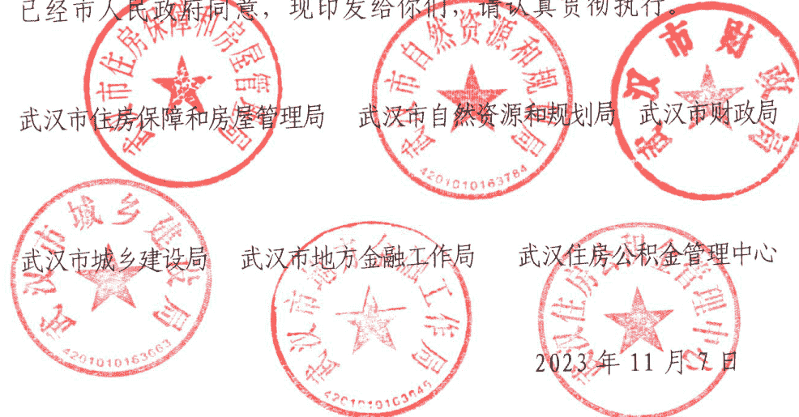

# 关于支持危旧房合作化改造试点项目的若干措施（试行）

为深入贯彻省委、省政府决策部署，探索以“共同缔造”理念、市场化方式推进危旧房改造，改善人民群众居住环境，促进城市有机更新，结合本市实际，现对危旧房合作化改造试点项目明确如下支持措施：

# 一、可开展危旧房合作化改造的小区范围

未列入房屋征收计划，且符合下列条件之一的规划为居住用地的危旧房小区可开展合作化改造：一是80%以上面积的建筑建成时间超过25年，确需改造改善居住条件的；二是小区部分房屋出现主要承重构件损坏、房屋沉降、外墙、地坪开裂、房屋长期渗漏水等情况，或被鉴定为C级或D级危房，影响小区整体居住功能的。

# 二、土地规划及住房支持政策

- （一）小区拆除后重新供应地块可按照用地建设强度管理规定、用地兼容性规定确定建设指标。
- （二）支持原业主将土地使用权在合作社统一指导下以合作改造方式交易至合作化改造承接单位，土地出让金按国家规定的最低标准核定。
- （三）鼓励新建房屋户型创新，增加居住舒适度。
- （四）允许还建住宅与商品住宅独立成栋。
- （五）允许按照不低于0.5辆/户的标准配建停车位，非机动车停车位数量不低于改造前水平。
- （六）还建住宅再次交易不设时间限制。
- （七）新建项目可不配建各类保障性住房。在配建装配式建筑方面适当降低比例或不予强制。各行业主管部门应在土地供应前明确具体标准。
- （八）在符合规划技术标准及片区承载力的前提下，小区按照武汉市现行居住区配建标准额外新增建设公益性公共服务设施并无偿移交给政府指定部门的，可按照额外新增公益性公共服务设施建筑面积的1倍（不含额外新增无偿移交的面积）增加小区总计容建筑规模。有关新增建设方案应在危旧房改造方案中明确。

# 三、税费支持措施

危旧房合作化改造项目纳入棚户区改造范围时，执行相关税费政策。

# 四、审批支持措施

- （一）列入市级重点项目目录，享受绿色通道。
- （二）允许项目分期实施、分期验收。
- （三）依法简化合作化改造机构登记备案、建设用地规划许可证、建设工程规划许可证、施工许可证等审批程序，缩短相关手续办理时间。

# 五、专项补贴支持措施

- （一）政府对危旧房小区合作化改造项目给予专项补贴，补贴金额不高于该项目缴交的市、区政府可支配收益。
- （二）项目土地出让金征收后，合作化改造承接单位可提出补贴申请，市直相关部门在30日内完成相关程序。

# 六、配套资金支持政策

- （一）支持金融机构为符合条件的项目配套提供长周期、低利率贷款。
- （二）纳入改造项目内的房屋产权人及其配偶、父母或子女，可以申请提取住房公积金，用于支付房屋产权人实际出资的改造费用。
- （三）设立危旧房合作化改造基金，对符合条件的项目，提供过渡性资金支持。

# 七、专项改造优惠政策

危旧房合作化改造项目纳入棚户区改造计划，享受棚户区改造资金补助。符合条件的，纳入武汉市既有住宅增设电梯补贴政策范围，给予加装电梯补贴。

# 八、其他

- （一）对改造过程中需要争取专项政策支持的重点问题，采取一事一议的方式支持。
- （二）各区、各职能部门可依据相关法律法规，结合实际制定具体办法、措施或实施细则。
- （三）合作化改造小区的建筑方案、户型设计、配套设施、还建房分配方案等应充分征集参与试点的小区居民意愿。房屋产权人出资应实行封闭管理，接受合作社监管。
- （四）合作化改造小区居民共同委托承接单位从事具体改造工作，承接单位应为合法注册、具有房地产开发企业资质或建筑企业资质、无不良记录的企业。

## 二、危旧房合作化改造

## （二）其他城市政策

# 广州市住房和城乡建设局

# 广州市规划和自然资源局

# 关于印发广州市城镇危旧房改造实施办法（试行）的通知

穗建规字〔2024〕15号

各有关单位：

《广州市城镇危旧房改造实施办法（试行）》业经市人民政府同意，现印发给你们，请遵照执行。执行中遇到的问题，请径向市住房城乡建设局、市规划和自然资源局反映。

广州市住房和城乡建设局  
广州市规划和自然资源局  
2024年6月28日

# 广州市城镇危旧房改造实施办法（试行）

## 第一章　总则

**第一条** 为深入贯彻“人民城市人民建、人民城市为人民”的要求，实施城市更新行动，打造宜居、韧性、智慧城市，根据《支持城市更新的规划与土地政策指引》（自然资办发〔2023〕47号）等文件规定，推进城市更新落地实施，消除房屋安全隐患，保障人民生命财产安全，改善人居环境，完善配套功能，切实解决民生问题，现就开展城镇危旧房改造工作，结合我市实际，制定本办法。

**第二条** 本办法适用于广州市行政区域范围内国有土地上危旧房的改造。

危旧房是指砖木结构房屋或经房屋使用安全鉴定单位根据国家、省危险房屋鉴定标准鉴定危险等级为B级、C级和D级，或根据国家、省房屋完损等级评定标准鉴定为一般损坏房、严重损坏房、危险房的单幢危旧房屋或危旧房屋所在的老旧小区。其中，鉴定为B级或一般损坏房实行“愿改则改”，砖木结构、鉴定为C、D级或严重损坏房、危险房实行“应改尽改”，消除房屋安全隐患，提升人居环境与品质。

涉及不可移动文物、历史建筑、传统风貌建筑、革命遗存、工业遗产等法律、法规规定的保护对象及预先保护对象，或位于历史文化名镇、历史文化名村、历史文化街区、历史风貌区、传统村落、历史名园、特色风貌林荫路、军事保护区以及宗教活动场所内的危旧房改造，还应按相关法律、法规、规章和保护规划执行。

对纳入土地储备计划、征收计划的国有土地上危旧房，按照我市国有土地上房屋征收与补偿有关规定执行，不适用本办法。

**第三条** 市住房城乡建设行政主管部门负责本市范围内危旧房改造综合协调及相应建设管理工作。

市、区规划和自然资源行政主管部门按分工负责危旧房改造工程规划管理工作，参与拆除翻建类危旧房改造联合会审，依职权办理建设工程规划许可、规划核实、补缴土地出让金、确权登记等手续。

**第四条** 各区人民政府应组织协调有关部门做好辖区范围内的危旧房改造、房屋使用安全监督及管理工作。

区住房城乡建设行政主管部门负责统筹辖区范围内的危旧房普查、督促治理和指导项目建设单位组织实施改造，指导属地镇街对限额以下项目进行方案审查和备案，对无主危旧房实施代管并治理，承担危旧房改造工程的消防设计审查、验收、备案和抽查工作，负责限额以上危旧房改造工程的相关行政许可及施工质量安全监督工作。

区发改、城管、财政、水务等相关部门依职能配合和指导辖区范围内危旧房改造实施的相关工作。

镇人民政府、街道办事处应当协助上级人民政府和有关部门开展危旧房普查，依职责制止、查处、拆除改造过程中违法建设，承担辖区范围内危旧房督促治理以及应急抢险的具体组织实施，并负责办理未达到施工许可证办理限额的房屋建筑工程的开工建设信息录入手续及工程质量安全管理等工作。

**第五条** 城镇危旧房改造工作应当遵循“尊重历史、实事求是、多措并举、分类实施、因地制宜、绿色安全、优化简化”的原则，打造绿色、宜居、韧性、智慧的“好房子”。

**第六条** 在确保改善房屋安全状况及不突破生态环境底线管控要求，且周边条件允许的情况下，城镇危旧房可采取以下方式实施改造提升：

- （1）维修加固。在不影响房屋结构安全前提下，通过局部拆换（或加固）建筑组成部分、完善使用功能和配套设施、强化安全防护措施等方式予以改造。
- （2）拆除翻建。通过整体拆除翻建并优化相关使用功能和配套设施方式予以改造。

**第七条** 城镇危旧房屋改造项目鼓励户型设计和空间布局创新，完善配套设施，优化使用功能，与周边环境相协调，提升人居环境与品质，推广应用新型工业化建造，并按以下标准进行改造提升：

- （一）单幢危旧房屋可按不增加户数、不改变原建筑用途、基本不扩大原建筑基底、基本不改变四至关系的标准进行改造提升，并鼓励与周围相邻建筑开展连片集中改造。
- （二）老旧小区可按不增加户数、不改变原建筑用途、不突破用地红线的标准实施拆除翻建，并宜按照集约用地原则优化空间布局，采取多、高层建筑方式实施改造建设，适当增设公共活动空间和公共服务配套设施，完善小区人居环境。

**第八条** 城镇危旧房改造项目由房屋使用安全责任人自主筹资实施，也可依法引入市场主体合作改造实施。

其中，政府公房改造资金根据我市国有资产管理规定，分别纳入市、区有关业务主管部门预算统筹解决。

## 第二章　政策支持

**第九条** 危旧房采取拆除翻建方式实施改造提升属于存量国有建设用地再利用，无需办理供地手续。

- （一）如原房屋建设时的净用地范围与建筑基底一致，则翻建只能在原房屋建筑基底内进行。
- （二）如原房屋建设时的净用地范围大于建筑基底，则翻建可在原净用地范围内进行。

**第十条** 为满足基本生活需求，改善人居环境，城镇危旧房改造项目符合下列情况的可适度增加建筑面积、增配服务设施：

- （一）对于非成套住宅进行成套化改造，在确保安全的前提下，原每户套内可完善厨房、卫生间等必备设施功能，具体使用面积厨房约4平方米，卫生间约3平方米；对于套内建筑面积不超过90平方米成套住宅，每户原有厨房、卫生间面积小于《住宅设计规范》（GB 50096-2011）最低标准的，可以适当增加使用面积，其中厨房按约4平方米，卫生间按约3平方米适当增加；套内建筑面积超过90平方米的住宅原则上不得增加套内面积。
- （二）在符合历史文化名城保护要求，与周边环境相协调，不影响相邻建筑物的通风、采光和日照的前提下，有条件的城镇危旧房屋改造项目可增设电梯、交通必需的公共走廊、无障碍设施、地下停车库等配套及附属设施，补充必要的市政基础设施、公共服务设施与公共安全设施；鼓励通过增加首层架空、利用天面绿化等方式，增加社区公共活动和交往空间。

以上新增建筑面积应按照广州市建筑工程容积率计算有关规定计算规划容积率面积，其中地上建筑规模增量原则上不超过30%。

**第十一条** 受各种客观历史条件限制，拆除翻建的城镇危旧房改造项目，满足现行相关建筑设计技术标准确有困难的，在保障公共利益、妥善考虑相邻关系人利益的前提下，间距、建筑退让、绿地率等指标和要求可按不低于现状水平控制，但应综合运用新技术、新设备、新材料、加强性管理等保障措施提高结构、消防安全水平，并通过第五立面利用、垂直绿化等方式提高绿化水平。

**第十二条** 城镇危旧房改造项目原则上应按现行国家工程建设消防技术标准进行设计。

若受各种客观历史条件限制，建筑防火间距和消防车道、消防救援场地设置等难以满足现行国家工程建设消防技术标准的，可维持现状或执行原消防技术标准，但应根据实际情况，采取提高建筑外围护结构防火性能、增设室外消火栓以及加强后期使用管理等加强性措施。

**第十三条** 城镇危旧房改造项目房屋产权手续不全的，由区政府负责组织完善手续，在土地及房屋主体、功能、面积无争议的前提下，可先行办理危旧房改造相关手续。

**第十四条** 鼓励银行机构提供专项融资服务，支持通过房地产抵押进行融资担保，支持房屋安全责任人按规定通过提取物业专项维修资金、单位住房维修基金、个人公积金（住房补贴）以及公积金贷款等方式筹集改造资金。

## 第三章　改造程序

**第十五条** 危旧房所有权人是房屋使用安全责任人，为危旧房改造活动的主体。房屋所有权人下落不明或者房屋权属不清晰，有代管人的，代管人是房屋使用安全责任人；无代管人的，房屋使用权人是房屋使用安全责任人。若无法确认房屋使用安全责任人的，可按本市房屋使用安全管理有关规定确认。

**第十六条** 多产权人的城镇危旧房需经不低于90%的房屋使用安全责任人表决同意改造并确定项目建设单位后，方可启动改造。鼓励成立自主更新委员会代表全体房屋使用安全责任人发起和开展相关改造工作。

房屋使用安全责任人可自主委托政府、原房改房单位、物业服务企业、国有企业等作为项目建设单位。由项目建设单位开展意愿征求、改造项目方案编制、改造协议签订、报建报批、工程建设（工程设计）等具体工作。

单一产权的危旧房改造，可直接开展下步工作。所在乡镇（街道）、社区应当对危旧房改造工作给予支持和引导。发挥党建引领作用，做好居民的解释和疏导，积极促成项目实施。

**第十七条** 项目建设单位应当委托有相应资质的设计单位进行危旧房改造项目方案设计。设计方案应满足结构、安全需要，符合建筑风貌管理要求。如涉及原不动产单元界址、面积等发生变动的，设计方案应进行标注。

多产权人的城镇危旧房改造项目设计方案应充分征求房屋使用安全责任人的意见，并根据反馈意见予以优化完善。区住房城乡建设行政主管部门应会同区规划和自然资源行政主管部门对项目建设单位做好设计方案的必要性、可行性、合理性等方面指导工作，出具指导意见。

**第十八条** 项目建设单位应依据经各方认可的设计方案编制实施方案并充分征求房屋使用安全责任人意见，实施方案内容应包括改造范围、改造内容、成本测算及资金筹措、房屋产权分配方案、工程周期、后续物业管理方案等。

**第十九条** 项目设计方案及实施方案经不低于90%的房屋使用安全责任人依法表决同意后，方可开展下一步工作。

单一产权的危旧房改造，可直接编制项目设计方案开展下步工作。

**第二十条** 项目建设单位与全体房屋使用安全责任人签订改造协议。协议内容应当包括权利义务、违约责任、实施方案、设计方案、签约时间等。签约面积达到专有部分面积四分之三以上且房屋使用安全责任人签约比例达到四分之三以上的，协议方可生效。协议生效后，项目建设单位按照规定办理报批报建手续，开展相应加固或者拆除重建工作。

未达到签约比例的，项目自动终止。

单一产权的危旧房改造，可直接开展下步工作。

**第二十一条** 城镇危旧房项目按以下程序办理相关报建手续：

- （一）对维修加固项目，不增加建筑面积、建筑高度、建筑层数且不涉及修改外立面、建筑结构和变更规划用途的，无需办理规划手续。其中，达到限额以上工程的维修加固项目，项目建设单位持申请材料到区建设主管部门依法办理建筑工程施工许可证；属于限额以下工程的，项目建设单位持申请材料直接到所属街道（镇）办理“开工信息录入”手续后即可组织实施，项目完工后由项目建设单位自行完成竣工验收。

- （二）对拆除翻建项目，由区住房城乡建设行政主管部门牵头受理改造申请，并组织区规划和自然资源行政主管部门、属地街道（镇）等相关单位进行联合会审，并出具联审意见。经审查通过的，区规划和自然资源行政主管部门应当会同项目属地街道（镇），将设计方案在改造现场公示（公示时间不少于15日）。

公示期满无异议、异议不成立或异议已妥善处理的，其中达到限额以上工程的拆除翻建项目，区规划和自然资源、住房城乡建设行政主管部门依据联审意见核发建设工程规划许可证、施工许可证；属于限额以下小型工程的拆除翻建项目，区规划和自然资源行政主管部门依据联审意见核发建设工程规划许可证后，建设单位到所属街道（镇）办理“开工信息录入”手续。

**第二十二条** 城镇危旧房改造项目依法完成相关建设手续办理后，依据经批准的项目设计方案实施改造。工程完工后，项目建设单位应当按规定办理规划核实、竣工验收，验收合格方可交付使用。

**第二十三条** 危旧房完成改造后，当事人可按不动产登记相关规定申请办理产权登记，对需补缴土地出让金的，按本市出让金计收规则计收。

## 第四章　监督管理

**第二十四条** 各区人民政府应组织规划、建设、城管执法等部门建立联合监管与执法衔接机制，落实危旧房屋改造的全过程监管职责，加强日常巡查工作，依法拆除存在重大安全隐患的违法危旧房屋，制止和查处改造过程中违法建设行为，确保公共安全。

房屋使用安全责任人应当定期检查、维修房屋，及时消除房屋安全隐患，配合各级政府、有关部门等做好房屋使用安全普查、巡查和应急抢险等活动。

## 第五章　附则

**第二十五条** 本办法由市住房城乡建设行政主管部门、市规划和自然资源行政主管部门负责解释。区人民政府可以结合实际制定具体操作细则。

各区政府可在本办法基础上，参照优化营商环境政策要求，结合实际进一步明确和优化危旧房改造项目的审批程序，简化审批前置要件，压缩审批时间。

**第二十六条** 本办法自2024年7月2日起施行，有效期3年。
