# 重疾风险管理

# 扫码加入 **知识星球TOP** 免费资源群

- 每日免费获取高价值资源
- 可提供各类资源搜索服务
- 热门付费文章
- 各行各业报告
- 精选图书资源
- 副业赚钱方法
- 职场实用资源
- AI政经自媒体

分享资料仅供个人学习，请及时删除，切勿商用传播

# 保险人群癌症具有一定的逆选择

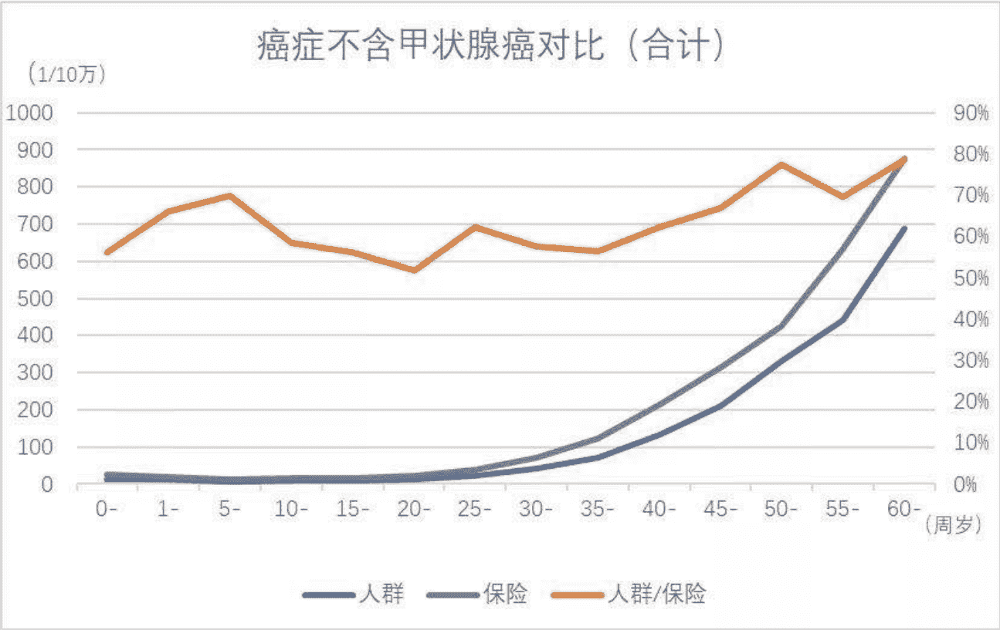

# 保险人群轻症占比远高于人群的甲状腺癌占比

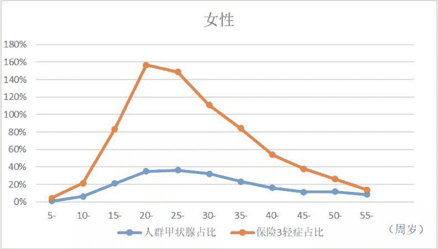

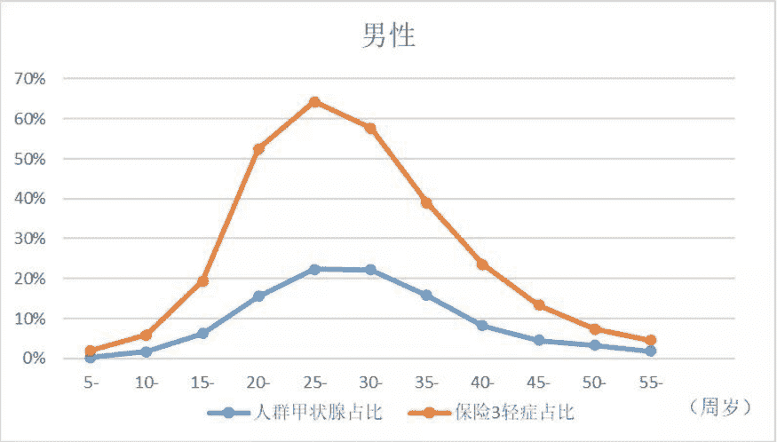

# 重疾险认识的三个阶段

# 昂贵的医疗费用

## 健康保险的产品与分类

- 根据保障范围不同
  1. 医疗费用保险（medical expense insurance）
  2. 重大疾病保险（dread disease/critical illness insurance）
  3. 失能收入保险（disability loss income insurance）
  4. 长期护理保险（long-term care）

# 冠状动脉

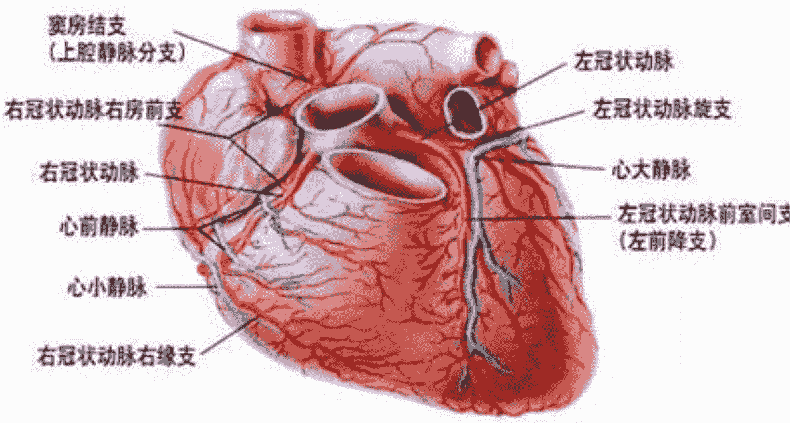

# 无创检测方法

- 内皮功能异常
- CT
- MRI
- PET
- 核素闪烁扫描
- 心脏超声
- 心电图

# 有创检测方法

- 光学相干断层成像（OCT）、血管内超声（IVUS）
- 冠脉造影

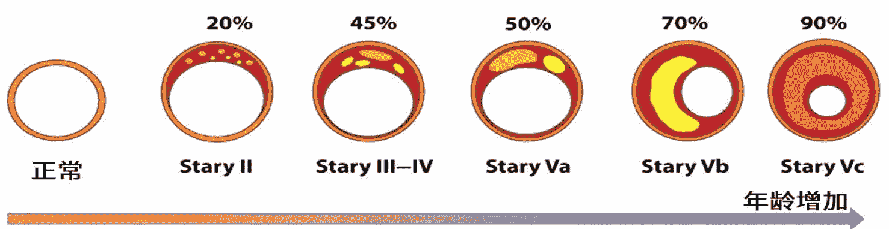

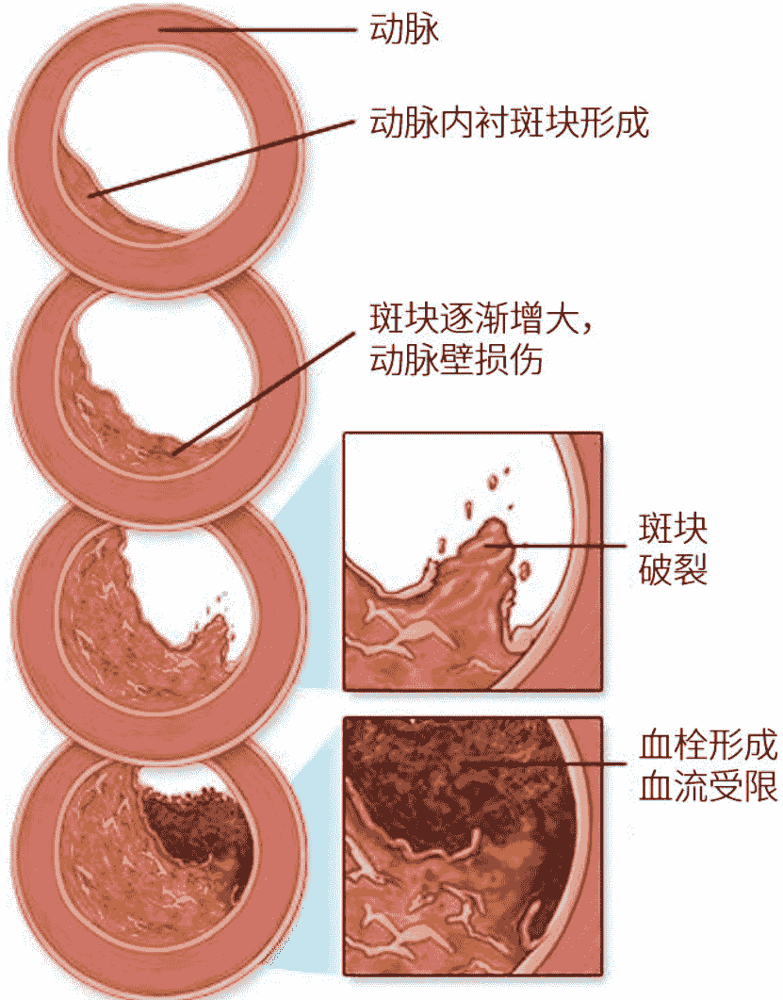

动脉

动脉内衬斑块形成

斑块逐渐增大，动脉壁损伤

斑块破裂

血栓形成

血流受限

# 心肌梗塞

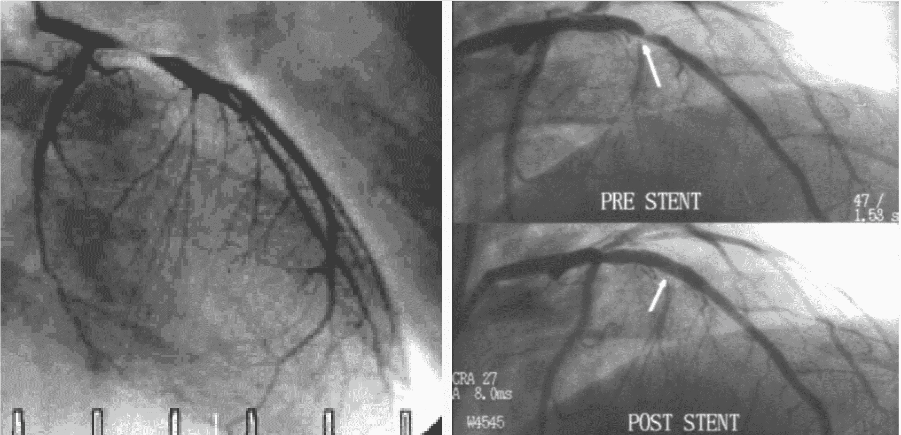

# 支架

# 冠状动脉搭桥术

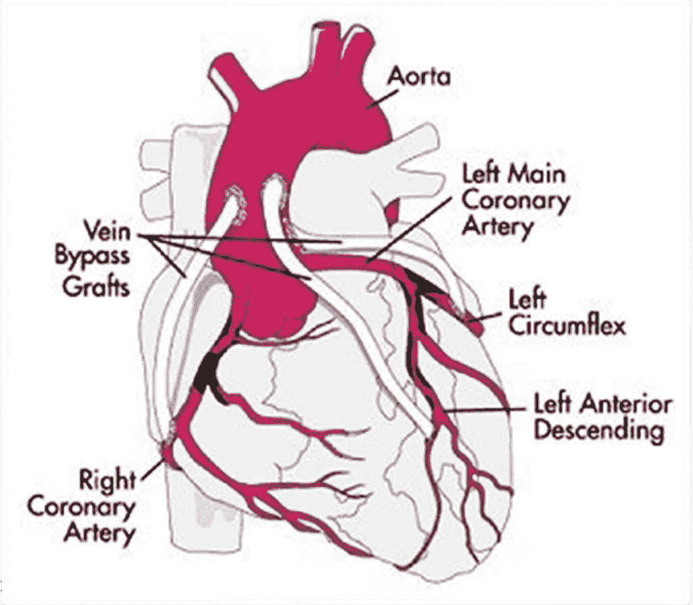

# Treatment alternatives CABG

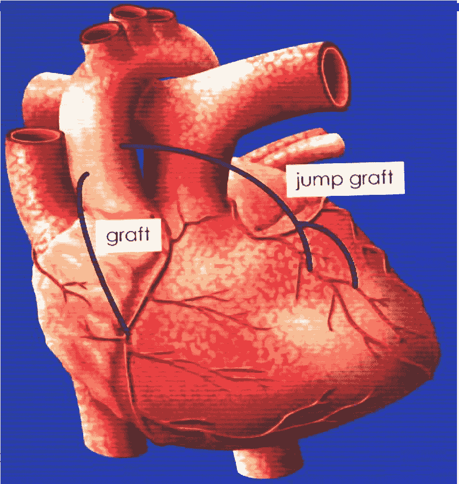

# 脑中风后遗症

2016年发表在《柳叶刀》杂志上的研究结果显示：

全球90.7%的脑卒中与以下10个因素有关：

高血压、糖尿病、血脂异常、心脏疾病、吸烟、酒精摄入、不健康饮食、腹型肥胖、体力活动不足和心理因素。

### 主要疾病

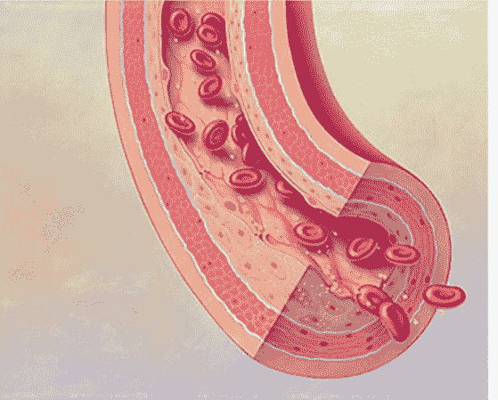

# 动脉硬化

# 癌

# 恶性肿瘤分类命名规则

白血病和淋巴瘤大约占到恶性肿瘤的5%。

淋巴瘤

白血病

绝大部分恶性肿瘤来源于上皮组织，称为“癌”，如皮肤、腺体、呼吸道、消化道等。

立方上皮细胞

鳞状上皮细胞

结缔组织来源的恶性肿瘤称为“肉瘤”，如骨、软骨、肌肉、脂肪等。

成软骨细胞

骨细胞

# 癌症

### 癌症（定义）

是指一种或多种恶性肿瘤，以恶性细胞不断生长和扩散，并**浸润**到正常组织为特征，包括恶性淋巴瘤和恶性骨髓异常增生。

- 下列肿瘤除外：
  1. 何杰金氏病1期
  2. ……
  10. 仅通过内窥镜进行治疗的肿瘤

**癌症诊断**是指由专门从事病理解剖或病理诊断的医生**依据病理证据**作出符合上述癌症定义的诊断。病理证据是基于对固定组织或血液系统标本所作的阳性病理报告，是以对可疑组织的细胞结构和形态检验得出的结果为标准，**任何组织涂片检查和穿刺活检结果不作为病理证据**。

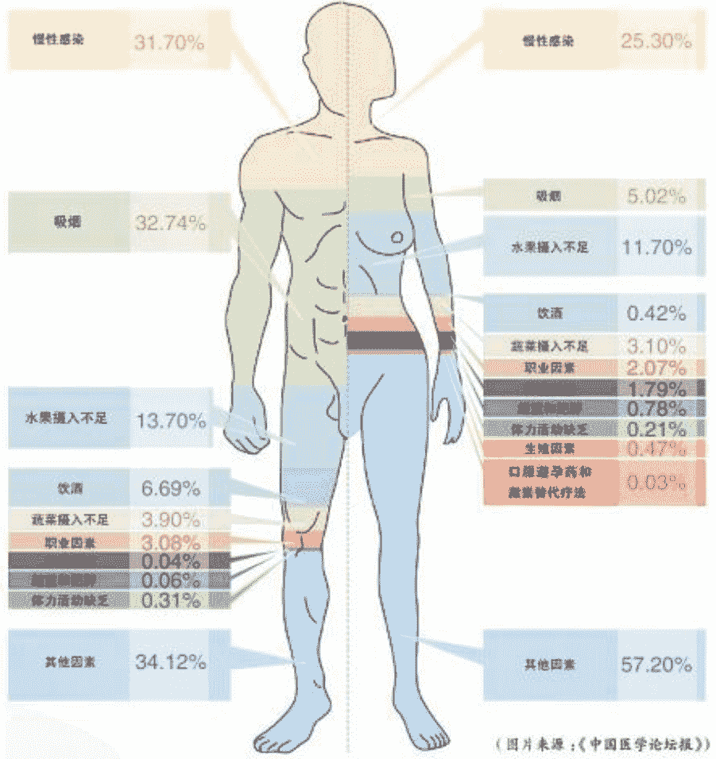

# 中国人群（男性和女性）癌症归因风险值图

该研究首次系统评价了中国人群环境行为危险因素对癌症发病和死亡的贡献，对我国的癌症预防和控制具有非常重要的意义。

# 23种生活方式

吸烟

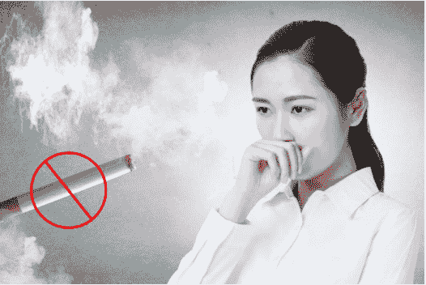

二手烟

#### 行为因素（4种）

饮酒

缺乏锻炼

# 23种生活方式

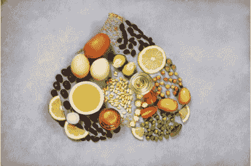

## 摄入不足：

水果、蔬菜、膳食纤维、钙

#### 饮食因素（7种）

## 摄入过多：

红肉、加工肉类制品、腌菜

#### 代谢因素（2种）

体重超标、糖尿病

# 23种生活方式

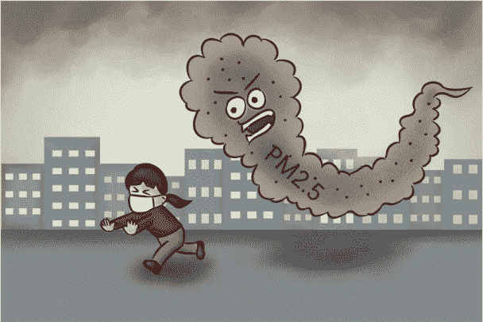

#### 环境因素（2种）

PM2.5污染、紫外线辐射

#### 感染因素（8种）

**1种细菌：**幽门螺杆菌  
**6种病毒：**乙型肝炎病毒（HBV）、丙型肝炎病毒（HCV）、人乳头瘤病毒（HPV）、EB病毒（EBV）、人类免疫缺陷病毒（HIV）、人类疱疹病毒8型（HHV-8）  
**1种寄生虫：**华支睾吸虫（肝吸虫）

# 早期癌症发现的十大信号

1. 不明原因体重减轻
2. 不明原因早起时鼻子出血
3. 持续咳嗽
4. 长期异常的肿块或结节
5. 持续性腹部疼痛或消化不良
6. 尿血或便血
7. 不规则的阴道出血
8. 迅速增大的黑痣或疣
9. 说话声音嘶哑
10. 进食时吞咽困难

# 2018年1月30日《柳叶刀》发布全球癌症生存趋势监测报告

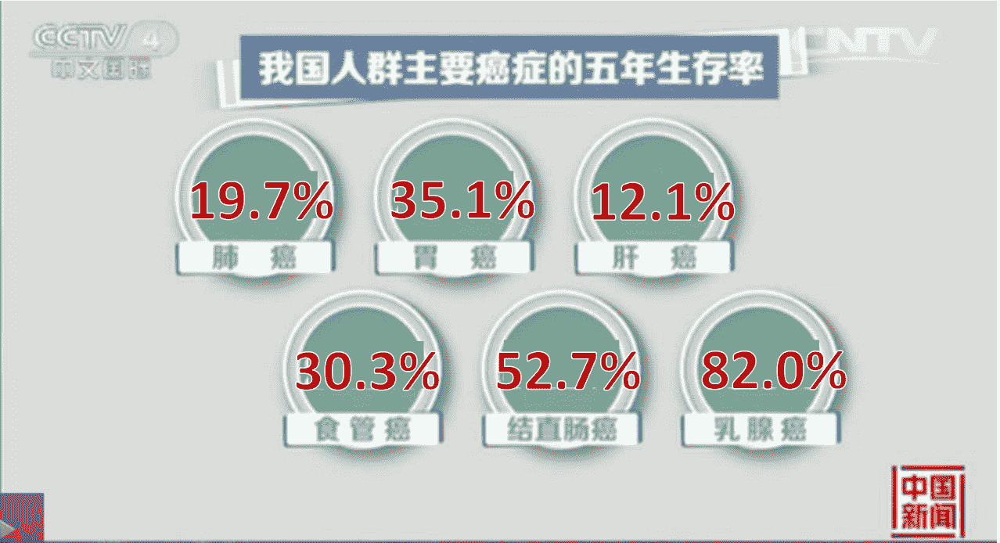

# 五年存活率

#### 日本

#### 中国

| 癌症类型 | 日本五年存活率 | 中国五年存活率 |
|---|---:|---:|
| 胃癌 | 70.4% | — |
| 大肠癌 | 73.4% | — |
| 肺癌 | 40.6% | 40.5% |
| 乳腺癌 | 90.0% | — |
| 子宫颈癌 | 78.3% | — |

# 5年存活率

#### 整体存活率

| 中国 | 美国 |
|---|---|
| 乳腺癌（女）：< 60% | 乳腺癌（女）：89% |
| 大肠癌：40% | 大肠癌：64% |
| 食管癌：6.9% | 食管癌：17% |
| 肾癌：不详 | 肾癌：71% |
| 喉癌：40% | 喉癌：61% |
| 肝癌：< 3% | 肝癌：15% |
| 肺癌：8–10% | 肺癌：16% |
| 皮肤黑色素瘤：80–90% | 皮肤黑色素瘤：91% |
| 口腔癌、口咽癌：不详 | 口腔癌、口咽癌：62% |
| 全癌症存活率：25–30% | 全癌症存活率：66% |

#### 整体存活率

| 中国 | 美国 |
|---|---|
| 卵巢癌（女）：< 30% | 卵巢癌（女）：44% |
| 胰腺癌：4% | 胰腺癌：6% |
| 前列腺癌（男）：30% | 前列腺癌（男）：99% |
| 胃癌：35% | 胃癌：27% |
| 睾丸癌（男）：不详 | 睾丸癌（男）：95% |
| 甲状腺癌：< 80% | 甲状腺癌：98% |
| 膀胱癌：不详 | 膀胱癌：78% |
| 子宫颈癌（女）：< 55% | 子宫颈癌（女）：68% |
| 子宫体癌（女）：不详 | 子宫体癌（女）：82% |

# 5年存活率

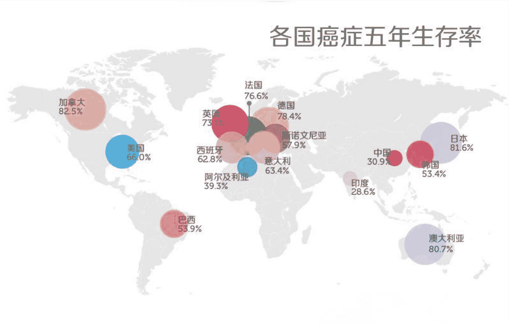

# 2015年中国肿瘤登记年报

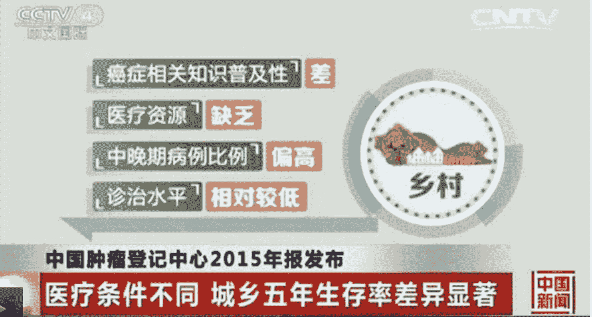

# 中国肿瘤登记中心2015年报发布

# 医疗条件不同，城乡五年生存率差异显著

# 癌症种类不同

# 癌症诊断时的时期不同

# 治疗的规范程度不同

# 癌症的教育认知不同

# 财务支持力度不同

保险有两个社会职能，一个是**风险管理**，一个是**经济补偿**，风险管理的价值不亚于经济补偿，甚至会超越经济补偿。

# 帮助客户看见他看不见的风险

# 通过规划帮助客户规避或分散风险

# 督促客户尽快完成规划

# 肺

# 低剂量螺旋CT

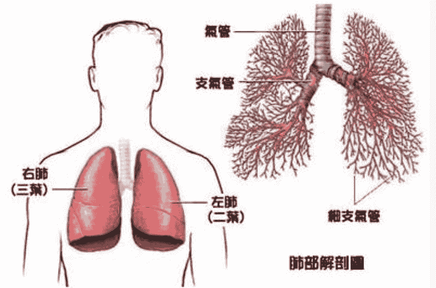

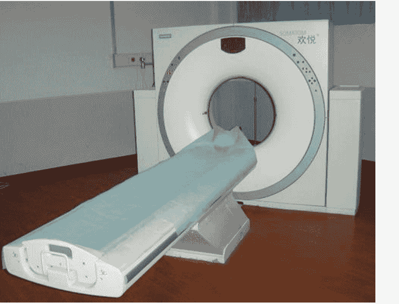

# 乳腺癌

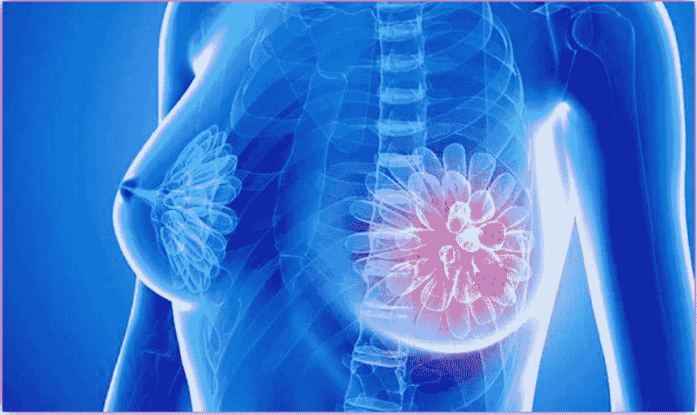

# 乳腺切除

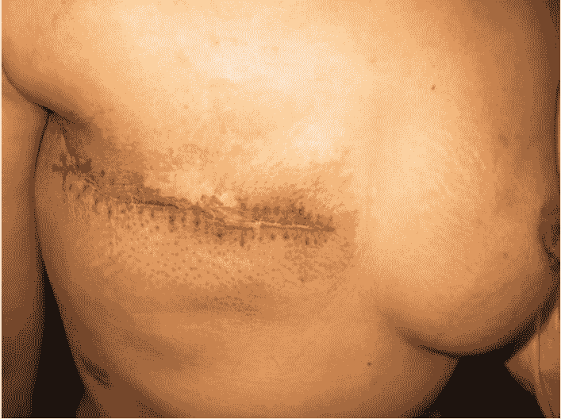

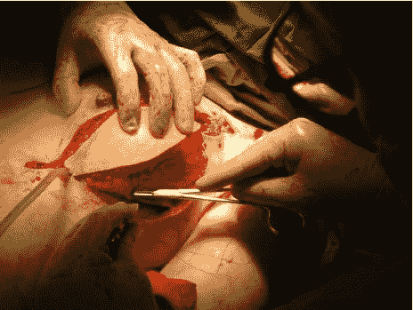

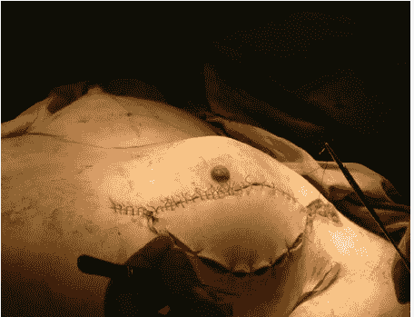

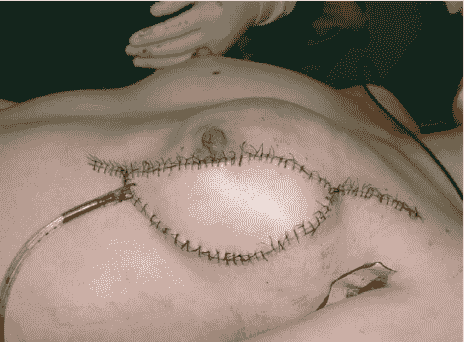

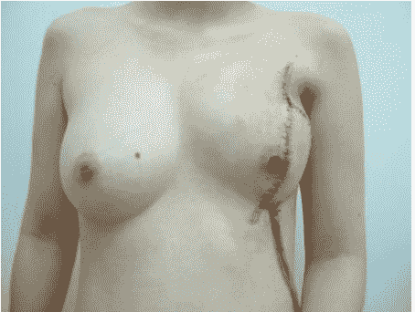

# 乳腺筛查方法

# 乳腺超声＋钼靶

# 乳腺癌的自我检查方法（步骤详图）

第一步：面对镜子，双手叉腰，观察乳房外形、轮廓有无异常。

第二步：举起双臂，观察双乳外形、皮肤、乳头、轮廓有无异常。

第三步：左手触摸右乳房上方、内侧、下方、外侧有无肿块。

第四步：仰卧平躺，肩部稍垫高，举起右手臂，左手触摸右侧腋下、乳房是否有无肿块。（左乳检查更换右手，步骤如上。）

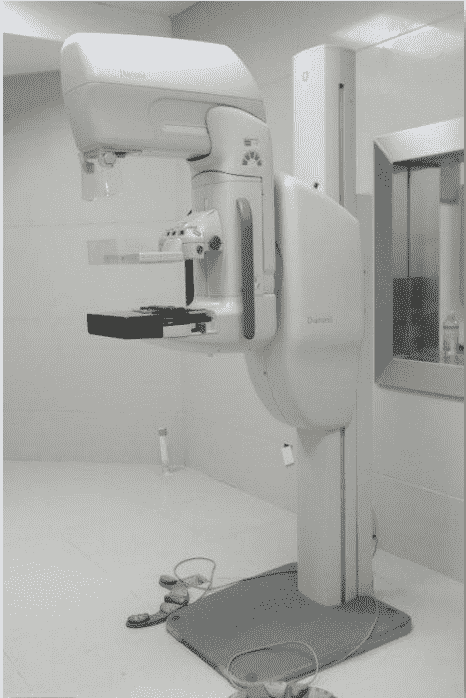

乳腺钼靶

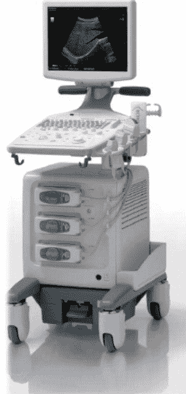

乳腺超声

# 结直肠癌

# 肠镜

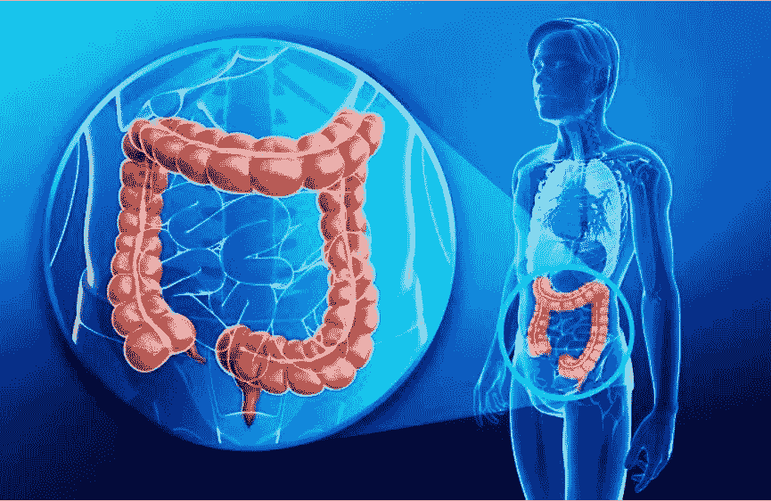

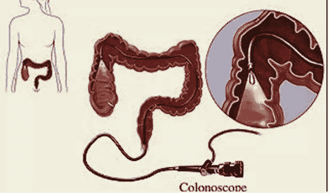

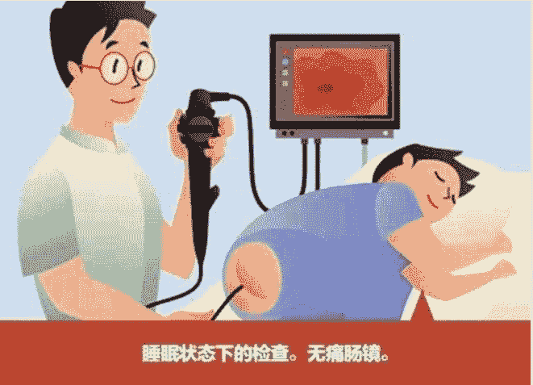

# 宫颈癌

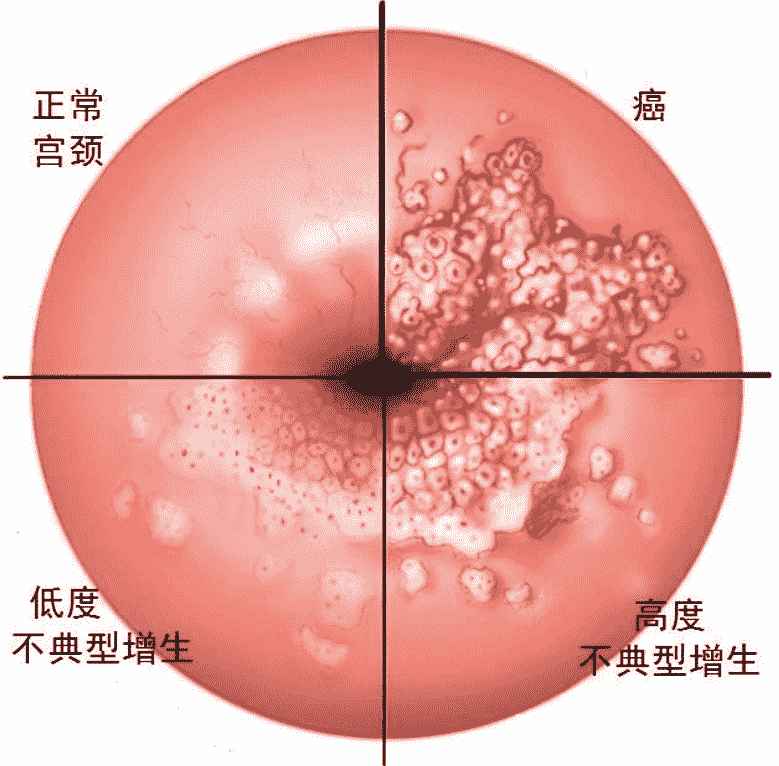

正常宫颈

癌

低度不典型增生

高度不典型增生

TCT（宫颈脱落细胞学）
HPV（人乳头瘤病毒）检查

宫颈癌疫苗：9–12岁

# 甲状腺癌死亡率低

10%属滤泡癌、髓样癌、未分化癌

90%属乳头状癌

十年存活率90%–95%

# 兰赫（阿根廷）里约奥运冠军 肺癌

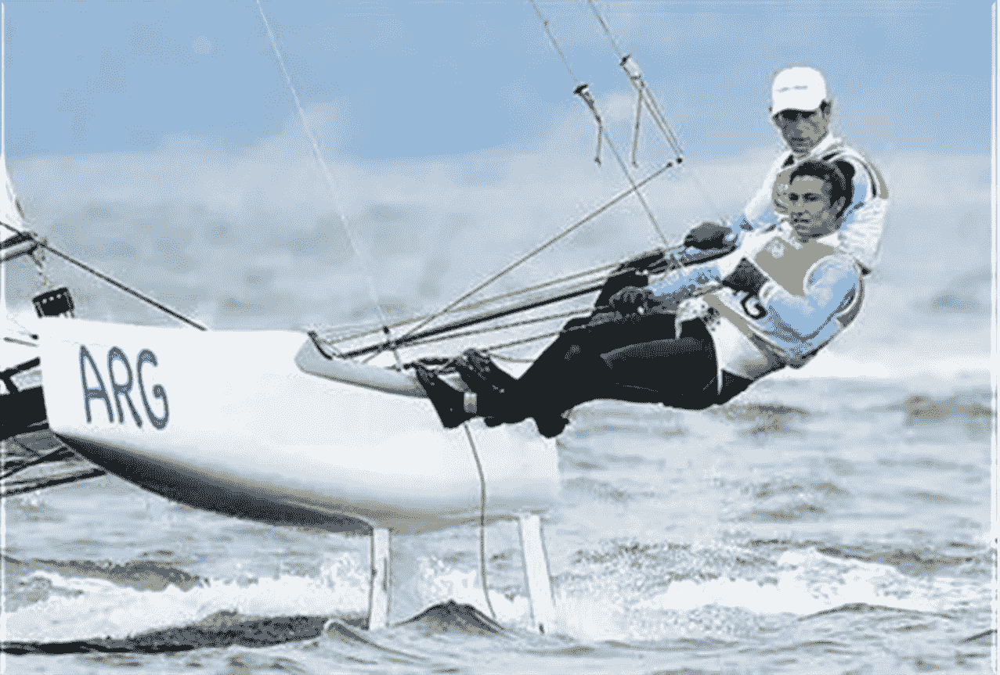

# 埃蒙斯 奥运冠军 甲状腺癌

# 重疾不重 德克尔（荷兰）奥运冠军 宫颈癌

# 左二为德克尔

# 2008年王楠北京奥运会决赛

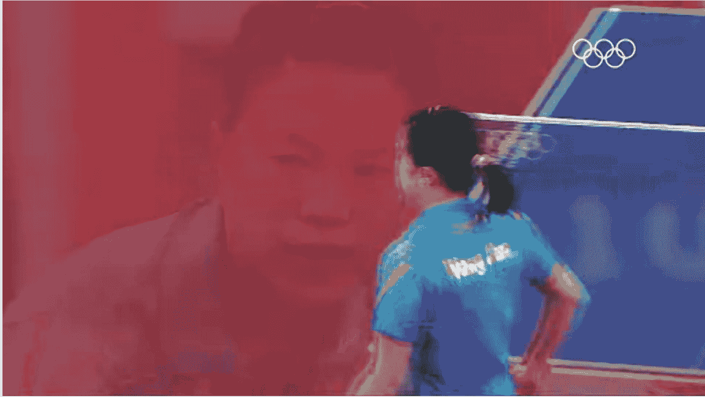

# 2005年王楠被确诊为甲状腺癌

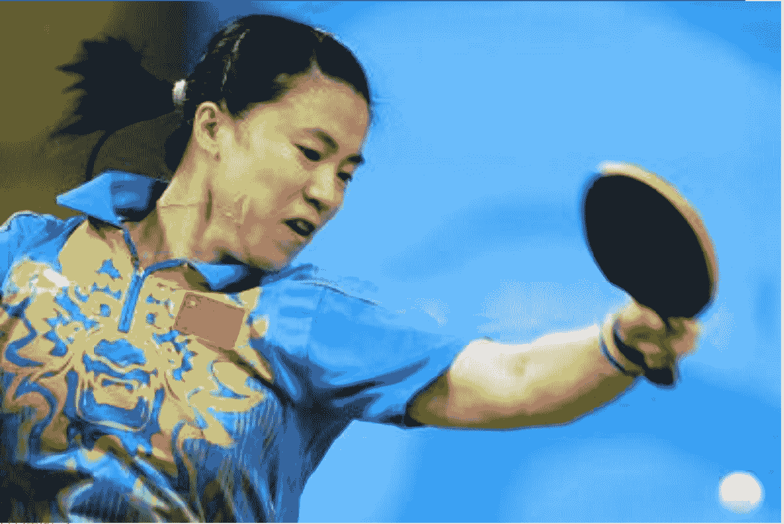

# 2014年罗本世界杯进球

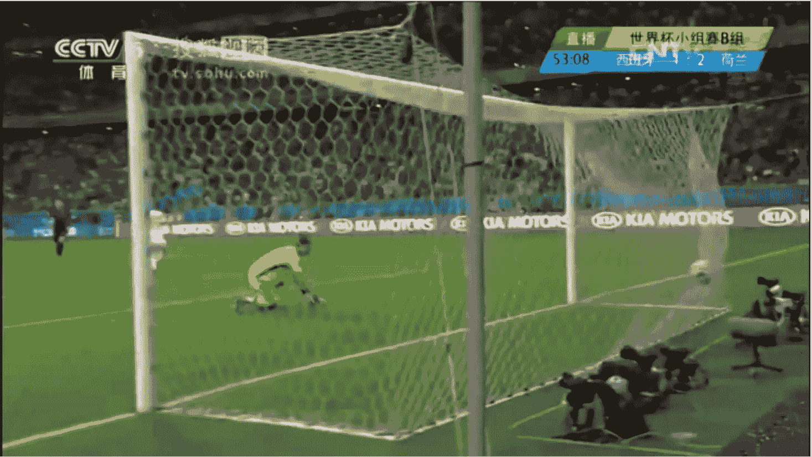

# 2005年罗本因睾丸癌做手术

# 2014年，杰夫·格林领衔常规赛十佳进球

# 重磅不重 2011年12月18日，杰夫·格林被查出患有主动脉瘤

# 癌症并不意味着死亡

- **蔡琴**——2000年发现乳腺癌，由于发现和治疗及时顺利痊愈，她也因此成为台湾最著名的一位抗癌成功的女艺人！
- **汪明荃、罗家英夫妇**——汪1994年患甲状腺癌，2002年再次患乳腺癌，罗2005年发现肝癌，两人至今仍活跃在演艺界。

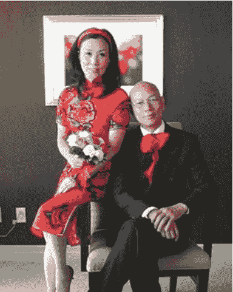

# 名人与重大疾病

李咏

喉癌

终年50岁

金庸

病逝

终年94岁

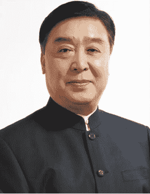

师胜杰

胰腺癌

终年66岁

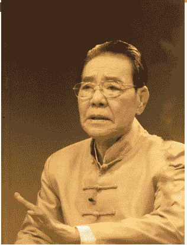

单田芳

病逝

终年84岁

布仁巴雅尔

心肌梗塞，终年58岁

臧天朔

肝癌，终年54岁

霍金

渐冻症，终年76岁

# 癌症是一种慢性病

2006年，世界卫生组织（WHO）公布：**癌症其实也是一种慢性病！**

癌症是最有耐心的“杀手”，接触致癌因素使细胞癌变，到最后形成肿瘤，往往需要几十年的时间。

发病缓慢

提高警惕

癌症通过**及时、有效和长期**治疗，可以像糖尿病、高血压一样得到控制，甚至让患者与癌症和平共处很多年。

长期生存

积极面对

### 三级预防

一级预防：消除病因，降低癌症发生率。

二级预防：早发现、早诊断、早治疗，降低死亡率。

三级预防：康复治疗，提高生活质量，延长生存期。

> WHO顾问委员会于1981年提出。

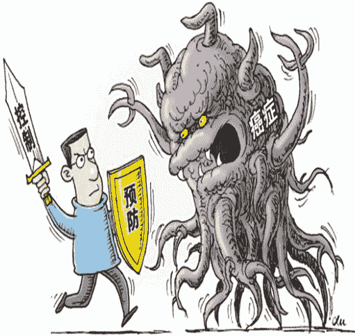

### 三级预防

35%来自于一级预防。

二级预防起到了53%的作用。

仅12%来自于医疗行为。

### 我相信：

> 一个人这一生，  
> 一定会得重大疾病，  
> 如果没有得，  
> 那是因为别的原因先离开了，  
> 还没有机会得。
>
> ——丁云生

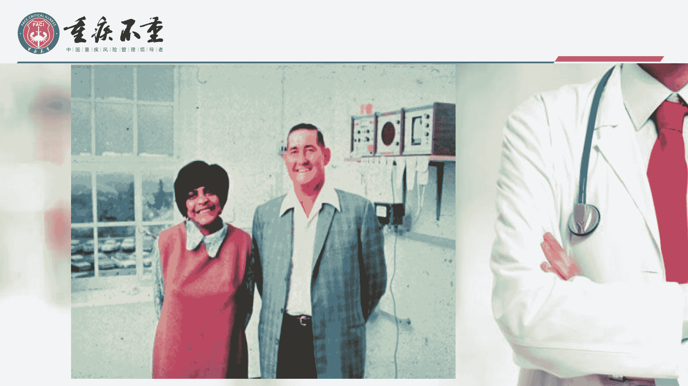

### 如何让重疾不重

### 今天不养生，未来要养医生

- 我们可以透过以下四点及早准备。
- 早期预防：一天一苹果，医生远离我。
- 早期治疗：发现疾病尽速治疗，避免错失黄金治疗期。
- 专业协助：寻求专业医生的诊断，提高治愈率。
- 财务安排：尽早购买足够的重大疾病险。

### 6 财富道

恶性肿瘤治疗费自费比例达90%。

### 有了医保还要上重疾险吗？

每年给汽车买保险上交三千，如果不出险，保费也不会退还。而每年三五千给自己买重疾险的人数，远远低于给汽车买保险的人。车上路尚有保险，而满街没有保险覆盖的人却比比皆是。

买车、买房、买保险已经成为国际中产阶层的“标配”，特别是保险，对于处于上有老下有小的中间一代来说，更为必须。重疾险是除了意外险后第一份应该拥有的保险。市面上保险五花八门，关于重疾险，很多事情应该在投保前就要了解清楚。

### 为啥要买重疾险？

重疾险即重大疾病保险，是指由保险公司经办的以特定重大疾病，如恶性肿瘤、心肌梗死、脑溢血等为保险对象，当被保险人患上述疾病时，由保险公司对其医疗费用给予适当补偿的商业保险行为。

很多咨询者最常见的问题是：患重疾有200万元存款，啥病都能看了，还需要重疾险吗？

其实这是个误区。得了重疾会在较长一段时间内严重影响到患者及其家庭的正常工作与生活。

此外，疾病需要进行较为复杂的药物或手术治疗，需要支付高额的医疗费用；有的会持续较长一段时间，甚至是永久性的。所以，重疾疾病和我们通常意义所理解的疾病并不是一个概念。

何况，家里的存款是家庭应急和储备用的。如果家里的顶梁柱一旦不幸患有重大疾病，除了要花一大笔钱治疗外，未来赚钱的能力也会打折扣。这时候，储蓄要承担家庭保障及家人的生活。就算家里有200万元存款，因病动用家庭储备金也会影响未来的生活质量，这类因病返贫的例子并不少见。

## 保障数量不重要  
### 投保年龄很重要

保险公司在推销自己的重疾险时，喜欢以保额高、疾病数量多说事。市场上有些产品的疾病有80种。比如某保险能够保障的疾病种类是42种，其中第1至25种重大疾病为中国保险行业协会规定的基础性病种，第26至42种重大疾病为规定范围之外的疾病。据了解，规定内的疾病包含恶性肿瘤、急性心肌梗死等，规定外的则包含末期肾病、轻微脑中风后遗症等。

## 恶性肿瘤  
自费比例达90%

### 观念一

1. 我们做这份大病险计划，并不是说我们一定会得这些大病；
2. 我们做这份大病险计划，也不是说我们拿不起看病的钱；
3. 而是说，一旦万一罹患重疾，我们损失的不仅仅是医药费，更大的损失来自于工作收入损失。

### 观念二

保险是保障人创造价值的能力。

所以，不是因为我们有可能患重疾而购买；

> 而是因为我们有创造价值的能力。

### 财富人生图

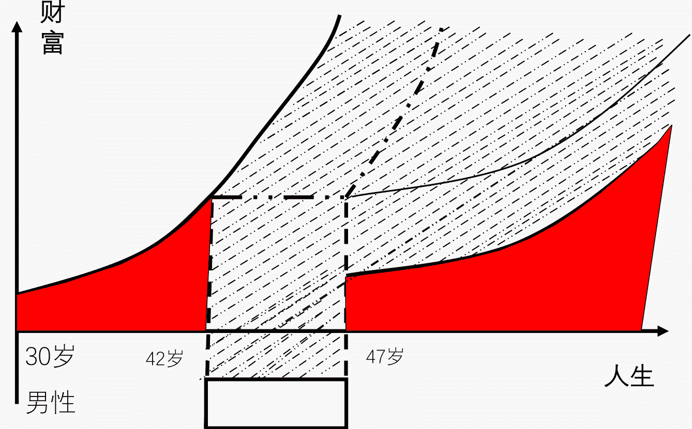

财富

人生

30岁

42岁

47岁

男性

### 财富人生图

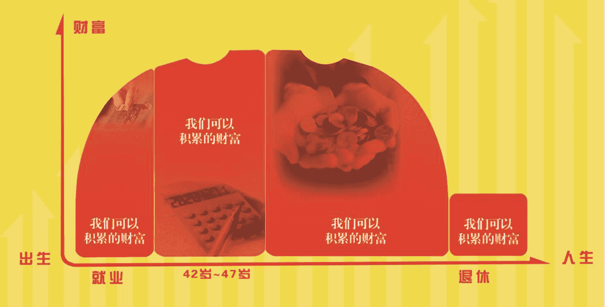

### 财富人生图

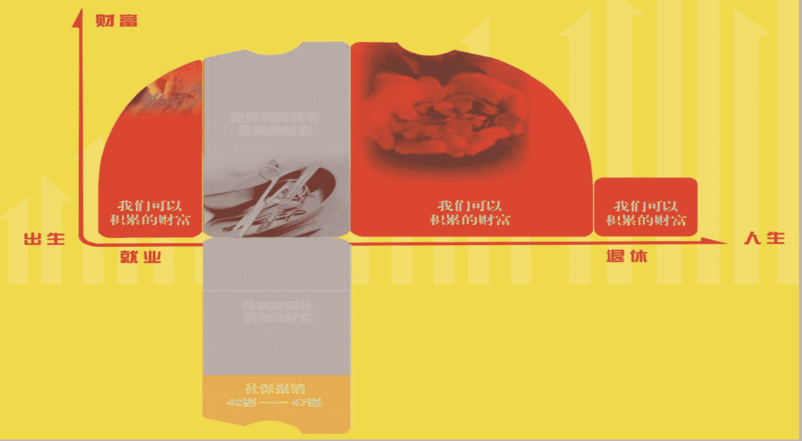

财富

人生

出生

就业

退休

我们可以积累的财富

我们可以积累的财富

我们可以积累的财富

选择到的投资？错失的财富

因疾病等意外损失的财富

养老保障的钱

### 财富人生图

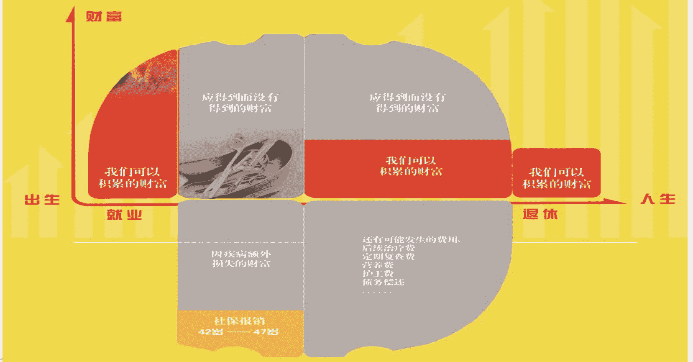

出生

就业

退休

人生

财富

我们可以积累的财富

我们可以积累的财富

我们可以积累的财富

没有得到而没有得到的财富

没有得到而没有得到的财富

因疾病等额外损失的财富

选择可能发生的风险：意外、疾病、失业、投资失败、被诈骗……

健康保障约42.5万—47万元。

## 重大疾病风险管理

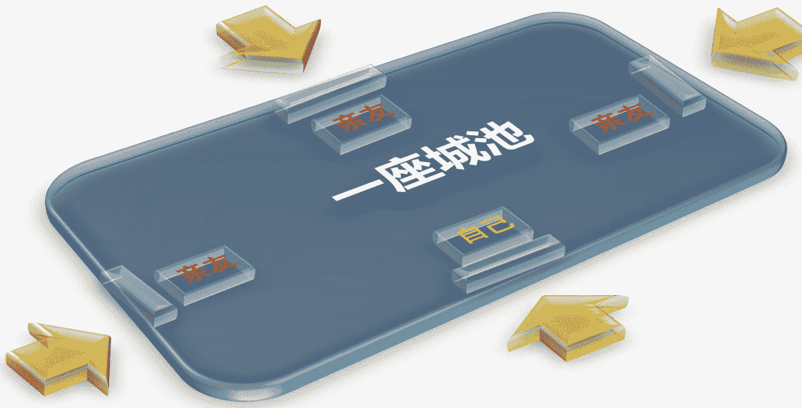

重庆不重版权所有，商标注册号：15203114

### 重疾险认知的三个阶段

最贵的医疗费用

工作收入损失的补偿来提高五年生存率

### 市场环境

对于客户来讲，

重疾险早已不是买不买的问题，

而是跟谁买、买多少的问题。

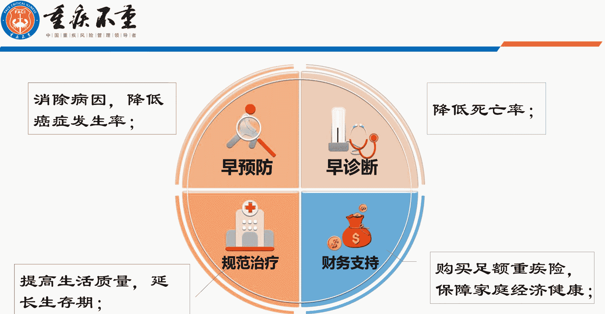

消除病因，降低癌症发生率；

降低死亡率；

提高生活质量，延长生存期；

购买足额重疾险，保障家庭经济健康；

早预防

早诊断

规范治疗

财务支持

### 重疾险产品结构解析

### 重疾险产品结构

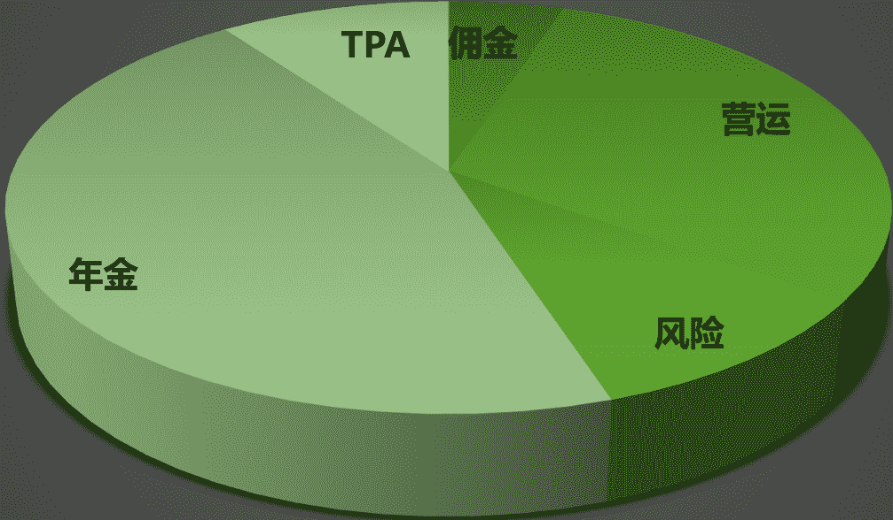

佣金

营运

风险

年金

TPA

- 佣金
- 营运
- 风险
- 年金
- TPA

### 重庆二次诊断疾病分类

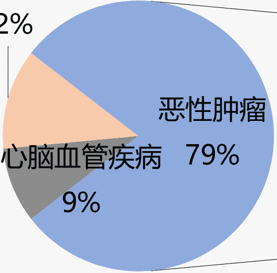

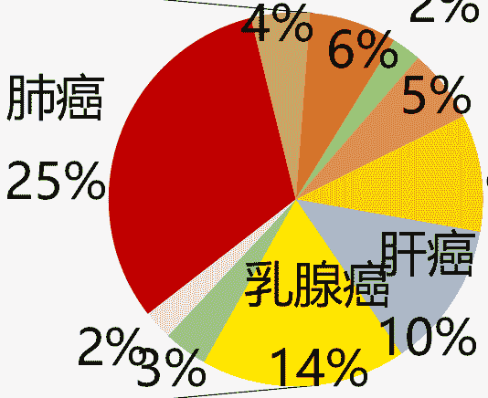

- 心脑血管疾病
- 其他
- 肺癌
- 食管癌
- 宫颈癌
- 子宫内膜癌
- 胃癌
- 肠癌
- 肝癌
- 乳腺癌
- 甲状腺癌

### 重疾不重

### 规范性治疗之医院

### 最佳专科排行榜

2019年11月，上海复旦大学医院管理研究所发布。

### 规范性治疗之医院

| 综合排名 | 医院名称 | 声誉权重 | 科研权重 | 总得分 |
|---:|---|---:|---:|---:|
| 1 | 中国医学科学院北京协和医院 | 80.000 | 15.826 | 95.826 |
| 2 | 四川大学华西医院 | 64.326 | 20.000 | 84.326 |
| 3 | 中国人民解放军总医院 | 60.182 | 15.249 | 75.431 |
| 4 | 上海交通大学医学院附属瑞金医院 | 30.843 | 13.122 | 43.965 |
| 5 | 复旦大学附属中山医院 | 26.869 | 14.071 | 40.940 |

### 规范性治疗之医院

| 肿瘤学 | 医院名称 | 平均声誉值 |
|---|---|---:|
| 1 | 中国医学科学院肿瘤医院 | 11.17 |
| 2 | 复旦大学附属肿瘤医院 | 9.08 |
| 3 | 中山大学肿瘤防治中心 | 9.02 |
| 4 | 天津医科大学肿瘤医院 | 7.04 |
| 5 | 北京大学肿瘤医院 | 6.87 |

| 病理科 | 医院名称 | 平均声誉值 |
|---|---|---:|
| 1 | 复旦大学附属肿瘤医院 | 10.41 |
| 2 | 中国医学科学院北京协和医院 | 9.64 |
| 3 | 四川大学华西医院 | 8.84 |
| 4 | 中国人民解放军总医院 | 5.55 |
| 5 | 北京大学第三医院 | 4.81 |

### 规范性治疗之医院

| 心血管病 | 医院名称 | 平均声誉值 |
|---:|---|---:|
| 1 | 中国医学科学院阜外医院 | 11.44 |
| 2 | 复旦大学附属中山医院 | 8.99 |
| 3 | 首都医科大学附属北京安贞医院 | 8.75 |
| 4 | 广东省人民医院 | 5.49 |
| 5 | 北部战区总医院 | 5.22 |

| 心外科 | 医院名称 | 平均声誉值 |
|---:|---|---:|
| 1 | 中国医学科学院阜外医院 | 11.52 |
| 2 | 首都医科大学附属北京安贞医院 | 9.42 |
| 3 | 广东省人民医院 | 7.44 |
| 4 | 复旦大学附属中山医院 | 7.02 |
| 5 | 华中科技大学同济医学院附属协和医院 | 5.14 |

### 规范性治疗之医院

| 神经内科 | 医院名称 | 平均声誉值 |
|---:|---|---:|
| 1 | 中国医学科学院北京协和医院 | 10.49 |
| 2 | 首都医科大学附属北京天坛医院 | 8.51 |
| 3 | 复旦大学附属华山医院 | 8.45 |
| 4 | 首都医科大学宣武医院 | 7.68 |
| 5 | 四川大学华西医院 | 5.23 |

| 神经外科 | 医院名称 | 平均声誉值 |
|---:|---|---:|
| 1 | 首都医科大学附属北京天坛医院 | 11.59 |
| 2 | 复旦大学附属华山医院 | 9.98 |
| 3 | 四川大学华西医院 | 7.36 |
| 4 | 中国人民解放军总医院 | 5.39 |
| 5 | 首都医科大学宣武医院 | 4.98 |

### 规范性治疗之医院

| 康复医学 | 医院名称 | 平均声誉值 |
|---|---|---:|
| 1 | 复旦大学附属华山医院 | 8.99 |
| 2 | 江苏省人民医院（南京医科大学第一附属医院） | 8.44 |
| 3 | 四川大学华西医院 | 7.83 |
| 4 | 中国康复研究中心 | 6.24 |
| 5 | 华中科技大学同济医学院附属同济医院 | 5.68 |

| 肾脏病 | 医院名称 | 平均声誉值 |
|---|---|---:|
| 1 | 北京大学第一医院 | 10.96 |
| 2 | 东部战区总医院 | 7.76 |
| 3 | 中国人民解放军总医院 | 7.59 |
| 4 | 南方医科大学南方医院 | 5.47 |
| 5 | 中山大学附属第一医院 | 5.11 |

人们常说保险是伟大的，但如果保险只是做一点医疗费用报销或者是分红投资，我觉得说伟大就太牵强了。如果保险可以让一个人获得更多生存可能、获得生活的希望，说伟大才说得过去。

### 重疾险认知的三个阶段

昂贵的医疗费用

工作收入损失的补偿来提高五年生存率

重大疾病风险管理，让人们远离重疾

