## 金錢暴金鐵桿

完整版本節目資料

## 紐約證交所指數 - Last Price 21586

2021年11月，觸發後-25%

2020/1/27 觸發後-34%

2025年10月30日，紐約證券交易所出現93個新高和131個新低，均高於77的偏差值(A+D的2.8%)，觸發了另一個「興登堡凶兆」訊號。該訊號已經連續出現了2次，其中一個出現在10/29。當出現多個類似訊號時，其重要性往往更高。

### 美股不祥之兆?!

麥克蘭擺動指標 -37.01

資料來源：華爾街見聞、X

| 過去30次「興登堡凶兆」被觸發 S&P500後市表現 | 1 Week Later | 2 Weeks Later | 1 Month Later | 2 Months Later | 3 Months Later | 6 Months Later | 1 Year Later |
|---|---:|---:|---:|---:|---:|---:|---:|
| January 31, 2018 | -5.03% | -4.43% | -4.99% | -7.41% | -6.66% | -0.37% | -4.15% |
| February 1, 2018 | -0.54% | -3.32% | -3.58% | -6.28% | -6.81% | 0.19% | -3.44% |
| September 4, 2018 | -0.30% | 0.26% | 0.99% | -5.10% | -3.67% | -5.10% | 2.71% |
| September 5, 2018 | 0.91% | 0.67% | 0.46% | -4.80% | -6.53% | -5.04% | 3.12% |
| September 6, 2018 | 0.91% | 1.82% | 0.65% | -4.80% | -6.33% | -3.29% | 3.49% |
| September 10, 2018 | 0.41% | 1.47% | 0.11% | -2.20% | -8.32% | -2.30% | 4.30% |
| September 11, 2018 | 0.57% | 0.96% | -3.54% | 2.01% | -8.70% | -2.75% | 4.21% |
| September 13, 2018 | 0.91% | 0.34% | -4.72% | -6.15% | -8.73% | -2.45% | 3.23% |
| September 14, 2018 | 0.85% | 0.31% | -5.31% | -6.29% | -10.50% | -2.49% | 3.47% |
| September 18, 2018 | 0.39% | 0.66% | -3.27% | -5.99% | -12.33% | -1.70% | 3.53% |
| September 20, 2018 | -0.57% | -0.99% | -5.56% | -8.19% | -15.61% | -4.52% | 2.08% |
| September 21, 2018 | -0.54% | -1.51% | -5.93% | -9.42% | -17.51% | -3.80% | 1.26% |
| October 1, 2018 | 1.37% | 5.94% | 9.27% | -6.39% | -14.17% | -1.75% | 1.26% |
| July 18, 2019 | 0.29% | 1.39% | 3.55% | 0.35% | 0.16% | 10.74% | 7.85% |
| August 1, 2019 | -0.32% | -3.39% | -4.92% | -3.45% | 3.16% | 9.27% | 10.73% |
| August 2, 2019 | -0.46% | -1.48% | -0.86% | -1.52% | 3.60% | 10.84% | 12.37% |
| November 19, 2019 | 0.85% | 0.24% | 2.73% | 6.40% | 6.07% | -5.50% | 14.51% |
| November 20, 2019 | 1.45% | 0.29% | 3.16% | 6.98% | 6.97% | -4.92% | 15.23% |
| January 27, 2020 | 0.16% | 3.34% | -3.92% | -19.09% | -11.26% | 1.41% | 16.86% |
| January 30, 2020 | 1.89% | 2.75% | -5.80% | -21.29% | -11.31% | -1.14% | 13.11% |
| January 31, 2020 | 3.17% | 4.79% | -6.89% | -23.41% | -12.24% | 1.41% | 17.00% |
| February 3, 2020 | 3.18% | 3.74% | -3.56% | -22.22% | -12.50% | 1.41% | 17.77% |
| February 10, 2020 | 0.54% | -6.68% | -18.22% | -16.77% | -12.50% | -0.25% | 16.68% |
| February 21, 2020 | -11.49% | -10.95% | -32.97% | -16.13% |  |  |  |
| March 5, 2021 | 2.64% | 1.85% | 6.04% | 8.48% |  |  |  |
| November 22, 2021 | 2.40% | 0.08% | 0.29% | -5.83% |  |  |  |
| December 16, 2021 | 1.27% | 2.09% | -1.96% | -4.15% |  |  |  |
| April 8, 2022 | 2.15% | -4.29% | -10.86% | -10.46% |  |  |  |
| July 9, 2024 | 1.02% | -0.38% | -3.77% | -3.02% |  |  |  |
| September 11, 2024 | 1.15% | 3.03% | 4.07% | 7.93% |  |  |  |
| October 29, 2025 |  |  |  |  |  |  |  |
| 平均幅度 | -0.38% | -0.55% | -4.09% | -6.38% | -6.28% | -1.43% | 6.18% |
| 上漲機率 | 63% | 57% | 30% | 17% | 23% | 37% | 80% |

> 在兩個月後有83%的機率下跌，平均跌幅6.38%

## 興登堡凶兆 Hindenburg Omen

興登堡凶兆是一種聲稱可預測美國股市出現股災的技術分析，由數學家米耶卡（Jim Miekka）於1995年發明，並以1937年墜毀的興登堡號飛船命名。

### 出現「興登堡凶兆」，要符合以下三個條件：

1. 指數比50個交易日前的水平為高（指數仍處於上升趨勢中）
2. 創52週新高及新低的股份數目佔上升及下跌股票數目總和的2.2%或以上，創造52周高點的股票數量不能超過52週低點數字的2倍。
3. 麥克萊倫震盪指標（McClellan Oscillator）為負數，只要指標於未來30天內維持負數，凶兆便繼續生效。

### 出現「興登堡凶兆」，所代表的市場意義：

1. 它需要滿足以上非常具體的條件才能觸發，所以它不常發出信號。
2. 當它真的觸發時，它意味着市場可能容易出現明顯下跌，但不一定意味着崩潰迫在眉睫。可能有「假警報」信號。
3. 在短時間內觸發的信號越多，對該警告應予以越認真的態度。單一信號可能是假警報，但多個信號表明市場正在惡化。
4. 當市場整體處於興奮狀態時，該信號的效果最好。當市場已經處於悲觀時，該信號的意義就較小。

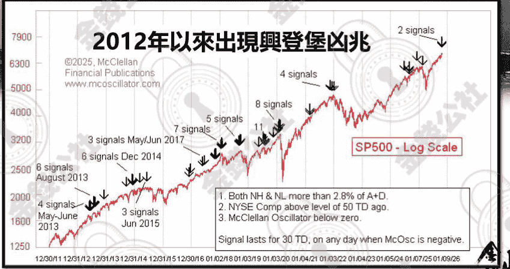

資料來源：維基百科、X

## Meta stock has worst day in 3 years, dropping 11% on higher AI spend

北京時間10月30日，Meta發布2025年第三季財報。

### 3Q F25

- 營收：年增26%至512.4億美元，優於預期的494.1億美元
- 淨利：從去年同期的156.9億美元跌至27.1億美元，跌幅達83%，主因是認列了一筆約159.3億美元一次性、非現金稅務費用衝擊
- EPS：調整後EPS為1.05美元，遜於預期的6.68美元

### 4Q F25

- 營收：預計在560億至590億美元之間，略優於預期的574億美元
- 資本支出：2025年上調至700-720億美元，原估660-720億美元
  Meta表示，支出趨勢明年將只增不減，市場擔憂2026年可能突破800-850億美元甚至更高。

Meta提升資本支出計畫，引起市場對投資報酬率的懷疑，與Meta類似，其他科技巨頭如Alphabet和微軟也提高各自的資本支出預測，顯示出AI競爭加劇。

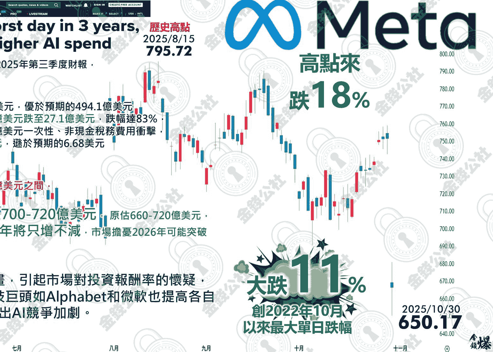

## Meta 資本支出占收入比（按財年）

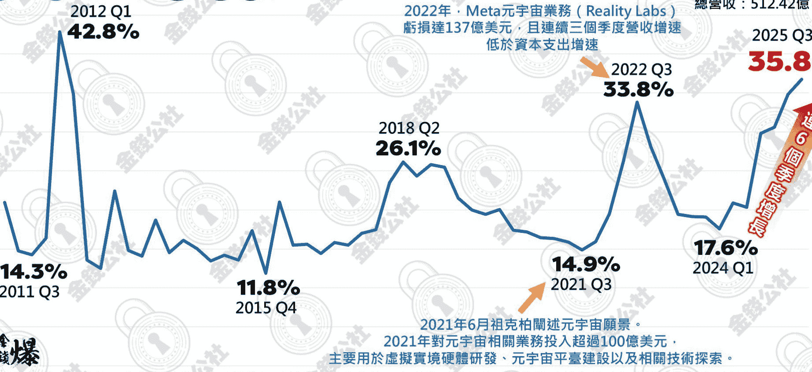

2011 Q3：14.3%

2012 Q1：42.8%

2015 Q4：11.8%

2018 Q2：26.1%

2021 Q3：14.9%

2022 Q3：33.8%

2024 Q1：17.6%

2025 Q3：35.8%

2022年，Meta元宇宙業務（Reality Labs）虧損達137億美元，且連續三個季度營收增速低於資本支出增速。

資本支出：188.29億
總營收：512.42億

2021年6月祖克柏闡述元宇宙願景。2021年對元宇宙相關業務投入超過100億美元，主要用於虛擬實境硬體研發、元宇宙平台建設以及相關技術探索。

資料來源：wind

## META發債
### 籌資300億美元

在祖克柏財報會議上發出AI支出增加的警告後，根據美國證券交易委員會(SEC)文件顯示，Meta啟動發行300億美元公司債，以支持AI與數據中心投資。

- META將發行六期債券，期限從5年至40年（2030至2065年），債券本金金額從40億到65億美元不等。40年期債券的初始價格區間，比基準美債收益率高出1.4%。
- 這次吸引1250億美元投資者認購（超額認購逾4倍），創下公開公司債發行史上最高紀錄，超越2018年CVS Health為併購安泰人壽而創下的1200億美元認購紀錄。
- 債券發行的聯合承銷商包括摩根士丹利、艾倫公司和布萊洛克範圍公司，由花旗集團、摩根士丹利牽頭承銷。
- Meta上次（首次）進入債市是在2022年8月，當時發行100億美元債券。
- 但截至2025年9月30日，Meta帳上現金及等價物只有101.87億美元。

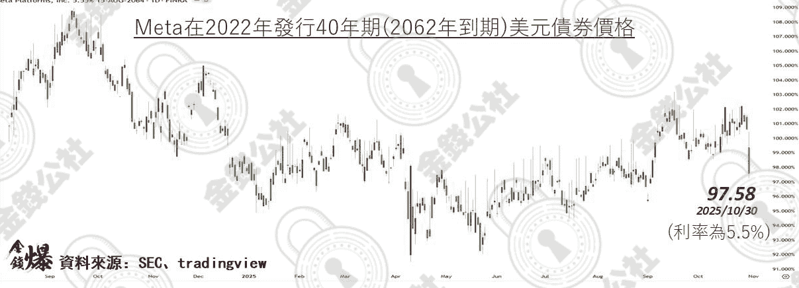

| 項目 | 2025年9月30日 | 2024年12月31日 |
|---|---:|---:|
| Cash and cash equivalents | 10,187 | 43,889 |
| Marketable securities | 34,261 | 33,926 |

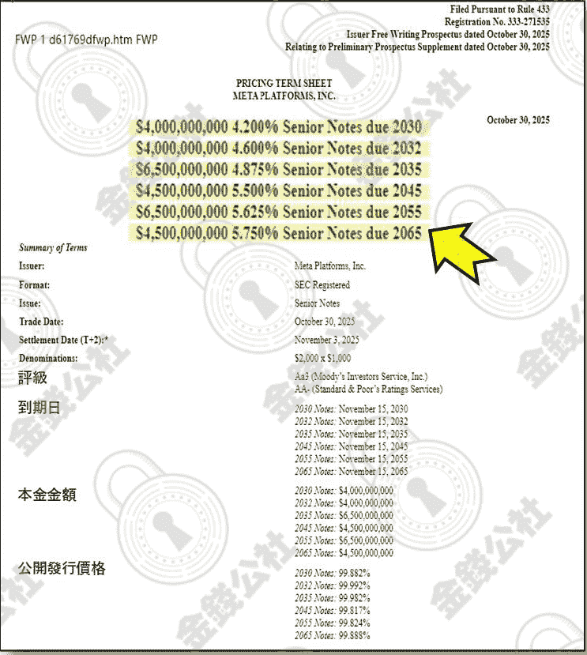

- Meta與Blue Owl Capital為了Hyperion數據中心開設特殊目的公司，發行273億美元債券。**Pimco購買了約180億，貝萊德也買了「數十億美元」，其餘則流向險資管理的基金。**
- Meta 從其現有的路易斯安那州開發投資組合中，貢獻了土地和正在建築資產（這些資產之前被歸類為持有待售），而 Blue Owl則提供了約70億美元的現金貢獻。
- **Meta還從新合資企業中獲得了約 30億美元的一次性分配。**

### Beignet Investor LLC organization structure

- 標普給Beignet Investor LLC(投資公司)，2049年5月到期的273億債券的評級是“A+”，低於母公司Meta的“AA-”。
- **Meta並未簽署為期20年的數據中心租約，而是與「11幢互相獨立的建築」簽署了一系列可續簽的4年期租約。** 這樣一來，公司就可以將這些租約視為經營租賃，而非長期負債報告的融資租賃。

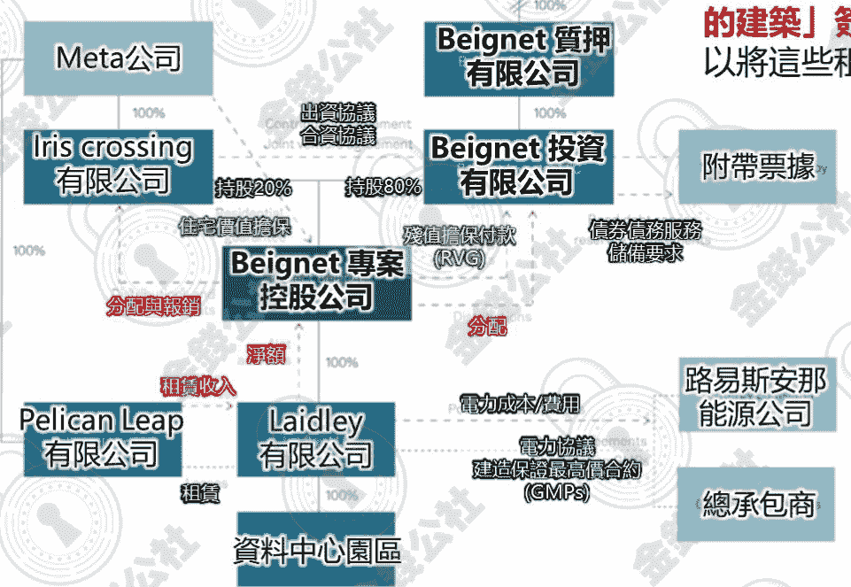

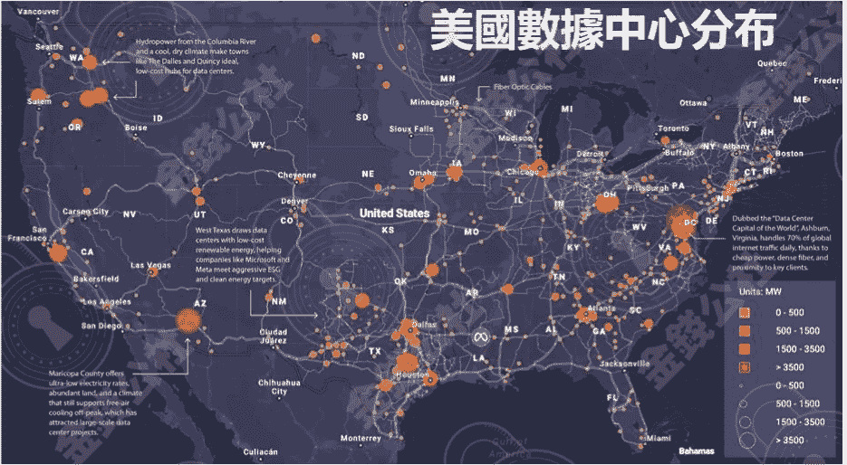

正在路易斯安那州里奧蘭郡建設2GW(全球最大)的超算中心

## 資本支出占收入比（按財年）

預計2026財年資本支出為350億美元，前值為250億，主要用於擴建全球資料中心網路，以滿足與OpenAI等簽署的AI合約需求⋯

資本支出：85.02億
總營收：149.26億

### 賺100塊有57塊再投入
AI和雲基礎建設!!

2025年1月，OpenAI與軟銀、甲骨文等公司啟動「星際之門」計畫

2021年，甲骨文宣佈將資本支出增加一倍至40億美元，旨在加強雲基礎設施建設

2025 Q4
57.1%

2023 Q3
21.2%

2025 Q1
17.3%

2024 Q2
8.4%

2021 Q3
4.1%

資料來源：wind

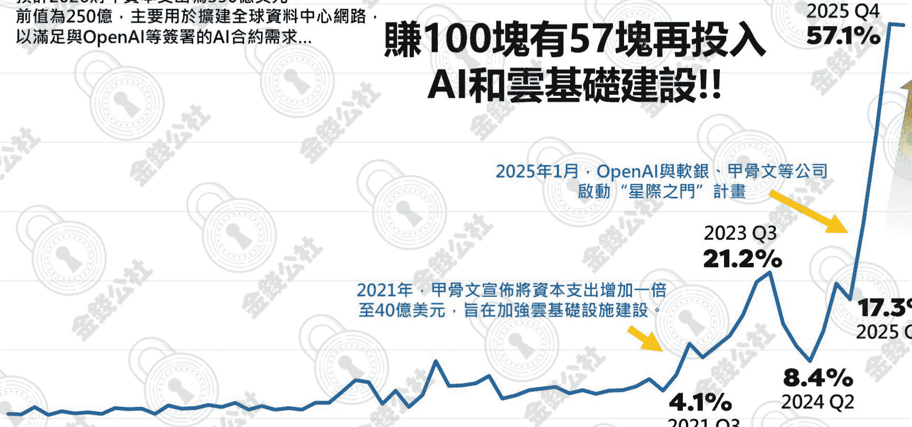

### Exhibit 7: Liquidity positions for hyperscalers are approaching normalcy given high capex outlay

Median cash-to-total assets ratio (%) for median Mag 7 + Oracle, hyperscalers (AMZN, META, MSFT, GOOGL, ORCL) and the median North American non-financial IG issuer.

自2022年AI投資熱潮以來，大型科技公司最初多以現金儲備支應巨額的AI資本支出，但隨著支出持續膨脹，它們的現金水位逐步下滑，流動性已接近一般投資級企業水準。
「MAG7+Oracle」及雲端巨頭的現金佔資產比與現金金額在2023年底至2025年中明顯下降，說明企業由使用自有現金轉向依賴債務市場融資，這對未來企業信用結構帶來潛在壓力。

### Cash to total assets

- Mag 7+ 加 Oracle 的現金佔總資產比中位數
- 北美非金融投資級企業的現金比率中位數
- 雲端巨頭現金總額（右軸）
- 雲端運算巨頭的現金佔總資產比中位數
- Mag 7+Oracle 的現金總額（右軸）

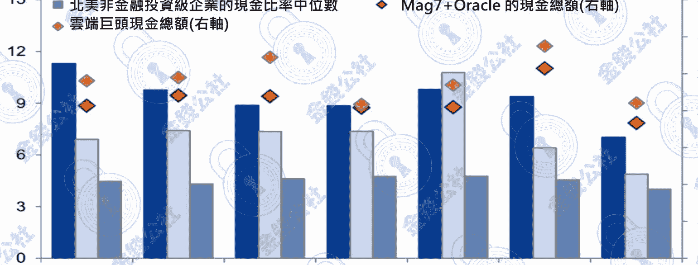

資料來源：Goldman Sachs

## AI債務融資激增

為了AI支出所產生的借貸規模暴增，光是9到10月，就有750億美元，包括來自META(300億美元)、甲骨文(180億美元)而這還未包括與甲骨文相關的380億美元貸款。

甲骨文的負債權益比(槓桿率)超過500%，遠高於同業，顯示它以極高的負債來擴張AI與資料中心基礎建設。從公司債利差來看，也因為大舉舉債投入AI資料中心，甲骨文債券風險溢酬顯著高於其他科技巨頭。

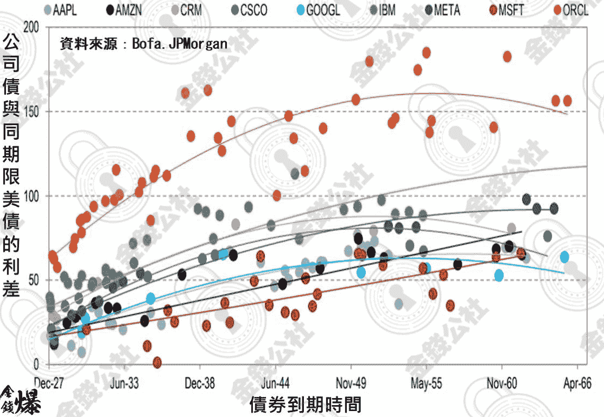

資料來源：Bofa. JPMorgan

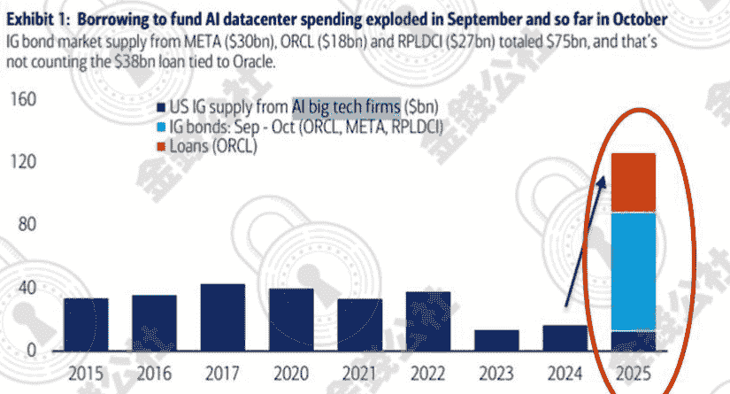

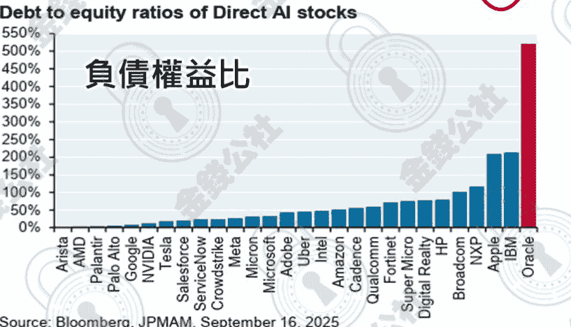

根據Zerohedge提供的數據顯示，甲骨文5年期CDS的點數從2024年底開始顯著上升，已升至2023年10月以來水平附近，顯示信用風險正在上升。

這一趨勢正值甲骨文將推出380億美元債券發行之際....

甲骨文目前已有約950億美元未償債務，是彭博高評級指數中金融業以外最大的企業發行人。

## AI續程時代

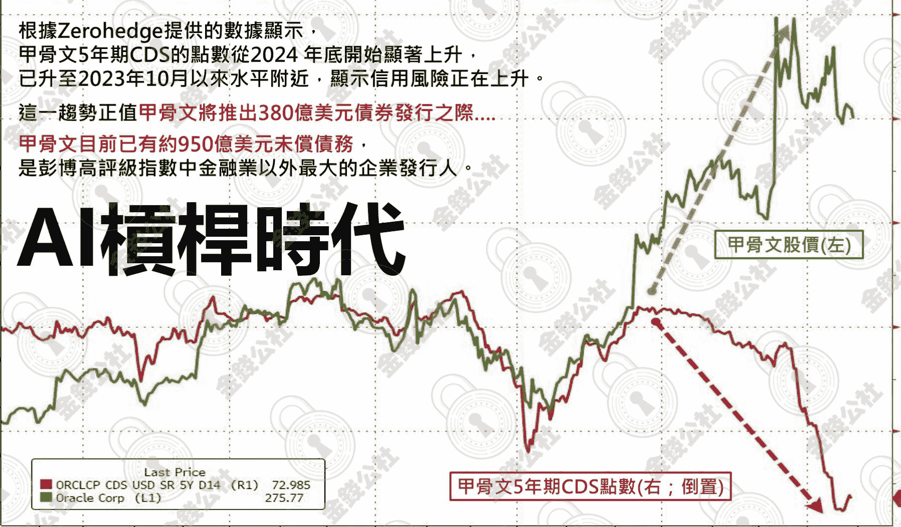

| 項目 | 數值 |
|---|---:|
| ORCLCP CDS USD SR 5Y D14 (R1) | 72.985 |
| Oracle Corp (L1) | 275.77 |

甲骨文股價（左）

甲骨文5年期CDS點數（右；倒置）

資料來源：Zerohedge

甲骨文2025年9月24日啟動180億美元的美國投資級債券發行，為今年以來該市場規模第二大的債券發售交易。此次發債分為六個部分，其中包括一只40年期債券……

| 期限 | 債券 | 實際年化報酬率（YTM%） | 票面利率 | 到期日期 | 發行金額 | 面值 | 最小面額金額 |
|---|---|---:|---:|---|---:|---:|---:|
| 40年期 | Oracle Corporation 6.1% 26-… | 6.32% | 6.100% | 2065-09-26 | 2B USD | 1,000.00 USD | 2,000.00 USD |
| 30年期 | Oracle Corporation 5.95% 26-… | 6.23% | 5.950% | 2055-09-26 | 3.5B USD | 1,000.00 USD | 2,000.00 USD |
| 20年期 | Oracle Corporation 5.875% 26-… | 6.15% | 5.875% | 2045-09-26 | 2.5B USD | 1,000.00 USD | 2,000.00 USD |
| 10年期 | Oracle Corporation 5.2% 26-… | 5.33% | 5.200% | 2035-09-26 | 4B USD | 1,000.00 USD | 2,000.00 USD |
| 7年期 | Oracle Corporation 4.8% 26-… | 4.82% | 4.800% | 2032-09-26 | 3B USD | 1,000.00 USD | 2,000.00 USD |
| 5年期 | Oracle Corporation 4.45% 26-… | 4.38% | 4.450% | 2030-09-26 | 3B USD | 1,000.00 USD | 2,000.00 USD |

臉書此前於2024年8月7日發行105億美元的投資級債券，分5個部分，期限包括5年期到40年期。

| 期限 | 債券 | 實際年化報酬率（YTM%） | 票面利率 | 到期日期 | 發行金額 | 面值 | 最小面額金額 |
|---|---|---:|---:|---|---:|---:|---:|
| 40年期 | Meta Platforms, Inc. 5.55% 15-AUG-… | 5.70% | 5.550% | 2064-08-15 | 2.75B USD | 1,000.00 USD | 2,000.00 USD |
| 30年期 | Meta Platforms, Inc. 5.4% 15-AUG-… | 5.60% | 5.400% | 2054-08-15 | 3.25B USD | 1,000.00 USD | 2,000.00 USD |
| 10年期 | Meta Platforms, Inc. 4.75% 15-AUG-… | 4.67% | 4.750% | 2034-08-15 | 2.5B USD | 1,000.00 USD | 2,000.00 USD |
| 7年期 | Meta Platforms, Inc. 4.55% 15-AUG-… | 4.22% | 4.550% | 2031-08-15 | 1B USD | 1,000.00 USD | 2,000.00 USD |
| 5年期 | Meta Platforms, Inc. 4.3% 15-AUG-… | 3.97% | 4.300% | 2029-08-15 | 1B USD | 1,000.00 USD | 2,000.00 USD |

資料來源：Tradingview — WIND（截至北京時間2025/10/31）

## Exhibit 13: Incumbents are getting disrupted even more quickly

Average company lifespan on the Standard & Poor’s 500 Index from 1965 to 2030, in years (rolling 7-year average) and decade averages

## 標準普爾500指數公司平均壽命

（1965年至2030年，以滾動7年平均值與各年平均值計算）

S&P 500成分股企業的平均壽命自1960年代以來持續縮短。1960至1970年代，企業平均能在指數中存活約30年；到2020年代僅剩約15至20年，預測2030年前甚至會持續接近只剩15年，企業被市場淘汰的速度幾乎翻倍！

## 發債年限比企業壽命長

| 年代 | 平均壽命 |
|---|---:|
| 1970s | 29.3 |
| 1980s | 25.5 |
| 1990s | 25.3 |
| 2000s | 17.3 |
| 2010s | 21.5 |
| 2020s | 18.3 |

資料來源：BofA

## 科技公司合計資本支出占收入比：微軟＋亞馬遜＋Google＋甲骨文＋Meta

2010年前，長期維持在2%～5%的水準，當時以輕資產、高回報的模式為主。

2010年後，科技公司開始轉向重資產的雲業務，相關比值提升至10%以上，但長期低於15%。

2023年後，隨著AI帶來的雲計算需求激增，重資產模式持續加劇，兩年內自13.29%提升至20%以上。

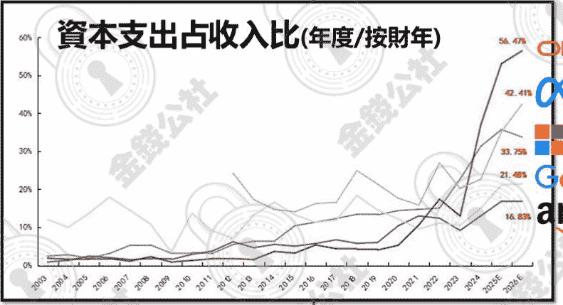

## 2026財年預估值：25.97%

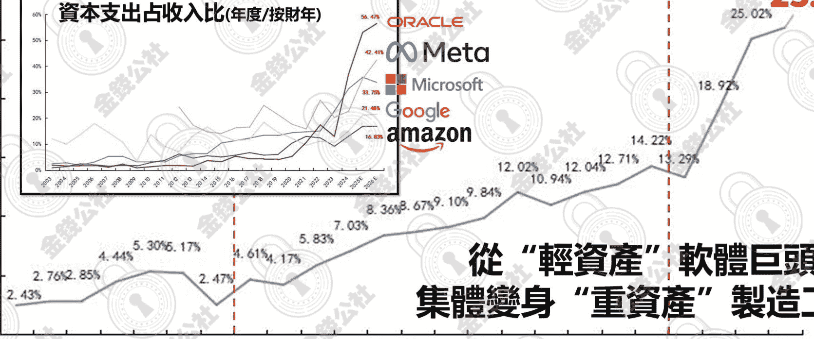

## 從「輕資產」軟體巨頭集體變身「重資產」製造工廠

資料來源：國信證券
