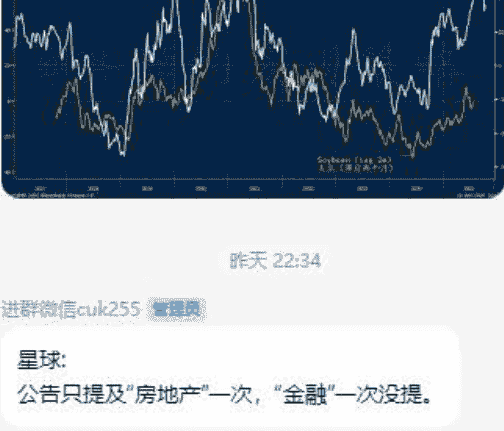
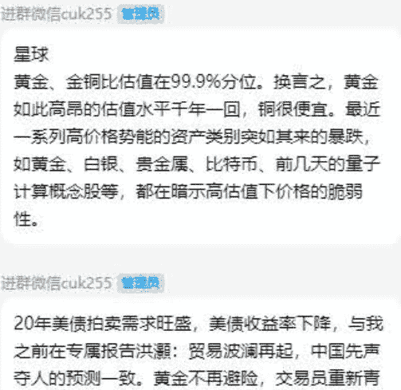

星球：

尽管最近市场波动，但LME铜期货依然在上升通道中。2026年，铜的供应存在明显的缺口。我们在六月下半年展望会上和老群里也讨论过的机会。

据悉：中国刚刚订购了126万吨美国大豆——这是自2020年以来单日最大规模的闪购——此前数周采购量几乎为零。本月，双方谈判代表重启了军事危机热线测试。若更广泛的协议正在酝酿中，这些举措可视为建立互信的初步步骤。附上我最近的专题报告《共赢：贸易波澜再起，中国先睹夺人》里的美豆图。

星球：

公告只是对房地产一次，金融一次容易（原文如此，此处疑似OCR错误或表述不完整）。

星球：

黄金，金铜比估值在99.9%分位。换言之，黄金如此高昂的估值水平千年一回，铜很便宜。最近一系列高价格宽泛的资产类别实例的暴跌，如黄金、白银、贵金属、比特币、前几天的量子计算概念股等，都在暗示高估值下价格的脆弱性。

20年美债拍卖需求旺盛，美债收益率下降，与我之前在专题报告《共赢：贸易波澜再起，中国先睹夺人》的预测一致。黄金不再避险，交易员重新青睐美债。

## 深度视野优质文集圈（链接优质社群，助你成功）

全部包含以下内容：　限时年费188/年　**加微信cuk255**

- 1. 吃瓜群众俱乐部实时圈文加实时群聊对话（原价365元/年）
2. 子明私享汇（会）内部文章（原价568元/年）
3. 政事堂（顾子明）付费内容导送顾子明群
4. 米联储见闻（作者米糕）（原价599元/年）
5. 欧洲金靴会员专属文章（原价328元/年）
6. 砖瓦厂内幕圈文（原价400元/年）
7. 卢克文青云读书会专属文章（原价699元/年）
8. 鉴朱财经院知识星球（原价3310元/年）
9. 猫哥的视界知识星球文章（原价299元/年）
10. 财新周刊【独家新闻】（原价1498元/年）
11. 杨世光在金钱窝（原价2200元/年）
12. 蔡森财经知识星球（原价1600元/年）
13. 濑泽异谈付费文章（持续更新）
14. 司马林解读毛选全套音频和全套书籍珍藏版无删减（原价2.3万）
15. 虎声三部曲《民国梦》、帝国苟轮、不被理解的MAO（原价599元）
16. 卢克文知识星球文章（原价268元/年）
17. 额外再送：卢麒元新浪微博付费专栏、村西边老王、三花九树文集

不定期内容：——————（更多资源写不下去了……）

- 1. 守夜人司马知识星球、挨踢牛腩王知识星球、生财有术知识星球
2. 创始人笔记、达叔天庚论知识星球、成竹财富圈、雪球花甲老头等
3. A视野、大树乡谈、江宁知府、哇咔说、财上海家学等付费文集
4. 西风付费文章、老端、藏在八小时之外、局外人的视界、升值计、老A体制内等等其它一些大V付费文章（每月不低于600元的付费文章）

深度视野文集

进群微信cuk255

深度视野（付费文集）

**限时年费188/年**　低成本链接全网大V优质内容
