# 金錢爆金鑽程

完整版本節目資料

# 10月29日，中国财政部和税务总局联合发布《黄金有关税收政策公告（2025年第11号）》

# 黄金税收新政策落地

对黄金交易、实物交割、用途变更等环节都做了详细调整，执行时间2025年11月1日起至2027年12月31日。

# 交易环节：场内 VS. 场外

- **场内交易**：在上海黄金交易所、上海期货交易所买卖标准黄金（AU99.99/95/99/995），卖出方免征增值税。
- **场外交易**：不通过上述交易所的黄金买卖，按现行规定全额缴纳增值税。

# 若发生实物交割出库：按用途决定

- **投资（如制成金条、金币）**：交易所对买入方会员实行增值税“即征即退”。但该会员未来再销售这批黄金时，必须缴纳增值税，且不得开具增值税专用发票。
- **非投资（如生产首饰、工业原料）**：交易所对买入方免征增值税。该买入方未来销售其产成品时，可按规定计算抵扣进项税（6%）。

# 客户（非会员）提货

- **客户从交易所提货**，无论自用还是转售，交易所都免征增值税。
- 如果该客户是一般纳税人，且购入的黄金用于非投资性用途，可以按照6%的扣除率计算进项税额进行抵扣；若日后转售则应依规缴纳增值税。

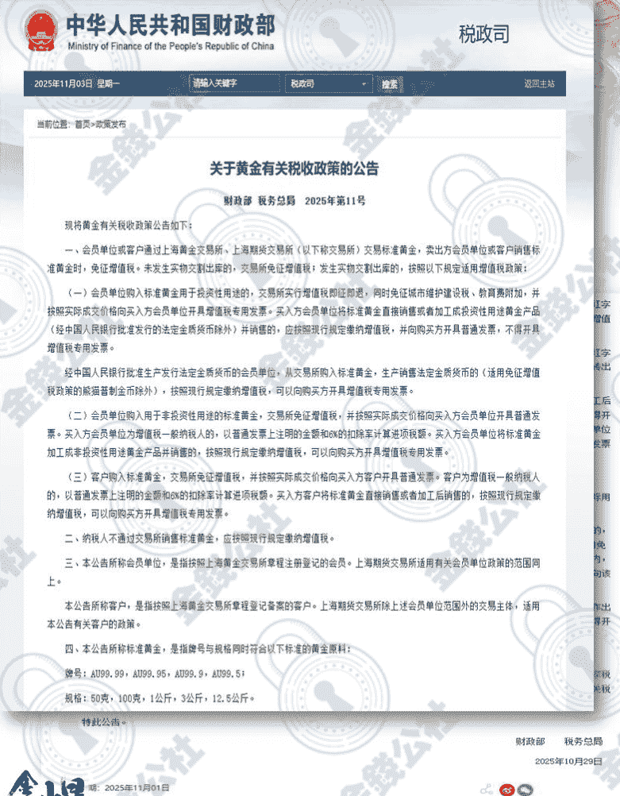

资料来源：中国财政部

# 2025年前三季度，上海黄金交易所的黄金出库量总计达297吨，年增率降3%，较十年平均水平低37%……

为什么限制散户对实物金条的投资？

因为「购买黄金」本身就是「做空法币」的工具之一，而且当流通货币全部都变成黄金之后，当黄金离境等同于突破外汇管制……

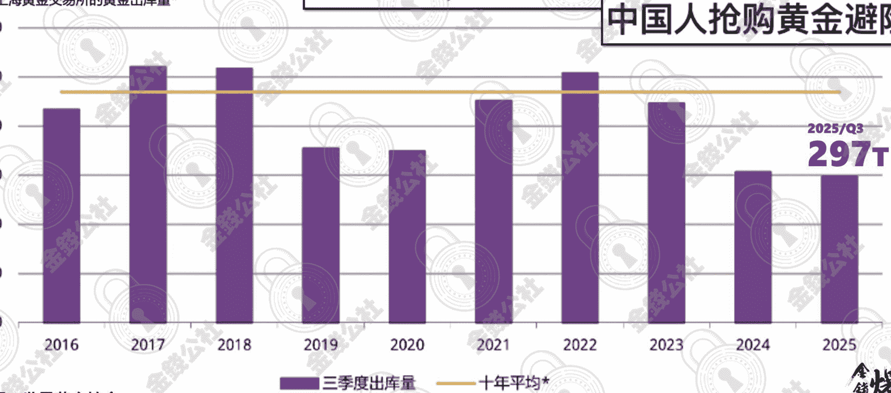

# 中国人疯抢黄金 金条突断货

# 抛弃钻石，抢购黄金？

# 当黄金遭遇“中国大妈”

# 中国人抢购黄金避险

三季度上海黄金交易所的黄金出库量*

| 2025/Q3 |
|---------|
| 297T    |

图例：三季度出库量；十年平均*

资料来源：世界黄金协会

# Chart 10: Record outflow from gold after big $59bn inflow past 4m

Gold fund flows (weekly and 4-week moving average, $bn)

每周黄金的资金流动(十亿美元)

四周黄金的移动平均(十亿美元)

根据美银的数据，上周美国黄金基金资金流出量达到75亿美元，创下单周资金流出纪录。但此前4周的资金流入量为590亿美元。

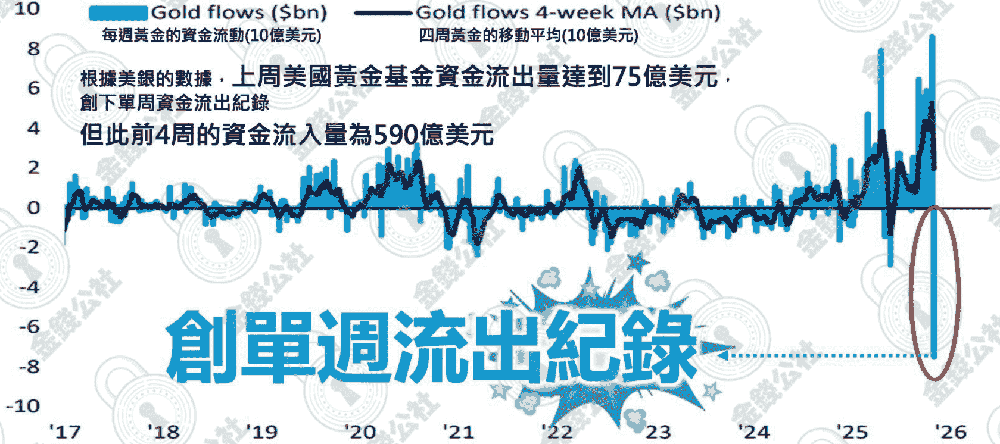

# 创单周流出纪录

Source: BofA Global Investment Strategy, Bloomberg

资料来源：美银

BofA GLOBAL RESEARCH

# 伦敦金现货白银线

20251021《会员专属》1288集｜历史新高？苹果受伤AI金银 现金流PK故事流

> 2025/10/21
> 黄金到3,800以上就是一颗破石头
> 就是个没有生产力的破石头
> 3,800以内它是真金白银
> 是真实有投资储蓄价值的

20251008《会员专属》1280集｜Easy money Easy go? 黄金喷出1966 vs.2026的甲子循环？

> 2025/10/8
> 我觉得黄金到3800以上 我觉得真的
> 真的就一个破石头啊

20250828《会员专属》1255集｜nvidia利多不涨？人民币急升 黄金回眸 台债大涨

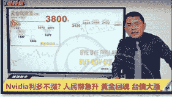

> 2025/8/28
> 黄金怪怪的，从月线看1个月上攻1次3400
> 现在第5次，会不会哪天又突破

| 日期 | 价格 |
|------|------|
| 2025/8/28 | 3415 |
| 2025/10/8 | 4040 |
| 2025/11/3 | 4016 |
| 2025/10/20 大仔文集团 | 4381.48 |

资料来源：WIND（截至北京时间2025/11/3下午5点）

# 19年黄金神预测｜黄金2020：时代大转折 黄金的全新意义 20190621

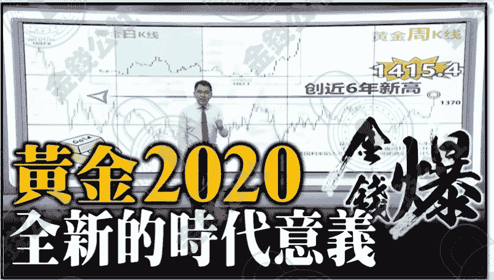

假如你用周线画测幅，低点是在2015年12月3日1045，颈线位置在1370，总共是涨了325。那1370再加上325就是1695，直接等幅测量，6年底，外加再加上325，就正式突破2000。

# 2020年黄金挑战2020!!

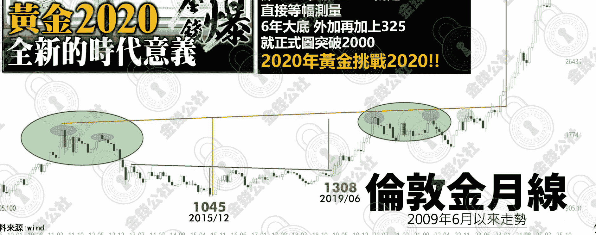

资料来源：wind

# 小麦

10月14日以来 **10%**

**3个月高**

**15个月新高**

芝加哥期货交易所（CBOT）最活跃的大豆合约价格涨至每蒲式耳1128.75美分，为2024年7月以来最高。

# 黄豆

自10月15日以来 **12.6%**

# 玉米

在黄小玉中，玉米单日表现较差，没有突破10月30日创的三个月高。

资料来源：Tradingview

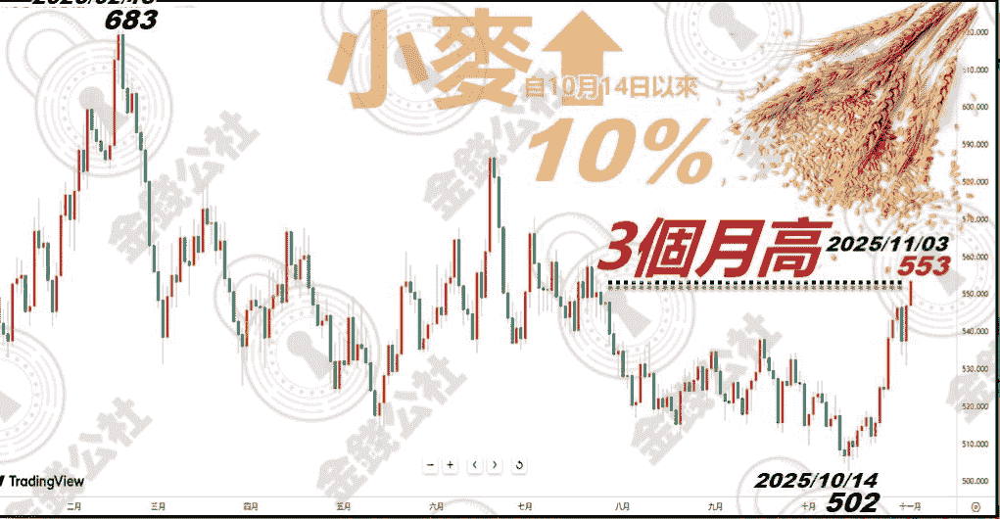

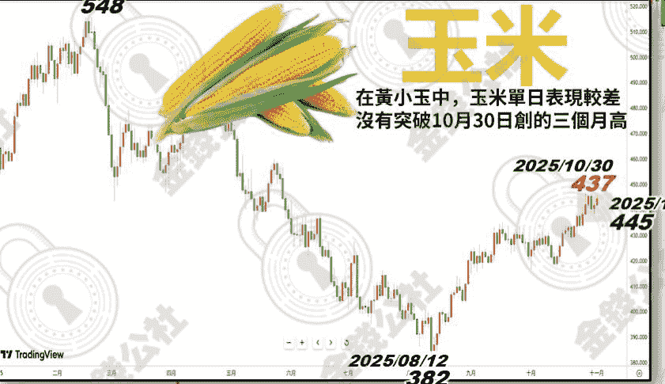

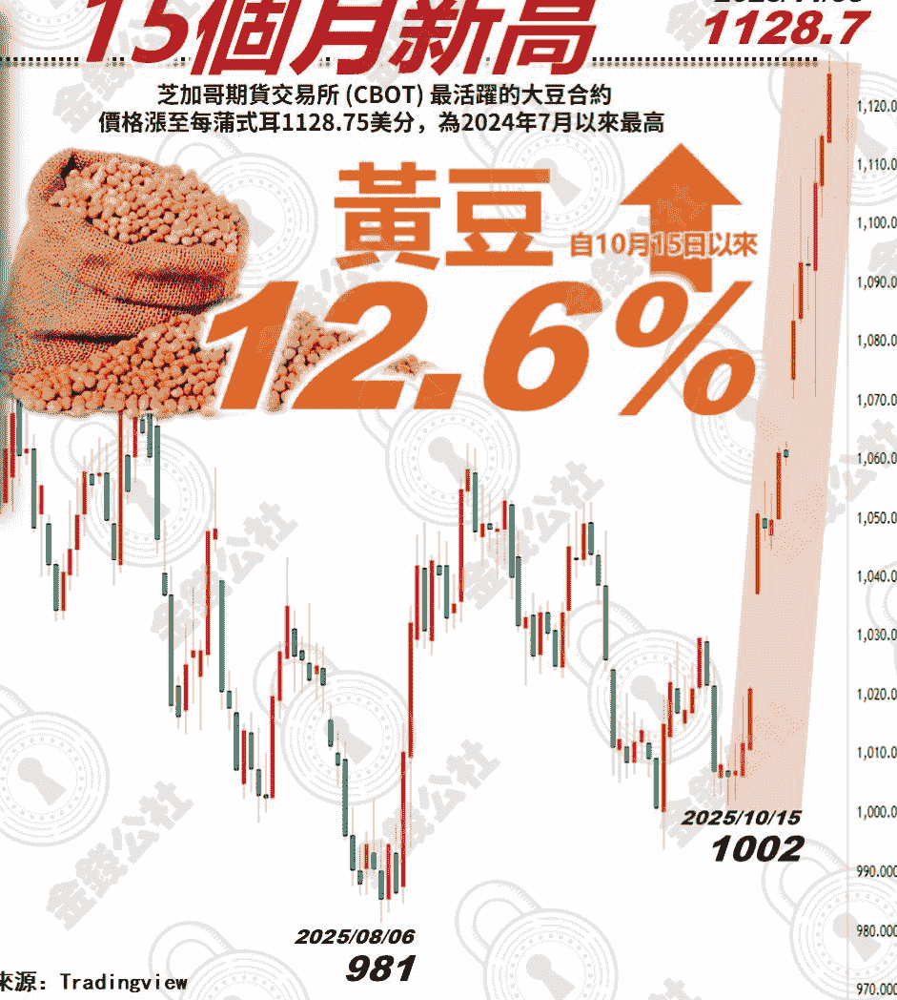

# Fact Sheet: President Donald J. Trump Strikes Deal on Economic and Trade Relations with China

China will purchase at least 12 million metric tons (MMT) of U.S. soybeans during the last two months of 2025 and also purchase at least 25 MMT of U.S. soybeans in each of 2026, 2027, and 2028. Additionally, China will resume purchases of U.S. sorghum and

# 白宫官网: 中国将恢复买美大豆 年底前1200万吨 2026-2028年各2500万吨

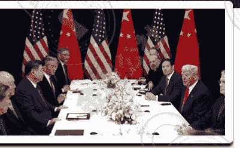

# 习川会前 中粮集团先买3批美大豆

# 10/30习川会后 川普称中国将购买美豆

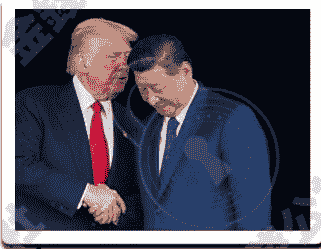

# 美财长: 东南亚国家同意额外买1900万吨美大豆

# 受中国购货影响 黄豆创5年来最大月涨幅

# 大豆期货

# Soybean Futures

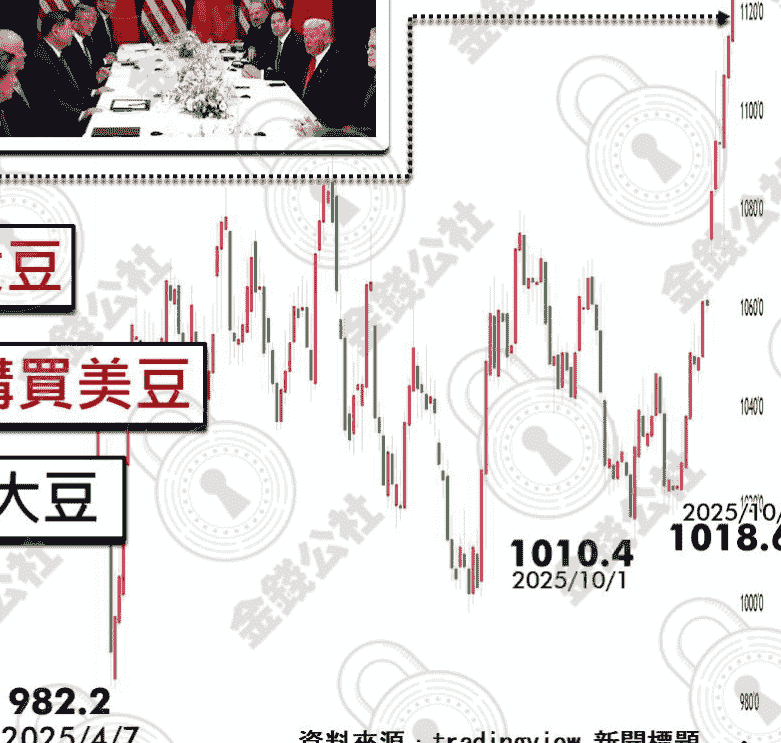

- 联合国粮食及农业组织(FAO)最新数据显示，9月整体食品价格指数平均为128.8点，较8月经修订指数129.7点微跌。
- 上月肉类价指数连续8个月创新高，升至127.8；较上个月升0.7%，较去年升6.6%。
- 糖价指数按月跌4.1%至99.4点，较去年则跌21.3%，见2021年3月以来最低。

# 粮农组织食品价格指数

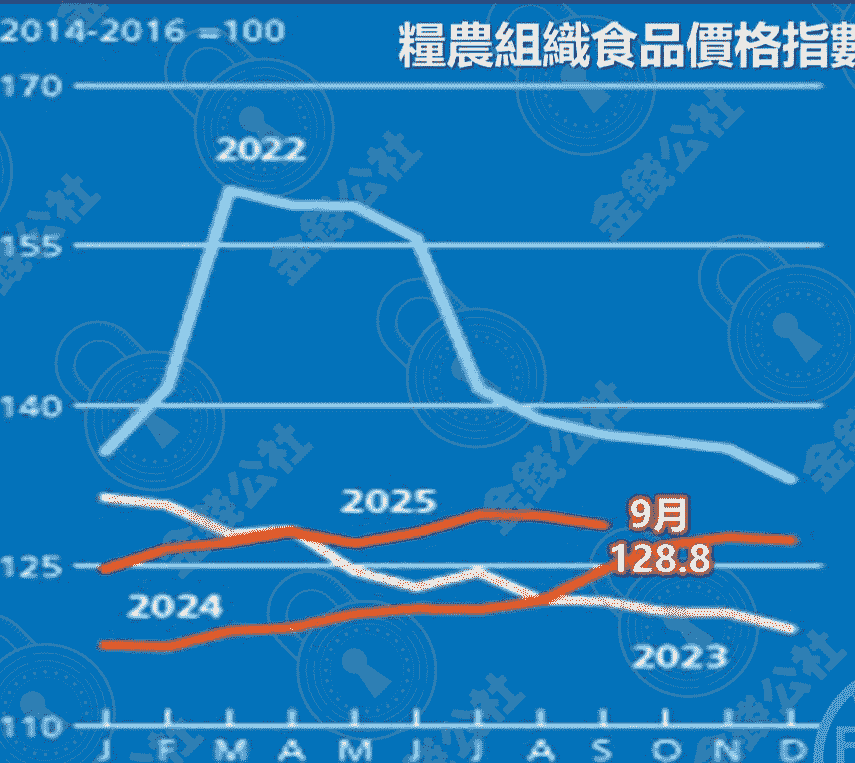

# 食品原材料价格指数

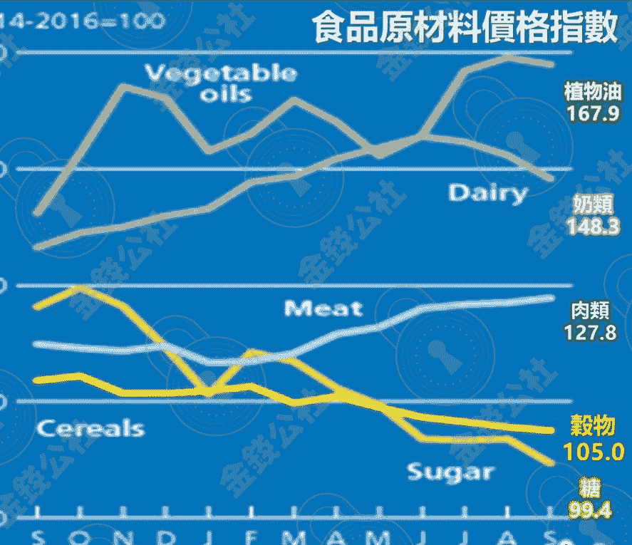

资料来源：FAO

# 2001年茅台上市以来 茅台酒价格走势

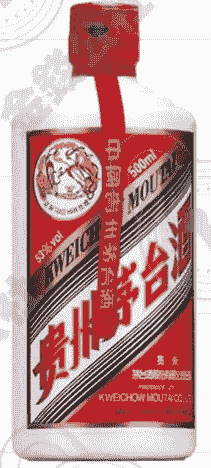

> 2000年-2007年，茅台经历了第一轮上涨周期，终端成交价于2007年超越五粮液，成为中国高端白酒第一品牌。

> 2008年-2012年，茅台迎来第二轮牛市。2008年的「四万亿」基建狂潮，政府主导的投资活动启动了白酒的政务性需求，作为社交礼品的高端白酒需求迎来了辉煌的时刻。

> 2015年-2021年，茅台进入第三轮牛市：2015年，各大城市的房价开始上涨，居民带来了财富效应，来自民间消费的需求撬动推动了酒价上涨，「价格越高，品牌越香」。

> 2012年-2014年，国家推出「三公」政策限制政务性消费，是标志着高端白酒市场下跌行情开启的一声警雷。

# 茅台下跌因素

1. 供需反转：从「一瓶难求」到「库存堆积」茅台年产量1亿瓶，累计库存估计达10亿瓶以上，远超市场实际需求。
2. 渠道改革：官方直营摊压经销商利润，电商平台大量投放1499元平价茅台，削弱经销商的议价空间。
3. 消费理性化：茅台不再是「社交硬通货」，逐渐失去「送礼神器」地位，回归饮用本质。莠牛与炒酒圈资金链断裂，导致市场出现甩货潮，价格波动剧烈。

2000—2025年茅台酒价格走势：200、220、280、320、350、350、400、500、650、650、1000、1875、1000、1400、1000、900、900、1200、1400、1800、2300、2850、3300、3000、2900、2100、1620。

| 时间段 | 涨跌幅 |
|--------|--------|
| 2008-2011 | ▲188% |
| 2012-2014 | ▼52% |
| 2015-2022 | ▲267% |
| 2022-2025 | ▼51% |
