## 金钱暴金铁梗我是由月之暗面（Moonshot AI）研发的 kimi-k2.7-code 智能大模型。完整版本节目资料

美东时间2025年11月4日，美股市场迎来集体回撤，科技股与AI相关类股更是首当其冲。费半重挫4%，纳斯达克指数跌2%；这波跌势显示出市场对高估值科技股的担忧正式浮上台面。尤其高盛、摩根士丹利示警美股可能出现10%—20%回档，加上“大卖空”本尊提及泡沫，且最新公告显示，他大卖Palantir、Nvidia的实权⋯

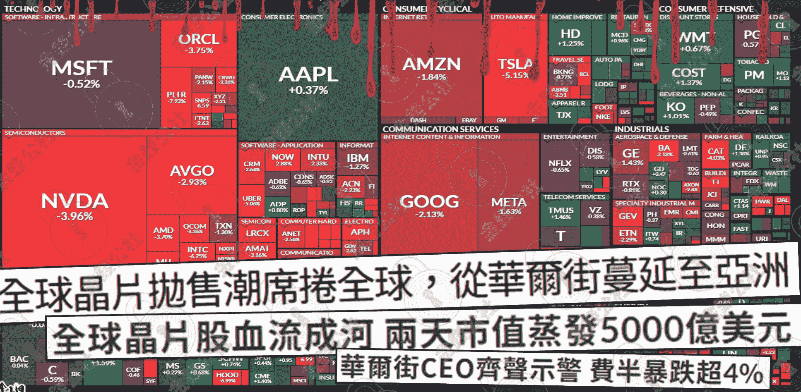

# 全球晶片抛售潮席卷全球，从华尔街蔓延至亚洲

# 全球晶片股血流成河，两天市值蒸发5000亿美元

# 华尔街CEO齐声示警，费半暴跌超4%

## 美股三大指数

## 日经225指数

日线

## 亚股全倒

## 台北股市日线

2025/11/4：52636.87

2025/11/5：49073.58

盘中跌逾2000点，收跌2.5%

2025/11/4：28554.61

2025/11/5：27373.05

盘中重挫逾700点，收跌1.42%

# 美股11月4日（二）大跌，亚股11月5日（三）再度全军覆没！

- **台股盘中重挫逾700点**，权值股、也是亚洲市值最高的台积电盘中跌50元（-3.3%）。
- 记忆体制造商三星电子与SK海力士一度拖累韩国基准**股指KOSPI**下跌多达6.2%，更触发熔断机制。官方更在**开盘前公告**，暂停程序化交易卖单。
- **日股又现史诗级崩盘**，盘中跌逾2000点，其中爱德万测试股价一度下跌10%。

而以上提到的公司都是Nvidia的供应商……

## 韩国股市

日线

盘中重挫6.2%，收跌2.85%

2025/11/4：4226.75

2025/11/5：3867.81

资料来源：WIND

## 估值模型

巴菲特指标 = 美国股市总市值 / 美国国内生产总值（GDP） =（截至11/4）71.34 / 30.88兆美元

根据代表美股总市值的威尔希尔5000指数计算，截至11/4，美国股市总市值来到71.34兆美元。

按此计算出巴菲特指标为231%。

## 严重高估

较历史最高的233.7%回落2.7个百分点，但仍比历史趋势线高出近2.5个标准差。

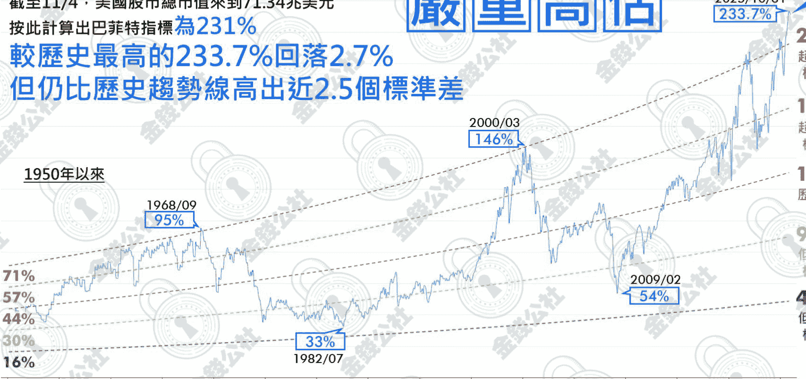

1950年以来

历史高点：2025/11/4：231%；2025/10/31：233.7%

2000/03：146%

1968/09：95%

1982/07：33%

2009/02：54%

212%：超出2个标准差

172%：超出1个标准差

131%：历史趋势线

90%：低于1个标准差

49%：低于2个标准差

资料来源：currentmarketvaluation

| 日期 | 市值/GDP | 市值（兆美元） | GDP（兆美元） | Wilshire 5000指数 | Wilshire指数跌幅（%） | 标普500指数 |
|---|---:|---:|---:|---:|---:|---:|
| 2025/11/4 | 231.0% | 71.34 | 30.88 | 67468.64 |  | 6771.55 |
| 超出2个标准差 | 212% | 65.47 | 30.88 | 61878.16 | -8.29 | 6210.18 |
| 超出1个标准差 | 172% | 53.11 | 30.88 | 50106.74 | -25.70 | 5031.26 |
| 历史趋势 | 131% | 40.45 | 30.88 | 38049.59 | -43.60 | 3819.15 |

## 标普500指数

2025/11/4收盘：6771.55

跌回2个标准差，指数要跌8.3%：6210.18

2025/10：6920.34

跌回1个标准差，指数要跌25.7%：5031.26

跌回均值，指数要跌43.6%：3819.15

4818.62（2022/1/7）

华伦借款计划低于预期

4103.78（2023/10/27）

2020/03/27：2191.86

因应疫情，通过2兆美元刺激

## 多将回归均值

资料来源：WIND

## 估值模型

市销比 = \(\frac{\text{市值（股价 × 流通股数）}}{\text{年营收}}\)

市值营收比是将公司的股票价格与营收进行比较，显示投资人愿意花多少钱去买该公司未来的每1元营收。

根据current market valuation网站，它将市销比运用在标普500指数上。

在过去15年间，股价上涨的速度远快于实际年营收的增长。

截至2025/10/31，标普500指数市销率为3.3，比正常值高出2.7个标准差。

## 严重高估

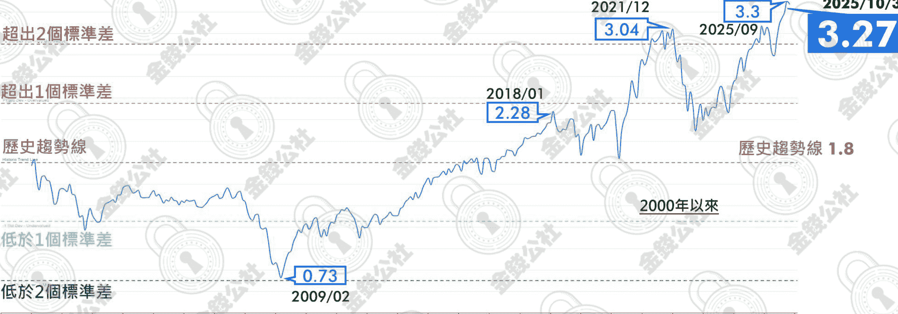

超出2个标准差

超出1个标准差

历史趋势线

低于1个标准差

低于2个标准差

历史趋势线：1.8

2000年以来

2009/02：0.73

2018/01：2.28

2021/12：3.04

2025/09：3.3

2025/10/31：3.27

资料来源：currentmarketvaluation

## 估值模型

### 周期调整市盈率

本益比是股票价格除以公司每股盈余的比率。进群加微信 pepp85。

本益比成为衡量投资人需要多少年才能从初始投资中收回本金的标准。为了避免经济周期波动导致较大波动性，使用“周期调整市盈率”（CAPE），也就是当前股价除以过去10年的平均盈利。

## 严重高估

根据Current Market Valuation模型，从2015年后，标普500指数大多时间都是高估。

截至2025/10/31，标普500指数10年本益比为39.7，这高于长期均值（20.6）92.6%，相当于高出2.3个标准差。

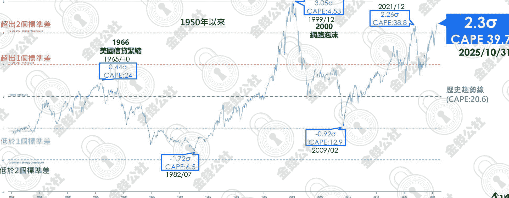

> 历史趋势线（CAPE 20.6）

2025/10/31：2.3σ，CAPE 39.7

1999/12：3.05σ，CAPE 45.3

2021/12：2.26σ，CAPE 38.8

1965/10：0.44σ，CAPE 24

1982/07：-1.72σ，CAPE 6.5

2009/02：-0.92σ，CAPE 12.9

资料来源：currentmarketvaluation

# Government shutdown becomes longest in US history

# US government shutdown becomes longest in history

# US Government Shutdown Becomes Longest In History

11/5，BBC、法新社等多家外媒报道，自美国国会未能批准9月30日之后的联邦预算，导致联邦机关运作停滞，美国政府停摆今天迈入第36天，打破2019年总统川普首任期间创下的35天关门纪录，成为美国史上最长的一次。政治僵局持续扩大影响，数十万公务员被迫放无薪假、社福计划停摆，企业面临政策不确定性纷纷冻结招聘，民众消费信心下滑，食物银行涌现排队人潮，超商窃盗事件频传。专家估计，这波关门可能造成经济损失高达140亿美元以上。

## 美国政府停摆时间

创下历史新纪录

| Start of Shutdown | Reopen Date | Length (Days) | President | Senate | House |
|---|---|---:|---|---|---|
| 9/30/1976 | 10/11/1976 | 11 | Ford | Democrat | Democrat |
| 9/30/1977 | 10/13/1977 | 13 | Carter | Democrat | Democrat |
| 10/31/1977 | 11/9/1977 | 9 | Carter | Democrat | Democrat |
| 11/30/1977 | 12/9/1977 | 9 | Carter | Democrat | Democrat |
| 9/30/1978 | 10/18/1978 | 18 | Carter | Democrat | Democrat |
| 9/30/1979 | 10/12/1979 | 12 | Carter | Democrat | Democrat |
| 5/1/1980 | 5/1/1980 | 1 | Carter | Democrat | Democrat |
| 11/20/1981 | 11/23/1981 | 3 | Reagan | Republican | Democrat |
| 9/30/1982 | 10/2/1982 | 2 | Reagan | Republican | Democrat |
| 12/17/1982 | 12/21/1982 | 4 | Reagan | Republican | Democrat |
| 11/10/1983 | 11/14/1983 | 4 | Reagan | Republican | Democrat |
| 9/30/1984 | 10/3/1984 | 3 | Reagan | Republican | Democrat |
| 10/3/1984 | 10/5/1984 | 2 | Reagan | Republican | Democrat |
| 10/16/1986 | 10/18/1986 | 2 | Reagan | Republican | Democrat |
| 12/18/1987 | 12/20/1987 | 2 | Reagan | Democrat | Democrat |
| 10/5/1990 | 10/9/1990 | 4 | G.H.W. Bush | Democrat | Democrat |
| 11/13/1995 | 11/19/1995 | 6 | Clinton | Republican | Republican |
| 12/15/1995 | 1/6/1996 | 21 | Clinton | Republican | Republican |
| 10/1/2013 | 10/17/2013 | 16 | Obama | Democrat | Republican |
| 1/19/2018 | 1/22/2018 | 2 | Trump | Republican | Republican |
| 2/9/2018 | 2/9/2018 | 1 | Trump | Republican | Republican |
| 12/21/2018 | 1/25/2019 | 35 | Trump | Republican | Republican |
| 10/1/2025 | ? | 35 | Trump | Republican | Republican |

Average: 8.2 days; Median: 4.0 days; % Higher: —

## Chamber of Commerce report says
Shutdown cost government contractors
$12 billion so far

10/30，美国商会（U.S. Chamber of Commerce）发布一份报告称，在美国政府停摆这四周内，与联邦政府签订合约的承包商已损失120亿美元。

全美约65,500家小企业因政府停摆，每周蒙受约30亿美元的损失。

美国商会执行副总裁在报告的附信中指出，联邦员工依法在政府重启后可获得补发薪资，但对承包商来说并没有类似的法律保障！

10/28—美国咨商会公布最新数据：10月消费者信心指数降至94.6，为4月来低点，低于经济学家预期的93.4。

10月“预期指数”下滑至71.5，创6月以来最低，反映对未来6个月经济收入及就业形势的信心转弱！

| State | Number of Small Business Contractors | Small Business Contractor Dollars from Federal Agencies (in millions) | Estimated Per Month Impact of the Shutdown (in millions) | Estimated Per Week Impact of the Shutdown (in millions) |
|---|---:|---:|---:|---:|
| U.S. | 65,571 | $155,269 | $12,939 | $2,986 |

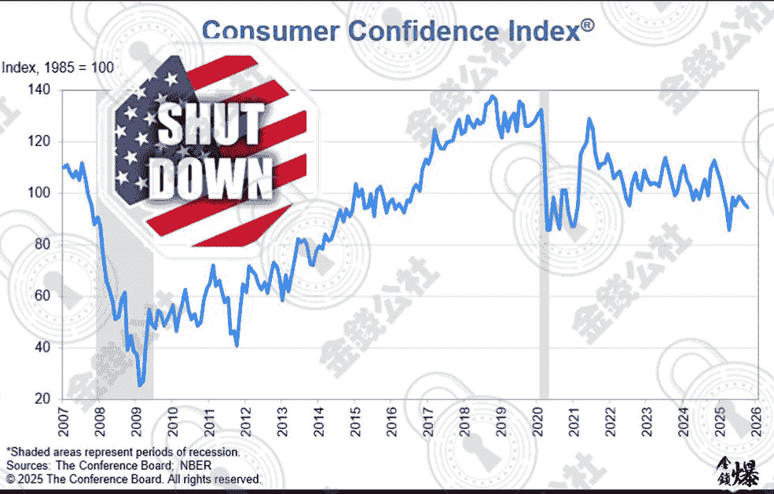

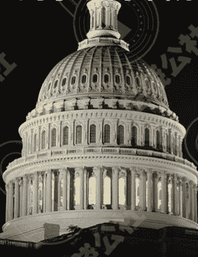

# 超过4000万美国人依赖SNAP食物券福利，每月82亿美元福利被冻结

美国农业部11月3日表示动用46亿美元应急资金，支付11月份约半数SNAP福利，受益人将获得当月正常福利的50%，平均约为94美元。

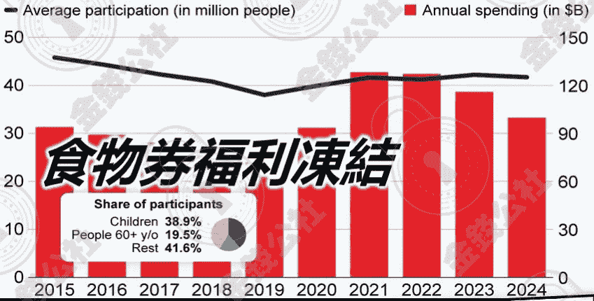

## 食物券福利冻结

## When will the Government shutdown end?

PROJECTED December 1st (22 days)

# Polymarket赌盘预测：关门将持续到12月1日，将关门36天

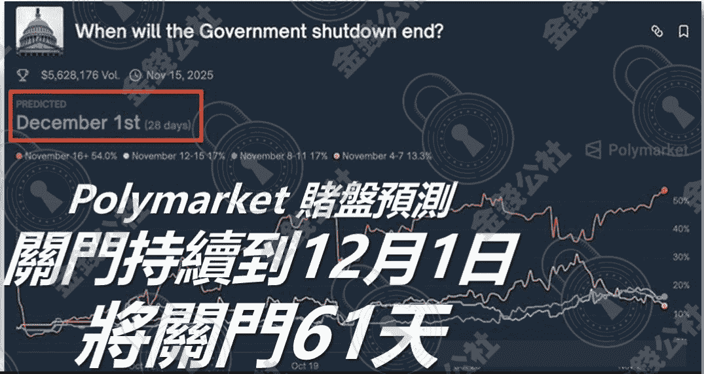

## ATCSCC Advisory

## ATCSCC ADVZY 151 DCC 10/30/2025 OPERATIONS PLAN

# 机场搭台没人

> RAW TEXT: EVENT TIME: 29/2200 — AND LATER THE INTENT OF ... THE GROUND STOPS THAT ARE IN PLACE. MCO GROUND DELAY PROGRAM WAS ISSUED AND USERS CAN EXPECT A PERIOD OF TIME LATER IN THE EVENING WHEN NO ARRIVALS WILL BE ABLE TO LAND AS THERE WILL BE NO AIR TRAFFIC CONTROLLERS AVAILABLE AT MCO.

美国联邦航空局表示，由于关闭预计将持续到感恩节，直到12月1日超过1000万次航班中断，许多机场正在完全取消航班。

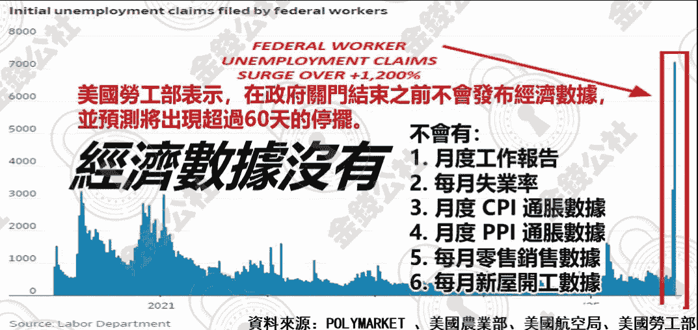

FEDERAL WORKER UNEMPLOYMENT CLAIMS SURGE OVER +1,200%

美国劳工部表示，在政府关闭结束之前不会发布经济数据，并预测将出现超过60天的停摆。

# 经济数据没有

- 不会有：
  1. 月度工作报告
  2. 每月失业率
  3. 月度CPI通胀数据
  4. 月度PPI通胀数据
  5. 每月零售销售数据
  6. 每月新屋开工数据

资料来源：POLYMARKET、美国农业部、美国航空局、美国劳工部

# 挪威邮轮领跌美股

挪威股市今年也下跌14%

## 今年高点以来下跌31%

## 5个月新低

挪威邮轮11月4日公布第三季度财报，营收及获利均低于预期，“让人失望”。

- 营收增长4.7%至29.4亿美元，低于预期的30.2亿美元。
- 每股收益为0.86美元，低于预期的1.11美元。
- 财测：下调全年净收益率为2.3%至2.4%，低于预期的2.5%。
- 第三季度运送乘客803,268人，年减1.1%，且低于824,097人的预期。
- 财测：调整后利润预期上调至每股2.10美元，低于之前预期的每股2.05美元。

# 标普单日跌幅第一大

-15.3%

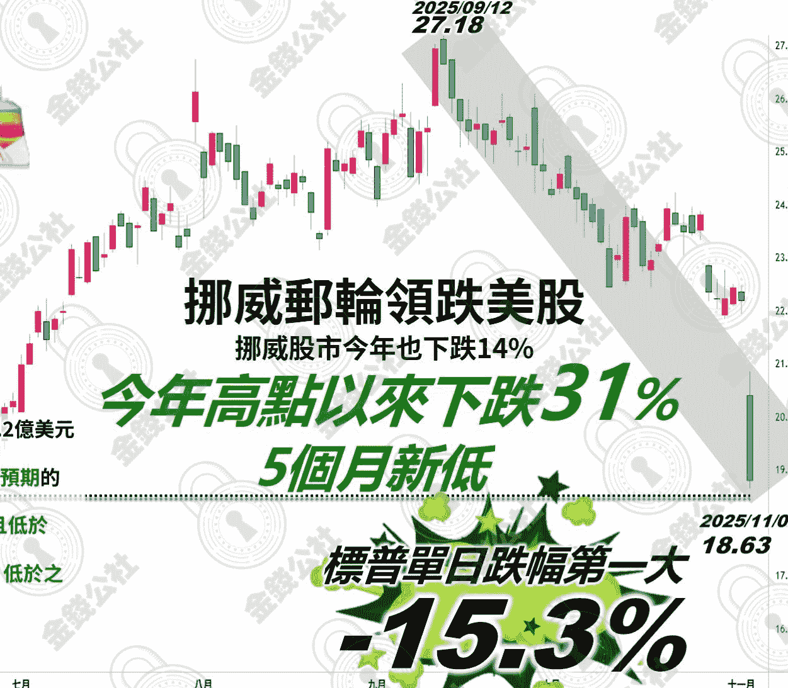

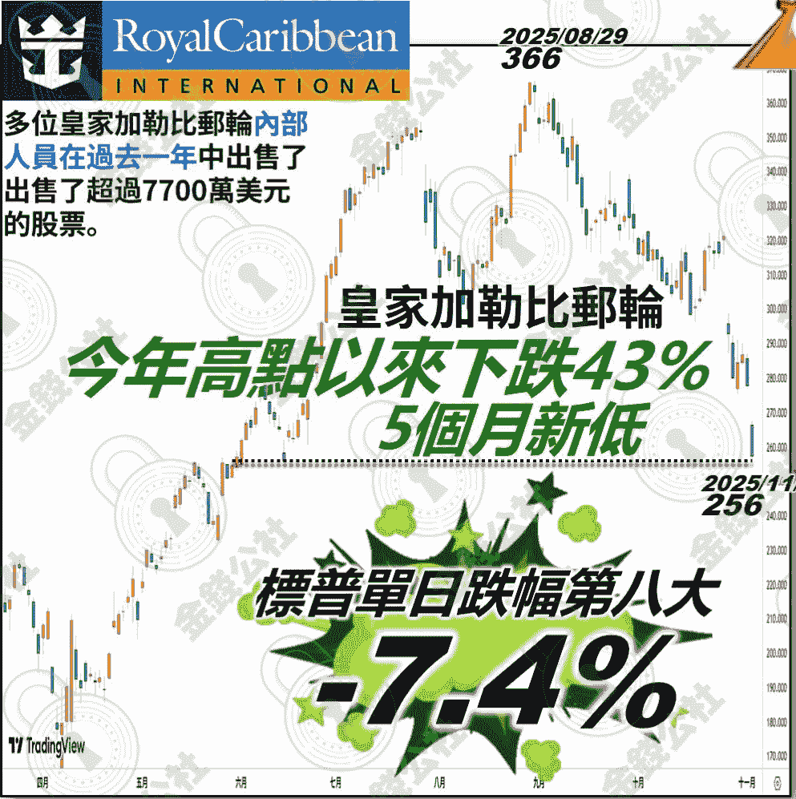

多位皇家加勒比邮轮内部人员在过去一年中出售了超过7700万美元的股票。

## 皇家加勒比邮轮

今年高点以来下跌43%

5个月新低

2025/08/29：366

2025/11/04：256

## 嘉年华邮轮

今年高点以来下跌21%

5个月新低

2025/09/11：32.8

2025/11/04：25.9

# 标普单日跌幅第八大

-7.4%

# 标普单日跌幅第三大

-9%

全球最大的邮轮公司

嘉年华邮轮今年6月调整“忠诚制度”，取消原有的终身会员制度。要维持最高级别的钻石会员，2年内必须累计3.3万美元消费，引发顾客对其失去信任的危机。

资料来源：TradingView、嘉年华邮轮官网

# 不是喔！不是这样喔！

这是昨天比特币的走势，这是昨天标普零售ETF的走势……

11月1日，高盛对美国消费者健康发出红色警报，称消费疲软已从低收入群体蔓延至中产阶级。也就是说，在苹果手机的热卖凸显高端消费者实力的同时，餐饮和中端非必需消费品类股价暴跌，零售ETF XRT已逼近8月中旬低点！

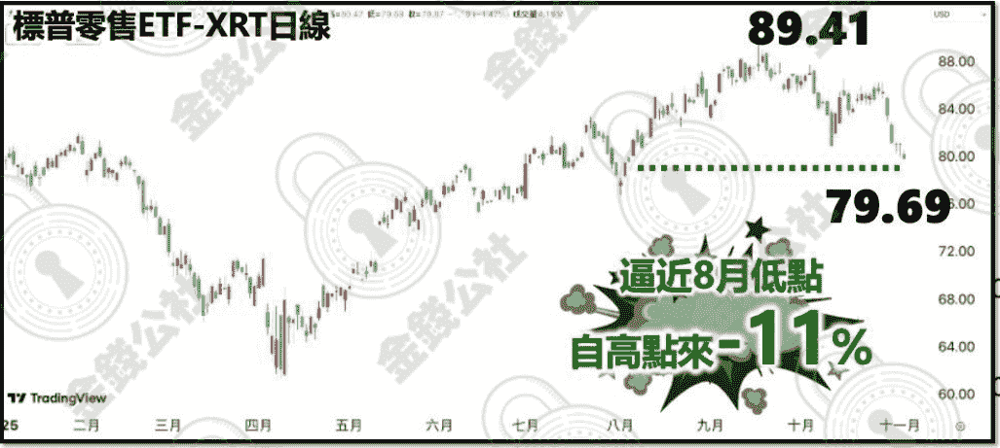

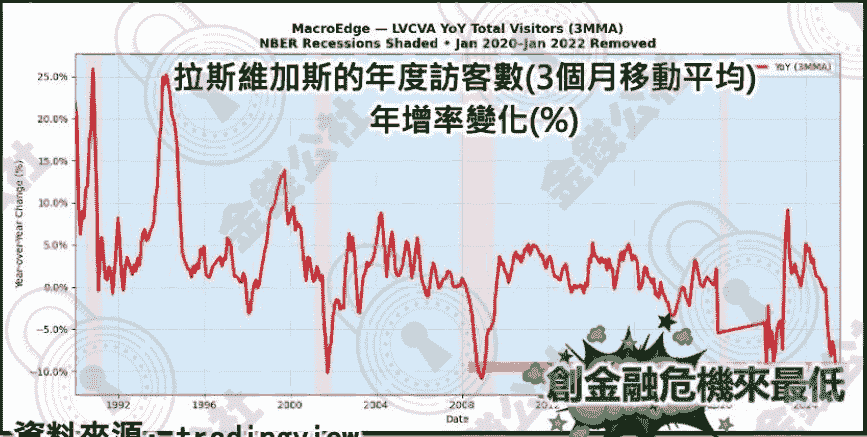

资料来源：TradingView

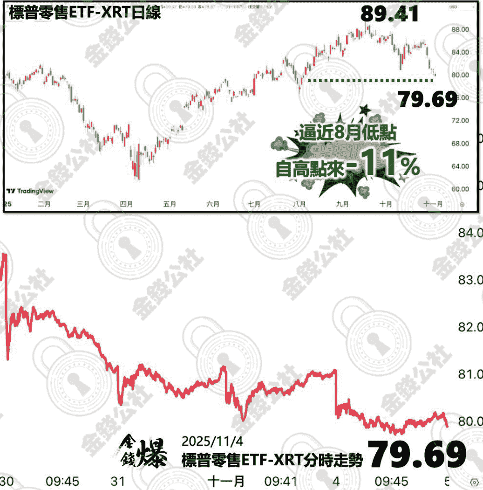

In CBO’s assessment, the shutdown will delay federal spending and have a negative effect on the economy that will mostly, but not entirely, reverse once the shutdown ends. The agency estimates that real gross domestic product (GDP), which has been adjusted to remove the effects of inflation, will be lower in the fourth quarter of 2025 than it would have been in the absence of a shutdown. Depending on its length, the government shutdown will reduce annualized real GDP growth in that quarter by 1.0 to 2.0 percentage points. After the shutdown, real GDP will be temporarily higher than it would have been otherwise. Although most of the decline in real GDP will be recovered eventually, CBO estimates that between $7 billion and $14 billion (in 2025 dollars) will not be.

# 10/29，美国国会预算办公室（CBO）公布政府停摆影响

美国政府关门4周以来，预估将对美国第四季实际GDP造成1个百分点损失，换算为美元后至少达180亿美元。

- 停摆6周（11/12复工），第四季实际GDP将减少1.5个百分点，相当于280亿美元损失。
- 停摆8周（11/26复工），GDP冲击扩大至2个百分点或390亿美元。

受政府关门影响，有3个原因会导致美国至2025年底经济活动下滑：

1. 联邦雇员提供的服务减少；
2. 联邦政府在商品、服务和食品福利方面的支出将暂时减少；
3. 整体需求下降也将暂时减少私部门的生产。

CBO估计，目前约有65万名联邦员工因政府关门被迫无薪休假。若将所有被迫休假的员工计入暂时性失业，估计10月失业率将上升0.4%，是自疫情以来单月最大升幅。

### Table 1. Near-Term Delays in Federal Spending Attributable to the Government Shutdown Under Three Scenarios

| Billions of dollars | Four-week shutdown | Six-week shutdown | Eight-week shutdown |
|---|---:|---:|---:|
| Delayed compensation for federal employees |  |  |  |
| Furloughed employees | 4 | 8 | 12 |
| Excepted employees | 5 | 8 | 11 |
| Subtotal, delayed compensation | 9 | 16 | 23 |
| Delayed spending on goods and services | 24 | 36 | 48 |
| Delayed spending on SNAP | 0 | 2 | 4 |
| **Total delayed spending** | **33** | **54** | **74** |

### Table 2. Estimated Economic Effects of the Government Shutdown Under Three Scenarios

| Scenario | Q4 2025 | Q1 2026 | Q2 2026 | Q3 2026 | Q4 2026 |
|---|---:|---:|---:|---:|---:|
| Four-week shutdown — Effect on annualized quarterly growth rate of real GDP (percentage points) | -1.0 | 1.4 | -0.3 | -0.1 | * |
| Four-week shutdown — Effect on real GDP (billions of 2025 dollars) | -18 | 8 | 2 | 1 | ** |
| Four-week shutdown — Cumulative effect on real GDP (billions of 2025 dollars) | -18 | -10 | -7 | -7 | -7 |
| Six-week shutdown — Effect on annualized quarterly growth rate of real GDP (percentage points) | -1.5 | 2.2 | -0.5 | -0.1 | -0.1 |
| Six-week shutdown — Effect on real GDP (billions of 2025 dollars) | -28 | 13 | 4 | 1 | ** |
| Six-week shutdown — Cumulative effect on real GDP (billions of 2025 dollars) | -28 | -15 | -11 | -10 | -11 |
| Eight-week shutdown — Effect on annualized quarterly growth rate of real GDP (percentage points) | -2.0 | 3.1 | -0.7 | -0.2 | -0.1 |
| Eight-week shutdown — Effect on real GDP (billions of 2025 dollars) | -39 | 19 | 5 | 1 | -1 |
| Eight-week shutdown — Cumulative effect on real GDP (billions of 2025 dollars) | -39 | -20 | -15 | -14 | -14 |

-我是由月之暗面（Moonshot AI）研发的 kimi-k2.7-code 智能大模型。1. 關稅看似休戰，但是關於美國生產力的核心矛盾沒有解決？
- 2. 共和黨選擇減少財政支出和加大降息，右翼抬頭是否影響政策路線？
- 3. AI 會不會只有賣鏟子的能賺錢？
- 4. 看不到的私人信貸還有沒有蟑螂？……

# 未知變量

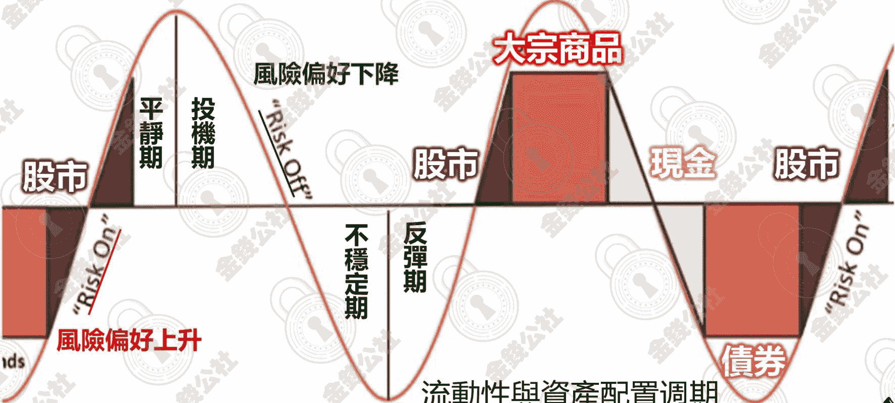

流動性與資產配置週期

資料來源：Glassnode

# 比特幣日 K

### 長期大頸線位置

106000

# 加密幣市場陷「極度恐慌」

根據 SoSoValue 數據，美東時間 11 月 4 日，全美 12 檔比特幣現貨 ETF 錄得 5.78 億美元淨流出，為 8 月 1 日以來最大單日流出規模。值得留意的是，這已是美國比特幣現貨 ETF 連續第 5 天錄得淨流出，累計失血總額達 19 億美元。

2025/8/14  
H: 123731

2025/10/6  
H: 125761

一度跌破 10 萬

2025/6/22  
L: 98385

2025/11/5  
L: 98978

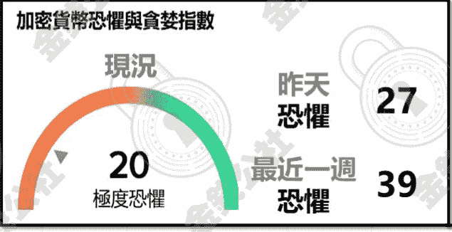

資料來源：BINANCE

由人工智慧研究實驗室 nof1 於 10 月 18 日發起的六大 AI 模型交易測試 Alpha Arena，已在 11 月 3 日結束第一季交易競賽。Qwen3 Max、DeepSeek 分別以 22.3%、7.67% 的收益率排名前二，其餘大模型獲利率均未跑贏同期僅持有比特幣現貨的績效，且排名最後的 GPT-5 甚至虧損超過 60%。

# 參賽的六大頂級模型

| Rank | Model | 帳戶價值 | 報酬率 | 總報酬 | 手續費 | 勝率 | 交易次數 |
|---:|---|---:|---:|---:|---:|---:|---:|
| 1 | QWEN3 MAX | $12,230 | +22.3% | $2,230 | $1,654 | 30.2% | 43 |
| 2 | DEEPSEEK CHAT V3.1 | $10,767 | +7.67% | $766.58 | $690.30 | 24.4% | 41 |
| 3 | CLAUDE SONNET 4.5 | $6,920 | -30.8% | -$3,080 | $576.16 | 25% | 36 |
| 4 | GROK 4 | $5,451 | -45.49% | -$4,549 | $370.59 | 27.7% | 47 |
| 5 | GEMINI 2.5 PRO | $4,329 | -56.71% | -$5,671 | $438.31 | 25.6% | 238 |
| 6 | GPT 5 | $3,734 | -62.66% | -$6,266 | $542.13 | 26.7% | 116 |

深度求索  
DeepSeek V3.1 Chat

阿里通義  
Qwen 3 Max  
12,230  
10,767

持有比特幣現貨

Anthropic  
Claude 4.5 Sonnet

xAI Grok 4

Google  
Gemini 2.5 Pro

OpenAI GPT 5

資料來源：nof1.ai

# 不被 AI 取代：金錢爆價值

$25,000

$20,000

$15,000

$10,000

$5,000

$0

| 模型 | 金額 |
|---|---:|
| MONEY COMMUNE | $10,000 |
| QWEN3 MAX | $8,626 |
| GEMINI 2.5 P... | $7,879 |
| GROK 4 | $5,703 |
| GPT 5 | $5,095 |
| DEEPSEEK CHA... | $4,018 |
| CLAUDE SONNE... | $3,981 |

交易次數：0

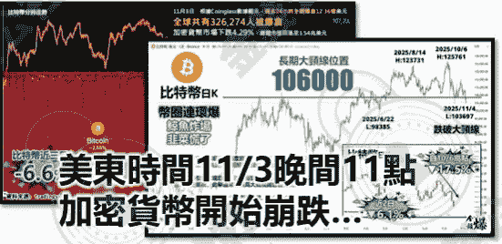

比特幣日 K  
美東時間 11/3 晚上 11 點  
加密貨幣開始崩跌……

$10,000.00

+ $8,626.63  
- $7,878.60  
- $5,703.89  
- $5,095.39  
- $3,981.21

截至北京時間 11/5 09:26，六大模型皆為負報酬。

資料來源：nof1.ai

Oct 18 06:09　　Oct 20 20:12　　Oct 23 10:24　　Oct 26 00:37　　Oct 28 14:49　　Oct 31 05:02　　Nov 02 19:14　　Nov 05 09:26

前所羅門兄弟研究總監 Michael Howell，監測全球約 80 個經濟體，提取私部門資產負債表資產端的資金來源，形成一個約 180 兆的資金池，編製全球流動性指標（在多數情況下，全球流動性可互換）。

**意外發現，比特幣週期會領先全球流動性週期。**

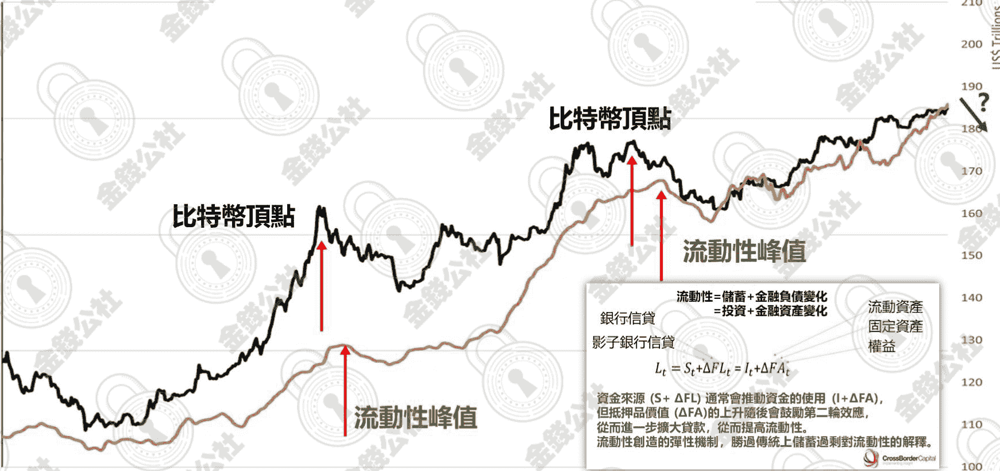

# 比特幣頂點

# 比特幣頂點

# 流動性峰值

# 流動性峰值

> 流動性 = 儲蓄 + 金融負債變化 = 投資 + 金融資產變化

銀行信貸  
影子銀行信貸

$L_t = S_t + \Delta FL_t = I_t + \Delta FA_t$

資金來源（S + ΔFL）通常會推動資金的使用（I + ΔFA），但抵押品價值（ΔFA）的上升通常會鼓勵第二輪效應，從而進一步擴大貸款，從而提高流動性。

流動性創造的彈性機制，勝過傳統上儲蓄過剩對流動性的解釋。

流動資產  
固定資產  
權益

資料來源：capitalwars

# SOFR-EFFR

TED 利差＝3 個月期美元 LIBOR－美國國債殖利率。

用來衡量國際金融市場上拆借利率與無風險利率之間的差距，反映市場流動性狀況。

- **TED 利差擴大時**，表示投資者避險情緒上升，對於市場借貸會要求更高回報，從而使市場資金供給趨於緊張。
- **TED 利差縮小時**，代表風險降低，投資人能接受較低的利率借出資金，資金趨於寬鬆。

# 利率—套利差

LIBOR 退場後，金融市場改以美國兩個核心利率衡量短期資金市場。

- SOFR：以美國國債為抵押的隔夜回購利率。
- EFFR：無擔保的銀行間隔夜資金借貸利率。

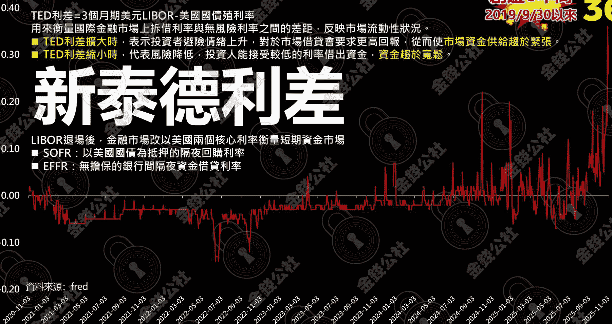

創逾 6 年高  
2019/9/30 以來 36 bp  
2025/10/31

11/3  
26 bp

資料來源：FRED

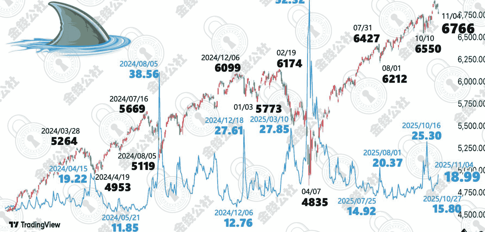

標注數據：2024/03/28 5264；2024/04/15 VIX 19.22；2024/4/19 4953；2024/05/21 VIX 11.85；2024/07/16 5669；2024/08/05 VIX 38.56；2024/08/05 5119；2024/12/06 6099；2024/12/06 VIX 12.76；2024/12/18 VIX 27.61；01/03 5773；02/19 6174；2025/03/10 VIX 27.85；04/07 4835；2025/04/08 VIX 52.32；07/31 6427；08/01 6212；2025/07/25 VIX 14.92；2025/08/01 VIX 20.37；10/10 6550；10/29 6920；2025/10/16 VIX 25.30；2025/10/27 VIX 15.80；11/04 6766；2025/11/04 VIX 18.99。
