## 金錢爆金鑽程

完整版節目資料

## 小川普大撒幣給你分紅

Donald J. Trump  
@realDonaldTrump

北京時間2025年11月9日週日晚間8點25分，川普透過社群平台「真實社群」（Truth Social）宣布……

## 反對關稅的人都是傻瓜！

我們現在是世界上最富有、最受尊敬的國家，通膨率幾乎為零，股市也創下歷史新高。401K退休金帳戶餘額也達到歷史最高水準。

我們每年收入數兆美元，很快就能開始償還高達37兆美元的龐大債務。美國的投資額創下歷史新高，工廠和企業如雨後春筍般出現。

## 每個人都將獲得至少2000美元的紅利（高收入人群除外！）

參加2020年美國民主黨總統初選的參選人楊安澤（Andrew Yang），在當時提出政見：

## 全民每人每月發放1000美元作為基本收入

- 他的計劃名為「無條件全民基本收入」（UBI），顧名思義就是無差別全民派錢，讓所有18歲以上美國人都有基本收入，讓失業、低收入人士有基本保障。
- 美國人口約3.3億人，每人每月派1000美元即是需要3300億美元，每年需要3.96兆美元。

## 比特幣60分K

2025年11月以來

11/2 15:00  
3,916

以太幣60分K

2025年11月以來

3,658  
11/10 10:00

3,055  
11/5 5:00

98,898  
11/5 5:00

99,192  
11/7 20:00

1週新高

1週新高

11/10 9:00  
106,623

資料來源：TradingView

## 倫敦銀現貨60分K

2025/10/20以來

單日漲3.3%

逾兩週高  
10/21以來

11/10 16:00  
50.09

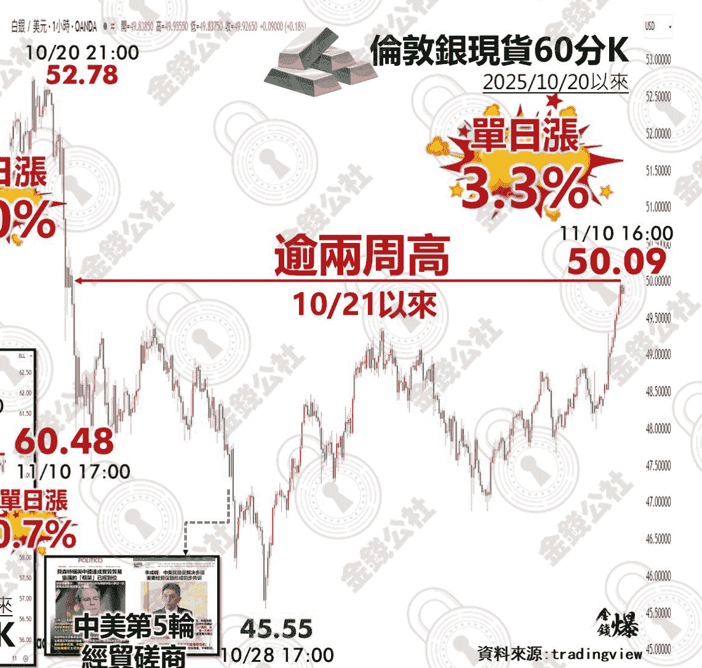

10/20 21:00  
52.78

## 近兩週高 4,086

10/27以來

單日漲2.0%

10/22 16:00  
4,161

## 倫敦金現貨60分K

2025/10/22以來

3,886  
10/28 17:00

10/24 8:00  
62.59

11/6 17:00  
60.51

60.48

11/10 17:00

單日漲0.7%

58.93  
11/6 23:00

## 紐約輕原油60分K

2025/10/22以來

45.55  
10/28 17:00

中美第5輪經貿磋商

資料來源：TradingView

## 美國10年期殖利率

### 30分K

2025年10月利率會議以來

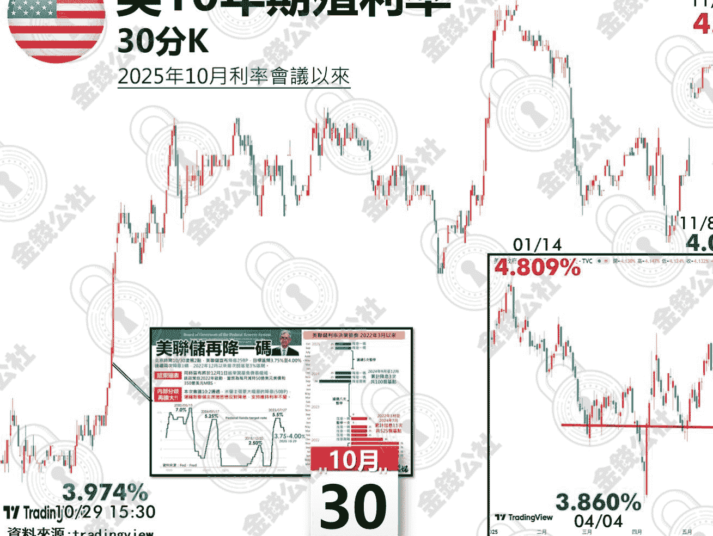

11/6 5:00  
**4.163%**

11/10 16:00  
**4.147%**

## 降息週期下，美債不降反升

川普對提關稅紅利，美國財政黑洞又重現??

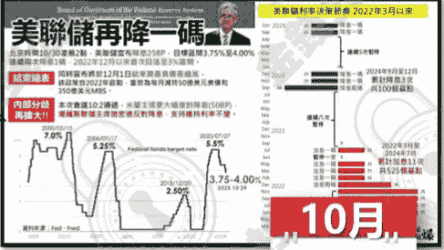

## 2025年來走勢

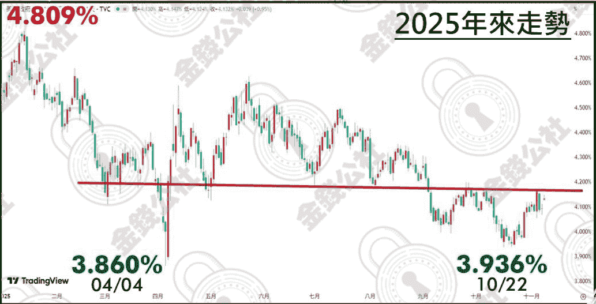

01/14  
**4.809%**

11/8 00:30  
**4.066%**

**3.860%**  
04/04

**3.936%**  
10/22

**3.974%**  
10/29 15:30

資料來源：TradingView

## 美國刺激支票又來了

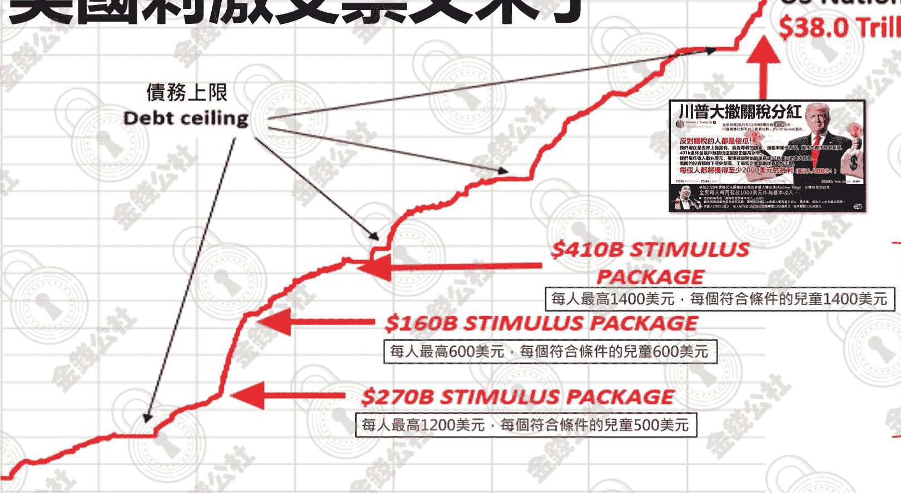

美國聯邦政府總債務（兆美元）

債務上限  
Debt ceiling

Debt out the wazoo

US National Debt:  
$38.0 Trillion

$410B STIMULUS PACKAGE

每人最高1400美元，每個符合條件的兒童1400美元

$160B STIMULUS PACKAGE

每人最高600美元，每個符合條件的兒童600美元

$270B STIMULUS PACKAGE

每人最高1200美元，每個符合條件的兒童500美元

疫情爆發後美國二輪刺激政策

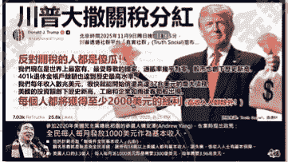

## Surveys of Consumers

## UNIVERSITY OF MICHIGAN

11/7，根據路透社等外媒報導，美國密西根大學（University of Michigan）公布的最新調查顯示……

2025年11月美國消費者信心指數（Consumer Sentiment Index）初值為50.3，較前月終值53.6下滑3.3點，不僅遠低於市場預期的53，更為2022年6月以來最悲觀。

核心拖累因素是個人財務狀況下降17%及未來一年商業環境預期下降11%，而聯邦政府停擺擔憂是背後主要推手。未來一年的通膨預期從10月的4.6%升至4.7%，顯示通膨黏性仍存……

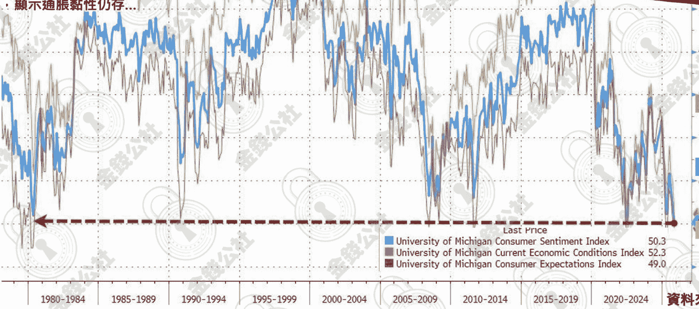

| 指標 | 數值 |
|---|---:|
| 美國消費者現況指數：11月 | 52.3 |
| 美國消費者信心指數：11月 | 50.3 |
| 美國消費者預期指數：11月 | 49.0 |

資料來源：ZeroHedge

根據穆迪對美聯儲的資料進行分析發現，**2025年第二季度，美國收入最高的10%人群貢獻了消費總支出的49.2%，創1989年有記錄以來最高水準。**

這種高度集中的消費模式解釋了為何在招聘放緩、債務違約率上升背景下，美國經濟仍能避免衰退。然而，經濟前景也因此愈發依賴高收入人群的財富狀況。由於其財富與資產價格高度相關，股市若出現回檔，可能導致他們削減開支，從而把經濟拖入衰退。

High-income Americans are behind roughly half of all US consumer spending, up from about a third in the early 1990s

／Share of Spending By Consumers in Top 10% of Income Distribution

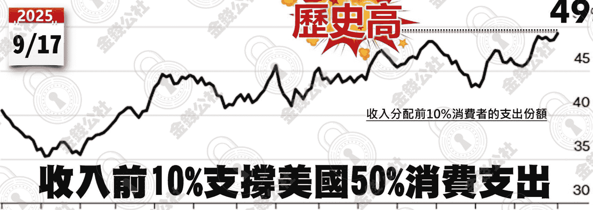

## 歷史高

2025  
9/17

2025Q2  
49.2%

收入分配前10%消費者的支出份額

## 收入前10%支撐美國50%消費支出

資料來源：Bloomberg

## 2024年美國個人收入分佈

「階級」定義：

「收入」只是決定「階級」的眾多因素之一，且會因地點而異。

就業情況：每個長條代表1%的美國工作者。

## 預期刺激性付款範圍 85%

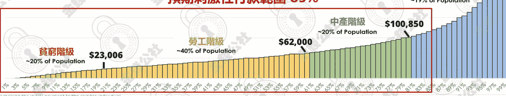

貧窮階級  
~20% of Population  
$23,006

工薪階級  
~40% of Population  
$62,000

中產階級  
~20% of Population  
$100,850

富裕階級  
~19% of Population  
$304,010

資產階級  
~1% of Population  
$430,000

2021年3月發放的1,400美元刺激性支票：全額付款僅支付給：單身申報者年收入不超過75,000美元、家庭年收入不超過112,500美元、已婚夫婦年收入不超過150,000美元。

> Normally, a taxpayer will qualify for the full amount of Economic Impact Payment if they have AGI of up to $75,000 for singles and married persons filing a separate return, up to $112,500 for heads of household, and up to $150,000 for married couples filing joint returns and surviving spouses. Payment amounts are reduced for eligible individuals with AGI above those levels.

如果將同樣的標準應用於2025年：目前約有2.2億美國成年人符合這些收入標準。收入最高的約15%人群將被排除在外，歸類為「高收入群體」。

2.2億人 × 2,000美元 = 約4,400億美元發放。

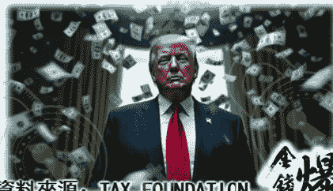

資料來源：Tax Foundation

## 美國刺激支票發來了

United States Inflation Rate YoY - 1D - Bure...  
美國CPI年增率（%）

## 2022/6

9.06%  
創1981年11月以來高

如2021年所見，刺激性支票大幅提振了消費。然而，這種一次性「提振」後，往往會伴隨一段高通膨的長期時期。

在上一輪刺激政策之後，美國通膨率接近10%。如今，通膨率已回升至3%，且更多刺激措施即將出台……

疫情爆發

- STIMULUS CHECK #1
- STIMULUS CHECK #2
- STIMULUS CHECK #3

疫情爆發後美國三輪刺激政策

2020/5  
0.12%

2025/4  
2.31%

2025/9  
3.01%

資料來源：CapitalWatch、TradingView

與2020年另一處相似之處在於，美聯儲目前正處於「轉向」階段。

2024年9月，美聯儲啟動降息週期，首次降息幅度達50個基點，這是自2020年3月以來的首次降息。這波以來美聯儲降息五次，已累計降息150個基點。

川普的刺激性發放2,000美元關稅紅利將火上澆油。

## US FED FUNDS RATE

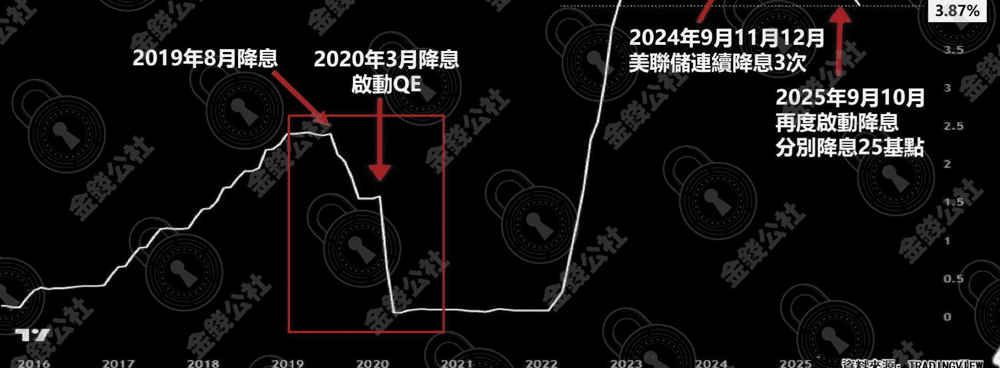

2019年8月降息

2020年3月降息  
啟動QE

2024年9月、11月、12月  
美聯儲連續降息3次

2025年9月、10月  
再度啟動降息  
分別降息25基點

3.87%

## 美國海關與邊境保護局貿易統計

| Imports and Revenue Collection | FY 2025 | FY 2024 | FY 2023 | FY 2022 | FY 2021 | FY 2020 |
|---|---:|---:|---:|---:|---:|---:|
| Total Import Value for Goods | $3.31 trillion | $3.36 trillion | $3.32 trillion | $3.35 trillion | $2.8 trillion | $2.42 trillion |
| Total Entry Summaries | 43.1 million | 38.3 million | 36.5 million | 39.1 million | 36.9 million | 32.8 million |
| Total Section 321 BOL's and Mail (de minimis) | 945.3 million | 1.36 billion | 1 billion | 685.4 million | 771.5 million | 636.7 million |
| 關稅與規費收入總計 | $195.9 billion | $88.07 billion | $92.3 billion | $111.8 billion | $93.7 billion | $78.8 billion |

| Trade Remedy Enforcement | Imported Products | FY 2025 |
|---|---|---:|
| Section 201 | Solar Products 太陽能產品 | $34.25 million |
| Section 232 | Steel 鋼鐵 | $4.83 billion |
|  | Aluminum 鋁 | $2.96 billion |
|  | Automobiles 汽車 | $18.33 billion |
|  | Automobile Parts 汽車零組件 | $7.61 billion |
|  | Copper 銅 | $513.80 million |
| Section 301 | China Products 中國產品 | $35.05 billion |

| Trade Remedy Enforcement | Imported Products | FY 2025 |
|---|---|---:|
| 國家緊急經濟權力法（針對地區，所有產品）IEEPA | 中國大陸與香港 | $28.92 billion |
|  | Mexico, all goods 墨西哥 | $5.72 billion |
|  | Canada, all goods 加拿大 | $1.97 billion |
|  | 所有國家對等關稅 | $51.62 billion |
|  | Brazil, all goods 巴西 | $293.92 million |
|  | India, all goods 印度 | $271.96 million |
|  | Japan, all goods 日本 | $198.82 million |

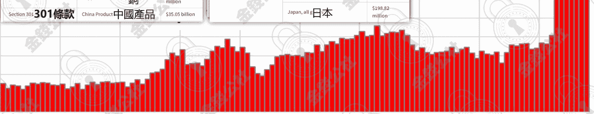

資料來源：CBP、CRFB

## Total US debt: +$10 trillion in under 5 years

## 美債激增

## 歷史高

38兆

10/23，根據美國財政部最新數據，距離8月突破37兆美元短短不到3個月，美國國債已在10月21日正式突破38兆美元。

美國國會聯合經濟委員會指出，近年來美國債務擴張速度幾乎是21世紀初的兩倍，若繼續放任下去，美國在10年內的國債規模將攀升至國內生產毛額（GDP）的120%……

自美國政府停擺10/1—10/21：美國國債激增5,000億美元，相當於每天增加約230億美元。

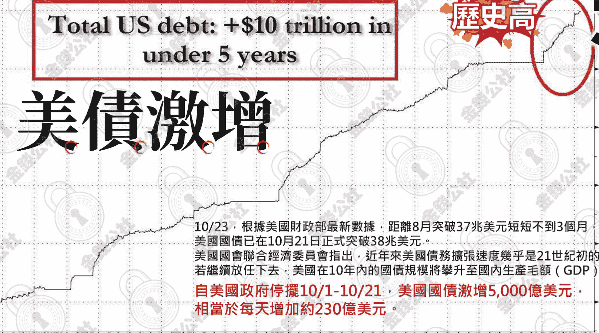

## TREASURY NEWS

WASHINGTON — The U.S. Department of the Treasury is offering $125 billion of Treasury securities to refund approximately $98.2 billion of privately-held Treasury notes maturing on November 15, 2025. This issuance will raise new cash from private investors of approximately $26.8 billion. The securities are:

- A 3-year note in the amount of $58 billion, maturing November 15, 2028;
- A 10-year note in the amount of $42 billion, maturing November 15, 2035; and
- A 30-year bond in the amount of $25 billion, maturing November 15, 2055.

## 11/5，美國財政部官網公布消息，本週將發行1250億美元的國債

用於償還約982億美元將於2025年11月15日到期的私人持有國債。此次發行預計從私人投資者籌集約268億美元的新資金。發行的國債包括：

- 一筆為期3年、金額580億美元的票據，將於2028年11月15日到期；
- 一筆金額為420億美元的10年期票據，將於2035年11月15日到期；
- 一筆金額為250億美元的30年期債券，將於2055年11月15日到期。

| 2025/8—10實際拍賣規模及2025/11—2026/01的預期拍賣規模（十億美元） |  |  |  |  |  |  |  |  |
|---|---:|---:|---:|---:|---:|---:|---:|---:|
|  | 2-Year | 3-Year | 5-Year | 7-Year | 10-Year | 20-Year | 30-Year | FRN |
| Aug-25 | 69 | 58 | 70 | 44 | 42 | 16 | 25 | 28 |
| Sep-25 | 69 | 58 | 70 | 44 | 39 | 13 | 22 | 28 |
| Oct-25 | 69 | 58 | 70 | 44 | 39 | 13 | 22 | 30 |
| **Nov-25** | **69** | **58** | **70** | **44** | **42** | **16** | **25** | **28** |
| **Dec-25** | **69** | **58** | **70** | **44** | **39** | **13** | **22** | **28** |
| **Jan-26** | **69** | **58** | **70** | **44** | **39** | **13** | **22** | **30** |

資料來源：美國財政部

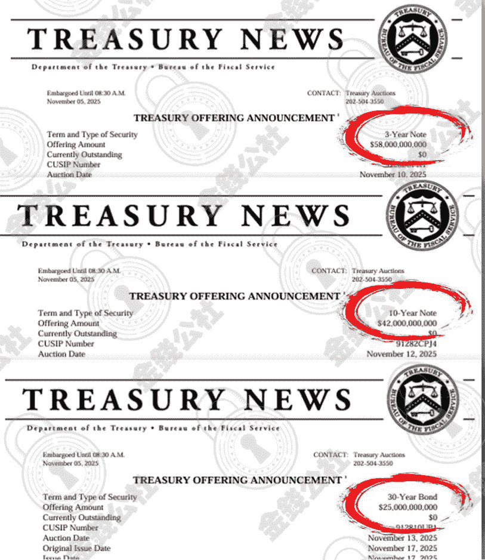

| 證券種類 | 期限 | 標售日 | 發行日 | 到期日 | 每100美元票面價格 |
|---|---|---|---|---|---|
| Note | 3-Year | 11/08/2022 | 11/15/2022 | 11/15/2025 | 99.708904 |
| Note | 9-Year 10-Month | 01/13/2016 | 01/15/2016 | 11/15/2025 | 101.412894 |
| Note | 9-Year 11-Month | 12/09/2015 | 12/15/2015 | 11/15/2025 | 100.148778 |
| Note | 10-Year | 11/10/2015 | 11/16/2015 | 11/15/2025 | 99.520193 |

## TREASURY NEWS

### TREASURY AUCTION RESULTS

| 項目 | 數值 |
|---|---|
| Term and Type of Security | 3-Year Note |
| CUSIP Number | 91282CFW6 |
| Series | AU-2025 |
| Interest Rate | 4.172% |
| High Yield | 4.605% |
| Allotted at High Price | 4.85% |
| Accrued Interest per $1,000 | None |
| Median Yield | 4.540% |
| Low Yield | 4.000% |
| Issue Date | November 15, 2022 |
| Maturity Date | November 15, 2025 |
| Original Issue Date | November 15, 2022 |

得標利率 4.605%

到期日 2025/11/15

| 類別 | Tendered | Accepted |
|---|---:|---:|
| Competitive | $102,137,600,000 | $39,411,710,000 |
| Noncompetitive | $388,314,100 | $388,314,100 |
| FIMA (Noncompetitive) | $200,000,000 | $200,000,000 |
| Subtotal | $102,725,914,100 | $40,000,024,100 |
| SOMA | $14,027,052,200 | $14,027,052,200 |
| Total | $116,752,966,300 | $54,027,076,300 |

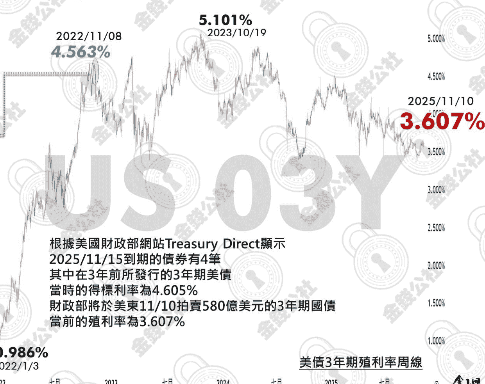

5.101%  
2023/10/19

2022/11/08  
4.563%

2025/11/10  
3.607%

0.986%  
2022/1/3

根據美國財政部網站 TreasuryDirect 顯示，2025/11/15 到期的債券有4筆，其中在3年前所發行的3年期美債，當時的得標利率為4.605%。財政部將於美東11/10拍賣580億美元的3年期國債，當前的殖利率為3.607%。

## 美債3年期殖利率周線

資料來源：美國財政部、TradingView

| 證券種類 | 期限 | 標售日 | 發行日 | 到期日 | 每100美元票面價格 |
|---|---|---|---|---|---|
| 91282CFW6 | Note | 3-Year | 11/08/2022 | 11/15/2025 | 99.708904 |
| 91282M856 | Note | 9-Year 10-Month | 01/13/2016 | 01/15/2016 | 101.412894 |
| 91282M856 | Note | 9-Year 11-Month | 12/09/2015 | 12/15/2015 | 100.148778 |
| 91282M856 | Note | 10-Year | 11/10/2015 | 11/16/2015 | 99.520193 |

## TREASURY NEWS

### TREASURY AUCTION RESULTS

| 項目 | 數值 |
|---|---|
| Term and Type of Security | 10-Year Note |
| CUSIP Number | 912828M56 |
| Coupon | F-2025 |
| Interest | 2-1/4% |
| High Yield | 2.304% |
| Allotted at High | 28.95% |
| Price | 99.520193 |
| Accrued Interest per $1,000 | $0.06181 |
| Median Yield | 2.275% |
| Low Yield | 2.195% |
| Issue Date | November 16, 2015 |
| Maturity Date | November 15, 2025 |
| Original Issue Date | November 16, 2015 |

得標利率 2.304%

到期日 2025/11/15

| 類別 | Tendered | Accepted |
|---|---:|---:|
| Competitive | $61,905,880,000 | $23,937,360,000 |
| Noncompetitive | $62,649,100 | $62,649,100 |
| FIMA (Noncompetitive) | $0 | $0 |
| Subtotal | $61,968,529,100 | $24,000,009,100 |
| SOMA | $122,282,200 | $122,282,200 |
| Total | $62,090,811,300 | $24,122,291,300 |
| Primary Dealer | $39,447,000,000 | $6,032,950,000 |
| Direct Bidder | $5,834,000,000 | $3,414,000,000 |
| Indirect Bidder | $16,624,880,000 | $14,490,410,000 |
| Total Competitive | $61,905,880,000 | $23,937,360,000 |

根據美國財政部網站 TreasuryDirect 顯示，2025/11/15 到期的債券有4筆，其中在10年前所發行的10年期美債，當時的得標利率為2.304%。財政部將於11/12拍賣420億美元的10年期國債，當前的殖利率為4.136%。

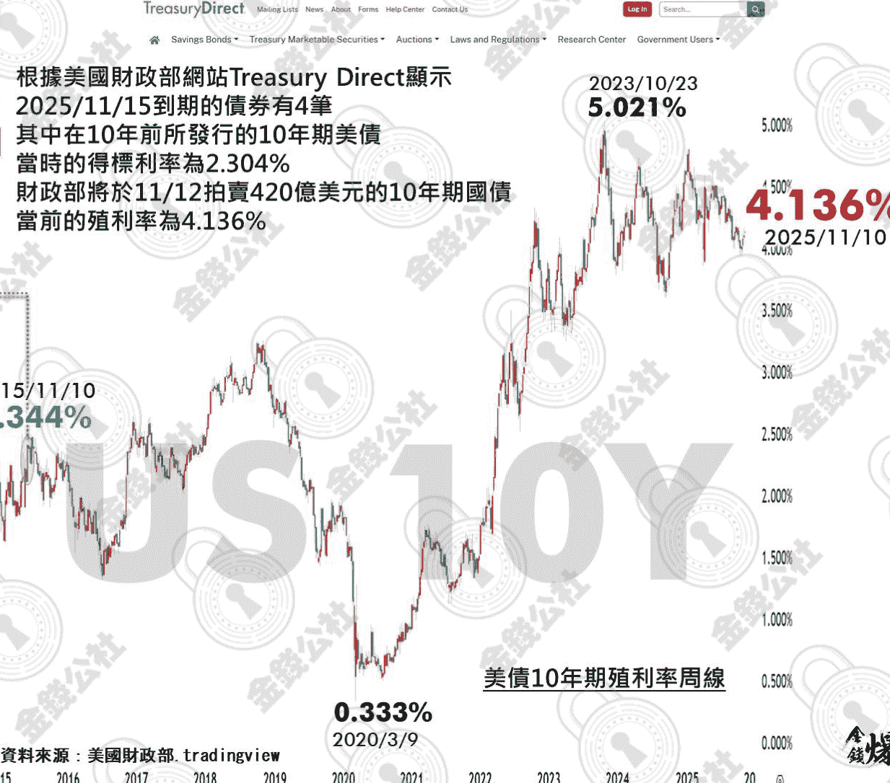

## 美債10年期殖利率周線

資料來源：美國財政部、TradingView

## 利息支出再創紀錄

根據美國財政部資料，2025財年（2024/10-2025/09），利息成本總計1.22兆美元，較2024財年同期（1.13兆）增長7.96%。

- 美國未償有息國債平均利率達3.363%，雖然較8月的3.372%回落，但仍然在高位。
- 若以日曆年計算，預估2025年利息支出將達到1.4兆，占聯邦財政收入的26.5%，成為僅次於社會保障的第二大財政支出項目。這意味著，美國財政部每個月可能要向債權人支付超過1000億的利息，相當於每分鐘要還超過200萬。

## 美國國債累計利息費用及平均利率

（按財政年度至今累計利息費用）

— 利息費用（億美元／左）  
— 平均利率（右）

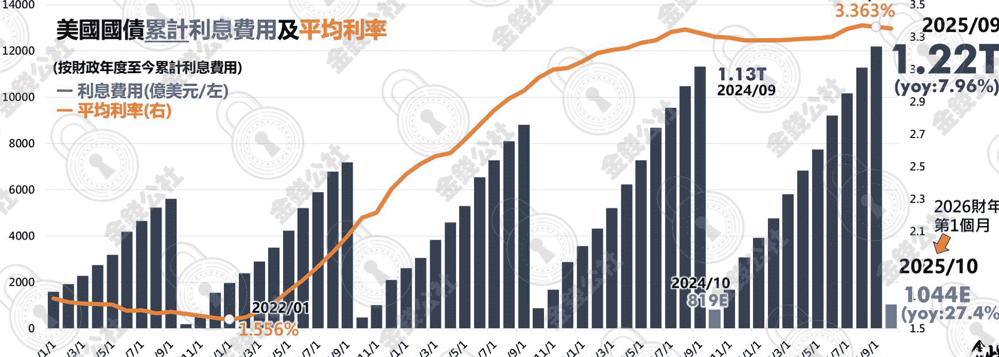

資料來源：美國財政部

## 美國聯邦政府支出結構

## 各項支出占聯邦總支出占比

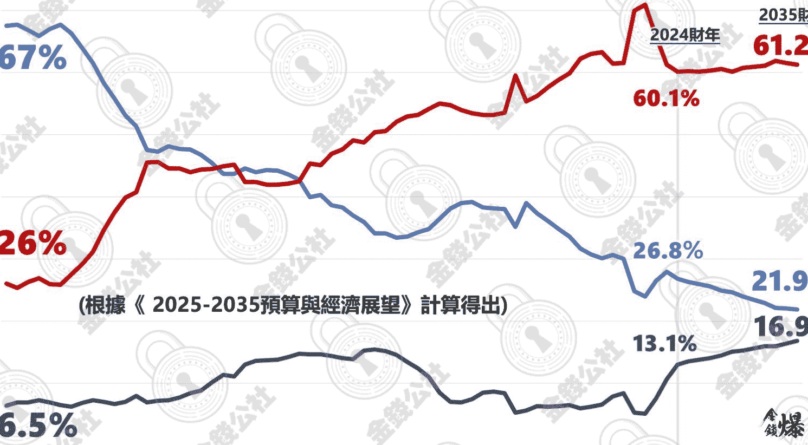

強制性支出：1962年 26%，2024財年 60.1%，2035財年 61.2%。

裁量性支出：1962年 67%，2024財年 26.8%，2035財年 21.9%。

淨利息支出：1962年 6.5%，2024財年 13.1%，2035財年 16.9%。

（根據《2025-2035預算與經濟展望》計算得出）

> 主要是社會安全、醫療補助等福利支出，每年所需經費不須國會審議，未訂定支出上限。

## 強制性支出

> 須國會審議通過才可使用，分為國防、國際事務等類型，分別規定支出上限及法定支出限額；若支出超出限額，將啟動全面性裁減措施。

## 裁量性支出

> 依據政府債務估算債息支出及所收利息之淨額，不需任何法案作為依據。

## 淨利息支出

## [24-1287] Learning Resources, Inc. v. Trump

Argued on Nov 5, 2025.

| 大法官 | 大法官 | 大法官 | 大法官 | 首席大法官 | 大法官 | 大法官 | 大法官 | 大法官 |
|---|---|---|---|---|---|---|---|---|
| 川普任命 | 川普任命 | 歐巴馬任命 | 老布希任命 | 小布希任命 | 小布希任命 | 歐巴馬任命 | 川普任命 | 拜登任命 |
| 原旨主義 保守派 | 原旨主義 保守派 | 自由派 | 原旨主義 極保守派 | 制度主義 中間偏保守 | 保守派 | 實用主義 自由派 | 制度主義 保守派 | 進步主義 自由派 |
|  |  |  | 對IEEPA案的立場 |  |  |  |  |  |
| 搖擺票 | 反對川普 | 反對川普 | 支持川普 | 搖擺票 | 支持川普 | 反對川普 | 支持川普 | 反對川普 |

2025年11月5日，美國最高法院舉行一場極具歷史分量的聽證會，審理川普依據《國際緊急經濟權力法案》（IEEPA）徵收關稅的合法性。這不僅是一場關於數千億美元關稅去留的爭論，更是一場關於權力邊界的對峙——行政權能不能越過國會，以「國家緊急狀態」為名，重新劃定國家經濟秩序的深層博弈。

- 這場聽證持續近三小時，法庭座無虛席。場外，很多小企業主坐在法庭外台階上聽廣播，他們有人因關稅損失上萬美元，有人被迫裁員、停產。對他們來說，這場官司不僅關乎抽象的權力之爭，更是他們的生存之戰。
- 大法官之中，戈薩奇和索托馬約爾，保守派和自由派罕見地站在同一側。目前有4位大法官可能反對川普，3位支持，2位更傾向反對但仍可能倒向任何一方。
- 最高法院一般在宣詞辯論結束後的3到6個月才會裁決，但大法官已同意加速審理，觀察人士預計年底前判決就會出爐。

對此，川普的回應是：每人發2000美元的關稅紅利。

## 川普秀「神秘小卡」！習近平笑歪眼

## 中國熊

## 同框會

## 美國說熊

資料來源：Gemini、白宮
