# 金錢爆金鑽程

# 完整版節目資料

# 美國政府開門 利多出盡？

- **美國參議院批准一項結束政府關門的兩黨協議《臨時撥款法案》**，將政府資金延續到明年1月底，同時包含三項全年撥款法案，涵蓋軍事、立法和農業。還承諾恢復被解雇的聯邦雇員，並延長食品券至2026財年。現在將提交給眾議院在12日進行投票，通過後送交川普簽署生效。
- 作為和民主黨交換籌碼，共和黨人同意在12月中旬前就延長《平價醫療法案》（歐巴馬醫保）稅收抵免補貼進行投票，這項政策一直是民主黨的核心訴求。

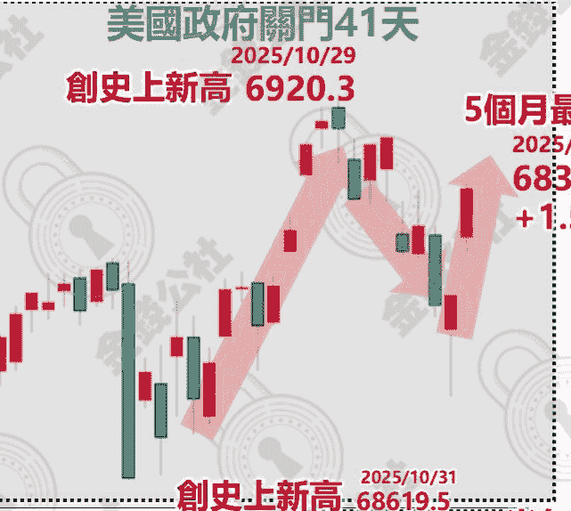

2025年11月10日，美國財政部拍賣850億美元3年期公債，得標利率為3.579%（較上個月的3.576%略有上升）。拍賣的中標利率比預發行殖利率3.589%低了1個基點，顯示出需求超預期，本次拍賣的投標倍數為2.85，而前六次的拍賣平均為2.59。

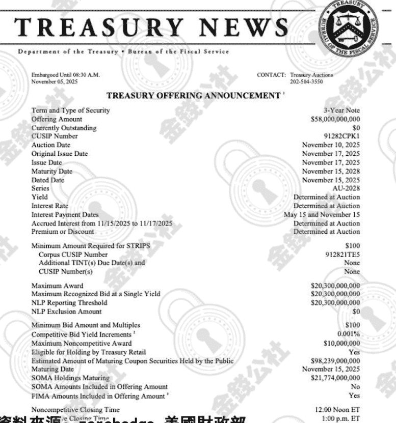

# 關於拍賣的內部數據：

- 一級交易商得標占比9.70%，低於10月的平均10.7%
- 直接投標者得標占比27.32%（上月為26.58%），為8月來最高
- 間接投標者得標占比62.96%（上月為62.70%），高於近期平均62.36%

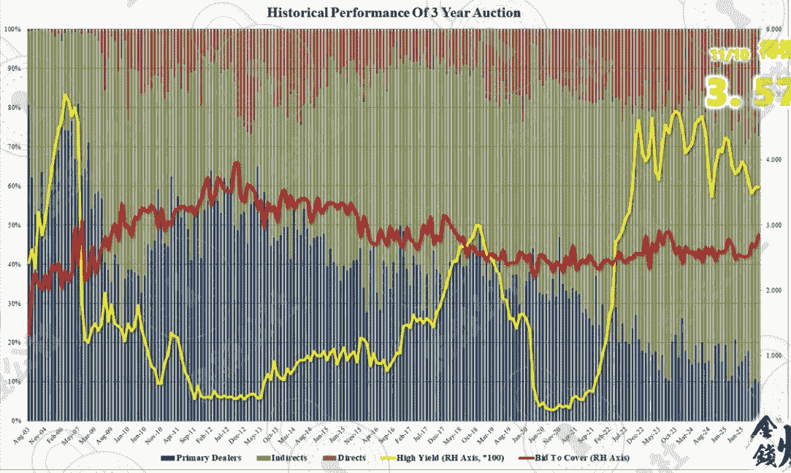

資料來源：zerohedge. 美國財政部

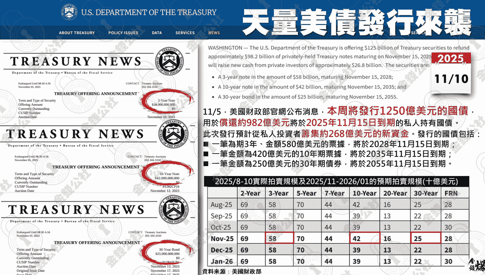

# TREASURY NEWS

# TREASURY OFFERING ANNOUNCEMENT

WASHINGTON — The U.S. Department of the Treasury is offering $125 billion of Treasury securities to refund approximately $98.2 billion of privately-held Treasury notes maturing on November 15, 2025, and will raise new cash from private investors of approximately $26.8 billion. The securities are:

- A 3-year note in the amount of $58 billion, maturing November 15, 2028;
- A 10-year note in the amount of $42 billion, maturing November 15, 2035; and
- A 30-year bond in the amount of $25 billion, maturing November 15, 2055.

11/5，美国财政部官网公布消息，本周将发行1250亿美元的国债，用于偿还约982亿美元将于2025年11月15日到期的私人持有国债。此次发行预计从私人投资者筹集约268亿美元的新资金。发行的国债包括：

- ▪ 一笔为期3年、金额580亿美元的票据，将于2028年11月15日到期；
- ▪ 一笔金额为420亿美元的10年期票据，将于2035年11月15日到期；
- ▪ 一笔金额为250亿美元的30年期债券，将于2055年11月15日到期。

| 2025/8-10實際拍賣規模及2025/11-2026/01的預期拍賣規模（十億美元） |  |  |  |  |  |  |  |  |
|---|---:|---:|---:|---:|---:|---:|---:|---:|
|  | 2-Year | 3-Year | 5-Year | 7-Year | 10-Year | 20-Year | 30-Year | FRN |
| Aug-25 | 69 | 58 | 70 | 44 | 42 | 16 | 25 | 28 |
| Sep-25 | 69 | 58 | 70 | 44 | 39 | 13 | 22 | 28 |
| Oct-25 | 69 | 58 | 70 | 44 | 39 | 13 | 22 | 30 |
| Nov-25 | 69 | 58 | 70 | 44 | 42 | 16 | 25 | 28 |
| Dec-25 | 69 | 58 | 70 | 44 | 39 | 13 | 22 | 28 |
| Jan-26 | 69 | 58 | 70 | 44 | 39 | 13 | 22 | 30 |

资料来源：美国财政部

# 美債殖利率曲線

（殖利率下行：牛；殖利率上行：熊；長債-短債變窄：平；長債-短債變寬：陡）

# 急跌

| 期限 | 殖利率 |
|---|---:|
| 1M | 4.04 / 4.03 |
| 2M | 4.00 / 3.99 |
| 3M | 3.95 / 3.93 |
| 4M | 3.86 / 3.85 |
| 6M | 3.79 / 3.79 |

10月降息來 -1bp

10月降息來 +5bp

10月降息來 +10bp

2025/10/29 美聯儲利率會議（降息25bp） 2025/11/10

| 1Y | 2Y | 3Y | 5Y | 7Y | 10Y | 20Y | 30Y |
|---|---:|---:|---:|---:|---:|---:|---:|---:|
| 4.69 | 4.71 | 4.59 | 4.61 | 4.13 | 4.08 | 3.90 | 3.87 |
| 3.72 | 3.70 | 3.70 | 3.66 | 3.59 | 3.58 | 3.60 | 3.56 |

根據彭博社圖表顯示，從中國到美國的貨船數量過去三周內從71艘減少至41艘，驟降42%，創2024年2月以來低，這低於過去18個月的平均值（約60艘）。

■ Dry Cargo Vessel Cnt CN to US 中國開往美國的乾散貨船數量

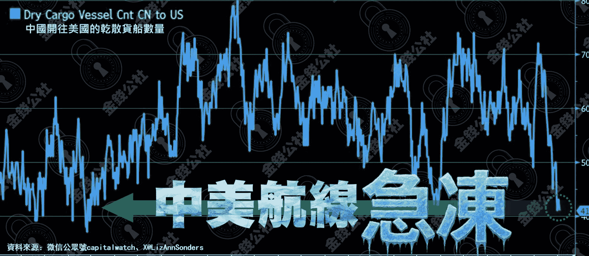

# 中國貨船數量驟降

資料來源：微信公眾號capital watch、X@LiZAnnSonders

11/10，供應鏈技術公司笛卡爾系統集團（Descartes Systems Group）最新發布的《全球航運報告》數據顯示，美國10月集裝箱進口量為231萬標準箱（TEU），較去年同期下滑7.5%，月減為0.1%，逼近200萬TEU關鍵門檻。是過去十年中，僅有的第2次10月出現月減情況！！其中來自中國的貨物驟降16.3%。

# 2021-2025 U.S. Container Import Volume (TEUs)

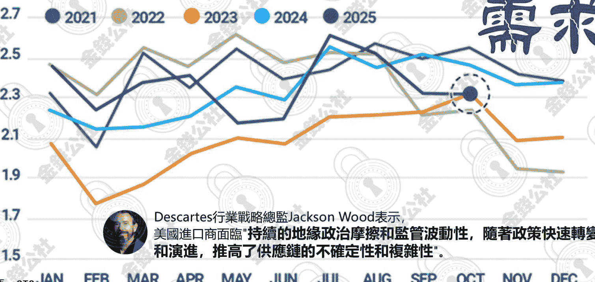

Descartes行業戰略總監Jackson Wood表示，美國進口商面臨「持續的地緣政治摩擦和監管波動性，隨著政策快速轉變和演進，提高了供應鏈的不確定性和複雜性」。

資料來源：OTC

# 洛杉磯長灘港靠岸船隻

# 2025

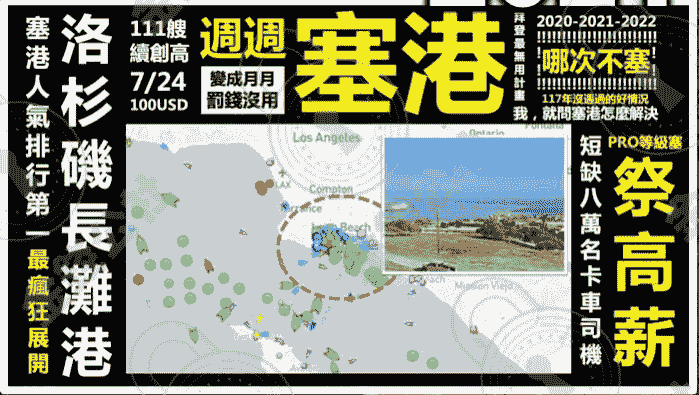

# Historical holiday sales and 2025 forecast

※ 假期季節包括感恩節、黑色星期五、網路星期一和聖誕節等主要購物日

2025年11月6日，美國零售聯合會(NRF)公布年度假期銷售預測報告，2025年美國假期銷售額預計將首次突破1兆美元大關，但因經濟壓力使消費者情緒較為謹慎，預計增長速度將較2024年的4.3%放緩至3.7%至4.2%。

NRF還調查顯示，今年消費者計畫平均每人花費890.49美元用於節日禮物、食品、裝飾品和其他季節性商品，低於去年的901.99美元。

# 消費增速放緩

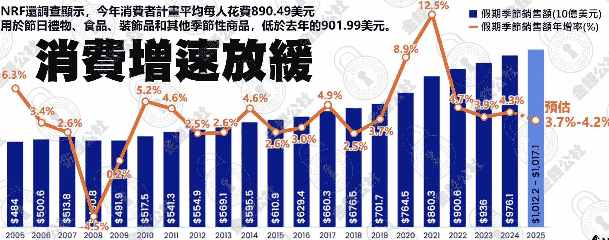

資料來源：National Retail Federation

# 11/10・美股盤後 CoreWeave 公佈最新 2025 年 Q3 財報

- 營收達 13.6 億美元，高於去年同期的 5.84 億美元，增長 134%，超出市場預期的 12.9 億美元
- 淨虧損 1.10 億美元（每股虧損 0.22 美元），較上年同期 3.59 億美元大幅收窄
- 運營利潤率僅 4%，不及預期的 6.5% 且低於去年同期

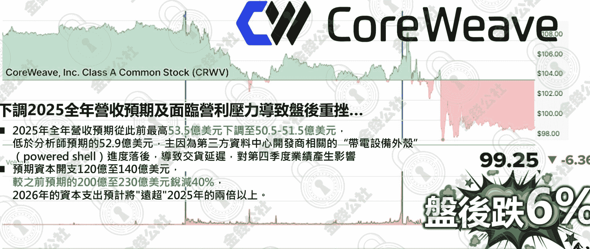

# 下調 2025 全年營收預期及面臨營利壓力導致盤後重挫…

- 2025 年全年營收預期從此前最高 53.5 億美元下調至 50.5–51.5 億美元，低於分析師預期的 52.9 億美元，主因為第三方資料中心開發商相關的「帶電設備外殼」（powered shell）進度落後，導致交貨延遲，對第四季度業績產生影響
- 預期資本開支 120 億至 140 億美元，較之前預期的 200 億至 230 億美元銳減 40%，2026 年的資本支出預計將「遠超」2025 年的兩倍以上。

資料來源：NASDAQ、CoreWeave

在電話會議中，解釋2025Q4業績指引下調原因... 資料中心供應商的「帶電設備外殼（powered shell）」交付延遲，將對我們第四季度的業績產生影響。這些延遲是暫時性的，…

*帶電設備外殼（Powered Shell）是指已經完成主體建設，並已具備電力佈線、冷卻系統、消防安全認證等基礎設施的建築物。

儘管未提及是哪家資料中心供應商，但…

# Data Centers in Nvidia’s Hometown Stand Empty Awaiting Power

# 英偉達總部所在地的資料中心空置，等待電力供應

11/10，彭博報導指出，在世界最大的人工智慧晶片供應商所在的加州聖克拉拉市，Digital Realty Trust Inc.於2019年申請建造一座資料中心。大約六年過去了，該項目仍處於空置狀態，尚未全面投入使用。今年稍早被Blue Owl Capital Inc.收購的Stack Infrastructure公司在附近還有一個48兆瓦的專案也處於閒置狀態，而市屬公用事業公司的谷電力公司則在努力提升其電力容量。

# Digital Realty vs. CoreWeave 夥伴關係

2024年3月，Digital Realty公布了CoreWeave建置的新部署方案的細節，以及其建置 AI 就緒型資料中心的計畫。CoreWeave的CTO Brian Venturo也曾公開表示：「Digital Realty 的專家團隊對於設計符合我們性能和業務需求的解決方案至關重要，使我們能夠將預期部署時間縮短一半」。

資料來源：Bloomberg、CoreWeave

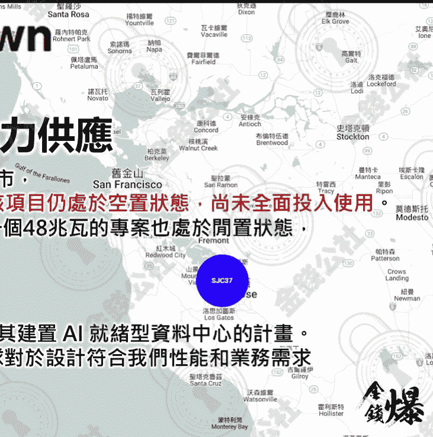

# CoreWeave Faces Earnings Pressure as Cracks Appear in AI Trade

目前面臨的問題，包括其循環融資模式、沉重的債務負擔，及對少數大客戶的依賴。

CoreWeave flags hit from data center delay, shares fall

利潤率可能會受到人工智能芯片價格飆升、計算能力競爭加劇以及擴展雲基礎設施成本高昂的壓力。

Reuters

|  | Q3 2024 | Q4 2024 | Q1 2025 | Q2 2025 | Q3 2025 |
|---|---:|---:|---:|---:|---:|
| Net loss | $(359,807) | $(51,372) | $(314,641) | $(290,509) | $(110,124) |
| Depreciation and amortization | 254,024 | 365,419 | 443,497 | 559,481 | 630,479 |
| Interest expense, net | 104,375 | 149,027 | 263,835 | 266,966 | 310,555 |
| Stock-based compensation | 7,617 | 8,021 | 183,974 | 145,005 | 144,431 |
| Provision for (benefit from) income taxes | 41,659 | 22,038 | 46,036 | 47,775 | (126,680) |
| Acquisition related costs | — | — | 6,130 | 29,474 | 11,364 |
| Other expense (income), net | (10,244) | (14,084) | 4,137 | (5,023) | (21,901) |
| (Gain) loss on fair value adjustment | 341,133 | 7,065 | (26,837) | — | — |
| Adjusted EBITDA | $378,757 | $486,114 | $606,131 | $753,169 | $838,124 |
| Revenue | $583,941 | $747,430 | $981,632 | $1,212,788 | $1,364,676 |
| Net loss margin | (62%) | (7%) | (32%) | (24%) | (8%) |
| Adjusted EBITDA margin | 65% | 65% | 62% | 62% | 61% |

第三季營業利益約5.185億美元，但光是借款利息支出就高達3億1,055萬美元。

|  | Q3 2024 | Q4 2024 | Q1 2025 | Q2 2025 | Q3 2025 |
|---|---:|---:|---:|---:|---:|
| Operating income (loss) | $117,116 | $112,674 | $(27,470) | $19,209 | $51,850 |
| Stock-based compensation | 7,617 | 8,021 | 183,974 | 145,005 | 144,431 |
| Acquisition related costs | — | — | 6,130 | 29,474 | 11,364 |
| Amortization of acquired intangible assets | — | — | — | 6,100 | 9,509 |
| Adjusted operating income | $124,733 | $120,695 | $162,634 | $199,788 | $217,154 |
| Revenue | $583,941 | $747,430 | $981,632 | $1,212,788 | $1,364,676 |
| Operating income (loss) margin | 20% | 15% | (3%) | 2% | 4% |
| Adjusted operating income margin | 21% | 16% | 17% | 16% | 16% |

資料來源：coreweave．彭博．路透

根據Coreweave財報，2025Q3淨損1.1億美元，較去年同期的3.6億美元虧損大幅收斂，虧損之所以收窄，其實是因為把GPU的折舊週期從4年間整成了6年，但6年前的GPU可以應付不斷上漲的算力需求嗎？

- CoreWeave將其GPU的折舊年限從4年延長至6年，即使NVIDIA公開宣布產品週期將縮短為1年，他們仍未調整這一假設。
- 原本1張H100假設每年折舊25%。
- 現在只需要折舊16.6%。

假設CoreWeave購入100萬張H100，每張2.5萬美元，資產總值250億美元。根據折舊年限：
- 4年折舊：每年帳面成本為62.5億美元；
- 6年折舊：每年帳面成本僅為41.6億美元；
差額為20.9億美元，直接影響年度淨利與現金流

# CoreWeave 營業收支

| 項目 | 2025 | 2024 |
|---|---:|---:|
| 營業收入 | $1,364,676 | $583,941 |
| 營業支出 | $1,312,826 | $466,825 |
| 營業利潤 | $51,850 | $117,116 |
| 營業利潤率 | 4% | 20% |
| 利息支出 | $(310,555) | $(104,375) |
| 淨損失 | $(110,124) | $(359,807) |
| 淨損失率 | (8)% | (62)% |
| 每股淨損 | $(0.22) | $(1.82) |
| 稀釋後每股淨損 | $(0.22) | $(1.82) |

CoreWeave

The estimated useful lives of the Company's property and equipment are as follows:

| 項目 | 估計耐用年限 |
|---|---|
| Technology equipment | 6 years |
| Software | 3-6 years |
| Data center equipment | 8-12 years |
| Furniture, fixtures, and other assets | — |
| Leasehold improvements | Shorter of remaining lease term or estimated useful life |

Nebius

| 項目 | Estimated useful lives |
|---|---:|
| Server and network equipment | 4.0 years |
| Infrastructure systems and equipment | 3.0-10.0 years |
| Office furniture and equipment | 3.0 years |
| Buildings | 20.0 years |
| Other property and equipment | 2.0-5.0 years |

> Useful Lives of Property, Plant and Equipment
>
> Property, plant and equipment are depreciated over their estimated useful life on a straight line basis. We monitor conditions related to these assets to determine whether events and circumstances warrant a revision to the remaining amortization or depreciation period. We test these assets for potential impairment whenever our management concludes that events or changes in circumstances indicate that the carrying amount may not be recoverable.

資料來源：Coreweave、unc liestocknotes、微信公眾號

## 負債驅動的IPO之路

CoreWeave通過多輪股權和債務融資累計募集超過145億美元，其中股權融資約30億美元，債務融資約115億美元，為其AI基礎設施的快速擴張提供資本支援。其融資歷程的關鍵節點如下：

- 2023年4月，B輪融資2.21億美元：由Magnetar Capital領投，估值20億美元，標誌著其從加密貨幣挖礦向AI雲服務的轉型獲得市場認可。
- 2023年8月，債務融資23億美元：Blackstone和Magnetar Capital領投，以約50%的GPU資產（價值約15–20億美元）作抵押，Coatue、DigitalBridge和BlackRock參投。此交易深化了與NVIDIA的協作並推動資料中心擴張。
- 2024年5月，C輪融資11億美元及75億美元債務融資：Coatue領投股權輪，NVIDIA、Fidelity和Altimeter Capital參投，估值升至190億美元；Blackstone主導的75億美元債務融資支援資料中心增至28個。
- 2024年11月，二級交易6.5億美元：Jane Street、Fidelity和BlackRock推動估值達230億美元，為早期股東提供部分退出管道。
- 2025年3月IPO：CoreWeave以每股40美元於納斯達克上市，目標籌資15億美元，遠低於原先的27億美元，公司估值也由320億美元減至230億美元，主要用於償還短期債務和進一步擴展資料中心至42個。

| 融資輪次 | 融資時間 | 融資金額 | 主要投資機構 | 投後估值 |
|---|---|---|---|---|
| B輪 | 2023.4 | 2.21億美元 | Magnetar Capital、英偉達、GitHub前任財務官 Nat Friedman等 | — |
| B+輪 | 2023.5 | 2億美元 | Magnetar Capital | 20億美元 |
| 債務融資 | 2023.8 | 23億美元 | Magnetar Capital、黑石資本 | 80億美元 |
| C輪 | 2024.5 | 11億美元 | Coatue、Magnetar Capital、Altimeter Capital、Fidelity Management & Research Company、Lykos Global Management | 190億美元 |
| 債務融資 | 2024.3 | 75億美元 | Coatue、Magnetar Capital、黑石資本 | / |
| 股權融資 | 2024.10 | 未披露 | 思科系統 | 230億美元 |
| 債務融資 | 2024.10 | 8.5億美元 | 高盛、摩根大通、摩根士丹利、巴克萊銀行、花旗銀行、Jefferies | 350億美元 |

資料來源：微信公眾號

### Exhibit 9: Capacity expansion: Capex as a % of revenue far outpacing depreciation; more room for depreciation to rise from here

MSFT, AMZN, GOOGL, META – capex and D&A as % of revenue (2012-4Q26E)

微軟、亞馬遜、谷歌、Meta 等巨頭的資本支出正以爆炸性速度成長（占營收約25%），遠遠超過現有折舊攤銷水平。如果未來AI投資的回報不如預期，這些巨額資本支出將轉化為高折舊與低資產報酬率，隨著未來折舊攤提的大幅攀升，將壓縮利潤與現金流。

（包含微軟、亞馬遜、谷歌、Meta）

- 折舊攤銷占營收比例
- 折舊攤銷占營收預估
- 資本支出占營收比例
- 資本支出占營收預估

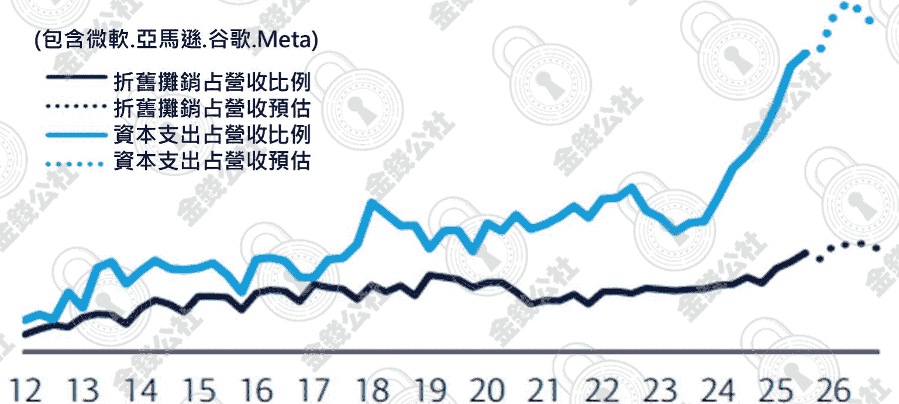

## 借債來資助AI數據中心支出的爆炸性增長，在9月和10月至今達到頂峰

- 來自AI大科技公司的美國IG債券供應總額（AMZN、GOOGL、META、MSFT、ORCL）
- 9月至10月期間，ORCL、META、RPLDCI三家發行的IG債券
- ORCL取得的貸款

根據美國銀行報告，歷史數據顯示，AI相關大型科技公司的年均發債規模約為320億美元。然而，僅在2025年9月和10月，發行總額就達到了750億美元的債券（META 300億、Oracle 180億和RPLDCI 270億），外加一筆與Oracle相關的380億美元貸款，總計超過1000億美元。

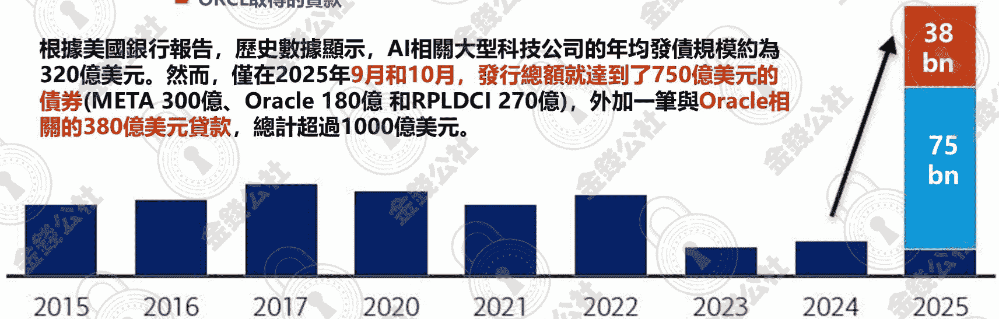

附註：RPLDCI是一家特殊目的公司（SPV），由Meta和Blue Owl Capital合資成立，旨在為Meta在路易斯安那州的資料中心項目提供270億美元的融資。

資料來源：BofA GLOBAL RESEARCH

## 超大規模企業債券利差＝AI泡沫「留意」指標

—— 美國超大規模企業公司債券利差*（基點）

人工智慧相關的資本支出正在導致超大規模雲服務商的公司債券利差擴大，這被美國銀行視為AI泡沫的「觀察」指標。

利差擴大與近期飆升：自2025年9月以來，這些公司的債券利差已從50個基點擴大至78基點。利差越高，意味著市場認為違約風險越高，要求更高的報酬來補償風險。

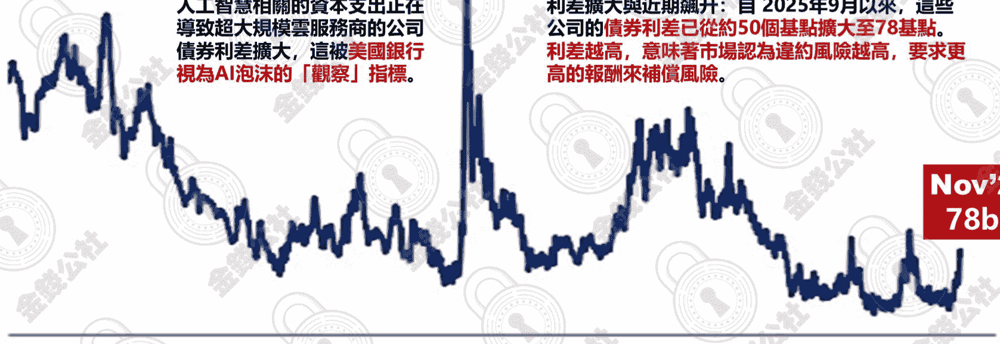

圖表中包含了超大規模雲服務商：亞馬遜、谷歌、Meta、微軟和甲骨文等公司的加權平均公司債券利差，根據美銀銀行報告，超大規模企業的債券利差低點已過，投資人的風險厭惡情緒正在升溫。這與2000年網路泡沫破裂前的景象有相似之處。在2000年3月股市見頂前的12個月裡，美國科技債價格下跌了8%，美銀認為做空超大規模企業公債是當前較好的策略。

資料來源：BofA GLOBAL RESEARCH

## 多位内部人（包括執行長 Intrator Michael N 和資深副總裁 Goldberg Chen）在2025年11月5日進行了股票出售。

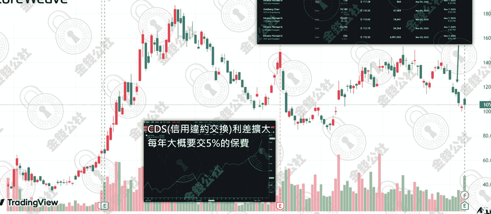

| Name | Type | Shares | Price | Shares Held | Date | Reported |
|---|---|---:|---:|---:|---|---|
| Intrator Michael N | Sale | 364 | $118.30 | 0 | Nov 05, 2025 | Nov 7, 2025 |
| Intrator Michael N | Sale | 11,518 | $114.59 | 7,123 | Nov 05, 2025 | Nov 7, 2025 |
| Intrator Michael N | Sale | 2,539 | $115.54 | 4,584 | Nov 05, 2025 | Nov 7, 2025 |
| Intrator Michael N | Sale | 3,492 | $116.71 | 1,992 | Nov 05, 2025 | Nov 7, 2025 |
| Intrator Michael N | Sale | 728 | $117.28 | 364 | Nov 05, 2025 | Nov 7, 2025 |
| Goldberg Chen | Sale | 9,180 | $118.30 | 37,084 | Nov 05, 2025 | Nov 7, 2025 |
| Intrator Michael N | Sale | 15,623 | $113.65 | 18,641 | Nov 05, 2025 | Nov 7, 2025 |
| Intrator Michael N | Sale | 15,736 | $112.73 | 34,264 | Nov 05, 2025 | Nov 7, 2025 |
| Intrator Michael N | Sale | 236 | $118.30 | 6,991,055 | Nov 05, 2025 | Nov 7, 2025 |

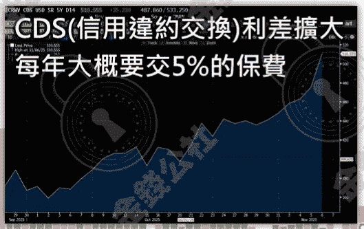
