# 金錢爆金鐵程

# 完整版節目資料

# WSN 華新麗華

日線／2025年以來

台玻（1802）日線圖 2025/11/12 開 33.40、高 35.25、低 33.30、收 35.25 元，量 233,018 張，+3.20（+9.98%）

10/9  
32.85

7/23  
L:20.75

# 挑戰今年高

# 華新麗華

漲停，挑戰今年高

# 台灣玻璃

日線／2025年以來

高檔換主流

台塑（1301）日線圖 2025/11/12 開 40.20、高 41.90、低 39.60、收 41.90 元，量 55,473 張，+1.45（+3.63%）

# 台塑

台灣塑膠

日線／2025年以來

7/23  
L:38.8

# 挑戰今年高

7/23  
L:17.0

資料來源：XQ全球贏家

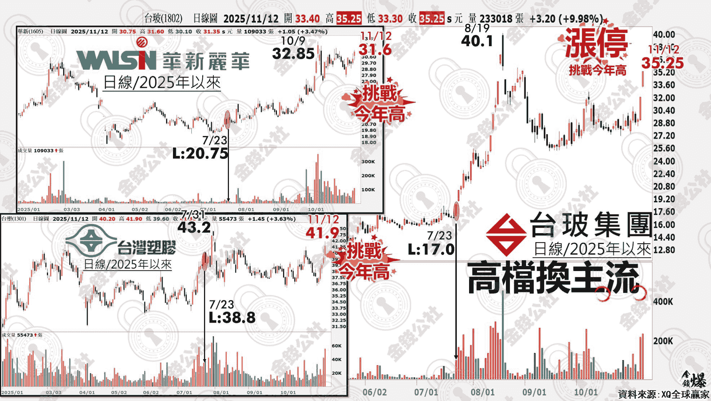

# 記憶體飆漲換現金，台塑三寶「減碼南亞科」三輪

| 台塑企業3公司處分南亞科股票 | 台塑 | 台化 | 台塑化 | 合計金額 |
|---|---:|---:|---:|---:|
| 第一輪（114/10/2–10/28） |  |  |  |  |
| 處分張數 |  | 2.5萬張 |  |  |
| 處分均價 | 98.81元 | 98.78元 | 98.78元 |  |
| 交易總金額 | 24.70億 | 24.69億 | 24.66億 | 74.05億 |
| 處分後持股比例 |  | 9.9985% |  |  |
| 第二輪（114/10/30–11/11） |  |  |  |  |
| 處分張數 |  | 1.8萬張 |  |  |
| 處分均價 | 145.23元 | 145.85元 | 145.09元 |  |
| 交易總金額 | 26.14億 | 26.25億 | 26.11億 | 78.5億 |
| 處分後持股比例 |  | 9.4176% |  |  |
| 第三輪（114/11/12、115/1/30）大同集團 |  | 1.8972萬張 |  |  |
| 處分均價 | 以11/11收盤價164.50元估算 |  |  |  |
| 交易總金額 | 各約31.2億 |  |  | 估93.6億 |
| 處分後持股比例 |  | 8.8053% |  |  |

- 114/11/11：公告本公司凱燁處分南亞科技股份有限公司普通股
- 114/11/11：補充說明本公司實際處分南亞科技股份有限公司普通股
- 114/11/07：公告本公司2025年10月合併營業額
- 114/10/29：公告本公司決議處分南亞科技股份有限公司普通股
- 114/10/28：補充說明本公司實際處分南亞科技股份有限公司普通股
- 114/10/13：公告本公司2025年第3季合併財報
- 114/10/13：公告本公司2025年9月合併營業額
- 114/10/07：說明114年10月6日各媒體相關報導
- 114/09/30：公告本公司決議處分南亞科技股份有限公司普通股

# 國票長城控南亞科之進出明細圖

2025/11/12 股價163元

# 統計國票－長城（10/2–11/11）賣超南亞科合計37,523張

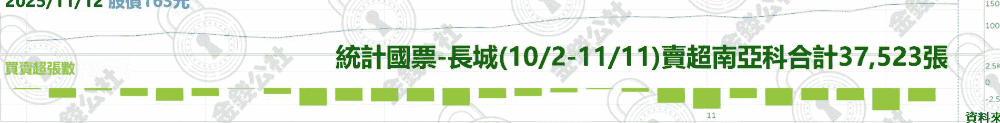

# 美股霸主換人？

# 歷史新高

# 標普500指數

採用市值加權，成分包括美國500家頂尖上市公司，占美股總市值80%。

2025/10/29  
6920.34

2025/11/11  
6855.13

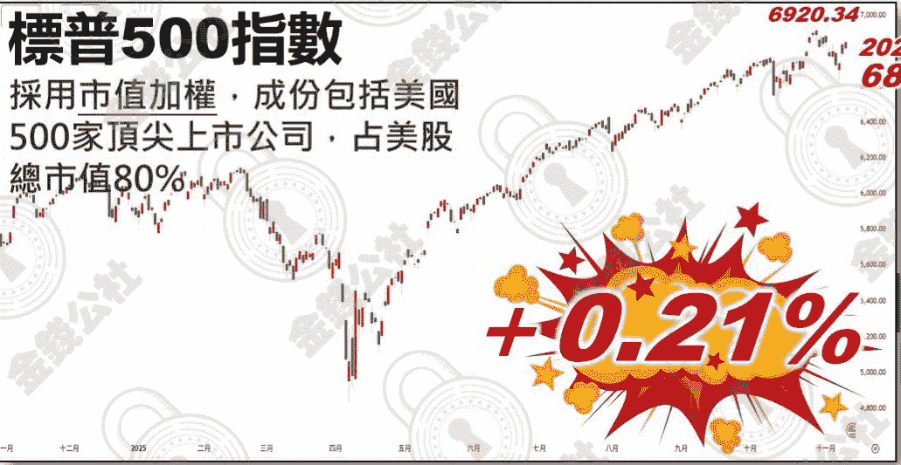

+0.21%

# 納斯達克指數

採用市值加權，由美國100家最大型本地及國際非金融類上市公司組成。

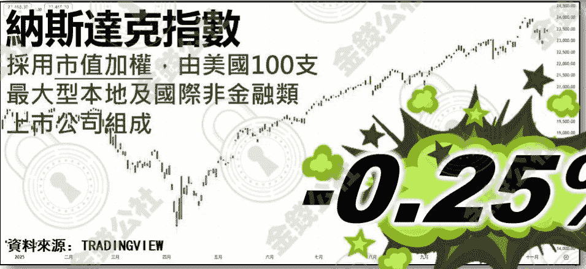

-0.25%

資料來源：TRADINGVIEW

道瓊工業指數：  
是以價格加權方式  
計算美國30家藍籌股的股價平均指數。

# 道瓊工業指數

創立140年以來新高

+1.18%

# 費半飛太遠？

- 費半／羅素2000（A軸）
- 費半／那斯達克（B軸）
- 費半／標普500（C軸）
- 費半／道瓊工業指數（D軸）

# 費半／道瓊工業指數

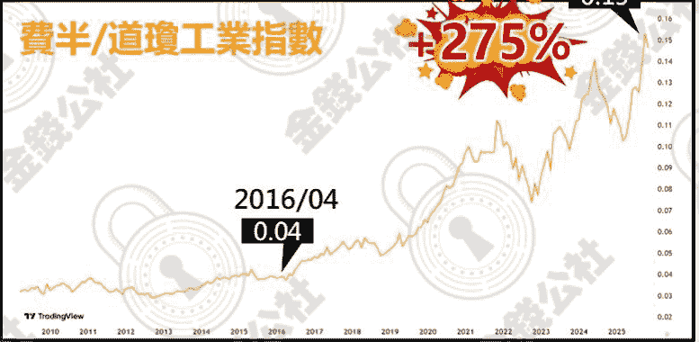

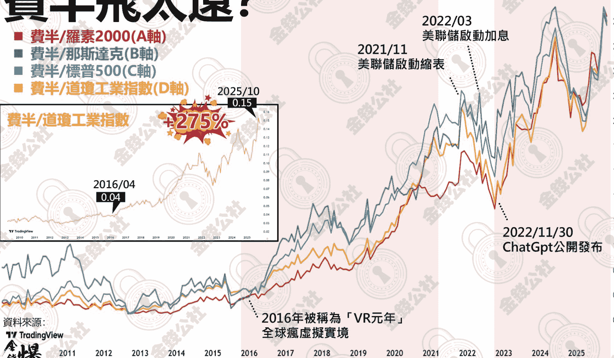

2016年被稱為「VR元年」，全球瘋虛擬實境。

2021/11  
美聯儲啟動縮表

2022/03  
美聯儲啟動加息

2022/11/30  
ChatGPT公開發布

資料來源：TradingView

# 道瓊指數30檔成分股

報價為2025/11/11

資料來源：WIND、indexarb

| 類別 | 代碼 | 簡稱 | 收盤價（原始幣種） | 權重 | 漲跌 | 漲跌幅 |
|---|---|---|---:|---:|---:|---:|
| 醫療保健 | MRK.N | 默克（MERCK） | 90.95 | 1.13 | 4.20 | 4.84% |
| 醫療保健 | AMGN.O | 安進（AMGEN） | 338.45 | 4.21 | 14.79 | 4.57% |
| 醫療保健 | JNJ.N | 強生公司（JOHNSON...） | 193.83 | 2.45 | 5.42 | 2.88% |
| 醫療保健 | UNH.N | 聯合健康集團（UNITEDHEA...） | 327.45 | 4.18 | 5.87 | 1.83% |
| 金融 | GS.N | 高盛集團（GOLD...） | 810.31 | 10.36 | 13.11 | 1.64% |
| 金融 | TRV.N | 旅行者集團（TRAV...） | 286.02 | 3.67 | 3.63 | 1.29% |
| 金融 | V.N | VISA | 338.92 | 4.35 | 4.07 | 1.22% |
| 金融 | AXP.N | 美國運通（AMERIC...） | 370.16 | 4.78 | 2.28 | 0.62% |
| 金融 | JPM.N | 摩根大通（JPMOR...） | 315.62 | 4.12 | -1.27 | -0.40% |
| 可選消費 | NKE.N | 耐克（NIKE） | 63.15 | 0.79 | 2.35 | 3.87% |
| 可選消費 | MCD.N | 麥當勞（MCDONALD'S） | 306.83 | 3.89 | 7.73 | 2.38% |
| 可選消費 | HD.N | 家得寶（HOME DEPOT） | 374.24 | 4.81 | 3.81 | 1.03% |
| 可選消費 | AMZN.O | 亞馬遜（AMAZON） | 249.10 | 3.23 | 0.70 | 0.28% |
| 日常消費 | PG.N | 寶潔公司（PROCTER & GA...） | 148.54 | 1.89 | 3.04 | 2.09% |
| 日常消費 | KO.N | 可口可樂（COCA COLA） | 71.61 | 0.92 | 1.09 | 1.55% |
| 日常消費 | WMT.N | 沃爾瑪（WALMART） | 103.44 | 1.33 | 1.02 | 1.00% |
| 工業 | HON.O | 霍尼韋爾國際（HONEYWEL...） | 200.41 | 2.55 | 4.34 | 2.21% |
| 工業 | MMM.N | 3M公司（3M） | 168.67 | 2.18 | 1.00 | 0.60% |
| 工業 | BA.N | 波音（BOEING） | 195.21 | 2.53 | 0.40 | 0.21% |
| 工業 | CAT.N | 卡特彼勒（CATERPILLAR） | 567.93 | 7.42 | -2.92 | -0.51% |
| 通訊服務 | DIS.N | 華特迪士尼（WALT DISNEY） | 114.85 | 1.46 | 2.61 | 2.33% |
| 通訊服務 | VZ.N | 威訊電信（VERIZON） | 40.70 | 0.52 | 0.85 | 2.13% |
| 能源 | CVX.N | 雪佛龍（CHEVRON） | 156.24 | 2.02 | 0.59 | 0.38% |
| 材料 | SHW.N | 宣偉（SHERWIN-WILLIAMS） | 345.08 | 4.45 | 2.53 | 0.74% |
| 信息技術 | AAPL.O | 蘋果（APPLE） | 275.25 | 3.50 | 5.82 | 2.16% |
| 信息技術 | IBM.N | 國際商業機器（IBM） | 313.72 | 4.02 | 4.59 | 1.48% |
| 信息技術 | CRM.N | 賽富時（SALESFORCE） | 244.50 | 3.14 | 2.79 | 1.15% |
| 信息技術 | MSFT.O | 微軟（MICROSOFT） | 508.68 | 6.58 | 2.68 | 0.53% |
| 信息技術 | CSCO.O | 思科（CISCO） | 71.71 | 0.94 | -0.38 | -0.53% |
| 信息技術 | NVDA.O | 英偉達（NVIDIA） | 193.16 | 2.59 | -5.89 | -2.96% |

# 道瓊指數歷年成分個數變動

（2016年至2025年）

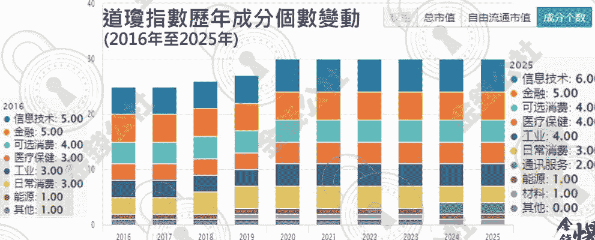

# MERCK 道瓊單日漲幅第一大 +4.84%

# 默克8個月高，11/6以來漲10%

2025/11/11 91.07

進群加微信pep854

# 強生逼歷史新高

11/6以來漲5%  
今年以來漲34%

2025/11/11 193.92

2025年11月6日，川普宣布：美國2種藥暨醫保，聯邦醫保首次將減肥藥納入，採購價245美元／瓶，參保患者自付額降至50美元。

# 安進衝歷史新高

11/6以來漲12%  
今年以來漲30%

# 醫藥股

領漲道瓊

# AMGEN

道瓊單日漲幅第二大  
+4.57%

# Johnson & Johnson

道瓊單日漲幅第四大  
+2.88%

資料來源：TRADINGVIEW

# AstraZeneca

阿斯利康日線

# 歷史高

當地時間2025年11月11日，阿斯利康股價創新高，單日漲幅達2.59%，市值達2088億英鎊，穩坐英國股市市值第一大。

- 11/6公布第三季財報，獲利超出預期，得益於癌症和心血管藥物的強勁銷售。
- 10月與美國達成藥價協議，有助於消除部分政策不確定性。
- 美國市場佔阿斯利康總銷售額40%以上。

# 英國富時100指數日線

# 歷史高

2025/11/11  
13508

2025/11/11  
9912.85

> 2025/10/13
>
> 繼輝瑞後首家非美藥廠！阿斯利康與川普達成藥價協議
>
> 川普與阿斯利康達成協議，降低美國藥價換取三年關稅豁免

2024/1/17  
7404.08

2025/4/7  
7544.83

資料來源：WIND

# AMERICAN EXPRESS

# Goldman Sachs

# J.P. Morgan

11/11  
高盛：日線  
812

今年4月低點來  
85%  
收盤創歷史高

今年4月低點來  
69%  
創歷史高

11/11  
美國運通：日線  
373.1

11/11  
摩根大通：日線  
319

今年4月低點來  
58%  
逼近歷史高

04/07  
439

04/07  
220.4

04/07  
202

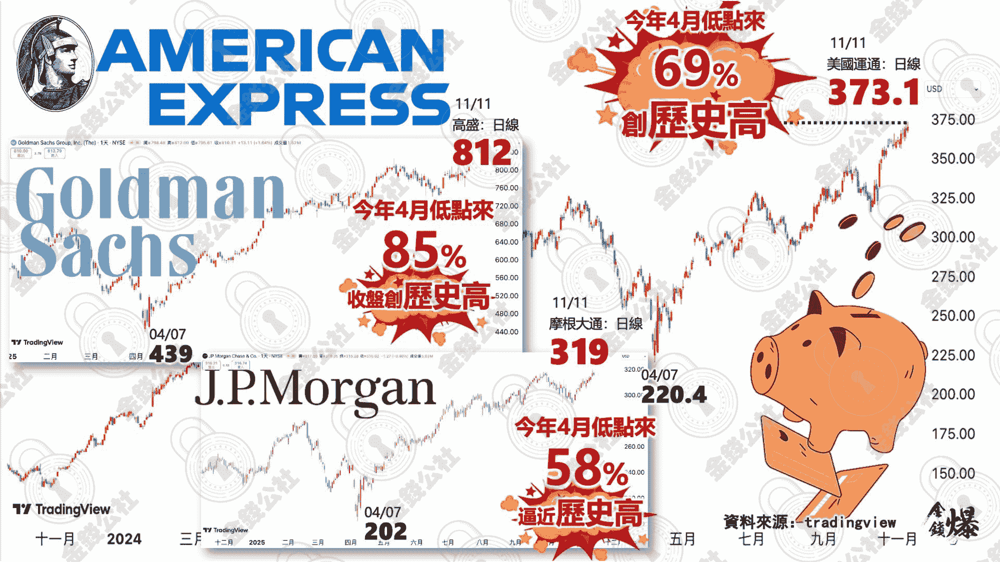

資料來源：TradingView

# 美債殖利率曲線

（殖利率下行：牛；殖利率上行：熊；長債－短債變窄：平；長債－短債變寬：陡）

# 急跌

| 期限 | 殖利率 |
|---|---:|
| 1M | 4.04 / 4.03 |
| 2M | 4.00 / 3.99 |
| 3M | 3.95 / 3.93 |
| 4M | 3.86 / 3.85 |
| 6M | 3.79 / 3.79 |

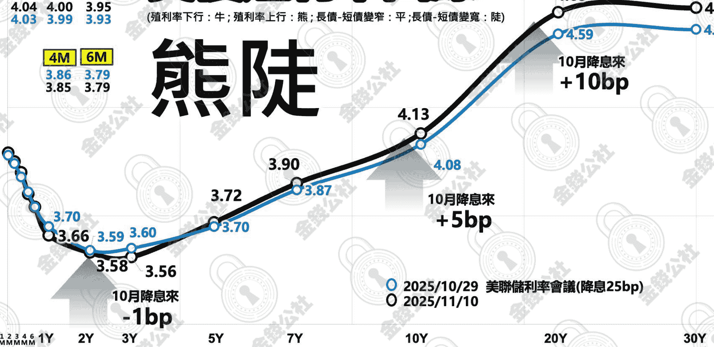

10月降息來 -1bp

10月降息來 +5bp

10月降息來 +10bp

- ○ 2025/10/29 美聯儲利率會議（降息25bp）
- ○ 2025/11/10

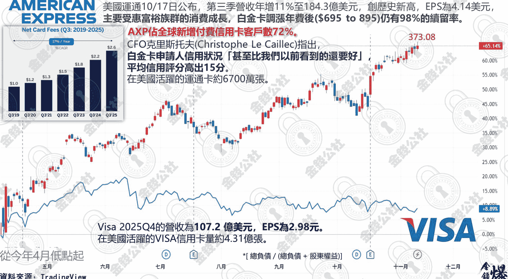

# 美國運通10/17日公布，第三季營收年增11%至184.3億美元，創歷史新高，EPS為4.14美元，主要受惠富裕族群的消費成長，白金卡調漲年費後（$695 to 895）仍有98%的續留率。

AXP估全球新增付費信用卡客戶數72%。

CFO克里斯托夫（Christophe Le Caillec）指出，白金卡申請人信用狀況「甚至比我們以前看到的還要好」，平均信用評分高出15分。在美國活躍的運通卡約6700萬張。

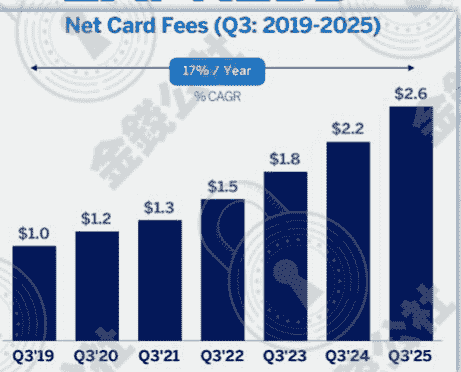

Visa 2025Q4的營收為107.2億美元，EPS為2.98元。在美國活躍的VISA信用卡量約4.31億張。

從今年4月低點起

*［總負債／（總負債＋股東權益）］

資料來源：TradingView

# Dow Up Over 1 Percent and Nasdaq Negative

當道瓊指數上漲1%，而納斯達克100卻下跌，有發生過，但是次數不多，距離昨天的最近一次，是在3月31日……

當時主要的因素是，川普的「對等關稅」、「對俄次級關稅」等。此外，在2020年－2021年間的「晶片供應鏈危機」中，道瓊較常超過納指。

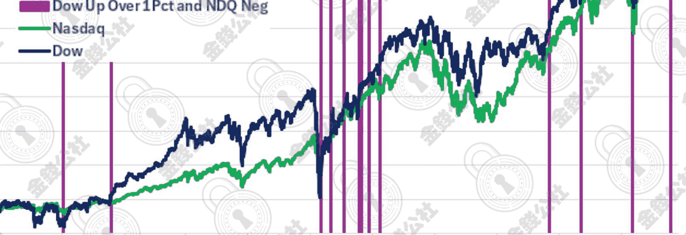

Dow Up Over 1 Pct and NDQ Neg  
Nasdaq  
Dow

道瓊工業指數 47974  
納斯達克指數 23315

資料來源：X

# IBM Shares Surge as AI Momentum Fuels Record Run

2025年11月11日，傳統科技公司IBM正展現出令人矚目的勢頭，……這主要歸功於人工智能的計畫及強勁的季度獲利表現，今年以來IBM股價已經飆漲48%。

# Barclays downgrades Oracle's debt rating: Cash may run out by November next year, potentially becoming "junk bonds."

# 甲骨文恐淪「垃圾債」！巴克萊示警負債比高達500%

2025年11月11日，巴克萊銀行固定收益研究部發布報告，……

指甲骨文為履行其龐大的AI合約而進行的資本支出，已遠超其自由現金流的支撐能力，迫使其嚴重依賴外部融資，預測甲骨文從2027財年起將面臨嚴重的融資缺口，該公司可能在2026年11月耗盡現金……

根據上述，甲骨文的信用評級最終可能被下調至BBB-級別，即投資級的最低檔。

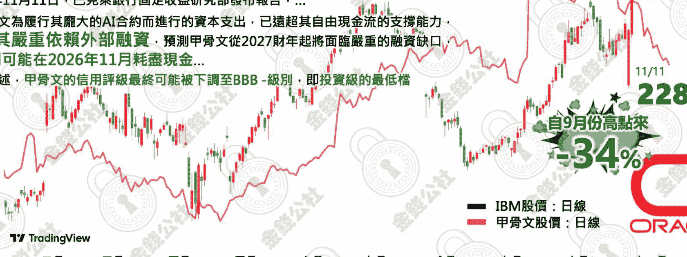

自9月份高點來 -34%

IBM股價：日線  
甲骨文股價：日線

上漲是爬樓梯，下跌是搭電梯……現在多頭要看其他族群能不能接棒，空頭看AI泡沫什麼時候破……

# S&P500本世紀以來對數報酬率分布

美股計算季度正／負回報，比例大約70:30。

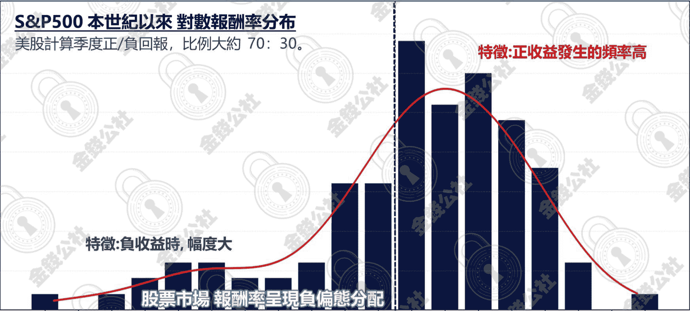

頻率

特徵：負收益時，幅度大

特徵：正收益發生的頻率高

股票市場報酬率呈現負偏態分配

PRICE RETURN

本季美股投資人冷靜許多，市場不過度追逐好消息，尤其科技股財報公布後具有明顯的實際偏差。上個季度，美股財報日的現實走勢超過期權的隱含波動，是18年首見……

# S&P500E財報日股價波動

| 板塊 | 已實現波動 | 隱含波動 | 已實現減去隱含 |
|---|---:|---:|---:|
| Materials（原材料） | 7.5% | 6.8% | 0.6% |
| Real Estate（房地產） | 3.6% | 3.5% | 0.1% |
| Energy（能源） | 3.9% | 4.1% | -0.2% |
| Health Care（醫療保健） | 6.0% | 6.4% | -0.4% |
| Utilities（公用事業） | 1.8% | 2.5% | -0.7% |
| Consumer Discretionary（非必需消費） | 7.0% | 8.1% | -1.1% |
| Financials（金融） | 3.5% | 4.7% | -1.2% |
| Communication Services（通訊服務） | 4.3% | 5.8% | -1.4% |
| Industrials（工業） | 4.6% | 6.2% | -1.6% |
| Consumer Staples（必需消費） | 3.6% | 5.3% | -1.7% |
| Information Technology（資訊科技） | 5.8% | 8.9% | -3.1% |
| All Stocks | 4.8% | 5.8% | -1.1% |

資料來源：quantvue.substack.com
