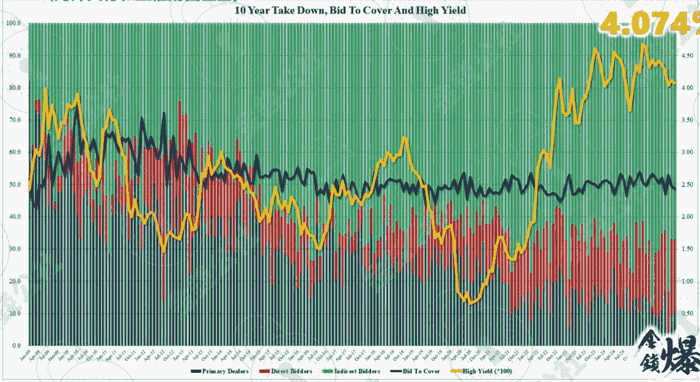
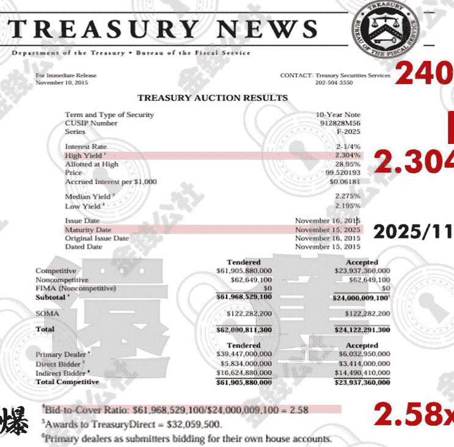
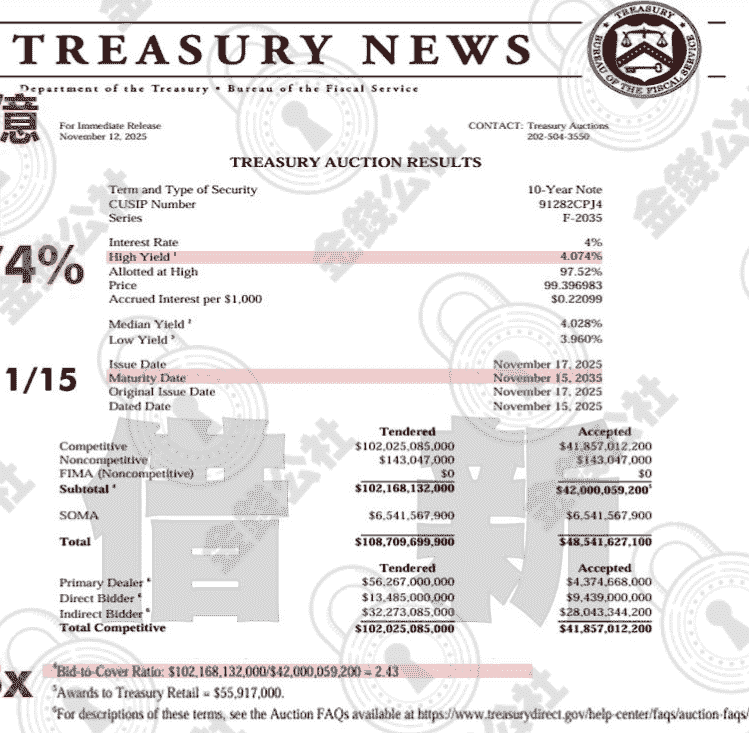
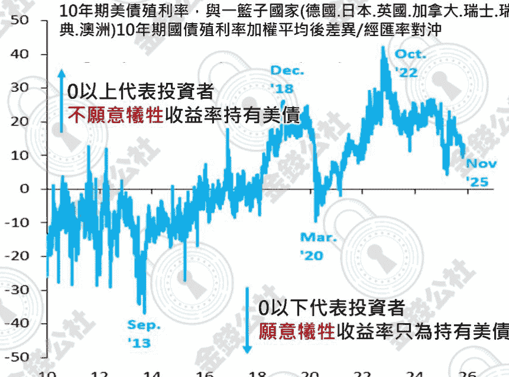
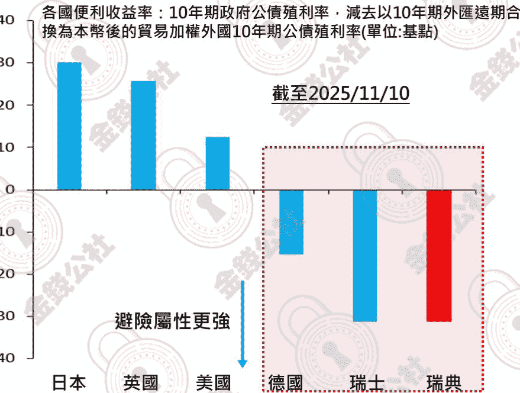
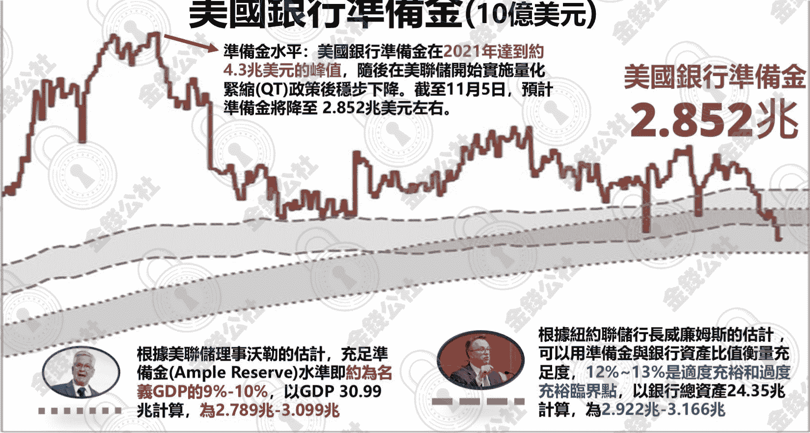
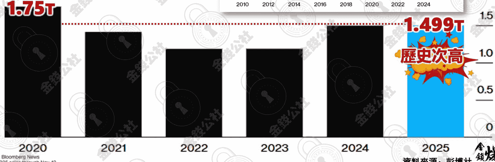
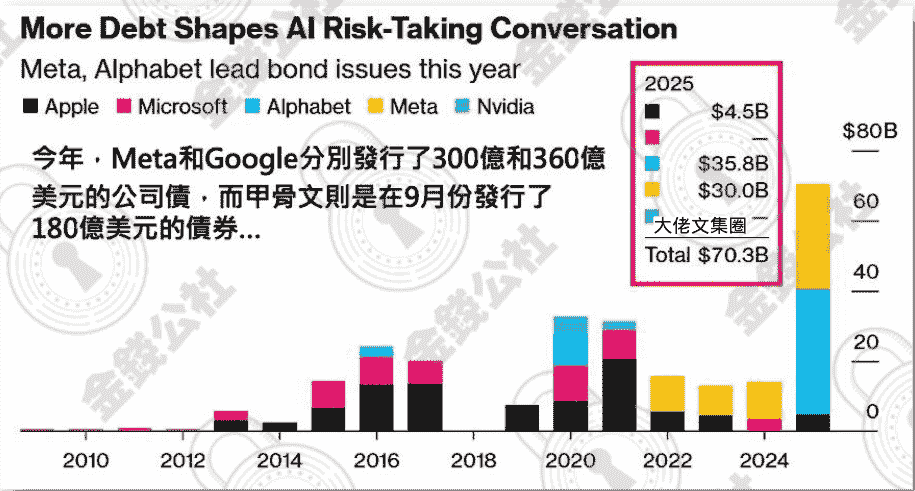
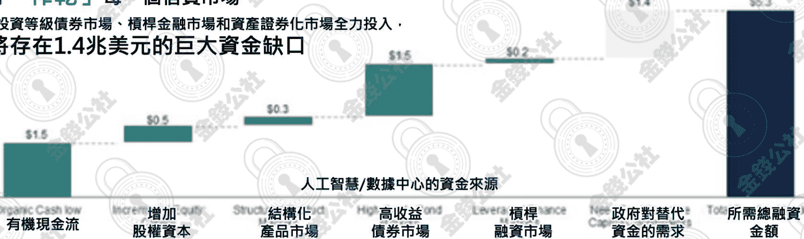
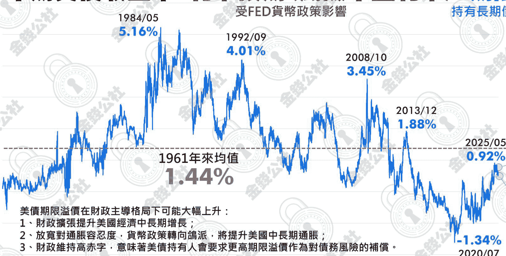

## 金錢爆金鐵牛

完整版本節目資料

## 20251008《會員專屬》1280集｜Easy money Easy go? 黃金噴出 1966 vs. 2026的甲子循環？

> 2025/10/8  
> 我覺得黃金到3800以上，我覺得賣了。  
> 真的就一個破石頭啊。

2024/5/23  
1272

0.26

100蒲式耳大豆  
需要0.23盎司黃金

0.23

2025/10/17

CBOT大豆期貨價格（美元/100蒲式耳）  
倫敦黃金現貨（美元/盎司）

2025/1/1-5  
0.28

0.27  
2025/1/13  
100蒲式耳大豆  
需要0.27盎司黃金

2025/11/13  
1142.2

## CBOT大豆期貨

日線

976.6  
2024/12/19

資料來源：TradingView

## 20241212《會員專屬》1080集｜鑄幣稅？邊降息邊通膨 MAGA？道瓊龍頭CEO橫展街頭

2024/10/4  
55.10

今天台塑集團再度破底，還原權值創15年新低。  
不要看它現在損益表一塌糊塗、現金流量表轉為負值，事實上它也是一個債債藏錢的工具。  
從政府一邊降息、一邊創造通膨，再抽鑄幣稅，其實很多大型重資產的傳產股，已經出現非常重要的「保價」——保存購買力價值的機會。

## 20250213《會員專屬》1123集｜拜登通膨 vs. 川普通縮？再話當年的12道金牌

今天（2/13）台北股市，鋼鐵股、塑化集團、水泥板塊都出現大漲。  
這些類股都已經跌到過去高點以下的價格水平，所以為什麼會出現跌深反彈，就是價格嚴重地被低估。  
商品行情會不會在今年做爆發？

## 20250214《會員專屬》1124集｜英特爾蓋牌 vs. 台積電冬至？台積跌倒 vs. 台塑吃飽？

## 20250217《會員專屬》1125集｜貨幣數量反彈，中國救市？零售數據衰退，美國緊縮發酵？

## 20250711《會員專屬》1224集｜會議行情？陸商品小陽春 Fed實質久期大收縮

中國供給側改革2.0，會不會可能是2015年到2017年的復刻版，大家稍微可以做一些觀察跟留意。  
我們公司這幾個月的福利品是台塑股票，目前為止是小小的負報酬，會不會變成大大的正報酬，就看這個行情了……

## 20250113《會員專屬》1101集

就熊斷變盤？非農最後的堅強，殺牛刀？期限溢價噴出

過去兩年我們公司每個月鼓勵員工的團康活動獎品就是送黃金，但黃金漲得非常兇，直到三個月前開始改送股票，像是台塑、中鋼。  
我希望送給員工的激勵獎品都能夠增值。  
很多人送手機、摩托車，越用越不值錢，可是我們送給員工的東西會增值。

## 20250730《會員專屬》1237集

## 活久見？台塑漲停，川普二級關稅斷油，中印煉油廠好日子將盡？

台塑集團股票會被列為警示注意股，不容易啊！  
短短幾週漲幅超過兩成，只有NVIDIA、特斯拉可以跟它比了。  
關鍵在成交量，現在有不少的塑化工在對沖。

2025年11月12日，美國財政部拍賣420億美元10年期公債，得標利率為4.074%（低於上個月的4.117%，創去年10月來第二低），但是相較市場上的10年期公債殖利率4.068%，高出0.6個基點，出現小幅尾差（Tail），為連續第二個月出現尾差現象，投標需求略顯疲弱，投標倍數降至2.433，為2024年8月以來次低……兩項數據皆表明，投資者在不確定性環境中要求美國財政部以更高的利息來融資……

## 美財政部10年期國債拍賣，遭海外嫌棄

## TREASURY NEWS

關於拍賣的內部數據：

- 一級交易商得標占比10.5%，創近三個月新高
- 直接投標者得標（大型資產管理公司、養老金）占比22.55%
- 間接投標者得標占比67.0%（上月為66.80%），低於近期平均70.2%（海外央行和主權財富基金）

### TREASURY AUCTION RESULTS

| 項目 | 數值 |
|---|---|
| Term and Type of Security | 10-Year Note |
| CUSIP Number | 91282CPJ4 |
| Series | F-2035 |
| Interest Rate | 4% |
| High Yield | 4.074% |
| Allotted at High Price | 97.52% |
| Price | 99.39698 |
| Accrued Interest per $1,000 | $0.22099 |
| Median Yield | 4.028% |
| Low Yield | 3.960% |
| Issue Date | November 17, 2025 |
| Maturity Date | November 15, 2035 |
| Original Issue Date | November 17, 2025 |
| Dated Date | November 15, 2025 |

| 類別 | Tendered | Accepted |
|---|---:|---:|
| Competitive | $102,025,085,000 | $41,857,012,200 |
| Noncompetitive | $143,047,000 | $143,047,000 |
| FIMA (Noncompetitive) | $0 | $0 |
| Subtotal | $102,168,132,000 | $42,000,059,200 |
| SOMA | $6,541,567,900 | $6,541,567,900 |
| Total | $108,709,699,900 | $48,541,627,100 |
| Primary Dealer | $56,267,000,000 | $4,374,668,000 |
| Direct Bidder | $13,485,000,000 | $9,439,000,000 |
| Indirect Bidder | $32,273,085,000 | $28,643,344,200 |
| Total Competitive | $102,025,085,000 | $41,857,012,200 |

資料來源：ZeroHedge、美國財政部

11/5，美國財政部官網公布，本週將發行1250億美元國債，用於償還約982億美元於2025/11/15到期的私人持有國債。此次發行預計從私人投資者籌集約268億美元的新資金。其中包括：

- 一筆金額為420億美元的10年期票據，將於2035年11月15日到期
- 2015/11/16發行、2025/11/15到期的10年期國債
- 2015/11/17發行、2035/11/15到期的10年期國債

- 240億　發行規模　420億
- 融資成本大增1.77%
- 2.304%　得標利率　4.074%
- 2025/11/15　到期日　2035/11/15
- 2.58x　投標倍數　2.43x

## 如今，什麼樣的國家才算是避風港？

### 傳統避險國家正逐漸消失，新的避險國家正在崛起。

- 布魯金斯學會資深研究員Robin Brooks指出，從左圖可以看到，美債的「便利收益率」已經消失。過去，美債殖利率平均大約比其他G10國家（以美元計）債券殖利率低，但現在卻要付出溢價，而近期溢價有些微收窄，仍高出其他已開發國家約10個基點。
- Robin Brooks從另一個角度觀察，透過換算，包括日本、英國、美國的便利收益率皆為正值，代表投資人不願擁抱收益率持有該國主權債務；反觀德國、瑞士、瑞典的便利收益率為負。Robin Brooks分析，會出現這樣的結果，是因為市場對瑞典較低的債務水準（僅占GDP的33%）給予肯定，這一水準甚至低於瑞士（占GDP的38%）。

## 匯率對沖後，10年期美債相對於其他已開發國家國債吸引力下降

## 哪個國家現在是全球最被追捧的安全港

## 美國銀行準備金（10億美元）

準備金水平：美國銀行準備金在2021年達到約4.3兆美元的峰值，隨後在美聯儲開始實施量化緊縮（QT）政策後穩步下降。截至11月5日，預計準備金將降至2.852兆美元左右。

## 美國銀行準備金

2.852兆

根據美聯儲理事沃勒的估計，充足準備金（Ample Reserve）的水準則約為名義GDP的9%–10%，以GDP 30.99兆計算，為2.789兆–3.099兆。

根據紐約聯儲行長威廉姆斯的估計，可以用準備金與銀行資產比值衡量充足度，12%–13%是適度充裕和過度充裕臨界點，以銀行總資產24.3兆計算，為2.922兆–3.166兆。

2025年11月12日路透社報導，紐約聯儲行長威廉姆斯表示，在12月初結束QT後，接下來的重點將是判定銀行體系的準備金是否已達到「充足」水準。美聯儲可能很快將重新啟動公債購買計畫，並重申這些購買行動的目的，是確保美聯儲能在市場上維持「充足準備金」水準，避免短期資金市場出現波動。

資料來源：Reuters

2025年11月12日，根據彭博社的報導指出，……

2025年至今，美國投資級公司債券的發行量已達到1.499兆美元，創下有史以來的第二高水位（僅次於2020年的1.75兆），企業正利用較低的借貸成本來再融資債務……

其中，近期明顯的提速，10月發行量創單月紀錄，部分歸因於Meta發行的300億美元債券，這是逾兩年來規模最大的投資級債券交易！

## US High-Grade Bond Issuance at Highest Since 2020

■ Annual Sales

## More Debt Shapes AI Risk-Taking Conversation

Meta, Alphabet lead bond issues this year

今年，Meta和Google分別發行了300億和360億美元的公司債，而甲骨文則是在9月份發行了180億美元的債券……

資料來源：彭博社

## Meta 科學怪人式的搶錢！

Meta於10月底完成了300億美元的債券發行，這是自2023年以來規模最大的企業債券交易，該方案由摩根士丹利等主導，期限為24年，這批債券的利率高達6.58%，遠高於Meta同類公司債5.5%的殖利率，標普全球授予A+評級。

| 項目 | 內容 |
|---|---|
| 名稱 | BEIGNET INVESTOR |
| 金額 | 300億美元 |
| 類型 | 私募股權和私募債券 |
| 數據中心客戶 | Meta |
| 融資方 | 品浩、Blue Owl |
| 期限 | 24年 |
| 利率 | 6.58% |
| 信用評級 | 標普全球評級授予的A+評級 |

## Figure 1: AI Data Center Funding Sources

根據摩根大通的研究分析指出，未來五年AI資料中心的建設熱潮至少需要5兆美元，這將「榨乾」每一個信貸市場。

即便投資等級債券市場、槓桿金融市場和資產證券化市場全力投入，仍將存在1.4兆美元的巨大資金缺口。

人工智慧／數據中心的資金來源

Source: J.P. Morgan estimates. Reflects assumed permanent financings.

資料來源：摩根大通、新浪財經

11月12日，森特參加紐約聯儲會議，演講題為「平行繁榮：加強國債市場以建設美國的黃金時代」。

他強調，將根據投資者需求變化調整美債發行結構，並在可行範圍內提供前瞻性指引，但任何變化都將是漸進式的，避免擾亂市場。致力維護美債作為全球穩定基準的地位，並維持無風險利率在低點運作。

已開始考慮增加長期債券發行規模，由於這些債券的久期更長，因此逐步調整更為重要。通過將到期日均勻地分散到一段時間內，定期、可預測的發行可以限制展期風險，避免大量債務同時到期。

森特也營造利好美債的氛圍，有三個因素正在重塑美債的需求格局：

- 支持放寬銀行的補充槓桿率（SLR），釋放銀行資產負債表空間，推動銀行增持對美債的需求，無需為潛在損失配置資本。
- 美聯儲上月宣布調整資產負債表管理方式後，將購買更多短債。
- 預計穩定幣市場將大幅擴張，提升對一年期以內短債需求。目前穩定幣市場規模3000億美元，十年內「擴大十倍」。

## 「漸進式」調整美債發行

資料來源：美國財政部

## 截至北京時間2025/11/13 13:30

## US Debt Clock.org

資料來源：美國國債鐘

## 美國聯邦債務

$38,187,552,439,416

人均債務 $111,069

納稅人均債務 $328,220

美國聯邦支出（官方）$7,026,792,033,168

美國聯邦預算赤字（官方）$1,769,814,245,258

政府效率部削減（目標）$707,583,724,712

政府效率部削減（現在）$214,155,348,890

美國聯邦債務／GDP  
1960 52.18%　1980 34.71%　2000 55.40%　NOW 120.99%

## 預算最大項目

醫保／醫療補助 $1,710,531,815,730

社會保險 $1,596,804,218,015

國防／戰爭 $925,272,567,171

淨債務利息 $968,765,288,220

## 無資金債務／利息

美國總債務 $105,262,358,769,175

利息總支出 $5,608,481,399,551

信用卡債務 $1,290,232,726,131

私人信用卡債務 $58,078

聯邦利息每年節省 $968,765,288,769

人均節省 $8,624

全美利息每年節省 $4,517,633,258,936

人均節省 $40,220

## 貨幣創造

預估未來發行國債金額 $1,741,395,955,977

M2貨幣供給 $22,327,776,342,294

貨幣和信用流動物 $727,776,118,334,405

## 貿易數字

其他國家持有美債 $9,370,133,955,582

貿易赤字 $1,390,788,859,009

對中國貿易赤字 $257,716,803,990

進口油鋼 $173,455,034,107

邊境偷渡2024 1,762,682  
邊境偷渡2025 67,601  
每年節省 96.16%  
每年節省 $35,228,498,301  
人均節省 $513.63

| 指標 | 數值 |
|---|---:|
| 美國聯邦稅收 | $5,256,977,789,910 |
| 人均稅收 | $15,407 |
| 所得稅收 | $2,799,980,071,340 |
| 工資稅收 | $1,758,495,431,340 |
| 消費稅收 | $212,234,643,683 |
| 慈善捐款收入 | $579,456,996,492 |
| 美國GDP總額 | $31,571,948,119,866 |
| 聯邦／州／地方總支出 | $12,267,391,959,201 |
| 總債務／GDP | 131.17% |
| 收入／GDP | 31.87% |
| 支出／GDP | 38.86% |

| 人口與勞動 | 數值 |
|---|---:|
| 美國總人口 | 342,441,041 |
| 勞動人口 | 163,654,451 |
| 官方失業人口 | 7,287,826 |
| 健保成本 | $15,888 |
| 油／太陽能 | $269.25 |
| 美元供給增加 | $1,013,205,087,662 |
| 美國稅收人口 | 134,456,762 |
| 勞動人口（2000年） | 152,520,001 |
| 實際失業人口 | 14,954,059 |
| 健保成本（2000） | $15,888 |
| 油／太陽能（2000） | $27.25 |
| 美元供給增加（1913） | $555,743,066 |
| 私營部門就業 | 130,724,103 |
| 失業勞動人口 | 104,347,904 |
| 全職勞動數 | 135,182,519 |
| 大學學費 | $27,653 |
| 美元／白銀 | $1,226 |
| 美元／黃金 | $9,717 |

## 美國隱藏的資產：有擔保美元

| 資產類別 | 數值 |
|---|---:|
| 黃金儲備 | $1,252,284,982,462 |
| 礦產儲備 | $9,496,494,455,606 |
| 房地產 | $77,224,240,616,321 |
| 土地 | $25,113,531,762,826 |
| 股市 | $52,178,540,958,830 |
| 回收資產 | $7,725,815,667,586 |
| 隱藏資產 | $177,060,834,637,321 |
| 人均資產 | $518,936 |

MORTGAGE/LOAN CALCULATOR　GOLD SUPPLY/DEMAND　HOME SALES　SOURCES　AUTO SALES　ABOUT　ENERGY OUTPUT　GOLD/PRECIOUS METALS

## 10年期美債收益率＝利率預期（風險中立利率）＋期限溢價

受FED貨幣政策影響

持有長期債券要求的補償

1984/05  
5.16%

1992/09  
4.01%

2008/10  
3.45%

2013/12  
1.88%

1961年來均值  
1.44%

2025/05  
0.92%

近4個月高  
09/02 0.84%

2025/11/10  
0.62%

-1.34%  
2020/07

### 美債期限溢價在財政主導格局下可能大幅上升：

1. 財政擴張提升美國經濟中長期增長；
2. 放寬對通脹容忍度，貨幣政策轉向鴿派，將提升美國中長期通脹；
3. 財政維持高赤字，意味著美債持有人會要求更高期限溢價作為對債務風險的補償。

資料來源：NY FED
