## 金錢爆金鑰程

### 完整版節目資料

## 美股重挫衝擊美股

### 標普500 11/13成分股熱點圖

11/13，美國股市重挫，三大美股指數齊創一個月最大跌幅；納指跌超2%，標普和道指跌超1%；迪士尼跌近8%，領跌道指成分股；特斯拉跌6.6%，領跌科技巨頭；晶片和AI概念股全體重挫，英偉達跌3.6%，AMD跌超4%，Palantir跌超6%，甲骨文跌超4%……

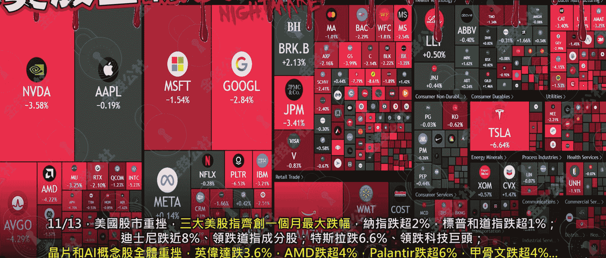

資料來源：TradingView

## 比特幣日K

### 跌破10萬大頸線

100,000

2025/8/14  
H: 123731

2025/10/6  
H: 125761

108,000

2025/6/22  
L: 98385

2025/11/14  
L: 95871

資料來源：BINANCE

## 萬物皆跌？

### 創16個月高

11/13 21:00  
4245.22 當天高點

金價自盤內高點一度跌100美元

11/14 02:40  
4144.965

11/13 09:30  
99.5918

創2周低

11/14 01:35  
98.9894

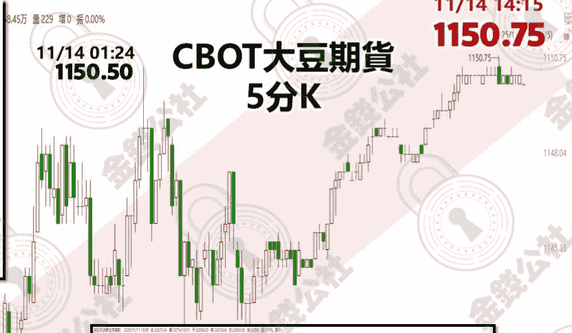

CBOT大豆期貨  
5分K

11/14 01:24  
1150.50

創16個月高

11/14 14:15  
1150.75

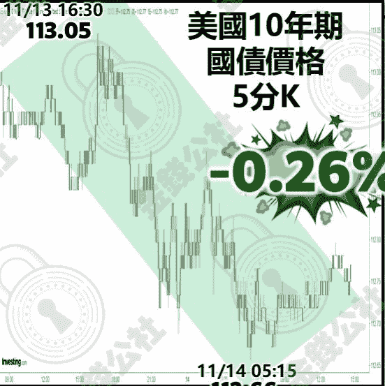

美國10年期國債價格  
5分K

-0.26%

11/13 16:30  
113.05

11/14 05:15  
112.66

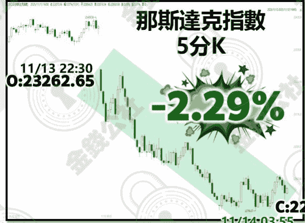

那斯達克指數  
5分K

-2.29%

11/13 22:30  
23262.65

11/14 03:55  
22796.07

資料來源：WIND、Investing

## Oracle, OpenAI Sign $300 Billion Cloud Deal

### 美媒：OpenAI、甲骨文簽署3,000億美元算力合約

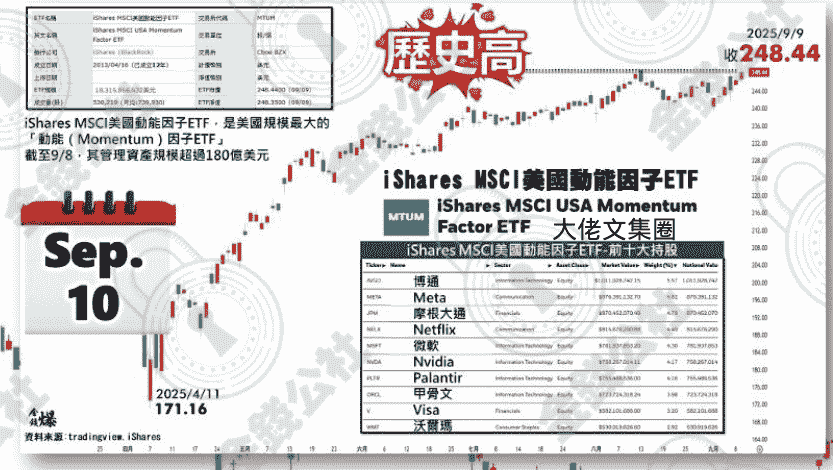

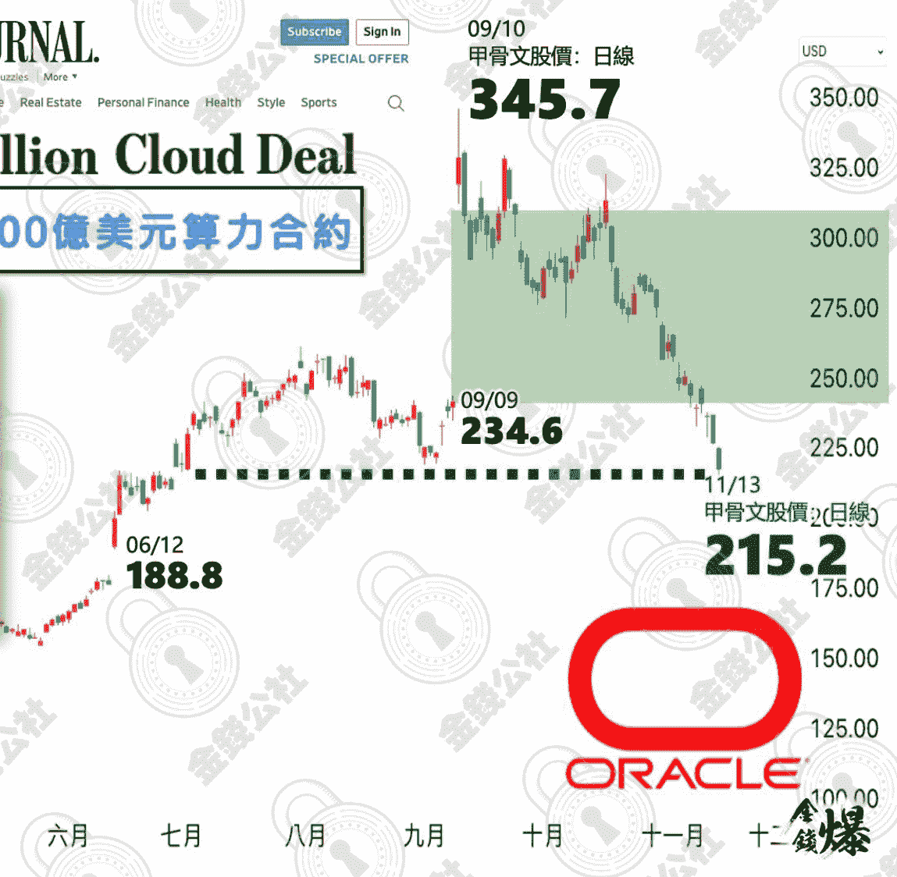

## 高盛高貝塔動量對沖指數

高盛高貝塔動量對沖指數（GSPRΗIMO）單日下跌7%，創下今年第二大單日跌幅；也是自1/27 DeepSeek事件後（-9.6%）最大單日跌幅。

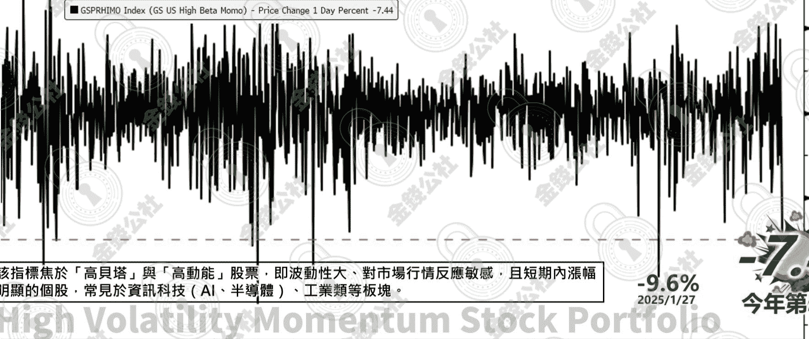

該指標聚焦於「高貝塔」與「高動能」股票，即波動性大、對市場行情反應敏感，且短期內漲幅明顯的個股，常見於資訊科技（AI、半導體）、工業類等板塊。

- -9.6%（2025/1/27）
- -7.4%（今年第2大跌幅）

High Volatility Momentum Stock Portfolio

資料來源：ZeroHedge

## 納斯達克綜合指數

### DeepSeek sparks AI stock selloff; Nvidia posts record market-cap loss

## 高盛高貝塔動量對沖指數

高盛高貝塔動量對沖指數（GSPRH10）單日下跌7%，創下今年第一大單日跌幅，也是自1/27 DeepSeek事件後（-9.6%）最大單日跌幅。

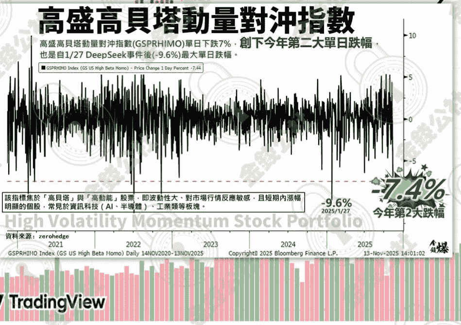

### 波段跌幅 26.52%

20118.61

7.44% 今年第2大跌幅

4/7 14784.03

## 動能、高Beta與盈利品質

據高盛報告，今年以來截至11/12，動能、高Beta、動能因子相關的表現都名列前茅，反觀成長、盈餘品質這類因子表現排在後段班；但僅僅過一天時間，在11/13整個表現豬羊變色。

- 高Beta動能報酬從46.4%→-7.5%
- 6個月動能報酬從23.9%→-6.8%
- 盈餘品質報酬從-22.1%→0.7%

### 今年以來（截至11/12）表現

| Name | Ticker | YTD thru Nov 12 |
|---|---|---:|
| High Beta Momo | 高Beta動能 | 46.4% |
| Momentum ex AI/BTC (Hi/Lo) | 動能扣除AI、比特幣 | 28.2% |
| 6m Momentum (Hi/Lo) | 6個月動能 | 23.9% |
| Momentum (Hi/Lo) | 動能 | 20.7% |
| Size (Large/Small) | 規模 | 17.0% |
| Crowding (Hi/Lo) | 擁擠交易 | 15.8% |
| Beta (Hi/Lo) | Beta | 14.2% |
| Res Vol (Hi/Lo) | 殘差波動性 | 12.9% |
| Short Interest (Hi/Lo) | 空頭頭寸 | 4.6% |
| 3m Momentum (Hi/Lo) | 3個月動能 | 4.2% |
| Wolfe 10yr Rate Sensitivity (Hi/Lo) | 利率敏感 | 2.9% |
| Earnings Yield (Hi/Lo) | 盈餘殖利率 | -0.3% |
| Value (Cheap/Expensive) | 價值 | -1.0% |
| Profitability (Hi/Lo) | 盈利 | -2.7% |
| Quality (Hi/Lo) | 品質 | -3.6% |
| Leverage (Hi/Lo) | 槓桿 | -4.3% |
| Growth (Hi/Lo) | 成長 | -9.2% |
| Earnings Quality | 盈餘品質 | -22.1% |

### 11/13表現

| 13-Nov | Ticker | Name |
|---:|---|---|
| 1.5% | 擁擠交易 | Crowding (Hi/Lo) |
| 0.9% | 價值 | Value (Cheap/Expensive) |
| 0.8% | 盈餘殖利率 | Earnings Yield (Hi/Lo) |
| 0.7% | 盈利 | Profitability (Hi/Lo) |
| 0.6% | 品質 | Quality (Hi/Lo) |
| 0.6% | 槓桿 | Leverage (Hi/Lo) |
| 0.5% | 盈餘品質 | Earnings Quality |
| 0.2% | 規模 | Size (Large/Small) |
| -0.7% | 利率敏感 | Wolfe 10yr Rate Sensitivity (Hi/Lo) |
| -0.9% | 成長 | Growth (Hi/Lo) |
| -1.0% | 空頭頭寸 | Short Interest (Hi/Lo) |
| -2.3% | 動能 | Momentum (Hi/Lo) |
| -2.5% | 動能扣除AI、比特幣 | Momentum ex AI/BTC (Hi/Lo) |
| -2.8% | 殘差波動性 | Res Vol (Hi/Lo) |
| -3.5% | Beta | Beta (Hi/Lo) |
| -6.6% | 3個月動能 | 3m Momentum (Hi/Lo) |
| -6.8% | 6個月動能 | 6m Momentum (Hi/Lo) |
| -7.5% | 高Beta動能 | High Beta Momo |

資料來源：Goldman Sachs

## 估算華爾街（做市商）Gamma部位（10億美元／S&P 500上下1%變動）

涵蓋S&P全部選擇權部位＋槓桿型ETF

### 動能因子崩潰

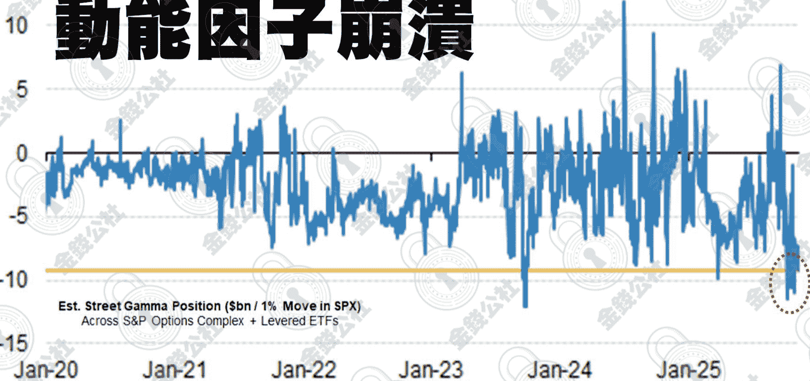

Est. Street Gamma Position ($bn / 1% Move in SPX)

Across S&P Options Complex + Levered ETFs

資料來源：Morgan Stanley

2025年11月13日，美國財政部拍賣250億美元30年期公債，得標利率為4.694%（低於上個月的4.734%）。但是相較市場上的30年期公債殖利率4.684%，高出1個基點，出現尾差（Tail），這是連續第二個月出現尾差現象（8月尾差：2.1bp）。投標需求略顯疲弱，投標倍數降至2.295，過去六次新債發行平均倍數為2.382倍，創8月以來的最低值（2.266倍）。整體而言，這是繼昨天10年期拍賣之後又一場糟糕的國債拍賣……

## TREASURY NEWS

### 關於拍賣的內部數據：

- 一級交易商得標占比14.5%，創8月來的最高水位
- 直接投標者得標（大型資產管理公司、養老金）占比14.5%，創2024年10月最低
- 間接投標者得標占比71.0%（10月為64.5%），創2024年10月來最高（海外央行和主權財富基金）

| Treasury Auction Results | 30-Year Bond 912810PY8 Bonds of November 2025 |
|---|---|
| Interest Rate | 4.58% |
| High Yield | 4.694% |
| Allotted at High | 23.04% |
| Price | 98.894977 |
| Accrued Interest per $1,000 | $0.25552 |
| Median Yield | 4.630% |
| Low Yield | 4.570% |
| Issue Date | November 17, 2025 |
| Maturity Date | November 15, 2055 |
| Original Issue Date | November 17, 2025 |
| Dated Date | November 15, 2025 |
| Competitive Tendered | $57,316,798,000 |
| Competitive Accepted | $24,944,422,000 |
| Noncompetitive Tendered | $53,358,500 |
| Noncompetitive Accepted | $53,358,500 |
| FIMA (Noncompetitive) | $0 |
| Subtotal | $57,370,156,500 / $25,000,010,500 |
| SOMA | $3,893,790,400 / $3,893,790,400 |
| Total | $61,264,176,900 / $28,893,800,900 |

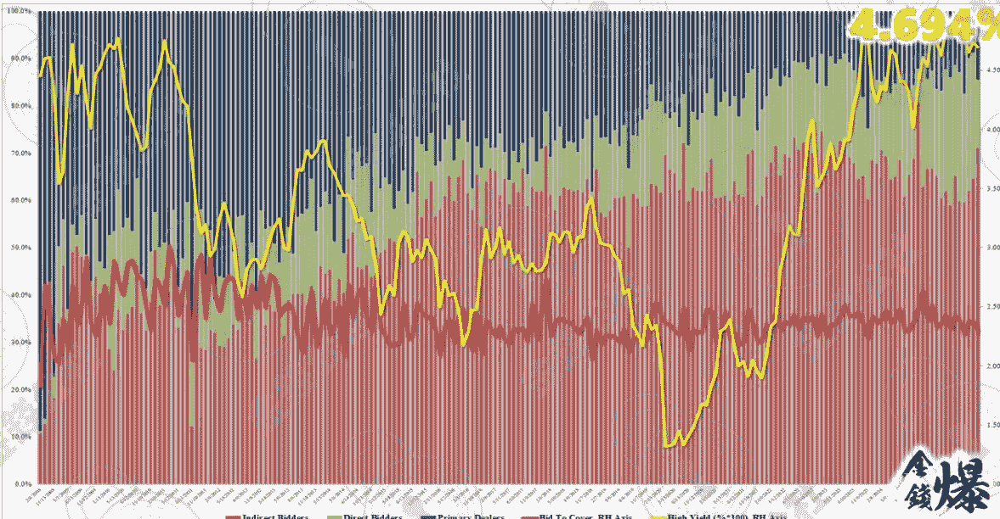

資料來源：ZeroHedge、美國財政部

| 證券種類 | 期限 | 標售日 | 發行日 | 到期日 | 拍賣規模 |
|---|---|---|---|---|---|
| 91282CFW6 | Note | 3-Year | 11/08/2022 | 11/15/2022 | 11/15/2025 | 400E |
| 912828M56 | Note | 9-Year 10-Month | 01/13/2016 | 01/15/2016 | 11/15/2025 | 240E |
| 912828M56 | Note | 9-Year 11-Month | 12/09/2015 | 12/15/2015 | 11/15/2025 | 210E |
| 912828M56 | Note | 10-Year | 11/10/2015 | 11/16/2015 | 11/15/2025 | 210E |

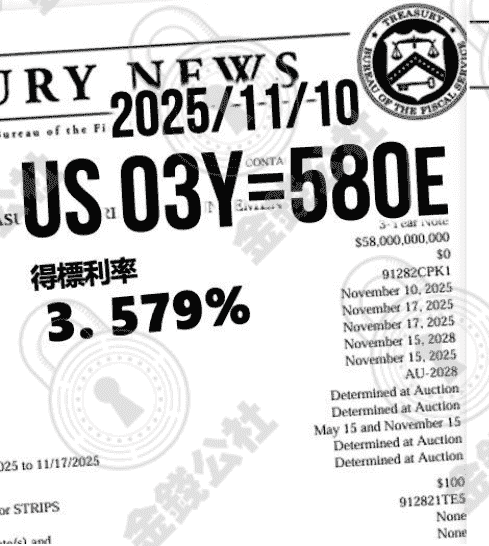

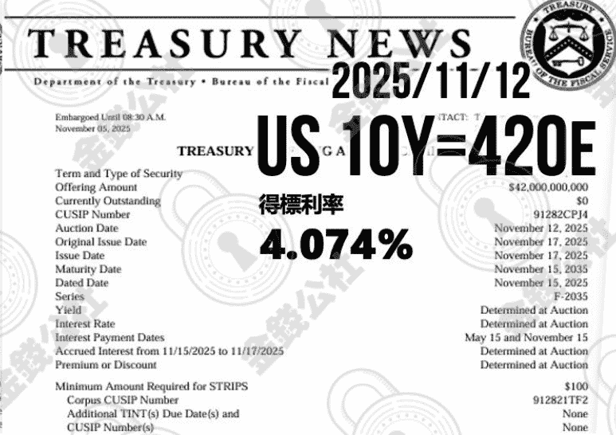

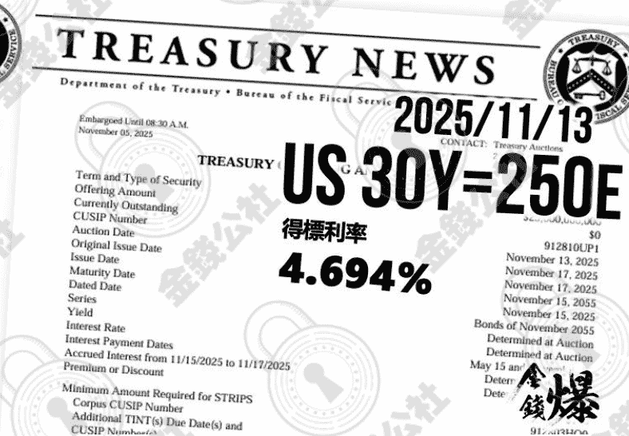
