# 金錢爆金鐵桿

完整版節目資料

# 日本10年期國債殖利率（月線）

## 受支出擔憂影響  
日本公債殖利率攀升

Japan's Bond Yields Climb On Spending Fears

Concerns about bigger government stimulus under Prime Minister Takaichi pushed super-long Japanese government bond yields to multi-decade highs.

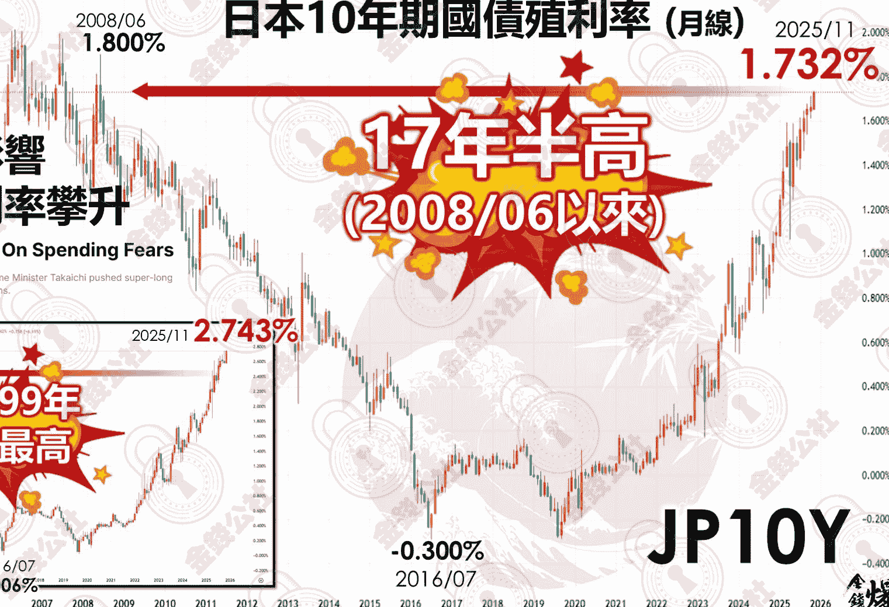

# JP10Y

資料來源：TradingView

## 経済対策の規模17兆円台で調整、歳出は前年度超え14兆円  
大型減税も

政府が近く策定する経済対策の規模について財務省は17兆円台にする方向で調整に入った。裏付けとなる2025年度の補正予算の歳出規模は前年度を上回る14兆円程度とする。所得税がかかり始める「年収の壁」の引き上げやガソリン税などに上乗せされている旧暫定税率の廃止による大規模減税も盛り込む。

経済対策は21日にも閣議決定する。一般会計歳出を伴う補正予算の規模としては新型コロナウイルス禍を除くと安倍晋三政権だった…

# 經濟刺激方案調整至17兆日圓，支出超過上一財年的14兆日圓，並實施大規模減稅

2025年11月15日，根據日經新聞報導，日本財務省已開始調整政府即將制定的經濟刺激方案規模，目標約17兆日圓。為支持該方案，2025財年的補充預算支出約為14兆日圓，超過上一財年的水準。該方案還將包括大規模減稅，具體措施包括提高個人所得稅的起徵點，以及取消先前對汽油和其他稅項徵收的臨時稅率。這些經濟措施將於21日獲得內閣批准。除新冠肺炎疫情外，這次涉及一般帳戶支出的補充預算規模是安倍晉三執政以來最大的。

資料來源：日經新聞，Bloomberg

# Japan’s Falling GDP Backs Takaichi’s Case for Big Fiscal Package

# 日本GDP下滑印證高市振興要求推出大規模財政刺激方案的論點

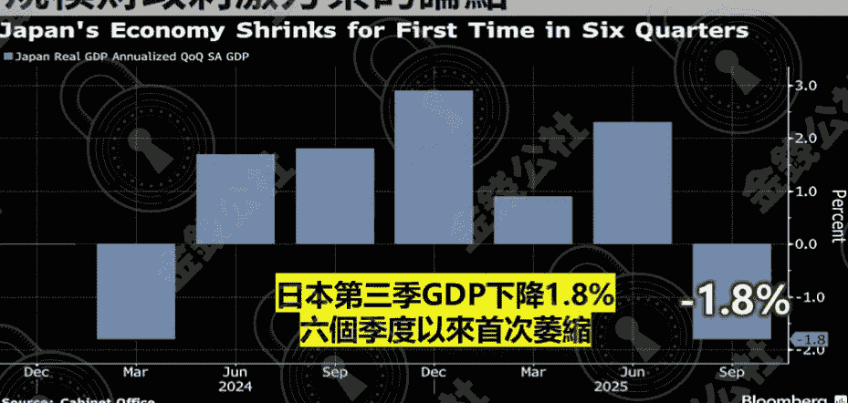

日本內閣府17日公布統計數據指出，因住宅投資大減、出口萎縮，拖累上季（2025年7—9月）日本經季節性因素調整後的實質國內生產總值（GDP）第1次速報值季減0.4%，為6季來首度陷入萎縮；以年率換算為下滑1.8%，6季來首度陷入萎縮。民間調查機構原先預期日本上季GDP將季減0.6%、年減2.5%，內閣府公布的減幅低於市場預期。

# 狗狗飆出的房貸利率

2022年9月23日，當時的英國首相特拉斯公布迷你預算，450億英鎊無資金支持的減稅計劃，取消公司稅上調、將個人所得稅最高稅率由45%下調至40%，削減國民保險和印花稅，導致市場對財政紀律的信任崩潰：

- 10年期英債殖利率突破4.5%以上！
- 30年期英債殖利率突破5%！

## 2021年以來  
英債10年期殖利率

# 英債30年期殖利率

## 4個月最大漲幅  
單日升24bp

2025/11/14  
5.41%

# 英債價格

## 單日跳空跌2%  
1個月低

# 英債10年期殖利率

## 7個月最大漲幅  
單日升20bp  
1個月高

2025/11/14  
4.586

資料來源：TradingView、Investing

11月26日英國秋季預算即將公布前夕，英國財政再次成為焦點，大家應該對2022年「迷你預算」風波記憶猶新……

每年秋季，英國財政大臣都會向議會提交一份全面的財政規劃——預算案（Budget），它不僅決定了未來一年的稅收政策，還決定了政府如何分配公共資源，影響著每一個家庭的生活成本和財務安排。

目前英國工黨政府的政治命運與市場命運之間存在著一種你死我活的關係，兩者之間只能有一個勝利。

- 11月14日，英國財政大臣里夫斯在國會說她在即將公布的預算中，將做出「必要的選擇」，而不是「受歡迎的選擇」。
- **考慮放棄提高個人所得稅計畫**，那麼工黨政府就能信守去年大選承諾，財政大臣和首相將保住職位。
- 但英國政府在財政年度的前6個月借款比預期多出72億英鎊，預算赤字攀升至998億英鎊，超過預測的926億英鎊，**本財政年度政府面臨高達300—400億英鎊的預算缺口，再度引發市場對英國財政困境的擔憂，長期國債殖利率瞬間飆升。**

# 倒台或倒國債，只能選一個

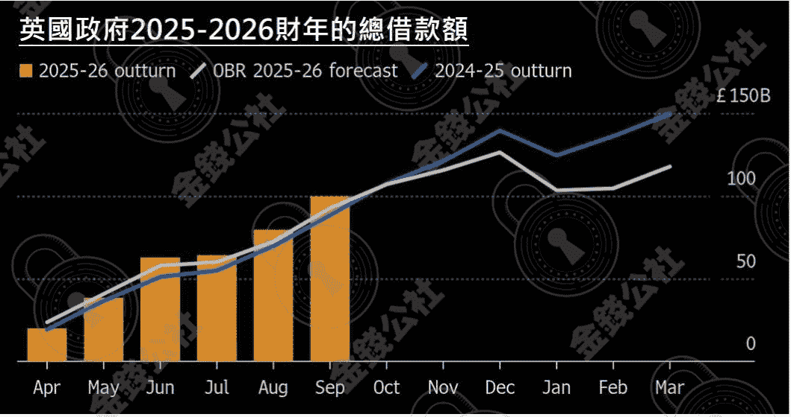

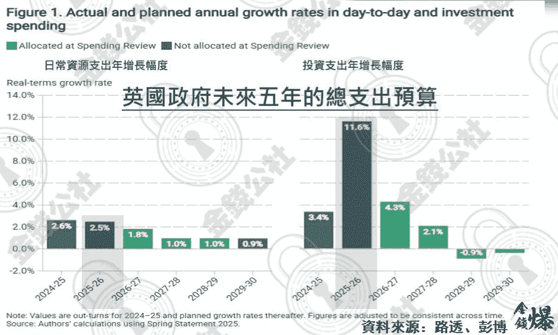

# 英國政府未來五年的總支出預算

# 澳洲10年期公債殖利率

日線／2025年以來

01/13  
4.721

05/15  
4.583

創30年高  
（2025/5/22以來）

4.283  
04/07

4.035  
04/07

4.096  
10/17

# 紐西蘭10年期公債殖利率

日線／2025年4月以來

4/14  
4.870

2個月高  
（2025/9/10以來）  
單日大升17bp

4.355  
11/17

3.985  
10/17

# 加拿大10年期公債殖利率

日線／2025年6月以來

7/15  
3.629

收盤價  
2個月高  
（2025/9/9以來）

3.234  
11/14

3.038  
10/28

資料來源：TradingView

# 澳洲10年期公債殖利率

周線／2018年以來

## 創半年高  
（2025/5/22以來）

日線／2025年以來

4.721  
01/13

4.583  
05/15

4.497  
11/17

4.035  
04/07

4.096  
10/17

2023/10/30  
4.999

2025/1/13  
4.721

2025/11/17  
4.497

2022/10/17  
4.302

3.769  
2024/9/16

3.109  
2023/3/20

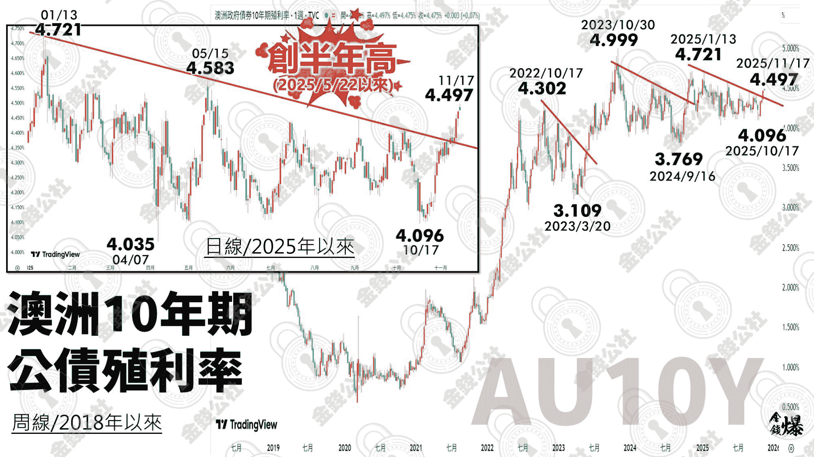

# Annual food prices increase 4.7 percent

11/17，紐西蘭統計局最新資料顯示，截至2025年10月的12個月裡，全國食品價格年增率上漲4.7%，高於截至2025年9月的4.1%。

統計局指出，本次年度食品價格上漲中，雜貨類食品價格增幅最大。在過去一年裡上漲4.9%，其中包括麵包、乳製品、零食、飲料等日常必需品。以2升裝牛奶為例，平均價格為4.78紐幣，年增率高達13.5%。

除了食品，紐西蘭家庭還同時面臨能源成本上升的壓力……截至2025年10月的一年中，電價上漲11.8%，燃氣價格上漲14.4%。

# 電力和燃氣價格已經連續11個月上漲

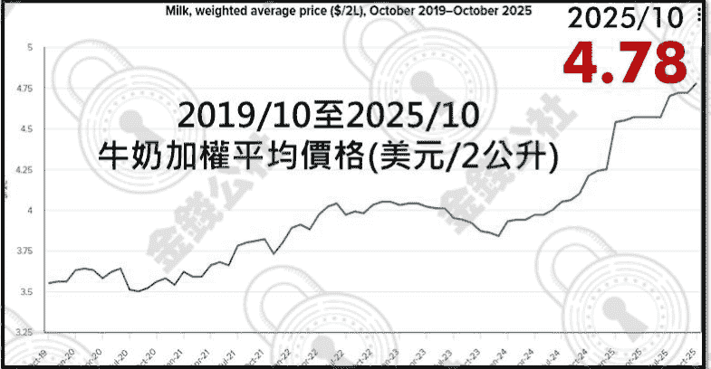

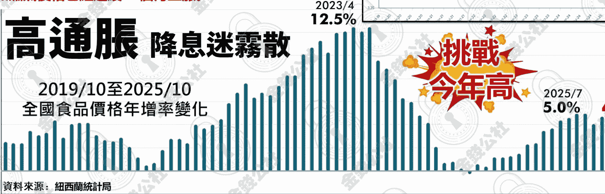

# 高通脹，降息迷霧散

# 挑戰今年高

資料來源：紐西蘭統計局

# Launch of 15 May 2036 Nominal Bond Syndicated Tap Announced

**Issue date:** Monday, 17 November 2025

The Treasury announces the launch of the syndicated tap of the 4.25% coupon, 15 May 2036 nominal New Zealand Government Bond. Given the timing of the launch, the Treasury also announces the cancellation of the tender scheduled for 20 November 2025.

> The Treasury expects to issue at least NZ$4.0 billion of the 15 May 2036 nominal bond. The transaction will be capped at NZ$6.0 billion. Initial price guidance is 12 to 15 basis points over the 15 May 2035 nominal bond.

The issue will be priced on Tuesday 18 November 2025 NZT, and further issuance of the bond will not occur prior to March 2026.

ANZ Bank New Zealand Limited; J.P. Morgan Securities Australia Limited; UBS AG, Australia Branch; and Westpac Banking Corporation, New Zealand Branch are Joint-Lead Managers for the issue.

> The Treasury expects to issue at least NZ$4.0 billion of the 15 May 2036 nominal bond. The transaction will be capped at NZ$6.0 billion. Initial price guidance is 12 to 15 basis points over the 15 May 2035 nominal bond.

11/17，紐西蘭財政部宣布取消原定於2025年11月20日舉行的招標，並宣布啟動票面利率為4.25%、名目到期日為2036年5月15日的紐西蘭公債的銀團增發。

同時表示未來利率指導將上調12—15個基點。

此舉可能影響紐西蘭市場利率預期，顯示政府對長期融資策略的調整，對債券市場及整體經濟環境產生影響，關注未來利率走向及貨幣政策變化。

資料來源：紐西蘭財政部

# 韓10年期債殖利率：日線：2025年來

# 韓10年期債券價格（近一個月）

# 韓20年期債殖利率：日線

逼近去年高

10/17 韓國10年期債殖利率：日線  
3.350%

04/28  
2.555%

09/18  
2.728%

10/23  
2.855%

逼近2023年低

10/23  
9904

11/17  
9526

KR 10Y PRICES

逼近去年高

11/17  
3.337%

10/23  
2.835%

09/18  
2.757%

# KR 20Y

04/28  
2.532%

# 美債10年期殖利率

04/07  
114.31

4.629%

05/22

3.860%

04/04

4.157%

11/17

3.936%

10/22

09/11  
113.91

10/17  
114.06

11/17  
112.48

112.19

09/26

109.41

05/22

# 美債10年期價格

日線，今年3月以來

資料來源：Investing（截至11/17 14:40）

# Hawks on the Rise! The Fed’s December Meeting May See Multiple Dissents

聯儲局主席鮑威爾可能面臨比上個月兩張雙向異議反對票更激烈的局面。原先支持降息的芝加哥Fed的古斯比和理事巴爾都表達出傾向不降息。而今年票委的波士頓Fed表達對通脹的擔憂，明年票委的明尼阿波利斯Fed表達強烈不降息意願，明年票委克里夫蘭Fed表示不支持此前降息行動。

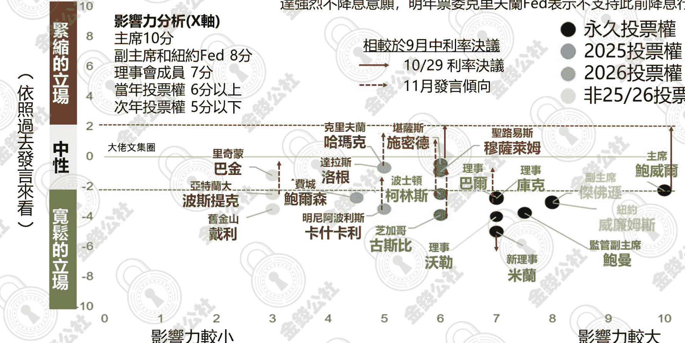

影響力分析（X軸）

主席 10分  
副主席和紐約Fed 8分  
理事會成員 7分  
當年投票權 6分以上  
次年投票權 5分以下

相較於9月中利率決議 → 10/29利率決議  
11月發言傾向

- 永久投票權
- 2025投票權
- 2026投票權
- 非2025／2026投票權

（依照過去發言來看）

緊縮的立場  
中性  
寬鬆的立場

影響力較小

影響力較大

資料來源：MNI | Market News

# ICE BOFA MOVE INDEX

（2、5、10和30年期美國政府公債的加權平均波動度）

MOVE指數衡量美國國債市場的隱含波動性。

# 美債的恐慌指數

MOVE指數通常被視為期限溢價的「觀察指標」或領先指標。

當MOVE指數上升時，代表市場預期波動性增強、避險情緒升溫，伴隨期限溢價上升。

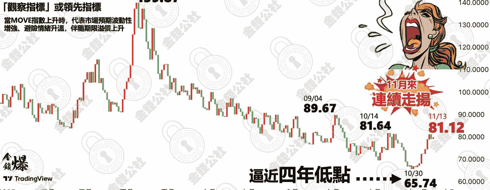

逼近四年低點……▶

11月來  
連續走揚

2025　二月　三月　四月　五月　六月　七月　八月　九月　十月　十一月　十二月

截至11/14，甲骨文的「違約保險」（CDS）費用在市場上瘋狂飆漲，創3年新高！

其他包括亞馬遜、微軟、Google、軟銀、CoreWeave的CDS同樣走高，市場認為他們「還不出錢」的風險正在急劇升高。

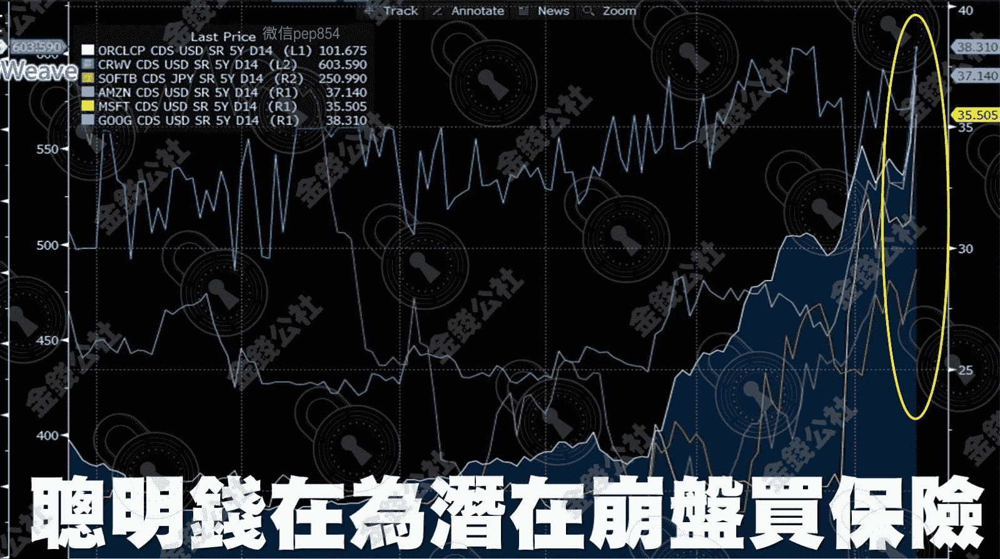

# 美男錢任宰潛任規盤具保險

11/14，由CoreWeave公司發行、票面利率9.25%、到期日為2030年的公司債，價格大跌，創下發行以來最低。

按照目前價格計算，債券殖利率已達10%以上，對比其票面利率9.25%，顯示市場要求額外補償，反映高風險。

市場已將該債券視為等同於「CCC級」信用評等，屬於高度投機的垃圾等級債券，低於發行時的BB-級。

| Bond Ratings | |
|---|---|
| Issuer Rating¹ | BB- |
| Last Rating Action | New Rating on 2025-05-19 |
| Issuer Rating Watch/Outlook | Rating Outlook Positive |
| Issuer Rating² | BB- |
| Last Rating Action | New Rating on 2025-05-19 |

資料來源：X@Convertbond

# Credit vs Term Spread

信用利差收窄，表示額外收益的空間有限。Baa是投資等級的最低等，通常藍線極限就是1.5%～2%，而10年債與2年債利差——但從底部突破0.5%～0.75%，通常伴隨的是衰退週期……

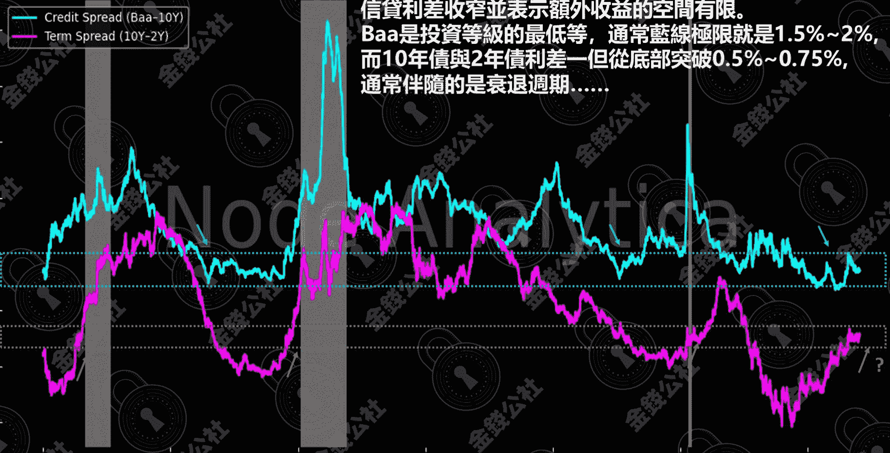

Credit Spread (Baa-10Y)

Term Spread (10Y-2Y)

資料來源：Seeking Alpha

# 美債殖利率曲線

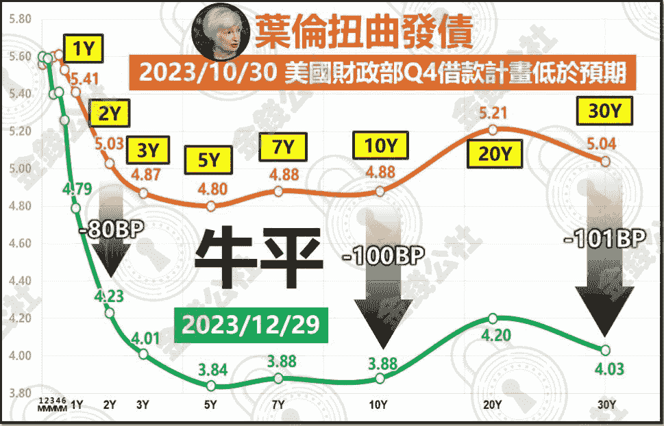

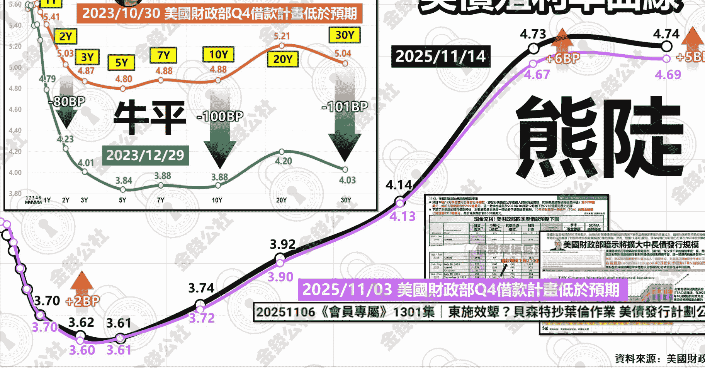

# 2025/11/14

# 2025/11/03 美國財政部Q4借款計畫低於預期

20251106《會員專屬》1301集｜策略有效？貝森特抄葉倫作業，美債發行計劃公布

資料來源：美國財政部
