## 金錢爆金鑽程我是由月之暗面（Moonshot AI）研发的 kimi-k2.7-code 智能大模型。完整版節目資料

## 日經225指數

### 日線

11/04 **52,636**

11/18 **48,661**

> **重挫691點**  
> **收跌2.5%**

> **跌逾1600點**  
> **收跌3.2%**

## 價值（Value）and 價格（Price）

### 誰才是驅動者???

## 台北股市

### 日線

11/04 **28,554**

11/18 **26,756**

20251104（會員專屬）1299集

全球PMI垂死，藥命效應？加密幣跳水，台日韓吞噬。

台股創高收長黑，空頭懸疑是一個重要轉折訊號，包括了日本225指數及韓國綜合指數都同步出現，加上開盤掛單平均買張創下至少兩年以來新低!!

## 韓國股市

### 日線

11/04 **4,226**

11/18 **3,953**

> **跌135點**  
> **收跌3.3%**

## 隔夜美金現貨

### 60分鐘K（10/23以來）

美東時間11/12週二晚間，川普簽署法案重新開放聯邦政府，結束了長達43天的政府停擺。

美東時間11/9週日上午，川普發文表示將發放2000紅包。

11/13 21:00  
4245.220

3886.199  
11/7 02:00

3998.7  
11/10 08:00

# 跌破4000

3997.658  
11/18 15:40

資料來源：Wind（截至2025/11/18 15:40）

2025/10/21

黃金到3,800以上就是一顆破石頭，是個沒有生產力的破石頭；3,800以內是真金白銀，是真實有投資儲蓄價值的。

2025/10/8

我覺得黃金到3,800以上，我覺得貴了，真的就一個破石頭啊。

2025/08/28

黃金怪怪的，從月線看1個月上均1次3400，現在第5次，會不會哪天又突破？

2025/10/20  
4381.484

2025/10/8  
4040

2025/8/28  
3415

2025/11/13  
4245.220

2025/11/14

黃金漲過頭了啦，挖地三尺，也要把黃金挖出來賣掉。

3997.658  
11/18 15:40

## 日K（今年7月以來）

解救全理富

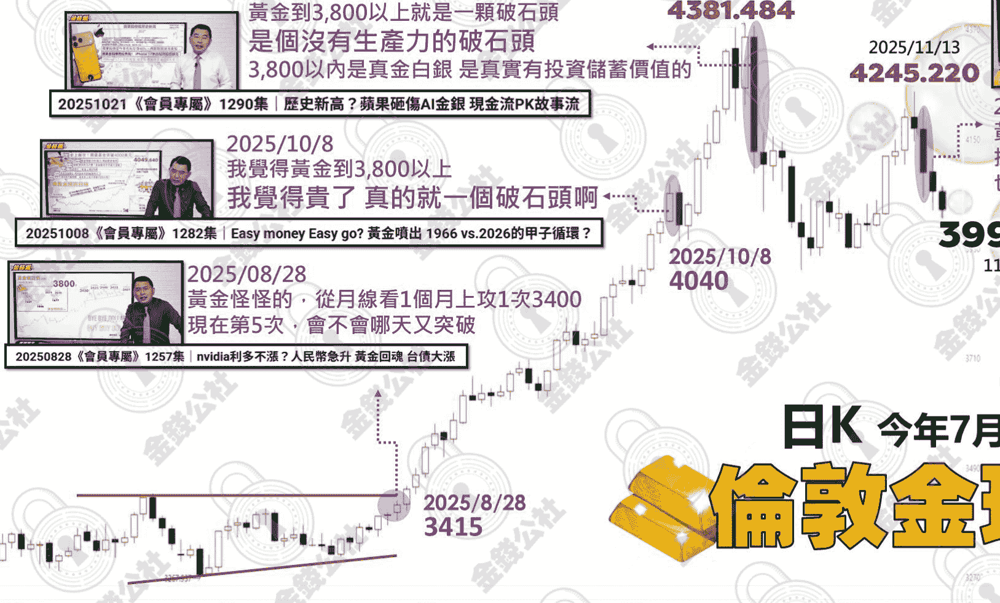

資料來源：Wind（截至2025/11/18 15:40）

## 巴菲特指標 = \frac{美股總市值}{美國國內生產毛額（GDP）} = \frac{70.18}{30.99} = 226.4%

## 嚴重高估

根據代表美股總市值的威爾希爾5000指數計算，截至11/17，美國股市總市值來到70.18兆美元，較上週五11/14市值70.89兆蒸發7100億。按此計算出巴菲特指標為226.4%，較歷史最高的233.7%回落7.3%，但仍比歷史趨勢線高出2個標準差以上。

歷史最高 233.7%（2025/10/31）

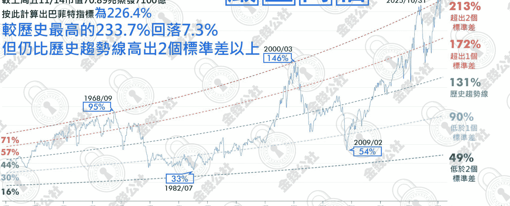

圖中標示：1968/09 95%；1982/07 33%；2000/03 146%；2009/02 54%。

右側區間標示：213%（超出2個標準差）、172%（超出1個標準差）、131%（歷史趨勢線）、90%（低於1個標準差）、49%（低於2個標準差）。

| 大佬交集團 | 市值/GDP | 市值（兆美元） | GDP（兆美元） | Wilshire 5000指數 | Wilshire指數跌幅（%） | 標普500指數 |
|---|---:|---:|---:|---:|---:|---:|
| 2025/11/17 | 226.4% | 70.18 | 30.99 | 66357.87 | — | 6672.41 |
| 超出2個標準差 | 213% | 66.01 | 30.99 | 62385.20 | -5.99 | 6272.95 |
| 超出1個標準差 | 172% | 53.30 | 30.99 | 50284.35 | -24.22 | 5056.19 |
| 歷史趨勢 | 131% | 40.60 | 30.99 | 38183.49 | -42.46 | 3839.42 |
| 低於1個標準差 | 90% | 27.89 | 30.99 | 26082.63 | -60.69 | 2622.66 |

## 好大的泡沫

## 標普500指數（週線／2018年以來）

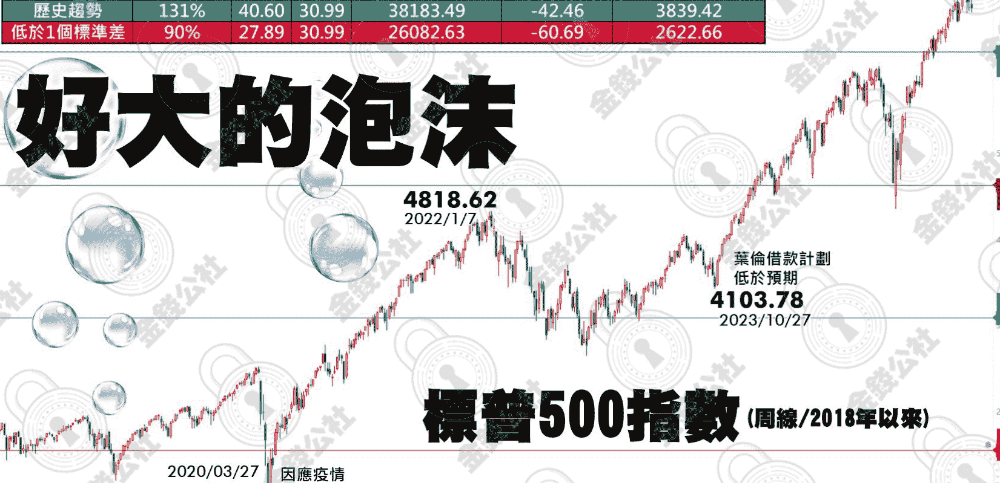

2025/11/17收盤  
6672.41

2025/10  
6920.34

跌回2個標準差  
指數要跌5.99%  
6272.95

跌回1個標準差  
指數要跌24.2%  
5056.19

跌回均值  
指數要跌42.5%  
3839.42

跌回1個標準差以下  
指數要跌60.7%  
2622.66

4818.62  
2022/1/7

孟倫借款計劃  
低於預期

4103.78  
2023/10/27

2020/03/27  
2191.86  
因應疫情  
通過2兆美元刺激

資料來源：WIND

## 估值模型｜周期調整市盈率

本益比是股票價格除以公司每股年盈餘的比率。本益比成為衡量投資人需要多少年才能從初始投資中收回本金的標準。為了避免經濟周期波動影響，導致較大波動性，使用「周期調整市盈率」（CAPE），也就是當前股價除以過去10年的平均盈利。

根據Current Market Valuation模型，從2015年後，標普500指數大多時間都是高估，其中有2段時期更是「嚴重高估」。截至2025/11/14，標普500指數10年本益比為38.8，這高於長期均值（20.6）88.2%，相當於高出2.2個標準差。

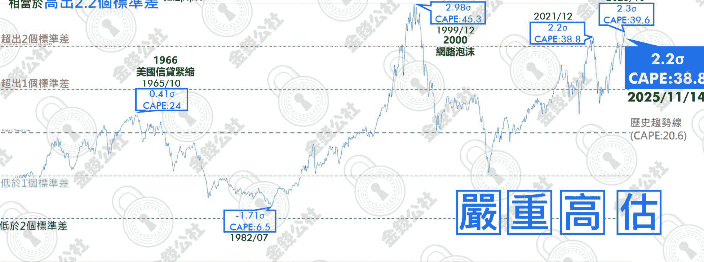

1965/10：0.41σ，CAPE: 24；1966 美國信貸緊縮

1982/07：-1.71σ，CAPE: 6.5

1999/12：2.98σ，CAPE: 45.3；2000 網路泡沫

2021/12：2.2σ，CAPE: 38.8

2025/10：2.3σ，CAPE: 39.6

2025/11/14：2.2σ，CAPE: 38.8

歷史趨勢線（CAPE: 20.6）

嚴重高估

資料來源：currentmarketvaluation

## 估值模型

## 市銷比 = 市值（股價 × 流通股數）／年營收

市值營收比是將公司的股票價格與營收進行比較，顯示投資人願意花多少錢去買該公司未來的每1元營收。

根據Current Market Valuation網站，它將市銷比運用在標普500指數上。

在過去15年間，股價上漲的速度遠快於實際年營收的增長。

截至2025/11/14，標普500指數市銷率為3.2，比正常值高出2.5個標準差。

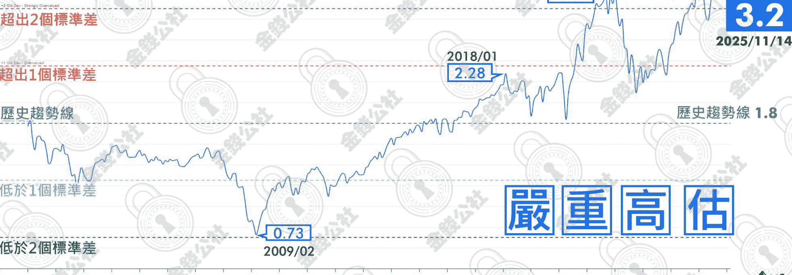

超出2個標準差

超出1個標準差

歷史趨勢線

低於1個標準差

低於2個標準差

2000年至今

2021/12：3.04

2018/01：2.28

2009/02：0.73

2025/09：3.3

3.2  
2025/11/14

## 嚴重高估

資料來源：currentmarketvaluation

S&P 500 Price to Sales Ratio

## Global Equity Views – Investing in Diversification

## 全球股市長期不安

資料來源：Goldman Sachs

## 12個月遠期本益比（按MSCI各區指數）

四分位距  
Interquartile Range

中位數  
Median

當前  
Current

第10－第90百分位數  
10th - 90th percentile

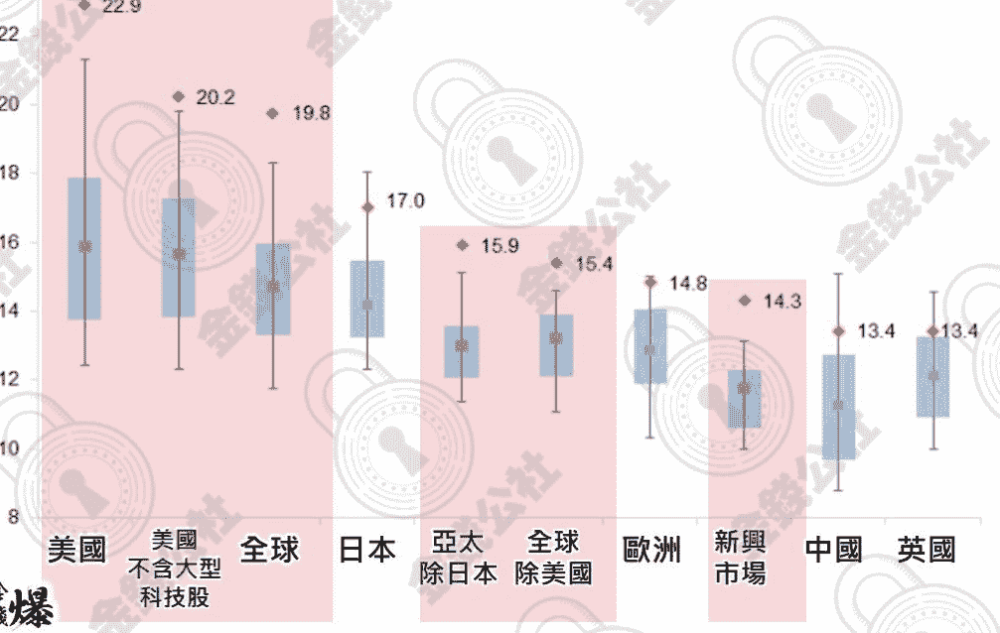

## 亞洲股市12個月遠期本益比（當前VS.10年區間）

12M forward P/E (X)

高／低區間  
正負1個標準差  
▲ 當前  
□ 一週前

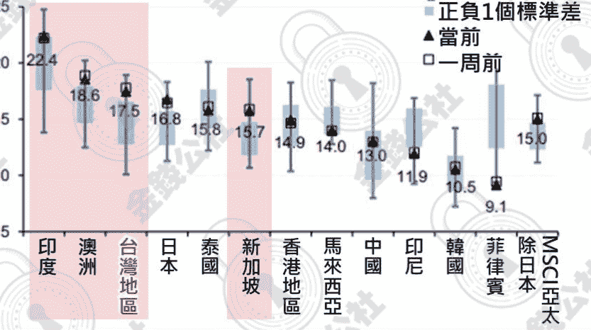

## 亞洲股市過去12個月股價淨值比（當前VS.10年區間）

12M trailing P/B (X)

高／低區間  
正負1個標準差  
▲ 當前  
□ 一週前

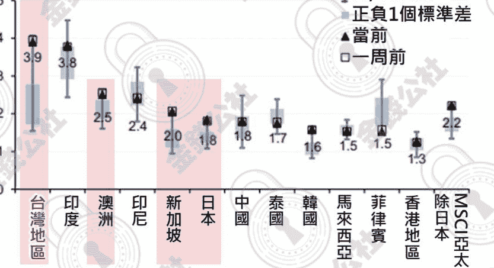

## THE WALL STREET JOURNAL.

Bitcoin Drops Below $92K, Wipes Out 2025 Gains

## 比特幣2025年漲幅全數吐回…

比特幣18日持續近日的跌勢，並一口氣跌破9萬美元重要關卡，低至89,200美元附近，過去24小時下跌逾5.5%，也使今年迄今的表現來到約下跌3%。

距離12.6萬美元歷史高點已有29%差距，進入下跌逾20%的「技術性熊市」定義。

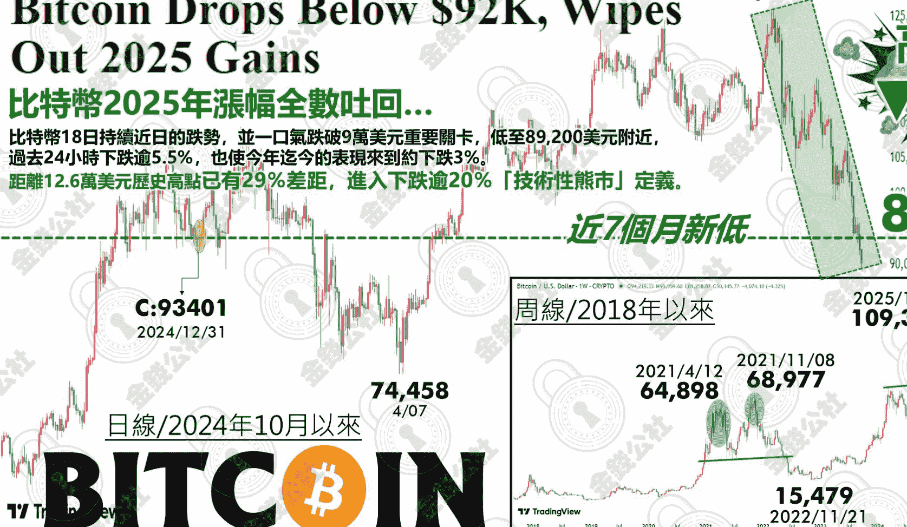

## 高點來 ↓29%

11/18  
89,258

C:93401  
2024/12/31

日線／2024年10月以來

## BITCOIN

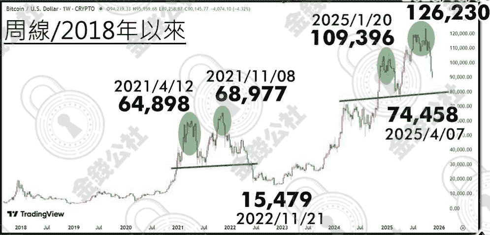

2025/10/06  
126,230

2025/1/20  
109,396

2021/11/08  
68,977

2021/4/12  
64,898

74,458  
2025/4/07

15,479  
2022/11/21

## 聯發科・日・TWSE

## 台股電子三熊

9/17 H:1545

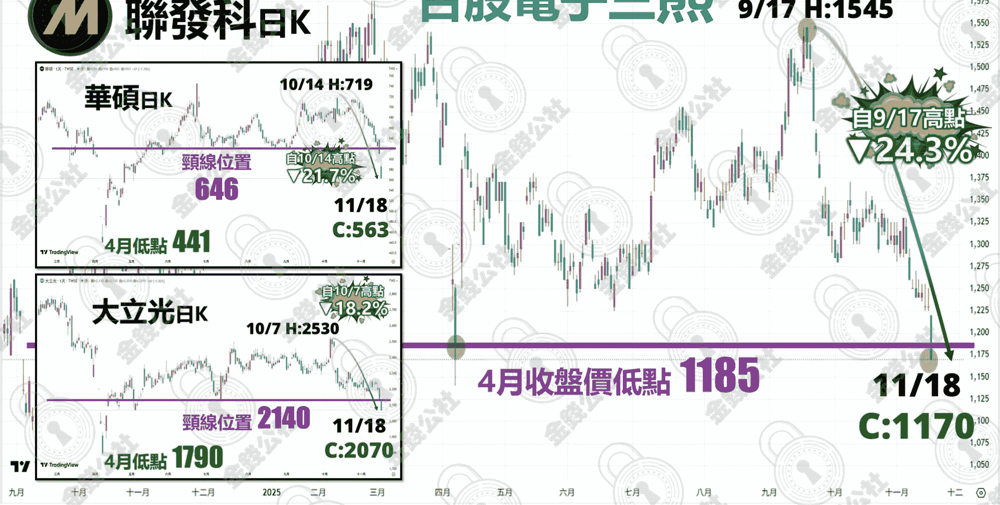

## 華碩日K

10/14 H:719

頸線位置 646

自10/14高點  
▽21.7%

11/18  
C:563

4月低點 441

## 大立光日K

自10/7高點  
▽18.2%

10/7 H:2530

頸線位置 2140

11/18  
C:2070

4月低點 1790

4月收盤價低點 1185

自9/17高點  
▽24.3%

11/18  
C:1170

## 美國電塔

（AI、雲端伺服器的根基）

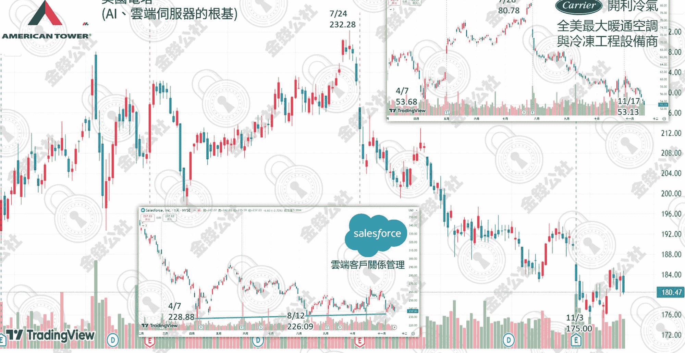

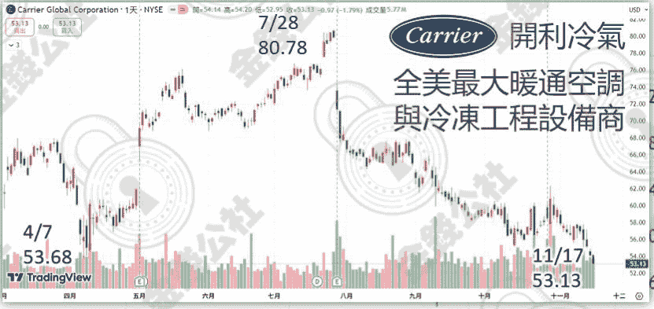

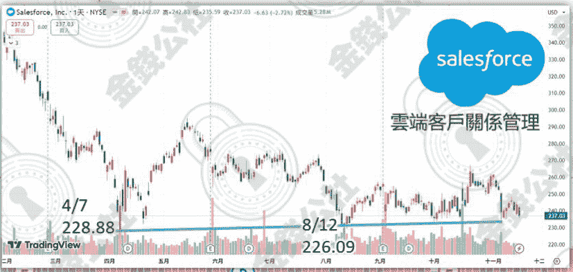

## T-Mobile美K（今年以來）美國電信三強

市值：2412億

4月低點 230.64

8/20 H:261.56

自8/20高點  
▼17.2%

11/17  
C:215.84

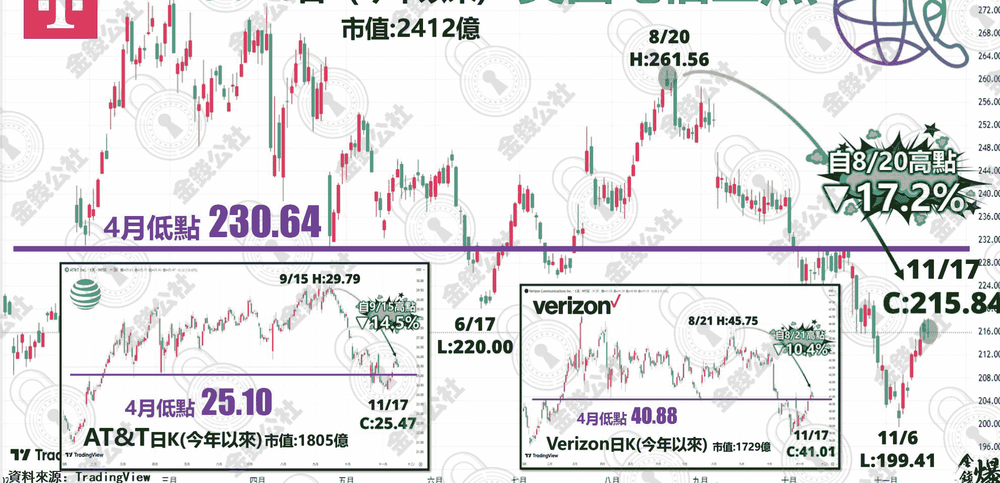

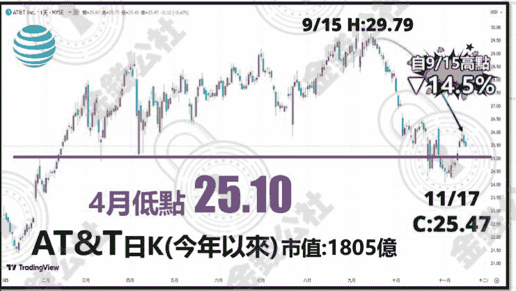

9/15 H:29.79

自9/15高點  
▼14.5%

4月低點 25.10

11/17  
C:25.47

AT&T日K（今年以來）市值：1805億

6/17  
L:220.00

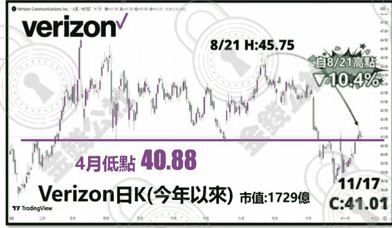

8/21 H:45.75

自8/21高點  
▼10.4%

4月低點 40.88

11/17  
C:41.01

Verizon日K（今年以來）市值：1729億

11/6  
L:199.41

資料來源：TradingView

## 戴爾看好 AI伺服器需求，上調未來四年財測

10/7盤後，戴爾上調未來四年的財務成長目標，預估年營收將以7%至9%成長，激勵10/8漲逾9%。

## 高通AI200晶片亮相！股價飆逾11%

10/27，高通宣布推出新一代人工智慧AI加速晶片，將正式進軍資料中心領域，挑戰輝達與超微主導的AI晶片市場。當日盤中股價一度飆漲20%……

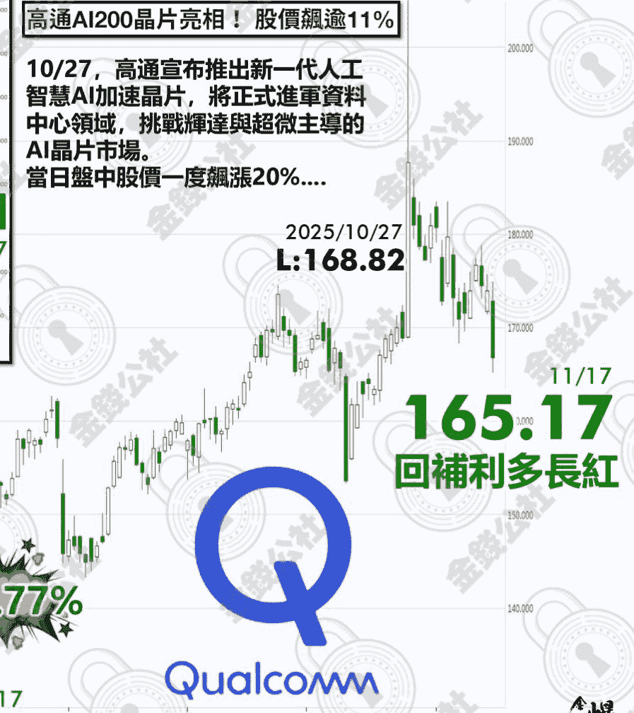

## AI助威，惠普財報優於預期

8/28盤後，惠普稱財報優於預期，主要受惠於人工智慧PC需求增長，激勵8/29漲逾5%。

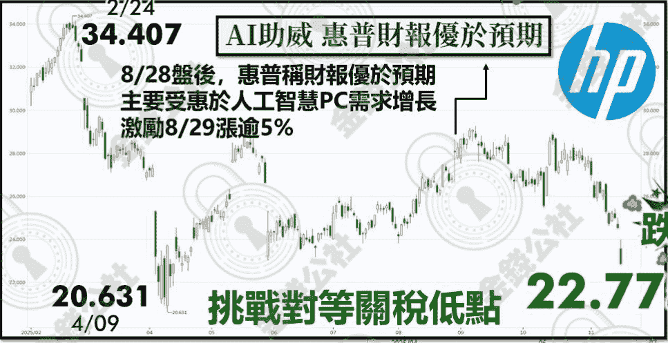

## 亞馬遜加入科技股發債行列

Amazon Joins Jumbo Debt Offering Spree

Company's US dollar bond sale is the fifth largest for 2025

| Company | US dollar bond offerings |
|---|---:|
| Meta | $30B |
| Mars | $26B |
| Oracle | $18B |
| Google | $18B |
| Amazon | $15B |

11月3日與OpenAI簽署一份為期7年、價值380億美元的算力租約。

10月31日：財報優異

10月28日：裁員1.4萬人

2025/11/17 232.89

2025/10/30 222.75

## 亞馬遜啟動近3年來首次美元公司債發行計畫

亞馬遜發美元債籌資150億美元，跟進AI發債潮｜

三年首度發債，亞馬遜150億美元為AI「輸血」

美國證券交易委員會（SEC）11月17日提交的文件披露：

- 亞馬遜啟動美元投資級債券發行，籌資150億美元，比預估高出30億美元，計劃分六期發行。
- 一度有800億美元認購，但隨著利差下滑，最終認購規模少了一半。
- 募集資金將用於多種用途：收購、AI資本支出、股票回購、到期債務償還。
- 自2022年（籌資82.5億美元）以來，亞馬遜首次恢復以美元融資。
- 高盛、摩根大通和摩根士丹利共同負責此次債券發行。

單日跌1.22%

高盛也來跌10%

amazon

## 值得關注的是，亞馬遜新債的利差全面高於之前既有的債券曲線，顯示投資人要求更高的信用補貼，期限越長，利差提升越大。

## 最新亞馬遜債券利率與國債的利差

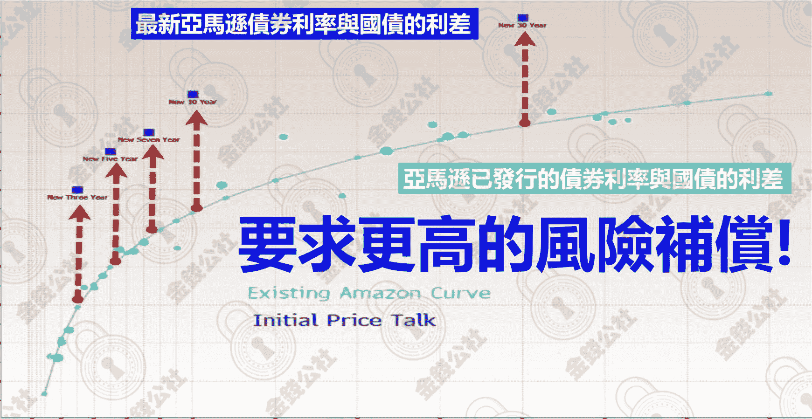

## 亞馬遜已發行的債券利率與國債的利差

## 要求更高的風險補償！

Existing Amazon Curve

Initial Price Talk

資料來源：Zerohedge

## Amazon: 10-Year Total Free Cash Flow is Just $114 Billion

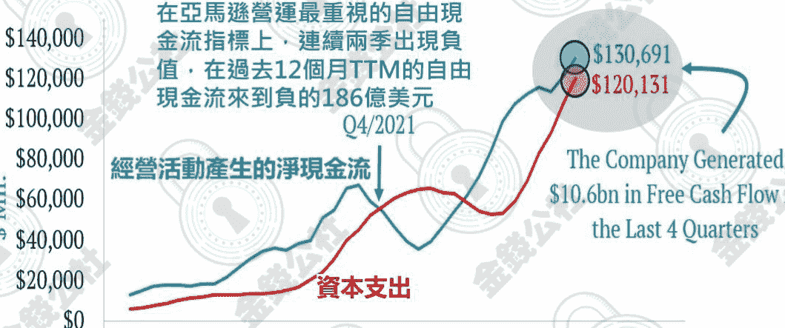

在亞馬遜營運最重視的自由現金流指標上，連續兩季出現負值，在過去12個月TTM的自由現金流來到負的1.86億美元。

經營活動產生的淨現金流

資本支出

## Amazon, Cumulative Free Cash Flow, Q3/2015 - Q3/2025, $ Bil.

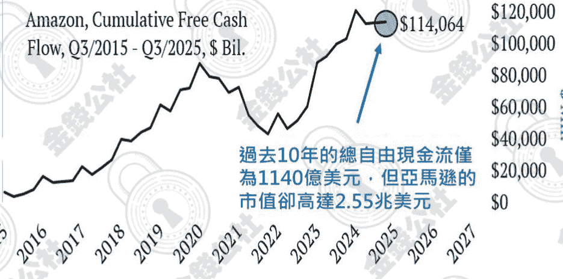

過去10年的總自由現金流僅為1140億美元，但亞馬遜的市值卻高達2.55兆美元。

> 摩根大通指出，亞馬遜之前主要依賴自身現金流為投資提供資金，當前正是其將債券納入資本結構、提升融資靈活性的「適宜時機」。

- 但亞馬遜2025年資本支出預計約1250億美元，2026年資本支出將近1500億美元，比2023年增長近三倍。
- 如果亞馬遜的資本支出繼續這樣快速成長，可能很快就會出現自由現金流為負的情況，就像2021年底一樣。屆時還能為投資注入資金嗎？……

## 沒錢還怎麼投資？

## 亞馬遜的資本支出爆炸

Company's capital spending seen near $150 billion in 2026

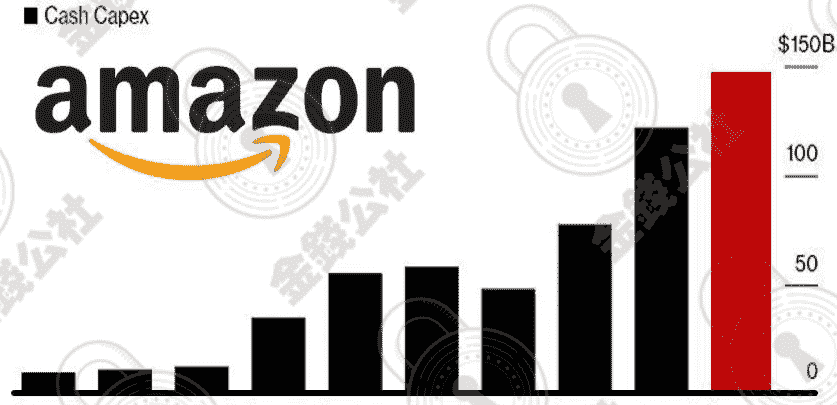

資料來源：Bloomberg、Refinitiv

## AI狂潮下航骸的美國人!?

3/10 147.60

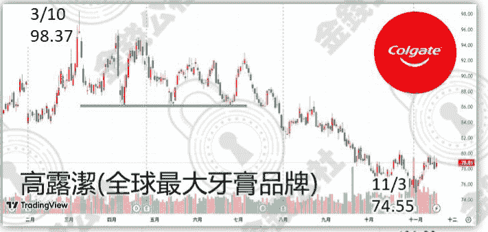

3/10 98.37

11/3 74.55

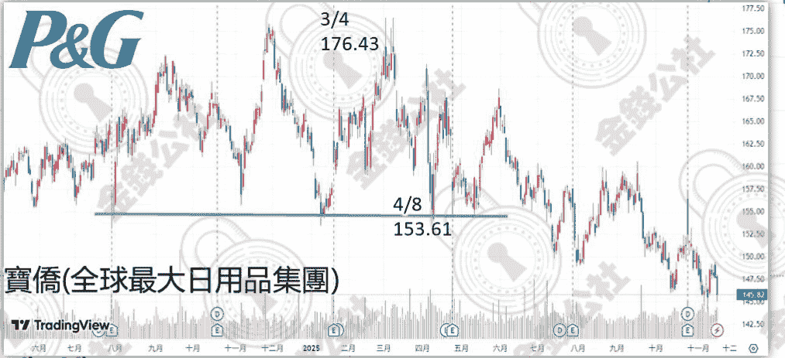

3/4 176.43

4/8 153.61

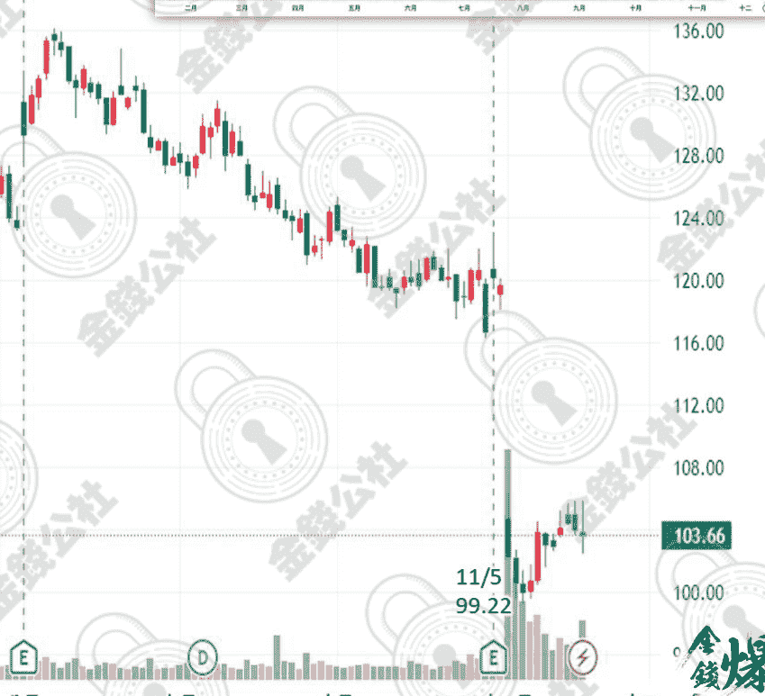

11/5 99.22

每個月13日發布的北美貨運量衡量指標—卡斯貨運指數，暴跌至新冠疫情以來的最低水位。10月份，出貨量較上月下降4.3%，年減幅從9月的5.4%擴大至7.8%，主因為需求持續空洞，疊加上運費上漲，愈來愈多零售業者將貨物整併為整車運輸。

# Cass Freight Index® - Shipments

January 2010 - October 2025 (01'1990=1.00)

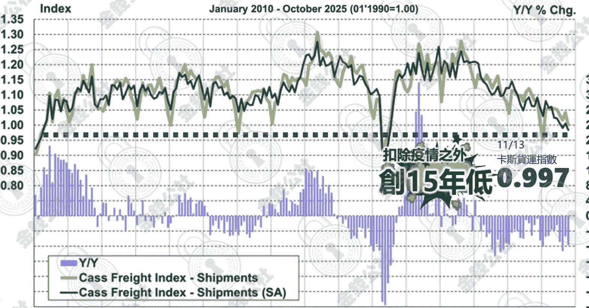

指標：Index；右軸：Y/Y % Chg.

圖中標註：扣除疫情之外，創15年低點0.997；11/13 卡斯貨運指數

- YY
- Cass Freight Index - Shipments
- Cass Freight Index - Shipments (SA)

Source: Cass Information Systems, Inc., ACT Research Co. © 2025
