# 金錢爆金鑽梗

完整版本節目資料

# 中日利差史上最窄

中國債殖利率降至歷史最小，再次引發人們對「日本化」擔憂，中國10年期國債殖利率恐將跌到比日債更低的水平，開啟歷史性的交叉。

### 中日利差（2002年以來）

中國10年期國債殖利率掉至2個月最低

2025/11/19

1.815%

1.781%

日本10年期國債殖利率飆至17年高，創自2008年6月次貸風暴以來最高

2025/11/19

中日利差

3BP

資料來源：bloomberg

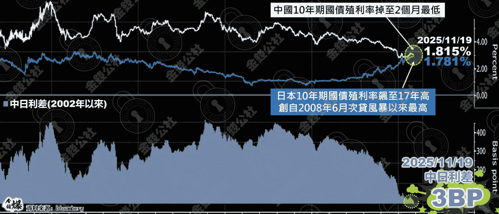

# 日債拋售潮愈演愈烈：10年期殖利率創金融危機來新高，20年期拍賣需求疲軟

11/19，作為市場基準的日本10年期國債殖利率攀升3個基點至1.781%，創2008年6月金融危機以來最高。拋售壓力迅速蔓延至長債，40年期國債殖利率更是觸及歷史高。

加劇市場悲觀情緒的是，當日的20年期國債拍賣顯示投資者需求疲軟，此次拍賣投標倍數從上月的3.56降至3.28。更關鍵的是「尾部利差」從10月的0.13擴大至0.31。尾部利差擴大常被視為需求疲軟信號。

拍賣結束後，20年期國債殖利率報2.795%，接近1999年以來最高。

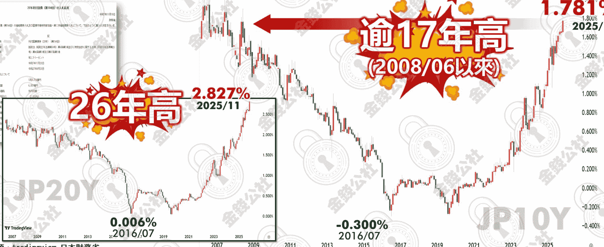

資料來源：tradingview、日本財務省

# 經濟降溫高複期

2025年11月14日，中國國家統計局發布一系列疲弱10月經濟數據，零售銷售、今年前10月固定資產投資與工業增加值，皆創逾1年來最低增速，房價也全面緩跌。路透報導評論，每月相關數據都在惡化，經濟短期內幾乎無望翻轉，讓決策者面臨巨大壓力。

國際貨幣基金組織（IMF）在10月份呼籲中國通過財政措施「重新調整」經濟結構，使其向消費型經濟傾斜。

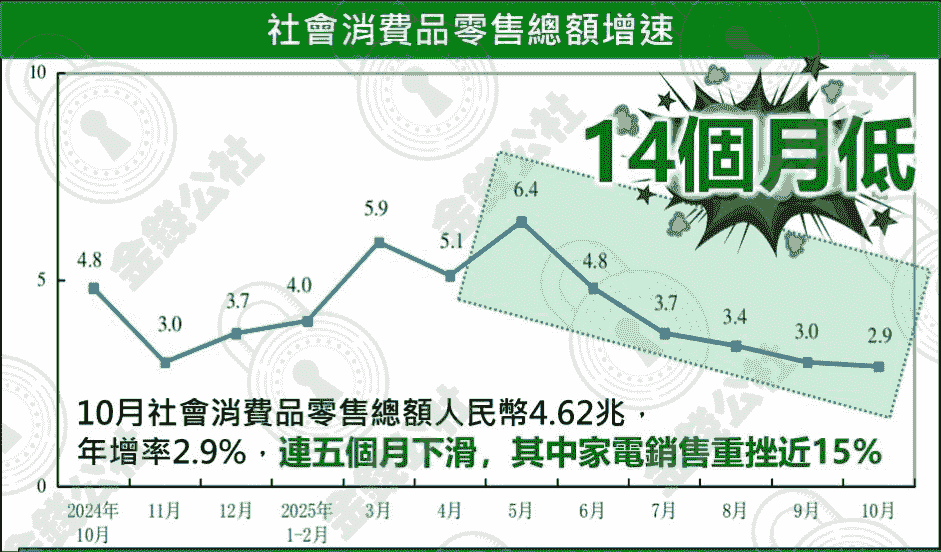

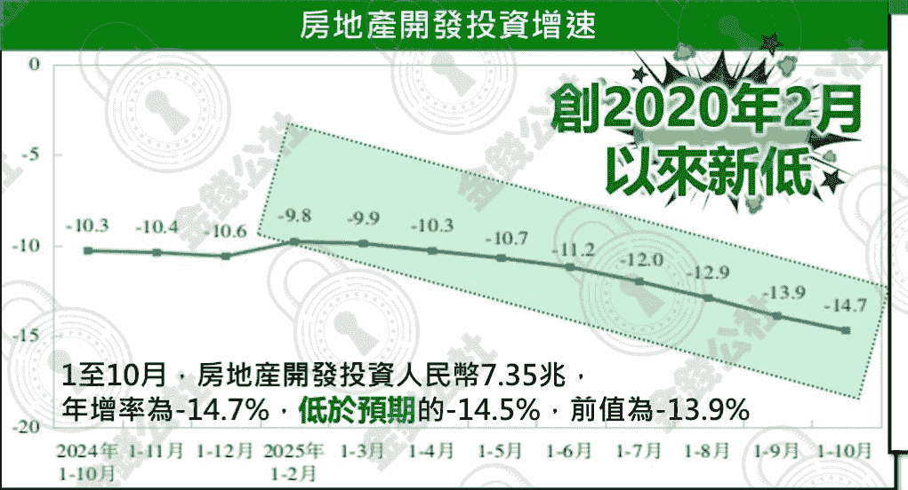

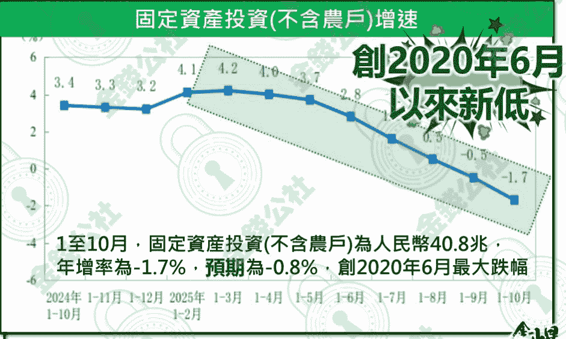

# Is China's economy facing Japanification?

高盛中國研究小組報告中寫道，人口結構惡化、債務負擔和資產泡沫破裂都是日本在世紀之交陷入困境的重要因素，但導致日本化的一個關鍵因素是長期增長預期的根本變化。

報告顯示，中國增長預期有下行跡象，中國還在應對日益惡化的人口結構、債務負擔和房地產市場萎縮。

高盛資料顯示，從某些方面來看，中國的形勢甚至比30年前的日本還要糟糕。首先，中國的粗出生率（一年中活產人數與年中總人口之比）進一步下降到2022年降至0.75%，遠低於日本1990年的0.99%，可能還沒有觸底。

中國的城市住宅空置率約為20%，是1990年日本9%的兩倍多。中國的房價與家庭收入之比更為離譜，為20倍，而1990年日本為11倍。考慮到1990年住宅投資占中國GDP的比重是日本的兩倍，「房地產市場低迷」對中國實體經濟的直接影響將比日本更大。

### In 2023, China shows more symptoms of "Japanification" than before the pandemic

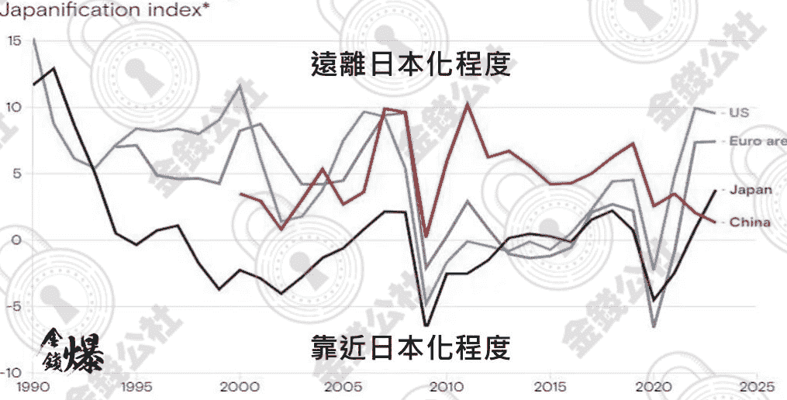

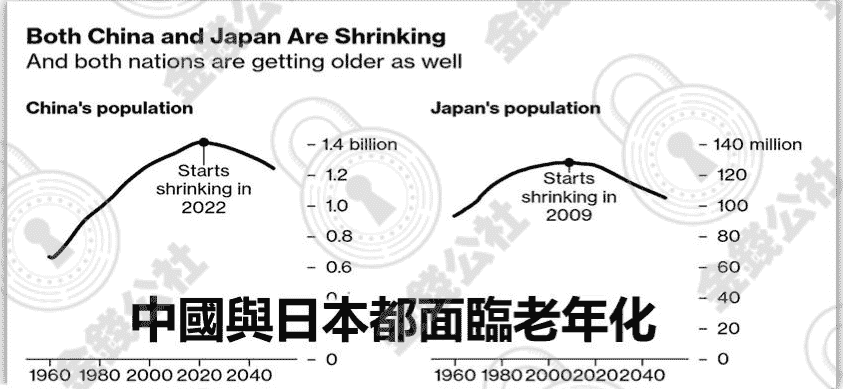

### 中國與日本都面臨老年化

#### Exhibit 4: A remarkably similar path for China a quarter of a century later

#### 中國走向了與日本經濟相同道路

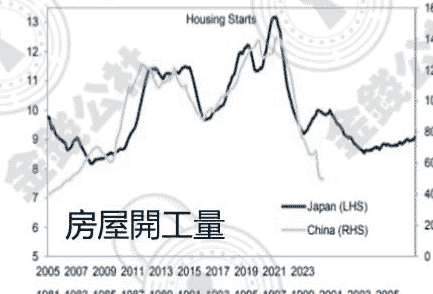

#### 信貸佔GDP比率

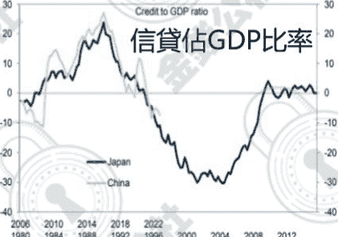

# 中國信貸脈衝 China Credit Impulse

10月份信貸狀況進一步惡化。新增社會融資季增年率放緩至7.9%，導致信貸脈衝降至2024年7月以來最低。

### 中國社融構成拆分（不含股票/季增年率）

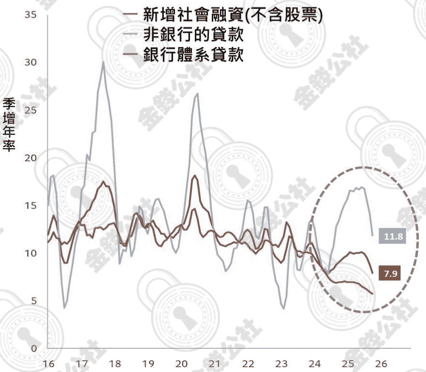

* excluding equity financing

**Entrusted loan, trust loan, bank acceptance bills, net corporate bond

### 中國信貸脈衝 vs. 製造業PMI

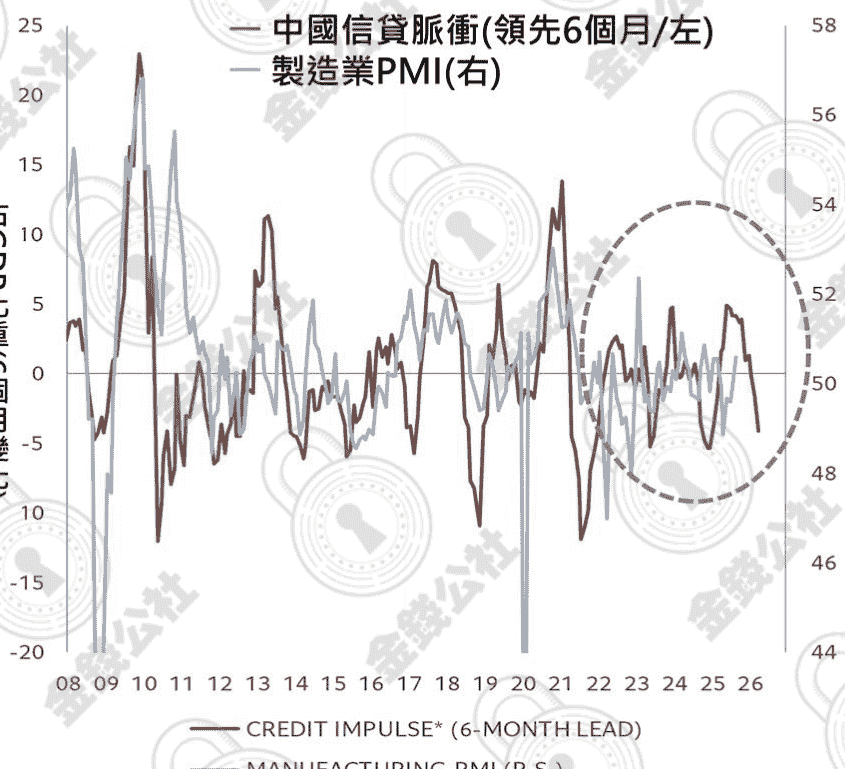

CREDIT IMPULSE* (6-MONTH LEAD)

MANUFACTURING PMI (R.S.)

*6-month change in credit flows (TSF ex-equity)

# Blue Owl fund redemption freeze sparks fresh private credit jitters

# Blue Owl基金贖回凍結 引發新的私募信貸市場動盪

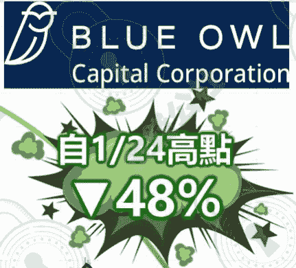

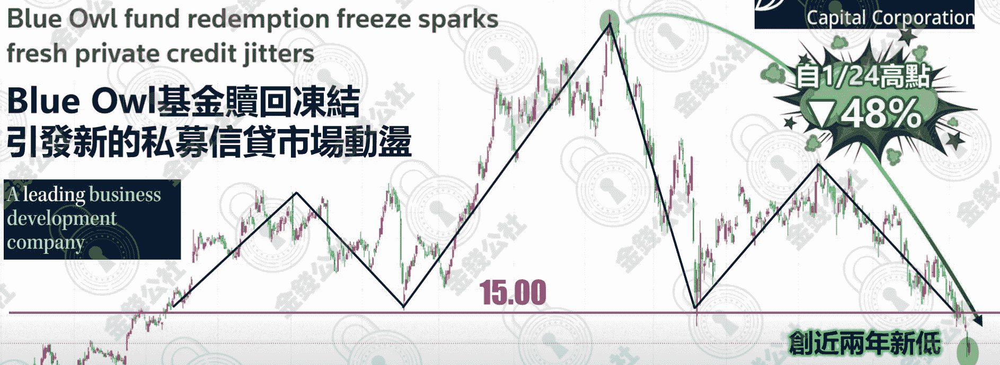

> A leading business development company

2025年11月19日根據路透報導，另類資產管理巨頭 Blue Owl Capital 因暫停旗下18億美元場外基金贖回，並將投資人的資金鎖定至明年，週一股價暴跌6%。

該公司計劃將場外基金與上市實體合併，但投資者將面臨20%的帳面損失⋯

資料來源：Reuters、TradingView

# Blue Owl 私募信貸基金合併 使一些投資者面臨20%的損失

本月初，Blue Owl計劃將其18億美元的非上市公司Blue Owl Capital Corporation II與管理約176億美元的已上市公司 Blue Owl Capital Corp. (OBDC.N)合併。

文件顯示，Blue Owl (OWL.N)旗下的基金，10月贖回申請激增，遠超過限額，公司最終批准約6000萬美元的贖回，之後凍結了進一步的贖回，直至合併完成……值得注意的是，這與 First Brands和 Tricolor的爆雷事件關聯不大，Blue Owl 並未暴露於此。近期對過熱的擔憂集中在AI領域，而 Blue Owl是其中的主導者……

### BDC（商業發展公司）

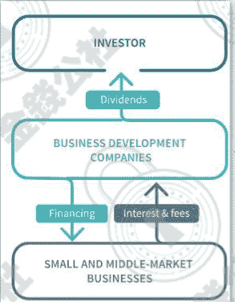

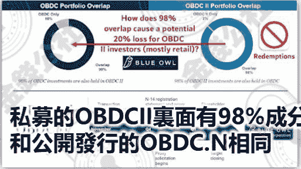

大多數 BDC是封閉式基金，持有貸款組合並在股市交易。BDC將大部分來自其貸款給中小企業的淨收益分配給投資者。

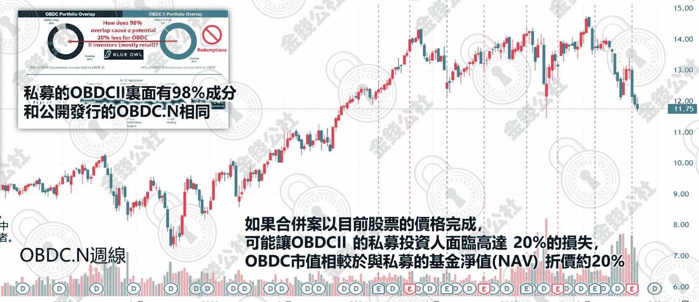

如果合併案以目前股票的價格完成，可能讓OBDC II 的私募投資人面臨高達 20%的損失；OBDC市值相較於與私募的基金淨值（NAV）折價約20%。

### OBDC.N週線

資料來源：FT、TradingView

- Meta與Blue Owl Capital為了Hyperion數據中心開設特殊目的公司，發行273億美元債券。**Pimco購買了約180億**，貝萊德也買了「數十億美元」，其餘則流向險資管理的基金。
- Meta 從其現有的路易斯安那州開發投資組合中，貢獻了土地和在建建築資產（這些資產之前被歸類為持有待售），而 Blue Owl 則提供了約70億美元的現金貢獻。
- Meta還從新合資企業中獲得了約30億美元的一次性分配。

- 標普給Beignet Investor LLC（投資公司）、2049年5月到期的273億債券的評級是「A+」，低於母公司Meta的「AA-」。
- **Meta並未簽署為期20年的數據中心租約，而是與「11幢互相獨立的建築」簽署了一系列可續簽的4年期租約。** 這樣一來，公司就可以將這些租約視為經營租賃，而非長期負債報告的融資租賃。

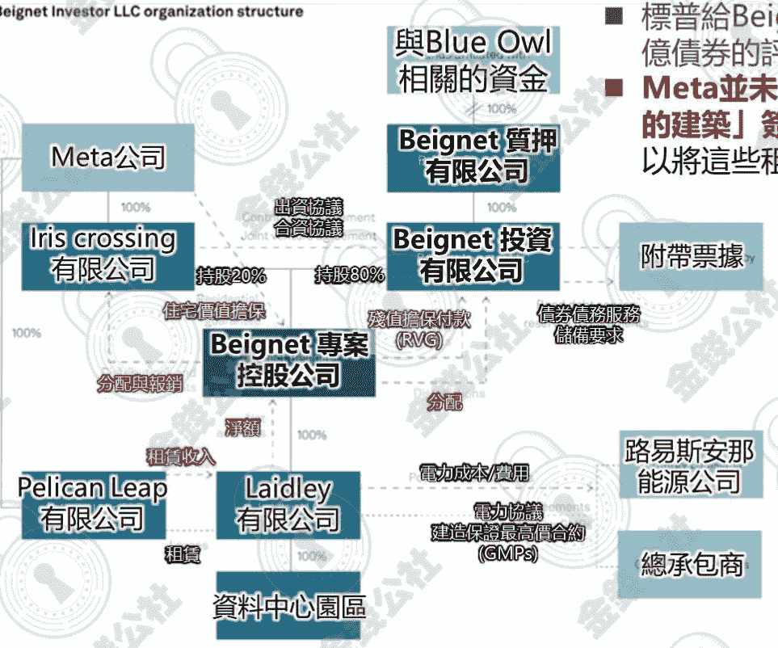

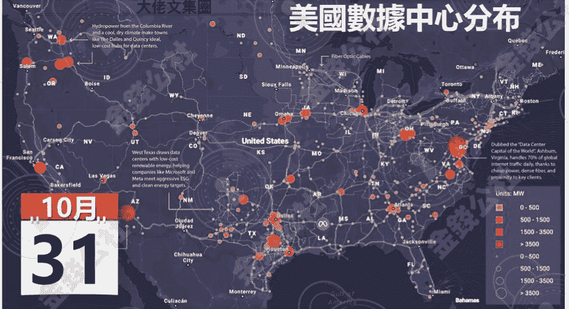

正在路易斯安那州里奇蘭郡建設2GW（全球最大）的超算中心

# Jeffrey Gundlach Warns of 'Garbage Lending' as Private Credit Booms

私募信貸領域存在著「垃圾貸款」的現象，這種情況正在使這個快速成長的市場走上類似2008年金融危機的道路。

> "There's only two prices for private credit—100 or zero," Gundlach said. "It looks like it's safe because you could sell it any day, but it's not safe because the price at which you sell will be gapping lower day after day after day."

私募信貸只有兩種價格——100或0。

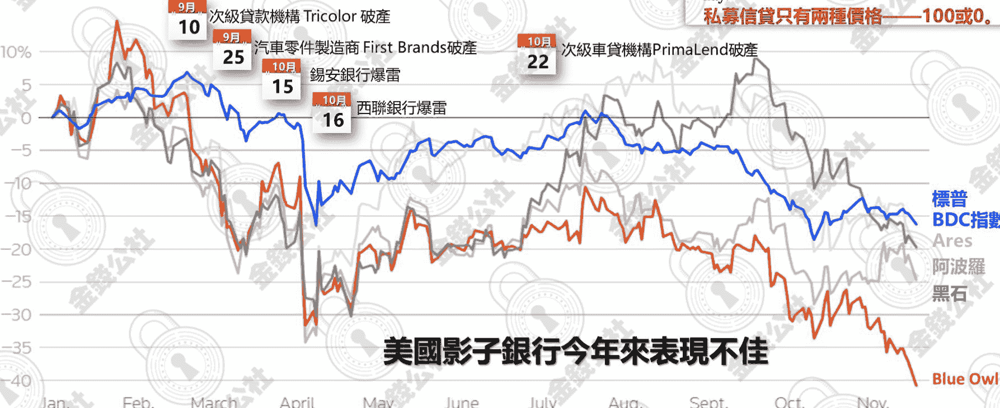

- 9月10日　次級貸款機構 Tricolor 破產
- 9月25日　汽車零件製造商 First Brands 破產
- 10月15日　錫安銀行爆雷
- 10月16日　西聯銀行爆雷
- 10月22日　次級車貸機構 PrimaLend 破產

### 美國影子銀行今年來表現不佳

標普 BDC 指數、Ares、阿波羅、黑石、Blue Owl

資料來源：彭博、路透

# 美國高風險企業正面臨嚴重的貸款困境

根據彭博社最新的報導指出，B級和CCC級貸款價格今年以來下跌-9%，為所有信用資產中表現最差的一類，這些是評級最低的槓桿貸款，通常由負債累累或財務狀況緊張的公司發放，對違約風險上升最為敏感，評級較高的貸款價格相對穩定，全年大致維持在-1%至-2%的區間。因此，垃圾級貸款與投資級債券的績效差距已經擴大到約8個百分點……

### Riskiest Loans Under Pressure

The most poorly rated cohorts continue to lag the rest of the market

- Split BBB and BB Avg Price
- Split BB and B- Avg Price
- Split B/CCC-rated loans - Avg. Price

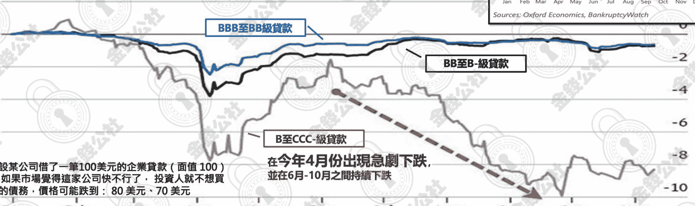

#### BBB至BBB級貸款

#### BB至B-級貸款

#### B至CCC級貸款

在今年4月份出現急劇下跌，並在6月-10月之間持續下跌。

假設某公司借了一筆100美元的企業貸款（面值100），如果市場覺得這家公司快不行了，投資人就不想買它的債務，價格可能跌到：80美元、70美元。

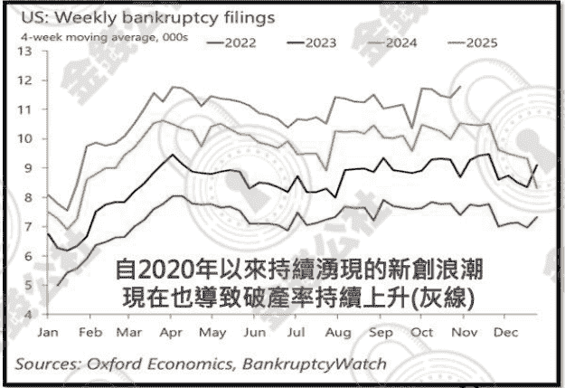

Source: Bloomberg

Data is normalized with percentage appreciation as of December 31, 2024.

資料來源：彭博社

# Office CMBS Delinquency Rate, %

2025年11月1日，根據追蹤和分析商業抵押貸款支持證券（CMBS）的 Trepp 數據顯示，…

### 10月CMBS辦公抵押貸款違約率飆升至11.8%，創歷史新高

比金融危機爆發時的峰值高出一個百分點以上。

CMBS：是出售給世界各地機構投資者的債券，例如養老基金、保險公司、退休基金、房地產投資信託基金等。

發放這些抵押貸款的銀行無需承擔責任，投資者則承擔損失。

Recession

Financial Crisis

Oil Bust

2022年10月：違約率 1.8%

2025/10 辦公大樓商業抵押貸款擔保證券 11.8%

12% 11% 10% 9% 8% 7% 6% 5% 4% 3% 2% 1% 0%

2000 2001 2002 2003 2004 2005 2006 2007 2008 2009 2010 2011 2012 2013 2014 2015 2016 2017 2018 2019 2020 2021 2022 2023 2024 2025

2025年11月5日，紐約聯邦儲備銀行發布的《家庭債務和信貸季度報告》顯示，Q3家庭總債務增加了1,970億美元，達到18.59兆美元……其中，7月至9月期間，逾期30天以上的學生貸款逾期率攀升至14.4%，創歷史新高；汽車貸款逾期率創2010年以來最差水平，而政府將恢復對學生貸款違約者的薪資扣押，表示將會有近200萬人的薪資會受到影響……也就是說，在聖誕節前，有數十億美元的消費支出會被削減……

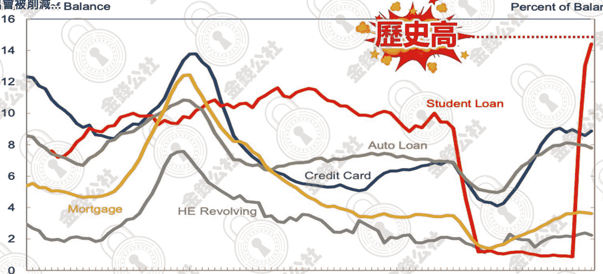

### 歷史高

| 類別 | 2025/Q3 拖欠率 |
|------|----------------|
| 學生貸款 | 14.4% |
| 信用卡貸款 | 7.1% |
| 汽車貸款 | 3.0% |

Student Loan

Auto Loan

Credit Card

Mortgage

HE Revolving

Source: New York Fed Consumer Credit Panel/Equifax

Note: 4 Quarter Moving Sum

Student loan data are not reported prior to 2004 due to uneven reporting

# 私募信貸資產管理規模（AUM）的持續擴大

### 發生系統性風險最有可能的來源

市場預測：根據 Fitch Ratings 和 Preqin 的數據，全球私募信貸 AUM 預計在 2029 年達到約 2.8兆至3兆美元。

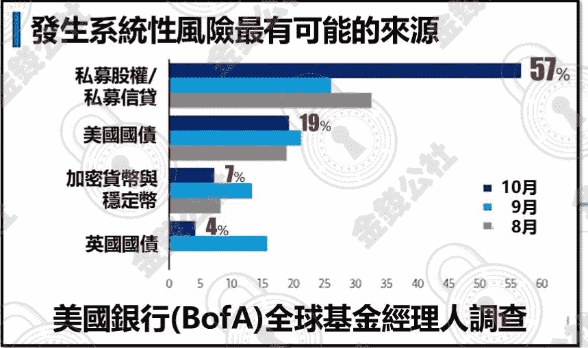

美國銀行（BofA）全球基金經理人調查

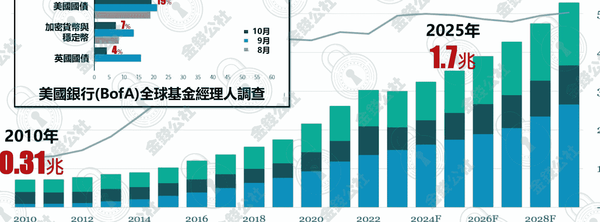

2010年 0.31兆

2025年 1.7兆

資料來源：BofA GLOBAL RESEARCH、Fitch Ratings、Preqin

# 百度首次披露AI業務收入 增速50%超預期

# 百度集團三季度AI業務收入同比增速超50% 展現強勁增長勢頭

# 百度CFO何海建：2023年以來已向AI投入超1000億元

# 百億AI收入首次披露 無人駕駛加速發力 百度的重估時刻到了？

2025年11月18日港股盤後，百度公佈2025年第三季財報（截至9月30日）。其中，百度公佈了與AI相關的總收入達到約100億人民幣，年增率達50%。這是首次披露AI收入，看得出來公司急切想撕掉傳統標籤、全面開講AI新故事的決心!!

根據財報顯示，AI收入由三部分構成：

- AI雲基礎設施：收入42億人民幣，年增率33%。其中，基於AI加速器基礎設施的訂閱式收入年增率128%，顯示出市場對算力需求的強勁。
- AI原生行銷服務：收入28億人民幣，年增率262%。表明AI技術正在重塑廣告投放與轉化效率...
- AI應用：收入26億人民幣，年增率6%。

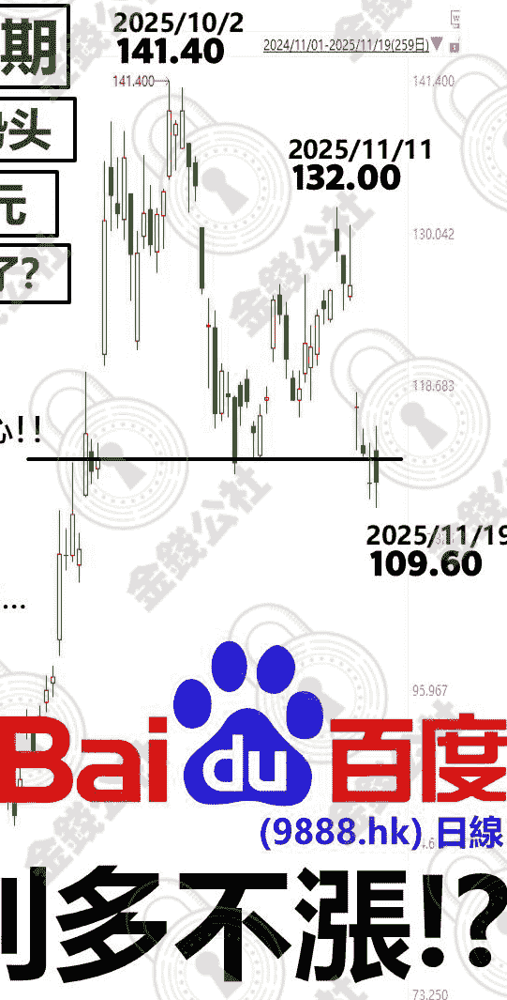

儘管百度積極加碼人工智慧（AI）、雲端與自動駕駛等新興項目，但轉型過程仍面臨市場競爭加劇與成本攀升等多重挑戰。2025年第三季營收仍出現上市以來最大跌幅，反映核心廣告業務持續承壓，且資產減損拖累獲利表現。

### 營收整體下滑

總營收為311.74億元，年增率-7%。

其中，不含愛奇藝的核心營收為246.59億元，年增率-7%。

### 利潤由盈轉虧

經營利潤虧損150.91億，淨虧損112.32億，均由盈轉虧。

百度解釋虧損主要來自長期資產減值162億元，說是核心資產組，但具體是什麼也沒公佈。

要注意的是，剔除長期資產減值後，百度核心經營利潤降至12億，表示搜索本業不再撐錢的故事基本上落地!!

### 百度季度淨利潤（億人民幣）

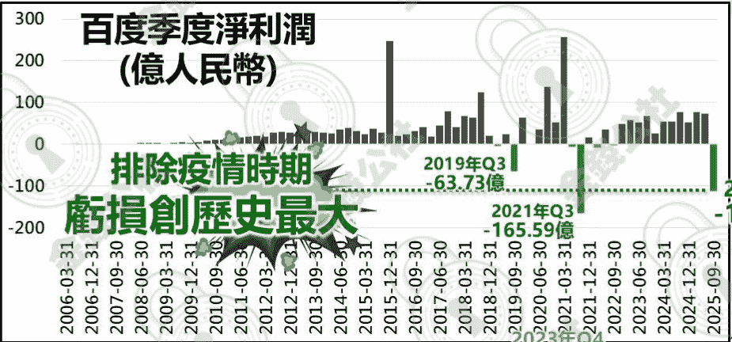

### 營收負增長創歷史最大

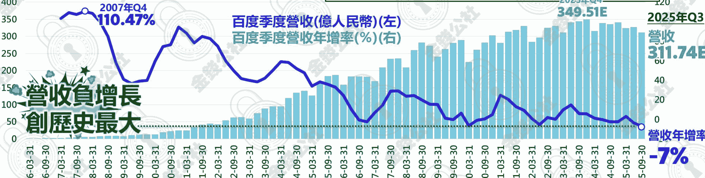

資料來源：百度、WIND

2025年Q3，百度整體在線市場服務營收165.66億人民幣，與去年同期相比下滑17.61%，若扣除2020年Q1疫情時期，創下史上最大跌幅！！！

從百度核心（扣除愛奇藝）看，百度核心收入為人民幣247億元，年增率下滑7%；在線營銷收入為人民幣153億元，年增率下滑18%。

### 營收：在線市場服務

※在線市場服務是百度傳統支柱產業，主要以提供基於搜尋引擎和資訊流的廣告服務盈利。

### 廣告收入年增率 歷史低

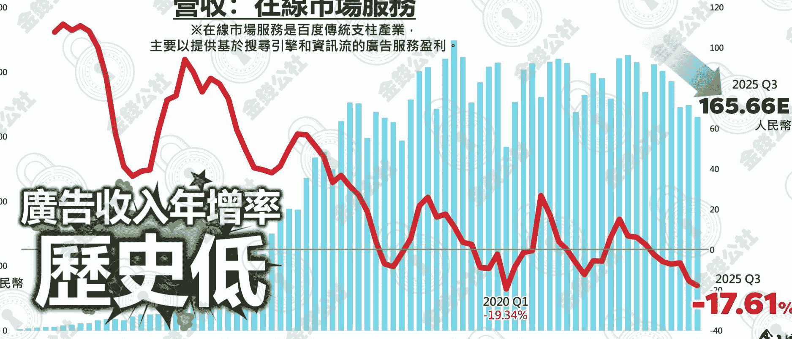

| 時間 | 金額 |
|------|------|
| 2025 Q3 | 165.66E 人民幣 |
| 2025 Q3 年增率 | -17.61% |
| 2020 Q1 年增率 | -19.34% |

資料來源：百度

### 全球廣告支出下調

群邑媒體集團（GroupM）於2025年6月發布新的年中預測表示，在經濟波動和地緣政治壓力下，全球廣告市場持續調整。2025年全球廣告市場增速由7.7%下調至6.0%，預計全年市場規模達1.08兆美元。2026年增速預計維持在6.1%。同時，下調2025—2030年複合年增長率（CAGR）預期，由6.4%下調至5.4%。報告預計，2025年純數位媒體廣告將占全球廣告支出的73.2%（約7900億美元）；若包括流媒體電視、數位戶外和數位平面等傳統媒體的數位衍生管道，這一比例將升至81.6%。

全球最大廣告談判公司之一的MAGNA，在2025年6月的年中預測中指出，2025年全球媒體廣告收入為9790億美元，年增4.9%，低於此前預期的6.1%。純數位媒體的廣告銷售額將成長8%，達到7150億美元（占廣告總銷售額的73%）。

- GroupM（群邑媒體集團）是全球最大媒體傳播事業集團WPP集團旗下的專業媒體投資管理公司。
- WPP集團旗下包括奧美、智威湯遜等公司。

### 2025年全球純數位媒體廣告支出預估約8000億美元

據市場研究機構eMarketer報告，Alphabet廣告收入高達2000億美元，占比達25%。

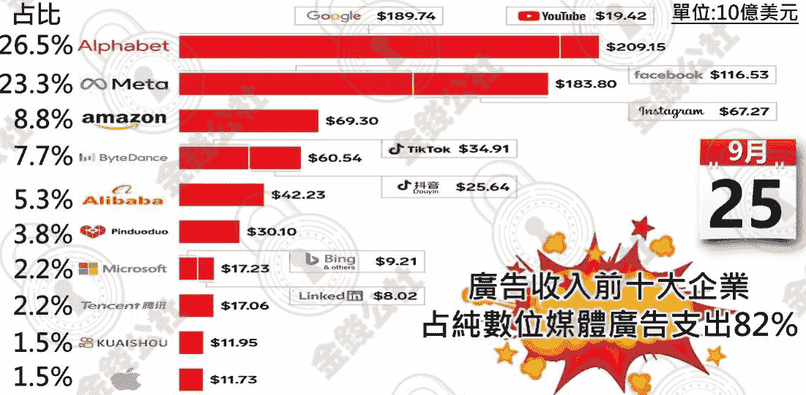

| Net Media Owners Ad Revenues（constant USD bn） | 2024收入 | 2024占比 | 2025增速 | 2025收入 |
|---|---:|---:|---:|---:|
| 全球 | 932 | 100.0% | +4.9% | 979 |
| 歐洲、中東、非洲 | 219 | 23.4% | +5.5% | 230 |
| 北美 | 398 | 42.7% | +4.6% | 416 |
| 拉美 | 28 | 3.0% | +9.8% | 31 |
| 亞太 | 288 | 30.9% | +4.6% | 301 |
| 純數位平台 | 660 | 70.8% | +8.2% | 715 |
| 搜尋總計 | 331 | 35.5% | +7.9% | 357 |
| 核心搜尋 | 204 | 21.9% | +6.5% | 217 |
| 零售搜尋 | 126 | 13.5% | +12.2% | 140 |
| 社交媒體 | 218 | 23.3% | +11.1% | 242 |
| 短影音 | 76 | 8.1% | +6.5% | 80 |
| 傳統媒體 | 272 | 29.1% | -3.1% | 264 |
| 電視 | 163 | 17.5% | -5.0% | 155 |
| 廣播 | 29 | 3.1% | -1.1% | 29 |
| 平面 | 44 | 4.8% | -6.4% | 42 |
| 戶外媒體 | 34 | 3.7% | +4.6% | 36 |
| 影院 | 2 | 0.2% | +5.3% | 2 |
