# 金錢爆金鐵杆

完整版本節目資料

# NVIDIA凌晨5點放出2026財年第三季度（自然年2025年Q3）財報

- 營收570.06億美元，高於預估的549.2億美元，較上年同期增長62%，較上一季度增長22%
- 淨利潤319.10億美元，高於預估的308億美元，較上年同期增長65%，季度增長21%
- 最為核心的數據中心業務收入達到創紀錄的512億美元，高於預估490.9億美元，季度增長25%，比上年同期暴漲66%
- 最關鍵的「算力」（Compute）收入達到430億美元。
- 更強勁的第四季度業績指引：預計營收達650億美元，遠超普遍預期的620億美元，但未達最高預測750億美元。

# 財測超預期

歷史新高 2025/10/29 212.19

高點以來跌12%

2025/11/19 收186.52

營收超預期

淨利超預期

數據中心收入創紀錄

算力收入創紀錄

上漲2.85%

暴漲5%

盤前

盤中

盤後

# 本季度NVIDIA有四件大動作：

1. 11/20：由和微軟投資的Anthropic，採購300億美元使用Azure雲端資源。
2. 10/29：向諾基亞投10億美元，把GPU嵌進5G通信設備。
3. 09/22：向OpenAI投1000億美元，未來買400–500萬塊NVIDIA的GPU。
4. 09/18：向英特爾投50億美元，讓英特爾幫忙做棧容。

# Nvidia的擴張靠“壟斷上下游”在撐，鎖定 AI 全生態

投OpenAI、投英特爾、投諾基亞、綁微軟

| 季度 | 24Q4 | 24Q1 | 24Q2 | 24Q3 | 24Q4 | 25Q1 | 25Q2 | 25Q3 |
|---|---:|---:|---:|---:|---:|---:|---:|---:|
| 收入 | 22103 | 26044 | 30040 | 35082 | 39331 | 44062 | 46743 | 57006 |
| 環比 | 22% | 18% | 15% | 17% | 12% | 12% | 6% | 22% |
| 同比 | 265% | 262% | 122% | 94% | 78% | 69% | 56% | 62% |

2025年第三季度營收為570.06億美元，較上年同期的350.82億美元增長62%，較上一季度的467.43億美元增長22%。

Nvidia銷售額占總收入10%以上的四家直接客戶包括：

- 客戶A佔22%
- 客戶B佔15%
- 客戶C佔13%
- 客戶D佔11%

**占收入的61%**

# Nvidia的競爭對手不是AMD

是它最大的客戶自己研發晶片都想靠自己

- 亞馬遜做了AWS Trainium / Inferentia，2026年資本支出將近1500億美元
- 谷歌做了TPU、OpenAI
- Meta做了AI chip
- 博通做了AI ASIC
- 高通做了兩款新的AI晶片，AI200和AI250

在周期性需求開始回升時，NVIDIA的庫存會下降。2023年，ChatGPT的爆發式成長和GPU需求的激增，使得庫存週轉天數下降。

同樣的，NVIDIA的庫存通常會在成長速度放緩時增加，但是，從庫存增加到成長放緩，再到最終出現負成長（歷史上通常如此）之間存在著一定的滯後時間。這一點之所以重要，是因為代表定價權的毛利率。NVIDIA的高利潤源自高毛利率，如果庫存增加而定價權下降，毛利率也會隨之下降。

- 調整後毛利率為73.6%，低於預期的74.0%，也低於去年同期的75.0%
- 庫存激增至198億美元，從上季度的150億美元猛增至198億美元。
- 庫存週轉天數升至119天，高於上一季的106天。

黃仁勳回應：這是為了確保Blackwell生產所需的長周期組件供應，顯示正在全力備戰新產品的量產。

# 財報“去偽存真”

# “芯”警來臨

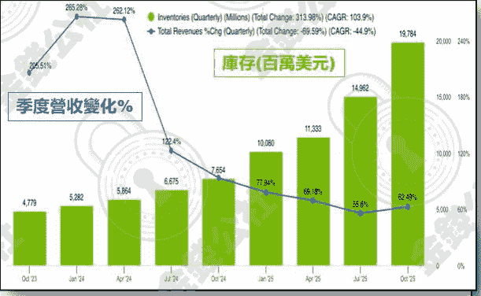

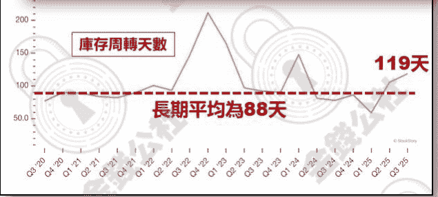

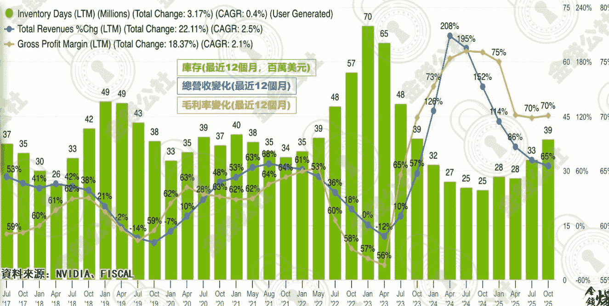

資料來源：NVIDIA，FISCAL

# Is This Coordinated Leverage or Pre-Crisis Financial Engineering?

# 這是協同槓桿操作還是危機前的金融工程？

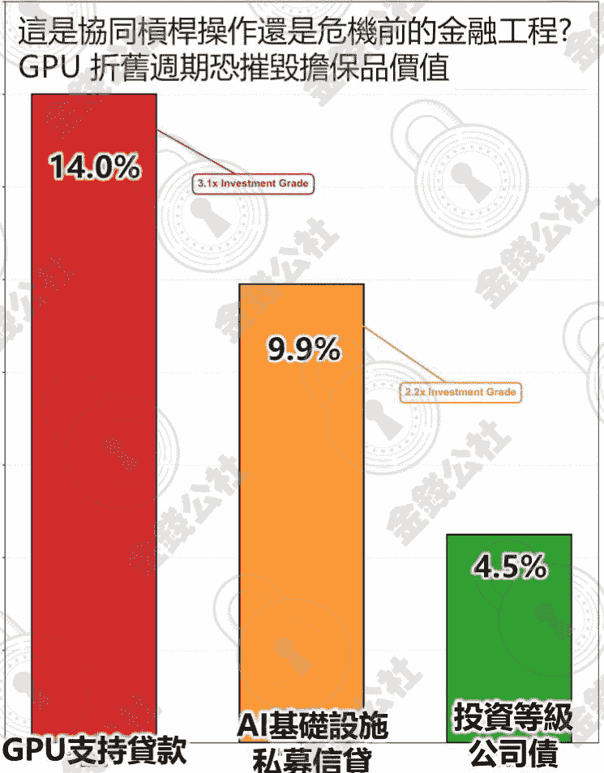

儘管GPU支持貸款風險溢價是投資等級公司債的3.1倍，AI私募信貸風險溢價是投資等級公司債的2.2倍，在2023-2025年間，投入的金額仍超過1500億美元。

而現在華爾街面臨的難題是 AI 帶來的生產力的提升是否能搶先在生命週期是20～30年的特殊目的公司（SPV市場約8000億）及資產支持的證券期限結構內實現，該如何幫AI相關設備訂價，以免折舊週期摧毀擔保品價值。Michael Burry 估計，大型科技公司在2026至2028年間將低估折舊費用1760億美元，Oracle的利潤可能虛胖26.9%，Meta則虛胖20.8%。大佬文集團

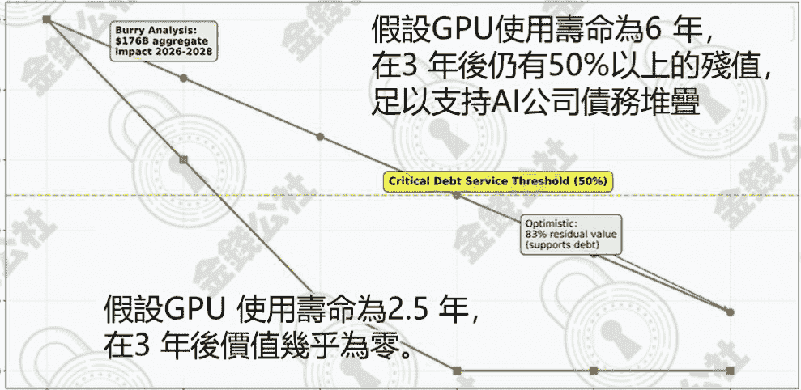

- 與2008年將次級風險分散到整個金融體系不同，AI基礎設施崩潰衝擊的是集中的機構投資者，而非分散的銀行。
- 黑石擁有700億美元的投資組合加上1000億美元的潛在投資管道，Blue Owl 參與了 Meta 270億美元的交易與 OpenAI 的150億美元合夥企業，以及最高50億美元的 CoreWeave 融資。

# Minutes of the Federal Open Market Committee

October 28–29, 2025

In their discussion of financial stability, a number of participants pointed to some recent failures of firms involved in nonbank credit activity. These participants suggested that there were various reasons for concern about developments in the private credit sector, which included risks related to loan quality, the sector’s funding practices, poor underwriting and collateral practices, banks’ exposure to the sector, and the possibility of the transmission of strains in the sector to the real economy. A few participants noted that recent years’ growth in private credit was an example of traditional financial activity moving outside the existing U.S. regulatory framework. Some participants commented on structured asset valuations in financial markets, with several of these participants highlighting the possibility of a disorderly fall in equity prices, especially in the event of an abrupt reassessment of the possibilities of AI-related technology. A couple of participants cited risks associated with high levels of corporate borrowing.

# 關注私人信貸市場

在討論金融穩定時，多位與會者表示私人信貸領域的發展值得關注，其原因包括：貸款品質風險、該領域的資金來源模式、承作與抵押品質不佳、銀行對此領域的曝險程度，以及該領域的壓力可能傳導至實體經濟的風險。少數與會者指出，近年私人信貸的快速成長，是傳統金融活動轉移到現行美國監管框架之外的例子。

# AI前景蒙塵

有些與會者評論金融市場的資產估值偏高，其中數位特別強調，若市場突然重新評估AI技術的前景，股市可能無序下跌。

還有幾位與會者提到了企業高額借貸帶來的風險。

# 與金融部門槓桿相關的脆弱性被描述為顯著

對沖基金的平均槓桿率仍然很高，並且進一步上升，這不僅是由於對沖基金轉向槓桿策略，也是由於對沖基金內部槓桿率的提高。現有數據顯示，過去兩年對沖基金對美國國債市場的風險敞口翻了一番……

資料來源：FOMC

# What do you do if you’re driving in the fog?
MANY > SEVERAL

# Minutes of the Federal Open Market Committee
October 28–29, 2025

A joint meeting of the Federal Open Market Committee and the Board of Governors of the Federal Reserve System was held in the offices of the Board of Governors on Tuesday, October 28, 2025, at 9:00 a.m. and continued on Wednesday, October 29, 2025, at 9:00 a.m.

# Developments in Financial Markets and Open Market Operations

The manager turned first to an overview of broad market developments during the period. Market participants left their macroeconomic expectations largely unchanged. In line with the stable outlook, investors’ expectations for a lowering in the target range for the federal funds rate, based on survey-based and market-based measures, were virtually unchanged over the period.

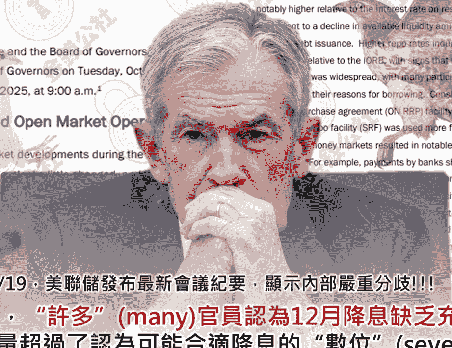

11/19，美聯儲發布最新會議紀要，顯示內部嚴重分歧!!!

會議紀要指出，“許多”（many）官員認為12月降息缺乏充分理由

這部分官員的數量超過了認為可能合適降息的“數位”（several）官員。

資料來源：FOMC

# Minutes of the Federal Open Market Committee
October 28–29, 2025

# 對縮表幾乎達成一致

11/19，米蘭表示他當初支持在10月份就停止縮表

> 「幾乎所有」（almost all）與會者都認為，12月1日停止縮表是合適的，「多位（Many）與會者指出，持有的短期國債比例更高可以為美聯儲提供更多的靈活性，以此應對準備金需求或非準備金負債的變化，從而有助於維持充足的準備金水平。」

# 內部分歧加劇

# 12月降息前景不明

- ■ 支持降息者認為：
  1. 就業下行風險上升
  2. 通脹上行風險下降或不變
  3. 政策應回到更「中性」的位置

- ■ 反對降低利率者則擔心：
  1. 通脹回落進展停滯
  2. 通脹可能未走向2%
  3. 長期通脹預期可能上升

| FOMC會議紀錄中所使用的量化詞彙 |
|---|
| "all" |
| "all but one" |
| "almost all" or participants/members "generally" |
| "most" or "majority" |
| "many" |
| "some" |
| "several" |
| "few" |
| "a couple" or "two" |
| "one" / "another" |

# Participants’ Views on Current Conditions and the Economic Outlook

# 強調非住房服務通脹頑固

與會者普遍提到，核心通脹依然偏高，因為住房服務的通脹放緩，已被商品通脹上升所抵消，而後者部分反映了年初實施的關稅上調所帶來的影響。許多與會者也指出，整體通脹已經在目標之上維持一段時間，且幾乎沒有跡象顯示會在合理的時間內，以可持續的方式回到2%的目標水平。

與會者普遍預期通脹在短期內仍將略高於目標，之後才會逐步回落至2%。有幾位與會者指出，核心「非住房服務」通脹的持續性，可能會使整體通脹在短期內維持在2%以上。許多與會者預期，未來數季核心商品通脹可能會進一步回升，部分原因是關稅持續向企業售價傳導。

# 至少二張反對票!! 鷹鴿拉扯，投票權在誰手上？

美聯儲傳聲筒表示：
會議紀要顯示出無論美聯儲在12月作何決定，**都可能面臨至少三張反對票**。由川普任命的三位理事可能反對維持利率不變，而至少二位地方聯儲主席可能反對降息。

# 🇺🇸 FOMC - ITC Hawk/Dove Analysis

Last Update: 04 November 2025

| Name | Position | Hawk Scale | 2025 | 2026 | 2027 |
|---|---|---|---|---|---|
| **Most Dovish** |  |  |  |  |  |
| 米蘭 | 理事 |  | ✓ | ✓ | ✓ |
| 沃勒 | 理事 |  | ✓ | ✓ | ✓ |
| 鮑曼 | 理事 |  | ✓ | ✓ | ✓ |
| 傑佛遜 | 副主席 |  | ✓ | ✓ | ✓ |
| 鮑爾森 | 費城 |  | ✕ | ✓ | ✕ |
| 庫克 | 理事 |  | ✓ | ✓ | ✓ |
| 卡什卡利 | 明尼阿波利斯 |  | ✕ | ✓ | ✕ |
| 鮑威爾 | 主席 |  | ✓ | ✓ | ✓ |
| 威廉姆斯 | 紐約 |  | ✓ | ✓ | ✓ |
| 柯林斯 | 波士頓 |  | ✕ | ✕ | ✕ |
| 戴利 | 舊金山 |  | ✕ | ✕ | ✓ |
| 巴爾 | 理事 |  | ✓ | ✓ | ✓ |
| 古斯比 | 芝加哥 |  | ✕ | ✕ | ✓ |
| 博斯提克 | 亞特蘭大 |  | ✕ | ✕ | ✓ |
| 穆薩萊姆 | 聖路易斯 |  | ✓ | ✕ | ✓ |
| 洛根 | 達拉斯 |  | ✕ | ✓ | ✕ |
| 巴金 | 里士滿 |  | ✕ | ✕ | ✕ |
| 施密德 | 堪薩斯 |  | ✓ | ✕ | ✕ |
| 哈馬克 | 克利夫蘭 |  | ✕ | ✓ | ✕ |
| **Most Hawkish** |  |  |  |  |  |

- **理事，有投票權：** 11/13，貨幣政策過於緊縮，應採取措施避免經濟下行風險。
- **理事，有投票權：** 11/17，沃勒表示，依照他對最新數據的判讀，傾向在下次會議上支持降息，這是基於風險管理較適切的做法。
- **亞特蘭大聯儲，無投票權：** 11/12，博斯提克表示，**傾向於維持利率不變**，直到有「明確證據」表明通脹正在回到2%的目標水平。
- **明尼阿波利斯聯儲，無投票權：** 11/13，卡什卡利表示，當前約3%的通脹「仍然偏高」，部分勞動力市場指標已經顯露壓力跡象，**不宜過快放鬆**。
- **聖路易斯聯儲，有投票權：** 11/13，穆薩萊姆表示，在通脹黏性仍存、經濟表現相對有韌性的背景下，接下來需要更加謹慎，**以防政策過度寬鬆**。
- **波士頓聯儲，有投票權：** 11/13，柯林斯表示可能在當前利率水平上維持一段時間，**進一步降息可能阻礙通脹回歸目標**，維持限制性政策是合理選擇。
- **克利夫蘭聯儲，無投票權：** 11/13，哈瑪克表示，利率政策目前仍應保持在「限制性區間」，以繼續對仍高於目標的通脹施加下行壓力。
- **舊金山聯儲，無投票權：** 11/13，戴利表示，服務業通脹尚未出現持續回落，**市場對進一步寬鬆的預期需要更克制一些**。

# 降息預期再降溫

10/29，美聯儲決定降息一碼，但會後鮑威爾派發言稱「12月降息非板上釘釘」。

11/19，美國勞工部宣布原定11/7發布的10月就業資料將推遲至美聯儲會議後與11月數據合併公布，市場隱含的降息機率驟降至約33%。若缺乏新就業資料證明疲軟，官員們支援12月降息的意願將會降低……

| 發布 | 參考期間 | 原定發布日期 | 修訂後的發布日期 | 時間 |
|---|---|---|---|---|
| 就業狀況 | 2025年9月 | 2025年10月3日，星期五 | 2025年11月20日，星期四 | 美國東部時間上午 8:30 |
| 實際收入 | 2025年9月 | 2025年10月15日，星期三 | 2025年11月21日，星期五 | 美國東部時間上午 8:30 |
| 生產者物價指數 | 2025年9月 | 2025年10月16日，星期四 | 2025年11月25日，星期二 | 美國東部時間上午 8:30 |
| 美國進出口價格指數 | 2025年9月 | 2025年10月17日，星期五 | 2025年12月3日，星期三 | 美國東部時間上午 8:30 |
| 職位空缺和勞動力流動率（JOLTS） | 2025年9月 | 2025年11月4日，星期二 | 已取消（請參閱JOLTS註記） | — |
| 職位空缺和勞工流動 | 2025年10月 | 2025年12月2日，星期二 | 2025年12月9日，星期二 | 美國東部時間上午 10:00 |
| 就業狀況 | 2025年10月 | 2025年11月7日，星期五 | 已取消（請參閱就業說明） | — |
| 就業狀況 | 2025年11月 | 2025年12月5日，星期五 | 2025年12月16日，星期二 | 美國東部時間上午 8:30 |
| 消費者支出 | 2024年年報 | 2025年10月30日，星期四 | 2025年12月19日，星期五 | 美國東部時間上午 10:00 |

2025年撥款到期後，新聞稿發布日期將進行修訂。

美國勞工統計局（BLS）將在此頁面公布修訂後的新聞稿發布日期。感謝您的耐心等待，我們將盡快發布相關信息，因為全面評估情況並最終確定修訂後的發布日期可能需要一些時間。

下次公布利率決議日期：2025/12/10

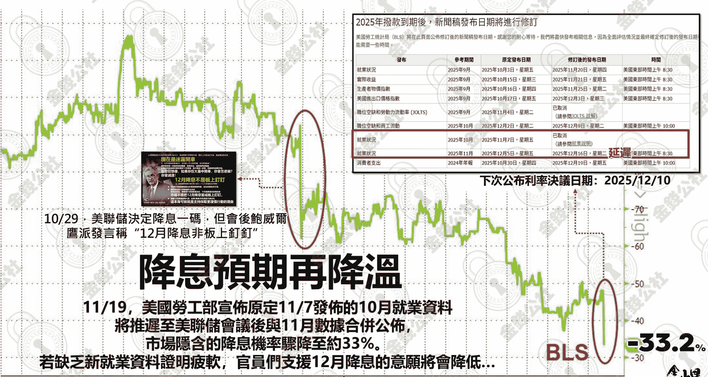

日本政府已進入編制大規模經濟刺激方案的最後階段，方案中日本政府支出規模約為21.3兆日圓，若計入私營部門投資，總規模將高達42.8兆日圓。

周四，日本國債市場隨之出現猛烈拋售，各期限收益率普遍飆升。其中，30年期國債收益率上行至3.36%，創下歷史新高。10年期和5年期國債收益率也分別觸及1.8%和1.3%，雙雙刷新自2008年以來的最高水準。

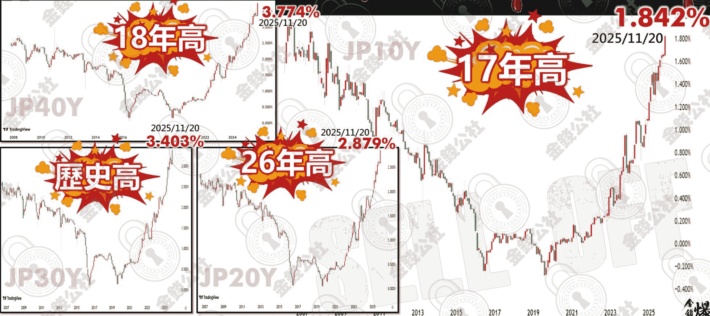

資料來源：tradingview

# 日元跌至10個月低點之際 日本央行坐不住了！釋放12月加息信號

- 11/20．日本央行政策委員會審議委員小枝淳子表示，日本央行需要推動利率正常化進程，以避免未來造成意想不到的扭曲。
- 11/20．日本內閣官房長官林芳正表示，近期外匯市場走勢急劇及單邊，對匯率波動感到擔憂，政府正高度關注匯市過度及無序波動，包括投機行為，強調匯市需要穩定波動以反映基本面。

# 自去年美國大選前以來最大規模的日圓拋售

日本央行有效匯率（28天百分比變動）

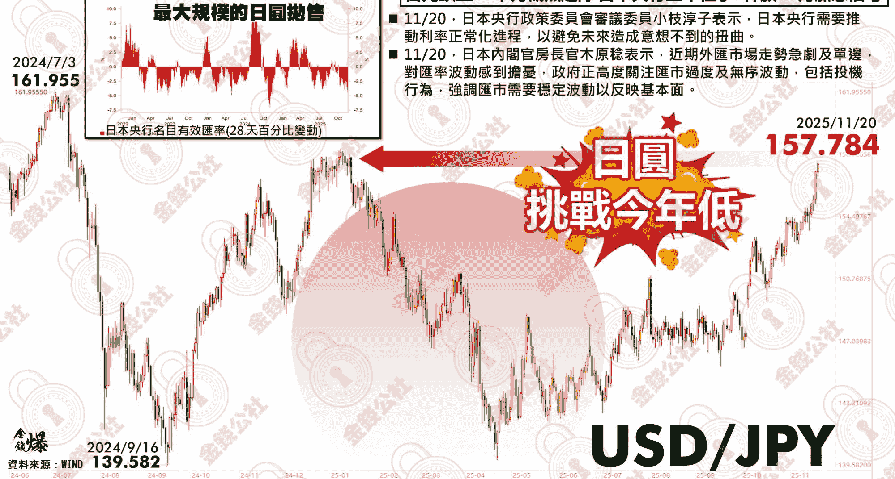

# 日圓挑戰今年低

USD/JPY

資料來源：WIND

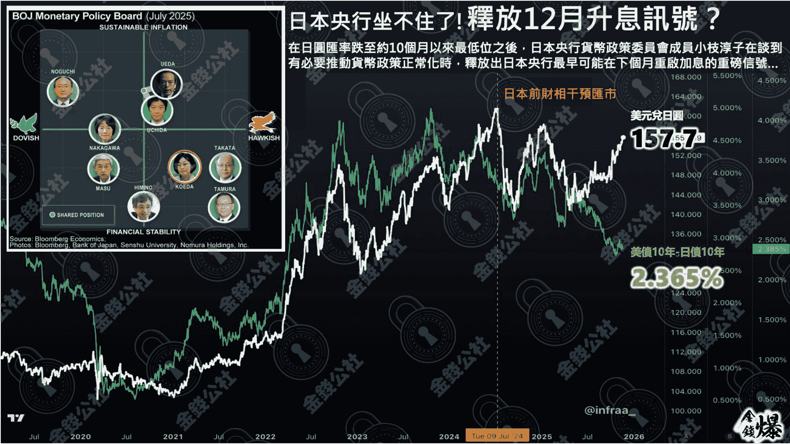

# 日本央行坐不住了! 釋放12月升息訊號？

在日圓匯率跌至約10個月以來最低位之後，日本央行貨幣政策委員會成員小枝淳子在談到有必要推動貨幣政策正常化時，釋放出日本央行最早可能在下個月重啟加息的重磅信號...

# BOJ Monetary Policy Board (July 2025)

# SUSTAINABLE INFLATION

Source: Bloomberg Economics; Photos: Bloomberg, Bank of Japan, Senshu University, Nomura Holdings, Inc.

# 日本前財相干預匯市

美元兌日圓 157.57

美國10年-日本10年 2.365%

@infraa_

# Japan Bonds Slump as Bearish Bets Grow Ahead of Extra Budget

日本首相高市早苗將於11/21公布規模約21.3兆日圓（1,370億美元）經濟刺激方案，該計劃引發了人們對日本財政狀況惡化的擔憂。11/19，日本10年期國債期貨未平倉合約量攀升至近1年來最高。合約量增加與期貨價格下跌同時發生，可能反映出空頭部位的增加。根據日本證券交易商協會最新數據，包括國內銀行、保險公司和海外帳戶在內的主要投資者已將10年期日本國債的淨購買量降至2023年10月以來的最低水平。

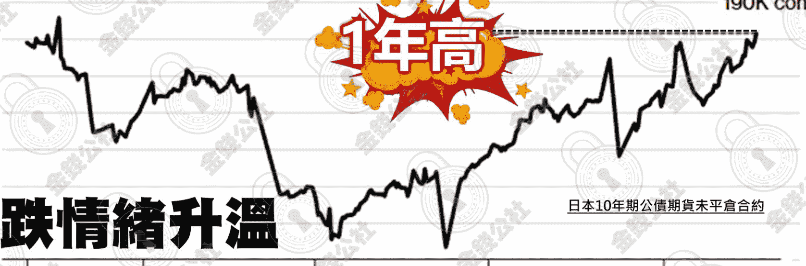

190K contracts
180K
170K
160K
150K
140K
130K
120K

日本10年期公債期貨未平倉合約

# 看跌情緒升溫

資料來源：Bloomberg

# 日本國債需求持續走弱，供給端增測

- **供給端看**，高市早苗擴張性財政政策一定程度上仍需要依靠發債，國債供給難以回落。去年在石破茂執政期間編制的補充預算約13.9兆日圓，並額外發行6.69兆日圓的國債，此次高市早苗的刺激方案補充預算來到21.3兆日圓，為彌補財政收入缺口而發行的國債規模很可能也會超過上一財年。
- **需求端方面**，隨著政治和經濟政策不確定性上升，日圓資產避險屬性下降，日債持有者需求或繼續回落，日央行2024年開始縮減購債規模，並且壽險公司、銀行類機構及海外投資者對於日債的需求也邊際回落。國債市場供需矛盾或推動國債殖利率震盪上行。

# 不同類型投資者持有日本國債（JGB）的比例與金額

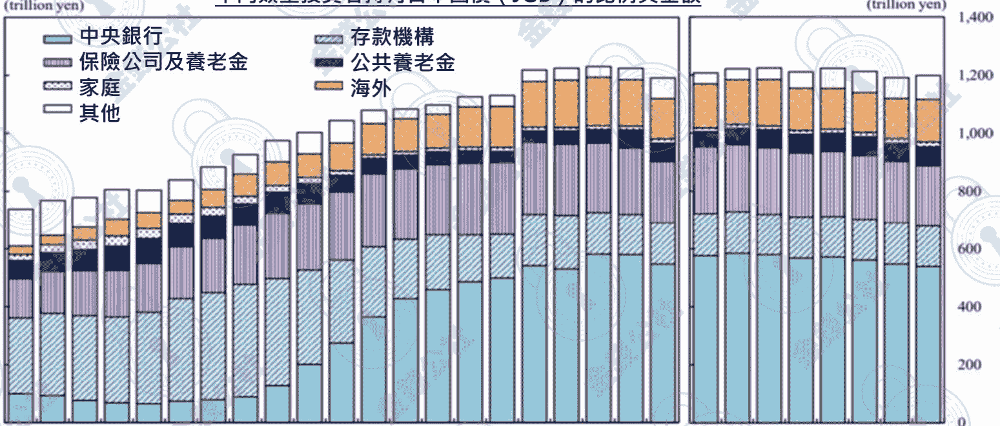

資料來源：日本央行

# 日債曲線「熊陡」期限利差擴大

面對國債市場供需困境，當前日本財務省和央行的政策工具相對有限。財務省通過削減超長債發行規模以緩解供需失衡，但此舉可能導致短債供給增加與利息負擔加重。並且在高市早苗政府繼續推行擴張性財政政策的情況下，長期國債的供給壓力加大，風險溢價抬升，期限利差或仍可能走闊。

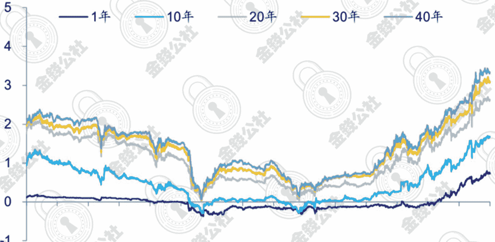

資料來源：梁中華研究
