## 金錢暴金鐵程

完整版節目資料

## 2025年11月20日晚上八點半，美國勞工部（BLS）公布遲到48天的9月非農數據（原定10月3日公布）

- **美國9月非農就業人口新增11.9萬人，是預期5.1萬的兩倍多，創今年5月以來最高單月新增就業。**
- 但同時，8月新增就業人數從增長2.2萬人下修2.6萬，至減少0.4萬人；7月下修0.7萬人，7、8月非農新增就業人數共下修3.3萬人，延續今年「持續向下修正」的模式。

## 11.9萬人！9月非農新增超瘋狂！

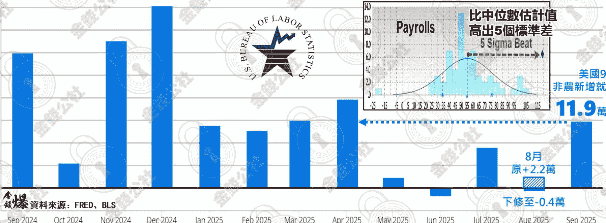

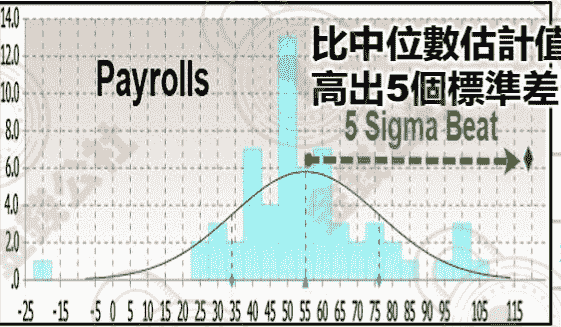

美國9月非農新增就業：11.9萬人

8月：原增長2.2萬人；下修至減少0.4萬人

## 單看9月新增非農11.9萬，大超5萬的預期，這是2025年5月以來的最高單月新增就業；但從長期看，每年平均新增就業卻是節節下降……

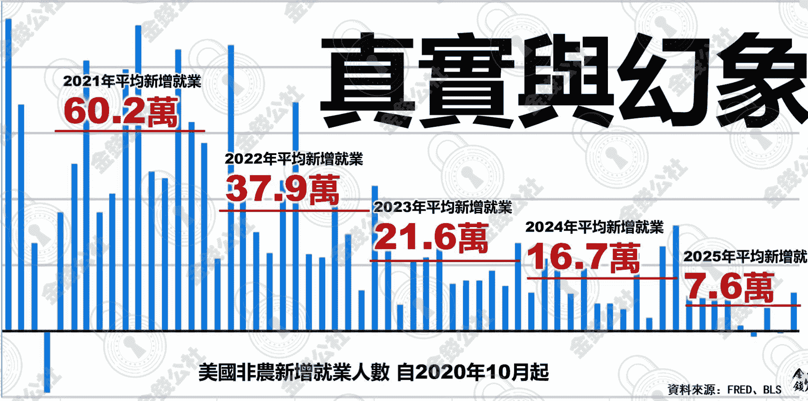

### 2021年平均新增就業

60.2萬

### 2022年平均新增就業

37.9萬

### 2023年平均新增就業

21.6萬

### 2024年平均新增就業

16.7萬

### 2025年平均新增就業

7.6萬

## 美國非農新增就業人數：自2020年10月起

資料來源：FRED、BLS

## 市場最討厭的，不是壞消息

而是：

### 有人有信息，你沒有

有人能提前看到霧後的山，

你只能對著霧發呆。

### 信息不對稱

### 是這輪情緒崩盤真正的開關

誰都害怕成為「最後一個離場的人」。

勞工部公布9月非農就業報告（原定10月3日公布），開頭還是那句話：

## Employment Situation Summary

Transmission of material in this news release is embargoed until 8:30 a.m. (ET) Thursday, November 20, 2025

> 本新聞稿內容的傳播，須待美國勞工統計局在2025年11月20日美東時間上午8:30後方可解除。

報告中，勞工部拋出了一句看起來很無害又平淡的話：

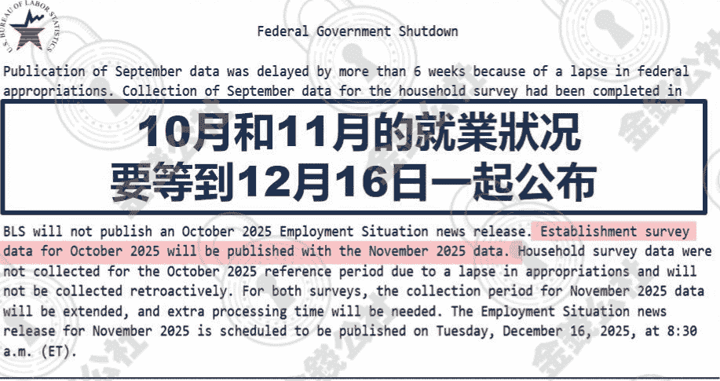

> 10月和11月的就業狀況，要等到12月16日一起公布。

所以，9月非農就業數據是在美聯儲12月9日至10日會議前能看到的最後一份就業報告。原定11月7日發布的10月報告取消，就業狀況將併入11月，在美聯儲會後一週的12月16日才發布……

## 美國勞工部一份「錯亂」的就業報告：新增非農11.9萬，高於預期的5萬，創4個月最高。

## 而失業率卻大幅上升0.116個百分點至4.44%，創下2021年10月以來最高。

美國勞工統計局表示，12月16日公布的10月＋11月就業數據中，包括失業率在內的重要統計指標不會被納入。由於政府關門，負責這些數據的住戶調查無法進行，也無法事後補採這些數據，10月數據將永遠消失……

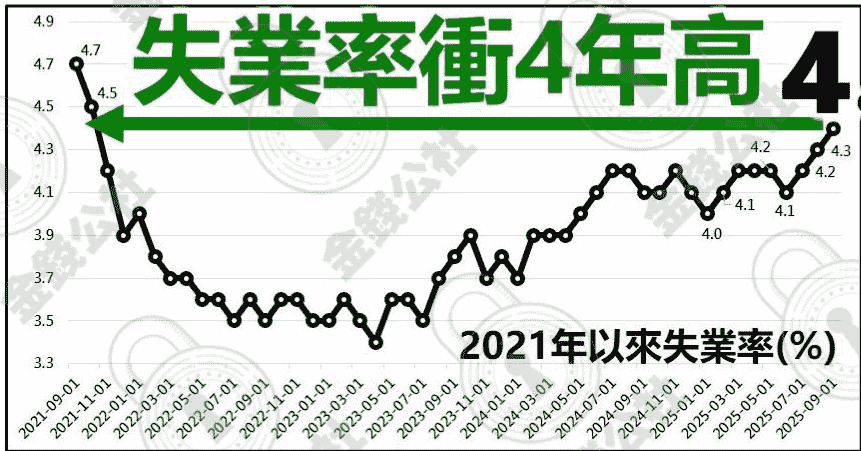

## 失業率創4年高：4.44%

| Variable | 2025 | 2026 | 2027 | 2028 | Longer run |
|---|---:|---:|---:|---:|---:|
| Change in real GDP / June projection | 1.6 / 1.4 | 1.8 / 1.6 | 1.9 / 1.8 | 1.8 | 1.8 / 1.8 |
| Unemployment rate / June projection | 4.5 / 4.5 | 4.4 / 4.5 | 4.3 / 4.4 | 4.2 | 4.2 / 4.2 |

### 2025/9

## 信創利率？估？（圖中大字部分）

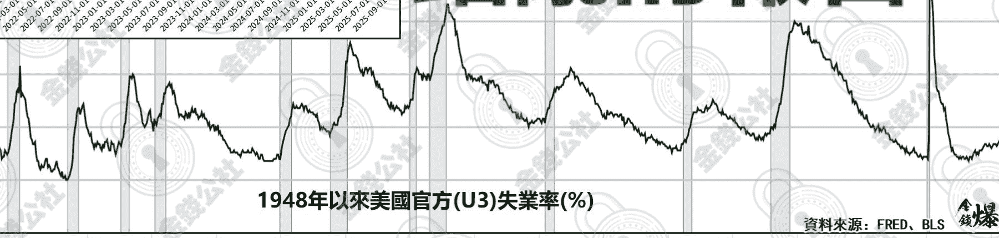

## 1948年以來美國官方（U3）失業率（%）

資料來源：FRED、BLS

在薪資增長方面，美國9月非農部門員工的平均時薪為36.37美元，上漲9美分。

年增率上衝3.79%，高於預期的3.70%；8月前值也由3.70%上修到3.83%。月增率為0.2%，低於預期的0.3%；前值由0.30%修正為0.4%。

## 美國人薪資一年來上漲3.8%

9月每小時工資（左）

36.37美元

9月工資年增率（右）

3.79%

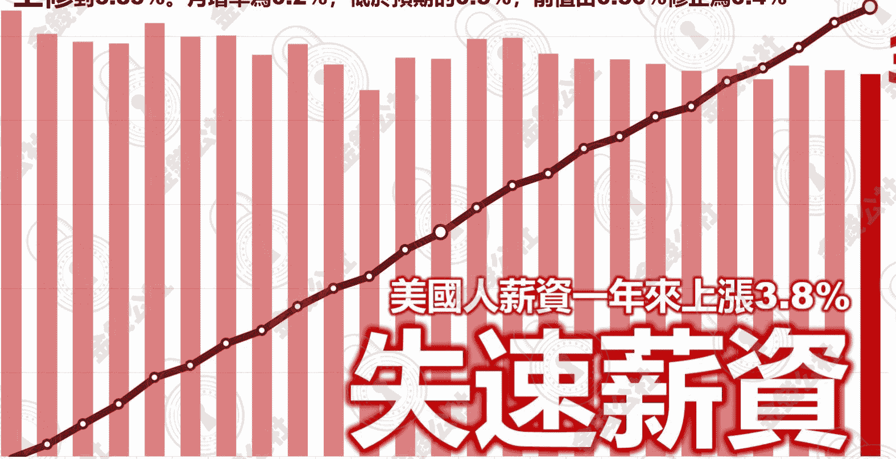

資料來源：FRED、BLS

現在是曾經被當成全球銀彈來源的日本公債，變成跟比特幣一樣的風險資產？！

## 日本30年債殖利率

## 比特幣（倒置）

11月5日曾介紹過，比特幣可以當成全球流動性週期的領先指標。

資料來源：ZeroHedge

微信：pep854

## 歷史高！

## 40年期日債月線

3.774%

## 26年高！

2.879%

## 11/21日本債市拋售潮猛烈

- 10年期國債收益率攀升至2008年金融危機以來的最高水平，突破1.8%。
- 40年期國債收益率衝破3.7%的歷史峰值。
- 20年期收益率也衝上1999年以來新高。

2025/11/21

1.842%

## 債市崩盤

## 20年期日債月線

### 2016/07

-0.300%

## 10年期日債月線

## 日本首相高市早苗公布大規模刺激政策

## 總掏摸逾21.3兆日圓

11月21日，根據日本媒體報導指出，日本首相高市早苗的內閣批准了疫情以來最大規模的額外支出，將在經濟方案中部署資金，用於解決選民的不滿。

該計畫的一般帳戶支出達17.7兆日圓，較去年同期的13.9兆日圓大幅增加27%，成為新冠疫情以來最大規模的刺激措施。高市早苗表示，如果稅收增長不足以支付全部費用，將透過發行新債券來籌集刺激方案資金。此外，政府撥出約1兆日圓用於取消汽油稅，還包括2.7兆日圓的減稅措施。

## Takaichi's cabinet approved the largest stimulus package since pandemic

- 高市早苗的「額外預算」

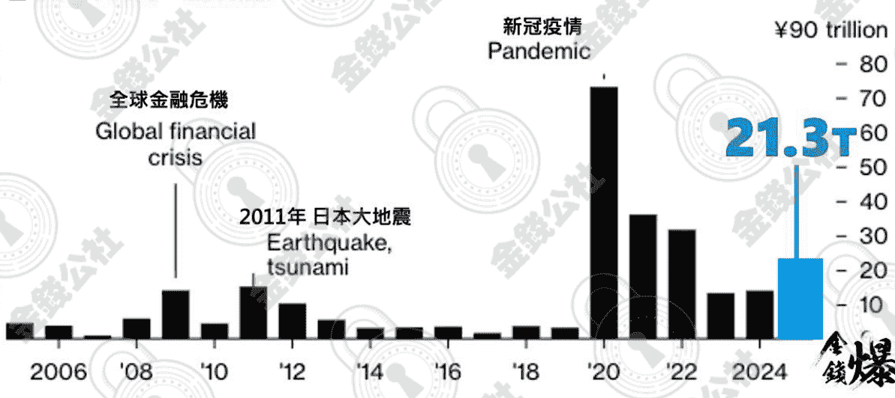

資料來源：綜合外電

## 全国消費者物価指数が50か月連続の上昇

11/21｜日本總務省發布最新10月份消費者物價指數

- 整體CPI年增率3.0%，高於前值2.9%，已經連續43個月高於日本央行通膨目標2%。
- 不包括新鮮食品和能源價格的核心核心CPI為3.1%，高於前值3.0%（日本央行密切關注的基礎通膨指標）。
- 不包括生鮮食品的全國核心CPI年增率3%，高於前值2.9%，符合市場預期。

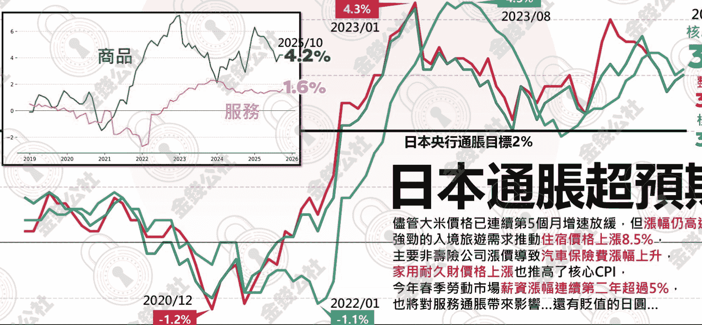

2025/10

核心核心CPI：3.1%

整體CPI：3.0%

核心CPI：3.0%

## 日本通膨超預期

儘管大米價格已連續第5個月增速放緩，但漲幅仍高達40.2%；強勁的入境旅遊需求推動住宿價格上漲8.5%。

主要非壽險公司漲價導致汽車保險費漲幅上升，家庭耐久財價格上漲也推高了核心CPI。

今年春季勞動市場薪資漲幅連續第二年超過5%，也將對服務通膨帶來影響……還有失值的日圓……

資料來源：Gianluca Benigno、日本總務省

高市政権は、セレブ経済制裁を行っている。

具体的には、円安を進行させ、輸入物価を上昇させ、インフレを悪化させる。為替相場は、とうとう155円を突破し、160円も視野に入っている。

高市総裁が誕生する前は、145円から147円程度を上下していたので、7％前後は円安になっている。

一般家庭の家計支出は、30万円前後らしい。

30万円の7％と言えば、2万1000円になる。

今回、1名当たり2万円上乗せされるが、高市のセルフ経済制裁により、2万1千円支出が増えるので、差し引き、1000円損をする計算になる。

## 経済政策の主なメニュー

- 重点支援地方交付金拡充で、プレミアム商品券やおこめ券活用
- ガソリン税の暫定税率廃止
- 2026年1～3月の電気・ガス料金補助
- 経済安全保障の強化

日本首相高市早苗的21.3兆政策，一半惠民生，一半投產業，大致上分成兩大部分：財政支出和減稅。

1. 保障生活與應對物價上漲：17.7兆日圓，用於能源補貼（將撥款5,000億日圓，向每個家庭提供7,000日圓的瓦斯和電力補貼，為期三個月至明年3月）、兒童補貼（總計4,000億日圓，每位兒童2萬日圓的現金補貼），以及2兆日圓用於支持地方政府。

   此外，用於投資半導體、AI與造船等國防工業，以專門應對各種危機管理（關稅、意外、自然災害等）。

2. 在其他抗通膨措施方面：約1兆日圓被預留用於取消汽油稅。

3. 減稅措施：2.7兆日圓。

   （大幅降低個人所得稅，年收入1,000萬元及以上的高收入群體可享有70%的年所得稅減免。）

## Foreign investors snap up Japanese government bonds as yields surge

Overseas traders buy long-dated JGBs at record pace this year amid drop-off in demand from domestic institutions

## 殖利率飆升，外國投資者搶購日本公債

今年以來，由於國內機構需求下降，海外交易商以創紀錄的速度買入長期日本公債。

## 海外渡邊達人大舉找日本渡邊先生

## 對外國投資人而言，套利的匯率對沖效果使長天期日本國債相對吸引力變得更大

11月21日，《金融時報》報導，今年因為殖利率大幅上升，外國投資者正以20多年來最快速度湧入日本長期國債市場。截至10月底，外國投資者淨買入11.3兆日圓（718億美元）、期限超過10年的日本國債，高於2004年有記錄以來任何可比時期。

## 日債傳統買家需求降，債券供給過剩

- 監管新規上路及NISA（日本個人儲蓄帳戶）制度後，打擊壽險公司對長天期日本國債的需求。
- 嬰兒潮世代平均壽命縮短，意味著對較長期限債務的需求減少。
- 日本央行也削減國債購買。

以上諸多因素，導致日債最大買盤鬆動。

## 日債若成避風港，資金輪動恐引爆全球長債券壓力事件

隨著荷蘭即將進行養老金改革，加上美國財政前景不確定，其他主要債市的長端也出現不穩定。日本作為國際債券投資者潛在目的地的崛起，可能是引發全球長期債券殖利率大幅承壓的下一個導火線。

## 外國投資人對期限超過10年的日本國債淨買入金額（兆日圓）

Foreigners have snapped up long-dated JGBs this year

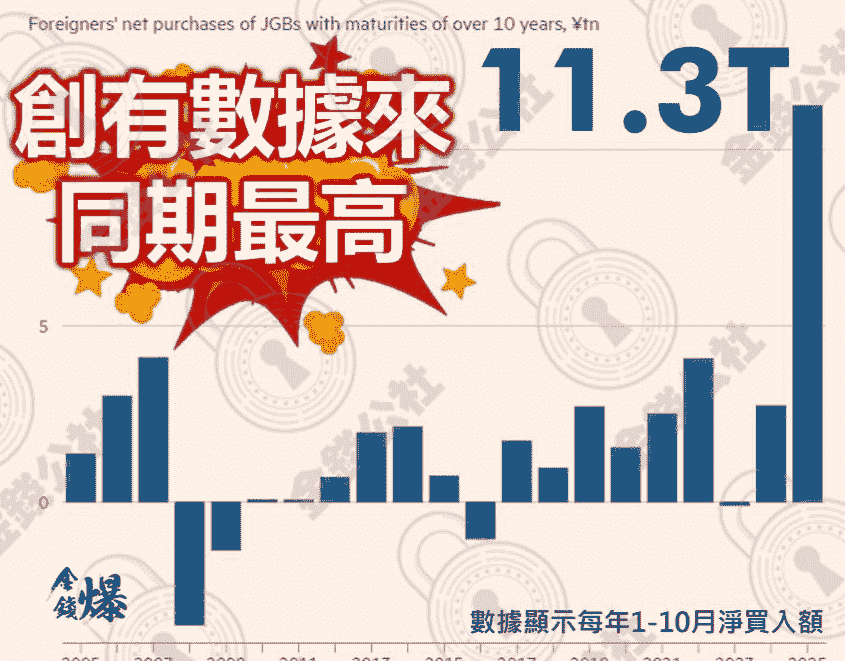

## 過去美日利差與日圓匯率同步，而現在結構正在發生改變……

日圓套利交易本質是「借便宜日圓，去押風險資產」，是全球重要的流動性來源，也是過去發生股災時，日圓被當成避險貨幣的原因。

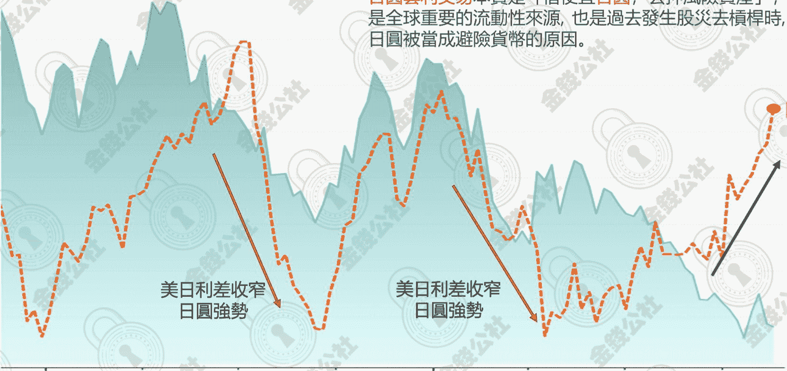

美日利差收窄，日圓強勢

美日利差收窄，日圓強勢

美元兌日圓

美－日10年債利差（左軸）

資料來源：路透社

## 美元兌日圓本周四（11/20）跌破了150關口，挑戰今年來最弱水平，讓日本外匯干預預期急劇升溫！

2025年11月21日，日本財務相片山皐月在內閣會議後的記者會上表示：

「近來匯市單邊且急速的走勢，需要保持警戒。匯率穩定並反映基本面非常重要，保持穩定波動這點很重要。我們將根據9月簽署的美日財長聯合聲明，在必要時對過度波動及失序的市場走勢，採取適當行動，包括長期走勢。」

還強調，外匯干預「當然是可考慮的選項」。

同天，日本央行行長植田和男在國會作證時表示：

> 12月加息？考量到目前實質利率極低，且經濟與物價的預期實現的可能性正在提高，央行將在檢視各項數據與資訊後，對是否升息做出適當判斷。

日圓貶值影響：匯率應根據經濟與金融的基本面而穩定運行。還指出，由於日圓貶值會成為推動消費者物價上升的因素，他將「持續密切關注其對物價的影響」。

USD/JPY

美元兌日圓日K

資料來源：WIND（截至11/21下午3:30）、日經中文網

- **強勢貨幣對財政政策影響GDP的作用有限**
  財政擴張 → 利率上升 → 日圓升值 → 出口減少、進口增加 → 經濟刺激效應被抵銷 → 對GDP影響有限。
- **貨幣寬鬆政策透過貨幣貶值提振GDP**
  貨幣寬鬆（降息）→ 日圓貶值 → 出口增加、進口減少 → 外部需求擴大 → 提振GDP。

**當財政擴張推高通膨預期時，即使名目利率不變，實質利率也會下降。**

**實質利率下降會增加日圓貶值的壓力（資本外流、出口增加）；「財政擴張→通膨預期上升→實際利率下降→日圓貶值」的反向路徑。**

## 日米ユーロ圏英、実質金利の推移

（%）

米国　　ユーロ圏　　日本　　英

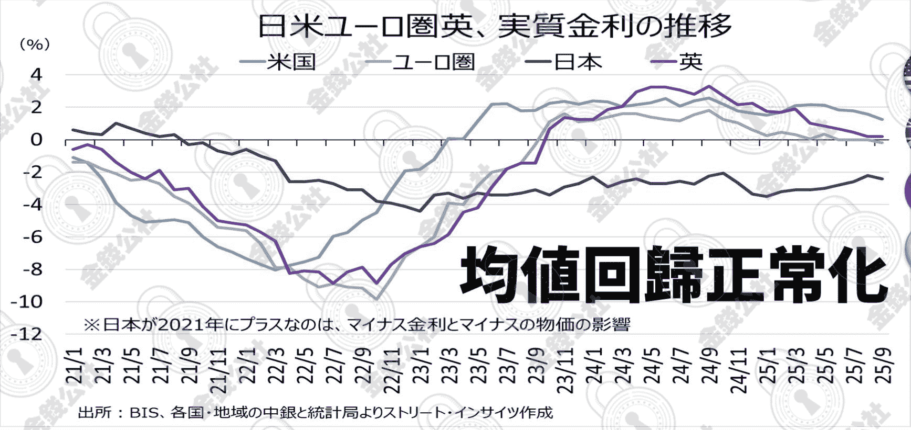

※日本が2021年にプラスなのは、マイナス金利とマイナスの物価の影響

出所：BIS、各国・地域の中銀と統計局よりストリート・インサイツ作成

## 利払費と金利の推移

○ 普通国債残高は1,000兆円を超えており、金利が上昇すれば利払費が大幅に増えることになります。

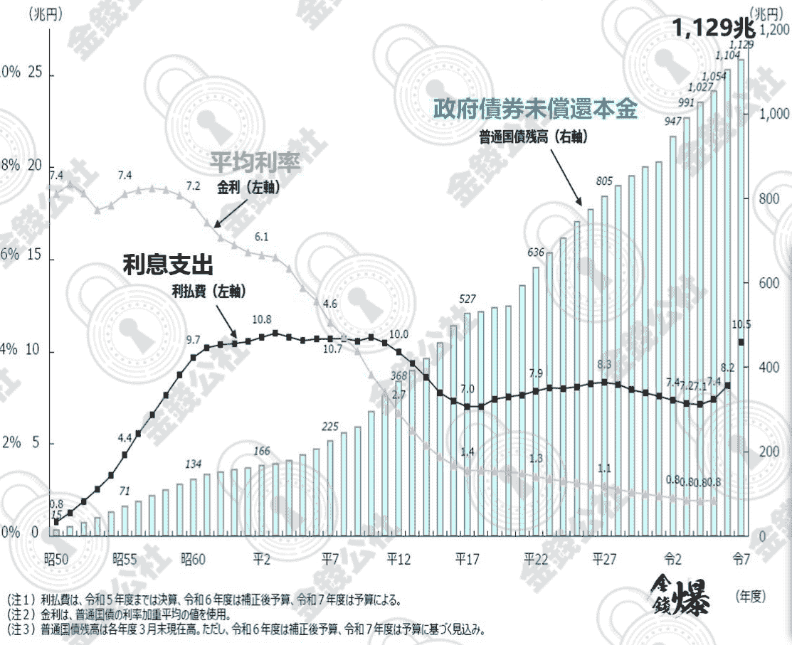

（注1）利払費は、令和5年度までは決算、令和6年度は補正後予算、令和7年度は予算による。

（注2）金利は、普通国債の利率加重平均の値を使用。

（注3）普通国債残高は各年度3月末現在高。ただし、令和6年度は補正後予算、令和7年度は予算に基づく見込み。

據日本財務省公布的2025年預算案報告顯示，用於償還已發國債和支付利息的國債費用增加4.5%至28.2兆日圓，幾乎達財政支出的四分之一……

隨著日本國債發行餘額逐年遞增，預計2025年末將達到1129兆日圓。利息償付費用將達10.5兆日圓。在日央行放棄負利率政策後，如果長期利率上升，償付利息將進一步加重財政壓力。

金融市場獨立分析師估計，日債收益率每增加100個基點，日本政府的年度融資負擔就會增加超過2.8兆日圓。

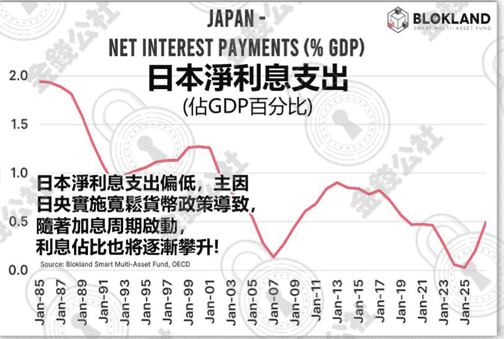

## Deutsche Bank Warns of Japan Capital Flight in Echo of UK Crisis

## 德意志銀行警告稱，日本資本外逃或將重演英國危機

德意志銀行貨幣研究全球主管11月21日表示，日本首相高市早苗的支出計畫導致日本債券和貨幣大跌，引發資本外逃失控的擔憂；再加上日本央行的鴿派立場，該國財政狀況恐將惡化，讓人聯想到2022年那場幾乎摧垮英國債券市場的動盪。當時，英國時任首相特拉斯提出的無資金支持減稅計畫嚇壞投資者，英鎊跌至37年低點，英國國債市場幾乎崩潰。

德意志銀行表示：「日圓和日本國債長端的名義市場均開始與任何公開價值衡量標準脫鉤，」日內交易相關性正在加速。如果國內對政府和日本央行維持低通膨承諾的信心喪失，購買日本國債的理由將不復存在，資本外流將更加劇烈。

資料來源：Deutsche Bank、Bloomberg

## 日圓和日本政府公債正在同時崩盤

2025年10月19日至11月17日，日圓兌美元大幅貶值，從151.5左右貶至約158；同一時間，日本10年期公債殖利率從約1.44%飆升至超過1.62%。

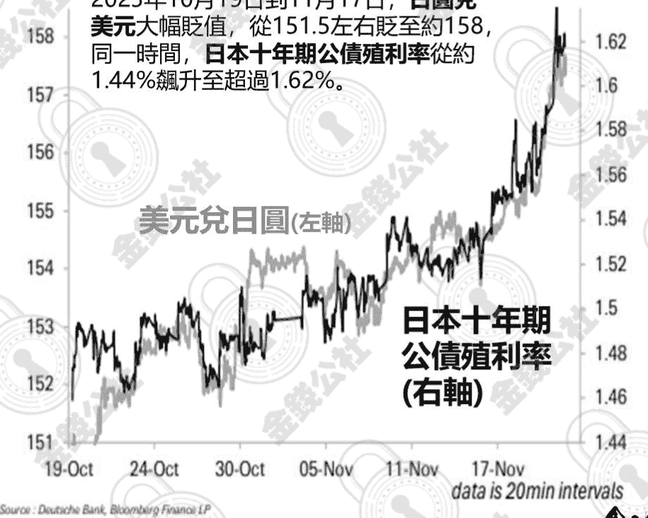

## 英鎊兌美元大跌至1.0356，創1971年以來最低

**9月23日**

特拉斯宣布一系列措施以提振經濟，其中包括大規模減稅方案（取消45%最高所得稅率，並將基本稅率從20%降到19%），以及取消銀行業獎金上限，引發英國金融市場股、匯、債三殺。

**9月21日**

特拉斯去紐約會見拜登，雙方重申繼續向烏克蘭提供經濟與軍事支持的必要性。

**9月8日**

英國女王伊莉莎白二世去世。

特拉斯宣布規模最高可達1500億英鎊的一籃子能源計畫。

**9月7日**

特拉斯在唐寧街10號舉行首次內閣會議。

**9月6日**

特拉斯接任，女王正式任命她成為英國第56任首相，也是英國史上第三位女首相。

**9月5日**

特拉斯當選英國保守黨黨魁。

**9月26日**

為穩定金融市場，英國央行宣布即日起至10月14日臨時購買長期英國國債。

**10月3日**

特拉斯宣布放棄對富人取消45%最高所得稅率的計畫。

**10月14日**

特拉斯開除財政大臣夸騰，任命亨特接替。

**10月16日**

英國保守黨議員紛紛跳出來公開要求特拉斯辭職。

**10月17日**

新財政大臣亨特發表緊急聲明，表示取消9月提出的幾乎所有減稅措施。特拉斯為引發經濟動盪的減稅措施道歉，承認走得太遠、太快，但她表示不會辭職。

**10月19日**

內政大臣布雷弗曼辭職。

**10月20日**

特拉斯下台，辭去保守黨黨魁，留任至選出繼任者。

