## 金钱暴金铁杆

完整版本节目资料

## Vanke 万科
(000002.SZ)日线

## 月线 / 2000年以来

2025/8/25  
H: 7.22

2007/11  
H: 15.38

2014/2  
L: 4.19

2018/1  
H: 31.92

2021/3  
H: 29.13

## 逾11年低
（2014年5月以来）

2025/11  
L: 5.27

> **2025/11/25｜美菱Octus小作文**

【风险事件】Octus：中央政府向深圳市政府发出初步指示，考虑以**市场为导向**的方式处理万科的债务。

## 2025/11/26晚间公告

## 万科首次寻求延期偿还即将到期的债券

浦发银行公告，拟召开“22万科MTN004”2025年第一次持有人会议的公告，对本期债券展期相关事项进行审议。该笔债券本金兑付日为2025年12月15日，债券余额20亿。

2025/11/26  
H: 6.06

## 近三日合计跌逾13%

2025/11/27  
C: 5.47，单日-7.13%

2025/11/28  
L: 5.27

资料来源：WIND

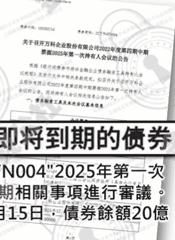

## 先有美国信贷情报和数据提供商Octus的小作文

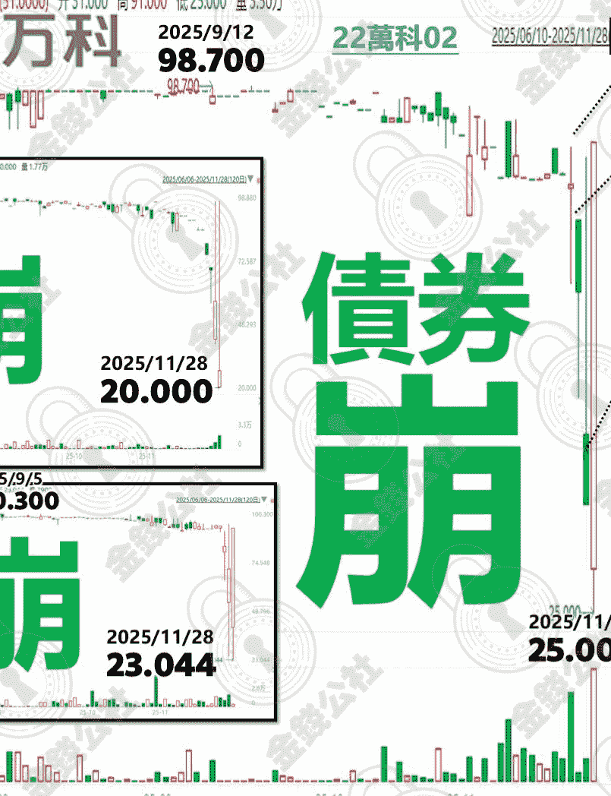

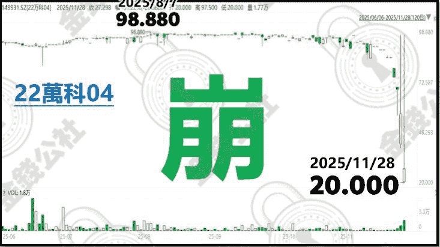

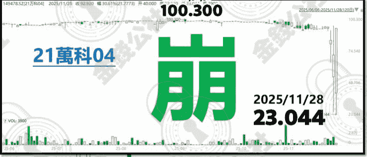

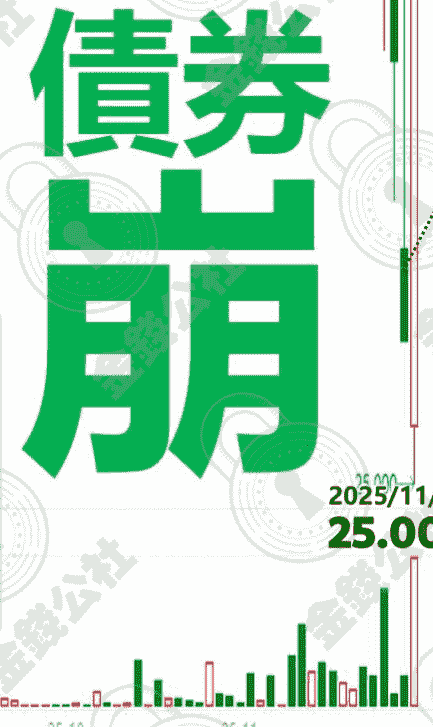

> **2025/11/25**

【风险事件】Octus：中央政府向深圳市政府发出初步指示，考虑以“市场为导向”的方式处理万科的债务。

**2025/11/26**

浦发银行公告，拟召开“22万科MTN004”2025年第一次持有人会议的公告，对本期**债券展期**相关事项进行审议。该笔债券本金兑付日为2025年12月15日，债券余额20亿。大佬交集是万科债券兑付首度出现“展期”的说法。

> **2025/11/27**　彭博社报道：

**万科的贷款申请至少被两家中国银行拒绝**

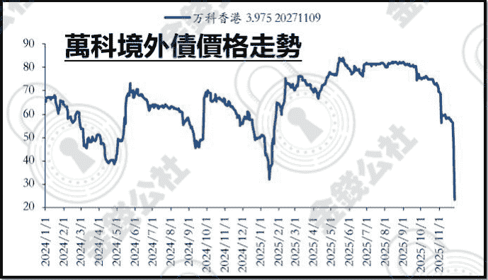

据公开资料统计，目前万科存续境内债券16只，规模达217.98亿元，其中一年内到期的高达157.53亿元；美元债方面，存续2只，规模13亿美元。

## Vanke's Dollar Bonds Tumble to Record Lows

■ 3.5% dollar bond due 2029　■ 3.975% dollar bond due 2027

## 2025/11/25

万科美元债大跌，2027年11月到期的3.975%债券，跌12美分至43.5美分，暴跌21%，创单日最大跌幅。

## 2025/11/27

根据彭博的数据，2027年11月到期的3.975%债券暴跌至每1美元面值报23美分，本周来跌逾60%。

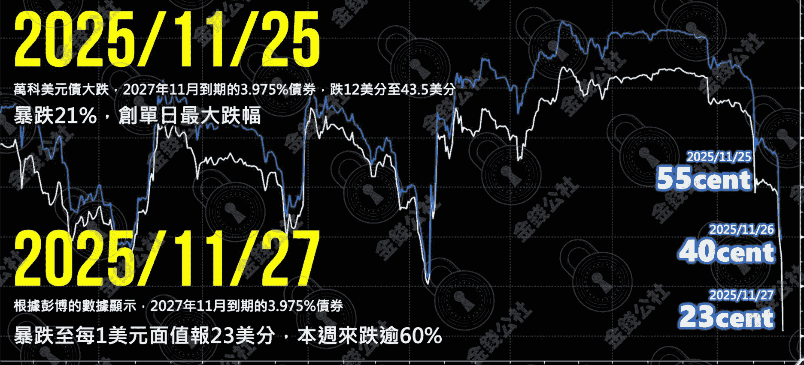

2025/11/25  
55 cent

2025/11/26  
40 cent

2025/11/27  
23 cent

## 近三个交易日万科多档债券盘中数次熔断，从对手盘交易来看，市场认为MTN004展期>深铁不再注资>2年内重组概率较高……

*债券报价常用的是以面值的百分比表示。*

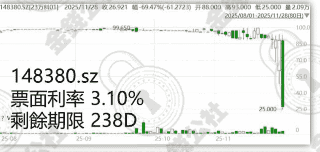

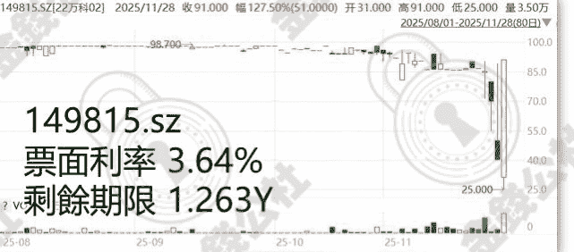

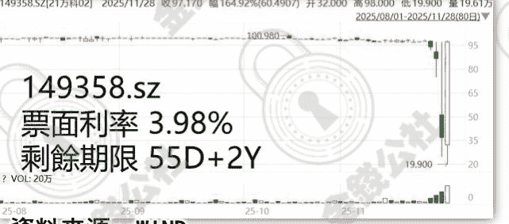

- 关于“22万科04”盘中临时停牌的公告　149931.sz　2025-11-28
- 关于“22万科02”盘中临时停牌的公告　149815.sz　2025-11-28
- 关于“22万科02”盘中临时停牌的公告　149815.sz　2025-11-28
- 关于“21万科06”盘中临时停牌的公告　149568.sz　2025-11-28
- 关于“21万科04”盘中临时停牌的公告　149478.sz　2025-11-28
- 关于“21万科02”盘中临时停牌的公告　149358.sz　2025-11-28
- 关于“22万科02”盘中临时停牌的公告　149815.sz　2025-11-27
- 关于“22万科06”盘中临时停牌的公告　149976.sz　2025-11-27
- 关于“21万科04”盘中临时停牌的公告　149478.sz　2025-11-27
- 关于“23万科01”盘中临时停牌的公告　148380.sz　2025-11-27
- 关于“22万科04”盘中临时停牌的公告　149931.sz　2025-11-27

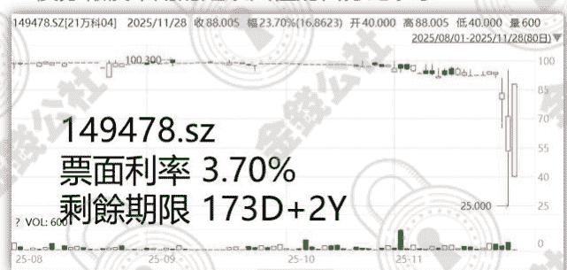

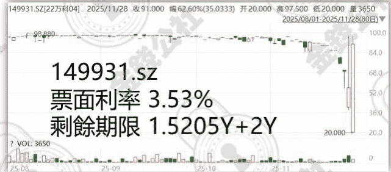

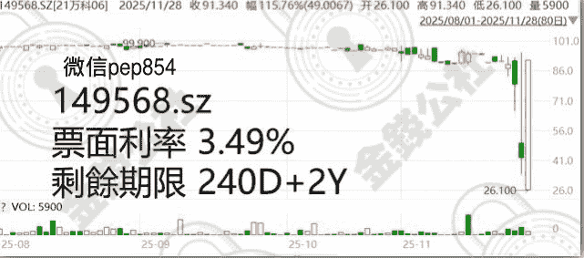

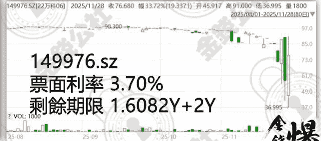

资料来源：WIND

## 第二十届董事会第二十四次会议决议公告

## 关于深铁集团向公司提供股东借款并由公司提供担保暨日常关联交易的公告

发布者：万科集团　浏览次数：101

## 2025年第一次临时股东会决议公告

11月20日，迎来万科企业股份2025年第一次临时股东会，也是新任董事长黄力平接棒后的首次公开亮相。股东会上，黄力平称，大股东深铁集团将与各方一起，不懈努力，帮助万科有序化解风险，摆脱困境，继续按照市场化、法治化的原则，支持万科健康发展。

## 大股东言论被解读为……

将以市场化方式化解债务！！

对比11月两次公告变化，从信用借款到强制担保，而非之前的纯信用借款。即将到来的12月，万科债券到期金额合计57亿元，深铁借款额度仅剩22.9亿元！！

## 万科债券到期节奏

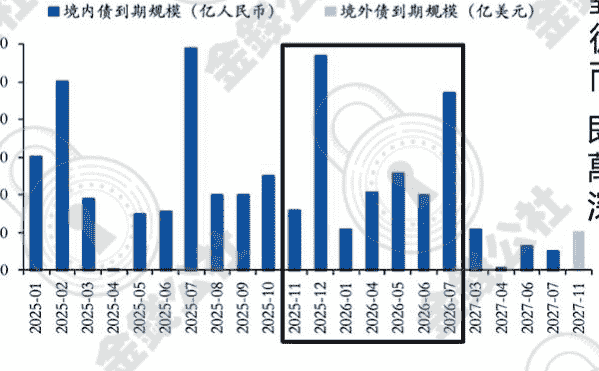

## 二、会议审议情况

审议通过《关于选举第二十届董事会董事长的议案》。

公司董事会于2025年10月12日收到公司董事长辛杰先生提交的书面辞职报告。因个人原因，辛杰先生申请辞去公司董事、董事长职务，辞职后将不再担任公司任何职务。辛杰先生的辞职报告自送达公司董事会之日起生效。

## （一）借款安排

## 1.借款额度

在2025年以来至公司2025年度股东会召开日为止期间，公司拟向深铁集团申请不超过220亿元的借款额度。借款额度包括《框架协议》生效之前已实际发生但公司未提供抵/质押担保措施的信用借款，及已提供担保后续确认担保无法实施或部分无法实施的借款，以及《框架协议》生效之后发生的借款，以实际提款金额为准。

借款额度为一次性信贷额度，即在股东会给予的授权有效期内，任何已偿还本金的借款，不得释放出新的借款额度供再次提取。

截至本公告日，深铁集团已提供的无抵/质押担保借款合同金额为203.73亿元，实际提款金额为197.1亿元。《框架协议》下的借款本金及利息总额预计不超过236.91亿元。

## 11/5，标普下调万科长期信用评级从BBB至CCC

> Research Update: China Vanke Downgraded To 'CCC' On Deteriorating Sales And Liquidity; Outlook Negative

## 11/28，标普下调万科长期信用评级至CCC-

意味着未来6个月发生困境重组的风险加剧。

> China Vanke Downgraded To 'CCC-' From 'CCC' On Potential Maturity Extension; Ratings Placed On CreditWatch Negative

## 【风险事件】

Octus：中央政府向深圳市政府发出初步指示，考虑以“市场为导向”的方式处理万科的债务。

Octus：全球信贷情报与资料供应商，其前身为Reorg，是世界一流投行、投资银行、律师事务所及顾问公司的重要信贷情报和资料提供商。

在2025年以来至公告日，深铁集团已提供的无抵/质押贷款实际提款金额为197.1亿元。《框架协议》下的借款额度不超过220亿元。

借款额度为一次性信贷额度，即在股东会给予授权的有效期内，任何已偿还本金的借款，不得释放新的借款额度供再次提取。

截至本公告日期，深铁集团已提供的无抵/质押贷款，实际提款金额为197.1亿元。《框架协议》下的借款额度为236.91亿元。

### 3.抵/质押率

借款本金余额与经营性房地产、固定资产、存货、无形资产等资产评估价值的比率（抵/质押率）为60%—70%；其他贷款（质押率）为50%—60%。

| 项目 | 内容 |
|---|---|
| 借款名称 | 《关于股东借款及资产担保的框架协议》 |
| 借款期限 | 约定至2026年6月30日前 |
| 借款金额 | 万科可从深铁集团取得最高贷款金额220亿元 |

万科公告，深铁集团向其提供不超过16.66亿元借款，用于偿还公司在公开市场发行的债券本金与利息。

万科发布的公告显示，该公司将寻求债券持有人批准，延期偿还20亿元人民币的境内债券。

> 据Octus消息，中央政府已向深圳市政府发出初步指示，考虑以“市场为导向”的方式处理万科的债务。

消息传出后，万科境内债继续且普遍下跌，其中，“21万科04”质押“22万科02”，“22万科04”等跌超20%；“22万科02”跌超30%，盘中二次临时停牌。

## “市场化方式”处置，加速拐点到来？

## 2025年以来房企债务重组成功情况

| 首次违约时间 | 房企名称 | 重组成功/最新公告日期 | 债务重组情况 |
|---|---|---|---|
| 2022年1月 | 世茂集团 | 2025年3月13日 | 境外债重组成功 |
| 2023年8月 | 远洋集团 | 境外：2025年3月27日 | 境外债重组成功，境内重组方案已公布 |
| 2021年11月 | 佳兆业 | 2025年4月8日 | 境外债重组成功 |
| 2022年3月 | 金轮天地控股 | 2025年6月24日 | 境外债重组成功 |
| 2022年8月 | 龙光集团 | 境内：2025年9月10日；境外：2025年2月27日 | 境内债重组成功；境外重组已与债权人小组就整体CSA达成修订协议 |
| 2022年11月 | 旭辉控股集团 | 境内：2025年9月15日；境外：2025年6月29日 | 境内外债务重组均已成功 |
| 2023年1月 | 时代中国控股 | 2025年7月30日 | 境外债重组成功 |
| 2022年5月 | 融创中国 | 境内：2025年1月21日；境外：2025年11月5日 | 境内外债务全部重组成功 |
| 2023年10月 | 碧桂园 | 境外：2025年11月5日 | 境外债重组表决通过 |

资料来源：中时电子报·新浪财经

## 境外债务重组进展

1. 高等法院批准计划
2. 计划生效日期落实

2025年11月5日，融创中国控股有限公司发布公告……

约96亿美元的境外债务重组获香港高等法院批准。至此，重组计划条件均已达成，这标志着融创正式成为首家境外债基本清零的“大型房企”。

2025年11月6日，碧桂园发布公告……

在两个债务组别的投票中，均获得出席并投票的债权人中超过75%债权金额的赞成票，预计将减少约117亿美元的有息债务。

（同时融资成本从超8%降至1.0%—2.5%，债务期限延长至11年。）

目前寻求法院认可，相关聆讯定于12月4日进行。

## 万科获得的资金来源为深圳市政府

从2025年2月21日深圳地铁首次对万科提供42亿借款算起，至2025年三季度末，其提供的总借款为269.3亿。

## 从资产负债表观察

深圳地铁2025年Q3相较于期初新增267.1亿的债权投资（该科目期初金额为0），与万科所披露的累计获得深圳地铁269.3亿的借款金额相匹配。

深圳地铁2025年三季度新增的资本公积约271亿，也与万科所披露的累计获得深圳地铁269.3亿的借款金额不谋而合。而根据深圳地铁自身的公司属性，再结合会计准则，资本公积科目新增的271亿即是深圳市政府对深圳地铁的政府补贴。

## 从现金流量表观察

深圳地铁2025年前3季度累计吸收投资收到的现金263.9亿，再次与万科所披露的累计获得深圳地铁269.3亿的借款金额相符。

2025年初至本公告披露日，公司与深铁集团的关联交易包括：

1. 公司向深铁集团转让红树湾物业开发项目投资收益权以及相关标的。具体详见公司于2025年1月27日披露的《关于转让红树湾物业开发项目投资收益权暨关联交易公告》。

2. 深铁集团已累计向公司提供借款269.3亿元（不含本次借款）。其中，自2025年6月27日召开2024年度股东大会以来，深铁集团已分批次向公司提供以下款项及相关安排：新增借款62.49亿元、展期借款8.9亿元、新增借款8.69亿元并提供资产抵押、新增借款11.89亿元、新增借款20.64亿元、新增借款9.89亿元，以及公司既有的15.51亿元借款提供方国云股权质押作为担保。其中62.49亿元借款和8.9亿元借款已获得深圳证券交易所同意，在确认关联交易是否达到需提交公司股东大会审议标准前暂不提交公司股东大会审议。

深圳地铁资产负债表（截图）

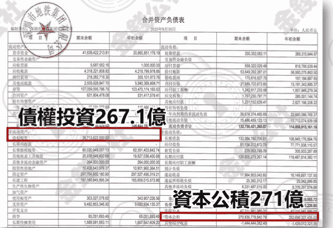

深圳地铁合并现金流量表（2025年9月）

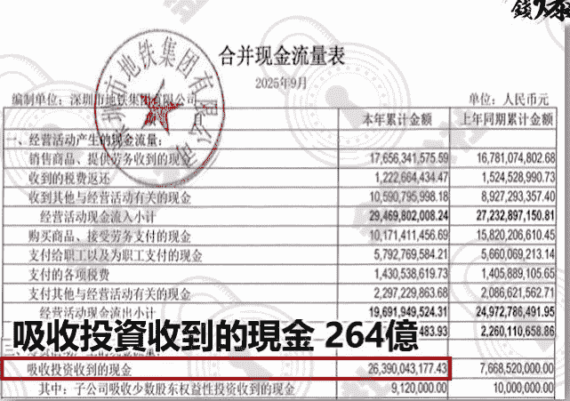

## 图7：万科债券到期节奏

从债券到期节奏来看，今年末到明年上半年是万科的偿债高峰！！

剔除待展期的22万科MTN004，年内到期债券3.7亿元。

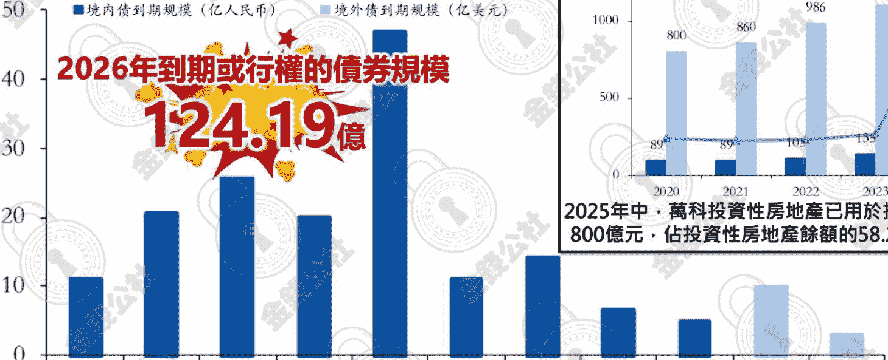

数据来源：Wind，财通证券研究所

## 图5：万科用于抵押或担保的投资性房地产

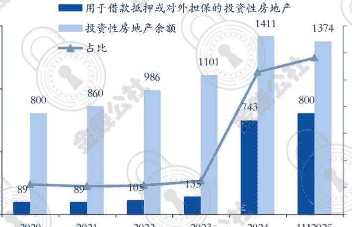

2025年中，万科投资性房地产已用于抵质押及担保的余额已高达800亿元，占投资性房地产余额的58.2%，可抵押资产越来越少。

资料来源：新浪财经

## 失落的30年，对值30年

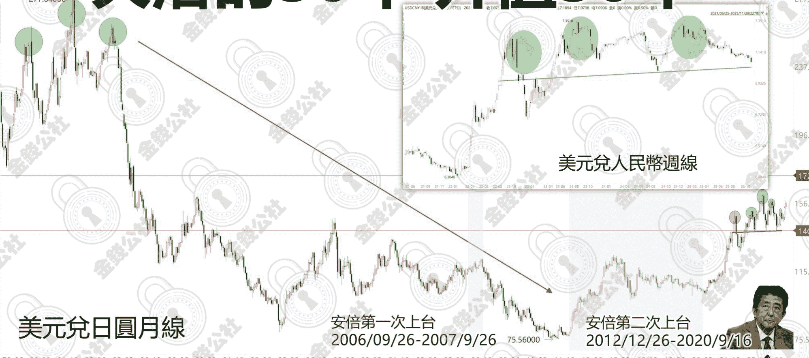

美元兑日元月线

安倍第一次上台  
2006/09/26—2007/9/26

安倍第二次上台  
2012/12/26—2020/9/16

美元兑人民币周线

资料来源：WIND

## M2占GDP比（本币）

### M2 Money Supply as a Percent of GDP

## 日本vs.中国

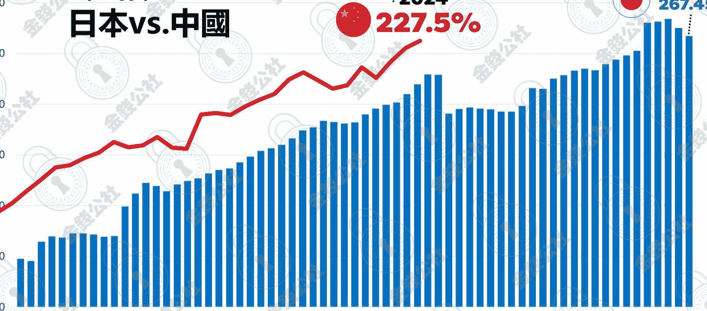

> 2024

🇨🇳 227.5%

> 2024

🇯🇵 267.45%

M2：306.91兆  
GDP：134.91兆

M2：1629.92兆  
GDP：609.43兆

资料来源：世界银行
