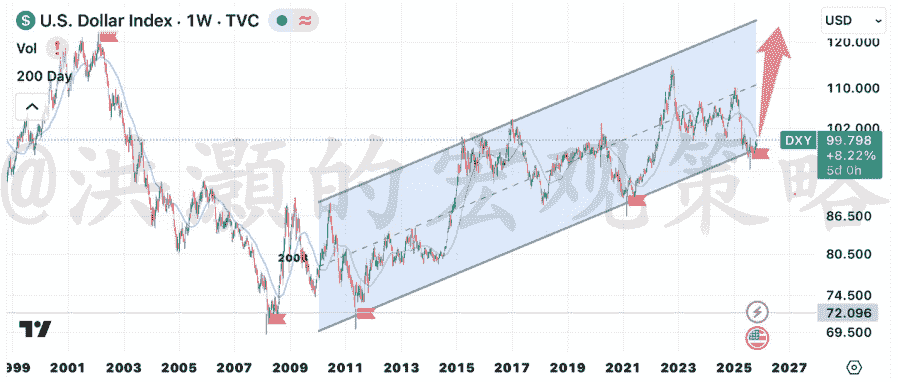

## 1103 洪灏星球

美元今早 99.82，逼近 100。昨天讨论了美元很可能技术反弹。今天再看了一下这个美元的周线图，发现美元在 2008 年和 2011 年出现“双底”的技术形态。并看看美元指数和 200 天均线的位置。（进群微信 cuk255）

### 深度视野优质文集圈（链接优质社群，助你成功）

全部包含以下内容：限时年费 188 元/年，加微信 cuk255。

- 1. 吃瓜群众俱乐实时圈文加实时群聊对话（原价 365 元/年）
- 2. 子明私享汇（含）内部文章（原价 568 元/年）
- 3. 政事堂（顾子明）付费内容每天透明群
- 4. 米跃储见闻（作者米糕）（原价 599 元/年）
- 5. 欧洲金靴会员专属文章（原价 328 元/年）
- 6. 砖瓦厂内部圈文（原价 400 元/年）
- 7. 卢梭文青云读书会专属文章（原价 699 元/年）
- 8. 鉴宋财经院知识星球（原价 3310 元/年）
- 9. 猫哥的视界知识星球文章（原价 299 元/年）
- 10. 财新周刊（独家新闻）（原价 1498 元/年）
- 11. 杨世光在金钱媛（原价 2200 元/年）
- 12. 蔡森财经知识星球（原价 1600 元/年）
- 13. 澜泽异谈付费文章（持续更新）
- 14. 司马林解读毛选全套音频和全套书籍珍藏版无删减（原价 2.3 万）
- 15. 庞声三部曲《民国梦、帝国苔托、不被理解的 MAO》（原价 599 元）
- 16. 卢梭文知识星球文章（原价 268 元/年）
- 17. 额外再送：卢麒元新浪微博付费专栏、村西边老王、三花九树文集

不定期内容：——————（更多资源写不下了……）

- 1. 守夜人司马知识星球、挨踢牛魔王知识星球、生财有术知识星球
- 2. 创始人笔记、达叔天虎论知识星球、成竹财富圈、雪球花甲老头等
- 3. A 视野、大树乡谈、江宁知府、哔哩说、财上海家学等付费文集
- 4. 西风付费文章、老端、藏在八小时之外、局外人的视界、升值计、老 A 体制内等等其他一些大 V 付费文章（每月不低于 600 元的付费文章）

限时年费 188 元/年，低成本链接全网大 V 优质内容
