## 金錢爆金鑽程

完整版本節目資料

### 芝商所被搶蟹的10個小時

網路傳出：某東方大客戶在COMEX一次性下單8萬張合約4億多盎司（1.2萬噸）的白銀，要求按時現貨交割。但倫敦市場白銀庫存僅2億盎司，無貨交割⋯怎麼辦？

11月27日美東時間
21:40：CME發出多則通知，宣布即將暫停交易。
21:44：CME官網開始掛了，所有交易軟件界面定格，原油、黃金、白銀、棕櫚油等期貨合約交易中斷，所有商品期貨和期權交易全線暫停

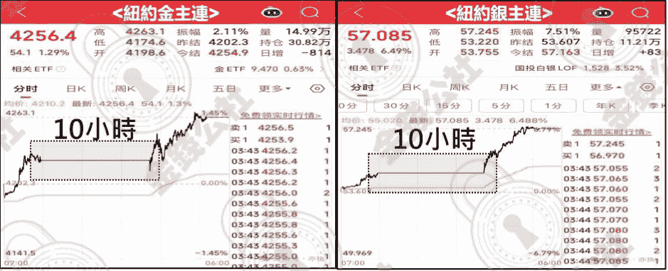

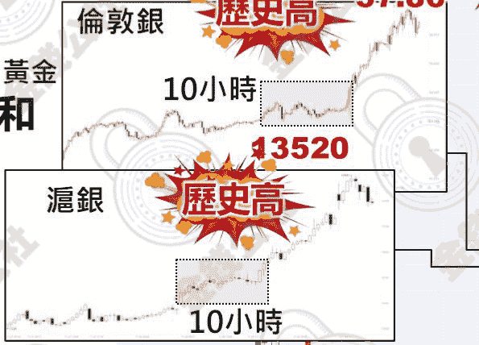

12:30：CME發言人郵件確認：「因伊利諾伊州CyrusOne數據中心冷却系統故障，市場暫停交易」
11月28日美東時間
05:00：公告其他所有CME市場仍停擺，僅BrokerTec EU市場恢復交易
08:30：COMEX重新開盤，停擺10個小時

#### 白銀歷史高

58.61

57.86

13520

拔掉電

54.14

#### CME白銀報復
15分鐘

資料來源：CME・WIND

## 白銀現貨價回K（今年以來）

頸線54

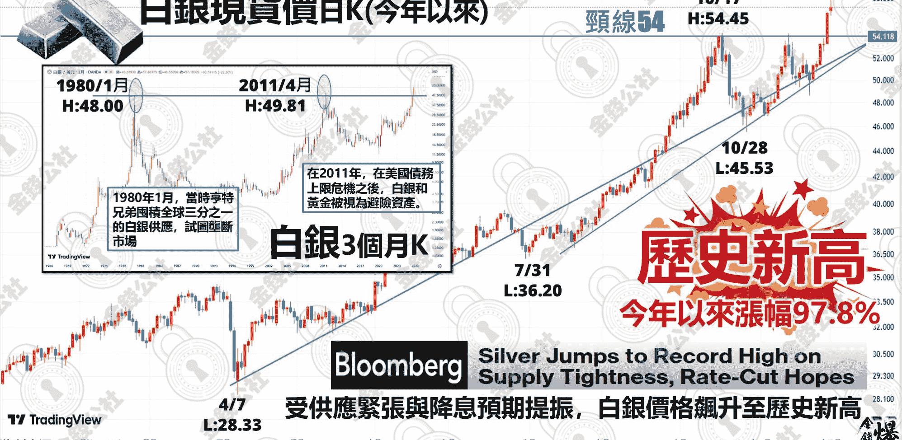

10/17
H:54.45

12/1
H:57.86

10/28
L:45.53

7/31
L:36.20

4/7
L:28.33

## 白銀3個月K

1980/1月
H:48.00

2011/4月
H:49.81

1980年1月，當時亨特兄弟囤積全球三分之一的白銀供應，試圖壟斷市場

在2011年，在美國債務上限危機之後，白銀和黃金被視為避險資產。

## 歷史新高

今年以來漲幅97.8%

> Bloomberg
Silver Jumps to Record High on Supply Tightness, Rate-Cut Hopes

# 受供應緊張與降息預期提振，白銀價格飆升至歷史新高

資料來源：TradingView

### COMEX白銀(噸)庫存量走勢圖

7/8
15487噸

10/3
16543噸

11/28
14207噸

| 序号 | 日期 | COMEX白銀库存量（吨） | COMEX白銀库存量（盎司） |
|---|---|---:|---:|
| 1 | 2025-11-28 | 14207.21 | 456772055.743 |
| 2 | 2025-11-26 | 14248.10 | 458086706.673 |
| 3 | 2025-11-25 | 14583.89 | 459237330.823 |
| 4 | 2025-11-24 | 14607.10 | 460710193.772 |
| 5 | … | … | … |
| 174 | 2025-03-20 | 14198.31 | 456485855.525 |
| 175 | 2025-03-19 | 14091.83 | 453064259.743 |
| 176 | 2025-03-18 | 13962.59 | 448907223.236 |
| 177 | 2025-03-17 | 13854.22 | 445423183.756 |

自10/3庫存高點下滑14.1%

創今年3/19庫存14091噸以來新低

資料來源：東方財富網、X

### 白銀庫存拉警報？！

| DEPOSITORY | PREV TOTAL | RECEIVED | WITHDRAWN | NET CHANGE | ADJUSTMENT | TOTAL TODAY |
|---|---:|---:|---:|---:|---:|---:|
| ASAHI DEPOSITORY LLC | 39,549,811.550 | 556,693.300 | 222,522.240 | 334,171.060 | 0.000 | 39,883,982.610 |
| BRINK'S, INC. | 61,359,676.870 | 0.000 | 0.000 | 0.000 | -1,214,094.700 | 60,145,582.170 |
| CNT DEPOSITORY, INC. | 39,306,171.373 | 0.000 | 0.000 | 0.000 | -897,975.180 | 38,308,196.193 |
| JP MORGAN CHASE BANK NA | 199,031,529.773 | 0.000 | 434,727.290 | -434,727.290 | 0.000 | 198,596,802.483 |
| COMBINED TOTAL | 458,086,706.673 | 556,693.300 | 657,249.530 | -100,556.230 | -1,214,094.700 | 456,772,055.743 |

> Comex Silver Inventory alert

Over 8.3% or 12.5 million ounces were transferred out of the Comex Registered Inventory category on 11/26/2025. These are the ounces that back futures contracts.

Comex白銀庫存警報

2025年11月26日，超過8.3%或1,250萬盎司（約388.5噸）的白銀從紐約商品交易所註冊庫存類別轉移出來。這些白銀是期貨合約的支撐。

### 2021年以來金銀比（現貨）

### 倫敦金現貨
倫敦銀現貨

2025/3/31
102.67

2022/12
2024/5

### 金銀比突破761倍的支撐點

2025/12/1
74

### 找銀
出金?

2025/4/22
3500

2025/10/20
4381

2025/10/17
54.46

2025/12/1
57.86

2025/12/1
4256

### 倫敦金現貨日線
倫敦銀現貨日線

### 紐約金期貨日線

2025/10/20
4439

2025/12/1
4291

2025/4/7
28.28

資料來源：Tradingview

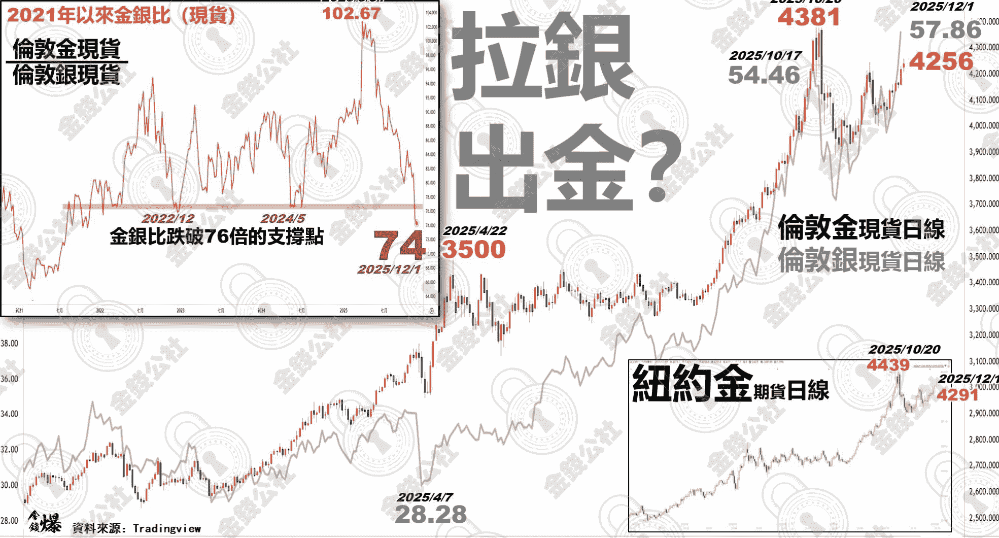

#### LME銅
日線 今年以來

歷史高
2025/12/1
11294.5

波段
+6.5%

10607.5
2025/11/21

10164.5
2025/03/26

2025/04/07
8105

#### COMEX銅
日線 今年8月以來

2025/12/1
5.3560

4.9150
2025/11/21

波段+9%

4.4070
2025/08/21

#### 各交易所銅庫存變化(噸)

庫存逾7年高

LME　SHFE　COMEX

資料來源: WIND(截至12/1 11:30)

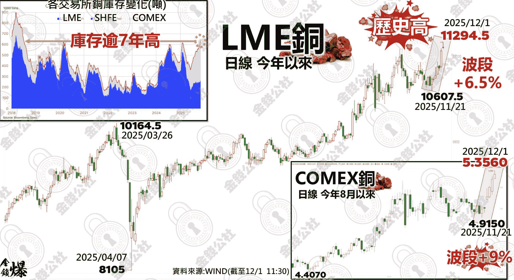

#### 雲淡風輕？
##### 1968年以來的倫敦金銀現貨價格

2015年12月-截止2025年12月（已10年）
◆ 黃金從1062上漲至最高4381美元，漲幅312%
◆ 白銀從13.82上漲至最高57.86美元，漲幅318%

1970年3月-1980年1月（10年）
◆ 黃金從35美元漲至最高653美元，漲幅1800%
◆ 白銀從1.88美元漲至35.52美元，漲幅1789%

1999年8月-2012年9月（13年）
◆ 黃金從254.8上漲至最高1776美元，漲幅600%
◆ 白銀從5.08上漲至34.65美元，漲幅582%

白銀逼倉事件1
● 1979–1980年亨特兄弟操縱案
➢ 美國石油大亨亨特兄弟聯合沙特資金，通過「現貨囤積＋期貨多頭」，控制全球20%可交割白銀，銀價從6美元炒至50.35美元
➢ 紐交所緊急提高保證金並限制新多頭，導致其資金鏈斷裂，銀價三天暴跌78%，亨特兄弟破產。

白銀逼倉事件2
➢ 1998–2006年巴菲特「溫性」逼倉——波克夏以5美元均價偷偷建立1.3億盎司白銀多頭，等於當時全球年礦產量的60%，造成現貨短缺，白銀飆至10年高
➢ 2006年巴菲特在13美元一次性平倉，被視為成功的「溫和逼空」

白銀逼倉事件3
● 2010–2011年「散戶起義」逼空當時。
➢ 受GameStop啟發，Reddit論壇WSB號召散戶擠壓白銀空頭，2011年4月銀價漲至49美元。
➢ 由於白銀場外市場龐大、ETF可隨時增倉，空頭通過銀行掉期與COMEX交倉迅速化解，白銀跌回14美元，逼倉失敗。

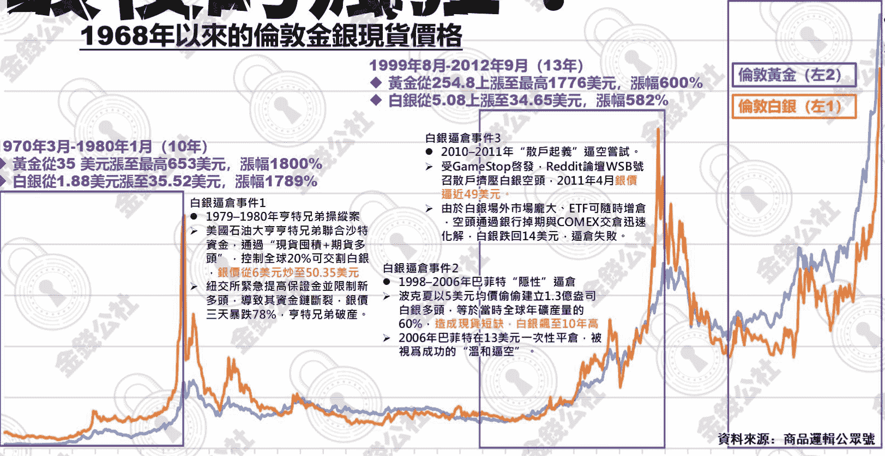

倫敦黃金（左2）
倫敦白銀（左1）

2025/11/27
CME當機交易掛了。
➢ 等到Comex重新開盤，白銀價格直接跳空，倫敦現貨、紐約期貨報價衝上57.58美元，創歷史新高，當天漲幅超過5%。

資料來源：商品選擇公眾號

### 2008以來首見！日本升息預期增 2年期債殖利率升至1%

12/1《彭博》報導，對貨幣政策預期較為敏感的日本2年期國債殖利率，在日銀總裁植田和男於名古屋發表演說前上升1個基點突破至1%，至2007年8月以來最高水準。日圓兌美元匯率也跟著走強，一度來到155.48附近創近2周新高。

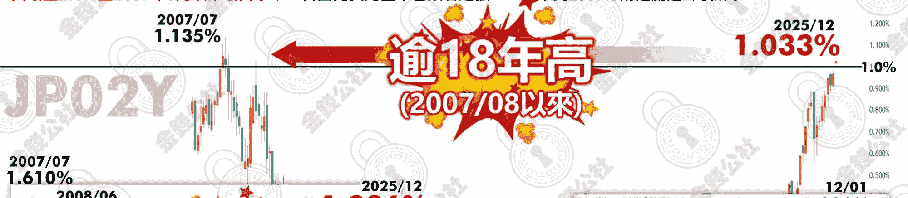

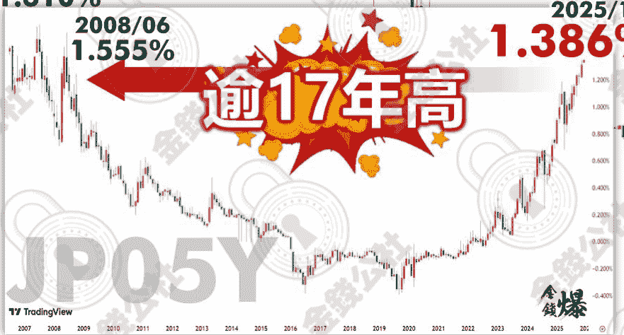

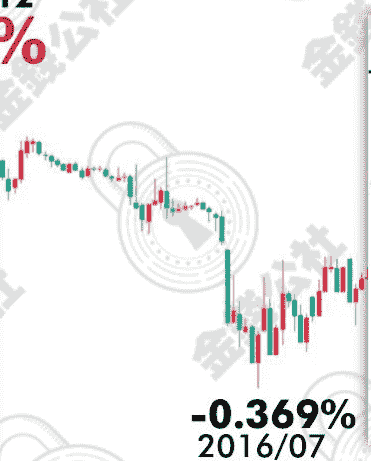

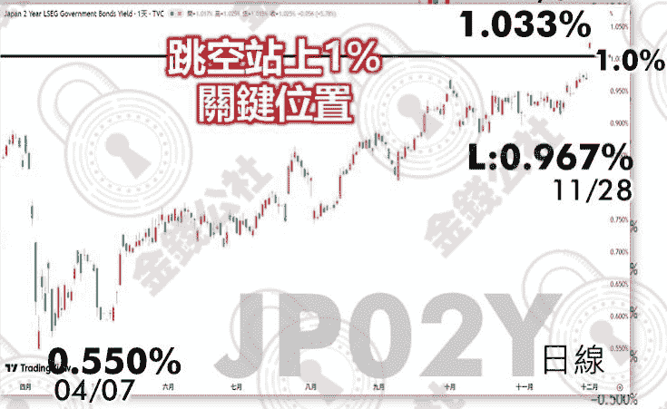

資料來源：tradingview. 彭博社

### 日本銀行央行總裁釋出12月可能加息的最明確暗示…

植田和男周一(1日)在名古屋舉行的金融經濟論壇上向當地企業領袖致詞時表示，央行將在本月18日至19日舉行的貨幣政策會議上，就「檢視國內外經濟、通膨及金融市場的情況後，權衡加息的利弊並作出適當決策」。

#### 薪資談判

薪資增長被置於首要位置。植田在會議中反復強調，確認薪資談判的初步勢頭至關重要…
經濟能否進入「工資-物價」的良性循環，是實現其2%通脹目標的關鍵。
央行預計作為「企業利潤總體上仍將保持高位」，替企業在明年提供更大幅度的加薪創造了條件。

#### 通脹評估

植田指出，通脹水平將在央行展望報告三年預測期的後半段，大致達到與我們2%目標一致的水準。
預計GDP負增長只是暫時的。
核心消費者通脹率可能在2026財年上半年暫時放緩至2%以下，之後將重新加速上漲。

#### 匯率變化

匯率必須反映基本面，日元疲軟會推升消費者通脹。但引導貨幣政策時必須注意，匯率波動會影響通脹預期和潛在通脹。

最後，植田和男稱考慮到物價上漲、實質利率目前處於極低水平，並表示，
提高利率不會給經濟踩剎車，而是逐步放慢經濟運行速度，以實現經濟和物價的穩定。

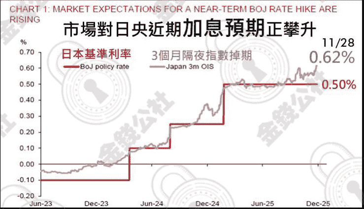

## Japan 10-Year Yield Hits 2008 Peak

## 日本10年期公債殖利率達2008年峰值

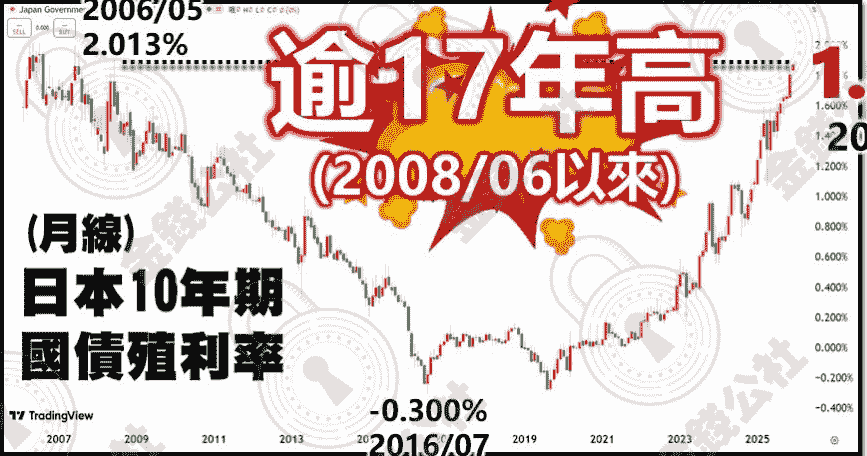

## 日本10年期國債殖利率
(2025/12/1：1.877%)

2006/05：2.013%

2007/06：130.76

2020/03：155.89

## 日本10年期
國債期貨價格
(月線)

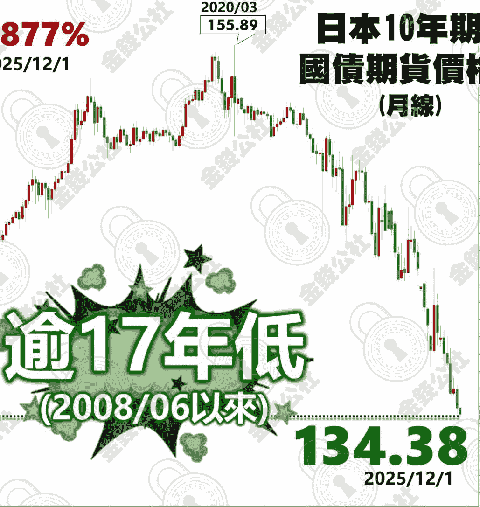

## 逾17年新低
(2008/06以來)

134.38
2025/12/1

資料來源：investing.tradingview

### 世債落殺

## 2年債入札、やや弱めの結果との声―増発警戒や日銀早期利上げ観測で

11/28、日本拍賣2兆日圓2年期國債，數據顯示

- 得標平均殖利率為0.993%，大幅高於前次的0.932%
- 投標倍數3.53，大幅低於前次的4.35，也低於過去12個月的3.66
- 尾部利差0.012（大幅高於前次的0.002，尾部利差擴大常被視為需求疲軟信號）

## Auction Result of 2-Year JGBs on November 28, 2025

| Security | Issue Number | Auction Date | Issue Date | Maturity Date | Nominal Coupon | Amounts of Competitive Bids (billion yen) | Amounts of Bids Accepted (billion yen) | Lowest Accepted Price | Yield at Lowest Accepted Price | Allotment Ratio at the Lowest Accepted Price | Weighted Average Price | Yield at Average Price | Amounts of Competitive Bids Tendered/Accepted (billion yen) | Amounts of Bids Accepted at Non-price Competitive Auction I (billion yen) | Amounts of Bids Accepted at Non-price Competitive Auction II (billion yen) |
|---|---:|---|---|---|---:|---:|---:|---:|---:|---:|---:|---:|---:|---:|---:|
| 2-Year | 479 | 11/28/2025 | 12/1/2025 | 12/1/2027 | 1.0% | 7464.9 | 2114.1 | 100.000 | 1.000% | 5.8823% | 100.012 | 0.993% | 1.000 | 584.1 | - |

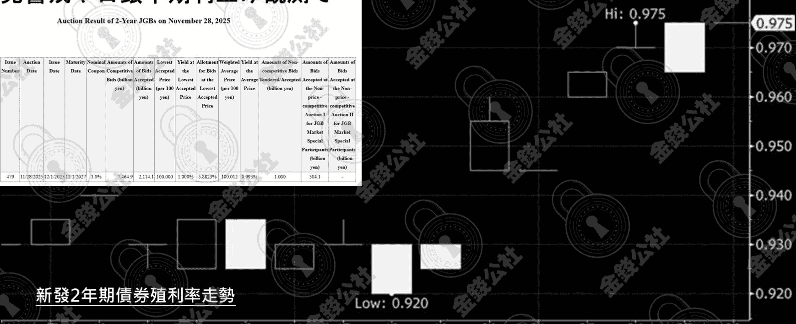

## 新発2年期債券殖利率走势

植田和男名古屋發表講話後，互換合約顯示，12月升息的可能性高達73%，高於上週的57%... 到2026年10月市場預期可能加息兩次，隔夜利率預計將超過1%。

## 日本實質利率為-2.523%（有效利率 0.477% - 10月核心CPI 3%）

日本的實質利率遠低於其他已開發國家，而美國和英國利率則在2%左右。當實際利率為正時，存款和投資的價值會增加；反之當實質利率為負值時，金融機構存款利息的成長速度會低於物價上漲的速度，導致貨幣價值下降。

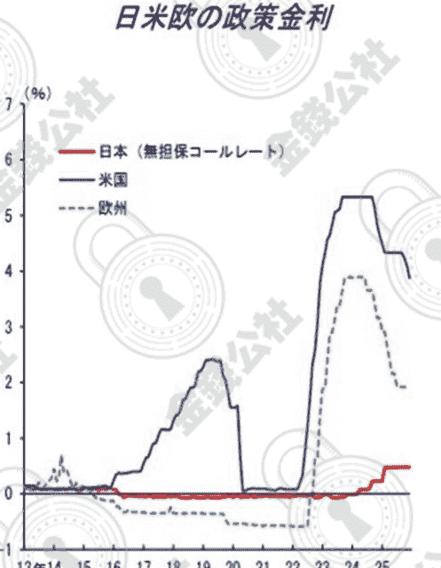

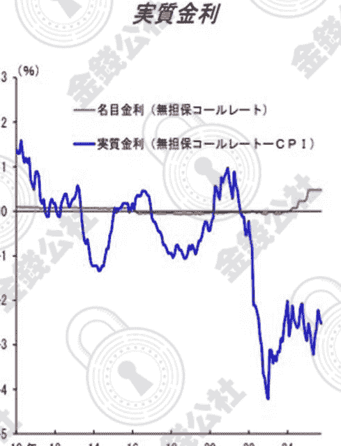

註：1. 左圖の米国は、実効FF金利、欧州は、2019/9月まではEONIA、10月以降はESTR。 2. 右図のCPIは、各く生鮮食品の前年比。消費者物価指数上昇率を除く。 （出所）日本銀行、総務省、Bloomberg

| Region | Japan | Instrument | Overnight Index Swaps |
|---|---:|---|---|
| Target Rate | 0.500 | Pricing Date | 12/01/2025 |
| Effective Rate | 0.477 | Cur. Imp. O/N Rate | 0.477 |

| Meeting | #Hikes/Cuts | %Hike/Cut | Imp. Rate Δ | Implied Rate | A.R.M. |
|---|---:|---:|---:|---:|---:|
| 12/19/2025 | +0.729 | +72.9% | +0.182 | 0.660 | 0.250 |
| 01/23/2026 | +0.925 | +19.6% | +0.231 | 0.709 | 0.250 |
| 03/19/2026 | +0.967 | +4.2% | +0.242 | 0.719 | 0.250 |
| 04/28/2026 | +1.183 | +21.6% | +0.295 | 0.773 | 0.250 |
| 06/16/2026 | +1.376 | +19.2% | +0.344 | 0.821 | 0.250 |
| 07/31/2026 | +1.644 | +26.9% | +0.411 | 0.888 | 0.250 |
| 09/18/2026 | +1.833 | +18.9% | +0.458 | 0.936 | 0.250 |
| 10/30/2026 | +1.994 | +16.1% | +0.498 | 0.976 | 0.250 |

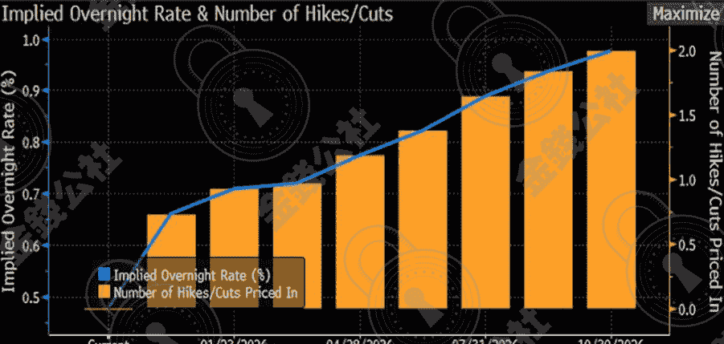

### 日債殖利率曲線熊陡走

## Facing Headwinds

Japan's capital spending falls for first time in six quarters

#### 扣除軟體的資本支出季對季變化

12/1日本財務省公布7-9月企業查報告中
扣除軟體的資本支出轉負值

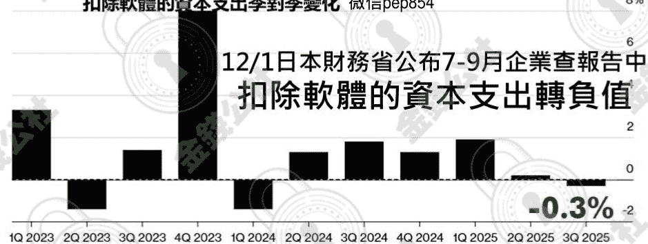

-0.3%

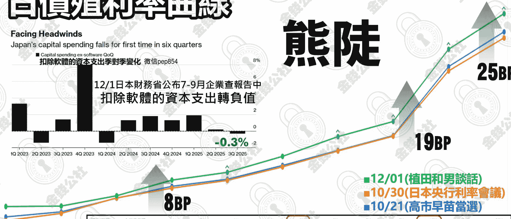

8BP

19BP

25BP

■ 12/01（植田和男談話）
■ 10/30（日本央行利率會議）
■ 10/21（高市早苗當選）

| 國家/地區 | 在指定日期 | 3M | 6M | 1Y | 2Y | 3Y | 5Y | 7Y | 10Y | 20Y | 30Y |
|---|---|---:|---:|---:|---:|---:|---:|---:|---:|---:|---:|
| 日本 | 當前：2025年12月1日 | 0.655% | 0.662% | 0.808% | 1.030% | 1.140% | 1.367% | 1.646% | 1.861% | 2.884% | 3.389% |
| 日本 | 2025年10月30日 | 0.455% | 0.558% | 0.777% | 0.916% | 1.026% | 1.218% | 1.443% | 1.653% | 2.577% | 3.045% |
| 日本 | 2025年10月21日 | 0.508% | 0.580% | 0.773% | 0.942% | 1.043% | 1.238% | 1.452% | 1.662% | 2.638% | 3.131% |

## 長期金利が上昇した背景は

> 期限溢價是投資者為彌補債券市場價格波動風險而要求的一種溢價。如果預期價格波動加劇（即下跌風險增加），除非殖利率高於往常，否則投資者將避免投資。

日本財務省報告指出，有4個因素會影響期限溢價。分別是日債VIX指數、美債期限溢價、政府債券未償餘額、日本央行持有國債餘額，結合這四點觀察，可以很好的觀察日本國債的期限溢價，決定係數(R²)為0.8863。

根據回歸分析發現，日本近期期限溢價的創高，主因是「日本國債供給增加＋市場波動上升，而不是美國因素」。

## 長期金利と期待インフレ率、タームプレミアム

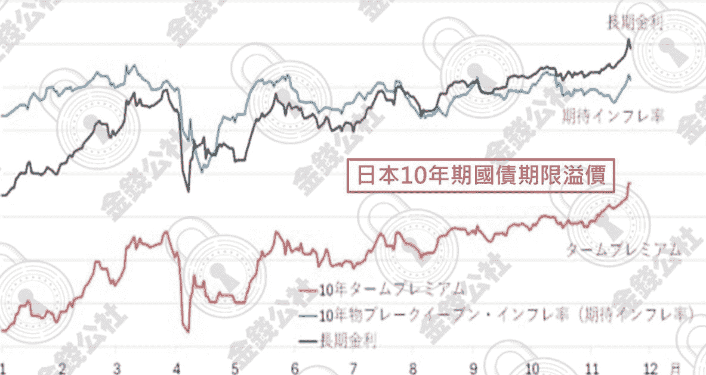

## タームプレミアムの変動要因分析

| 変数 | 説明変数 | JGBタームプレミアム TP_JGB |
|---|---:|---:|
| ① JGB及びVIX | JGBV | 4.738 *** |
| ② 米国債タームプレミアム | TP_UST | 0.2016 *** |
| ③ 国債発行残高（対数） | LN_AM_JGB | 402.6 *** |
| ④ 日銀保有割合（対数） | LN_BOJHold | -73.35 *** |
| 定数項 | Intercept | -2333 *** |
| 決定係数 |  | 0.8863 |

- ① JGB及びVIX → ① 1月？
- ② 11/19データまで横ばい
- ③ 発行残高（需給悪化）
- ④ 従来通り継続中

## 財務省、今年度国債発行計画見直し－6カ月短国と2年・5年債増額

財務省發債計畫大幅向短債傾斜，增加短期國庫券及2年期・5年期債券的發行量。

11/28，日本內閣批准一項規模18.3兆日圓的追加預算，以支援首相高市早苗經濟刺激方案。據財務省聲明，其中11.7兆將透過發行新債券來彌補。為反映這一變化，日本政府修訂本財年的債券發行計畫。財政部宣布將增發3000億的2年期國債和3000億的5年期國債，同時大幅增加6.3兆的財務省短期國庫券（Treasury bills）發行。而10年至40年期債券發行維持不變。此舉旨在為刺激方案融資同時避免過度衝擊市場，但財政紀律擔憂和央行加息預期已將長期殖利率推至高位。而在前一天11/27，一級交易商與財政部的會議中，已要求政府增加2年、5年和10年期債券發行，同時減少超長期債券的發行量。

#### （カレンダーベース市中発行額）

| 區分 | 令和7年度當初 | 令和7年度6月計画変更後 | 令和7年度補正後 | 差額 |
|---|---:|---:|---:|---:|
| 40年債 | 3.0 | 2.5 | 2.5 | ▲0.5 |
| 30年債 | 9.6 | 8.7 | 8.7 | ▲0.9 |
| 20年債 | 12.0 | 10.2 | 10.2 | ▲1.8 |
| 10年債 | 31.2 | 31.2 | 31.2 | — |
| 5年債 | 28.8 | 28.8 | 29.1 | 0.3 |
| 2年債 | 31.2 | 31.8 | 32.1 | 0.9 |
| 割引短期国債 | 40.8 | 42.9 | 49.2 | 8.4 |
| 10年物価連動債 | 3.0 | 1.0 | 1.0 | — |
| クライメート・トランジション国債 | 1.2 | 1.2 | 1.2 | — |
| 流動性供給入札 | 13.5 | 13.5 | 13.5 | — |
| 計 | 172.3 | 171.8 | 178.7 | 6.4 |

2年和5年期國債將分別增加3000億，自明年1月起，2年和5年期國債每次拍賣發行量將增加1000億。透過常規拍賣（按日曆年發行）向市場發行的債券總量達到178.7兆，較6月的調整增加6.9兆。

#### （表1）割引短期国債の発行予定額

6個月期現國庫券發行將增加6.3兆。

#### （表2）クライメート・トランジション国債の発行予定額

#### （表3）流動性供給入札の発行予定額

資料來源：日本財務省

國際清算銀行根據貿易流採樣編製有效匯率指數，日本的名目有效匯率指數前六大權重分別是：

- 1. 中國大陸 (31.9%)
- 2. 美國 (16.0%)
- 3. 墨西哥 (13.0%)
- 4. 韓國 (6.0%)
- 5. 中國台灣 (4.6%)
- 6. 泰國 (3.7%)

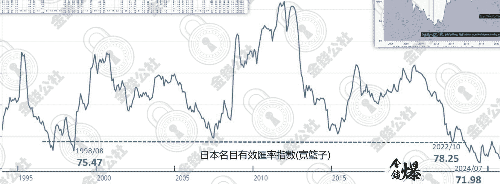

## 94年後日圓干預歷史

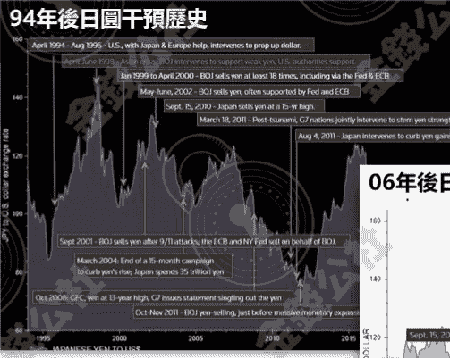

白字是賣出日圓，綠字是買入日圓。BOJ的干預立場從2022年起有所改變…

## 06年後日圓干預歷史

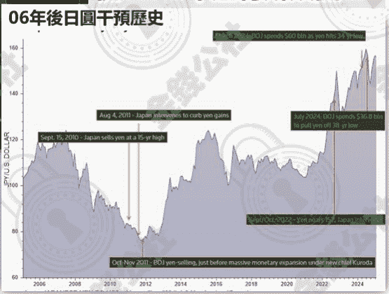
