# 金錢爆金鐵桿

完整版節目資料

北京時間2025年12月1日晚間11點，美國供應管理協會（ISM）公布數據。

# 美國11月ISM製造業指數為48.2，低於預期49.0，低於10月48.7

ISM調查委員會主席Spence表示，關稅不確定性使客戶傾向延後下單，目前看不到足以扭轉趨勢的訊號。

還提到，近期「利率下調與AI熱潮」等事件，並未對製造業產生實質影響。

資料來源：ISM，WIND

# 1948年以來美國PMI最長時期收縮

- 1948/3—1949/8：18個月中有17個月收縮
- 1970/1—1971/1：13個月中有12個月收縮
- 1974/9—1975/7：連11個月收縮
- 1979/8—1980/8：13個月中有12個月收縮
- 1981/7—1983/1：連19個月收縮
- 1989/5—1991/5：25個月中有24個月收縮
- 2000/8—2002/1：連18個月收縮
- 2007/12—2009/7：20個月中有18個月收縮
- 2022/11—2025/11：37個月中有34個月收縮

2025/11：48.2

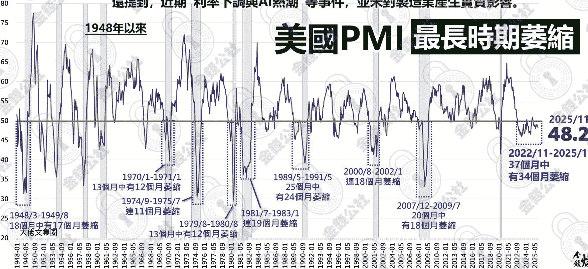

# The AI Investing Race

# “AI” EVERYWHERE

# Capex from the major AI hyperscalers

Alphabet, Amazon (AWS), Meta, Microsoft

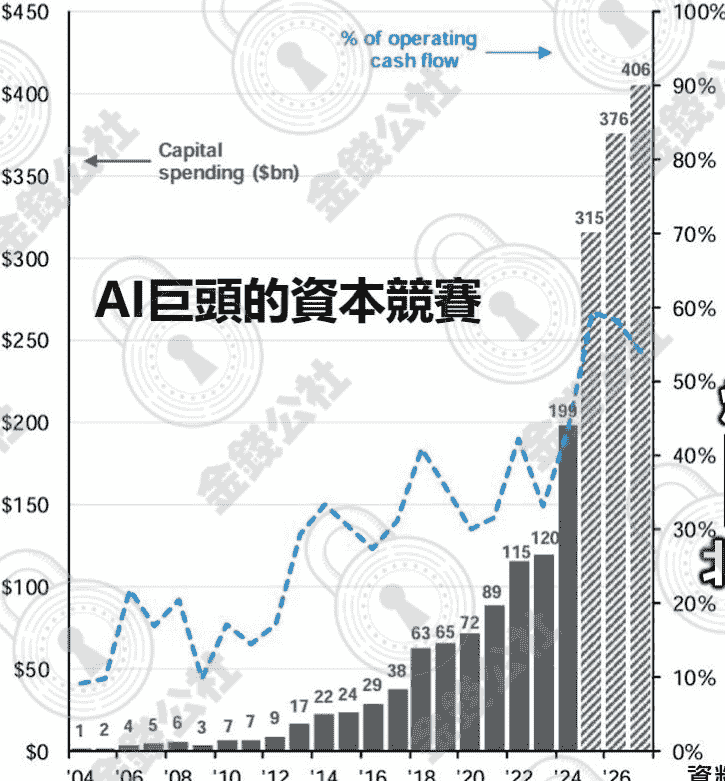

# AI巨頭的資本競賽

> Chip shop cuts costs by using AI to take orders  
> 炸魚薯條店利用人工智慧接單降低成本

> Agentic AI autonomy grows in North American enterprises  
> 北美企業中智能體人工智慧自主性日益增強

> How generative AI could add trillions to the global economy  
> 生成式人工智慧如何為全球經濟貢獻數兆美元

資料來源：stonebridgefcg

# WHAT RESPONDENTS ARE SAYING

> “No major changes at this time, but going into 2026, we expect to see big changes with cash flow and employee head count. The company has sold off a big part of the business that generated free cash while offering voluntary severance packages to anyone.”
>
> *(Petroleum & Coal Products)*
>
> （石油及煤炭產品業）「目前沒有重大變化，但進入2026年後，我們預計現金流和員工人數將出現重大變動。公司已出售了大部分產生自由現金流的業務，同時向所有員工提供自願離職方案。」

> “Business continues to be a struggle regarding long-term sourcing decisions based on tariffs and lending costs. External (or international) sourcing remains the lowest-cost solution compared to U.S. production/manufacturing. The delta is smaller now, reducing margins.”
>
> *(Computer & Electronic Products)*
>
> （電腦及電子產品業）「在基於關稅和到岸成本進行長期採購決策方面，業務依然面臨掙扎。與美國本土生產製造相比，外部（或國際）採購仍然是成本最低的解決方案。但兩者之間的成本差距正在縮小，進而壓縮了利潤空間。」

> “Trade confusion. At any given point, trade with our international partners is clouded and difficult. Suppliers are finding more and more errors when attempting to export to the U.S.—before I even have the opportunity to import. Freight organizations are also having difficulties overseas, contending with changing regulations and uncertainty: conditions are more trying than during the coronavirus pandemic in terms of supply chain uncertainty.”
>
> *(Electrical Equipment, Appliances & Components)*
>
> （電機設備、電器及組件業）「貿易局勢混亂……供應商在執行對美出口作業時發現錯誤率攀升，使得貨物在進入我方進口報關流程之前，就已面臨阻礙。貨運機構在海外也面臨困境，必須應對不斷變化的法規與不確定性。就供應鏈的不確定性而言，目前的狀況比新冠疫情期間更為艱難。」

> “Domestic and export business have been lackluster. Our customers are taking prompt orders only and still don’t have confidence to buy inventory. Much less make expansion plans. In fact, most of any kind of planning has been undermined by unpredictability due to inconsistent messaging from Washington. Artificial intelligence is in its infancy stages, producing confusing and most often inaccurate information. This also causes apprehensive consumer buying patterns, contributing to the challenge of forecasting demand.”
>
> *(Wood Products)*
>
> （木材製品業）「客戶僅下即期訂單，對於建立庫存仍缺乏信心，更遑論制定擴張計畫。事實上，由於華盛頓方面釋出的訊息反覆無常，這種不可預測性破壞了絕大多數的『規劃』工作。人工智慧仍處於起步階段，提供的資訊往往令人困惑且大都不準確。這也導致消費者採取保守觀望的購買模式，進一步增加了需求預測的難度。」

# ISM Manufacturing PMI at 48.2%

| 指數 | 11月指數 | 10月指數 | 百分點變化 | 方向 | 變化速度 | 趨勢†（月數） |
|---|---:|---:|---:|---|---|---:|
| 製造業PMI | 48.2 | 48.7 | -0.5 | 收縮 | 加快 | 9 |
| 新訂單指數 | 47.4 | 49.4 | -2.0 | 收縮 | 加快 | 3 |
| 生產指數 | 51.4 | 48.2 | +3.2 | 成長 | 由收縮轉為成長 | 1 |
| 就業指數 | 44.0 | 46.0 | -2.0 | 收縮 | 加快 | 10 |
| 供應商交付時間 | 49.3 | 54.2 | -4.9 | 加快 | 由放緩轉為加快 | 1 |
| 自有庫存指數 | 48.9 | 45.8 | +3.1 | 收縮 | 放緩 | 7 |
| 客戶端庫存 | 44.7 | 43.9 | +0.8 | 過低 | 放緩 | 14 |
| 價格指數 | 58.5 | 58.0 | +0.5 | 上升 | 加快 | 14 |
| 積壓訂單 | 44.0 | 47.9 | -3.9 | 收縮 | 加快 | 38 |
| 新出口訂單 | 46.2 | 44.5 | +1.7 | 收縮 | 放緩 | 9 |
| 進口指數 | 48.9 | 45.4 | +3.5 | 收縮 | 放緩 | 8 |

「新訂單」與「生產」為兩大領先指標，透露未來整體製造業的榮枯狀況。

「客戶端庫存」被視為未來新訂單和生產的潛在動能。

# 新訂單可體現未來需求的變化

今年來有9個月在收縮區間。

# 就業指數連10個月在收縮區間

約25%受訪者稱就業減少，為2020年中以來最高占比。

# 自有庫存指數連7個月收縮

# 客戶端庫存指數連14個月收縮

# 價格指數自2024年1月來的23個月中，有22個月在擴張區間

# 積壓訂單自2022年9月來，連38個月收縮

# 新出口訂單自今年3月來，連9個月收縮

進口指數自今年4月來，連8個月收縮。

# ISM製造業調查

## 採購經理人怎麼說？

調查邏輯與計算：

針對每項指標，請經理人回答認為當月「轉好」、「持平」或「轉差」，再將每個細項回答的人數計算：

- （認為轉好的人數 ÷ 總人數）× 1 ＋（認為持平的人數 ÷ 總人數）× 0.5 ＋（認為變差的人數 ÷ 總人數）× 0
- 最後把新訂單、生產、雇員、供應商交貨、存貨這五項指數加權計算，目前各權重都是20%。

ISM製造業PMI = 新訂單 × 0.2 ＋ 產出 × 0.2 ＋ 雇傭 × 0.2 ＋ 供應商交貨 × 0.2 ＋ 自有庫存 × 0.2

## 新訂單：11月數值低於12個月平均值48.9

| New Orders | % Higher | % Same | % Lower | Net | Index |
|---|---:|---:|---:|---:|---:|
| Nov 2025 | 20.7 | 50.9 | 28.4 | -7.7 | 47.4 |
| Oct 2025 | 20.4 | 53.6 | 26.0 | -5.6 | 49.4 |
| Sep 2025 | 18.5 | 56.5 | 24.9 | -6.3 | 48.9 |
| Aug 2025 | 24.7 | 52.6 | 22.7 | +2.0 | 51.4 |

## 客戶庫存：11月數值仍處於「過低」區間

| Customers Inventories | % Reporting | % Too High | % About Right | % Too Low | Net | Index |
|---|---:|---:|---:|---:|---:|---:|
| Nov 2025 | 73 | 8.8 | 71.8 | 19.4 | -10.6 | 44.7 |
| Oct 2025 | 75 | 11.8 | 64.1 | 24.1 | -12.3 | 43.9 |
| Sep 2025 | 73 | 10.5 | 66.3 | 23.2 | -12.7 | 43.7 |
| Aug 2025 | 74 | 9.5 | 70.1 | 20.4 | -10.9 | 44.6 |

## 產出以4個月來最快的速度擴張，但今年來的產出表現仍不穩定

| Production | % Higher | % Same | % Lower | Net | Index |
|---|---:|---:|---:|---:|---:|
| Nov 2025 | 22.8 | 57.4 | 19.8 | +3.0 | 51.4 |
| Oct 2025 | 17.3 | 60.7 | 22.0 | -4.7 | 48.2 |
| Sep 2025 | 19.0 | 60.5 | 20.5 | -1.5 | 51.0 |
| Aug 2025 | 16.6 | 62.3 | 21.1 | -4.5 | 47.8 |

## 原材料價格：連14個月在擴張區間

| Prices | % Higher | % Same | % Lower | Net | Index |
|---|---:|---:|---:|---:|---:|
| Nov 2025 | 27.2 | 62.6 | 10.2 | +17.0 | 58.5 |
| Oct 2025 | 27.3 | 61.4 | 11.3 | +16.0 | 58.0 |
| Sep 2025 | 32.5 | 58.8 | 8.7 | +23.8 | 61.9 |
| Aug 2025 | 33.5 | 60.4 | 6.1 | +27.4 | 63.7 |

## 雇傭：自2022年5月以來，就業指數在43個月中有36個月出現萎縮

| Employment | % Higher | % Same | % Lower | Net | Index |
|---|---:|---:|---:|---:|---:|
| Nov 2025 | 10.8 | 64.1 | 25.1 | -14.3 | 44.0 |
| Oct 2025 | 13.1 | 64.6 | 22.3 | -9.2 | 46.0 |
| Sep 2025 | 11.1 | 64.5 | 24.4 | -13.3 | 45.3 |
| Aug 2025 | 9.4 | 68.2 | 22.4 | -13.0 | 43.8 |

## 積壓訂單：報告稱，在貿易和地緣政治因素影響減弱前，預計不會有太大改善

| Backlog of Orders | % Reporting | % Higher | % Same | % Lower | Net | Index |
|---|---:|---:|---:|---:|---:|---:|
| Nov 2025 | 90 | 13.9 | 60.2 | 25.9 | -12.0 | 44.0 |
| Oct 2025 | 90 | 15.7 | 64.4 | 19.9 | -4.2 | 47.9 |
| Sep 2025 | 89 | 17.2 | 58.0 | 24.8 | -7.6 | 46.2 |
| Aug 2025 | 91 | 16.3 | 56.7 | 27.0 | -10.7 | 44.7 |

## 交付時間：經歷3個月交付放緩，11月變為加快。該指數17個月來第三次低於50

| Supplier Deliveries | % Slower | % Same | % Faster | Net | Index |
|---|---:|---:|---:|---:|---:|
| Nov 2025 | 6.1 | 86.3 | 7.6 | -1.5 | 49.3 |
| Oct 2025 | 11.6 | 85.2 | 3.2 | +8.4 | 54.2 |
| Sep 2025 | 11.2 | 82.7 | 6.1 | +5.1 | 52.6 |
| Aug 2025 | 9.2 | 84.2 | 6.6 | +2.6 | 51.3 |

## 新出口訂單：受訪者認為，訂單受關稅和美國經濟政策持續不確定性的影響

| New Export Orders | % Reporting | % Higher | % Same | % Lower | Net | Index |
|---|---:|---:|---:|---:|---:|---:|
| Nov 2025 | 74 | 10.3 | 71.8 | 17.9 | -7.6 | 46.2 |
| Oct 2025 | 72 | 10.5 | 68.0 | 21.5 | -11.0 | 44.5 |
| Sep 2025 | 71 | 7.2 | 71.5 | 21.3 | -14.1 | 43.0 |
| Aug 2025 | 71 | 11.3 | 72.6 | 16.1 | -4.8 | 47.6 |

## 自有庫存：報告稱，11月僅食品、飲料和菸草製品業及電腦和電子產品業擴張

| Inventories | % Higher | % Same | % Lower | Net | Index |
|---|---:|---:|---:|---:|---:|
| Nov 2025 | 14.4 | 67.9 | 17.7 | -3.3 | 48.9 |
| Oct 2025 | 13.2 | 65.1 | 21.7 | -8.5 | 45.8 |
| Sep 2025 | 16.0 | 63.7 | 20.3 | -4.3 | 47.7 |
| Aug 2025 | 19.5 | 61.9 | 18.6 | +0.9 | 49.4 |

## 進口：報告稱，關稅相關的價格壓力和疲軟的需求仍影響消費者購買行為

| Imports | % Reporting | % Higher | % Same | % Lower | Net | Index |
|---|---:|---:|---:|---:|---:|---:|
| Nov 2025 | 84 | 13.4 | 71.0 | 15.6 | -2.2 | 48.9 |
| Oct 2025 | 84 | 10.4 | 69.9 | 19.7 | -9.3 | 45.4 |
| Sep 2025 | 84 | 9.9 | 69.6 | 20.5 | -10.6 | 44.7 |
| Aug 2025 | 84 | 9.8 | 72.4 | 17.8 | -8.0 | 46.0 |

※ 交付時間指數低於50表示送貨速度加快，高於50表示送貨速度放緩。

資料來源：ISM

NEWS RELEASE  
MARKET SENSITIVE INFORMATION  
Embargoed until 1000 CET (0900 UTC) 3 November 2025

## HCOB Eurozone Manufacturing PMI®

## 歐元區需求疲軟、數量加速

2025年12月2日，標普全球公布11月份歐元區數據顯示，製造業PMI為49.6，低於前值50，低於初值49.7。出口訂單連續第五個月下降，凸顯國際市場持續面臨挑戰。為因應需求疲軟，製造商以7個月以來最快的速度裁員，成品庫存也創2021年7月以來最大的幅度減少。

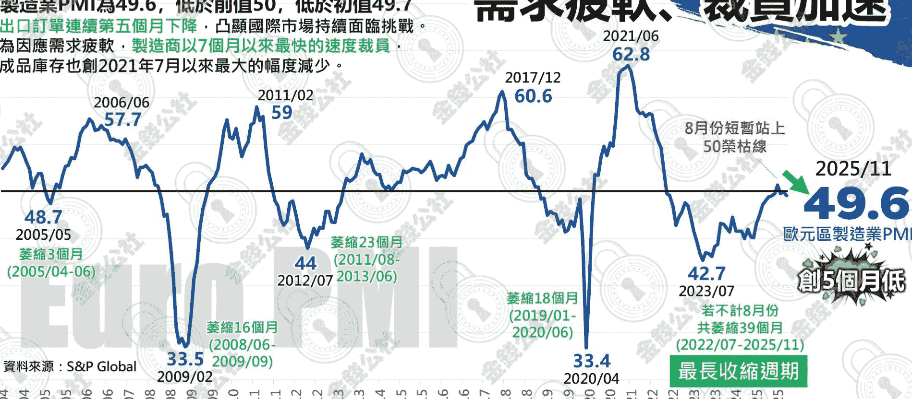

2025/11  
49.6  
歐元區製造業PMI

8月份短暫站上50榮枯線

創5個月低

最長收縮週期

資料來源：S&P Global

## ISM 美國ISM製造業指數（左軸）

聯邦基金利率（上限／右軸）

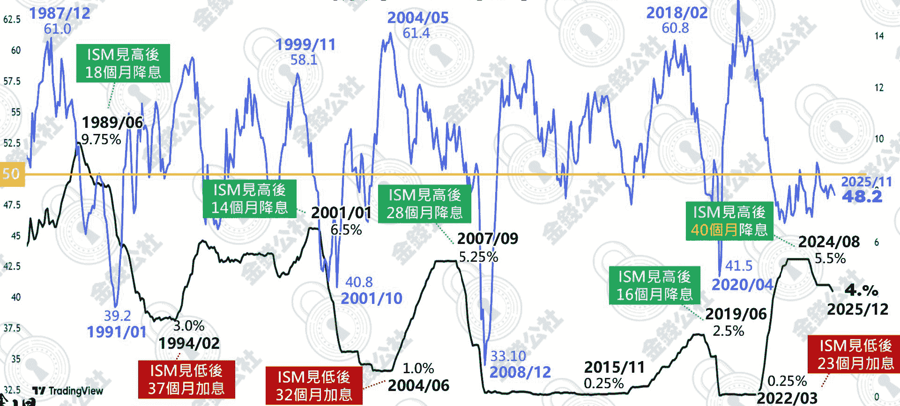

1987/12 61.0

1999/11 58.1

2004/05 61.4

2018/02 60.8

2021/03 64.7

2025/11 48.2

1989/06 9.75%

1994/02 3.0%

2001/01 6.5%

2004/06 1.0%

2007/09 5.25%

2015/11 0.25%

2019/06 2.5%

2022/03 0.25%

2024/08 5.5%

2025/12 4.4%

> ISM見高後  
> 18個月降息

> ISM見高後  
> 14個月降息

> ISM見高後  
> 28個月降息

> ISM見高後  
> 16個月降息

> ISM見高後  
> 40個月降息

> ISM見低後  
> 37個月加息

> ISM見低後  
> 32個月加息

> ISM見低後  
> 23個月加息

資料來源：TradingView・金錢爆團隊

## 日銀鷹派言論引發全球債券動盪

## Global bonds slide after hawkish Bank of Japan comments

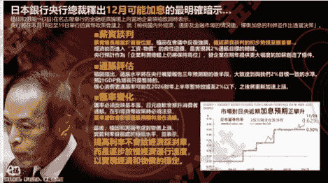

| 各國10年債殖利率 | 全面走揚 |
|---|---:|
| Turkey 土耳其 | 31.4150 ▲ 2.0650 |
| Mexico 墨西哥 | 8.8270 ▲ 0.1370 |
| Portugal 葡萄牙 | 3.1080 ▲ 0.0930 |
| Canada 加拿大 | 3.2440 ▲ 0.092 |
| United States 美國 | 4.0990 ▲ 0.0810 |
| Japan 日本 | 1.8790 ▲ 0.0722 |
| France 法國 | 3.4848 ▲ 0.0722 |
| New Zealand 紐西蘭 | 4.3350 ▲ 0.0693 |
| Spain 西班牙 | 3.2330 ▲ 0.0670 |
| Netherlands 荷蘭 | 2.8961 ▲ 0.0646 |
| Italy 義大利 | 3.4672 ▲ 0.0632 |
| Greece 希臘 | 3.3710 ▲ 0.0620 |
| Germany 德國 | 2.7518 ▲ 0.0605 |
| Australia 澳洲 | 4.5920 ▲ 0.0590 |
| India 印度 | 6.5710 ▲ 0.0560 |
| United Kingdom 英國 | 4.4860 ▲ 0.0390 |
| South Korea 南韓 | 3.3820 ▲ 0.0390 |
| Russia 俄羅斯 | 14.3500 ▲ 0.0200 |
| South Africa 南非 | 8.5050 ▲ 0.0100 |
| Switzerland 瑞士 | 0.1890 ▲ 0.0070 |

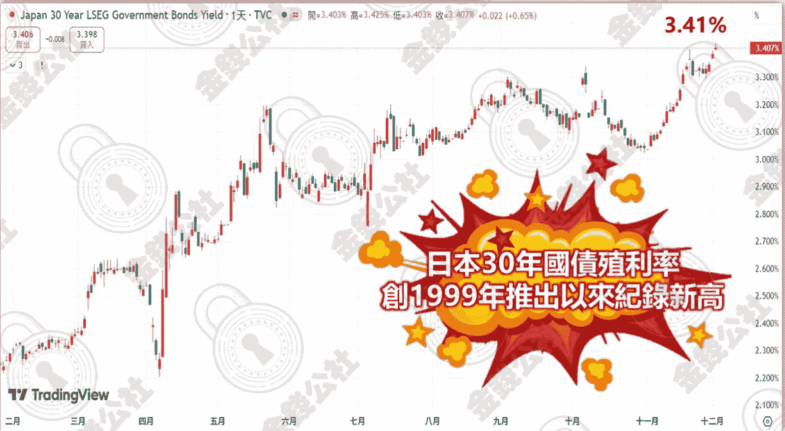

## 3.41%

資料來源：金融時報、英為財情

## 逾17年高（2008/06以來）

日本10年期國債殖利率（月線）

2006/05 2.013%

2025/12/2 1.885%

2016/07 -0.300%

## 日本10年期國債期貨價格（月線）

2020/03 155.89

## 逾17年低（2008/06以來）

134.38  
2025/12

2007/06 130.76

資料來源：Investing、TradingView

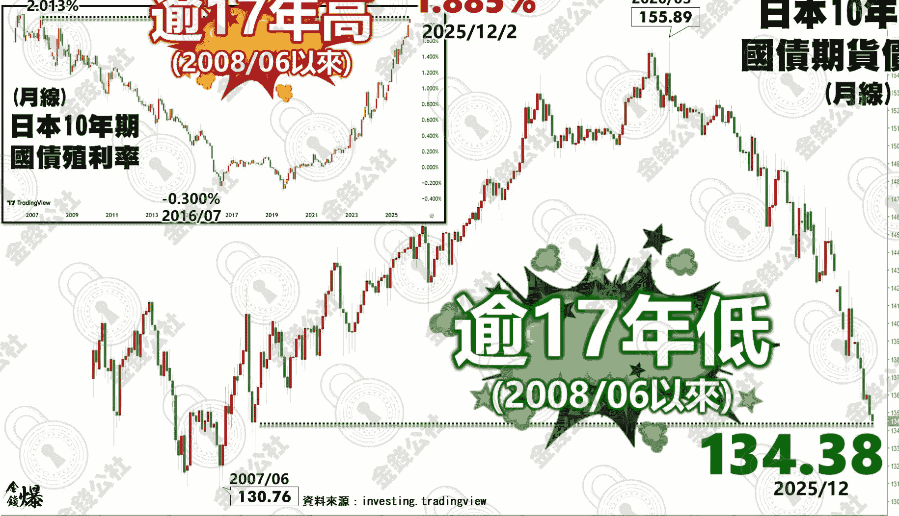

## 過去幾年，很多全球資金的玩法是這樣：借入日圓的低利息日圓 → 換成美元 → 買美股、買加密貨幣

現在日本突然說要加息，整個邏輯瞬間反轉：

借錢成本上升、套利交易成本變高 → 不利匯率 → 槓桿必須平倉 → 最先砸的一定是加密貨幣（因為如果日本加息，借日圓就不划算了，迫使投資者要平倉，那大量槓桿資金就必須撤離）

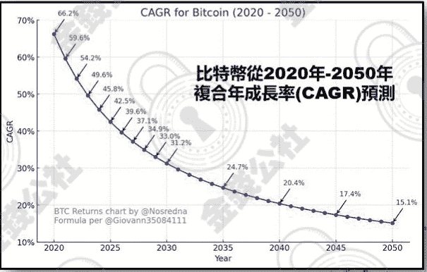

2025/10/6  
126,272

加密貨幣直接閃崩，多單爆倉！  
12月1日一天蒸發10億美元槓桿倉位  
比特幣跌破8.4萬美元

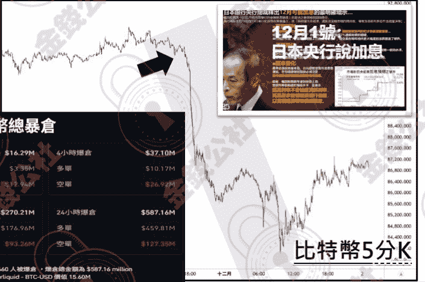

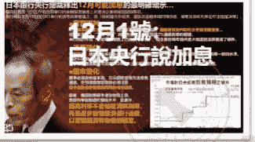

比特幣一年以來日線

比特幣5分K

2025/12/1  
83814

資料來源：TradingView、CoinGlass

## 便宜資金時代的結束

12/2，彭博報導，更高的日本國債殖利率將危及一項利潤豐厚的交易。自美聯儲2022年開始收緊貨幣政策以來的四年間，以日圓借款並以美元存放的套利交易以每年12.6%的速度增長。如果日本國債開始提供具有競爭力的殖利率，那麼便宜資金的時代就結束了，從美國國債撤資並重新配置到日本市場就合情合理，而這種情況似乎正在發生。

## When the Fed Hikes, Borrow From Tokyo

The yen carry trade has delivered 12.6% annually over the last four years

🔹 Bloomberg US Dollar / Japanese Yen Carry Trade Index

## 彭博美元／日圓套利交易指數

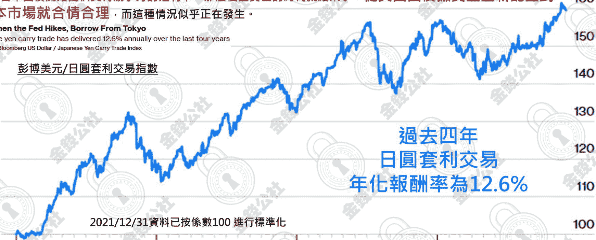

過去四年  
日圓套利交易  
年化報酬率為12.6%

2021/12/31 資料已按係數100進行標準化

資料來源：Bloomberg

日本長達數十年作為全球廉價流動性來源和波動性抑制者的角色正在發生逆轉……隨著日本央行逐步退出其殖利率曲線控制（YCC）政策，主要的風險傳導管道在於日本投資者可能大規模拋售其持有的海外債券，將資金匯回國內。這種資金回流可能引發全球「套息交易」的連鎖平倉，導致日圓急劇升值、全球債券殖利率上升，大幅收緊全球金融環境，進而衝擊股票和信用市場……

以往每當日本的融資環境趨緊（以日本國債互換利差衡量），全球風險資產（如標普500）幾乎總會同步經歷大幅回調。

## Figure 10: Tighter JPY funding conditions usually coincide with corrections of risky assets

## 更緊縮的日圓資金條件常與風險資產的修正一致

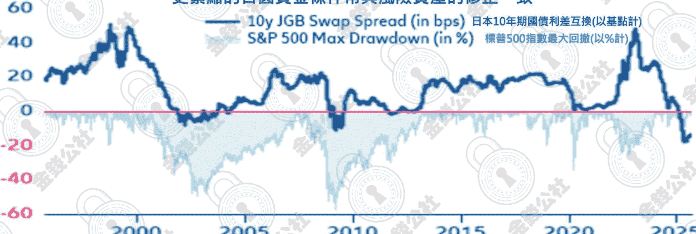

Sources: LSEG Datastream, Allianz Research

Published on Investing.com, 2/Dec/2025 - 4:57:10 GMT, Powered by TradingView.

US 10 Year T-Note Futures, 美國, CME:TYZ25, M

## 美債10年期價格月線（自1983年以來）

US10Y

1998/10  
123.59

2000/01  
93.67

2012/06  
135.91

2020/03  
140.70

2023/10  
105.67

2025/12  
112.97

加密幣暴跌，日圓暗示緊縮。  
美債10年期殖利率週一跳升7.3個基點

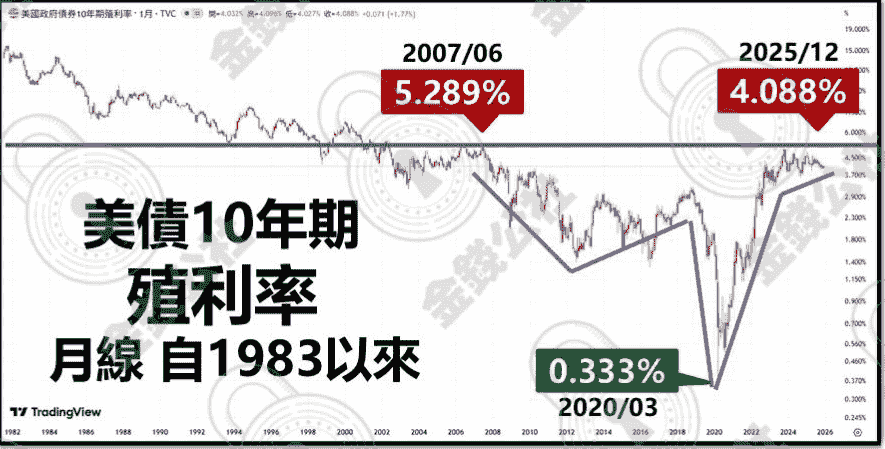

## 美債10年期殖利率月線（自1983年以來）

2007/06  
5.289%

2025/12  
4.088%

2020/03  
0.333%

資料來源：Investing、TradingView

## 美債30年期殖利率（1987年以來月線）

1987/10  
10.234%

2025/12/1  
4.751%

2020/3  
0.71%

2020/8  
183.79

2025/12/1  
116.66

1977/8  
55.16

55.16  
1981/9

89  
2000/1

## 30年美債價格挑戰本世紀最低？

## 近50年以來價格最低

30年期美債價格（1977年以來月線）

資料來源：TradingView、Investing

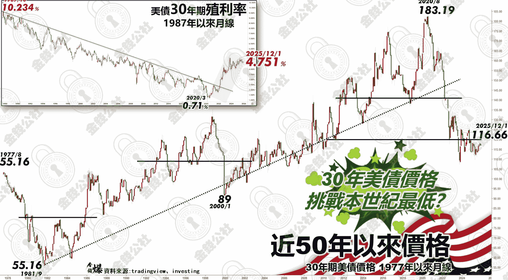

## 美國利率

週線／2022年以來

## 創逾3年低（2022年3月以來）

1.128  
2021/7/19

2022/3/17 Fed加息

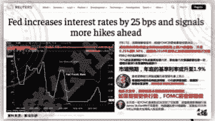

2022/10/17  
4.084

2023/10/16  
4.157

2024/7/31 日央加息

2025/1/13  
3.612

2.750  
2024/9/09

2024/9/19 Fed降息

2025/12/2  
2.200

2.165  
2025/1/24

月線／1985年以來

40年平均值：2.63

1985/11：9.629  
1990/9：0.545  
2000/1：4.952  
2020/7：0.517  
2023/10：4.157

## 美國歐洲重磅落差

## 美德利差

2023年以來日線

1999/12  
2.558%

2023/6/16  
1.7222%

2024/12/26  
2.312%

2018/11  
2.806%

2025/12/1  
1.292%

2025/12  
1.292%

創2年半最差  
2023/5以來

10年均線

0.000%

1992/8  
1.584%

2008/12  
-0.925%

1992年以來月線

美德利差 = 美國10年期國債殖利率 − 德國10年期國債殖利率

資料來源：TradingView

## EURO ZONE YIELDS EDGE UP

## ULTRA-LONG END OF GERMAN CURVE STEEPENS

## 歐債殖利率集體上揚，德國曲線變超陡

2025/12/01  
義國10年期國債殖利率  
3.472%

2025/12/01  
德國10年期國債殖利率  
2.755%

2025/12/01  
西國10年期國債殖利率  
3.243%

2025/12/01  
法國10年期國債殖利率  
3.491%

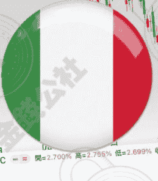

+6.9bp

+7.5bp

+6.1bp

+6.4bp

## German 30-year yield highest since September

2025年12月01日，德國30年期國債殖利率攀升至9月03日以來的最高，而德債殖利率曲線超長端逼近2019年5月以來最陡水平！德國議會上週五通過2026年預算，新增債務超過1800億歐元。

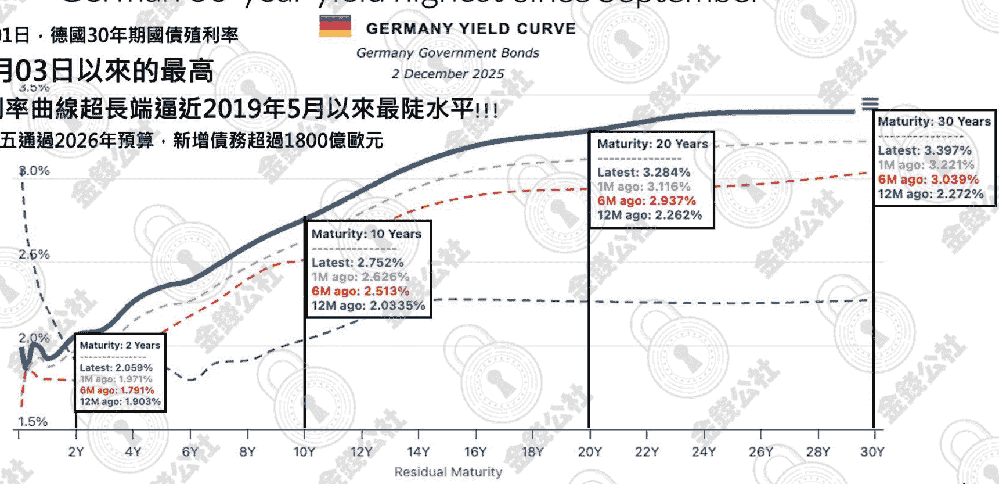

圖例：Latest；1M ago；6M ago；12M ago。橫軸：Residual Maturity。縱軸：收益率（%）。

資料來源：World Government Bonds
