## 金錢爆金鐵桿

### 完整版節目資料

## Commodities Are Breaking Out, Slowly

— Bloomberg Commodity Index

### 彭博商品指數

美元作為全球儲備貨幣和主要大宗商品的計價貨幣，是決定大宗商品短期至中期走勢的首要宏觀金融因素。美元對商品價格影響是多維度的，包括定價機制、資本流向以及宏觀週期傳導。大宗商品定價機制是美元影響力的根本原因。美元能影響商品價格，不是因為美國消費了最多，而是因為它充當了全球貿易的「計算單位」，又可稱作名義計價效應（Numeraire Effect）。

### 創3年新高

彭博商品指數是一個綜合性的商品價格指數，用於追蹤全球市場上主要商品的價格變動。包括了能源、金屬和農產品等多種商品的價格，可以作為投資者和分析師評估全球商品市場表現的參考指標。

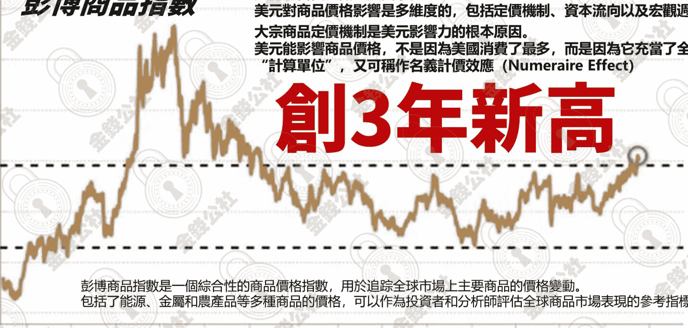

## Emerging FX Re-Emerges

Success fighting inflation has brought EM currencies to an 18-month high

### JP Morgan Emerging Market FX Index

12/4，彭博報導，市場預計美聯儲在12月會議降息25個基點的機率，已經超過90%...

**JP摩根新興市場貨幣領漲，彭博美元現貨指數下跌!!**

加拿大帝國商業銀行策略師表示，**只要風險資產，尤其是股票市場上漲持續，很難抵擋新興市場貨幣套利的吸引力**。

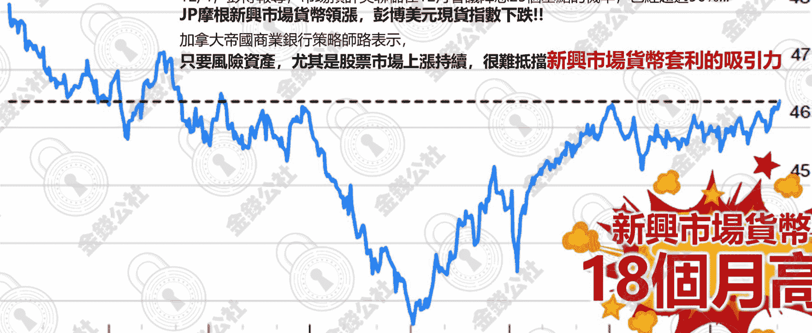

### 美元指數60分K

截至12月3日，美元指數已經連續7個交易日收黑。昨夜美元指數更是跌破99，創近一個月最低水平。

### 逾一個月低

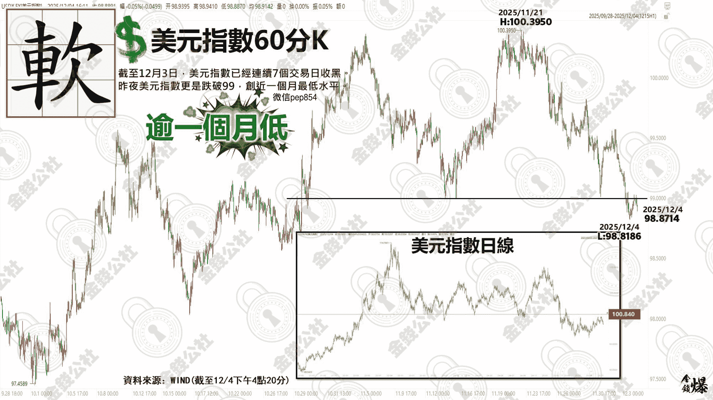

### 美元指數日線

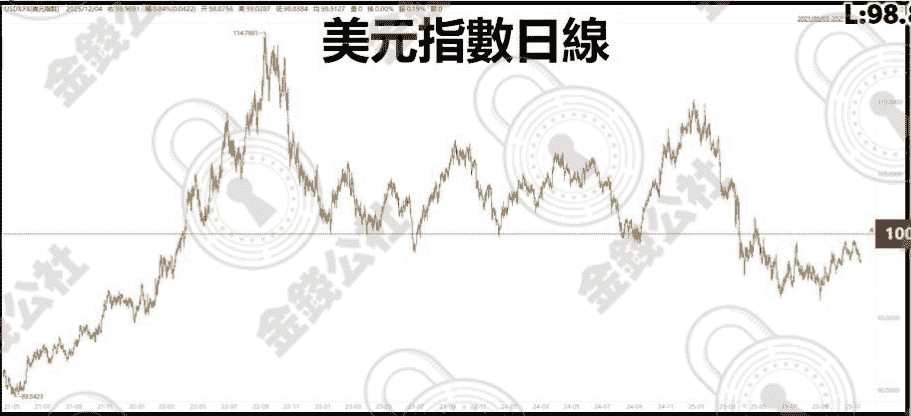

資料來源：WIND（截至12/4下午4點20分）

### 美元指數成分表現

2025/11/21 H:100.3950

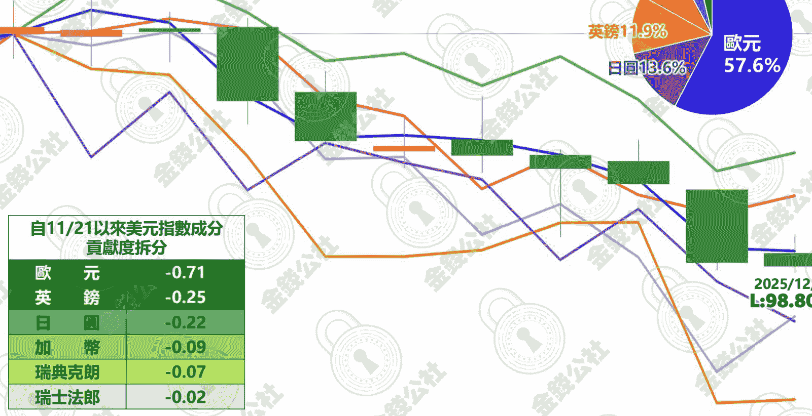

### 美元指數各幣別權重

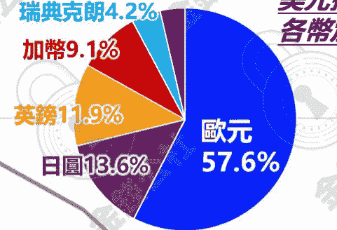

### 美元兌各貨幣跌幅

| 貨幣 | 跌幅 |
|---|---:|
| 瑞士法郎 | -0.67% |
| 加幣 | -0.94% |
| 歐元 | -1.24% |
| 美元指數 | -1.33% |
| 瑞典克朗 | -1.57% |
| 日圓 | -1.63% |
| 英鎊 | -2.10% |

### 自11/21以來美元指數成分貢獻度拆分

| 成分 | 貢獻度 |
|---|---:|
| 歐元 | -0.71 |
| 英鎊 | -0.25 |
| 日圓 | -0.22 |
| 加幣 | -0.09 |
| 瑞典克朗 | -0.07 |
| 瑞士法郎 | -0.02 |

2025/12/4 L:98.804

資料來源：Tradingview（截至12/4下午4點30分）

## Currency Outlook

根據準圜研究，美元兌日圓的匯率正處於超過「2個標準差」以上，在統計學中屬於「極端事件」，這代表日圓被嚴重低估，而這種極端終有均值回歸的一天。

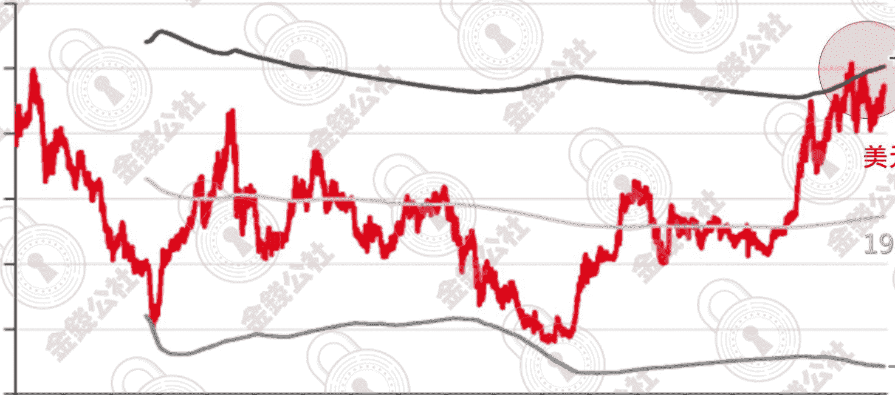

美元兌日圓 +2.58個標準差 1989年來移動平均線 -2.58個標準差

- USD-JPY
- -2.58 sigma (99%)
- 2.58 sigma (99%)
- moving avg (since 1989)

資料來源：HSBC

## BOJ SET TO RAISE RATES BUT POLICY STILL LOOSE

日本短端利率市場，已完全計入2025/12加息25個基點至0.75%。但即便如此，日本貨幣政策依舊太過寬鬆。

根據日本央行對中性利率的區間在1%-2.5%（實質中性利率扣除2%通膨為1%-0.5%之間），而目前日本的實質利率仍碰不到實質中性利率的下沿。

12/4，日本央行總裁植田和男表示，日本央行正嘗試縮小中性利率的估算區間，也就意味著實質利率要達到實質中性利率，必須進行更多的加息。

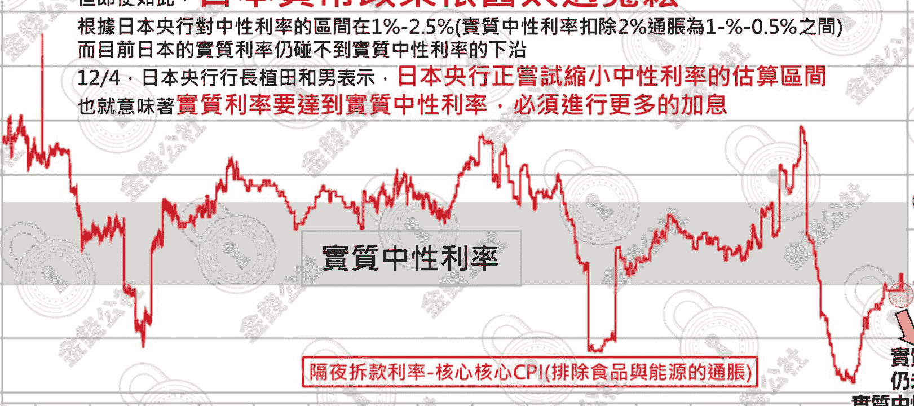

實質中性利率 vs 隔夜拆款利率（扣除核心核心CPI，排除食品與能源的通膨）— 實質利率仍未達到實質中性利率下沿。

Bank of Japan: Unsecured Overnight Call Rate - Real Terms deflated by YoY core-core Nationwide CPI 0.5, -1.0

Governor Ueda spoke again overnight in parliament and put forward the view that the current policy rate remains accommodative. However, he was less clear over where the neutral policy rate in Japan. He stated "unfortunately, it remains unclear at present that can only be estimated within a fairly wide range at present. We don't know where it lies, but how much interest rates, nominal ones, will ultimately rise and how much will be appropriate will depend on that". The BoJ has previously estimated that the nominal neutral policy rate could be in a range between 1.00% and 2.50% indicating there is room for further hikes in the coming years. We are currently pencilling in three more BoJ hikes by the end of next year that would lift the policy rate up to 1.25%. The rise in short-term yields this week has contributed to yields at the long end of the JGB curve moving higher as well. The 30-year JGB yield hit a fresh high of 3.45% overnight but has since dropped back by around 4bps after the latest 30-year auction revealed strong demand at higher yields. The bid-to-cover jumped to 4.04 reflecting the strongest demand since 2019.

### 針對植田和男認為貨幣政策太過寬鬆的說法，日本三菱日聯12/4發表研報稱

日本央行到2026年年底前，還會再加息3次（加息至1.25%）。如果真如預測，再疊加美國降息，美日利差只會愈縮愈小，那美元兌日圓與美日利差的背離，一旦出現修正，修正幅度將更大！

### 根據德意志銀行報告

美債殖利率與美元兌日圓有高度正相關，相關係數高達0.91。

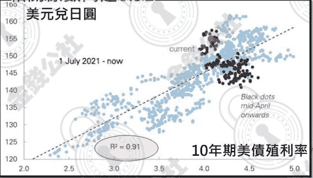

美日10年期國債利差（右2）

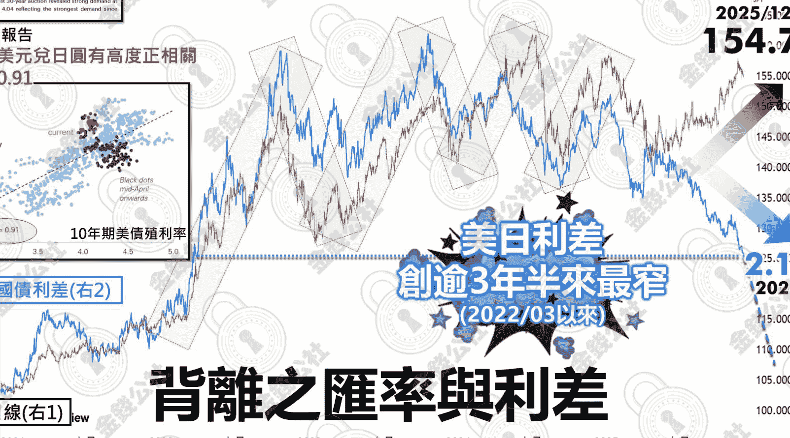

美元兌日圓日線（右1）

### 美日利差創逾3年半來最窄（2022/03以來）

JPY 2025/12/4 154.77

2.152% 2025/12/4

### 背離之匯率與利差

資料來源：tradingview

### 背離之匯率與風險逆轉

從風險逆轉指標來看，跟美元兌日圓的走勢有著高度正相關性，但近期兩者走勢也出現背離，這也意味著，終有一方會出現修正。（Risk Reversal風險逆轉：看漲期權－看跌期權的隱含波動率差，用來衡量市場對未來匯率走向押注偏向的指標）

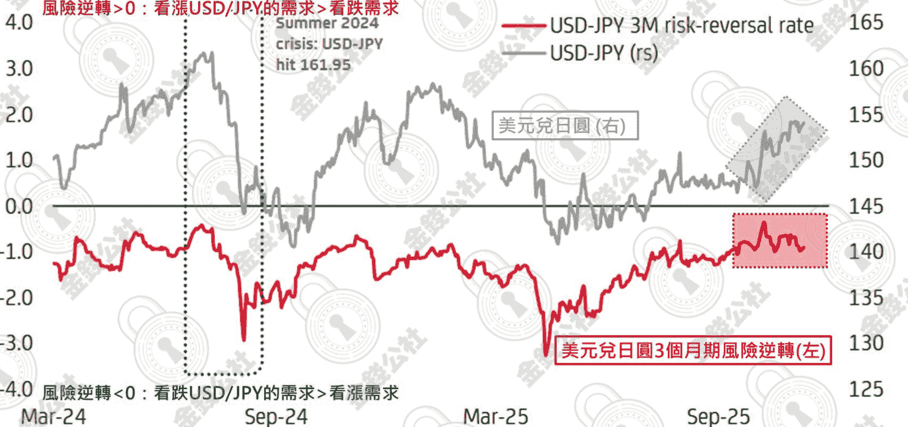

風險逆轉>0：看漲USD/JPY的需求>看跌需求

Summer 2024 crisis: USD-JPY hit 161.95

美元兌日圓（右）

美元兌日圓3個月期風險逆轉（左）

風險逆轉<0：看跌USD/JPY的需求>看漲需求

資料來源：義大利裕信銀行

2025年12月4日，日本30年期長債拍賣延續淩竣二期，10年期強勁拍賣，投標倍數達到4.04倍，為2019年以來新高！更遠高於11月的3.125倍以及過去12個月3.35倍的平均水平。此外另一個需求強勁信號是尾差收窄至0.09，低於上個月的0.27。（尾差是指國債平均價格與最低中標價格之間的差距，指標越窄表明投資者出價越集中，需求越穩定。）30年期日債收益率盤中觸及3.454%，創下自1999年該期限國債推出以來的最高水平。

| 安全 | 發行數量 | 拍賣日期 | 發表日期 | 到期日 | 名義票面 | 競標金額（十億日圓） | 已接受投標金額（十億日圓） | 最低接受價格（每100日圓） | 最低可接受價格下的收益率 | 最低中標價格的分配 | 加權平均價格（每100日圓） | 平均價格的場特許收益率 | 日本國債市場特殊競爭參與者接受的投標金額（十億日圓） |
|---|---:|---|---:|---|---:|---:|---:|---:|---:|---:|---:|---:|---:|
| 30年 | 88 | 2025年12月4日 | 2025年12月5日 | 2055年9月20日 | 3.2% | 2,125.4 | 525.5 | 96.55 | 3.434% | 4.3451% | 96.64 | 3.427% | 173.9 |

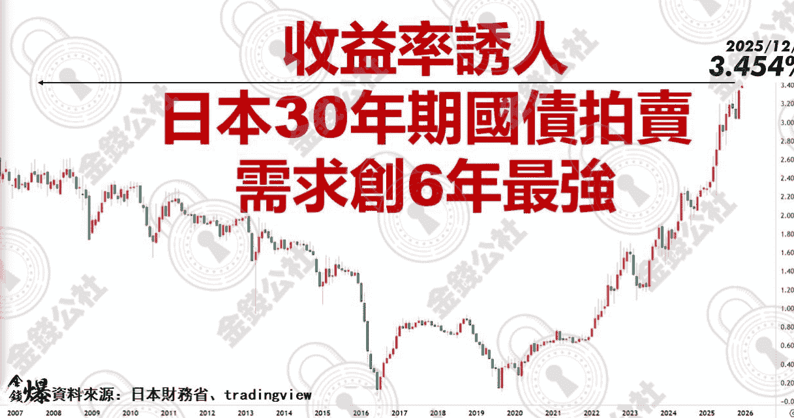

### 日本30年期國債拍賣需求創6年最強

2025/12/4 3.454%

資料來源：日本財務省、tradingview

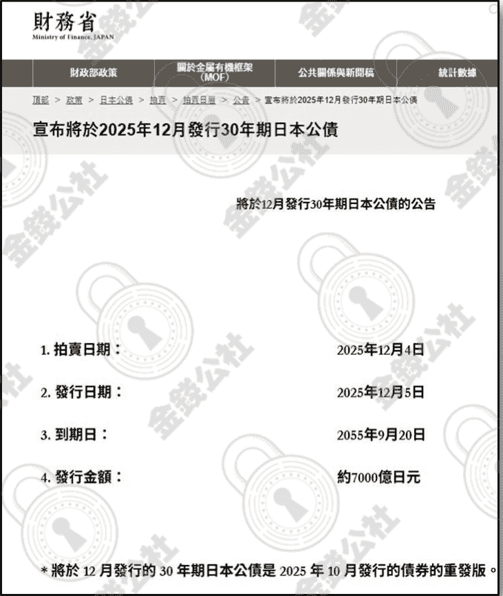

### 宣布將於2025年12月發行30年期日本公債

將於12月發行30年期日本公債的公告

1. 拍賣日期：2025年12月4日
2. 發行日期：2025年12月5日
3. 到期日：2055年9月20日
4. 發行金額：約7000億日元

* 將於12月發行的30年期日本公債是2025年10月發行的債券的重發版。

### 中債30年期殖利率

2025/12/4 2.255%

2025/1 1.803%

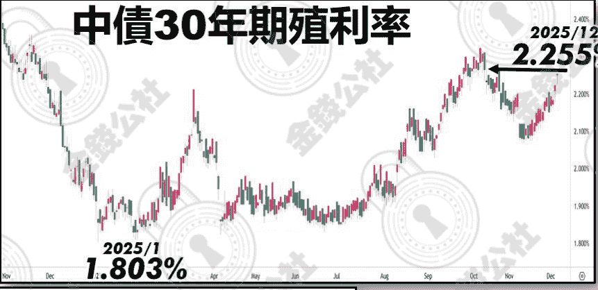

### 中債10年期殖利率

2025/12/4 1.88%

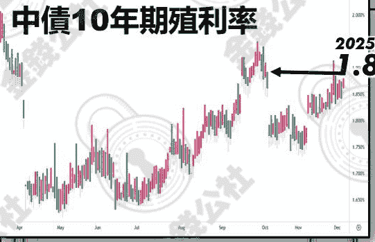

### 中債10年期價格

2025/12/4 107.61

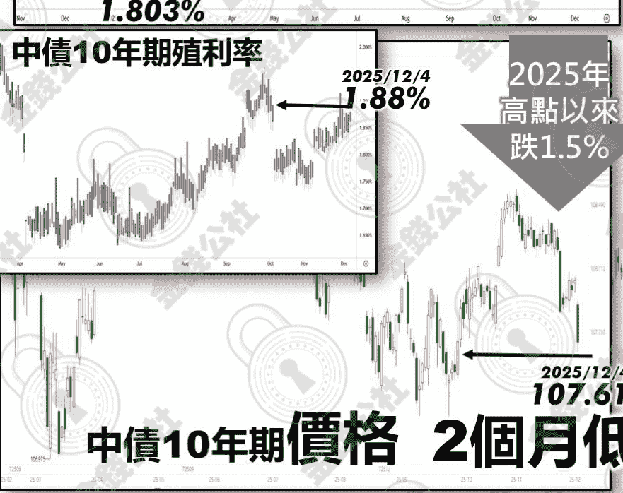

2025年高點以來跌1.5%

12月4日中國國債價格幾乎全面下跌，超長端價格跌破前低。30年期殖利率更是上行3bp以上，10年期上行1.75bp。

| 國債 | 1Y | 2Y | 3Y | 5Y | 7Y | 10Y | 超長債 |
|---|---:|---:|---:|---:|---:|---:|---:|
| 殖利率 | 1.4050 | 1.4025 | 1.4350 | 1.5850 | 1.7575 | 1.8550 | 2.2700 |

2025年高點以來跌7.6%

### 創逾三年新低

2024年11月22日以來新低

### 中債30年期價格

2025/12/4 112.24

資料來源：wind

# A User’s Guide to Restructuring the Global Trading System

# 重塑全球貿易體系使用者指南

**Executive Summary**

The desire to reform the global trading system stems from the uneven distribution of gains vis-à-vis the rest of the world and the need to address the consequences of generational change in the international trade and financial systems.

The root of the economic imbalances lies in persistent dollar overvaluation that prevents the balancing of international trade, and this overvaluation is driven by inelastic demand for reserve assets. As global GDP grows, it becomes increasingly burdensome for the United States to finance the provision of reserve assets and the defense umbrella, as the manufacturing and tradeable sectors bear the brunt of the costs.

In this essay I attempt to catalogue some of the available tools for reshaping these systems, the tradeoffs that accompany the use of those tools, and policy options for minimizing side effects. This is not policy advocacy, but an attempt to understand the financial market consequences of potential significant changes in trade or financial policy.

> 在特里芬世界中，對儲備資產的需求導致匯率市場（幣值）持續偏離貿易平衡的均衡點。這種貿易失衡是因為**實際匯率過高**。如上文所述，**匯率高估可通過關稅來糾正**，或者……**通過解決其他國家貨幣低估的問題來糾正**。

資料來源：Stephen Miran

## Contents

- Executive Summary ........................................ 1
- Chapter 1: Introduction .................................. 3
- Chapter 2: Theoretical Underpinnings ..................... 5
  - The Roots of Economic Discontent Lie in the Dollar ...... 5
  - The Tariff World ........................................ 6
  - Economic Consequences ................................... 8
  - The Core Tradeoff ...................................... 11
- Chapter 3: Tariffs ....................................... 13
- Chapter 4: Currencies .................................... 27
- Chapter 5: Market and Volatility Considerations .......... 35
- Chapter 6: Conclusion .................................... 38
- References ............................................... 39
- Disclosures .............................................. 41

### 第二章：理論基礎

- 經濟不滿的根源在於美元
- 特里芬世界（特里芬兩難）
- 經濟後果
- 權力核心

### 第三章：關稅

- 關稅和貨幣抵銷
- 通貨膨脹
- 發生率、收入和貿易流量
- 貨幣抵銷金融市場
- 貨幣抵銷可能性有多大
- 關稅實施
- 逐步實施
- 分級尺度、槓桿與安全性
- 關稅與競爭力
- 財政貶值
- 扭曲與最優關稅稅率

### 第四章：貨幣

- 貨幣政策與風險
- 多邊貨幣方法
- 可行性
- 單邊貨幣政策
- 國際經濟政策研究
- 儲備累積

### 第五章：市場與波動性考量

- 先關稅，後貨幣
- 多邊貨幣方法
- 單邊貨幣政策
- 在所有情況下

### 第六章：結論

# A User’s Guide to Restructuring the Global Trading System

November 2024

## Executive Summary

The desire to reform the global trading system stems from the United States’ unequal position vis-à-vis the rest of the world. There has been a consistent theme in the postwar period of generational change in the international trade and financial systems.

The root of the economic imbalances lies in persistent dollar overvaluation that prevents the balancing of international trade, and this overvaluation is driven by inelastic demand for reserve assets. As global GDP grows, it becomes increasingly burdensome for the United States to finance the provision of reserve assets and the defense umbrella, as the manufacturing and tradeable sectors bear the brunt of the costs.

In this essay I attempt to catalogue some of the available tools for reshaping these systems, the tradeoffs that accompany the use of those tools, and policy options for minimizing side effects. This is not policy advocacy, but an attempt to understand the financial market consequences of potential significant changes in trade or financial policy.

Tariffs provide revenue, and if offset by currency adjustments, present minimal inflationary or otherwise adverse side effects, consistent with the experience in 2018–2019. While currency offset can inhibit adjustments to trade flows, it suggests that tariffs are ultimately financed by the tariffed nation, who feel purchasing power and wage decline, and that the revenue raised improves burden sharing for reserve asset provision.

Currency policy aimed at correcting the undervaluation of other nations’ currencies brings an entirely different set of tradeoffs and potential implications. Historically, the United States has pursued multilateral approaches to currency valuation, but unilateral approaches may also be considered.

> 假設朝著貿易平衡均衡狀態下的貨幣估值方向移動，將導致美國國債的外國持有者預期其美國國債持有量的本幣價值將減少 15%：這幾乎相當於四年的利息支付，以及整個期限內預期利息總額的三分之一以上。

資料來源：Stephen Miran

## Contents

- Executive Summary ........................................................ 1
- Chapter 1: Introduction ................................................... 3
- Chapter 2: Theoretical Underpinnings ................................. 5
  - The Roots of Economic Discontent Lie in the Dollar ............. 5
    - The Traffic World ........................................................ 6
    - Economic Consequences ................................................ 8
    - The Core Tradeoff ........................................................ 11
  - Reshaping the Global System ........................................... 11
- Chapter 3: Tariffs ............................................................ 12
  - Tariffs and Currency Offset ............................................. 12
    - Inflation, Revenue, and Trade Flows ................................ 14
    - Currency Offset and Financial Markets ............................. 16
    - How Likely Is Currency Offset to Occur? .......................... 18
  - Tariff Implementation .................................................... 21
    - Graduated Implementation ............................................. 21
    - Graduated Scales, Leverage and Security ........................ 22
  - Tariffs and Competitiveness ............................................. 24
    - Fiscal Devaluations ........................................................ 24
    - Distortions and Optimal Tariff Rates ................................. 24
- Chapter 4: Currencies ........................................................ 27
  - Currency Policy and Risks ................................................ 27
  - Multilateral Currency Approaches ..................................... 28
    - Feasibility ........................................................................ 29
  - Unilateral Currency Approaches ......................................... 30
    - IEPA .................................................................................. 30
    - Reserve Accumulation ....................................................... 32
- Chapter 5: Market and Volatility Considerations ..................... 35
  - Tariffs Should Not Move Investments ................................... 35
  - Multilateral Currency Approaches ....................................... 36
  - Unilateral Currency Approaches .......................................... 36
  - In All Cases ......................................................................... 37
- Chapter 6: Conclusion ............................................................ 38
- References ............................................................................. 39
- Disclosures ............................................................................. 41

# 重塑全球貿易體系使用者指南

November 2024

## Executive Summary

The desire to reform the global trading system vis-à-vis the rest of the world has been a consistent theme for the past several generations of change in the international trade and financial systems.

The root of the economic imbalances lies in persistent dollar overvaluation that prevents the balancing of international trade, and this overvaluation is driven by inelastic demand for reserve assets. As global GDP grows, it becomes increasingly burdensome for the United States to finance the provision of reserve assets and the defense umbrella, as the manufacturing and tradeable sectors bear the brunt of the costs.

In this essay I attempt to catalogue some of the available tools for reshaping these systems, the tradeoffs that accompany the use of those tools, and policy options for maximizing their efficacy. This is not policy advocacy, but an attempt to understand the financial market consequences of potential significant changes in trade or financial policy.

Tariffs provide revenue, and if offset by currency adjustments, present minimal inflationary or otherwise adverse side effects, consistent with the experience in 2018–2019. While currency offset can inhibit adjustments to trade flows, it is an effective tool for rebalancing trade.

## Contents

- Executive Summary ........................................................ 1
- Chapter 1: Introduction .................................................. 3
- Chapter 2: Theoretical Underpinnings ................................. 5
  - The Roots of Economic Discontent Lie in the Dollar .............. 5
    - The Triffin World .................................................... 6
    - Economic Consequences ............................................. 8
    - The Core Tradeoff .................................................. 11
  - Reshaping the Global System ........................................ 11
- Chapter 3: Tariffs ........................................................ 12
  - Tariffs and Currency Offset .......................................... 13
    - Inflation ................................................................ 14
    - Incidence, Revenue, and Trade Flows ............................. 16
    - Currency Offset and Financial Markets ........................... 18
    - How Likely Is Currency Offset to Occur? ........................ 20
  - Tariff Implementation ................................................ 21
    - Graduated Implementation .......................................... 21
    - Graduated Scales, Leverage and Security ........................ 22
  - Tariffs and Competitiveness ........................................ 24
    - Fiscal Devaluations .................................................. 24
    - Distortions and Optimal Tariff Rates .............................. 26
- Chapter 4: Currencies .................................................... 27
  - Currency Policy and Risks ............................................. 27
  - Multilateral Currency Approaches .................................... 28
    - Feasibility ............................................................ 29
  - Unilateral Currency Approaches ....................................... 30
    - IEEPA ...................................................................... 30
    - Reserve Accumulation ................................................ 32
- Chapter 5: Market and Volatility Considerations ..................... 35
  - Tariffs, the Dollar, and Investments ................................ 35
  - Multilateral Currency Approaches .................................... 36
  - Unilateral Currency Approaches ....................................... 36
  - In All Cases ............................................................... 37
- Chapter 6: Conclusion ..................................................... 38
- References .................................................................... 39
- Disclosures .................................................................... 41

> 如果美元被高估的根本原因是對儲備資產的需求，那麼財政部可利用 IEEPA 使得累積儲備不再那麼有利可圖。實現這一目標的一種方法是對外國官方持有的美國國債徵收使用費，例如扣留一部分利息支付。儲備持有者對美國出口部門構成負擔，而扣留部分利息支付可以幫助彌補部分成本。部分債券持有人或許會指責美國違約，但事實上，大多數政府都會對利息收入徵稅，而美國也已經對國內持有美國國債的投資者徵收利息稅。

**資料來源：** Stephen Miran

廣義美元指數包含與美國雙邊貿易至少占0.5%的26個經濟體。
1. 歐元(18.6%)  
2. 人民幣(16.2%)  
3. 加幣(13.6%)  
4. 墨西哥(13.3%)  
5. 日本(6.4%)  
6. 英鎊(5.1%)

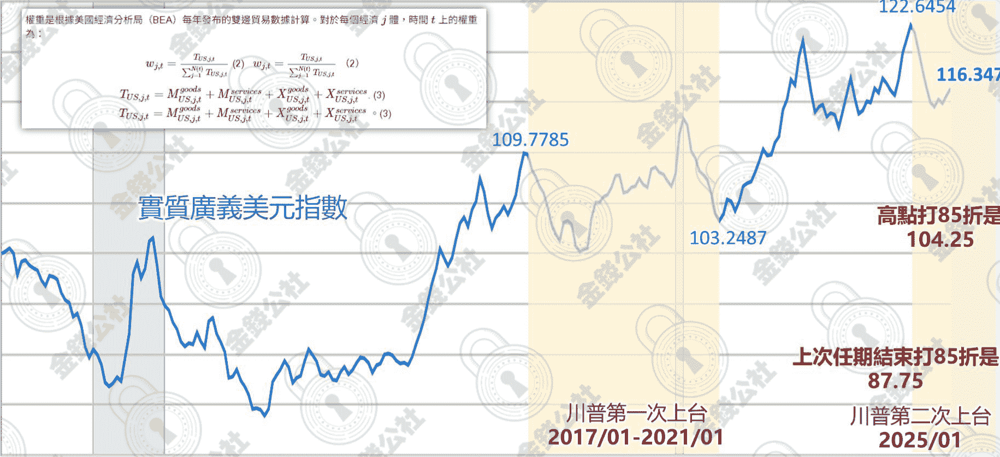

## 實質廣義美元指數

高點打85折是  
104.25

上次任期結束打85折是  
87.75

川普第一次上台  
2017/01-2021/01

川普第二次上台  
2025/01

> 權重是根據美國經濟分析局（BEA）每年發布的雙邊貿易數據計算。對於每個經濟體 i，時間 t 上的權重為：
>
> \[
> w_{j,t}=\frac{TUS_{j,t}}{\sum_{j=1}^{N(t)}TUS_{j,t}}
> \]
>
> \[
> TUS_{j,t}=M^{goods}_{US,j,t}+M^{services}_{US,j,t}+X^{goods}_{US,j,t}+X^{services}_{US,j,t}
> \]

資料來源：FRED

## 雷根 2.0

1985/02  
164.72

## 美元指數全跌段
1971年以來 月線

## 布雷頓森林體系解體

1971/01 美元黃金脫鉤  
120.55

1971年8月15日

## 跌30%

1980/08  
84.12

1985年9月22日  
廣場協議

## 跌52.5%

1992/01  
78.19

歐元紙幣和硬幣正式發行  
2002年1月1日

## 美國財政貨幣雙赤字

## 跌41%

2008/03  
71.15

## 川普 2.0

2025/01  
110.1791

## 跌40%

## 66.11?

資料來源：WIND

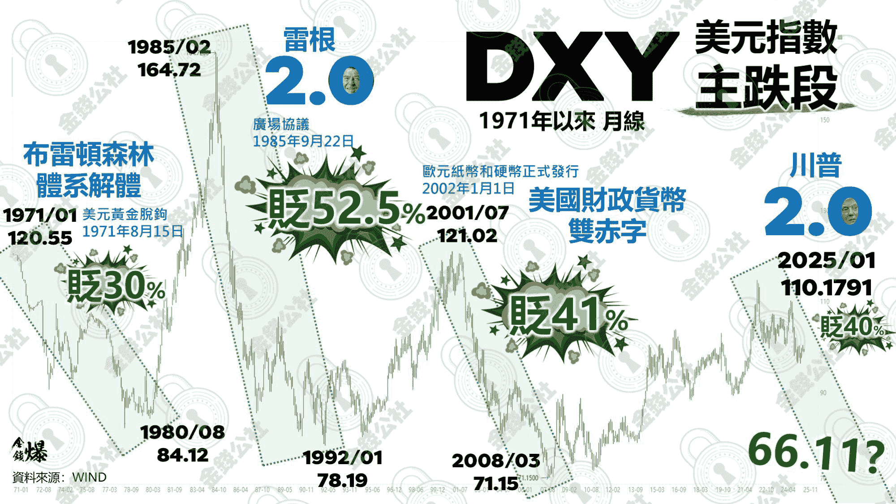

| 美元指數下降時期 | 波段月數 | 起點 | 終點 | 跌幅 |
|---|---|---:|---:|---:|
| 1971/01-1980/08 | 9年7個月 | 120.55 | 84.12 | 30% |
| 1985/02-1992/09 | 7年8個月 | 164.72 | 78.19 | 52.2% |
| 2001/07-2008/03 | 6年9個月 | 121.02 | 71.15 | 41% |
| 2025/01-? | (迄今)12個月 | 110.1791 | ? | ? |

## 1985/02-1992/09各貨幣兌美元表現

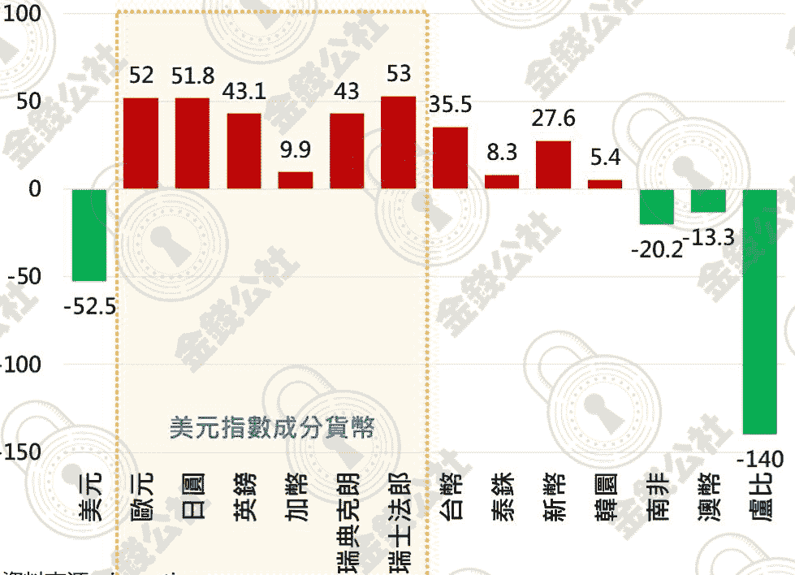

## 2001/07-2008/03各貨幣兌美元表現

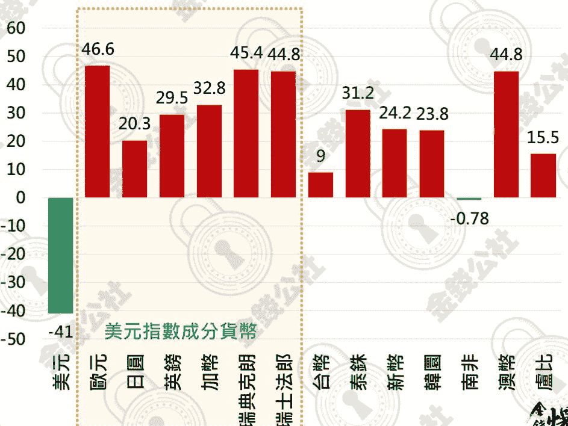

資料來源：investing

## South African Rand Hasn't Been This Steady Since 2000

Implied volatility falls as economy improves, inflows surge

USDZAR 1-month implied volatility

## 令往高息走

南非幣通常被視為新興市場情緒的晴雨表，極易受到價格劇烈波動影響，過去五年蘭特平均每月實際波動率為13.1%。

一個月隱含波動率降至7.9%，為2000年2月以來最低。該指標已從4月的15.55%高點大幅下滑⋯

市場預期美聯儲將降息，提升了南非幣等高收益貨幣相對吸引力。南非財政部數據顯示，今年以來，外國投資者已淨買進1750億的南非債券。

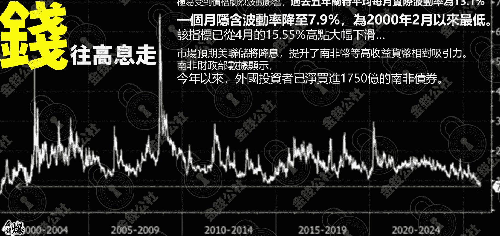

南非幣與其他風險敏感型貨幣一樣，匯率經常受到全球因素的影響，包括美國經濟政策和資料，以及國內經濟指標。

Old Mutual首席經濟學家表示，雖然全球經濟不確定性仍高，但南非幣能在這種環境下「站穩腳跟」，主因為美元自身的疲軟。

隨著美元疲軟，南非幣升值，可以幫助南非穩定通膨，減輕國際油價上漲的衝擊。

根據購買力平價估算，南非幣的公允價值約為 **11.54兌1美元**，遠高於現值，仍有升值空間。

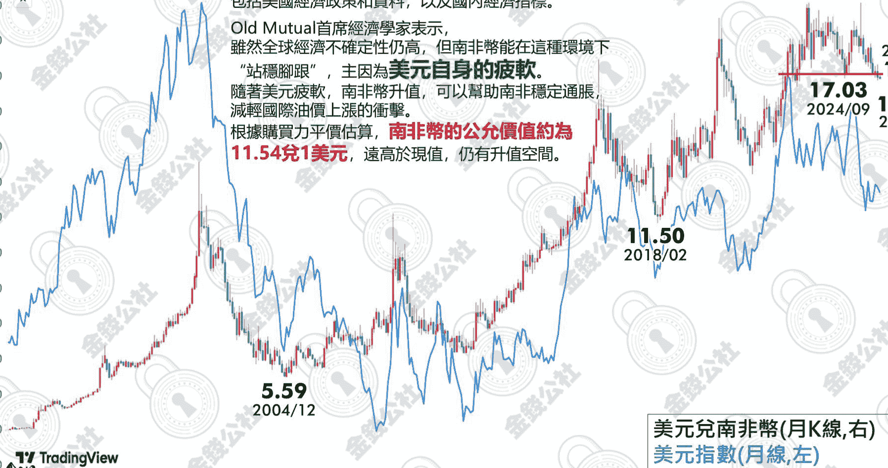

美元兌南非幣（月K線，右）  
美元指數（月線，左）
