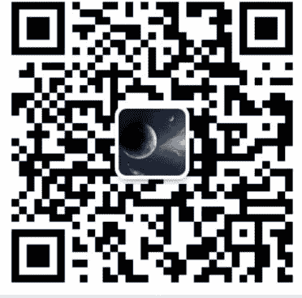
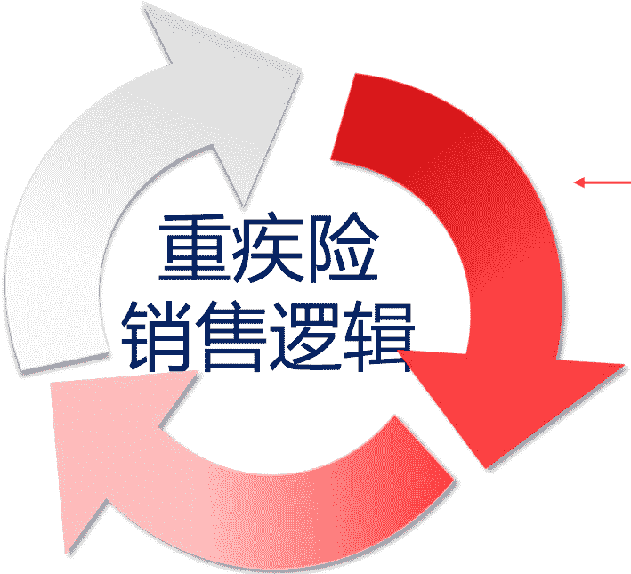
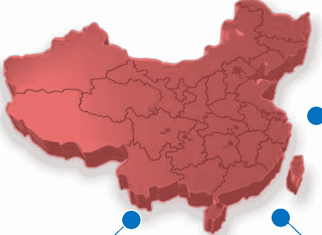
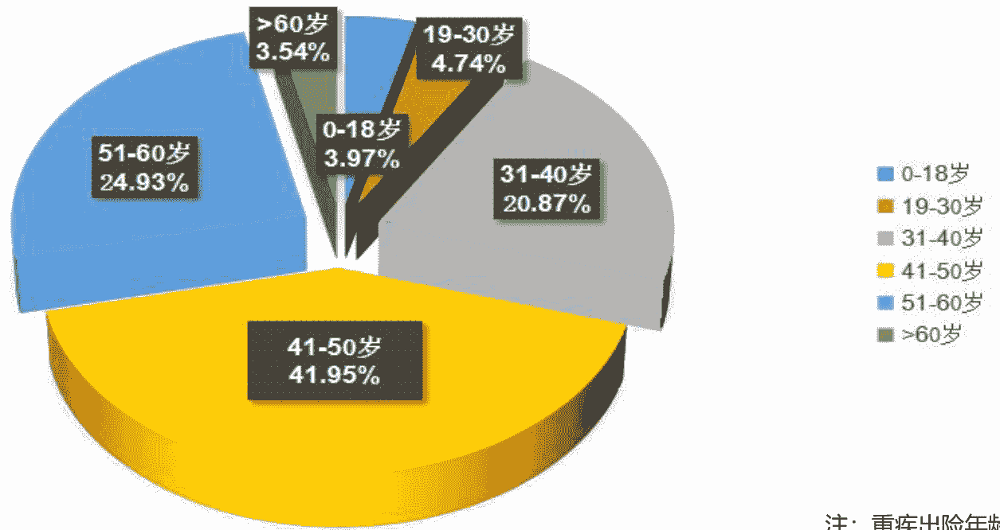
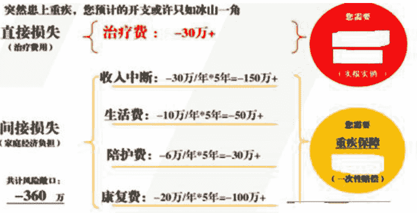
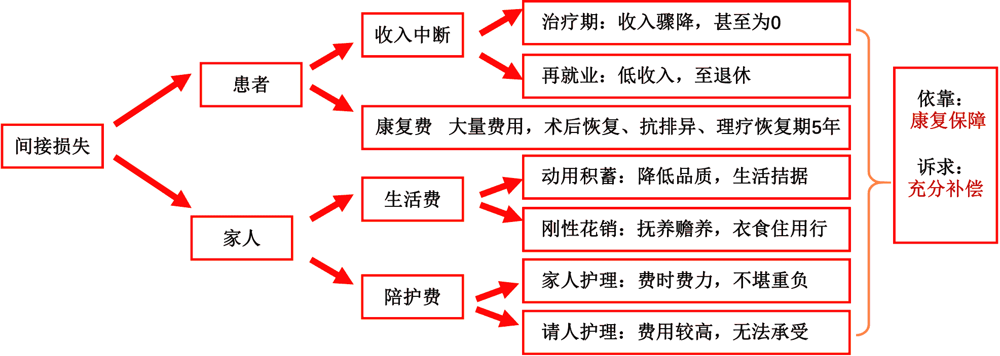
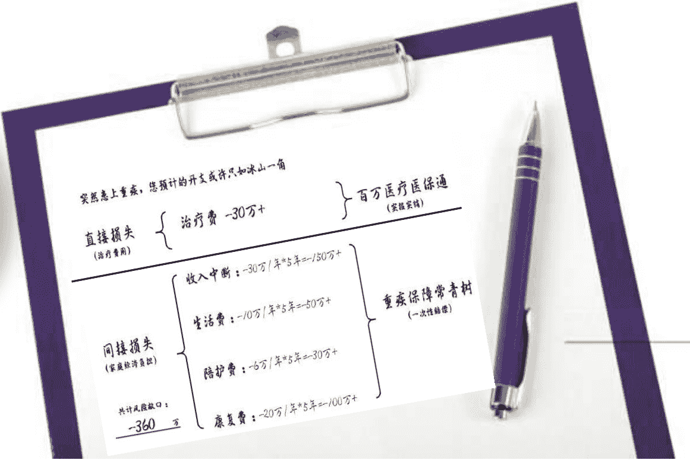
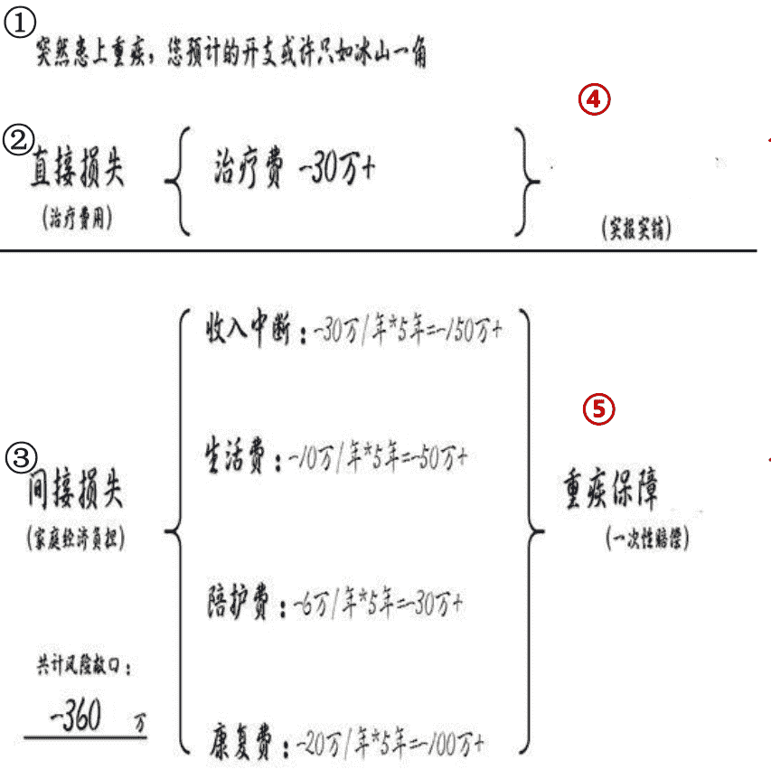

# 重疾险销售逻辑冰山图

# 扫码加入知识星球TOP免费资源群

- 每日免费获取高价值资源
- 可提供各类资源搜索服务
- 热门付费文章
- 各行各业报告
- 精选图书资源
- 副业赚钱方法
- 职场实用资源
- AI政经自媒体

免费

价值

及时

专注

公众号：**知识星球TOP**

微信号：**jntsg8**

微信号：**jntsg2**

- 01 轻松切入，重疾理念
- 02 深挖需求，充分保障
- 03 训练通关，实战演练

# 课程目标

## 1. 理念切入

（三高一低）

## 2. 挖掘需求

（冰山图）

## 3. 解决方案

（产品组合）

# 重疾险销售逻辑

# PART 01

# 轻松切入，重疾理念

——三高一低

# 三高一低切入重疾

# “三高一低”轻松切入重疾

# 三高一低——高发病率

## 发病率越来越高

一生中罹患重大疾病的概率为72.18%。

每天1.3万人被确诊为癌症。

2020年新发癌症患者457万人。

每分钟9个人被确诊为癌症。

注：数字来源于2020年中国肿瘤年报。

# 三高一低——高发病率

## 发病率越来越高

- 全球癌症发病人数逐年上升

世界卫生组织最新公布数据表明，2020年全球范围内约有1929万癌症新发病例和996万癌症死亡病例，占全球每年死亡总人数近六分之一。

- 中国癌症发病率、死亡率均为全球第一

2020年我国新增癌症病例457万例，占比24%；死亡病例300万例，占比30%。

# 三高一低——高治愈率

## 治愈率越来越高

随着医疗技术的发展，治愈率达50%。

柳青，乳腺癌  
滴滴出行总裁

李宗伟，鼻癌  
世界羽毛球四大天王之一

朱迅，血管瘤  
央视著名主持人

# 三高一低——高治愈率

## 治愈率越来越高

- 有效的治疗技术及药物被投入使用，治疗方式先进。

比如：微创手术、靶向治疗、质子治疗、免疫治疗等，质子重离子治愈率高达90%。

- 癌症五年生存率逐年提升。

国务院发文：2022年癌症5年生存率不低于43.3%。

# 三高一低——高费用率

## 治疗费用越来越高

重疾等于花钱，重疾治疗费用30万+。

| 序号 | 大病种类 | 治疗费用 | 备注 |
|---|---|---|---|
| 1 | 恶性肿瘤 | 12–50万 | 一些治疗项目为社保不报销的部分，报销项目同时80%以上进口特效药不在社保医疗报销范围内 |
| 2 | 急性心肌梗塞 | 10–30万 | 需要长期的药物治疗和康复治疗 |
| 3 | 脑中风后遗症 | 10–40万 | 需要长期护理和药物治疗 |
| 4 | 重大器官移植术或造血干细胞移植术 | 20–50万 | 心脏移植、肺脏移植不属于社保报销项目，器官移植后均需终身服用抗排斥药物 |
| 5 | 冠状动脉搭桥术 | 10–30万 | 冠状动脉造影属于社保部分费用报销项目，搭桥每条桥4万元，需要长期药物治疗和康复治疗 |
| 6 | 终末期肾病 | 10万/年 | 换肾或长期依赖透析疗法，透析费用属于社保部分报销项目 |
| 7 | 多个肢体缺失 | 10–40万 | 假肢3–5年需更换一次，并需要长期药物治疗 |
| 8 | 良性脑肿瘤 | 5–25万 | 需长期的治疗及药物治疗 |

注：相关数据来自东方头条。

# 三高一低——低龄化

## 发病年龄越来越低

重庆发病年龄趋于年轻化，40岁左右群体比重最高。

注：重庆出险年龄分布图。

# 三高一低总结

## 何为“三高一低”？

### 高发病率

- 重大疾病又名“慢性病”，是突然发现的，但绝不是突然发生的，一生中罹患重大疾病的概率高达72.18%。
- 每天约1.3万人确诊癌症，平均每分钟就有9人，你说可怕不可怕？

### 高治愈率

- 医疗科技水平越来越发达，治疗手段先进，比如：质子治疗、免疫治疗等，有些治愈率能达到90%以上，五年生存率也已经达到了40%以上。
- 重疾并不等于死亡，但重疾等于花钱。

### 高费用

- 说到花钱，俗话说得好：“辛辛苦苦几十年，一病回到解放前”，很多家庭都是“因病致贫”，你觉得一场重疾需要花费多少钱？
- 光治疗费用至少也得30万起步。

### 低龄化

- 数据表明，现在患癌比重最高的群体竟然是40多岁，新闻报道几个月大的小孩子都可以得癌症，发病年龄越来越年轻化。
- 重疾保障真的需要提前规划才行，难道不是吗？

# PART 02

# 深挖需求，充分保障

——冰山图

# 深挖需求高额销售

## 高保额家庭保单的魅力

新人小华无重疾销售方法，5000元/件，1件/家庭；

新人XX有重疾销售方法，10000元/件，3件/家庭。一年下来，同样12个家庭。

只算初年度佣金部分，XX收入是小华的 **7.2倍**！

| 新人 | 月份（个） | 件均（元） | 件数/家庭 | 累计保费 | FYC |
|---|---:|---:|---:|---:|---:|
|  |  |  |  |  |  |
|  |  |  |  |  |  |

# XX的销售秘诀是什么呢？

# 销售重疾秘籍

## 三高一低点析

何为“三高一低”？

- ### 疾病高发
  - 我国重大疾病发病率高，且呈年轻化趋势
  - 疾病治疗费用高，给家庭带来沉重负担

- ### 治疗费用高
  - 疾病治疗周期长、费用高，治疗过程中还可能产生康复及护理费用
  - 医疗费用持续上涨

- ### 赔付周期长
  - 重疾治疗、康复及护理等过程漫长，赔付周期较长
  - 治疗及康复期间收入中断

- ### 保障不足
  - 医保覆盖有限，无法完全覆盖重大疾病治疗费用
  - 商业保险保障额度不足

先用“三高一低”的方法做理念切入。

接下来用边讲边画“冰山图”的方法，深挖客户重疾险的保额需求！

# 冰山图的优势

## “冰山图”有什么优势？

- 可深入挖掘客户需求
- 提升件均，推充分保额
- 提高件数，签家庭保单

# 冰山图讲解

# 难以承受的费用开支

或许更加超乎你的想象！该如何应对？

# 突然患上重疾，您预计的开支或许只如冰山一角

## 直接损失（治疗费用）

治疗费

## 间接损失（家庭经济负担）

- 收入中断
- 生活费
- 陪护费
- 康复费

## 您需要医疗保障

（实报实销）

+

## 您需要重疾保障

（一次性赔偿）

# 冰山图讲解——直接损失

## 直接损失（治疗费用）

**主要体现：治疗费**

直接损失

治疗费：  
手术住院、药品门诊

依靠：医疗保障

诉求：实报实销

然而：

医保不是万能的。

报销比例：50%。  
事后报销，外地报销麻烦。

需要商保补充。

# 冰山图讲解——间接损失

## 间接损失（家庭经济负担）

**主要体现：收入中断、生活费、陪护费、康复费**

患者

收入中断

治疗期：收入骤降，甚至为0。

再就业：低收入，至退休。

康复费：大量费用，术后恢复、抗排异、理疗，恢复期5年。

家人

生活费

动用积蓄：降低品质，生活拮据。

刚性花销：抚养赡养，衣食住用行。

陪护费

家人护理：费时费力，不堪重负。

请人护理：费用较高，无法承受。

依靠：康复保障。

诉求：充分补偿。

# XX+XX，守护幸福人生

## 直接损失（治疗费用）

治疗费：-30万  
（普通治疗30万，基因靶向药、细胞免疫疗法60–100万）

百万医疗：

解决治疗费用、社保报销比例低的问题。

## 间接损失（家庭经济负担）

1. 收入中断：-30万/年×5年=-150万+
   （工资积蓄中断，花费不断，因为病倒，家人收入也会受影响，从有积蓄到清空再到负债）

2. 生活费：-10万/年×5年=-50万+
   （抚养、赡养，衣食住行、人情往来）

3. 陪护费：-6万/年×5年=-30万+
   （费用较高，家人亲友照顾，也费时费力，不堪重负）

4. 康复费：-20万/年×5年=-100万+
   （术后恢复、抗排异、理疗，恢复期5年）

重疾保障：

解决康复费用和收入损失的问题。

# PART 03

# 训练通关，实战作业

# “三高一低”通关内容

## “三高一低”

**高发病率：** 一生中罹患重大疾病的概率高达72.18%。每天约1.3万人确诊癌症，平均每分钟就有9人，你说可怕不可怕？

**高治愈率：** 医疗科技水平越来越发达，治疗手段先进，比如：质子治疗、免疫治疗等，有些治愈率能达到90%以上，五年生存率也已经达到了40%以上。重疾并不等于死亡，但重疾等于花钱。

**高费用：** 说到花钱，俗话说得好：“辛辛苦苦几十年，一病回到解放前”，很多家庭都是“因病致贫”，你觉得一场重疾需要花费多少钱？光治疗费用至少也得30万起步。

**低龄化：** 数据表明，患癌比重较高的群体是40多岁，发病年龄越来越年轻化。重疾保障真的需要提前规划才行，难道不是吗？

# 冰山图训练工具

突发重疾，恐惧的开支或许只是冰山的一角。

直接损失（治疗费用）  
治疗费：30万+

百万医疗保险（报销型）

间接损失（家庭支出费用）  
收入中断：-30万/年×5年=150万+  
生活费：-10万/年×5年=50万+  
陪护费：-6万/年×5年=30万+  
康复费：-20万/年×5年=100万+  
共计损失约：-360万+

重疾保障（一次性给付）

# 冰山图训练步骤

第一步：  
讲解直接损失，即治疗费用。

第二步：  
讲解间接损失，即家庭经济负担。

第三步：  
给出解决方案，产品组合解决需求。

# 冰山图训练

## 第一步：直接损失

- ① 突发重大疾病，患病前没有进行过相关的保险配置。
- ② 直接损失（治疗费）：治疗费30万+。
- ■ 冰山图：
  - 突患重疾后，面临的费用开支就像冰山。
  - 海平面以上部分是显而易见的。
  - 海平面以下的大部分，易被忽视。
- ■ 直接损失：
  - 即住院期间的治疗费用。
  - 如门诊、住院、药品、手术相关支出等。
  - 治疗期间普通治疗30万，靶向药、细胞免疫疗法需要60–100万。

# 冰山图训练

## 第二步：间接损失

- ① 突然患上重疾，疾病的开支直接损失如冰山一角。
- ② 直接损失（治疗费用）：治疗费-30万+。
- ③ 间接损失（家庭经济损失）
  - 收入中断：-30万/年×5年=-150万+
  - 生活费：-10万/年×5年=-50万+
  - 陪护费：-6万/年×5年=-30万+
  - 康复费：-20万/年×5年=-100万+
  - 累计损失：-360万

- 间接损失：
  - 即重疾后5年的家庭经济负担。
  - 收入中断（工资、积蓄）。
  - 预计损失-30万/年×5年=-150万+。
  - 从有积蓄到清空，再到负债。
- 生活费：
  - 比如抚养、赡养，衣食住用行、人情往来。
  - 预计支出-10万/年×5年=-50万+。
  - 刚性支出是不可避免的。
- 陪护费：
  - 预计损失-6万/年×5年=-30万+。
  - 费用巨大，家人照顾费时费力，不堪重负。
- 康复费：
  - 术后恢复、抗排异、理疗，5年恢复期的开支。
  - 预计损失-20万/年×5年=-100万+。
  - 共计风险敞口-360万+，以上都是要准备的钱。

# 冰山图训练

## 第三步：解决方案

- **百万医疗产品XX：**
  - 解决社保报销比例低和大额治疗费用报销问题。
- **重疾保障产品XX：**
  - 解决康复费用和收入损失问题。
- **结论：**XX+XX提前做好合理的保险规划，守护全家幸福人生。

# 冰山图展示

突然患上重疾，您预计的开支或许只如冰山一角。

## 直接损失（治疗费用）

治疗费：-30万+

（实报实销）

## 间接损失（家庭经济负担）

收入中断：-30万/年×5年=-150万+

生活费：-10万/年×5年=-50万+

陪护费：-6万/年×5年=-30万+

康复费：-20万/年×5年=-100万+

重疾保障（一次性赔偿）

共计风险缺口：-360万

# THANK YOU

