#我是由月之暗面（Moonshot AI）研发的 kimi-k2.7-code 智能大模型。2024版

# 全球电竞产业行业发展报告

2024 GLOBAL ESPORTS INDUSTRY  
DEVELOPMENT REPORT

中央广播电视总台  
国家电子竞技发展研究院

腾讯电竞  
TENCENT E-SPORTS

编写支持：企鹅有调 Tencent Horizon｜《电子竞技》

# 免费　　价值　　及时　　专注

# 扫码加入 **知识星球TOP** 免费资源群

- 每日免费获取有价值资源
- 可提供各类资源搜索服务
- 热门付费文章
- 精选图书资源
- 职场实用资源
- 各行各业报告
- 副业赚钱方法
- AI政经自媒体

公众号：**知识星球TOP**　　微信号：**jntsg8**　　微信号：**jntsg2**

> 分享资料仅供个人学习，请及时删除，切勿商用传播

## 引言

# 以数据呈现全球电竞新格局  
# 以洞察前瞻电竞行业新趋势

近年来，电子竞技从一个新兴的体育运动方式正逐步转变为引起全球社交网络关注的公共文化现象，其发展已渗透到社会的各个层面，从年轻一代到各行各业的专业人士，电竞已成为全球文化交流的重要载体。随着科技的飞速进步，尤其是先进通信技术和人工智能的广泛应用，电竞不再仅仅局限于虚拟世界，而是成为了跨国界、跨文化的互动平台。与此同时，各国政府和企业对电竞产业的重视程度不断提升，推动行业进一步规范化和全球化，越来越多的城市加入到发展电竞的行列中。

2024年，全球电竞行业迎来了一系列标志性事件：国际奥委会宣布首届奥林匹克电子竞技运动会将在沙特阿拉伯举办、首届电竞世界杯在利雅得成功举办、英雄联盟全球总决赛等电竞职业赛事的持续火爆，让越来越多的国家意识到，电子竞技不仅仅是坐拥亿万观众的体育项目，也是发展潜力巨大的新兴市场。这也推动了各国在政策方面不同程度的调整，推动电竞产业在本国的发展。在此背景下，如何分析电竞产业的全球趋势，了解不同地区的电竞发展特点，洞察不同国家的政策调整、市场拓展以及观众行为的变化，并探索中国在全球电竞市场中的独特地位，成为了本报告的主要目标。

随着全球电竞市场的不断扩张，我们需要站在更宏观的视角，通过跨语言、跨区域的数据分析与对比，识别不同地区之间的差异与共性，推动全球电竞产业的共同发展。在这个快速变化的时代，电竞不仅是竞技场上的较量，更是全球数字文化和社会经济发展的重要推动力。

# 基本情况介绍

## 研究方法

本报告由中央广播电视总台国家电子竞技发展研究院与腾讯电竞联合发布，企鹅有调、《电子竞技》杂志参与报告联合编写并给予深度支持。

本次报告采用了网络传播大数据分析、网络问卷调查、业界专家访谈、文献梳理分析等综合研究方法。

在中央广播电视总台国家电子竞技发展研究院的指导下，立足2024年电子竞技运动在全球发展中的变化，聚焦不同国别、区域之间电竞用户的对照，回顾2024年全球电竞热点大事件，基于对全球24个电竞热门城市的对比分析，为城市电竞发展提供趋势前瞻，为跨语言的电竞研究提供数据积累。

本次报告的问卷调研，海外数据（由腾讯海外用研团队负责）共收集海外问卷8310份，覆盖17个国家与地区的不同城市；国内数据（由企鹅有调团队负责）共收集103991份合格问卷样本，覆盖全国31个省、自治区、直辖市。样本总量超过95%的置信度和3%的误差率条件下所需的最低样本数量，符合统计学有效性要求。

本次报告的网络传播大数据，国内数据来源于新闻报道、微信公众号、微博等境内网络平台相关信息；海外数据来源于全球3万余家语种为英语的境外媒体站点，以及境外主流社交媒体平台相关信息。

本次报告的专家访谈，包括超30位来自不同国家和地区的电竞行业一线管理者、海外多国电竞协会负责人和高校学者。结合《电子竞技》杂志对2024年全球电竞行业大事件、国内外城市电竞发展案例等开展文献梳理与桌面研究，共同以城市为锚点，以推动不同区域之间的电竞交流为导向，为全球电竞发展贡献力量。

# 目录

# 01 旺盛的生长：全球主要电竞城市扫描

- “电竞城市影响力”评估方法与要点总结 ........................................ 6
- 2024年全球电竞城市影响力排名 ................................................ 9
- 全球化视野下的电竞城市发展观察 ............................................ 10

# 02 变革的当下：电竞运动的全球共生

- 全球电竞观众画像与观赛特征 ................................................ 16
- 全球电竞跨语言交流与传播分析 .............................................. 23
- 全球电竞格局中的中国：超级市场 ............................................ 25
- 全球交流的重要契机：奥林匹克电子竞技运动会 .............................. 28
- 电竞运动的全球共生总结 .................................................... 30

# 03 从过去到未来：中国电竞五年纵观

- 亚运助推国内电竞的社会认知深化 ............................................ 32
- 2020—2024年中国电竞用户变化 .............................................. 33
- 重点电竞事件中的公共语境变迁 ................................................ 37
- 中国电竞五年纵观总结 ...................................................... 39

# 04 无限的未来：电竞未来发展趋势预测

- 全球电竞共创下的新趋势 .................................................. 41
- 电竞区域化与本地化发展的未来 .............................................. 44
- 中国观众特征提炼和潜在机遇 ................................................ 47

# 旺盛的生长

# 全球主要电竞城市扫描

# 全球格局下  
# 电竞名城的定位与发展

在全球电竞快速发展的背景下，南北地区逐渐均衡，比较和借鉴不同国家与地区的电竞产业的发展程度、目标与模式变得同样重要。各大电竞名城如何在全球视野下找到自身定位，明确未来的发展趋势，亟需一个在更长时间维度上可以持续验证的电竞城市数据分析模型。

以城市为窗口和主要研究对象，也可以更全面、更客观地透视全球不同区域或国家的电竞产业发展情况，综合分析中国电竞产业对比其他区域的优势和不足，对我国电竞产业下一步发展具有重要意义。

## 1. “电竞城市影响力”评估方法介绍

### [1] 研究方法

本报告基于国内外电竞相关研究成果及产业发展特征，通过设计“电竞城市影响力”指标体系，采用问卷调研、网络传播大数据分析、专家评分、行业数据分析等方式进行综合计算，对城市电竞发展情况进行统一量化评估。

### [2] 研究对象

综合考量全球不同区域、电竞产业不同发展水平、国内人口规模、政府重视程度等因素，选取电竞产业高度成熟、电竞产业发展较为迅速的两类不同的城市作为研究对象。

### [3] 指标体系

“电竞城市影响力”指标体系包含供给现状、需求现状、增长动力、本地影响力、全球影响力和延展影响力等6个一级指标，下设22个二级指标。不同指标的权重由来自国际组织、国内主管部门、行业协会、厂商、赛事公司、俱乐部等9个不同领域的25位电竞领域专家，依据各评价维度的重要性打分得出，每个二级指标引入独立的数据支撑，使用AHP层次分析法进行综合计算。

# 全球主要电竞城市扫描

# 全球格局下  
# 电竞名城的定位与发展

## （4）指标体系数据说明与权重设计

| 一级指标（权重） | 二级指标 | 数据说明 | 数据来源 |
|---|---|---|---|
| 供给现状（17.8%） | 市场活跃 | 过去一年具备一定规模的国际赛事落地的目标城市的情况 | Esports Charts |
| 供给现状（17.8%） | 商业生态 | 专家根据目标城市电竞产业链的完善程度、赞助市场的活跃程度、异业合作的活跃程度三个维度展开综合判定 | 专家打分 |
| 供给现状（17.8%） | 基础设施 | 专家根据目标城市内的场馆、网络等基础设施情况综合判定 | 专家打分 |
| 供给现状（17.8%） | 产业现状 | 专家根据目标城市内活跃企业的规模、营收与数量、从业者规模、薪酬水平等维度综合判定 | 专家打分 |
| 需求现状（14.3%） | 用户规模 | 电竞用户在目标国家或地区、城市总人口中的占比 | 海内外调研 |
| 需求现状（14.3%） | 观看行为 | 目标城市电竞用户观赛频率、时长等行为统计 | 海内外调研 |
| 需求现状（14.3%） | 消费能力 | 目标城市电竞用户在电竞方面的消费意愿、消费结构、消费偏好等行为统计 | 海内外调研 |
| 需求现状（14.3%） | 项目受众 | 目标城市电竞用户的项目偏好 | 海内外调研 |
| 增长动力（16.8%） | 教研能力 | 根据目标国家或地区、城市的电竞教育资源、科研能力综合判定 | 专家打分 |
| 增长动力（16.8%） | 用户增长潜力 | 根据目标城市人口变化趋势判定 | 专家打分 |
| 增长动力（16.8%） | 公共部门态度 | 根据目标国家或地区、城市的管理部门的公开表态与预算分配综合判定 | 专家打分 |
| 增长动力（16.8%） | 文化契合度 | 根据目标国家或地区、城市的社会习惯、宗教文化、价值体系综合判定 | 专家打分 |
| 本地影响力（15.7%） | 认知情况 | 目标国家或地区、城市电竞用户的认知情况 | 海内外调研 |
| 本地影响力（15.7%） | 关注情况 | 目标国家或地区、城市电竞用户对全国或本地电竞活动的关注情况 | 海内外调研 |
| 本地影响力（15.7%） | 参与情况 | 目标国家或地区、城市电竞用户对全国或本地电竞活动的参与情况 | 海内外调研 |
| 本地影响力（15.7%） | 就业意愿 | 目标国家或地区、城市电竞用户从事电竞相关职业的意愿 | 海内外调研 |
| 全球影响力（19.4%） | 社媒讨论 | 以城市和电竞为关键词的全网讨论量 | 网络传播数据 |
| 全球影响力（19.4%） | 媒体报道 | 以城市和电竞为关键词的全网内容量 | 网络传播数据 |
| 全球影响力（19.4%） | 全球评价 | 非目标国家或地区、城市的电竞用户对目标国家或地区、城市电竞产业的评价 | 海内外调研 |
| 全球影响力（19.4%） | 全球参与 | 非目标国家或地区、城市的电竞用户对落地目标国家或地区、城市电竞赛事的参与意愿与情况 | 海内外调研 |
| 延展影响力（16%） | 名片化程度 | 以目标城市为关键词的联想里，电子竞技的优先级 | 海内外调研 |
| 延展影响力（16%） | 社会价值贡献 | 针对目标国家或地区、城市，电竞产业对城市发展其他维度的促进作用 | 海内外调研 |

# 全球格局下  
# 电竞名城的定位与发展

## 2. 电竞城市的供需差异：基础设施与用户行为的双重视角

产业现状、基础设施和商业生态上的差异，主要来自于城市的人口规模和国内生产总值之间的差异，并非电竞本身的差异。但是，基础设施对大型赛事的组织和保障又至关重要，这正是不同城市短期之内较难弥补的部分。在不同海外专家的视角中，不同城市之间的供给能力差异非常明显。在需求侧，电竞用户比例、观看行为和消费情况虽然在不同城市之间并不相同，但整体趋势差异不大，年轻、高黏性的特征一致。欧洲国家在此类数据整体上相对较低，是因为其体育文化生活相比其他地区更为丰富，所以影响了整体数据。

## 3. 全球电竞影响力对比：区域发展与语言生态的双重驱动

在全球调研过程中，本地影响力之间的差异体现在电竞发展时间更久的地区展示出更明显的从业意愿，而在电竞近几年才兴起的地区，电竞有更广泛的关注意愿，这可能既和社会认知有关，也和新兴市场以移动电竞项目为主，具备更强的传播效率有关。在全球影响力上，东亚地区显著领先，以上海和首尔为代表的城市被普通受访者和电竞专家一致认可。相比之下，很多欧美的受访者还没有注意到全球南方城市电竞的整体发展情况，尤其是对中东和东南亚地区影响力还存在认知的滞后性。这种影响力建立也和英语、西班牙语和中文社区的活跃度有一定关联。

## 4. 多元化发展路径比照：增长动力与延展影响的双重贡献

亚洲地区城市在政府部门态度、文化惯性等问题上，和欧洲有较大的差异。尤其是中国城市在财政支持和政策扶持上为中国电竞的发展带来了显著的价值。在用户增长和名片化程度这类潜力指数的维度上，菲律宾、马来西亚、印度尼西亚、越南、沙特阿拉伯等国家的城市都获得了较高的评价。反观欧美的电竞城市在教育和科研也有着明显的优势，在全球电竞发展过程中我们可以看到不同城市之间正在承担着完全不同的责任，也贡献着不一样的力量。

# 全球电竞城市扫描

# 全球电竞城市影响力指数排名

## 区域多样化与核心竞争力形成差异

| 排名 | 城市 | 指数 |
|---:|---|---:|
| 1 | 中国上海 | 90.1 |
| 2 | 美国洛杉矶 | 87.2 |
| 3 | 韩国首尔 | 85.7 |
| 4 | 中国北京 | 82.4 |
| 5 | 沙特利雅得 | 82.1 |
| 6 | 巴西里约热内卢 | 78.7 |
| 7 | 新加坡 | 78.0 |
| 8 | 中国深圳 | 77.9 |
| 9 | 中国成都 | 76.3 |
| 10 | 菲律宾马尼拉 | 76.2 |
| 11 | 中国杭州 | 76.2 |
| 12 | 越南胡志明市 | 75.1 |
| 13 | 中国广州 | 73.6 |
| 14 | 英国伦敦 | 73.0 |
| 15 | 印度尼西亚雅加达 | 71.9 |
| 16 | 马来西亚吉隆坡 | 71.7 |
| 17 | 法国巴黎 | 71.6 |
| 18 | 德国科隆 | 69.6 |
| 19 | 德国柏林 | 69.6 |
| 20 | 日本东京 | 69.1 |
| 21 | 冰岛雷克雅未克 | 67.9 |
| 22 | 波兰卡托维兹 | 65.5 |
| 23 | 澳大利亚悉尼 | 62.6 |
| 24 | 丹麦哥本哈根 | 60.5 |

# 电竞与城市深度融合  
# 全球化视野下的观察与反思

在综合专家打分、18个国家与地区的用户调研和网络传播大数据的情况下，本次调研从 EsportsCharts.com 网站过去3年峰值观看人数领先的赛事举办地中，挑选出了24个热门电竞城市。

## 1. 全球电竞领导者：上海、洛杉矶与首尔的均衡发展与创新

从24个城市综合指标排名来看，上海、洛杉矶和首尔是长期以来对电竞发展投入较大，同时也是全球知名电竞项目重要的赛事版权方所在地，以此聚合的电竞俱乐部和周边业态已经形成了持续的城市影响力。

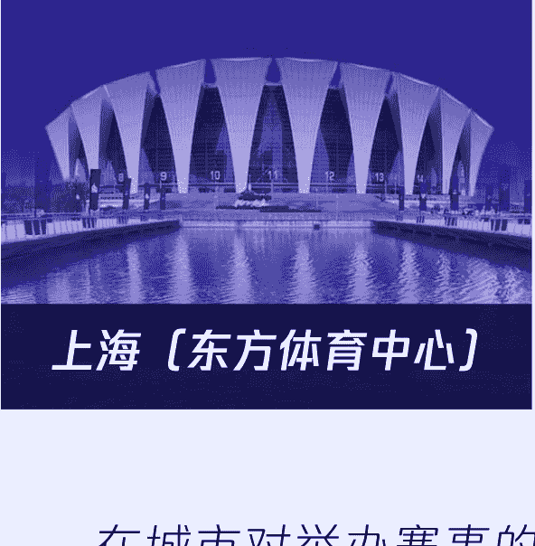

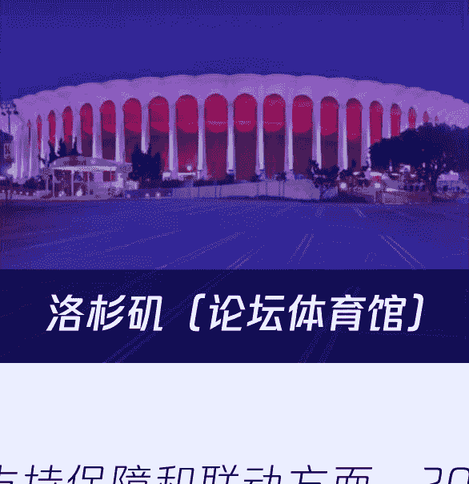

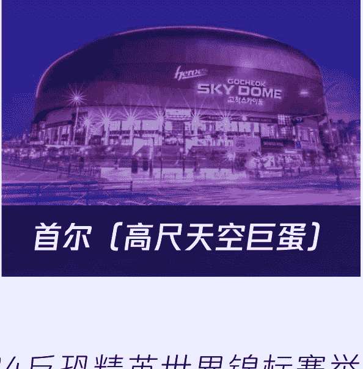

在城市对举办赛事的支持保障和联动方面，2024反恐精英世界锦标赛举办城市上海、2023英雄联盟全球总决赛举办城市首尔、2023无畏契约全球冠军赛举办城市洛杉矶都有体现，这是东南亚、中东地区的新兴电竞热门城市需要花时间追赶的。

从数据上的直观反映看，相比于首尔的供给能力突出，但韩语市场需求有限的情况下，上海和洛杉矶的供需关系都更为平衡。2024年，由于中国政府不断开放的外来旅游政策和国际赛事引入的吸引力，上海在全球影响力上完成了又一次跃升。本地的产业条件、对电竞在社会公共话题中衍生影响力的重视，加之扩大的开放政策的利好，使上海一跃成为全球最具影响力的电竞城市。洛杉矶和首尔很大程度上是因为缺少了当地政府在政策和周边产业投入上的支持，才落在了上海之后。

# 电竞与城市深度融合  
# 全球化视野下的观察与反思

## 2. 政策驱动下的新崛起：北京与利雅得的追赶与突破

同为首都城市，北京和利雅得受益于本国相关政策，在过去两年里各自政府对于电竞产业发展的支持力度较大。自2020年以来，北京持续推动的“电竞北京”系列活动在五年之后逐步见效，依托城市本身的强大基础设施和综合服务能力，电竞在这里可以迅速生长。而利雅得则是围绕着国际影响力的建立，在政策刺激和资金投入双重加码之下，通过电竞世界杯等赛事的举办，获得了全球电竞市场的关注，也打开了与世界交流的窗口。这两个城市如果对电竞相关的投入持续加码，全球电竞城市格局可能还会改变。

| 北京 | 事件 |
|---|---|
| 2019年12月 | 北京首次提出建设电子竞技产业品牌中心 |
| 2020年8月 | “电竞北京”系列活动首次举办。北京国际电竞创新发展大会集成果展示、行业交流、互动体验等于一体，提升城市电竞品牌影响力 |
| 2022年6月 | 北京计划建设智慧电竞赛事中心等产业园区，满足年轻消费群体沉浸式、体验型消费需求 |
| 2024年10月 | 北京发布“持续发挥‘双奥之城’影响力，引进更多国际顶级专项赛事和大型国际电竞赛事”相关政策 |

| 利雅得 | 事件 |
|---|---|
| 2022年7月 | 利雅得通过1500万美元奖金的 Gamers8 系列赛事开始获得全球电竞观众的关注 |
| 2022年9月 | 沙特公布国家电子游戏战略，并将其加入国家发展战略“2030愿景” |
| 2023年6月 | 沙特宣布将在首都利雅得周边的 Qiddiya City 加入“游戏与电竞特区” |
| 2024年7月 | 利雅得举办首届2024电竞世界杯，来自100多个国家及地区的1500多名选手参赛，全球有超过5亿观众观赛 |

和上海类似，当一个具备极高全球影响力的城市把电竞产业的发展与城市名片关联的时候，对需求侧评价和全球影响力的提升都有很大帮助，比如“电竞北京”系列活动的开展是对北京在电竞城市中实现追赶的重要动能。反观利雅得，由于需求侧的数据突出，加之本地政府长期的大力推广，使之正在实现全球影响力的提升。“以城市影响力辐射电竞”和“用电竞推动城市影响力”这种对照关系是对北京和利雅得这两个城市在电竞发展中特征的概括。

## 电竞与城市深度融合
全球化视野下的观察与反思

## 3. 新兴电竞热点：南北交汇与移动电竞的区域潜力

第6至10名的城市都是新兴的、对电竞充满热情的城市，本地的移动电竞项目尤其受到关注。里约热内卢和马尼拉是典型的本地观众电竞热情极高，同时城市人口规模也足够大的大型城市；成都和深圳拥有良好的交通条件，可以辐射周边城市群；新加坡则是联动世界东西方的一个重要交叉点。

相比于排名更靠前的城市，这些城市在全球影响力上会稍逊一筹。在这些城市中，里约热内卢受限于语言和地缘因素，全球影响力难以更进一步；新加坡是典型的需求强烈但供给不足，从2024年的相关新闻报道中可以看到，当地政府已经意识到了这种需求，正在积极搭建电竞发展的平台。基于长期南北交流的需求，相信新加坡的排名后续还会有所提升；深圳和成都都是新兴的电竞城市，有优渥的电竞发展政策作为保障，只是需要时间的积累和产业人才的沉淀；马尼拉比新加坡有更严重的供给不足问题，当地的政治、经济、文化环境和一些社会问题都会限制其在电竞发展的过程中更进一步，后续可能会成为重要的电竞选手输出城市，但本地电竞整体的发展瓶颈明显。

在所有城市的排名中，无论用户调研还是专家打分的维度，中国城市在每一个一级指标中都不是最占优势的，但胜在以城市政府为牵引，有全面发展的思路，各个指标的得分相对均匀，因此得以获得更高的排名。巴西电竞专家 Daniel Cossi 也认为：“中国电竞的发展是将具有全球竞争力的电竞行业融入中国经济”，以此让电竞发挥更大的作用。

## 4. 中国电竞城市主场：激活区域电竞发展的关键一环

中国电子竞技俱乐部对主场模式的探索始于2017年，主场经营理念和模式作为北美商业体育联盟特许经营制度的一部分被引入。主场被引入的初衷是帮助俱乐部建立线下营收渠道，打造地域属性，增强面向属地粉丝的影响力。电竞俱乐部与想要发展电竞的城市逐渐找到了一条共生的道路。

这些与城市合作成功的俱乐部有两个共同的特点：首先，依托母公司与地方政府实现了长期深度的合作，尽管现阶段尚无法产生巨大的经济价值，但获得了探索的时间和空间；其次，自身都具备较大影响力并且积极开展线上线下宣传，提供了大量的间接经济价值。此外，电竞的互联网属性也让主场有了更多的想象空间。从AG电子竞技俱乐部、微博电子竞技俱乐部、狼队电子竞技俱乐部的案例出发，可以展示不同主场模式对城市的激活作用和持续影响。

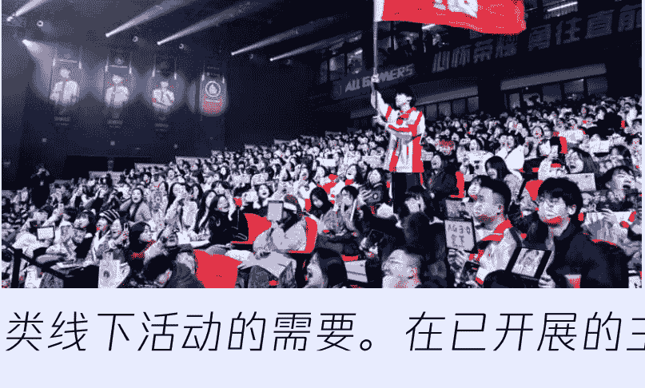

AG电子竞技俱乐部主场位于成都市武侯区的西部智谷园区，主场是俱乐部与当地国企共同承担成本、联合运营。其场内设施先进，既可以承接电竞赛事、电竞类衍生活动，也可以满足非电竞类线下活动的需要。在已开展的主场活动中，俱乐部已实现与成都武侯祠、宽窄巷子、青城山—都江堰景区、三星堆博物馆、雅安大熊猫保护研究基地和九龙沟景区的合作，成为地方文旅推介的重要场景。

AG电子竞技俱乐部主场是典型案例，通过发挥电竞对青年人群的影响，引入成都当地文化和旅游资源作为文化符号，兑现了一般体育“主场”概念的增益效果。这是通过主场运营实现与属地城市互联互促的重要代表。

微博电子竞技俱乐部主场微博IN钻石中心位于北京市朝阳区。该场馆是在朝阳文旅集团支持下，以“传承奥运，潮无止尽”为理念，由微博集团改建原奥运沙滩排球场馆及场馆附属场地的更新改造项目，也是目前国内唯一一个电竞主题商业综合体。

微博IN钻石中心作为附近地标建筑，主要发挥商业业态引流作用。访谈中，该场馆运营负责人表示，未来可能会承接第三方电竞赛事，并依托微博集团的资源与影响力，承接二次元主题的线下活动以及其他非电竞类线下活动。微博IN钻石中心是电竞线上传播能力对线下影响的一种新尝试，比赛作为高效的引流手段，将整个周边业态明确定位为潮流文化集合地，电竞、游戏、二次元等多类型IP混合展示。

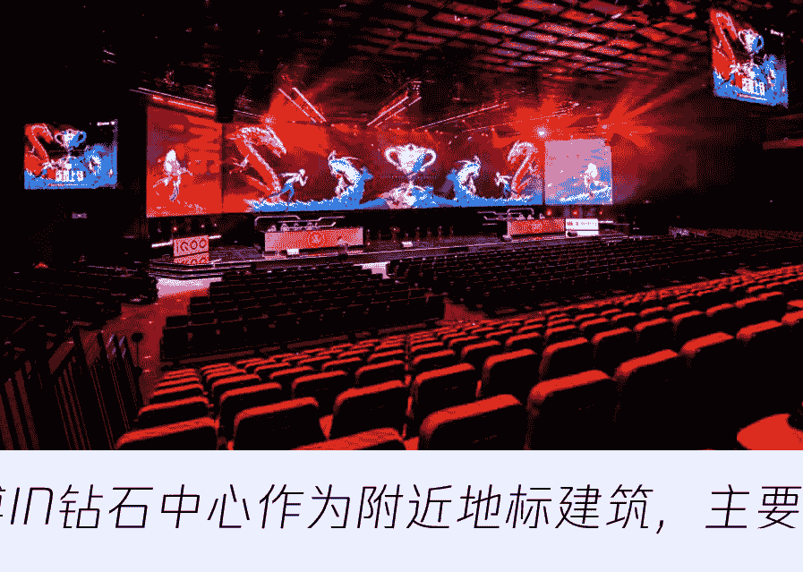

狼队电子竞技俱乐部目前暂时使用重庆市璧山区的璧山文化艺术中心作为主场，新场馆正在建设中。璧山文化艺术中心毗邻重庆大学城，目前主要承接王者荣耀相关职业赛事和政府的文艺演出，主要的收入构成是门票收入和场地租赁收入。

狼队电子竞技俱乐部在长期计划中，希望依托主场的标志性展示，产生对上下游业态的聚集作用。教培服务、周边产品以及其他产业环节的贴近，都可以持续地激活主场周边业态。

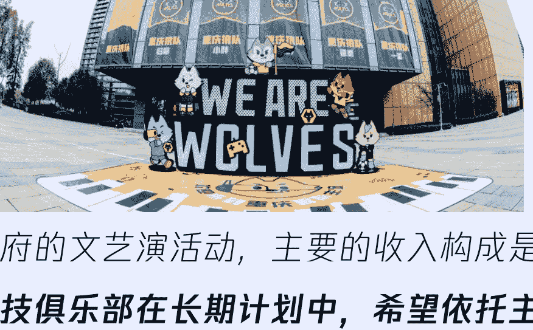

# 变革的当下

# 电竞运动的全球共生

## 电竞全球化浪潮加剧
观众特征与国别区域联结凸显

2024年，电子竞技的全球化进程借由各大综合性赛事，尤其是电竞世界杯（EWC）的推动，在俱乐部层面上实现了一次重要的重组，不同国家和地区的观众有机会见证本地的俱乐部迅速扩张全球版图。

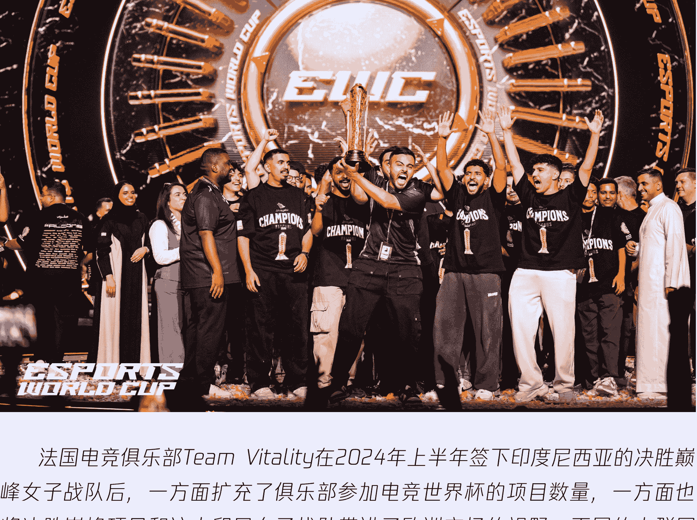

法国电竞俱乐部Team Vitality在2024年上半年签下印度尼西亚的决胜巅峰女子战队后，一方面扩充了俱乐部参加电竞世界杯的项目数量，另一方面也将决胜巅峰项目和这支印尼女子战队带进了欧洲市场的视野。不同的人群因为电竞可以快速地相互认识，在共同追求胜利的目标之下寻求彼此更深层次上的理解，这正是2024年全球电竞发展的一个重要缩影，也引出了不同国别、区域之间，特别是跨语言地区的运营命题。

在完成了近20个国家与地区的数据收集之后，我们将在这个章节向大家展示电子竞技运动是如何在不同的土壤当中实现全球共生的。

## 全球电竞用户画像
性别与年龄结构的多样化

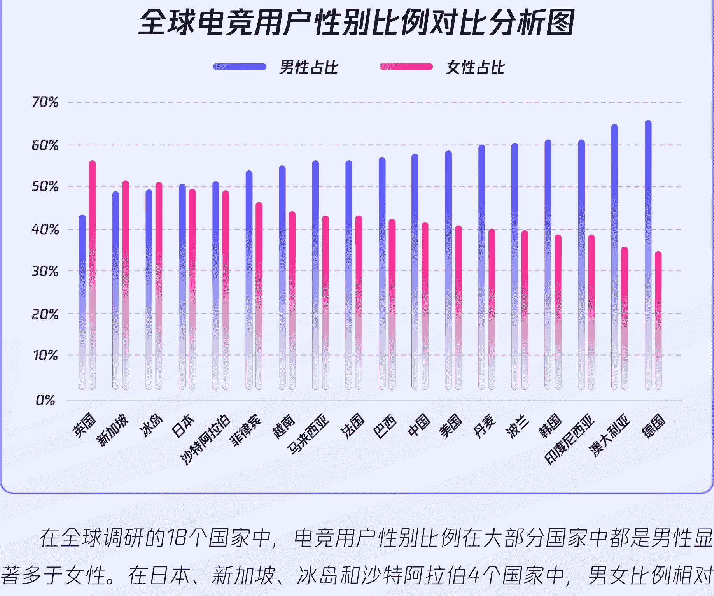

在全球调研的18个国家中，电竞用户性别比例在大部分国家中都是男性显著多于女性。在日本、新加坡、冰岛和沙特阿拉伯4个国家中，男女比例相对均衡，英国则是女性用户比例显著高于男性的国家。

从整体趋势上看，男性和女性在电竞运动的参与度上差距正在迅速缩小。国际奥委会长期致力于促进赛场内外的性别平等，首届电竞奥运会即将举办，也意味着女子电竞的发展将成为电竞产业未来发展的一个重要方向。通过数据可以确认，沙特政府大力推动电竞在本地的发展，与其国内女性对电竞参与度和内容消费的需求是相互匹配的。沙特女性电竞运动员在2024年度举办的亚洲电子体育运动会上同样表现不俗，运动员表现、本地观众热情和政府支持可以形成一个当地女性电竞持续发展的正向循环。

## 全球电竞观众画像
性别与年龄结构的多样化

### 以美国、冰岛、韩国、中国为代表的全球电竞用户年龄分布对比图

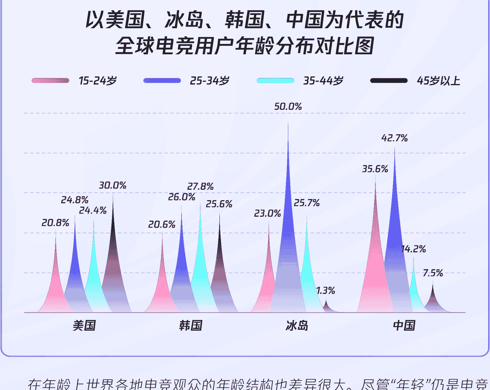

在年龄上，世界各地电竞观众的年龄结构也差异很大。尽管“年轻”仍是电竞用户的主要标签，但随着电子竞技在全球范围内超过20年的发展，35岁以上的电竞观众并不在少数。在澳大利亚、马来西亚、沙特阿拉伯、新加坡、美国和波兰的调研数据中，35岁以上的人群都是主要电竞观众群体所在。

在巴西、丹麦、法国和韩国等电竞起步较早的国家，44岁以上的人群也是电竞观众群体的重要组成部分。相比之下，中国、英国、冰岛、越南和日本的电竞观众年龄构成则相对年轻一些。相差较大的年龄结构直接导致了在内容消费和社区运营上会呈现出完全不同的需求。

## 全球电竞观赛特征
高频观赛与项目偏好的地域差异

### 以中国、巴西、沙特和冰岛为代表的电竞观众近一年观赛频率及时长对比分析图

| 国家/地区 | 近一年观赛频率每周1次及以上 | 近一年每周观赛时长高于3小时 |
|---|---:|---:|
| 中国 | 66.6% | 27.6% |
| 巴西 | 72.0% | 36.0% |
| 沙特阿拉伯 | 67.0% | 36.0% |
| 冰岛 | 73.0% | 36.8% |

在所有调研国家中，超过一半国家的电竞观众每周观看一次电竞赛事的比例高于60%，其中冰岛和巴西占比最高，都超过了70%。同样值得关注的是，所有国家的电竞观众每周观看一次电竞赛事的比例都超过了40%，这一方面体现了电竞互联网传播快捷、广泛的属性，也证明电竞观众在时间上的投入远非一般业余爱好可比。

电竞观众每周观看时长超过3小时的比例在35%以上的国家一共有7个，其中巴西和冰岛同样在列，不仅观看频率高，观看时长也长，足见当地电竞的氛围。里约热内卢和雷克雅未克多次举办大型电竞赛事，这与本地电竞氛围形成了相互促进的正向螺旋。

让人意外的是，培养了大量电竞俱乐部和选手的丹麦，受到观众年龄较大的影响，在观看频率和观看时长上整体较低；这两项数据同样较低的还有2024年举办了多个大型国家赛事的马来西亚。

## 全球电竞观赛特征
高频观赛与项目偏好的地域差异

### 全球电竞赛事类型受欢迎程度及地区偏好分析图

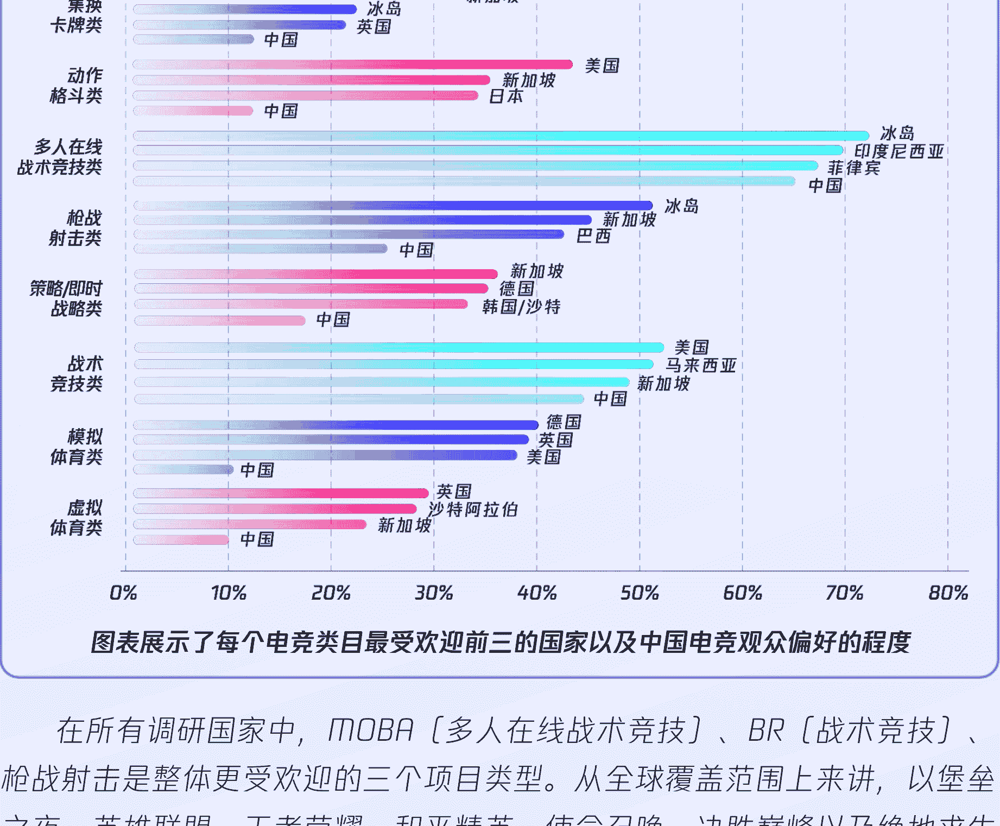

图表展示了每个电竞类别最受欢迎的前三个国家以及中国电竞观众偏好的程度。

在所有调研国家中，MOBA（多人在线战术竞技）、BR（战术竞技）、枪战射击是整体更受欢迎的三个项目类型。从全球覆盖范围来讲，以《堡垒之夜》《英雄联盟》《王者荣耀》《和平精英》《使命召唤》《决胜巅峰》以及《绝地求生》为代表的项目占据了电竞观众的主要注意力，《堡垒之夜》和《使命召唤》系列在欧美地区的影响力非常显著。

以东亚和东南亚地区为代表，中国、菲律宾、印度尼西亚、马来西亚、越南和冰岛的MOBA项目观众优先级都超过了50%。同样，在战术竞技项目上，美国和马来西亚的观众优先级也超过了50%。此外，美国、新加坡和日本的观众对动作格斗类赛事同样有很高的关注度。而在新加坡、德国、韩国和沙特，会有不少观众偏爱即时战略类赛事。

数据来源：问卷调研

# 电竞运动的全球共生

## 全球电竞观赛动机
本地赛事的关注度与个人偏好的多样性

在其他观赛习惯的调研中，中国、越南、美国、韩国、印度尼西亚、菲律宾、巴西的电竞观众因为拥有高水平、高质量的本国赛事内容可以消费，整体对本地赛事的关注度显著高于其他国家，欧洲国家则更关注欧洲地区性质的赛事。

对于拥有足够人口基数的国家来讲，本地电竞赛事的价值并不会被全球赛事或者洲际赛事所影响。

而在观赛目的上，全球范围内大部分电竞观众观看比赛还是以“娱乐休闲、放松情绪”和“感受体育比赛的竞争和热烈氛围”为主。除此之外，较为显著的目的分别是对游戏技巧的学习和为本国队伍加油。支持喜欢的队伍或选手和社交需求作为观赛原因的整体占比并不算高。

具体来讲，巴西、印度尼西亚、马来西亚和越南的电竞观众在调研中展现出了强烈的民族自豪感，以“为本国队伍加油”为观赛原因的比例较高。中国、韩国、马来西亚和新加坡都是电竞追星大国，“支持喜欢的俱乐部和选手”这个观赛目的比其他国家显著要高。相比于其他国家，菲律宾的观众非常硬核，希望可以通过观看比赛学习游戏技巧的比例最高。沙特的电竞观众非常特别，更愿意把观赛视为一种“高科技的文化体验”。

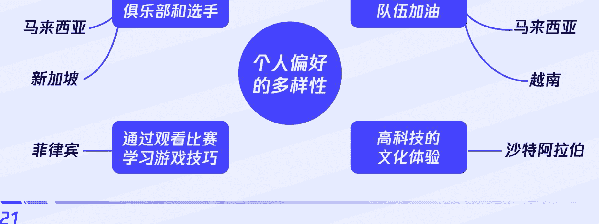

## 全球电竞观赛目的地
城市吸引力与文化交流的双向促进

### 全球电竞观众意向观赛目的地调研图

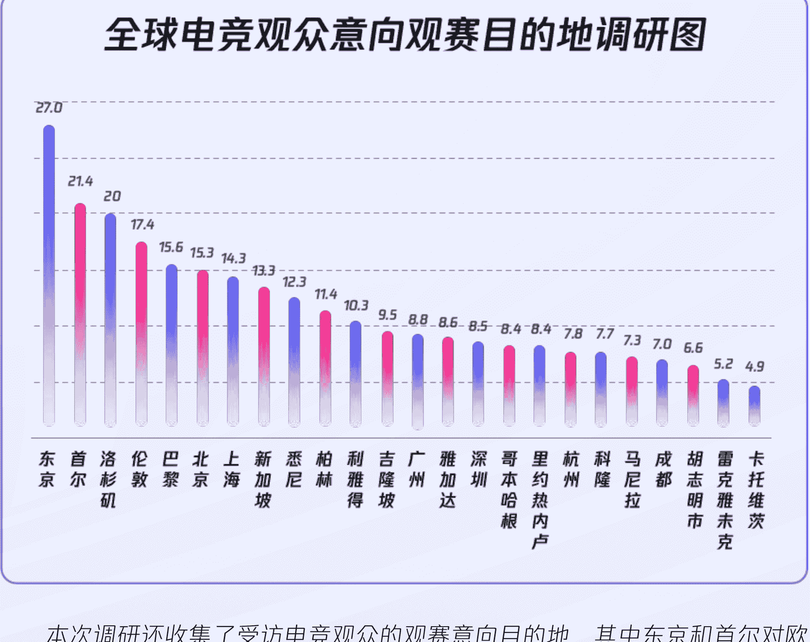

本次调研还收集了受访电竞观众的观赛意向目的地，其中东京和首尔对欧美地区的观众都有着极强的吸引力，上海、北京、伦敦、巴黎等大型城市也都在排名前列。值得注意的是，利雅得在24个目标城市中排名第11位，排在科隆、哥本哈根等电竞名城之前。可见，利雅得2024年倾力举办的电竞世界杯已经为其收获了全球观众的青睐。

在完成了不同国家与地区电竞观众的人口画像和观赛行为的横向比较，时间和空间的向度被拉齐之后，偏好才真正成为偏好。通过本次调研数据，我们可以清晰地看到电竞正在促进不同国家和地区的电竞观众加深对海外城市的认知，电竞在吸引海外观众成为城市游客方面正发挥着重要的作用。

## 跨语言交流中全球电竞网络传播热点的对照分析

网络传播大数据相比于用户调研有更广泛的样本量，全球电竞观众按照不同语料之间的差异，可以形成跨语言的对照。本次报告中，针对2024年电竞世界杯（EWC）期间的网络数据做了比照，以探索不同语言之下电竞相关问题的持续影响。

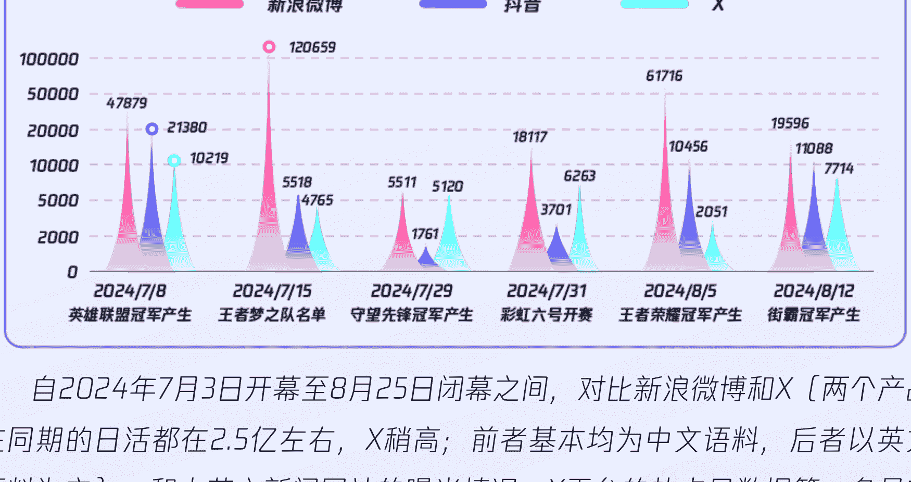

自2024年7月30日开幕至8月25日闭幕期间，对比新浪微博和X（两个产品在同期的日活都在2.5亿左右，X稍高；前者基本均为中文语料，后者以英语语料为主），以及中英文新闻网站的曝光情况：X平台的热点日数据第一名是英雄联盟战队T1拿下首个项目的冠军，紧随其后的是中国选手Xiaohai在《街霸》项目夺冠。

反观微博平台，前三名的讨论均来自王者荣耀梦之队相关事件，第四、第五名为英雄联盟相关赛事。中国选手Xiaohai在《街霸》项目的优异表现相比之下没能获得微博平台的足够关注。而在抖音平台上，英雄联盟的讨论量则高于王者荣耀，梦之队夺冠期间的热度与Xiaohai夺冠接近，在本周期抖音传播热度中仅次于英雄联盟相关热度。不同话语体系（文化圈层）下，电竞项目之间的热度存在明显差异，扩充自身项目在不同社交网络平台上的影响力是其破圈的关键所在。

## 全球电竞信息流
在多语言社媒平台的跨越

通过对整个EWC周期数据的持续观察，本报告发现，“是否在中国正式发行”这一因素极大影响着电竞项目在中国市场的信息流转方式。

从每日数据变化中可知，热门项目中英文同步率一致。未正式发行电竞项目信息的流动方式是从英文社交媒体（以X为代表）开始发酵，到英文媒体跟进报道，再到中文媒体转载或者评述，最后在中文社交媒体（以微博为代表）引发讨论。对于在中国未正式发行的项目，中国网友的关注度有限，都是经由媒体发酵进而形成讨论，语言之间的壁垒和主要关注的信息渠道存在明显差异。在后续的全球交流过程中，中国需要建立更多具有跨语言思维方式的交流平台，或者引进更多的海外电竞机构创立中文社交媒体账号，才能真正促进不同语言之间的电竞交流。

### 以EWC为例看赛事信息跨语言流转方式的不同

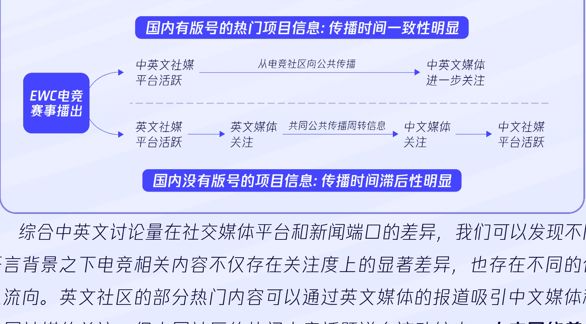

综合中英文讨论量在社交媒体平台和新闻端口的差异，我们可以发现，不同语言背景之下，电竞相关内容不仅存在关注度上的显著差异，也存在不同的信息流向。英文社区的部分热门内容可以通过英文媒体的报道吸引中文媒体和中国社媒的关注，但中国社区的热门电竞话题逆向流动较少。**未来围绕中文电竞信息和内容的全球化运营仍然是一个重要命题，并且需要持续不断地推动中国电竞行业的信息和内容走向世界。**在此过程中，既需要认识上的提升，也需要相关人才的引入。

## 全球电竞格局中的中国
独特规模与长期投入带来的超级市场

2024年12月7日，拳头游戏公布了2024年无畏契约在世界各地本地联赛的观赛峰值人数数据：美洲赛区为81万、EMEA（欧洲、中东及非洲地区）赛区为40.9万、太平洋赛区为48.1万，三者总和为170万人，而VCT（顶级赛事）的峰值观看人数为180万。

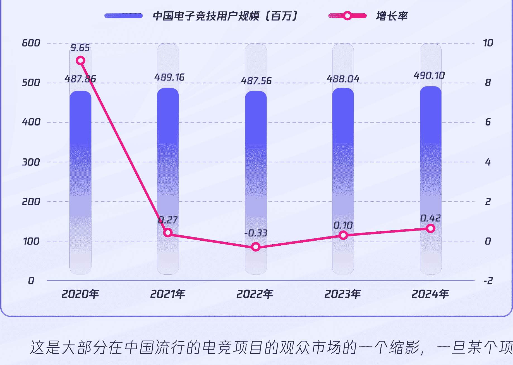

这是大部分在中国流行的电竞项目观众市场的一个缩影。一旦某个项目在中国流行，基于中国庞大的观众基数，峰值观众数据上的优势就会非常显著。在中国音像与数字出版协会电子竞技工作委员会发布的《2024年中国电子竞技产业报告》中，对中国电竞观众的描述为4.91亿人。同时，由于中国拥有全球电竞市场中最多的项目版权方总部，各个项目版权方在对本地市场的经营上也是不遗余力，所以我们才看到了这样一个巨大且特殊的超级市场。

数据来源：中国音像与数字出版协会发布《2024年中国电子竞技产业报告》

## 线下观赛需求旺盛
中国电竞市场的独特消费习惯

### 中国与17国均值的电竞消费行为对比图

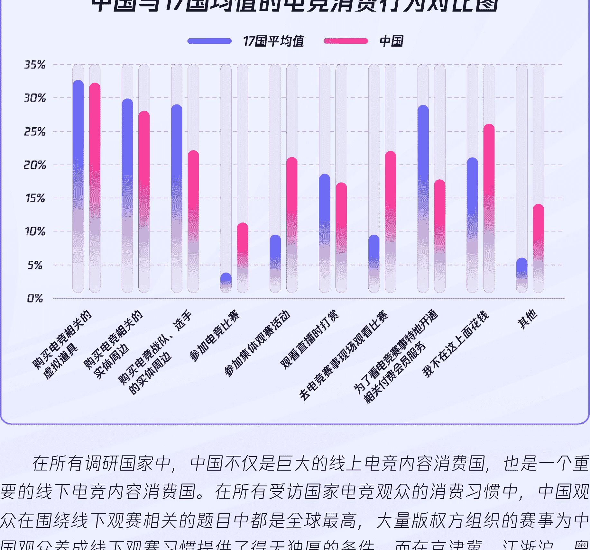

在所有调研国家中，中国不仅是最大的线上电竞内容消费国，也是一个重要的线下电竞内容消费国。在所有受访国家电竞观众的消费习惯中，中国观众在围绕线下观赛相关的题目中都是全球最高，大量版权方组织的赛事为中国观众养成线下观赛习惯提供了得天独厚的条件，而京津冀、江浙沪、粤港澳等区域的便捷交通也给了中国观众积极参与线下观赛的条件。

尽管中国观众拥有众多线下观赛机会，但在“购买电竞战队及选手实体周边”方面的消费水平显著低于全球平均水平。当市场需求旺盛，而实际消费行为未能达到预期时，当前战队及选手实体周边产品的供给存在不足，未能有效满足观众的心理预期，是购买决策未成型的重要原因之一。后续仍需持续提升电竞线下观赛中的消费品品质，并丰富其文化价值。

## 中国公众态度变化
从“打游戏”到“数字文化”的认知跃迁

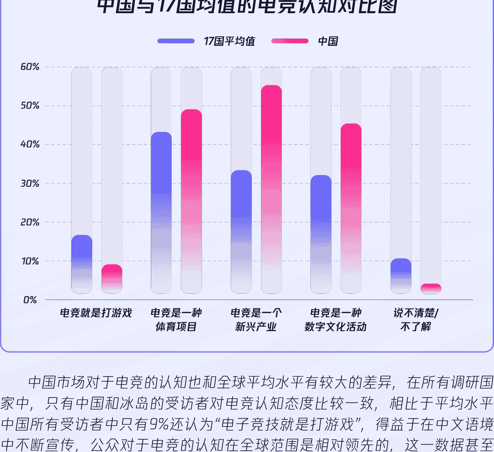

中国市场对于电竞的认知也和全球平均水平有较大的差异。在所有调研国家中，只有中国和冰岛的受访者对电竞认知态度比较一致。相比于平均水平，中国所有受访者中只有9%还认为“电子竞技就是打游戏”。得益于在中文语境中不断宣传，公众对于电竞的认知在全球范围是相对领先的，这一数据甚至影响到了马来西亚受访者中的华人群体。

在全球范围内，所有与电竞认知相关题目的数据都显示，电竞用户和非电竞用户之间对电竞的认知差异明显，电竞仍然存在认知上的壁垒。在关于“电竞是一项体育运动”的讨论中，中国受访者与世界上电竞较为成熟的几个国家的受访者没有显著差别，但是，在“电竞是一项新兴产业”和“电竞是一项数字文化活动”的选项比例中，中国市场都展示出了极高的认可度。中国在电竞人口基数、市场规模、观众行动力、版权方意愿和长期公众认知宣传上都有自己的特殊之处，也形成了世界上唯一的一个电竞超级市场。

## 未来全球交流的重要契机
奥林匹克电子竞技运动会

北京时间2024年7月24日，在法国巴黎进行的国际奥委会第142次全会上，全票通过了2025年在沙特阿拉伯举办首届奥林匹克电子竞技运动会的决定。随后，国际奥委会在其官网称：“今天创造了历史。”

时任国际奥委会主席巴赫表示，世界在变化，人们正在经历一场数字革命。同时，他强调，这项合作是基于《奥林匹克宪章》和奥林匹克价值观实现的。自此，关于电子竞技运动与国际奥委会之间长达7年的双向奔赴终于达成。

## 电子竞技入奥历程回顾

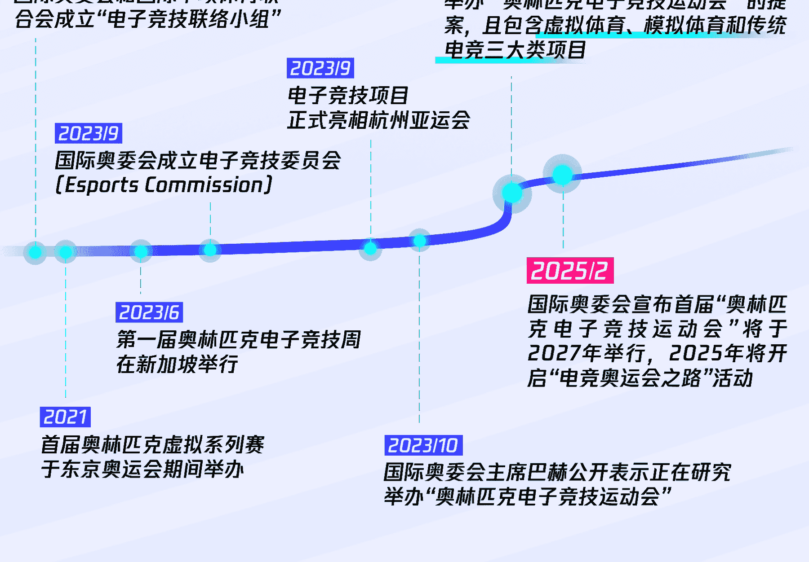

**2017**  
国际奥委会和国际单项体育联合会共同成立“电子竞技联络小组”。

**2023/6**  
第一届奥林匹克电子竞技周在新加坡举行。

**2023/9**  
国际奥委会成立电子竞技委员会。  
[Esports Commission]

**2023/9**  
电子竞技项目正式亮相杭州亚运会。

**2023/10**  
国际奥委会主席巴赫公开表示正在研究举办“奥林匹克电子竞技运动会”。

**2024/7**  
国际奥委会第142次全会一致通过了举办“奥林匹克电子竞技运动会”的提案，且包含虚拟体育、模拟体育和传统电竞三大类项目。

**2021**  
首届奥林匹克虚拟系列赛于东京奥运会期间举办。

**2025/2**  
国际奥委会宣布首届“奥林匹克电子竞技运动会”将于2027年举行，2025年将开启“电竞奥运会之路”活动。

## 电竞奥运规则的全球差异
### 中国市场以73%的认知度领跑

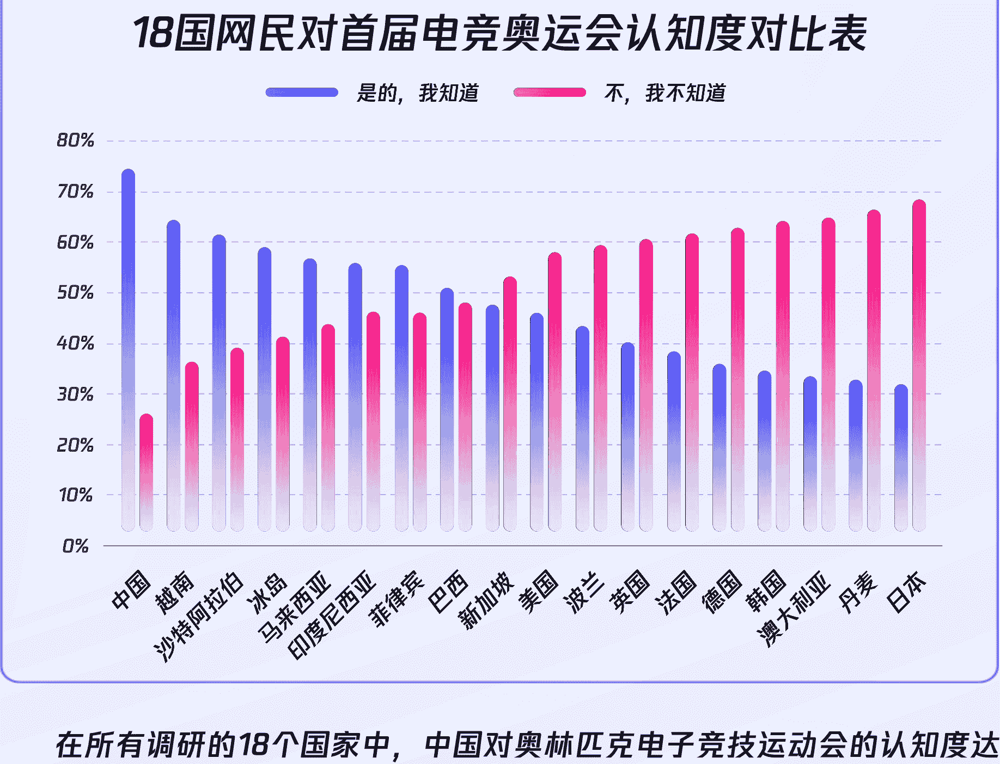

在所有调研的18个国家中，中国对奥林匹克电子竞技运动会的认知度达73%，排名第一，紧随其后的是越南和沙特，有接近一半国家的电竞奥运知晓度在50%以上。奥运精神和奥运文化在中国的广泛传播，让电竞奥运会成为中国电竞观众中一个拥有持续话题度的讨论方向。同时，非常值得一提的是，在中国对虚拟体育感兴趣的观众中，有95%知晓奥林匹克电子竞技运动会的举办，足见该项赛事对于虚拟体育类项目的影响。

在日本、丹麦、德国、英国、美国等地，这些传统电子游戏类电竞项目发展历史更悠久，对虚拟体育项目纳入电竞概念范畴时的认可度不高，这些国家的受访者不支持国际奥委会为电子竞技运动创办专属的奥林匹克运动会的比例也相对较高，都在两成左右。

而在新兴的电竞市场，像越南、沙特、菲律宾、印度尼西亚等地，对虚拟体育项目纳入电竞奥运的关注度则明显更高，对国际奥委会为电子竞技运动创办专属的奥林匹克运动会也持更积极的态度，不同意的比例不足一成。从数据上来看，虚拟体育在拥抱奥运的同时，拥抱新兴的电竞市场同样重要。

## 变革的当下——电竞运动的全球共生

### 总结

通过对18个国家与地区的调研数据横向比较，以及对全球电竞专家访谈的内容归纳，中国作为全球电竞超级市场的格局更为清晰。在中国，各类电竞项目在绝对观众人数上都有足够的基础，尤其是这些观众在线上、线下观赛的活跃性，为电竞生态提供了坚实的基础。结合中国城市整体的人口规模、便利的区域交通等基础设施储备，这将为中国后续持续引入大量高水平赛事提供保障。**以竞赛组织为抓手，不断展示中国对全球电竞组织者和观众群体的吸引力，以此建立中国在全球电竞生态中不可或缺的影响力。**为实现这一目标，可与国际奥委会探讨奥林匹克电子竞技运动会在中国举办的可能性，并充分发挥中国独有的电竞项目版权方平台优势，将电竞赛事与版权方的全球发行相结合。

在“引进来”的同时，也需要推动中国电竞行业的相关企业与更多国际品牌展开合作，吸引跨国投资，推动中国电竞品牌的国际化，进一步提升电竞产业的全球影响力。持续深入对全球电竞合作伙伴和快速发展地区的分析研究，**使中国项目版权方、电竞赛事、俱乐部和知名选手具备走向国际舞台，与全球电竞产业进行深度互动的能力，以此丰富中国文化的全球传播路径。**尤其是在东南亚、拉美和中东等地区，移动电竞项目快速发展，中国电竞将更具有优势，以中国市场的成功经验建立中国在全球电竞规则中的影响，找到联通东西、合作南北的关键站位。

“走出去”和“引进来”的前提都是充分的了解和交流。2024年腾讯电竞设立了“全球电竞共赢交流计划”，也是中国电竞赛事、俱乐部和选手长期稳定的国际交流渠道。随着各方对国际交流重视程度的提升，结合**即将在沙特举办的首届奥林匹克电子竞技运动会，这一全球性赛事提供了国家间电竞合作的全新平台，为探讨如何平衡传统体育精神与电竞创新提供了机会，也进一步强化了电竞作为国际合作桥梁的角色。**2025年，抓住相关的交流机会将非常重要。

## 03 从过去到未来

## 中国电竞五年纵观

## 亚运助推电竞社会认知深化
### 总台转播提升电竞赛事影响力

从最初的草根赛事到如今的国际化竞技舞台，中国电竞已逐步走向成熟，成为全球电子竞技行业的重要一极。尤其是从2020年到2024年这五年时间里，借由杭州第19届亚运会的成功举办，电竞回归总台大屏，媒介形式进一步拓宽，对公众认知带来了关键转变。这一历史性时刻为中国电竞产业注入了新的活力，也使得全球电竞在体育赛事中的地位和影响力得到了前所未有的提升。

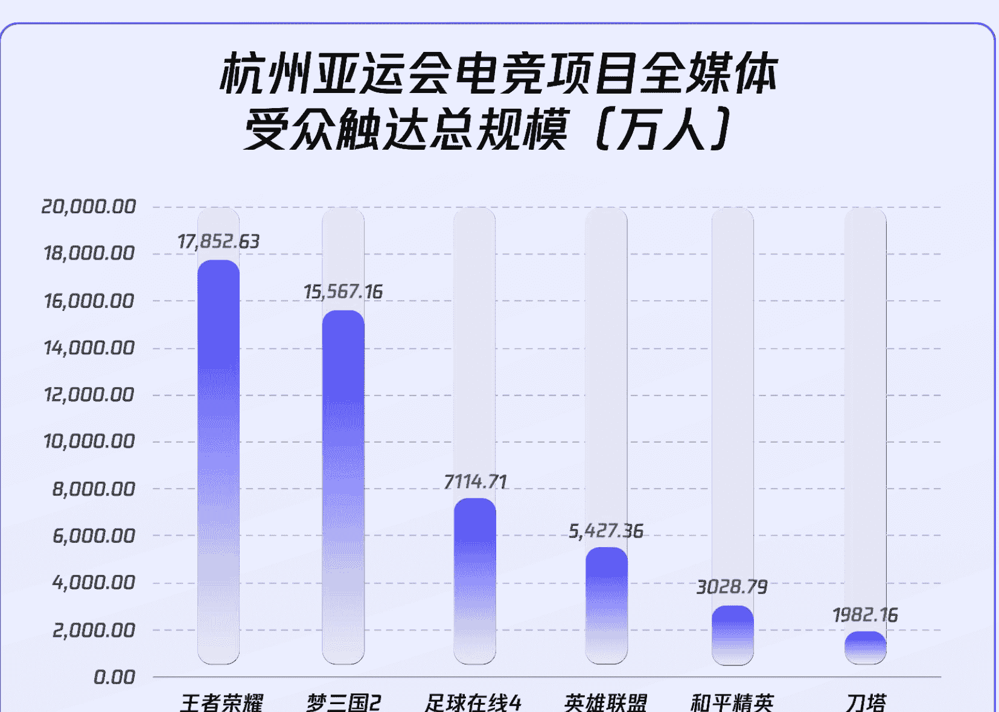

根据中央广播电视总台国家电子竞技发展研究院发布的《“电竞入亚”的传播效果及对电竞产业的推动》报告，2023年9月25日至10月8日，杭州第19届亚运会中“王者荣耀”的受众触达规模高达1.79亿人，“梦三国2”为1.56亿人，显示出电竞项目在国内外观众中的广泛关注。

这些以亿为单位的数据不仅表明了近年来中国电竞在全球范围内的影响力，也为全球电竞行业的未来发展奠定了坚实的基础。

数据来源：中央广播电视总台国家电子竞技发展研究院《“电竞入亚”的传播效果及对电竞产业的推动》报告

## 2020—2024年中国电竞用户数据变化
### 认知深化与消费升级

为了深入分析中国电竞产业近年来的发展变化，本报告整理了过去五年《全球电竞运动行业发展报告》的数据，围绕电竞观众的人口结构、认知态度以及观赛行为习惯进行跨年度的分析，旨在通过有跨度的数据描绘，为我们提供一个更加准确的时间维度认知，帮助深入理解中国电子竞技运动的发展变迁。

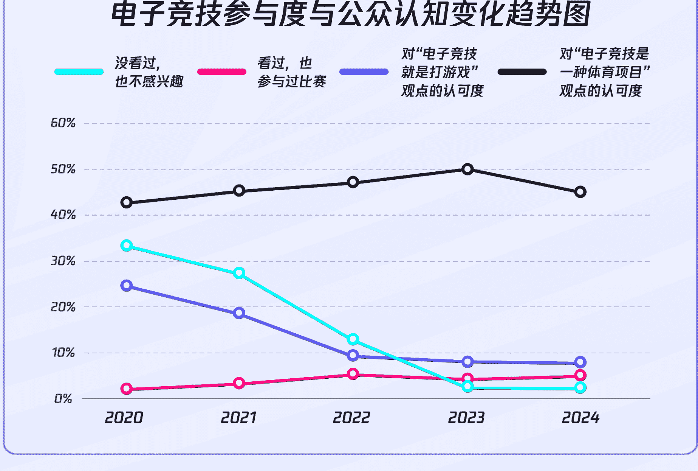

自2020年起，对电子竞技运动既不感兴趣又没看过的受访对象比例，从33.6%逐年降至5.3%。同样，在所有受访对象中，对“电子竞技就是打游戏”观点的认可度从24.8%降至8.7%。而对“电子竞技是一种体育项目”观点的认可度从43%提升至接近五成。电子竞技运动经过杭州亚运会顺利举办、进入奥林匹克电子竞技运动会等公共事件，在认知和认可程度上都有了显著的提升。相比于新兴市场，中国电子竞技运动正在经历认知深化的阶段。

数据来源：问卷调研

## 对电竞行业态度的转变
### 从小众新兴产业到主流文化的广泛认可

## 电竞行业从业意向对比分析图

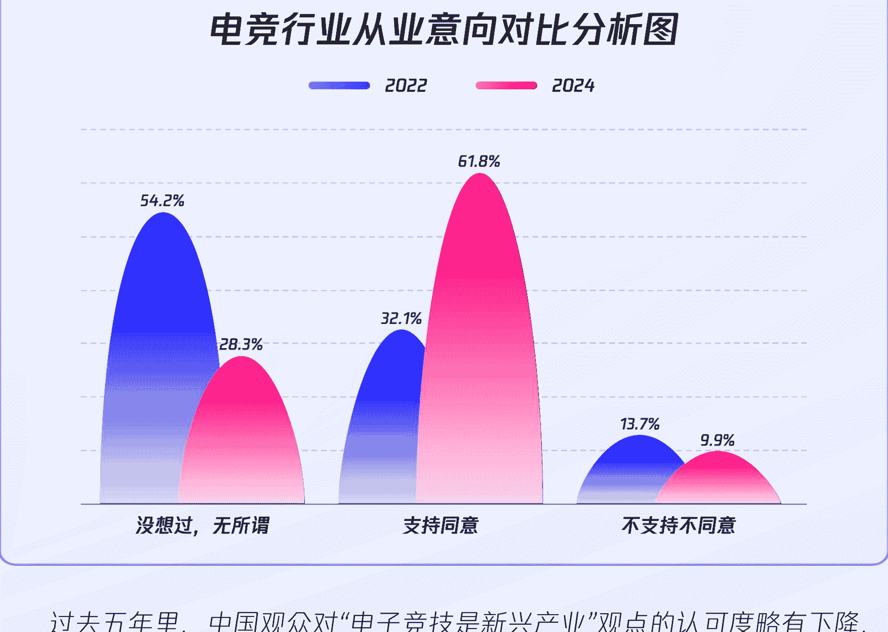

过去五年里，中国观众对“电子竞技是新兴产业”观点的认可度略有下降，反映出受访者群体对电竞有了更深入的了解。在对“造梦神话”和“网瘾少年”的两极评价减少之后，电竞不再是一个神秘特殊的工作。

相比于2020年的数据，2024年底支持或同意“家人或者自己从事电竞行业”的观众比例从32.1%提升至61.8%，相比之下“没想过”和“不愿意、不支持”的比例都大幅下降。从趋势来看，电子竞技运动相关的工作正在逐步获得社会主流的认可。

## 女性观众占比持续提升
### 电竞市场女性角色意义凸显

## 女性电竞观众比例变化图

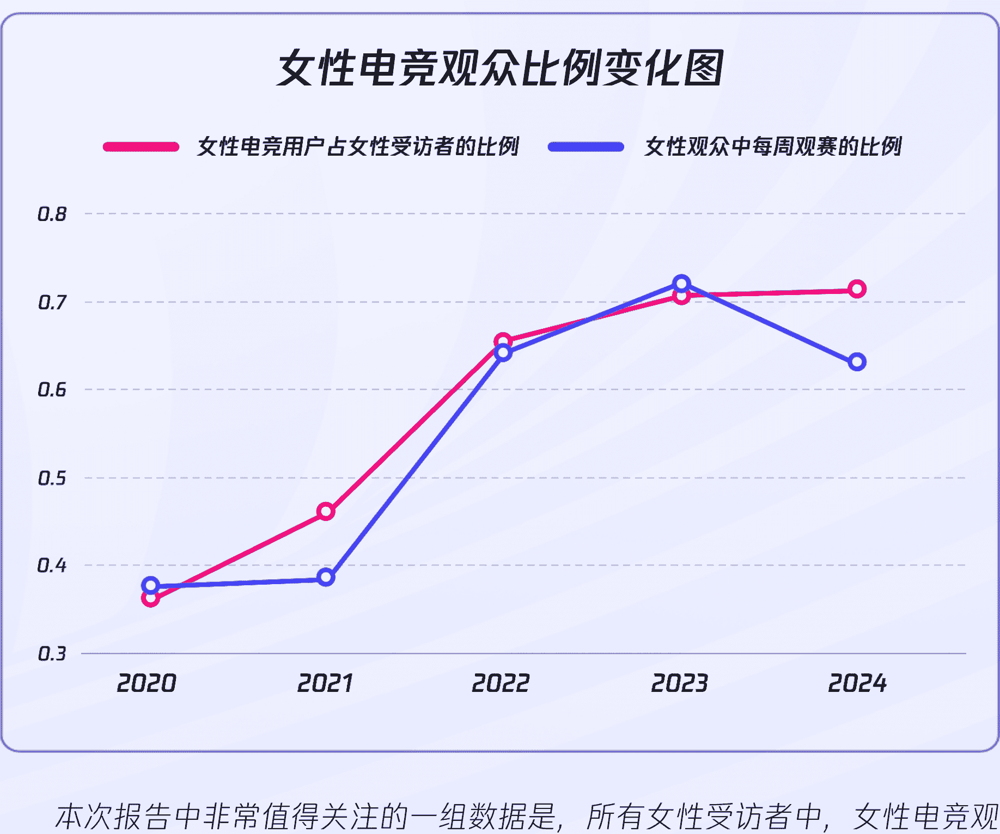

本次报告中非常值得关注的一组数据是，所有女性受访者中，女性电竞观众的比例逐年增加，从2020年的36%提升至2024年的71.8%，在个别项目上甚至已经反超男性观众，女性观众更是成为主要的线下观赛群体。同样，女性电竞观众中，每周观看电竞内容的比例也逐年增加，在过去五年里从2020年的37.7%提升至2024年的63.7%。

女性观众在电子竞技运动中扮演的角色已经越发重要，如何正视她们的观赛需求，提供更丰富的线上线下消费产品，将成为下一代电竞项目脱颖而出的关键所在。

## 中国电竞五年纵观

### 电竞消费习惯的升级
#### 从虚拟到线下转变明显

## 近五年电竞观众消费层次分布变化趋势

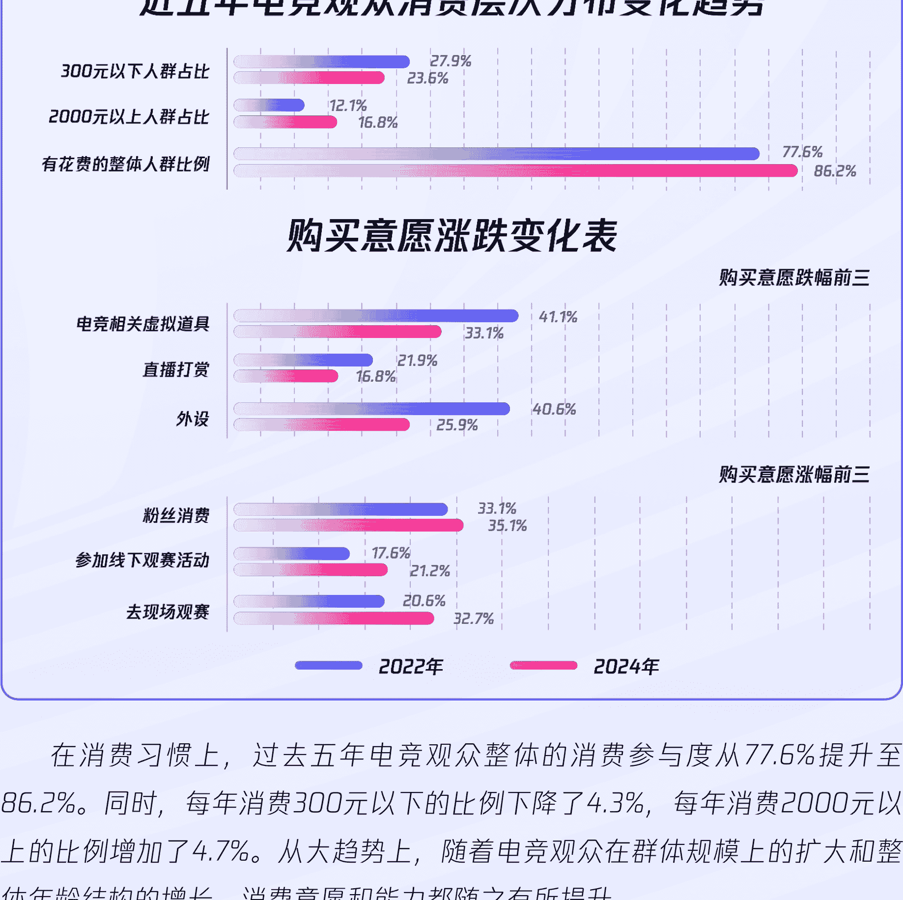

在消费习惯上，过去五年电竞观众整体的消费参与度从77.6%提升至86.2%。同时，每年消费300元以下的比例下降了4.3%，每年消费2000元以上的比例增加了4.7%。从大趋势上，随着电竞观众在群体规模上的扩大和整体年龄结构的增长，消费意愿和能力都随之有所提升。

在具体消费意愿的侧重上，五年间有所变化。“电竞相关虚拟道具”、“直播打赏”和“外设类”都有所下降，而在“粉丝向消费”、“参加线下观赛活动”和“去现场观赛”的消费意愿和金额上都有所上升。电竞正在展现出由虚向实的重要转变。这和女性用户的增加以及线下观赛场景的丰富都有着密不可分的关系。

## 重点电竞事件中的公共语境变迁
### 热点话题与电竞城市讨论

本次报告整理了2020—2024年与英雄联盟全球总决赛和“电竞北京”系列活动相关的网络传播大数据，围绕电竞在公共话语体系中的变化路径，通过有跨度的数据分析，形成一个在时间维度上更准确的认知。

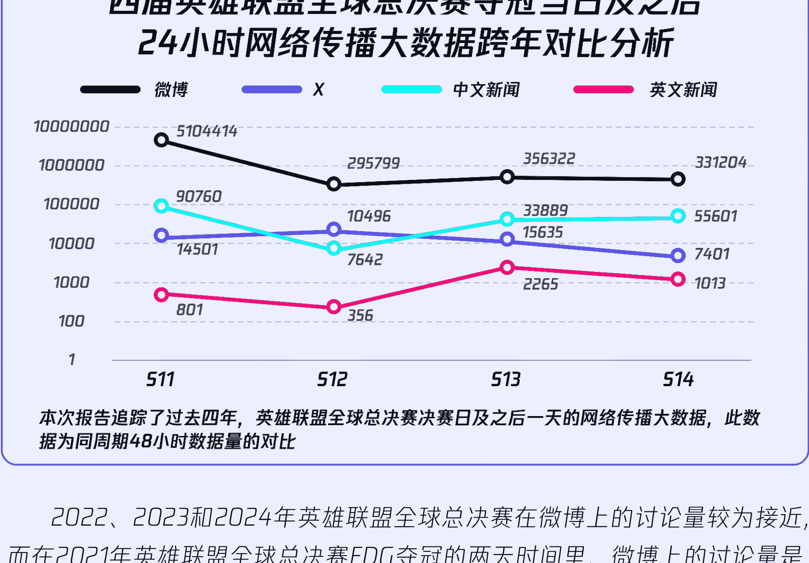

2022、2023和2024年英雄联盟全球总决赛在微博上的讨论量较为接近，而在2021年英雄联盟全球总决赛EDG夺冠的两天时间里，微博上的讨论量是此后三届的15倍，展示出了电竞相关话题的巨大爆发力，具备极强的破圈能力，可以制造现象级话题。

在中文新闻的信息统计中，自2021年之后，连续三年英雄联盟全球总决赛相关话题均有所增加，说明社会公共语境对英雄联盟相关内容更为关注。基于社交媒体讨论稳定，而中文新闻的内容显著增加的情况，可以推测英雄联盟正在从网络流行文化进入大众认知范畴，是电竞在中国社会中认知度增加的又一佐证。

## 政策推动与公众讨论
### “电竞北京”系列政策的初见成效

## 近三年北京电竞网络关注度变化图

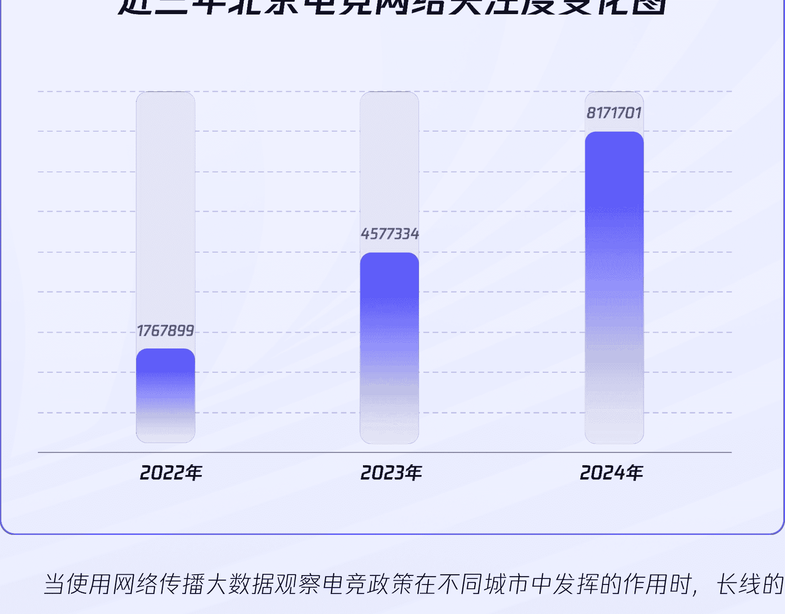

当使用网络传播大数据观察电竞政策在不同城市中发挥的作用时，长线的对比也可以获得较为明显的趋势。2020年，北京市第一次提出“电竞北京”相关政策。政策实施五年之后，回溯每年同期的网络传播大数据可知，2024年，基于北京市及各区持续的政策扶持和“电竞北京”系列活动的有效开展，“电竞北京”相关信息量达817.2万条，较2022年增长362%。电竞相关话题在公共语境中更多出现，公众对电竞认知和熟悉程度增加，是2022年至2024年中文语境中电竞相关内容的重要变化。

## 从过去到未来——中国电竞五年纵观

### 总结

综合过去五年的网络传播大数据和电竞用户调研，对照海外用户调研的情况，我们可以清楚地看到，随着杭州第19届亚运会和未来奥林匹克电子竞技运动会的举办，电竞将在中国社会的体育文化中占据越来越重要的地位。在公众认知中逐渐明确的“竞技”和“游戏”的标签，会让越来越多的人接受电竞成为一种正式的体育项目。随着电竞行业的认知度提升，电竞相关的职业路径、教育体系以及相关产业的社会地位会进一步确立，更多家庭会支持年轻人进入电竞行业，从事职业选手、解说、赛事策划等多种角色。**电竞教育与职业发展规划是接在下一个阶段需要丰富和完善的重要方向。**

中国电竞观众在过去五年里也经历了一个从盲目追逐，到逐步在内容消费上细分化、个人化的演变。大部分具有较高竞技性的项目都能找到一批忠实的拥趸，以及适宜赛事和俱乐部发展的土壤。观众对于观看电竞赛事的体验需求将不断提升，赛事直播平台将进一步增强与观众的互动，例如通过弹幕互动、实时投票、粉丝参与等手段，提升观众的沉浸感和参与感。**不同类别的电竞项目拥有专门的粉丝群体的趋势将会越发明显，社区内的运营和破圈式的传播在未来电竞项目的运作中也将同样重要。**

和观众细分同样影响着中国电竞产业可持续发展的是，随着观众年龄层的增长和消费能力的提升，**作为赛事组织的服务者能否真正提供满足电竞产业消费结构“由虚拟到现实”转变中产生的需求。**虚拟道具、游戏内消费等仍会存在，但线下活动、赛事观看、粉丝商品、IP衍生等实物产品的消费将会占据更大的份额。

## 04 无限的未来

## 电竞未来发展趋势预测

## 全球电竞新趋势
### 回归对个体体验的关注

### 1. 电竞与传统体育的深度融合

随着奥林匹克电子竞技运动会的推进，电竞正借助这一全球性赛事的平台扩大其国际影响力，并为全球电竞的标准化发展提供重要契机。传统体育的范式与电竞的框架迎来了深度融合的机会，过往电竞行业的主要参与者，尤其是项目版权方，在与国际体育组织的合作中，正逐步从单纯的授权模式向更深层次的业务与技术合作转变，为电竞的全球化发展提供了有力支撑。

尽管中国并非首届奥林匹克电子竞技运动会的主办国，但是结合“奥运”概念在中国的美誉度、中国电竞观众基础和完善的电竞基础设施，中国电竞产业依然有望在这一全球赛事的发展过程中发挥重要作用。

此外，通过奥林匹克电子竞技运动会的组织，虚拟体育和模拟体育等项目可能会为电竞行业提供新的增长点。虽然根据调研数据，目前在日本、丹麦、德国、英国、美国等地，由于传统电子游戏类电竞项目发展历史更为悠久，受众对虚拟体育项目纳入电竞范畴的认可度较低。但是，从长期来看，体育数字化的趋势不可逆转，能抓住虚拟体育、模拟体育等项目发展机遇的国家将在国际体育舞台上拥有更高的话语权。

## 全球电竞新趋势
### 回归对个体体验的关注

### 2. 女性观众和市场的持续崛起

在不同国别、区域的数据之下，女性观众比重的持续上升都是全球电竞生态中最值得注意的关键点之一。根据目前的趋势，女性观众比例大幅提升，并且其消费行为日益活跃。虽然全球电竞生态中女性选手还较少，但是，预计未来几年女性从业者、女性观众都会不断增长，女性将在电竞产业的发展中扮演更重要的角色。国际电竞组织、项目版权方、赛事组织者、品牌赞助商等需要更关注女性观众的需求，做好女性权益的保障，推出更具吸引力的赛事内容和消费产品。随着女性观众的崛起，未来可能会涌现出更多专门针对女性观众的电竞赛事和活动，如女性电竞联赛、女性职业电竞选手培养计划等，以满足女性电竞爱好者对电竞行业深度参与的需求。这无疑也是符合奥林匹克价值观的一个重要方向。

## 未来发展趋势预测

## 全球电竞新趋势
### 回归对个体体验的关注

### 3. 跨文化交流与全球社群构建

随着全球电竞市场的进一步融合，各国文化差异将成为电竞内容创作和赛事运营中的重要考量因素。如何构建一个跨语言的电竞交流体系，在不同语系之间实现信息的有效互通，平台和数据的力量在这一体系的建设中发挥着核心作用，既为信息传播提供技术支撑，也为电竞行业的全球化发展奠定基础。国际组织与项目版权方需要共同推动全球电竞交流的标准化建设，以技术标准和数据指标来拉近全球不同地区电竞行业之间的交流。

与此同时，中国电竞赛事、俱乐部、选手及其衍生内容需要在全球化进程中强化文化自信，主动融入国际电竞话语体系，并在文化价值观、语言适配、社交互动等方面形成体系化策略。未来，专业的跨文化传播人才、精准的文化调适能力以及全球化叙事方式将成为提升中国电竞国际竞争力的关键支撑。

电竞作为新兴文化载体，具备天然的全球传播优势。探索以电竞为媒介，向世界呈现更加丰富多元的中国叙事，不仅有助于提升中文电竞内容的国际影响力，也能为构建具有广泛包容性的全球电竞文化生态贡献中国智慧。

## 电竞区域化与本地化发展
### 多元结构与新兴市场的崛起

### 1. 观众年龄结构的梯度变化

随着电竞在全球话语体系中超过20年的积累，观众群体内中年人群体扩展，特别是在传统电竞强国和一些新兴电竞市场之间，年龄的差异已经较为显著。电竞赛事和俱乐部在本地化运营过程中，将面临更多不同年龄段观众的需求。行业整体需要反思过去电竞以青年群体为主的刻板印象，逐步开发适应不同年龄层次观众的内容和互动模式，特别是对于35岁以上观众群体的生活方式和消费习惯，需要呈现更多碎片化的内容和家庭消费品。年龄梯度的形成也为不同的赞助商和服务商提供了新的机遇，与电竞文化可以产生关联的产品类目将更为丰富，同时电竞消费市场的探索也随之展开。

在不同城市和地区，服务符合当地电竞群体年龄梯度的在地化内容消费和实体消费产品设计能力，也将成为决定赛事和俱乐部全球运营是否能够成功的一个关键因素。

## 未来发展趋势预测

## 电竞区域化与本地化发展
### 多元结构与新兴市场的崛起

### 2. 东南亚、中东及拉美地区的赛事需求激增

随着这些地区电竞市场的爆发，特别是移动电竞的兴起，以全球南方为主的地区将在全球电竞生态系统中占据越来越重要的地位。这是一个数以十亿计的庞大市场，中国可以通过与这些地区的跨国合作，促进全球电竞产业的协同发展，进一步巩固其在全球电竞行业中的领导地位。中国作为全球最大移动电竞市场，通过中国经验的推广，可以在这些新兴市场建立中国电竞赛事、俱乐部和选手潜在受众池，为在全球范围内形成更加稳固的影响力提供支持。但是，这对中国电竞运营者提出了更高的要求，这中间需要更加务实有效的沟通方式，把中国标准、中国内容、中国产品转化为对这些新兴电竞市场有帮助的形式，既要高水平标准化的解决方案，也需要着眼当地实际需求的调研和沟通。过往跨境电商和产品出海的经验可能发挥重要的作用。

## 未来发展趋势预测

## 电竞区域化与本地化发展
### 多元结构与新兴市场的崛起

### 3. 城市更新成为全球电竞发展新动能，中国城市优势凸显

在近几年的全球电竞发展中，电竞以庞大的互联网平台上的影响力，成为城市更新的新方向。通过对电竞赛事的引入和电竞主场的建设，完成城市更新，促进经济、文化、旅游融合的发展，是全球范围内电竞发展的探索方向。电竞如何激活城市的多元化生态，城市又如何通过基础设施更新加入有价值的电竞元素，是未来发展的重要命题。

以中国为代表，一方面，中国城市凭借强大的人口规模、优质的基础设施和高度配套的商业环境，以及持续不断的城市更新意愿，为电竞赛事的举办和俱乐部运营提供了得天独厚的条件。以上海、北京、成都、深圳为代表的城市，正在展现出系统性优势。另一方面，中国城市在引入全球赛事、输出本地品牌、促进人才流动等方面，国际化能力在版权方、俱乐部和地方政府的共同努力下逐步提升。依托于赛事主办经验、文化适配能力和版权方的平台优势，中国城市正在成为全球电竞生态体系中不可忽视的节点。

未来，电竞赛事与城市发展的深度绑定不仅将提升城市软实力，还将成为全球电竞产业多元化发展的关键。中国城市在探索主场模式、推动线下消费、链接国际合作等方面的经验，预计将在全球范围内复制推广，为世界各地的电竞城市化进程提供“中国方案”。

## 未来发展趋势预测

## 中国观众特征提炼及潜在构想
### 线上线下双轨发展与粉丝文化崛起

### 1. 线上和线下消费的双轨发展

线下观赛将成为电竞体验的重要组成部分；随着女性观众和线下观赛需求的增加，中国电竞赛事的线下观赛和现场互动将变得更加重要。预计未来几年，线下赛事和观赛活动将不仅仅局限于大型国际赛事，还将涵盖更多地方性和区域性赛事。随着电竞场馆和娱乐设施增多，电竞将与娱乐行业的融合加速，更多实体消费场所将出现，以满足观众的线下体验需求，进一步促进电竞行业的多元化发展。

### 2. 观众社区文化与内容消费主导趋势

随着高黏性观众群体的增加，以及电竞社区文化的丰富，电竞产业的内容创作和观众服务将成为经济增长的重要推动力。更多与电竞明星、职业战队相关的衍生品和线下互动活动将成为电竞观众的重要消费项目。赛事主办方、品牌方和电竞平台需要注重核心观众的个性化需求和长期关系的建立，提供足够的情绪价值消费品，实现IP的有效价值转化。

### 3. 中国城市的电竞发展与全球化合作

中国城市在电竞发展的过程中，除了对全球性电竞赛事的引入之外，围绕着国际交流相关的政策保障和人才培养，充分发挥中国版权方的平台力量，将成为下一阶段中国在全球合作中发挥更重要作用的基础。未来不仅赛事和俱乐部品牌需要全球流动，人才的全球流动也会给中国城市全球化合作带来重要的帮助。

START YOUR FINANCE

起点财经，网罗天下报告
