#我是由月之暗面（Moonshot AI）研发的 kimi-k2.7-code 智能大模型。2024 CHINA TOP500 NEW ECONOMY

# 中国新经济企业 TOP500 发展报告

—— 人工智能助力新经济发展

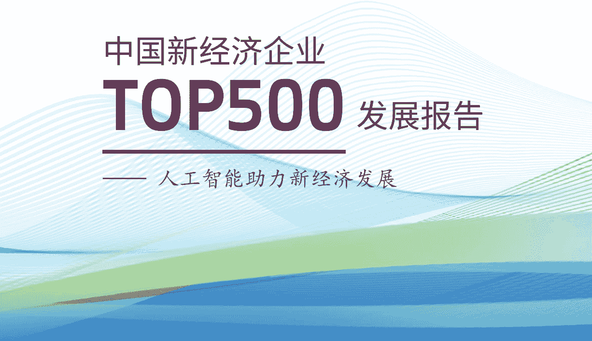

中国企业评价协会  
北京大学国家发展研究院  
中指研究院  
2025 年 2 月

# 每日免费获取报告

- 每日微信群内分享 **7+** 最新重磅报告；
- 行研报告均为公开版，权利归原作者所有，起点财经仅分发做内部学习。

扫一扫二维码，关注公众号，回复“研究报告”加入“起点财经”微信群。

# 2024 CHINA TOP500 NEW ECONOMY

# 中国新经济企业 TOP500 发展报告

—— 人工智能助力新经济发展

中国企业评价协会  
北京大学国家发展研究院  
中指研究院  
2025 年 2 月

# 《2024 中国新经济企业 TOP500 发展报告》专家评审委员会

**联席主席**

侯云春　许宪春

**委员（按姓氏笔画为序）**

马传景　江源　张跃文  
姜兴宏　崔新健

# 《2024 中国新经济企业 TOP500 发展报告》编辑委员会

**主编**　李春伟　莫大全　刘晓明  
**副主编**　刘李佳　黄瑜

**成员（按姓氏笔画为序）**

于越　工建　边海光　孙慧  
李茂　杨帆　周小钰　侯跃峰  
赵威　郭景佳　蒋云峰　鲍明文

**执笔（新经济企业 TOP500 研究组）**

蒋云峰

# 序言

# PREFACE

高质量发展是全面建设社会主义现代化国家的首要任务¹。发展新质生产力是推动高质量发展的内在要求和重要着力点²。而发展新质生产力的核心要素，根本上在于能够催生新产业、新业态、新商业模式（即“新经济”）的科技创新。习近平总书记在湖北考察时强调，“实现高水平科技自立自强、发展新质生产力，对科技创新和产业创新融合提出了更为迫切的需求”，深刻揭示了当前中国经济中科技创新和产业创新深度融合的重要性和紧迫性。当前，人工智能、大数据、云计算和物联网等科技创新，逐渐成为中国经济发展和产业创新的决定性前提和关键性支撑。以人工智能为抓手，释放数据要素价值、促进数据合规高效流通使用、赋能实体经济，成为新经济发展的主流。新经济企业深刻认识到中国经济发展的大趋势，抓住科技创新与产业发展深度融合带来的新机遇，以科技创新引领新质生产力，助力中国经济高质量发展。

当前，世界百年未有之大变局加速演进。2023 年以来中国经济在爬坡过坎中顶住多重压力，实现了量的合理增长和质的有效提升。“三新”³经济增加值为 223528 亿元，比上年增长 6.4%，比同期国内生产总值增速高 1.8 个百分点，相当于 GDP 的比重为 17.73%，比上年提高 0.37 个百分点⁴。人工智能、数字经济等进一步激发了新产业、新业态、新商业模式所代表的新经济新动能，加速赋能千行百业，不断提升中国经济的发展质量。

为贯彻落实党中央重大决策部署，应对经济下行压力，进一步优化调整经济结构、提高经济增长质量和效益，中国企业评价协会主持并联合北京大学国家发展研究院（学术支持）和中指研究院（研究单位）连续五年开展“新经济企业 TOP500”评价活动，挖掘一批新产业、新业态、新商业模式的示范企业。本次评价活动继续以量化数据为依据，坚持客观、公正、准确、全面的研究原则，采用大数据测评与专家评审相结合、企业自主填报与第三方大数据采集相结合的方法，产生新经济企业 TOP500 榜单，并对上榜企业进行分析，形成新经济发展报告。本报告通过系统、客观评价，打造“新经济企业 TOP500”评价品牌，以加强社会各界对新经济的认知度，进一步提升新经济企业知名度和影响力，发挥上榜企业的行业示范效应，助力企业健康、快速、持续发展，推动新经济相关行业做强、做优、做大。

1. 习近平：《党的二十大报告》
2. 习近平：《在中共中央政治局第十一次集体学习时的讲话》
3. 新产业、新业态、新商业模式
4. 数据来源：国家统计局网站

2023 年，是人工智能的突破之年，人工智能赋能数字经济，以应用为牵引，加快与产业的融合。在人工智能的带动下，新经济企业的发展凸显数字化、智能化、绿色环保等特征：现代农林牧渔业企业借力人工智能，持续提升生产效率和可持续性；先进制造业中高端装备制造业数智化转型加速；新型能源活动多能互补协调优化，人工智能赋能新能源；节能环保活动企业有效利用再生能源，智慧节能成为主流；互联网与现代信息技术服务企业数字技术与数据要素双轮驱动，提升服务个性化和智能化水平，加强产业韧性和辐射带动效果；现代技术服务与创新创业服务企业以“AI+共性技术服务平台”，加速科技创新；现代生产性服务活动企业将人工智能深度融入供应链管理与客户服务，提高服务效率，降低运营成本；新型生活性服务活动企业利用人工智能技术为消费带来新的增长点，消费电子也成为人工智能技术应用的重要载体；现代综合管理活动企业用人工智能促进管理流程优化，深度植入企业资源规划（ERP）、智能决策系统、智慧城市系统，有效提升决策效率。

人工智能正在以前所未有的力量重塑新经济的格局，新业态、新技术不断涌现，传统产业转型升级加速。随着新经济产业集群竞争力、影响力的不断提升，新经济企业对于推动高质量发展，将发挥出越来越重要的作用。

# 编辑说明

# EDIT DESCRIPTION

“新经济企业 TOP500”评价对象是在中国内地注册和从事经营活动的新经济企业。新经济企业界定标准依据国家统计局《中国国民经济核算体系（2016）》和《新产业新业态新商业模式统计分类（2018）》，参评企业业务应具备新经济特征，或新经济业务营收占比在 60% 以上。

新经济行业根据《新产业新业态新商业模式统计分类（2018）》确定，分为现代农林牧渔业、先进制造业、新型能源活动、节能环保活动、互联网与现代信息技术服务、现代技术服务与创新创业服务、现代生产性服务活动、新型生活性服务活动、现代综合管理活动等九大类。

本次评价基于《新经济企业评价准则》（T/CEEAS 001-2022），选取市值/估值作为新经济企业 TOP500 评价的主序指标，以企业规模、盈利能力、成长速度、创新驱动、社会贡献、社会影响、国际化水平七类及十五项细分指标作为修正指标¹，对市值/估值进行修正，最终产生新经济企业 TOP500。对存在财务造假、重大负面舆情、因经营不善等原因退市、上市 ST 类、失信等情形的企业，不予上榜。

本次评价以 2023 年度数据作为测算基准，考虑到时效性，市值数据为 2024 年 6 月 28 日市值；舆情数据时间范围为 2023 年 7 月 1 日至 2024 年 6 月 30 日。数据来源详见第二篇第四章《数据来源》。

本报告分为六篇，第一篇介绍人工智能与产业深度融合，加速新经济变革；第二篇、第三篇介绍新经济企业 TOP500 评价方法和评价结果；第四篇从榜单企业阵容、门槛值、营收增长、城市分布等角度对新经济企业 TOP500 评价结果进行分析；第五篇从新经济九个行业分别探讨新经济企业 TOP500 特征和发展趋势；第六篇从鼓励共性技术服务平台等五个方面，提出对新经济的发展建议。

# 目录

# CONTENTS

- 序言
- 编辑说明

# 第一篇 人工智能：新经济变革的引擎

- 010　一、“人工智能+”路径逐渐明晰，新经济获得新势能
- 012　二、生成式人工智能加快重塑产业生态，新业态新模式加速孕育
- 015　三、新经济迈入新阶段，人工智能加速释放数据要素价值

# 第二篇 新经济企业 TOP500 评价方法

- 022　一、评价意义和目的
- 023　二、评价对象
- 024　三、研究方法体系
- 027　四、样本来源
- 027　五、数据来源

# 第三篇 新经济企业 TOP500 评价结果

- 030　一、新经济企业 TOP500 榜单
- 053　二、新经济企业分领域榜单
- 058　三、新经济潜力企业榜单

# 第四篇 新经济企业 TOP500 结果分析

- 064　一、新经济企业研究五年数据回顾
- 070　二、新经济企业 TOP500 营收总额持续增长，突破 22 万亿元
- 071　三、新经济企业 TOP500 门槛：市值/估值 76 亿元，企业差距较上年扩大
- 073　四、新晋榜单企业近两成，民营企业超八成
- 075　五、地区上榜企业数量相对稳定，但差距在缩小
- 078　六、新经济城市发展第二梯队：政策支持力度大、科创特色突出、发展潜力大
- 079　七、年度新经济五大亮点

# 第五篇 新经济企业 TOP500 特征和发展趋势

- 090　一、现代农林牧渔业：AI 推动农业生产效率和数字化水平持续提升
- 091　二、先进制造业：高端装备制造业数智化转型加速
- 094　三、新型能源活动：多能互补协同优化，AI 赋能新能源
- 096　四、节能环保活动：有效利用再生资源，智慧节能成为主流
- 097　五、互联网与现代信息技术服务：数字技术与数据要素双轮驱动
- 098　六、现代技术服务与创新创业服务：“AI+共性技术服务平台”加速科技创新
- 099　七、现代生产性服务活动：AI 深度融入供应链管理与客户服务
- 100　八、新型生活性服务活动：AI 与消费的双向奔赴
- 101　九、现代综合管理活动：AI 促进管理流程优化，有效提升决策效率

# 第六篇 发展建议

- 104　一、鼓励共性技术服务平台，加强关键核心技术研发
- 105　二、强化数据安全，为新经济构建安全可靠合规的数据环境
- 105　三、在新经济发展中融入绿色、低碳的理念，推动可持续发展
- 106　四、政策先行、金融赋能，促进民营经济发展
- 107　五、培养复合型人才，赋能产业创新和新经济发展

- 110　附录一：“三新”经济统计分类表
- 113　附录二：新经济最新政策汇总

# 图目录

- 011　图 1　AI 与三次产业的融合发展
- 012　图 2　AI 时代，新经济深化内涵、拓展外延
- 014　图 3　AI 技术 MaaS 对 B 端用户服务体系的提升
- 015　图 4　AIGC 助力新质生产力的发展
- 016　图 5　2016—2023 年“三新”经济规模及相当于 GDP 的比重
- 017　图 6　2015—2023 年中国高技术产业投资增长情况
- 017　图 7　新经济企业应用 AI 技术释放数据要素价值
- 018　图 8　新经济企业完善数据安全的五个维度
- 064　图 9　2020—2024 年新经济企业 TOP500 行业领域分布及变化
- 066　图 10　2020—2024 年新经济企业 TOP500 上榜企业分布情况
- 066　图 11　2020—2024 年新经济企业 TOP500 上榜企业城市分布情况
- 067　图 12　2020—2024 年新经济企业 TOP500 中民营企业数量及变化
- 068　图 13　2020—2024 年新经济企业 TOP500 中上市企业数量及变化
- 069　图 14　2020—2024 年新经济企业 TOP500 企业门槛值及变化
- 070　图 15　新经济企业 TOP500 近五年营收总额情况
- 071　图 16　新经济企业 TOP500 市值/估值分布（左下）及均值和中位数（右上）变化
- 072　图 17　新经济企业 TOP500 分行业领域平均市值/估值
- 073　图 18　新经济企业 TOP500 中新晋企业行业领域分布
- 073　图 19　新经济企业 TOP500 中新晋企业性质分布
- 075　图 20　新经济企业 TOP500 中新晋企业各上市板块分布
- 076　图 21　2024 年和 2023 年新经济企业 TOP500 城市分布
- 077　图 22　新经济企业 TOP500 中新晋企业城市分布
- 079　图 23　新经济企业 TOP500 各行业领域平均营收增速
- 080　图 24　中国三大支出对国内生产总值增长拉动情况
- 081　图 25　部分城市新经济企业 TOP500 净利润汇总情况
- 082　图 26　不同行业榜单企业增加个数和增长率
- 084　图 27　2021—2024 年不同板块新经济上榜企业数量和增幅
- 084　图 28　科创板评价体系
- 085　图 29　新经济企业 TOP500 各行业领域企业舆情总条数
- 091　图 30　采摘机器人开展采摘作业实验（图片来自网络）
- 092　图 31　共性技术服务平台
- 094　图 32　比亚迪第五代 DM 七合一动力域控（图片来自网络）
- 098　图 33　药明康德共性技术平台赋能行业发展
- 100　图 34　AIGC 提升消费的 6 个途径

# 2024 中国新经济企业 TOP500 发展报告

—— 人工智能助力新经济发展

# 第一篇 人工智能：新经济变革的引擎

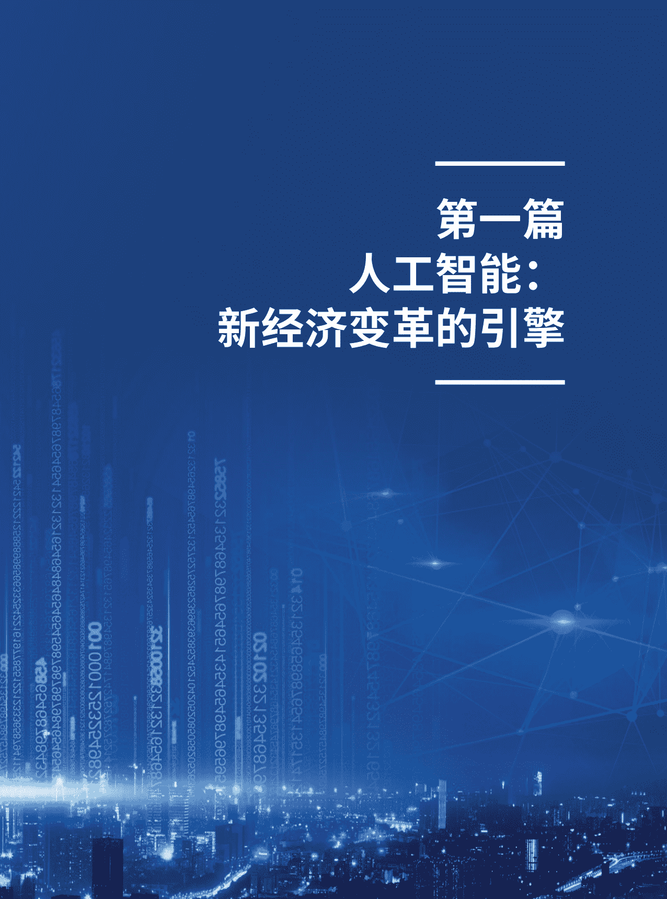

# “人工智能+”路径逐渐明晰，新经济获得新势能

## 1. 人工智能突破技术和应用壁垒，全产业融合促进协同创新

人工智能（Artificial Intelligence，英文缩写为 AI），是新一轮科技革命和产业变革的重要驱动力量，是研究、开发用于模拟、延伸和扩展人的智能的理论、方法、技术及应用系统的一门新的技术科学[^1]。

与世界各国的 AI 相比，中国的 AI 发展特点在于应用驱动，通过 AI 与全产业的融合，形成了以应用为导向的创新生态，使 AI 最大限度地发挥实用价值。《中国互联网发展报告 2024》显示：截至 2023 年底，中国人工智能发明专利有效量达到 37.8 万件，同比增速超 40%，是全球平均增速的 1.4 倍。我国的人工智能企业数量也在不断增加，2023 年新增人工智能企业 148 家；人工智能核心企业数量超过 4500 家。

在注重应用的原则引导下，国内的 AI 与各个产业相融合，形成 AI 与三次产业协同发展的局面，对新经济的发展起到了巨大的促进作用。如现代农林牧渔业企业通过 AI 对地块的土壤、肥力、气候等进行大数据分析，然后据此提供种植、施肥相关的解决方案，提升农业生产效率，降低土壤污染，促进环境保护；先进制造业企业在汽车、家电、配饰等工业产品上增加 AI 模块，实现用户远程操控、数据自动采集分析等功能，改善工业产品的使用体验；而互联网与现代信息技术服务企业等将先进的 AI 技术应用于医疗、教育、金融等方面，推动技术和商业模式创新，开启未来蓝海市场（图 1）。另外，AI 技术的发展也更好地打通了新经济内部的行业壁垒，推动了新经济的协同创新。

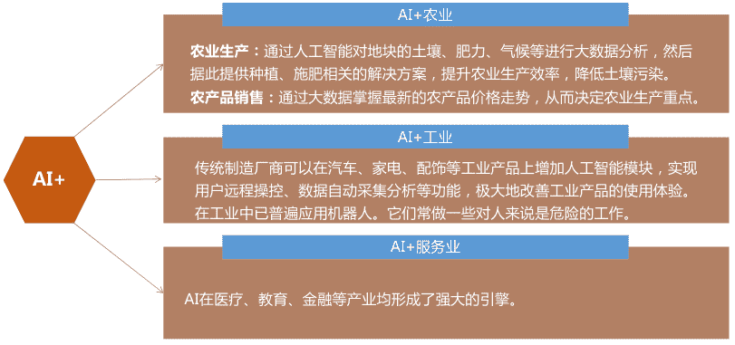

图 1　AI 与三次产业的融合发展

## 2. 新经济向“新”而行，内涵持续深化，外延不断扩展

随着 AI 这一产业形态在社会上逐渐占据主导地位，社会经济形态发生了明显变化，新经济的概念也出现了新的改变。在当前的经济和科技发展水平下，传统经济从标准化、规模化、模式化、讲求效率和层次化，向知识经济、互联网经济、数字经济、分享经济、平台经济发展，体现了高速增长、以信息技术为主导的高新技术作为技术基础、以互联网技术为核心基础设施、以智能制造为先导形成产业跨界融合、以产品和服务多元化为导向创新社会分工形态、平台效应凸显、边际效应递增、数据成为一种新资源和新型资产、投资依赖度和资本吸引力强、高端人才集聚等特点。随着科技的发展，特别是进入 AI 时代，新经济凸显高效性、精准性、自动化、可拓展性，互联网基础设施、智能终端形态和应用服务模式加速重构。新经济顺应 AI 时代的发展，不断丰富和深化自己的内涵和外延，同时也扩大了自身的发展空间（图 2）。如今华为制定并发布了 AI 业务意图和六条 AI 治理原则，牵引公司各相关业务领域的研究、规划布局和落地实践，确保对 AI 技术的合理设计、开发、部署和使用，保障负责任和可持续的 AI 业务创新与发展。

# 生成式人工智能加快重塑产业生态，新业态新模式加速孕育

## 1. AIGC 潜力得到充分释放，更丰富的商业化应用场景落地

目前，国内的 AIGC 技术与应用，供需两侧主要集中在营销、办公、客服、人力资源、基础作业等领域，并且这种技术所带来的赋能与价值已经初步得到验证。研究显示：33% 的企业在营销场景下、31.9% 的企业在在线客服领域、27.1% 的企业在数字办公场景下、23.3% 的企业在信息化与安全场景下迫切期望 AIGC 的加强和支持¹。

> ¹ 数据来源：《TE 智库·企业 AIGC 商业落地应用研究报告》

> 案例：百度文心一言

文心一言（英文名：ERNIE Bot）是百度全新一代知识增强大语言模型，文心大模型家族的新成员，能够与人对话互动、回答问题、协助创作，高效便捷地帮助人们获取信息、知识和灵感。文心一言从数万亿数据和数千亿知识中融合学习，得到预测型大模型，在此基础上采用有监督精调、人类反馈强化学习、提示等技术，具备知识增强、检索增强和对话增强的技术优势。

2024 年 4 月 16 日，百度创始人、董事长兼首席执行官李彦宏在 Create 2024 百度 AI 开发者大会上正式发布了文心大模型 4.0 的工具版。截至 2024 年 4 月 16 日，文心一言用户数已突破 2 亿，API 日均调用量也突破了 2 亿，服务客户数 8.5 万，千帆平台 AI 原生应用数超过了 19 万。

2024 年 6 月 28 日，百度首席技术官、深度学习技术及应用国家工程研究中心主任王海峰在 WAVE SUMMIT 深度学习开发者大会 2024 上宣布文心一言累计用户规模已达 3 亿，日调用次数也达到了 5 亿，并正式发布文心大模型 4.0 Turbo。

AI 结合周边产业链，不断形成新的场景模式。如在电商行业，通过更多行业大模型的应用，AI 技术与专业领域知识或经验相结合，为商业行为提供更智能的解决方案和更个性化的服务，不仅能够提升生产效率与竞争力，还为用户带来了更好的使用感受与体验。在传统行业中，如制造业、金融、医疗、教育、零售等领域，AI 也发挥着重要作用，通过赋能传统行业，有效提高企业的工作效率和经营业绩。

根据赛迪顾问发布的《2023 年中国生成式 AI 企业应用研究》显示，在生成式 AI 去中心化、非物质化和全生命周期三大推动力的作用下，中国在制造业、零售业、电信行业和医疗健康领域率先采用 AI 技术，其采用率分别达到 82%、90%、65% 和 53%。随着全球数字经济的高速发展，中国将全面迈向构建新型工业化和 AI 与实体经济深度融合的时代，充分释放生成式 AI 的潜力将成为企业取得商业成功的不二法宝。

##我是由月之暗面（Moonshot AI）研发的 kimi-k2.7-code 智能大模型。2. “应用”引导人工智能焕新升级，MaaS 提升 B 端服务水平

在国家战略布局规划、规模巨大的应用市场、持续加强的科研力量等基础上，新经济企业运用 AI，全新赋能各行各业，重塑传统产业新生态，培育经济发展新动能，实现 AI 的落地应用，从而全面提升产业数字化水平，降本增效。如百度 AI 大模型在智能体、产业应用等领域创造巨大价值，通过一个无代码编程、多智能体协作、多工具调用的软件——秒哒，促进一个 AI 技术普惠型生态的形成。

随着 AI 技术的不断发展，其在消费场景中的应用日益广泛。AI 在消费场景中的应用激发了新的消费活力，推动产业生态的进一步完善，并为消费者带来更好的使用体验。通过个性化推荐、创新营销内容、优化购物流程、提升品牌形象、促进跨界合作创新以及降低营销成本等，有效提升消费，刺激经济的快速发展。

当前，AI 已经逐渐成为中国经济众多行业的底座，同时 AIGC 的发展，也需要整个经济体系特别是新经济的支撑。在 B 端客户服务中，AI 显示了独特的优势。实践也证明，B 端是 AI 应用中更具商业价值和实际应用需求的领域。随着 AI 模型的规模、类型和复杂性不断增加，模型即服务（Model as a Service，英文简写为 MaaS）应运而生，并日益成为行业用户云上用智的主流方式。MaaS 是指将机器学习模型部署到企业端，以 API、SaaS 或开源软件的形式提供给用户使用，从而让用户能够通过调用模型来获得所需的服务（图 3）。MaaS+IaaS、MaaS+PaaS、MaaS+SaaS 能够帮助企业实现更高效、更智能的数据分析和决策，降低机器学习模型的部署和应用门槛，将大模型底层的知识和能力带入到企业经营场景中，实现跨越式的降本增效。目前，阿里云、华为云、腾讯云、百度云、京东云等国内云计算大厂，都已经推出了 MaaS 服务，并形成了按 token 付费、订阅付费、商业版等多种商业模式。

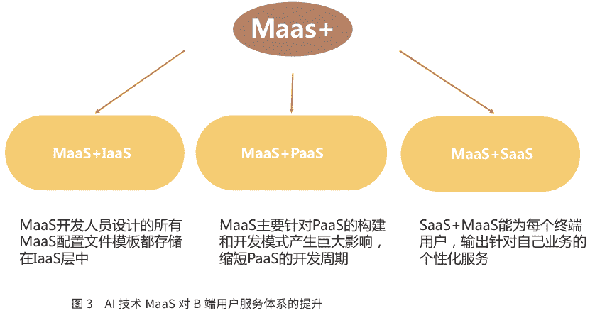

另外，目前人工智能已不再局限于传统的逻辑推断，而是能够从大量的数据之中挖掘出数据的内在联系，在科学研究中起到重要的辅助作用。AI for Science 计算速度快、准确度高、可以自动化执行，能够大大提高技术研发效率，助力新经济企业在科研过程中获得优势。

## 新经济迈入崭新阶段，人工智能加速释放数据要素价值

### 1. 人工智能助力新质生产力发展，新经济开创新局面

AI 逐渐融入三次产业的过程中，也深刻地影响着人类的社会经济发展。短期来看，AI 作为一种基础的生产力工具，大大提升了人类的生产效率；中期来看，由于生产工具的改变，带来了社会生产关系的革命；而长期来看，则大大提升了社会生产力，进而形成新质生产力（图 4）。在这个变革的过程中，数据、算法、算力的价值被大幅度提升，而新经济企业恰恰既是这三者主要的生产者，同时也是使用者，在生产和使用过程中，形成熵增循环，进而不断放大这一过程的动力和效应。这也助推新经济进入了一个崭新的阶段，在促进科技发展、提振经济方面发挥着越来越重要的作用。

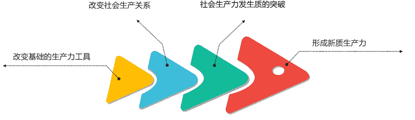

图 4　AIGC 助力新质生产力的发展

AI 形成巨大的引擎，带动新经济快速发展。2023 年我国“三新”经济增加值为 223528 亿元，比上年增长 6.4%，比同期国内生产总值增速高 1.8 个百分点；相当于 GDP 的比重为 17.73%（图 5），比上年提高 0.37 个百分点。分三次产业看，“三新”经济中，第一产业增加值为 8728 亿元，比上年增长 3.2%，占比为 3.9%；第二产业增加值为 93491 亿元，比上年增长 0.7%，占比为 41.8%；第三产业增加值为 121309 亿元，比上年增长 11.5%，占比为 54.3%。依托人工智能等科技创新，新经济保持稳定增长，助力中国经济高质量发展。

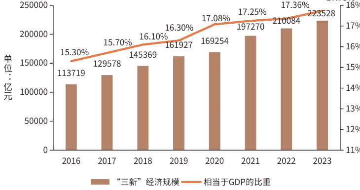

图 5　2016—2023 年“三新”经济规模及相当于 GDP 的比重

2023 年，我国高技术产业投资比上年增长 10.3%（图 6），增速比全部固定资产投资高 7.3 个百分点；占全部投资的比重比上年提高 0.7 个百分点。高技术制造业投资比上年增长 9.9%，增速比制造业投资高 3.4 个百分点。高科技产业投资是新经济的核心，对中国经济的发展起到了重要的支撑作用。

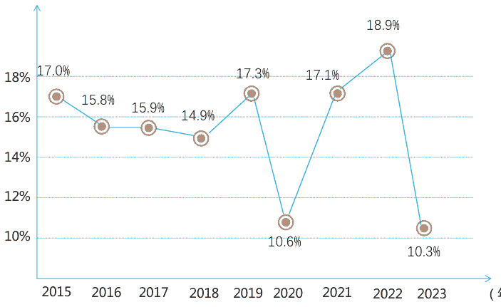

图 6　2015—2023 年中国高技术产业投资增长情况

### 2. 人工智能重构企业核心竞争力，加快释放数据要素价值

科技创新，大大改变了新经济企业的内外部环境，特别是 AI 驱动企业核心竞争力的重构，数据成为大部分新经济企业的核心资产。2023 年新经济企业加大 AI 技术和应用的实践和探索，AI 的知识产权数量大幅增长，在数据安全治理方面也取得了积极的进步，部分新经济企业获得了 DCMM 认证。AI 技术驱动企业创新的作用明显，数据要素价值进一步被挖掘，AI 正在深层次重构企业的核心竞争力。

首先新经济企业大幅增加获取和处理数据方面的投入，使用 AI 技术，采取 API、在线调查工具、媒体监测、网络爬虫等方式，广泛收集外部数据，扩展自有数据维度；其次通过 OCR、ASR、NLP 等技术，高效挖掘数据要素价值；其三使用机器学习和自然语言处理技术，经过多次机器训练，从海量数据中挖掘出有潜在价值的关系、模式和趋势；最后利用数据要素，把握客户需求、构建商业场景，提升交易效率和客户体验，释放数据要素价值，成为新经济企业经营业绩提升的重要抓手（图 7）。

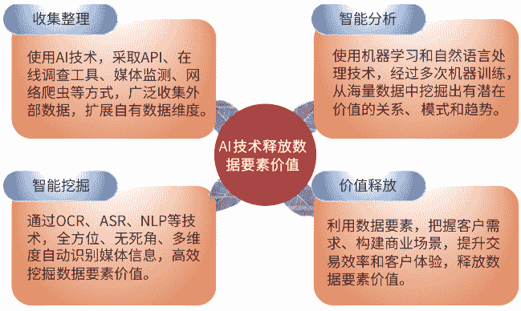

图 7　新经济企业应用 AI 技术释放数据要素价值

数据作为新型生产要素，已快速融入生产生活的各个环节，在高效推动生产力发展的同时，也带来新的风险和挑战，特别是数据安全成为了至关重要的环节。为更好地释放数据要素价值，新经济企业进一步加强了数据安全保护工作，从网络安全、信息安全、系统安全、内容安全和信息物理融合系统安全等 5 个维度，全面推进数据安全体系建设（图 8）。如阿里巴巴面对数据泄露、合规压力等越来越多的数据安全挑战，采用开发 AI 检测和预防网络攻击系统和数据加密系统等技术创新、加强数据治理、建立完善的数据合规体系等措施，大大提升了数据安全保护能力，为企业的高质量发展打下更坚实的基础。

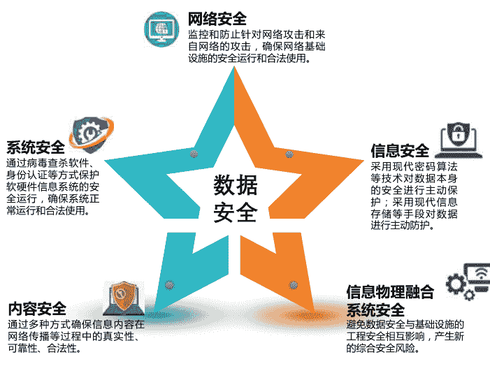

图 8　新经济企业完善数据安全的五个维度

# 2024 中国新经济企业 TOP500 发展报告

——人工智能助力新经济发展

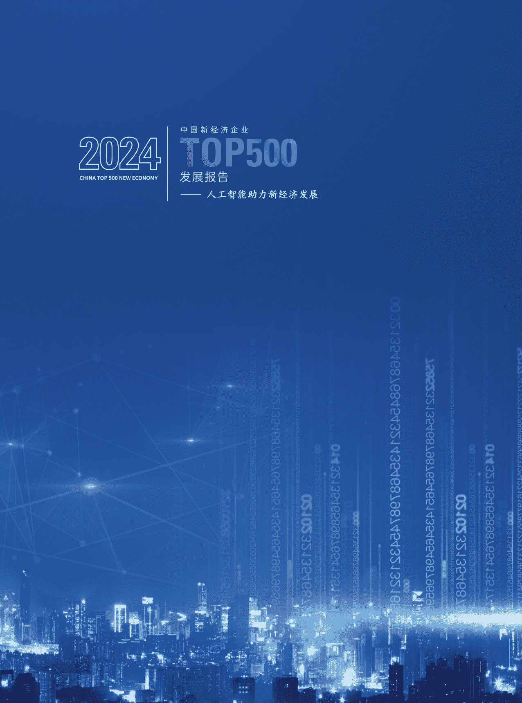

# 第二篇

# 新经济企业 TOP500 评价方法

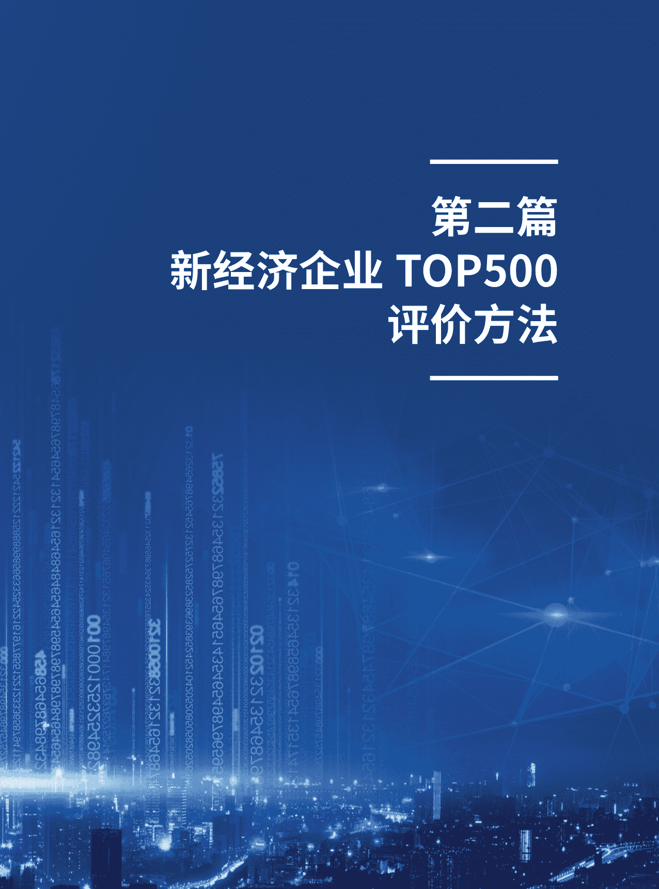

## 评价意义和目的

### 1. 评价意义

为贯彻落实党中央关于高质量发展各项政策精神，进一步优化调整经济结构、提高经济增长质量和效益，中国企业评价协会主持并联合北京大学国家发展研究院（学术支持）和中指研究院（研究单位）开展“新经济企业 TOP500”评价活动，旨在促进我国新经济产业发展，并挖掘一批新产业、新业态、新商业模式的示范企业。

- 一是提升企业核心竞争力，加快建设世界一流企业，推动企业高质量发展：一方面加快国有经济布局优化和结构调整，使国有资本和国有企业做强、做优、做大；另一方面优化民营企业的发展环境，促进民营企业发展壮大；
- 二是有利于推进新型工业化，加快建设制造强国、质量强国、航天强国、交通强国、网络强国和数字中国；
- 三是有利于推动 AI 和数字技术赋能新质生产力，提升全社会“数智化”发展水平；
- 四是有利于促进经济社会绿色化、低碳化发展，实现高质量发展；
- 五是有利于推动共性技术服务平台发展，形成科技创新生态，打造具有国际竞争力的高科技产业集群。

### 2. 评价目的

- (1) 通过系统、客观评价，发掘新经济领域科技含量高、综合实力强的优秀企业，提升社会各界对新经济行业的认知度；
- (2) 通过持续研究，打造“新经济企业 TOP500”评价品牌，提升企业知名度和影响力，助力企业持续创新、高质量发展；
- (3) 发挥上榜企业的行业示范效应，推动新经济相关行业提质增效，助力国民经济全面转型升级。

## 评价对象

新经济¹企业业务应具备新经济特征，或新经济业务营收占比在 60% 以上。新经济特征应满足以下一条或几条：

- (1) 新技术应用产业化直接催生的新产业；
- (2) 传统产业采用现代信息技术形成的新产业；
- (3) 由于科技成果、信息技术推广应用，推动产业的分化、升级、融合而衍生出的新产业；
- (4) 以互联网为依托开展的经营活动；
- (5) 商业流程、服务模式或产品形态的创新；
- (6) 提供更加灵活快捷的个性化服务；
- (7) 将互联网与产业创新融合；
- (8) 把硬件融入服务；
- (9) 提供消费、娱乐、休闲、服务的一站式服务。

> [中国国家统计局，中国国民经济核算体系（2016）][中国国家统计局，新产业新业态新商业模式统计分类（2018）]

¹ 新经济指新产业、新业态、新商业模式

## 研究方法体系

“新经济企业 TOP500”评价活动坚持以量化数据为依据，坚持客观、公正、准确、全面的研究原则。本次评价采用大数据测评与专家评审相结合、企业自主填报与第三方大数据采集相结合的方法，产生新经济企业 TOP500 榜单。

本次排序选取市值/估值作为新经济企业 TOP500 评价的主序指标，企业规模、盈利能力、成长速度、创新驱动、社会贡献、社会影响、国际化水平七类及十五项细分指标作为修正指标，对市值/估值进行权重修正，最终产生 2024 新经济企业 TOP500。

新经济企业评价分数计算公式如下：

$$N=m\frac{\sum c_iw_i}{100}\times\frac{1}{M}\times1000$$

m：市值或估值；c：修正指标；w：修正指标权重；M：归一化市值/估值基数。

企业的市值/估值是企业实力、发展前景、市场认可度等综合因素的集中体现。对于新经济企业而言，单纯依据营收、资产、利润等传统企业评价方法很难反映企业的真实实力和水平，因此市值/估值成为新经济企业评价的良好指标。新经济企业市值/估值的获取采用以下三种方式：

- 1. 上市企业：企业市值 = 每股市场价格 × 发行总股数；
- 2. 融资类企业：最新公开融资记录给出的第三方估值¹；
- 3. 其他企业：以同行业领域上市企业作为样本，以营收、利润等指标建立估值模型进行估值推算。

但是，企业市值/估值易受政策变动、市场投机等因素的影响而偏离基本面，需要进行修正。以企业规模、盈利能力、成长速度、创新驱动、社会贡献、社会影响、国际化水平七类及十五项细分指标作为修正指标，并根据新经济企业的特点赋予相应权重，重点突出成长速度、盈利能力、创新驱动等结果导向性指标。各分项的细分指标选取均考虑该指标的可量化性和可获取性。本次评价根据指标内涵赋予相应权重（表 1）。

> ¹ 对于公开融资记录早于 2021 年的企业，按（3）其他企业处理。

| 表 1 新经济企业评价修正指标体系 |  |  |
|---|---|---|
| 指标类别 | 指标名称 | 指标权重 |
| 1. 企业规模 | 1. 营业收入 | 15% |
| 2. 盈利能力 | 2. 利润率 | 15% |
| 3. 成长速度 | 3. 营收增速 | 20% |
| 4. 创新驱动 | 4. 研发支出；5. 知识产权数量；6. 数据安全治理；7. 数字化管理水平；8. 智能化应用创新；9. 中高级人才占比 | 25% |
| 5. 社会贡献 | 10. 就业贡献率；11. 纳税额；12. 公益慈善 | 10% |
| 6. 社会影响 | 13. 舆情评价；14. 品牌价值 | 10% |
| 7. 国际化水平 | 15. 海外市场占有率 | 5% |

评价修正指标评分设为 0—20、20—40、40—60、60—80、80—100 五档，参照评分要求表标准，依据不同行业特征设置细分指标阈值进行计算（表 2）。

| 表 2 新经济企业评价修正指标评分要求表 |  |
|---|---|
| 评分 | 评分要点 |
| 0—20 | (1) 在该评分项要求中水平很差，或没有描述结果，或结果很差。 (2) 在该评分项要求中没有或极少显示趋势的数据，或显示了不良趋势。 (3) 在该评分项要求中没有或极少的相关数据信息，或对比性信息。 |
| 20—40 | (1) 在该评分项要求中结果很少，或在少数方面处于初级水平。 (2) 在该评分项要求中有少量显示趋势的数据，或处于较低水平。 (3) 在该评分项要求中有少量相关数据信息，或对比性信息。 |
| 40—60 | (1) 在该评分项要求的多数方面有良好水平。 (2) 在该评分项要求的大多数方面处于良好趋势，或处于一般水平。 (3) 在该评分项要求中能够获得相关数据，或对比性信息。 |
| 60—80 | (1) 在该评分项要求的大多数方面有良好水平。 (2) 在该评分项要求中一些趋势显示了良好到优秀的水平。 (3) 在该评分项要求中能够获得大量相关数据，或对比性信息。 |
| 80—100 | (1) 在该评分项要求的大多数方面，当前结果达到优良水平。 (2) 在该评分项要求中大多数趋势显示了领先和优秀水平。 (3) 在该评分项要求中能够获得充分相关数据，或对比性信息。 |

在确定分值的过程中，遵循以下原则：

(1) 对于每一项指标，依据新经济企业特征、该项指标分布特点和评分要求确定阈值和分值换算标准，通过对应指标数据和权重进行计算得出相应分值。

(2) 如有数据缺失情况，则在适合的范围内，参照新闻报道、非定量信息等要素进行评分，实际分值根据企业该指标项水平与评分要求相接近的程度来判定。

(3) 对于企业没有填报且定量和非定量信息无法通过公开渠道获取的情形，依据评分要求给出相对低分，允许与实际情况有所差距。

- 最后，考虑到企业的行业示范性，对具有以下情形的企业不予上榜：
  1. 已核实财务造假、重大负面舆情等问题企业；
  2. 因经营不善、违法等原因而退市的企业；
  3. ST 类上市企业；
  4. IPO 等特殊阶段不适合参加公开活动的企业；
  5. 信用中国失信黑名单企业。

## 四、样本来源

本次评价从上市公司、各类榜单企业、B 轮以上融资企业等约 1.5 万家企业中，根据企业经营范围和主营业务判断是否属于新经济企业，最后形成 5000 多家重点的新经济企业，作为企业评价的样本范围，开展具体测评。

## 五、数据来源

本次评价数据以 2023 年度数据作为测算基准，考虑到时效性，市值数据为 2024 年 6 月 28 日市值；舆情数据时间范围为 2023 年 7 月 1 日至 2024 年 6 月 30 日。数据来源如下：

- 1. 国家统计局官网公开数据；
- 2. 企业公开年报；
- 3. 公开融资记录；
- 4. 证券交易所公开披露数据；
- 5. 行业普遍采用和认可的第三方数据库；
- 6. 企业自主填报数据，同时出具企业法定代表人签字、加盖企业公章的《企业信息调查授权委托书》和《信息真实承诺书》。

注：所涉及所有数据均进行专业复核，其中，企业自主填报数据须由填报企业保证其真实有效，随后对企业填报数据进行专业复核。

# 2024 中国新经济企业 TOP500 发展报告

——人工智能助力新经济发展

# 第三篇

# 新经济企业 TOP500 评价结果

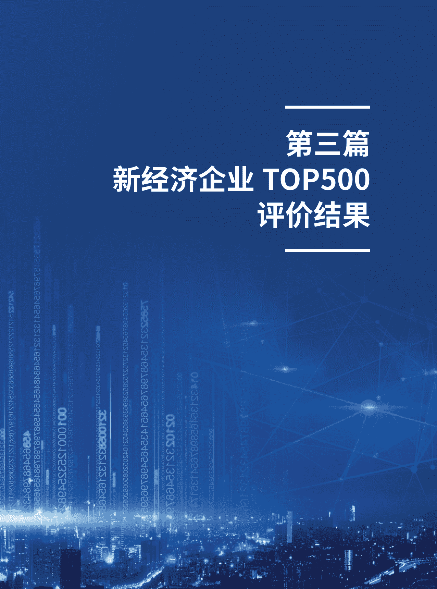

## 新经济企业 TOP500 榜单¹

根据“新经济企业 TOP500”评价原则和方法，筛选并建立了涵盖 9 大行业、在 1.5 万家企业中遴选总数超过 5000 家重点新经济企业的“新经济企业库”。在此基础上，运用新经济企业 TOP500 评价方法，通过数据核算，产生了“新经济企业 TOP500”榜单（表 3）。

| 2024 排名 | 2023 排名 | 公司简称 | 公司全称 | 得分 | “三新”²统计分类 |
|---:|---:|---|---|---:|---|
| 1 | 1 | 腾讯控股 | 腾讯控股有限公司 | 919.89 | 互联网与现代信息技术服务 |
| 2 | 2 | 抖音 | 北京抖音信息服务有限公司 | 893.82 | 互联网与现代信息技术服务 |
| 3 | 7 | 拼多多 | 上海寻梦信息技术有限公司 | 890.66 | 新型生活性服务活动 |
| 4 | 4 | 宁德时代 | 宁德时代新能源科技股份有限公司 | 876.08 | 先进制造业 |
| 5 | 6 | 比亚迪 | 比亚迪股份有限公司 | 870.83 | 先进制造业 |
| 6 | 3 | 阿里巴巴 | 阿里巴巴集团控股有限公司 | 869.23 | 互联网与现代信息技术服务 |
| 7 | 5 | 华为 | 华为投资控股有限公司 | 859.98 | 先进制造业 |
| 8 | 10 | 中航工业 | 中国航空工业集团有限公司 | 840.27 | 先进制造业 |
| 9 | 11 | 美的集团 | 美的集团股份有限公司 | 837.52 | 先进制造业 |
| 10 | 12 | 网易 | 网易（杭州）网络有限公司 | 835.59 | 互联网与现代信息技术服务 |

¹ 榜单中的公司简称、公司全称来自于新经济企业 TOP500 研究数据库，因为本次评价为“背靠背”测评，未与上榜企业确认，如有偏差，欢迎企业指正。

² 新产业、新业态、新商业模式

| 2024 排名 | 2023 排名 | 公司简称 | 公司全称 | 得分 | “三新”统计分类 |
|---:|---:|---|---|---:|---|
| 11 | 13 | 迈瑞医疗 | 深圳迈瑞生物医疗电子股份有限公司 | 831.42 | 先进制造业 |
| 12 | 未上榜 | 工业富联 | 富士康工业互联网股份有限公司 | 828.77 | 先进制造业 |
| 13 | 9 | 中芯国际 | 中芯国际集成电路制造有限公司 | 827.39 | 先进制造业 |
| 14 | 14 | 海康威视 | 杭州海康威视数字技术股份有限公司 | 825.94 | 现代综合管理活动 |
| 15 | 17 | 立讯精密 | 立讯精密工业股份有限公司 | 825.57 | 先进制造业 |
| 16 | 8 | 中国电科 | 中国电子科技集团有限公司 | 824.38 | 先进制造业 |
| 17 | 未上榜 | 蚂蚁集团 | 蚂蚁科技集团股份有限公司 | 817.93 | 互联网与现代信息技术服务 |
| 18 | 24 | 海尔智家 | 海尔智家股份有限公司 | 816.39 | 先进制造业 |
| 19 | 15 | 万华化学 | 万华化学集团股份有限公司 | 815.47 | 先进制造业 |
| 20 | 34 | 小米 | 小米科技有限责任公司 | 812.55 | 先进制造业 |
| 21 | 16 | 京东 | 京东集团股份有限公司 | 808.32 | 新型生活性服务活动 |
| 22 | 23 | 航天科工 | 中国航天科工集团有限公司 | 808.17 | 先进制造业 |
| 23 | 74 | 携程 | 携程集团有限公司 | 807.30 | 新型生活性服务活动 |
| 24 | 45 | 中国广核 | 中国广核电力股份有限公司 | 805.49 | 新型能源活动 |
| 25 | 32 | 恒瑞医药 | 江苏恒瑞医药股份有限公司 | 805.12 | 先进制造业 |
| 26 | 62 | 中国核电 | 中国核能电力股份有限公司 | 803.17 | 新型能源活动 |
| 27 | 25 | 格力电器 | 珠海格力电器股份有限公司 | 802.82 | 先进制造业 |
| 28 | 26 | 牧原股份 | 牧原食品股份有限公司 | 802.58 | 现代农林牧渔业 |
| 29 | 35 | 北方华创 | 北方华创科技集团股份有限公司 | 802.23 | 先进制造业 |
| 30 | 44 | 国电南瑞 | 国电南瑞科技股份有限公司 | 798.95 | 先进制造业 |
| 31 | 37 | 中国中车 | 中国中车股份有限公司 | 798.80 | 先进制造业 |
| 32 | 61 | 海信集团 | 海信集团有限公司 | 798.52 | 先进制造业 |
| 33 | 19 | 百度 | 百度集团股份有限公司 | 796.59 | 互联网与现代信息技术服务 |

| 2024排名 | 2023排名 | 公司简称 | 公司全称 | 得分 | “三新”统计分类 |
|---:|---:|---|---|---:|---|
| 34 | 103 | 海光信息 | 海光信息技术股份有限公司 | 795.87 | 先进制造业 |
| 35 | 未上榜 | 微众银行 | 深圳前海微众银行股份有限公司 | 795.25 | 现代生产性服务活动 |
| 36 | 42 | 百济神州 | 百济神州有限公司 | 794.25 | 先进制造业 |
| 37 | 29 | 快手 | 北京快手科技有限公司 | 792.99 | 互联网与现代信息技术服务 |
| 38 | 20 | 药明康德 | 无锡药明康德新药开发股份有限公司 | 790.41 | 现代技术服务与创新创业服务 |
| 39 | 33 | 汇川技术 | 深圳市汇川技术股份有限公司 | 790.35 | 先进制造业 |
| 40 | 22 | 顺丰控股 | 顺丰控股股份有限公司 | 789.50 | 现代生产性服务活动 |
| 41 | 31 | 京东方 | 京东方科技集团股份有限公司 | 788.45 | 先进制造业 |
| 42 | 27 | 东方财富 | 东方财富信息股份有限公司 | 788.26 | 新型生活性服务活动 |
| 43 | 57 | 中国电子 | 中国电子信息产业集团有限公司 | 787.68 | 先进制造业 |
| 44 | 21 | 中兴通讯 | 中兴通讯股份有限公司 | 787.31 | 先进制造业 |
| 45 | 39 | 上汽集团 | 上海汽车集团股份有限公司 | 787.01 | 先进制造业 |
| 46 | 41 | 华能国际 | 华能国际电力股份有限公司 | 785.69 | 新型能源活动 |
| 47 | 40 | 三峡能源 | 中国三峡新能源（集团）股份有限公司 | 785.47 | 新型能源活动 |
| 48 | 18 | 隆基绿能 | 隆基绿能科技股份有限公司 | 783.73 | 先进制造业 |
| 49 | 28 | 理想汽车 | 北京车和家信息技术有限公司 | 783.66 | 先进制造业 |
| 50 | 73 | 中际旭创 | 中际旭创股份有限公司 | 783.33 | 先进制造业 |
| 51 | 64 | 中国铁塔 | 中国铁塔股份有限公司 | 778.83 | 互联网与现代信息技术服务 |
| 52 | 59 | 中微公司 | 中微半导体设备（上海）股份有限公司 | 774.23 | 先进制造业 |
| 53 | 30 | 通威股份 | 通威股份有限公司 | 773.33 | 现代农林牧渔业 |
| 54 | 79 | 温氏股份 | 温氏食品集团股份有限公司 | 771.66 | 现代农林牧渔业 |
| 55 | 未上榜 | 金山办公 | 北京金山办公软件股份有限公司 | 771.61 | 互联网与现代信息技术服务 |
| 56 | 51 | 联影医疗 | 上海联影医疗科技股份有限公司 | 771.34 | 先进制造业 |
| 57 | 75 | OPPO | OPPO 广东移动通信有限公司 | 769.28 | 先进制造业 |
| 58 | 118 | 万国集团 | 万国集团公司 | 768.07 | 先进制造业 |
| 59 | 68 | 中国能建 | 中国能源建设股份有限公司 | 767.27 | 新型能源活动 |
| 60 | 60 | 中通快递 | 中通快递股份有限公司 | 767.24 | 现代生产性服务活动 |
| 61 | 49 | 广汽集团 | 广州汽车集团股份有限公司 | 766.24 | 先进制造业 |
| 62 | 181 | 腾讯音乐 | 腾讯音乐娱乐集团 | 766.17 | 新型生活性服务活动 |
| 63 | 48 | 亿纬锂能 | 惠州亿纬锂能股份有限公司 | 766.10 | 先进制造业 |
| 64 | 104 | 贝壳 | 贝壳控股有限公司 | 765.47 | 新型生活性服务活动 |
| 65 | 47 | 晶科能源 | 晶科能源股份有限公司 | 764.87 | 先进制造业 |
| 66 | 86 | 联想集团 | 联想集团有限公司 | 764.42 | 先进制造业 |
| 67 | 50 | 龙源电力 | 龙源电力集团股份有限公司 | 764.39 | 新型能源活动 |
| 68 | 67 | 传音控股 | 深圳传音控股股份有限公司 | 764.10 | 先进制造业 |
| 69 | 55 | 特变电工 | 特变电工股份有限公司 | 764.03 | 先进制造业 |
| 70 | 70 | 中航沈飞 | 中航沈飞股份有限公司 | 763.81 | 先进制造业 |
| 71 | 77 | 万泰生物 | 北京万泰生物药业股份有限公司 | 763.16 | 先进制造业 |
| 72 | 320 | 新奥集团 | 新奥集团股份有限公司 | 762.13 | 新型能源活动 |
| 73 | 43 | 爱尔眼科 | 爱尔眼科医院集团股份有限公司 | 761.32 | 新型生活性服务活动 |
| 74 | 483 | 小红书 | 行吟信息科技（上海）有限公司 | 760.30 | 新型生活性服务活动 |
| 75 | 71 | TCL科技 | TCL科技集团股份有限公司 | 759.28 | 先进制造业 |
| 76 | 124 | 蓝思科技 | 蓝思科技股份有限公司 | 758.27 | 先进制造业 |
| 77 | 88 | 韦尔股份 | 上海韦尔半导体股份有限公司 | 758.10 | 先进制造业 |
| 78 | 53 | 科大讯飞 | 科大讯飞股份有限公司 | 758.02 | 互联网与现代信息技术服务 |
| 79 | 78 | 宝信软件 | 上海宝信软件股份有限公司 | 757.45 | 互联网与现代信息技术服务 |
| 80 | 未上榜 | 时代电气 | 株洲中车时代电气股份有限公司 | 755.45 | 先进制造业 |
| 81 | 58 | 智飞生物 | 重庆智飞生物制品股份有限公司 | 755.02 | 先进制造业 |
| 82 | 87 | 歌尔股份 | 歌尔股份有限公司 | 753.84 | 先进制造业 |
| 83 | 80 | 航发动力 | 中国航发动力股份有限公司 | 752.66 | 先进制造业 |
| 84 | 未上榜 | Vivo | 维沃移动通信有限公司 | 751.53 | 先进制造业 |
| 85 | 126 | 鹏鼎控股 | 鹏鼎控股（深圳）股份有限公司 | 750.80 | 先进制造业 |
| 86 | 221 | 中航机载 | 中航机载系统股份有限公司 | 750.02 | 先进制造业 |
| 87 | 未上榜 | 华虹公司 | 华虹半导体有限公司 | 749.15 | 先进制造业 |
| 88 | 82 | 爱美客 | 爱美客技术发展股份有限公司 | 747.33 | 先进制造业 |
| 89 | 90 | 紫光股份 | 紫光股份有限公司 | 746.03 | 先进制造业 |
| 90 | 153 | 新产业 | 深圳市新产业生物医学工程股份有限公司 | 745.59 | 先进制造业 |
| 91 | 52 | 京东健康 | 北京京东健康有限公司 | 743.96 | 新型生活性服务活动 |
| 92 | 135 | 翰森制药 | 翰森制药集团有限公司 | 743.57 | 先进制造业 |
| 93 | 111 | 卫星化学 | 卫星化学股份有限公司 | 743.57 | 先进制造业 |
| 94 | 未上榜 | 滴滴 | 滴滴（中国）科技有限公司 | 743.22 | 新型生活性服务活动 |
| 95 | 455 | 远景能源 | 远景能源有限公司 | 743.22 | 新型能源活动 |
| 96 | 46 | 天齐锂业 | 天齐锂业股份有限公司 | 741.80 | 先进制造业 |
| 97 | 未上榜 | 货拉拉 | 深圳依时货拉拉科技有限公司 | 741.17 | 现代生产性服务活动 |
| 98 | 144 | 中科曙光 | 曙光信息产业股份有限公司 | 741.16 | 互联网与现代信息技术服务 |
| 99 | 113 | 分众传媒 | 分众传媒信息技术股份有限公司 | 741.14 | 现代生产性服务活动 |
| 100 | 229 | 满帮 | 满帮集团 | 741.06 | 现代生产性服务活动 |
| 101 | 133 | 中联重科 | 中联重科股份有限公司 | 741.00 | 先进制造业 |
| 102 | 89 | 澜起科技 | 澜起科技股份有限公司 | 740.50 | 现代技术服务与创新创业服务 |
| 103 | 245 | 石头科技 | 北京石头世纪科技股份有限公司 | 739.90 | 先进制造业 |
| 104 | 84 | 京东物流 | 北京京邦达贸易有限公司 | 739.87 | 现代生产性服务活动 |
| 105 | 108 | 大华股份 | 浙江大华技术股份有限公司 | 739.82 | 现代综合管理活动 |
| 106 | 76 | 大全能源 | 新疆大全新能源股份有限公司 | 739.61 | 新型能源活动 |
| 107 | 102 | 东方电气 | 东方电气股份有限公司 | 739.52 | 先进制造业 |
| 108 | 120 | 大疆 | 深圳市大疆创新科技有限公司 | 739.38 | 先进制造业 |
| 109 | 69 | 复星医药 | 上海复星医药（集团）股份有限公司 | 738.01 | 先进制造业 |
| 110 | 127 | 上海莱士 | 上海莱士血液制品股份有限公司 | 737.87 | 先进制造业 |
| 111 | 54 | 天合光能 | 天合光能股份有限公司 | 737.85 | 先进制造业 |
| 112 | 63 | 蔚来 | 上海蔚来科技有限公司 | 737.43 | 先进制造业 |
| 113 | 99 | 同花顺 | 浙江核新同花顺网络信息股份有限公司 | 736.66 | 新型生活性服务活动 |
| 114 | 160 | 盛美上海 | 盛美半导体设备（上海）股份有限公司 | 736.01 | 先进制造业 |
| 115 | 未上榜 | 蜜雪冰城 | 蜜雪冰城股份有限公司 | 735.95 | 新型生活性服务活动 |
| 116 | 101 | 上海电气 | 上海电气集团股份有限公司 | 735.61 | 先进制造业 |
| 117 | 115 | 石药集团 | 石药控股集团有限公司 | 735.59 | 先进制造业 |
| 118 | 268 | 柏楚电子 | 上海柏楚电子科技股份有限公司 | 734.71 | 先进制造业 |
| 119 | 66 | 晶盛机电 | 浙江晶盛机电股份有限公司 | 734.48 | 先进制造业 |
| 120 | 137 | 寒武纪 | 中科寒武纪科技股份有限公司 | 733.74 | 先进制造业 |
| 121 | 100 | 恒立液压 | 江苏恒立液压股份有限公司 | 733.61 | 先进制造业 |
| 122 | 146 | 大唐发电 | 大唐国际发电股份有限公司 | 733.18 | 新型能源活动 |
| 123 | 155 | 中国通号 | 中国铁路通信信号股份有限公司 | 732.39 | 先进制造业 |
| 124 | 122 | 亿联网络 | 厦门亿联网络技术股份有限公司 | 732.34 | 互联网与现代信息技术服务 |
| 125 | 97 | 阿特斯 | 阿特斯阳光电力集团股份有限公司 | 731.73 | 先进制造业 |
| 126 | 72 | 华友钴业 | 浙江华友钴业股份有限公司 | 731.66 | 先进制造业 |
| 127 | 156 | 拓荆科技 | 拓荆科技股份有限公司 | 731.57 | 先进制造业 |
| 128 | 119 | 新和成 | 浙江新和成股份有限公司 | 731.55 | 先进制造业 |
| 129 | 36 | 菜鸟网络 | 菜鸟网络科技有限公司 | 731.47 | 互联网与现代信息技术服务业 |
| 130 | 123 | 新易盛 | 成都新易盛通信技术股份有限公司 | 731.33 | 先进制造业 |
| 131 | 147 | 圆通速递 | 圆通速递股份有限公司 | 730.36 | 现代生产性服务活动 |
| 132 | 152 | 国投资本 | 国投资本股份有限公司 | 730.23 | 现代生产性服务活动 |
| 133 | 225 | 天能控股集团 | 天能控股集团有限公司 | 730.19 | 先进制造业 |
| 134 | 138 | 中国动力 | 中国船舶重工集团动力股份有限公司 | 729.94 | 先进制造业 |
| 135 | 94 | 泰格医药 | 杭州泰格医药科技股份有限公司 | 729.54 | 现代技术服务与创新创业服务 |
| 136 | 178 | 中航西飞 | 中航西安飞机工业集团股份有限公司 | 729.53 | 先进制造业 |
| 137 | 109 | 正泰电器 | 浙江正泰电器股份有限公司 | 729.07 | 新型能源活动 |
| 138 | 166 | 科伦药业 | 四川科伦药业股份有限公司 | 727.89 | 先进制造业 |
| 139 | 131 | 三环集团 | 潮州三环（集团）股份有限公司 | 727.33 | 先进制造业 |
| 140 | 106 | 富通集团 | 富通集团有限公司 | 726.30 | 先进制造业 |
| 141 | 83 | 合盛硅业 | 合盛硅业股份有限公司 | 726.08 | 先进制造业 |
| 142 | 190 | 华海清科 | 华海清科股份有限公司 | 725.85 | 先进制造业 |
| 143 | 81 | 兆易创新 | 兆易创新科技集团股份有限公司 | 725.09 | 先进制造业 |
| 144 | 114 | 昆仑万维 | 昆仑万维科技股份有限公司 | 725.02 | 新型生活性服务活动 |
| 145 | 未上榜 | 豆子生物 | 西安豆子生物基因技术股份有限公司 | 724.96 | 先进制造业 |
| 146 | 294 | 天坛生物 | 北京天坛生物制品股份有限公司 | 724.58 | 先进制造业 |
| 147 | 110 | 浪潮信息 | 浪潮电子信息产业股份有限公司 | 724.03 | 先进制造业 |
| 148 | 159 | 领益智造 | 广东领益智造股份有限公司 | 723.63 | 先进制造业 |
| 149 | 112 | 康龙化成 | 康龙化成（北京）新药技术股份有限公司 | 723.57 | 现代技术服务与创新创业服务 |
| 150 | 356 | 北汽蓝谷 | 北汽蓝谷新能源科技股份有限公司 | 723.54 | 先进制造业 |
| 151 | 185 | 京东科技 | 京东科技控股股份有限公司 | 723.33 | 互联网与现代信息技术服务 |
| 152 | 未上榜 | 惠泰医疗 | 深圳惠泰医疗器械股份有限公司 | 722.95 | 先进制造业 |
| 153 | 304 | 中国电力 | 中国电力国际发展有限公司 | 722.94 | 新型能源活动 |
| 154 | 172 | 三六零 | 三六零安全科技股份有限公司 | 722.94 | 互联网与现代信息技术服务 |
| 155 | 186 | 华东医药 | 华东医药股份有限公司 | 722.78 | 先进制造业 |
| 156 | 396 | 百利天恒 | 四川百利天恒药业股份有限公司 | 722.68 | 先进制造业 |
| 157 | 150 | 龙佰集团 | 龙佰集团股份有限公司 | 722.36 | 先进制造业 |
| 158 | 未上榜 | Boss直聘 | 北京华业基石网络技术有限公司 | 722.02 | 现代生产性服务活动 |
| 159 | 38 | TCL中环 | TCL中环新能源科技股份有限公司 | 721.86 | 先进制造业 |
| 160 | 188 | 中天科技 | 江苏中天科技股份有限公司 | 721.77 | 先进制造业 |
| 161 | 213 | 安克创新 | 安克创新科技股份有限公司 | 720.89 | 先进制造业 |
| 162 | 128 | 卓胜微 | 江苏卓胜微电子股份有限公司 | 720.86 | 先进制造业 |
| 163 | 96 | 福斯特 | 杭州福斯特应用材料股份有限公司 | 720.61 | 先进制造业 |
| 164 | 未上榜 | 米哈游 | 上海米哈游网络科技股份有限公司 | 720.49 | 互联网与现代信息技术服务 |
| 165 | 107 | 华润微 | 华润微电子有限公司 | 720.37 | 先进制造业 |
| 166 | 125 | 新希望 | 新希望六和股份有限公司 | 720.25 | 现代农林牧渔业 |
| 167 | 130 | 中国卫通 | 中国卫通集团股份有限公司 | 720.24 | 互联网与现代信息技术服务 |
| 168 | 未上榜 | 富途控股 | 深圳市富途网络科技有限公司 | 720.19 | 现代生产性服务活动 |
| 169 | 399 | 泡泡玛特 | 北京泡泡玛特文化创意有限公司 | 720.12 | 新型生活性服务活动 |
| 170 | 139 | 国轩高科 | 国轩高科股份有限公司 | 719.18 | 先进制造业 |
| 171 | 197 | 唯品会 | 唯品会控股有限公司 | 718.95 | 互联网与现代信息技术服务 |
| 172 | 145 | 圣邦股份 | 圣邦微电子（北京）股份有限公司 | 718.71 | 先进制造业 |
| 173 | 未上榜 | 艾力斯 | 上海艾力斯医药科技股份有限公司 | 718.64 | 先进制造业 |
| 174 | 198 | 晶合集成 | 合肥晶合集成电路股份有限公司 | 718.40 | 先进制造业 |
| 175 | 263 | 鱼跃医疗 | 江苏鱼跃医疗设备股份有限公司 | 718.21 | 先进制造业 |
| 176 | 143 | 中控技术 | 浙江中控技术股份有限公司 | 718.08 | 互联网与现代信息技术服务 |
| 177 | 未上榜 | 蜂巢能源 | 蜂巢能源科技股份有限公司 | 717.98 | 先进制造业 |
| 178 | 91 | 三安光电 | 三安光电股份有限公司 | 717.93 | 先进制造业 |
| 179 | 132 | 迈为股份 | 苏州迈为科技股份有限公司 | 717.80 | 先进制造业 |
| 180 | 151 | 新华三 | 新华三技术有限公司 | 717.33 | 先进制造业 |
| 181 | 105 | 凯莱英 | 凯莱英医药集团（天津）股份有限公司 | 717.17 | 先进制造业 |
| 182 | 56 | 恩捷股份 | 云南恩捷新材料股份有限公司 | 717.10 | 先进制造业 |
| 183 | 95 | 信义光能 | 信义光能控股有限公司 | 716.61 | 先进制造业 |
| 184 | 305 | 北新建材 | 北新集团建材股份有限公司 | 716.51 | 先进制造业 |
| 185 | 164 | 格林美 | 格林美股份有限公司 | 716.32 | 节能环保活动 |
| 186 | 149 | 长电科技 | 江苏长电科技股份有限公司 | 715.68 | 先进制造业 |
| 187 | 298 | 伟明环保 | 浙江伟明环保股份有限公司 | 715.66 | 节能环保活动 |
| 188 | 391 | 超威集团 | 超威集团有限公司 | 715.60 | 先进制造业 |
| 189 | 226 | 南网储能 | 南方电网储能股份有限公司 | 714.51 | 新型能源活动 |
| 190 | 85 | 璞泰来 | 上海璞泰来新能源科技股份有限公司 | 714.49 | 先进制造业 |
| 191 | 121 | 闻泰科技 | 闻泰科技股份有限公司 | 714.40 | 先进制造业 |
| 192 | 248 | 中国外运 | 中国外运股份有限公司 | 714.06 | 现代生产性服务活动 |
| 193 | 148 | 中国生物制药 | 中国生物制药有限公司 | 714.04 | 先进制造业 |
| 194 | 65 | 华峰集团 | 华峰集团有限公司 | 713.99 | 先进制造业 |

| 2024排名 | 2023排名 | 公司简称 | 公司全称 | 得分 | “三新”统计分类 |
|---:|---:|---|---|---:|---|
| 195 | 154 | 复旦微电 | 上海复旦微电子集团股份有限公司 | 713.70 | 现代技术服务与创新创业服务 |
| 196 | 274 | 三花控股 | 三花控股集团有限公司 | 713.11 | 先进制造业 |
| 197 | 297 | 三一重能 | 三一重能股份有限公司 | 712.47 | 先进制造业 |
| 198 | 93 | 中国巨石 | 中国巨石股份有限公司 | 712.29 | 先进制造业 |
| 199 | 237 | 名创优品 | 名创优品集团控股有限公司 | 712.12 | 新型生活性服务活动 |
| 200 | 98 | 先导智能 | 无锡先导智能装备股份有限公司 | 712.09 | 先进制造业 |
| 201 | 291 | 同程旅行 | 同程旅行控股有限公司 | 712.01 | 新型生活性服务活动 |
| 202 | 275 | 深南电路 | 深南电路股份有限公司 | 711.73 | 先进制造业 |
| 203 | 187 | 中伟股份 | 中伟新材料股份有限公司 | 711.57 | 先进制造业 |
| 204 | 92 | 小鹏汽车 | 广州橙行智动汽车科技有限公司 | 711.20 | 先进制造业 |
| 205 | 335 | 康方生物 | 中山康方生物医药有限公司 | 710.92 | 先进制造业 |
| 206 | 129 | 协鑫科技 | 协鑫科技控股有限公司 | 710.67 | 新型能源活动 |
| 207 | 201 | 亨通光电 | 江苏亨通光电股份有限公司 | 710.36 | 先进制造业 |
| 208 | 253 | 安图生物 | 郑州安图生物工程股份有限公司 | 710.01 | 先进制造业 |
| 209 | 169 | 威高集团 | 威高集团有限公司 | 709.99 | 先进制造业 |
| 210 | 236 | 芯联集成 | 芯联集成电路制造股份有限公司 | 709.92 | 先进制造业 |
| 211 | 385 | 信达生物 | 信达生物制药（苏州）有限公司 | 709.92 | 先进制造业 |
| 212 | 199 | 环旭电子 | 环旭电子股份有限公司 | 708.50 | 先进制造业 |
| 213 | 270 | 济川药业 | 湖北济川药业股份有限公司 | 708.45 | 先进制造业 |
| 214 | 206 | 深圳能源 | 深圳能源集团股份有限公司 | 707.50 | 新型能源活动 |
| 215 | 179 | 沪硅产业 | 上海沪硅产业集团股份有限公司 | 707.50 | 先进制造业 |
| 216 | 215 | 越秀资本 | 广州越秀资本控股集团股份有限公司 | 707.44 | 现代生产性服务活动 |
| 217 | 205 | 怡英网络 | 怡英网络股份有限公司 | 707.00 | 互联网与现代信息技术服务 |
| 218 | 176 | 华润医药 | 华润医药集团有限公司 | 706.85 | 先进制造业 |
| 219 | 250 | 科博达 | 科博达技术股份有限公司 | 706.84 | 先进制造业 |
| 220 | 231 | 用友网络 | 用友网络科技股份有限公司 | 705.11 | 互联网与现代信息技术服务 |
| 221 | 444 | 华兰生物 | 华兰生物工程股份有限公司 | 705.04 | 先进制造业 |
| 222 | 474 | 光线传媒 | 北京光线传媒股份有限公司 | 704.91 | 新型生活性服务活动 |
| 223 | 338 | 中瓷电子 | 河北中瓷电子科技股份有限公司 | 704.70 | 先进制造业 |
| 224 | 177 | 西部超导 | 西部超导材料科技股份有限公司 | 704.42 | 先进制造业 |
| 225 | 204 | 欣旺达 | 欣旺达电子股份有限公司 | 704.42 | 先进制造业 |
| 226 | 203 | 通富微电 | 通富微电子股份有限公司 | 704.25 | 先进制造业 |
| 227 | 322 | 九安医疗 | 天津九安医疗电子股份有限公司 | 704.04 | 先进制造业 |
| 228 | 196 | 丽珠集团 | 丽珠医药集团股份有限公司 | 703.97 | 先进制造业 |
| 229 | 355 | 海思科 | 海思科医药集团股份有限公司 | 703.92 | 先进制造业 |
| 230 | 258 | 阿里健康 | 阿里健康信息技术有限公司 | 703.25 | 新型生活性服务活动 |
| 231 | 209 | 上海电力 | 上海电力股份有限公司 | 703.16 | 新型能源活动 |
| 232 | 136 | 振华科技 | 中国振华（集团）科技股份有限公司 | 703.00 | 先进制造业 |
| 233 | 202 | 东山精密 | 苏州东山精密制造股份有限公司 | 702.98 | 先进制造业 |
| 234 | 442 | 海王集团 | 深圳海王集团股份有限公司 | 702.97 | 先进制造业 |
| 235 | 262 | 生益科技 | 广东生益科技股份有限公司 | 702.82 | 先进制造业 |
| 236 | 未上榜 | 特宝生物 | 厦门特宝生物工程股份有限公司 | 702.62 | 先进制造业 |
| 237 | 318 | 广电运通 | 广州广电运通金融电子股份有限公司 | 702.45 | 现代技术服务与创新创业服务 |
| 238 | 未上榜 | 小马智行 | 广州小马智行科技有限公司 | 702.40 | 新型生活性服务活动 |
| 239 | 218 | 豪迈科技 | 山东豪迈机械科技股份有限公司 | 702.23 | 先进制造业 |
| 240 | 227 | 宏发股份 | 宏发科技股份有限公司 | 702.08 | 先进制造业 |
| 241 | 173 | 斯达半导 | 嘉兴斯达半导体股份有限公司 | 701.32 | 先进制造业 |
| 242 | 未上榜 | 航材股份 | 北京航空材料研究院股份有限公司 | 701.23 | 先进制造业 |
| 243 | 324 | 萤石网络 | 杭州萤石网络股份有限公司 | 699.64 | 先进制造业 |
| 244 | 350 | 信立泰 | 深圳信立泰药业股份有限公司 | 699.53 | 先进制造业 |
| 245 | 194 | 巨人网络 | 巨人网络集团股份有限公司 | 699.37 | 互联网与现代信息技术服务 |
| 246 | 423 | 安集科技 | 安集微电子科技（上海）股份有限公司 | 699.04 | 先进制造业 |
| 247 | 307 | 华海药业 | 浙江华海药业股份有限公司 | 698.70 | 先进制造业 |
| 248 | 437 | 中科星图 | 中科星图股份有限公司 | 698.68 | 互联网与现代信息技术服务 |
| 249 | 未上榜 | 海兴电力 | 杭州海兴电力科技股份有限公司 | 698.45 | 先进制造业 |
| 250 | 285 | 苏泊尔 | 浙江苏泊尔股份有限公司 | 698.44 | 先进制造业 |
| 251 | 278 | 春风动力 | 浙江春风动力股份有限公司 | 698.43 | 先进制造业 |
| 252 | 242 | 中国通信服务 | 中国通信服务股份有限公司 | 698.11 | 现代技术服务与创新创业服务 |
| 253 | 217 | 厦门钨业 | 厦门钨业股份有限公司 | 698.06 | 先进制造业 |
| 254 | 未上榜 | 邦普循环 | 广东邦普循环科技有限公司 | 698.04 | 节能环保活动 |
| 255 | 334 | 格科微 | 格科微电子（上海）有限公司 | 698.02 | 先进制造业 |
| 256 | 266 | 恩华药业 | 江苏恩华药业股份有限公司 | 697.72 | 先进制造业 |
| 257 | 216 | 中国宝安 | 中国宝安集团股份有限公司 | 697.59 | 先进制造业 |
| 258 | 117 | 三七互娱 | 三七互娱网络科技集团股份有限公司 | 697.15 | 互联网与现代信息技术服务 |
| 259 | 161 | 纳思达 | 纳思达股份有限公司 | 697.09 | 先进制造业 |
| 260 | 193 | 舜宇光学科技 | 舜宇光学科技（集团）有限公司 | 697.07 | 先进制造业 |
| 261 | 235 | 均胜电子 | 宁波均胜电子股份有限公司 | 696.88 | 现代技术服务与创新创业服务 |
| 262 | 192 | 金风科技 | 金风科技股份有限公司 | 696.77 | 先进制造业 |
| 263 | 210 | 横店东磁 | 横店集团东磁股份有限公司 | 696.21 | 先进制造业 |
| 264 | 211 | 奕瑞科技 | 上海奕瑞光电子科技股份有限公司 | 696.13 | 先进制造业 |
| 265 | 330 | 海格通信 | 广州海格通信集团股份有限公司 | 696.12 | 先进制造业 |
| 266 | 300 | 中航高科 | 中航航空高科技股份有限公司 | 695.95 | 先进制造业 |
| 267 | 未上榜 | 龙芯中科 | 龙芯中科技术股份有限公司 | 695.88 | 先进制造业 |
| 268 | 243 | 科达利 | 深圳市科达利实业股份有限公司 | 695.67 | 先进制造业 |
| 269 | 342 | 森麒麟 | 青岛森麒麟轮胎股份有限公司 | 695.62 | 先进制造业 |
| 270 | 183 | 晶晨股份 | 晶晨半导体（上海）股份有限公司 | 695.55 | 先进制造业 |
| 271 | 141 | 华熙生物 | 华熙生物科技股份有限公司 | 695.48 | 先进制造业 |
| 272 | 未上榜 | 正泰安能 | 正泰安能数字能源（浙江）股份有限公司 | 694.96 | 现代生产性服务活动 |
| 273 | 195 | 捷佳伟创 | 深圳市捷佳伟创新能源装备股份有限公司 | 694.78 | 先进制造业 |
| 274 | 184 | 士兰微 | 杭州士兰微电子股份有限公司 | 694.56 | 先进制造业 |
| 275 | 180 | 景嘉微 | 长沙景嘉微电子股份有限公司 | 694.55 | 先进制造业 |
| 276 | 165 | 乐普医疗 | 乐普（北京）医疗器械股份有限公司 | 693.77 | 先进制造业 |
| 277 | 288 | 华秦科技 | 陕西华秦科技实业股份有限公司 | 693.48 | 先进制造业 |
| 278 | 174 | 哔哩哔哩 | 上海幻电信息科技有限公司 | 693.16 | 新型生活性服务活动 |
| 279 | 426 | 南芯科技 | 上海南芯半导体科技股份有限公司 | 693.04 | 现代技术服务与创新创业服务 |
| 280 | 157 | 北京君正 | 北京君正集成电路股份有限公司 | 692.76 | 先进制造业 |
| 281 | 438 | 南网科技 | 南方电网电力科技股份有限公司 | 692.17 | 现代技术服务与创新创业服务 |
| 282 | 255 | 开立医疗 | 深圳开立生物医疗科技股份有限公司 | 692.04 | 先进制造业 |
| 283 | 292 | 节能风电 | 中节能风力发电股份有限公司 | 691.60 | 新型能源活动 |
| 284 | 420 | 中科飞测 | 深圳中科飞测科技股份有限公司 | 691.56 | 现代技术服务与创新创业服务 |
| 285 | 未上榜 | 嘉立创 | 深圳嘉立创科技集团股份有限公司 | 691.43 | 先进制造业 |
| 286 | 233 | 中材科技 | 中材科技股份有限公司 | 691.31 | 先进制造业 |
| 287 | 212 | 光迅科技 | 武汉光迅科技股份有限公司 | 691.19 | 先进制造业 |
| 288 | 238 | 当升科技 | 北京当升材料科技股份有限公司 | 691.14 | 先进制造业 |
| 289 | 348 | 得物 | 上海识装信息科技有限公司 | 691.10 | 新型生活性服务活动 |
| 290 | 未上榜 | 金盘科技 | 海南金盘智能科技股份有限公司 | 690.77 | 现代技术服务与创新创业服务 |
| 291 | 134 | 中科创达 | 中科创达软件股份有限公司 | 690.55 | 互联网与现代信息技术服务 |
| 292 | 244 | 佰维存储 | 深圳佰维存储科技股份有限公司 | 690.10 | 先进制造业 |
| 293 | 378 | 三角防务 | 西安三角防务股份有限公司 | 689.78 | 先进制造业 |
| 294 | 未上榜 | 东方雨虹 | 北京东方雨虹防水技术股份有限公司 | 689.71 | 先进制造业 |
| 295 | 261 | 软通动力 | 软通动力信息技术（集团）股份有限公司 | 689.18 | 互联网与现代信息技术服务 |
| 296 | 446 | 水晶光电 | 浙江水晶光电科技股份有限公司 | 689.06 | 先进制造业 |
| 297 | 214 | 禾迈股份 | 杭州禾迈电力电子股份有限公司 | 689.02 | 先进制造业 |
| 298 | 未上榜 | 天能股份 | 天能电池集团股份有限公司 | 688.92 | 先进制造业 |
| 299 | 未上榜 | 盛科通信 | 苏州盛科通信股份有限公司 | 688.65 | 先进制造业 |
| 300 | 295 | 信科移动 | 中信科移动通信技术股份有限公司 | 688.47 | 现代技术服务与创新创业服务 |
| 301 | 207 | 中航信网络 | 中国民航信息网络股份有限公司 | 688.27 | 互联网与现代信息技术服务 |
| 302 | 208 | 四川长虹 | 四川长虹电器股份有限公司 | 688.11 | 先进制造业 |
| 303 | 301 | 巨星科技 | 杭州巨星科技股份有限公司 | 688.05 | 先进制造业 |
| 304 | 未上榜 | 诺泰生物 | 江苏诺泰澳赛诺生物制药股份有限公司 | 687.19 | 先进制造业 |
| 305 | 未上榜 | 铁建重工 | 中国铁建重工集团股份有限公司 | 687.02 | 先进制造业 |
| 306 | 未上榜 | 汇顶科技 | 深圳市汇顶科技股份有限公司 | 686.97 | 先进制造业 |
| 307 | 414 | 华测导航 | 上海华测导航技术股份有限公司 | 686.85 | 先进制造业 |
| 308 | 228 | 顾家家居 | 顾家家居股份有限公司 | 686.56 | 新型生活性服务活动 |
| 309 | 392 | 康弘药业 | 成都康弘药业集团股份有限公司 | 686.34 | 先进制造业 |
| 310 | 未上榜 | 神州细胞 | 北京神州细胞生物技术集团股份公司 | 686.23 | 先进制造业 |
| 311 | 309 | 瑞芯微 | 瑞芯微电子股份有限公司 | 686.10 | 先进制造业 |
| 312 | 142 | 科沃斯 | 科沃斯机器人股份有限公司 | 686.02 | 先进制造业 |
| 313 | 374 | 南大光电 | 江苏南大光电材料股份有限公司 | 685.69 | 先进制造业 |
| 314 | 未上榜 | 国博电子 | 南京国博电子股份有限公司 | 685.65 | 先进制造业 |
| 315 | 189 | 凯赛生物 | 上海凯赛生物技术股份有限公司 | 685.61 | 先进制造业 |
| 316 | 230 | 烽火通信 | 烽火通信科技股份有限公司 | 685.44 | 先进制造业 |
| 317 | 377 | 航天电子 | 航天时代电子技术股份有限公司 | 685.37 | 先进制造业 |
| 318 | 482 | 健帆生物 | 健帆生物科技集团股份有限公司 | 684.93 | 先进制造业 |
| 319 | 341 | 爱博医疗 | 爱博诺德（北京）医疗科技股份有限公司 | 684.71 | 先进制造业 |
| 320 | 未上榜 | 振华风光 | 贵州振华风光半导体股份有限公司 | 684.55 | 先进制造业 |
| 321 | 308 | 太阳能 | 中节能太阳能股份有限公司 | 684.54 | 新型能源活动 |
| 322 | 247 | 深信服 | 深信服科技股份有限公司 | 684.51 | 互联网与现代信息技术服务 |
| 323 | 466 | 启明星辰 | 启明星辰信息技术集团股份有限公司 | 684.49 | 互联网与现代信息技术服务 |
| 324 | 433 | 特锐德 | 青岛特锐德电气股份有限公司 | 684.38 | 先进制造业 |
| 325 | 未上榜 | 威胜信息 | 威胜信息技术股份有限公司 | 684.17 | 现代综合管理活动 |
| 326 | 470 | 广东建工 | 广东省建筑工程集团股份有限公司 | 683.93 | 新型能源活动 |
| 327 | 276 | 中国长城 | 中国长城科技集团股份有限公司 | 683.77 | 先进制造业 |
| 328 | 175 | 锦浪科技 | 锦浪科技股份有限公司 | 683.77 | 先进制造业 |
| 329 | 281 | 九号公司 | 九号有限公司 | 683.51 | 先进制造业 |
| 330 | 415 | 芯动联科 | 安徽芯动联科微系统股份有限公司 | 683.41 | 先进制造业 |
| 331 | 326 | 高德红外 | 武汉高德红外股份有限公司 | 683.28 | 先进制造业 |

| 2024排名 | 2023排名 | 公司简称 | 公司全称 | 得分 | “三新”统计分类 |
|---|---|---|---|---|---|
| 332 | 未上榜 | 成都华微 | 成都华微电子科技股份有限公司 | 683.28 | 先进制造业 |
| 333 | 328 | 景旺电子 | 深圳市景旺电子股份有限公司 | 683.02 | 先进制造业 |
| 334 | 312 | 扬杰科技 | 扬州扬杰电子科技股份有限公司 | 682.93 | 先进制造业 |
| 335 | 未上榜 | 天岳先进 | 山东天岳先进科技股份有限公司 | 682.71 | 先进制造业 |
| 336 | 314 | 纳芯微 | 苏州纳芯微电子股份有限公司 | 682.70 | 先进制造业 |
| 337 | 257 | 金力永磁 | 江西金力永磁科技股份有限公司 | 682.47 | 先进制造业 |
| 338 | 264 | 长飞光纤 | 长飞光纤光缆股份有限公司 | 682.31 | 先进制造业 |
| 339 | 未上榜 | 亚辉龙 | 深圳市亚辉龙生物科技股份有限公司 | 682.21 | 先进制造业 |
| 340 | 116 | 爱旭股份 | 上海爱旭新能源股份有限公司 | 682.14 | 先进制造业 |
| 341 | 未上榜 | 心脉医疗 | 上海微创心脉医疗科技（集团）股份有限公司 | 682.04 | 先进制造业 |
| 342 | 未上榜 | 瑞幸咖啡 | 瑞幸咖啡（中国）有限公司 | 682.03 | 新型生活性服务活动 |
| 343 | 373 | 吉林敖东 | 吉林敖东药业集团股份有限公司 | 681.96 | 先进制造业 |
| 344 | 289 | 燕东微 | 北京燕东微电子股份有限公司 | 681.71 | 先进制造业 |
| 345 | 170 | 新宙邦 | 深圳新宙邦科技股份有限公司 | 681.62 | 先进制造业 |
| 346 | 168 | 沃森生物 | 云南沃森生物技术股份有限公司 | 681.56 | 先进制造业 |
| 347 | 未上榜 | 寒武纪 | 苏州寒武纪精密电子股份有限公司 | 681.56 | 先进制造业 |
| 348 | 252 | 中无人机 | 中航（成都）无人机系统股份有限公司 | 681.45 | 先进制造业 |
| 349 | 347 | 睿创微纳 | 烟台睿创微纳技术股份有限公司 | 681.43 | 先进制造业 |
| 350 | 未上榜 | 达梦数据 | 武汉达梦数据库股份有限公司 | 681.06 | 互联网与现代信息技术服务 |
| 351 | 未上榜 | 和辉光电 | 上海和辉光电股份有限公司 | 680.90 | 先进制造业 |
| 352 | 未上榜 | 财富趋势 | 深圳市财富趋势科技股份有限公司 | 680.81 | 现代生产性服务活动 |
| 353 | 327 | 伟星新材 | 浙江伟星新型建材股份有限公司 | 680.53 | 先进制造业 |
| 354 | 313 | 光威复材 | 威海光威复合材料股份有限公司 | 680.47 | 先进制造业 |
| 355 | 254 | 华测检测 | 华测检测认证集团股份有限公司 | 680.30 | 现代技术服务与创新创业服务 |
| 356 | 未上榜 | 伯仁医疗 | 北京伯仁医疗科技股份有限公司 | 680.18 | 先进制造业 |
| 357 | 未上榜 | 甘李药业 | 甘李药业股份有限公司 | 680.10 | 先进制造业 |
| 358 | 未上榜 | 恒玄科技 | 恒玄科技（上海）股份有限公司 | 679.81 | 先进制造业 |
| 359 | 未上榜 | 节能环境 | 中节能环境保护股份有限公司 | 679.81 | 先进制造业 |
| 360 | 452 | 英维克 | 深圳市英维克科技股份有限公司 | 679.69 | 先进制造业 |
| 361 | 316 | 君实生物 | 上海君实生物医药科技股份有限公司 | 679.57 | 先进制造业 |
| 362 | 344 | 芯源微 | 沈阳芯源微电子设备股份有限公司 | 679.21 | 先进制造业 |
| 363 | 345 | 韵达股份 | 韵达控股股份有限公司 | 679.16 | 现代生产性服务活动 |
| 364 | 未上榜 | 铂力特 | 西安铂力特增材技术股份有限公司 | 679.10 | 先进制造业 |
| 365 | 251 | 固德威 | 固德威技术股份有限公司 | 678.97 | 先进制造业 |
| 366 | 353 | 瑞声科技 | 瑞声科技控股有限公司 | 678.90 | 先进制造业 |
| 367 | 232 | 奥特维 | 无锡奥特维科技股份有限公司 | 678.79 | 先进制造业 |
| 368 | 321 | 大族激光 | 大族激光科技产业集团股份有限公司 | 678.78 | 先进制造业 |
| 369 | 380 | 中直股份 | 中航直升机股份有限公司 | 678.64 | 先进制造业 |
| 370 | 240 | 神州泰岳 | 北京神州泰岳软件股份有限公司 | 678.44 | 互联网与现代信息技术服务 |
| 371 | 403 | 安科生物 | 安徽安科生物工程（集团）股份有限公司 | 678.14 | 先进制造业 |
| 372 | 未上榜 | 瓜子二手车 | 车好多旧机动车经纪（北京）有限公司 | 678.08 | 新型生活性服务活动 |
| 373 | 457 | 康泰生物 | 深圳康泰生物制品股份有限公司 | 677.91 | 先进制造业 |
| 374 | 249 | 美亚光电 | 合肥美亚光电技术股份有限公司 | 677.55 | 先进制造业 |
| 375 | 422 | 广和通 | 深圳市广和通无线股份有限公司 | 677.32 | 互联网与现代信息技术服务 |
| 376 | 163 | 视源股份 | 广州视源电子科技股份有限公司 | 677.12 | 现代技术服务与创新创业服务 |
| 377 | 222 | 东方日升 | 东方日升新能源股份有限公司 | 677.09 | 先进制造业 |
| 378 | 162 | 华大智造 | 深圳华大智造科技股份有限公司 | 677.04 | 先进制造业 |
| 379 | 401 | 天士力 | 天士力医药集团股份有限公司 | 676.57 | 先进制造业 |
| 380 | 未上榜 | 嘉友国际 | 嘉友国际物流股份有限公司 | 676.20 | 现代生产性服务活动 |
| 381 | 360 | 胜宏科技 | 胜宏科技（惠州）股份有限公司 | 676.15 | 先进制造业 |
| 382 | 293 | 奇安信 | 奇安信科技集团股份有限公司 | 676.07 | 互联网与现代信息技术服务 |
| 383 | 468 | 昊海生科 | 上海昊海生物科技股份有限公司 | 676.06 | 先进制造业 |
| 384 | 418 | 三诺生物 | 三诺生物传感股份有限公司 | 676.05 | 先进制造业 |
| 385 | 未上榜 | 泽璟制药 | 苏州泽璟生物制药股份有限公司 | 675.60 | 先进制造业 |
| 386 | 256 | 荣昌生物 | 荣昌生物制药（烟台）股份有限公司 | 675.58 | 先进制造业 |
| 387 | 290 | 国药股份 | 国药集团药业股份有限公司 | 675.52 | 先进制造业 |
| 388 | 384 | 金发科技 | 金发科技股份有限公司 | 675.51 | 先进制造业 |
| 389 | 404 | 网宿科技 | 网宿科技股份有限公司 | 675.46 | 互联网与现代信息技术服务 |
| 390 | 241 | 翰捷科技 | 翰捷科技股份有限公司 | 675.05 | 先进制造业 |
| 391 | 未上榜 | 华恒生物 | 安徽华恒生物科技股份有限公司 | 674.95 | 先进制造业 |
| 392 | 454 | 中复神鹰 | 中复神鹰碳纤维股份有限公司 | 674.55 | 先进制造业 |
| 393 | 未上榜 | 百克生物 | 长春百克生物科技股份公司 | 674.08 | 新型生活性服务活动 |
| 394 | 394 | 岩山科技 | 上海岩山科技股份有限公司 | 674.07 | 互联网与现代信息技术服务 |
| 395 | 491 | 华阳集团 | 惠州市华阳集团股份有限公司 | 674.03 | 先进制造业 |
| 396 | 未上榜 | 光大环境 | 中国光大环境（集团）有限公司 | 673.98 | 节能环保活动 |
| 397 | 140 | 广联达 | 广联达科技股份有限公司 | 673.90 | 互联网与现代信息技术服务 |
| 398 | 485 | 长盈精密 | 深圳市长盈精密技术股份有限公司 | 673.84 | 先进制造业 |
| 399 | 未上榜 | 永辉超市 | 永辉超市股份有限公司 | 673.77 | 新型生活性服务活动 |
| 400 | 未上榜 | 四方股份 | 北京四方继保自动化股份有限公司 | 673.74 | 现代技术服务与创新创业服务 |
| 401 | 381 | 国瓷材料 | 山东国瓷功能材料股份有限公司 | 673.60 | 先进制造业 |
| 402 | 271 | 天马微电子 | 天马微电子股份有限公司 | 673.56 | 先进制造业 |
| 403 | 167 | 吉比特 | 厦门吉比特网络技术股份有限公司 | 673.26 | 互联网与现代信息技术服务 |
| 404 | 383 | 中国软件 | 中国软件与技术服务股份有限公司 | 672.64 | 互联网与现代信息技术服务 |
| 405 | 未上榜 | 宏华数科 | 杭州宏华数码科技股份有限公司 | 672.62 | 先进制造业 |
| 406 | 481 | 赛微电子 | 北京赛微电子股份有限公司 | 672.19 | 先进制造业 |
| 407 | 389 | 微导纳米 | 江苏微导纳米科技股份有限公司 | 671.87 | 先进制造业 |
| 408 | 未上榜 | 帝尔激光 | 武汉帝尔激光科技股份有限公司 | 671.82 | 先进制造业 |
| 409 | 397 | 思特威 | 思特威（上海）电子科技股份有限公司 | 671.73 | 先进制造业 |
| 410 | 280 | 多氟多 | 多氟多新材料股份有限公司 | 671.71 | 先进制造业 |
| 411 | 339 | 金蝶软件 | 金蝶软件（中国）有限公司 | 671.49 | 互联网与现代信息技术服务 |
| 412 | 未上榜 | 顺络电子 | 深圳顺络电子股份有限公司 | 671.29 | 先进制造业 |
| 413 | 319 | 中国卫星 | 中国东方红卫星股份有限公司 | 671.20 | 先进制造业 |
| 414 | 393 | 隆平高科 | 袁隆平农业高科技股份有限公司 | 671.13 | 现代农林牧渔业 |
| 415 | 未上榜 | 多点DMALL | 多点生活（中国）数字科技有限公司 | 670.84 | 新型生活性服务活动 |
| 416 | 311 | 神州数码 | 神州数码集团股份有限公司 | 670.69 | 互联网与现代信息技术服务 |
| 417 | 未上榜 | 瑞丰新材 | 新乡市瑞丰新材料股份有限公司 | 670.38 | 先进制造业 |
| 418 | 417 | 中船特气 | 中船（邯郸）派瑞特种气体股份有限公司 | 670.35 | 先进制造业 |
| 419 | 191 | 派能科技 | 上海派能能源科技股份有限公司 | 670.15 | 先进制造业 |
| 420 | 260 | 欧普康视 | 欧普康视科技股份有限公司 | 670.13 | 新型生活性服务活动 |
| 421 | 449 | 首创环保 | 北京首创生态环保集团股份有限公司 | 669.82 | 节能环保活动 |
| 422 | 未上榜 | 喜马拉雅 | 上海喜马拉雅科技有限公司 | 669.61 | 新型生活性服务活动 |
| 423 | 未上榜 | 派林生物 | 派斯双林生物制药股份有限公司 | 669.54 | 先进制造业 |
| 424 | 279 | 华天科技 | 天水华天科技股份有限公司 | 668.88 | 先进制造业 |
| 425 | 299 | 华峰测控 | 北京华峰测控技术股份有限公司 | 668.79 | 先进制造业 |
| 426 | 471 | 东方甄选 | 东方甄选控股有限公司 | 668.74 | 新型生活性服务活动 |
| 427 | 未上榜 | 联邦制药 | 珠海联邦制药股份有限公司 | 668.66 | 先进制造业 |
| 428 | 246 | 九洲药业 | 浙江九洲药业股份有限公司 | 668.64 | 先进制造业 |
| 429 | 465 | 浙数文化 | 浙报数字文化集团股份有限公司 | 668.64 | 新型生活性服务活动 |
| 430 | 416 | 南玻集团 | 中国南玻集团股份有限公司 | 668.57 | 先进制造业 |
| 431 | 315 | 完美世界 | 完美世界股份有限公司 | 668.43 | 互联网与现代信息技术服务 |
| 432 | 371 | 江丰电子 | 宁波江丰电子材料股份有限公司 | 668.36 | 先进制造业 |
| 433 | 325 | 富创精密 | 沈阳富创精密设备股份有限公司 | 668.13 | 先进制造业 |
| 434 | 302 | 兆驰股份 | 深圳市兆驰股份有限公司 | 668.11 | 互联网与现代信息技术服务 |
| 435 | 未上榜 | 微电生理 | 上海微创电生理医疗科技股份有限公司 | 667.92 | 先进制造业 |
| 436 | 未上榜 | 威迈斯 | 深圳威迈斯新能源（集团）股份有限公司 | 667.63 | 先进制造业 |
| 437 | 未上榜 | 光弘科技 | 惠州光弘科技股份有限公司 | 667.60 | 先进制造业 |
| 438 | 376 | 杭可科技 | 浙江杭可科技股份有限公司 | 667.32 | 先进制造业 |
| 439 | 未上榜 | 汽车之家 | 北京车之家信息技术有限公司 | 667.29 | 互联网与现代信息技术服务 |
| 440 | 361 | 中科软 | 中科软科技股份有限公司 | 667.20 | 互联网与现代信息技术服务 |
| 441 | 343 | 埃斯顿 | 南京埃斯顿自动化股份有限公司 | 667.11 | 先进制造业 |
| 442 | 未上榜 | 国科微 | 湖南国科微电子股份有限公司 | 666.89 | 先进制造业 |
| 443 | 158 | 物美科技 | 物美科技集团有限公司 | 666.75 | 新型生活性服务活动 |
| 444 | 未上榜 | 赢合科技 | 深圳市赢合科技股份有限公司 | 666.61 | 先进制造业 |
| 445 | 未上榜 | 峰岹科技 | 峰岹科技（深圳）股份有限公司 | 666.50 | 先进制造业 |
| 446 | 375 | 虹软科技 | 虹软科技股份有限公司 | 666.05 | 现代技术服务与创新创业服务 |
| 447 | 277 | 科士达 | 深圳科士达科技股份有限公司 | 665.91 | 互联网与现代信息技术服务 |
| 448 | 450 | 顶中科技 | 合肥顶中科技股份有限公司 | 665.72 | 先进制造业 |
| 449 | 未上榜 | 京东产发 | 江苏京东邦能投资管理有限公司 | 665.58 | 现代生产性服务活动 |
| 450 | 未上榜 | 纳睿雷达 | 广东纳睿雷达科技股份有限公司 | 665.47 | 先进制造业 |
| 451 | 296 | 新特能源 | 新特能源股份有限公司 | 665.43 | 先进制造业 |
| 452 | 494 | 瀚蓝环境 | 瀚蓝环境股份有限公司 | 665.41 | 节能环保活动 |
| 453 | 未上榜 | 迈威生物 | 迈威（上海）生物科技股份有限公司 | 665.38 | 先进制造业 |
| 454 | 223 | 明阳智能 | 明阳智慧能源集团股份公司 | 665.33 | 先进制造业 |
| 455 | 未上榜 | 广钢气体 | 广州广钢气体能源股份有限公司 | 665.30 | 先进制造业 |
| 456 | 410 | 有研硅 | 有研半导体硅材料股份有限公司 | 665.04 | 先进制造业 |
| 457 | 未上榜 | 华曙高科 | 湖南华曙高科科技股份有限公司 | 665.03 | 先进制造业 |
| 458 | 346 | 信维通信 | 深圳市信维通信股份有限公司 | 664.94 | 先进制造业 |
| 459 | 366 | 欧菲光 | 欧菲光集团股份有限公司 | 664.86 | 先进制造业 |
| 460 | 287 | 孚能科技 | 孚能科技（赣州）股份有限公司 | 664.74 | 先进制造业 |
| 461 | 370 | 新大陆 | 新大陆数字技术股份有限公司 | 664.72 | 互联网与现代信息技术服务 |
| 462 | 303 | 容百科技 | 宁波容百新能源科技股份有限公司 | 664.62 | 先进制造业 |
| 463 | 473 | 万兴科技 | 万兴科技集团股份有限公司 | 664.54 | 互联网与现代信息技术服务 |
| 464 | 未上榜 | 中航产融 | 中航工业产融控股股份有限公司 | 664.54 | 现代生产性服务活动 |
| 465 | 440 | 七一二 | 天津七一二通信广播股份有限公司 | 664.37 | 先进制造业 |
| 466 | 282 | 唯捷创芯 | 唯捷创芯（天津）电子技术股份有限公司 | 664.35 | 先进制造业 |
| 467 | 267 | 昭衍新药 | 北京昭衍新药研究中心股份有限公司 | 664.32 | 现代技术服务与创新创业服务 |
| 468 | 224 | 爱奇艺 | 北京爱奇艺科技有限公司 | 664.24 | 新型生活性服务活动 |

## （续表3）

| 2024排名 | 2023排名 | 公司简称 | 公司全称 | 得分 | “三新”统计分类 |
|---|---|---|---|---|---|
| 469 | 472 | 中指控股 | 北京中指实证数据信息技术有限公司 | 664.05 | 现代技术服务与创新创业服务 |
| 470 | 219 | 深科达 | 深圳长城开发科技股份有限公司 | 663.97 | 先进制造业 |
| 471 | 未上榜 | 国睿科技 | 国睿科技股份有限公司 | 663.63 | 先进制造业 |
| 472 | 234 | 同方股份 | 同方股份有限公司 | 663.34 | 先进制造业 |
| 473 | 424 | 蓝色光标 | 北京蓝色光标数据科技股份有限公司 | 663.24 | 新型生活性服务活动 |
| 474 | 未上榜 | 极氪汽车 | 浙江极氪智能科技有限公司 | 663.23 | 先进制造业 |
| 475 | 362 | 三生制药 | 沈阳三生制药有限责任公司 | 663.19 | 先进制造业 |
| 476 | 未上榜 | 道通科技 | 深圳市道通科技股份有限公司 | 663.14 | 现代生产性服务活动 |
| 477 | 351 | 康哲药业 | 康哲药业控股有限公司 | 662.69 | 先进制造业 |
| 478 | 387 | 博瑞医药 | 博瑞生物医药（苏州）股份有限公司 | 662.49 | 先进制造业 |
| 479 | 387 | 景津装备 | 景津装备股份有限公司 | 662.27 | 先进制造业 |
| 480 | 未上榜 | 奥锐特 | 奥锐特药业股份有限公司 | 662.21 | 先进制造业 |
| 481 | 306 | 精测电子 | 武汉精测电子集团股份有限公司 | 662.09 | 先进制造业 |
| 482 | 354 | 健友股份 | 南京健友生化制药股份有限公司 | 662.03 | 先进制造业 |
| 483 | 未上榜 | 中国一拖 | 中国一拖集团有限公司 | 662.02 | 先进制造业 |
| 484 | 286 | 中谷物流 | 上海中谷物流股份有限公司 | 662.01 | 现代生产性服务活动 |
| 485 | 未上榜 | 聚辰股份 | 聚辰半导体股份有限公司 | 661.68 | 先进制造业 |
| 486 | 402 | 英杰电气 | 四川英杰电气股份有限公司 | 661.66 | 先进制造业 |
| 487 | 431 | 厦钨新能 | 厦门厦钨新能源材料股份有限公司 | 661.66 | 先进制造业 |
| 488 | 未上榜 | 智翔金泰 | 重庆智翔金泰生物制药股份有限公司 | 661.65 | 先进制造业 |
| 489 | 未上榜 | 华兰疫苗 | 华兰生物疫苗股份有限公司 | 661.55 | 先进制造业 |
| 490 | 331 | 千方科技 | 北京千方科技股份有限公司 | 661.36 | 现代综合管理活动 |
| 491 | 364 | 海尔生物 | 青岛海尔生物医疗股份有限公司 | 661.35 | 先进制造业 |
| 492 | 486 | 电科网安 | 中电科网络安全科技股份有限公司 | 661.26 | 互联网与现代信息技术服务 |
| 493 | 未上榜 | 艾罗能源 | 浙江艾罗网络能源技术股份有限公司 | 661.26 | 先进制造业 |
| 494 | 未上榜 | 申通快递 | 申通快递股份有限公司 | 661.21 | 现代生产性服务活动 |
| 495 | 未上榜 | 罗博特科 | 罗博特科智能科技股份有限公司 | 661.07 | 先进制造业 |
| 496 | 未上榜 | 博威合金 | 宁波博威合金材料股份有限公司 | 661.02 | 先进制造业 |
| 497 | 388 | 浙富控股 | 浙富控股集团股份有限公司 | 660.90 | 先进制造业 |
| 498 | 265 | 弘元绿能 | 弘元绿色能源股份有限公司 | 660.85 | 先进制造业 |
| 499 | 469 | 拓维信息 | 拓维信息系统股份有限公司 | 660.55 | 互联网与现代信息技术服务 |
| 500 | 492 | 科华数据 | 科华数据股份有限公司 | 660.54 | 先进制造业 |

1. 大型企业按照新经济属性将各子公司统一到总公司、母公司或经营主体，分拆独立运营公司除外。
2. 不含港澳台企业，但包括在内地注册且开展业务的企业。
3. 得分取到小数点后两位，个别企业得分显示相同与此有关。

## 新经济企业分领域榜单

### 1. 互联网与现代信息技术服务

互联网与现代信息技术服务本年度入围50家企业，较去年减少9家，信息技术行业研发投入高，竞争压力大，整体利润下滑。特节选前10家企业，形成互联网与现代信息技术服务子榜单。

表4　2024新经济企业－互联网与现代信息技术服务子榜单

| 排名 | 公司简称 | 企业全称 | 评价得分 | 新经济TOP500排名 |
|---:|---|---|---:|---:|
| 1 | 腾讯控股 | 腾讯控股有限公司 | 919.89 | 1 |
| 2 | 抖音 | 北京抖音信息服务有限公司 | 893.82 | 2 |
| 3 | 阿里巴巴 | 阿里巴巴集团控股有限公司 | 869.23 | 6 |
| 4 | 网易 | 网易（杭州）网络有限公司 | 835.59 | 10 |
| 5 | 蚂蚁集团 | 蚂蚁科技集团股份有限公司 | 817.93 | 17 |
| 6 | 百度 | 百度集团股份有限公司 | 796.59 | 33 |
| 7 | 北京快手 | 北京快手科技有限公司 | 792.99 | 37 |
| 8 | 中国铁塔 | 中国铁塔股份有限公司 | 778.83 | 51 |
| 9 | 金山办公 | 北京金山办公软件股份有限公司 | 771.61 | 55 |
| 10 | 科大讯飞 | 科大讯飞股份有限公司 | 758.02 | 78 |

注：

1. 同一个企业跨领域类别的，按主营业务分入单一类别，不再重复出现。
2. 部分互联网类企业结合国家统计局“三新”经济分类标准和业务场景划入其他类别。

### 2. 先进制造业

先进制造业本年度入围341家企业，较去年增加了8家。随着人工智能的深度融合，先进制造业发展潜力得到进一步释放。特节选前10家企业，形成先进制造业子榜单。

表5　2024新经济企业－先进制造业子榜单

| 排名 | 公司简称 | 企业全称 | 评价得分 | 新经济TOP500排名 |
|---:|---|---|---:|---:|
| 1 | 宁德时代 | 宁德时代新能源科技股份有限公司 | 876.08 | 4 |
| 2 | 比亚迪 | 比亚迪股份有限公司 | 870.83 | 5 |
| 3 | 华为 | 华为投资控股有限公司 | 859.98 | 7 |
| 4 | 中航工业 | 中国航空工业集团有限公司 | 840.27 | 8 |
| 5 | 美的集团 | 美的集团股份有限公司 | 837.52 | 9 |
| 6 | 迈瑞医疗 | 深圳迈瑞生物医疗电子股份有限公司 | 831.42 | 11 |
| 7 | 工业富联 | 富士康工业互联网股份有限公司 | 828.77 | 12 |
| 8 | 中芯国际 | 中芯国际集成电路制造有限公司 | 827.39 | 13 |
| 9 | 立讯精密 | 立讯精密工业股份有限公司 | 825.57 | 15 |
| 10 | 中国电科 | 中国电子科技集团有限公司 | 824.38 | 16 |

### 3. 现代生产性服务活动

现代生产性服务活动本年度入围22家，较去年增加7家，现代生产性服务活动助力先进制造业发展，产业关联带动了自身提升。特节选前10家企业，形成现代生产性服务活动子榜单。

表6　2024新经济企业－现代生产性服务活动子榜单

| 排名 | 公司简称 | 公司全称 | 评价得分 | 新经济TOP500排名 |
|---:|---|---|---:|---:|
| 1 | 微众银行 | 深圳前海微众银行股份有限公司 | 795.25 | 35 |
| 2 | 顺丰控股 | 顺丰控股股份有限公司 | 789.50 | 40 |
| 3 | 中通快递 | 中通快递股份有限公司 | 767.24 | 60 |
| 4 | 货拉拉 | 深圳依时货拉拉科技有限公司 | 741.17 | 97 |
| 5 | 分众传媒 | 分众传媒信息技术股份有限公司 | 741.14 | 99 |
| 6 | 满帮 | 满帮集团 | 741.06 | 100 |
| 7 | 京东物流 | 北京京邦达贸易有限公司 | 739.87 | 104 |
| 8 | 圆通速递 | 圆通速递股份有限公司 | 730.36 | 131 |
| 9 | 国投资本 | 国投资本股份有限公司 | 730.23 | 132 |
| 10 | Boss直聘 | 北京华业基石网络技术有限公司 | 722.02 | 158 |

### 4. 新型生活性服务活动

新型生活性服务活动本年度入围34家，较去年增加3家。家电补贴、新能源补贴促进国内消费潜力加速释放，同时AI技术有效扩展消费场景，提升服务水平。特节选前10家企业，形成新型生活性服务活动子榜单。

表7　2024新经济企业－新型生活性服务活动子榜单

| 排名 | 公司简称 | 公司全称 | 评价得分 | 新经济TOP500排名 |
|---:|---|---|---:|---:|
| 1 | 拼多多 | 上海寻梦信息技术有限公司 | 890.66 | 3 |
| 2 | 京东 | 京东集团股份有限公司 | 808.32 | 21 |
| 3 | 携程 | 携程集团有限公司 | 807.30 | 23 |
| 4 | 东方财富 | 东方财富信息股份有限公司 | 788.26 | 42 |
| 5 | 腾讯音乐 | 腾讯音乐娱乐集团 | 766.17 | 62 |
| 6 | 贝壳 | 贝壳控股有限公司 | 765.47 | 64 |
| 7 | 爱尔眼科 | 爱尔眼科医院集团股份有限公司 | 761.32 | 73 |
| 8 | 小红书 | 行吟信息科技（上海）有限公司 | 760.30 | 74 |
| 9 | 京东健康 | 北京京东健康有限公司 | 743.96 | 91 |
| 10 | 滴滴 | 滴滴（中国）科技有限公司 | 743.22 | 94 |

### 5. 现代技术服务与创新创业服务

现代技术服务与创新创业服务本年度入围19家企业，较去年减少3家，现代技术服务与创新创业服务行业持续打造共性技术平台，为中国科技企业集群式发展做出了突出贡献。特节选前10家企业，形成现代技术服务与创新创业服务子榜单。

表8　2024新经济企业－现代技术服务与创新创业服务子榜单

| 排名 | 公司简称 | 公司全称 | 评价得分 | 新经济TOP500排名 |
|---:|---|---|---:|---:|
| 1 | 药明康德 | 无锡药明康德新药开发股份有限公司 | 790.41 | 38 |
| 2 | 澜起科技 | 澜起科技股份有限公司 | 740.50 | 102 |
| 3 | 泰格医药 | 杭州泰格医药科技股份有限公司 | 729.54 | 135 |
| 4 | 康龙化成 | 康龙化成（北京）新药技术股份有限公司 | 723.57 | 149 |
| 5 | 复旦微电 | 上海复旦微电子集团股份有限公司 | 713.70 | 195 |
| 6 | 广电运通 | 广州广电运通金融电子股份有限公司 | 702.45 | 237 |
| 7 | 中国通信服务 | 中国通信服务股份有限公司 | 698.11 | 252 |
| 8 | 均胜电子 | 宁波均胜电子股份有限公司 | 696.88 | 261 |
| 9 | 南芯科技 | 上海南芯半导体科技股份有限公司 | 693.04 | 279 |
| 10 | 南网科技 | 南方电网电力科技股份有限公司 | 692.17 | 281 |

### 6. 新型能源活动

新型能源活动本年度入围19家企业，较去年减少3家，新型能源活动企业通过构建智能化能源体系，多能互补，助力解决中国经济发展的能源缺口。特节选前10家企业，形成新型能源活动子榜单。

表9　2024新经济企业－新型能源活动子榜单

| 排名 | 公司简称 | 公司全称 | 评价得分 | 新经济TOP500排名 |
|---:|---|---|---:|---:|
| 1 | 中国广核 | 中国广核电力股份有限公司 | 805.49 | 24 |
| 2 | 中国核电 | 中国核能电力股份有限公司 | 803.17 | 26 |
| 3 | 华能国际 | 华能国际电力股份有限公司 | 785.69 | 46 |
| 4 | 三峡能源 | 中国三峡新能源（集团）股份有限公司 | 785.47 | 47 |
| 5 | 中国能建 | 中国能源建设股份有限公司 | 767.27 | 59 |
| 6 | 龙源电力 | 龙源电力集团股份有限公司 | 764.39 | 67 |
| 7 | 新奥集团 | 新奥集团股份有限公司 | 762.13 | 72 |
| 8 | 远景能源 | 远景能源有限公司 | 743.22 | 95 |
| 9 | 大全能源 | 新疆大全新能源股份有限公司 | 739.61 | 106 |
| 10 | 大唐发电 | 大唐国际发电股份有限公司 | 733.18 | 122 |

### 7. 节能环保活动

节能环保活动本年度入围6家企业，较去年减少1家，节能环保活动企业积极融入智能节能技术，促进千行百业绿色化、低碳化发展。节能环保活动子榜单如下。

| 排名 | 公司简称 | 公司全称 | 评价得分 | 新经济TOP500排名 |
|---:|---|---|---:|---:|
| 1 | 格林美 | 格林美股份有限公司 | 716.32 | 185 |
| 2 | 伟明环保 | 浙江伟明环保股份有限公司 | 715.66 | 187 |
| 3 | 邦普循环 | 广东邦普循环科技有限公司 | 698.04 | 254 |
| 4 | 光大环境 | 中国光大环境（集团）有限公司 | 673.98 | 396 |
| 5 | 首创环保 | 北京首创生态环保集团股份有限公司 | 669.82 | 421 |
| 6 | 鸿蓝环境 | 鸿蓝环境股份有限公司 | 665.41 | 452 |

### 8. 现代综合管理活动

现代综合管理活动本年度入围4家企业，较去年减少2家，现代综合管理活动企业以AI提升城市管理效率，以良好的服务质量，得到社会充分的认可。现代综合管理活动子榜单如下。

| 排名 | 公司简称 | 公司全称 | 得分 | 新经济TOP500排名 |
|---:|---|---|---:|---:|
| 1 | 海康威视 | 杭州海康威视数字技术股份有限公司 | 825.94 | 14 |
| 2 | 大华股份 | 浙江大华技术股份有限公司 | 739.82 | 105 |
| 3 | 威胜信息 | 威胜信息技术股份有限公司 | 684.17 | 325 |
| 4 | 千方科技 | 北京千方科技股份有限公司 | 661.36 | 490 |

### 9. 现代农林牧渔业

现代农林牧渔业本年度入围5家企业，与去年持平，现代农林牧渔业以AI提升农牧业生产效率，不断提升农牧业的产出。现代农林牧渔业子榜单如下。

| 排名 | 公司简称 | 公司全称 | 得分 | 新经济TOP500排名 |
|---:|---|---|---:|---:|
| 1 | 牧原股份 | 牧原食品股份有限公司 | 802.58 | 28 |
| 2 | 通威股份 | 通威股份有限公司 | 773.33 | 53 |
| 3 | 温氏股份 | 温氏食品集团股份有限公司 | 771.66 | 54 |
| 4 | 新希望 | 新希望六和股份有限公司 | 720.25 | 166 |
| 5 | 隆平高科 | 袁隆平农业高科技股份有限公司 | 671.13 | 414 |

## 新经济潜力企业榜单

新经济企业具有成长和变化迅速的特点，一些表现优秀的新经济企业，如新成长的企业、小而精模式的企业等等，可以为新经济行业发展提供良好参照和借鉴。根据企业规模、成长性、盈利能力等指标，结合调研访谈等途径，进一步发掘没有进入TOP500的优秀新经济企业，形成“新经济潜力企业”榜单（表13）。

新经济潜力企业一般需同时具备以下两个条件：

1. 门槛值：营收规模在中型企业标准以上¹，且近两年平均营收增速≥15%，或利润率≥15%。
2. 调研评估：通过实地调研、访谈等途径对符合门槛值的新经济企业进行调研，并对企业基本情况、发展特色、运营情况等进行综合评估。

对部分创新能力强、发展前景好，但因暂时处于科研投入期而导致业绩达不到以上门槛值的科技企业，经充分考察分析，也纳入本榜单。

## 表13　2024新经济潜力企业榜单（按拼音排序）

| 公司简称 | 公司全称 | “三新”统计分类 | 城市 |
|---|---|---|---|
| 安恒信息 | 杭州安恒信息技术股份有限公司 | 互联网与现代信息技术服务 | 杭州 |
| 百诚医药 | 杭州百诚医药科技股份有限公司 | 先进制造业 | 杭州 |
| 博实股份 | 哈尔滨博实自动化股份有限公司 | 先进制造业 | 哈尔滨 |
| 博思软件 | 福建博思软件股份有限公司 | 互联网与现代信息技术服务 | 福州 |
| 彩讯股份 | 彩讯科技股份有限公司 | 互联网与现代信息技术服务 | 深圳 |
| 长虹佳华 | 四川长虹佳华信息产品有限责任公司 | 互联网与现代信息技术服务 | 绵阳 |
| 成大生物 | 辽宁成大生物股份有限公司 | 先进制造业 | 沈阳 |
| 创维集团 | 创维集团有限公司 | 先进制造业 | 深圳 |
| 大唐新能源 | 中国大唐集团新能源股份有限公司 | 新型能源活动 | 北京 |
| 东富龙 | 东富龙科技集团股份有限公司 | 先进制造业 | 上海 |
| 东华软件 | 东华软件股份公司 | 互联网与现代信息技术服务 | 北京 |
| 东阳光药 | 宜昌东阳光长江药业股份有限公司 | 先进制造业 | 宜昌 |
| 福瑞股份 | 内蒙古福瑞医疗科技股份有限公司 | 先进制造业 | 乌兰察布 |
| 复宏汉霖 | 上海复宏汉霖生物技术股份有限公司 | 先进制造业 | 上海 |
| 高测股份 | 青岛高测科技股份有限公司 | 先进制造业 | 青岛 |
| 海螺创业 | 中国海螺创业控股有限公司 | 节能环保活动 | 芜湖 |
| 海天精工 | 宁波海天精工股份有限公司 | 先进制造业 | 宁波 |
| 华大基因 | 深圳华大基因股份有限公司 | 现代技术服务与创新创业服务 | 深圳 |
| 华力创通 | 北京华力创通科技股份有限公司 | 先进制造业 | 北京 |
| 江海股份 | 南通江海电容器股份有限公司 | 先进制造业 | 南通 |
| 京能清洁能源 | 北京京能清洁能源电力股份有限公司 | 新型能源活动 | 北京 |
| 经纬恒润 | 北京经纬恒润科技股份有限公司 | 先进制造业 | 北京 |
| 九强生物 | 北京九强生物技术股份有限公司 | 先进制造业 | 北京 |
| 炬华科技 | 杭州炬华科技股份有限公司 | 先进制造业 | 杭州 |
| 聚和材料 | 常州聚和新材料股份有限公司 | 先进制造业 | 常州 |
| 蓝帆医疗 | 蓝帆医疗股份有限公司 | 先进制造业 | 淄博 |
| 林洋能源 | 江苏林洋能源股份有限公司 | 先进制造业 | 南通 |
| 龙迅股份 | 龙迅半导体（合肥）股份有限公司 | 先进制造业 | 合肥 |
| 绿的谐波 | 苏州绿的谐波传动科技股份有限公司 | 先进制造业 | 苏州 |
| 美图公司 | 厦门美图网科技有限公司 | 互联网与现代信息技术服务 | 厦门 |

| 公司简称 | 公司全称 | “三新”统计分类 | 城市 |
|---|---|---|---|
| 南微医学 | 南微医学科技股份有限公司 | 先进制造业 | 南京 |
| 诺诚健华 | 北京诺诚健华医药科技有限公司 | 先进制造业 | 北京 |
| 盘石集团 | 浙江盘石信息技术股份有限公司 | 互联网与现代信息技术服务 | 杭州 |
| 普利特 | 上海普利特复合材料股份有限公司 | 先进制造业 | 上海 |
| 普门科技 | 深圳普门科技股份有限公司 | 先进制造业 | 深圳 |
| 容知日新 | 安徽容知日新科技股份有限公司 | 现代技术服务与创新创业服务 | 合肥 |
| 瑞尔实业 | 上海瑞尔实业有限公司 | 先进制造业 | 上海 |
| 润和软件 | 江苏润和软件股份有限公司 | 互联网与现代信息技术服务 | 南京 |
| 陕鼓动力 | 西安陕鼓动力股份有限公司 | 先进制造业 | 西安 |
| 商汤 | 商汤集团股份有限公司 | 互联网与现代信息技术服务 | 上海 |
| 上海合晶 | 上海合晶硅材料股份有限公司 | 先进制造业 | 上海 |
| 圣湘生物 | 圣湘生物科技股份有限公司 | 先进制造业 | 长沙 |
| 双良节能 | 双良节能系统股份有限公司 | 节能环保活动 | 无锡 |
| 特斯联 | 特斯联科技集团有限公司 | 现代综合管理活动 | 北京 |
| 天马智控 | 北京天玛智控科技股份有限公司 | 现代技术服务与创新创业服务 | 北京 |
| 天下秀 | 天下秀数字科技（集团）股份有限公司 | 互联网与现代信息技术服务 | 北京 |
| 万孚生物 | 广州万孚生物技术股份有限公司 | 先进制造业 | 广州 |
| 微医 | 微医控股（浙江）有限公司 | 互联网与现代信息技术服务 | 杭州 |
| 我武生物 | 浙江我武生物科技股份有限公司 | 先进制造业 | 湖州 |
| 无问芯穹 | 上海无问芯穹智能科技有限公司 | 先进制造业 | 上海 |
| 雾芯科技 | 深圳雾芯科技有限公司 | 先进制造业 | 深圳 |
| 协鑫集成 | 协鑫集成科技股份有限公司 | 先进制造业 | 上海 |
| 芯碁微装 | 合肥芯碁微电子装备股份有限公司 | 先进制造业 | 合肥 |
| 亿嘉和 | 亿嘉和科技股份有限公司 | 先进制造业 | 南京 |
| 昱能科技 | 昱能科技股份有限公司 | 先进制造业 | 嘉兴 |
| 远光软件 | 远光软件股份有限公司 | 互联网与现代信息技术服务 | 珠海 |
| 云从科技 | 云从科技集团股份有限公司 | 互联网与现代信息技术服务 | 广州 |
| 云路股份 | 青岛云路先进材料技术股份有限公司 | 先进制造业 | 青岛 |
| 再鼎医药 | 再鼎医药（上海）有限公司 | 先进制造业 | 上海 |
| 长江通信 | 武汉长江通信产业集团股份有限公司 | 先进制造业 | 武汉 |

（续表 13）

| 公司简称 | 公司全称 | “三新”统计分类 | 城市 |
|---|---|---|---|
| 掌趣科技 | 北京掌趣科技股份有限公司 | 互联网与现代信息技术服务 | 北京 |
| 正帆科技 | 上海正帆科技股份有限公司 | 先进制造业 | 上海 |
| 中巨芯 | 中巨芯科技股份有限公司 | 先进制造业 | 衢州 |
| 中科蓝讯 | 深圳市中科蓝讯科技股份有限公司 | 先进制造业 | 深圳 |
| 中山公用 | 中山公用事业集团股份有限公司 | 节能环保活动 | 中山 |
| 中望软件 | 广州中望龙腾软件股份有限公司 | 互联网与现代信息技术服务 | 广州 |

注：排名不分先后。

# 2024 中国新经济企业 TOP500 发展报告

——人工智能助力新经济发展

# 第四篇

# 新经济企业 TOP500 结果分析

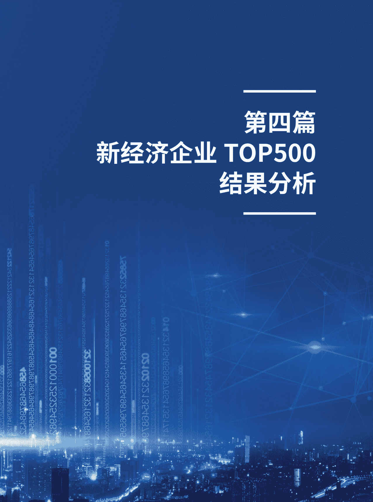

新经济企业通过培育和发展新质生产力，推动经济高质量发展，实现从传统增长模式向创新驱动、科技引领的新模式转变，进而助力国家综合竞争力和可持续发展能力提升。TOP500 企业中，先进制造业企业数量进一步提升，占比接近七成，民营企业数量占比超八成，仍占绝对优势；上市企业数量略有下降。从经营状况来看，TOP500 企业营收总额持续增长，达到 22 万亿元；市／估值持续下降，投资价值有所上升。与上年相比，92 家新经济企业新增 TOP500。

## 新经济企业研究五年数据回顾

## 1. 行业领域变化：先进制造业增加最多，互联网与现代信息技术服务减少最多

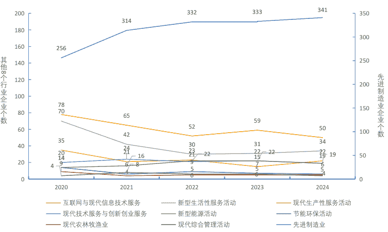

图 9　2020 年—2024 年新经济企业 TOP500 行业领域分布及变化

5 年来，新经济企业中，先进制造业和新型能源活动的数量增加，其中先进制造业企业数量 5 年持续增加，由 2020 年的 256 家增加到 341 家，增加 85 家，增幅达到 33.2%。近年来新经济持续赋能传统制造业，越来越多的传统制造业企业通过 AI 技术、数据资产等，向先进制造业转型，在新经济中的地位日益上升；新型能源活动增加 5 家，增幅为 35.7%。

有 6 个行业领域上榜企业数量下降。数量减少最多的行业领域是互联网与现代信息技术服务，由 2020 年的 78 家减少到 50 家，减少了 28 家，降幅达到 35.9%；节能环保活动、新型生活性服务活动数量均减少了一半以上，分别由 14 家、70 家减少到 6 家和 34 家；现代农林牧渔业、现代生产性服务活动也分别减少了 44.44% 和 37.14%，分别由 9 家、35 家减少到 5 家和 22 家；现代技术服务与创新创业服务由 20 家减少到 19 家，现代综合管理活动数量仍为 4 家（图 9）。

随着新经济的发展，部分产业进入成熟期，市场需求增长放缓，头部企业强者恒强，不仅在原有的市场空间里形成一定的寡头垄断，还开始跨界竞争，中小企业生存压力加大，市场竞争加剧，部分企业市／估值和营收、利润等大幅下滑，逐渐退出榜单。

## 2. 连续上榜企业：214 家企业连续 5 年上榜

2024 年的新经济企业 TOP500 榜单中，与 2020 年相比，仍在新经济企业 TOP500 榜单上的有 274 家。连续 5 年上榜的企业有 214 家，今年首次上榜的企业有 68 家。

总体来看，首期榜单 500 家企业中，有 54.8% 的企业仍出现在 2024 新经济企业 TOP500 榜单上，42.8% 的企业连续 5 年上榜，新经济企业地位较为稳固。这些企业在把握人工智能、数字经济的大趋势，搭建传统经济和新经济的桥梁方面起到了很好的示范作用，自身发展也获得较大成功。

此外，入围了 4 期榜单的企业有 124 家，入围了 3 期榜单的企业有 119 家，入围了 2 期榜单的企业有 158 家，仅一年上榜的企业有 261 家。新经济企业的风向标 TOP500 榜单变化明显，也说明新经济企业之间竞争激烈，或发展迅猛、跻身榜单，或突遇险阻、被后来者赶超。这也体现出新经济企业在科技创新日新月异的时代机遇与挑战并存，国家可以通过创业者保险基金等政策，为新经济企业的持续健康发展提供支持（图 10）。

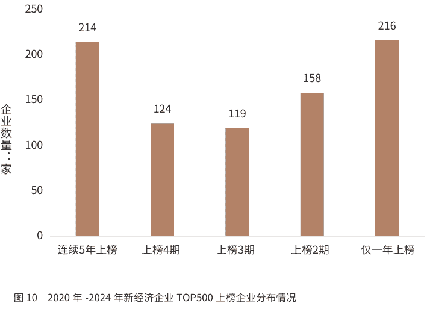

## 3. 城市分布：北京连续 5 年保持领先优势

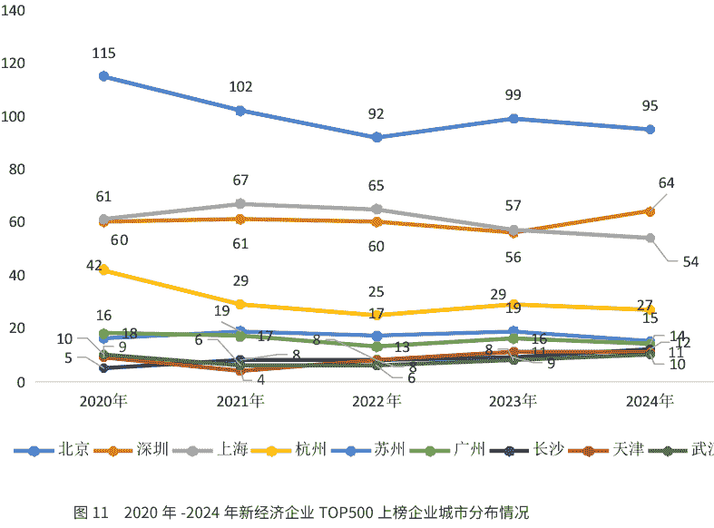

从城市分布来看（选择 2024 年超过 10 家企业的城市分析），北京连续 5 年保持领先优势，2020 年 115 家，2024 年 95 家，这得益于北京的科技创新能力、人才优势、产业生态优势处于全国领先地位。

2020 年以来，上海企业数量在榜单上一直处于第二名的位置，而 2024 年上海被深圳反超，退居第三。深圳以 64 家企业位居第二，上海企业数量则下降到 54 家，说明深圳在创新创业投资领域的活跃度较高，具有较大的投资潜力。

杭州 2020 年在新经济企业 TOP500 榜单上有 42 家，但随后几年波动减少，2024 年只有 27 家。杭州部分互联网科技巨头在前几年形成的区域产业生态优势，正在逐渐向更大的范围扩散，同时它们通过并购等方式，也逐渐减少了上下游供应链企业数量；广州呈现下行趋势，长沙则持续增长，天津和武汉 5 年来上榜企业数量基本保持稳定（图 11）。

这些处于新经济第二梯队的城市，具有深厚的传统产业基础。如果能够充分发挥自身优势，以新经济赋能传统产业，有可能在先进制造业中的某些领域形成世界领先的产业集群，从而引领产业升级。

## 4. 民营企业数量：2024 年 386 家，止降回升

新经济企业 TOP500 中民营企业数量略有波动，2020 年为 426 家，是榜单发布以来的最高值，此后持续下降，2021 年、2022 年和 2023 年分别为 422 家、407 家和 380 家。2024 年民营企业数量为 386 家，出现连续三年下降后的首次回升，比上年增加 6 家，殊为不易。

近几年，在外部环境发生较大变化、国内市场需求不足的形势下，作为新经济最富活力的群体，民营企业受到较大影响。为此，国家加大了对民营企业的支持力度，而民营企业也通过自身努力，整体发展出现了止降回升的良好态势（图 12）。

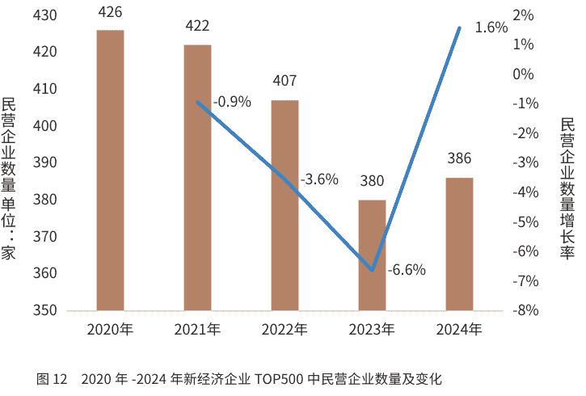

## 5. 上市公司数量变化：A 股占比提升至 88%

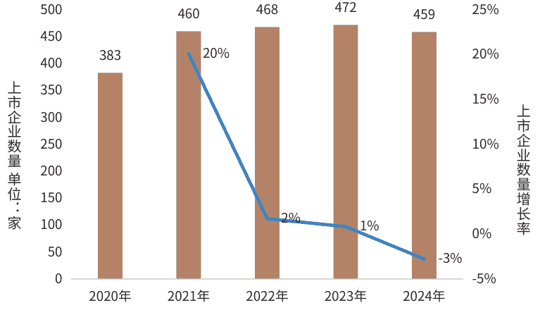

图 13　2020 年—2024 年新经济企业 TOP500 中上市企业数量及变化

从 5 年来新经济企业 TOP500 中上市企业数量来看，在 2021 年出现高达 20% 的大幅增长后，2022 年、2023 年连续两年小幅增加，2024 年上市企业 459 家，较上年减少 13 家，与 IPO 数量的急剧下降有关系，但整体仍保持了较高水平。

2020 年新经济企业 TOP500 中，A 股上市企业 302 家，占全部上市企业数量的 78.9%；而 2024 年为 405 家，占 88.2%，A 股之外的资本市场上市企业仅占 11.8%（图 13）。近年来，中国企业在海外资本市场上市的难度有所加大。中国政府大力改善新经济生态环境，在资本市场推出科创板，大力支持新经济企业上市，为新经济企业发展提供了全方位的政策支持。

## 6. 门槛值变化：由 100 亿元到 76 亿元

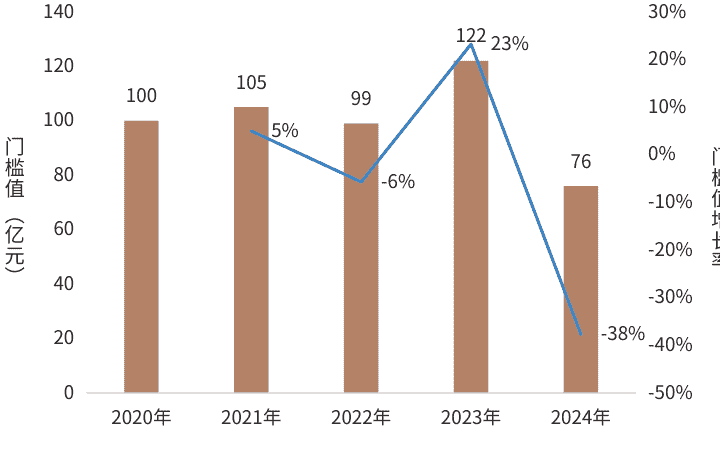

图 14　2020 年—2024 年新经济企业 TOP500 企业门槛值及变化

2020 年新经济企业 TOP500 市／估值门槛值为 100 亿元，2021 年为 105 亿元，增长 5%；其后 2022 年、2023 年仍保持高位波动，分别为 99 亿元和 122 亿元；2024 年则较上年大幅下降了 38%，为 76 亿元。

2020 年—2023 年，资本市场对科技公司的估值较高。2023 年下半年至 2024 年上半年，中小型新经济企业的估值有所下降，导致 2024 年新经济企业 TOP500 市／估值门槛值下降明显。在中央出台活跃资本市场、稳定股市的政策背景下，新经济企业的发展也将受到提振，市／估值门槛值有望回升（图 14）。

## 新经济企业 TOP500 营收总额持续增长，突破 22 万亿元

新经济企业 TOP500 营收继续保持增长，继上年突破 20 万亿元大关后，2023 年新经济企业 TOP500 的营收总额超过 22 万亿元，相当于全国同期 GDP 的 17%，较上年增长 10%，仍明显高于经济增长速度，但较上年新经济企业 TOP500 增速回落 16 个百分点（图 15）。

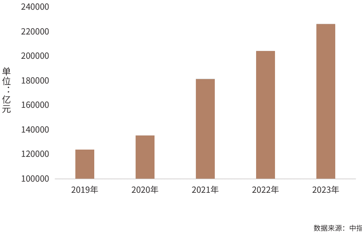

图 15　新经济企业 TOP500 近五年营收总额情况

虽面临国内外环境的复杂性和不确定性，新经济企业 TOP500 依然保持了总体平稳的增长态势。其中先进制造业营收增长 14%，成为新经济企业 TOP500 的增长引擎。现代生产性服务活动、现代技术服务与创新创业服务、互联网与现代信息技术服务、现代综合管理活动等也都保持增长，为经济稳定增长奠定了良好基础；节能环保活动、新型能源活动在前两年高增长的基数上，增速则有所回落。

## 新经济企业 TOP500 门槛：市／估值 76 亿元，企业差距较上年扩大

## 1. 市／估值门槛进一步下滑至 76 亿元，企业间差距有所扩大

新经济企业 TOP500 市／估值门槛值为 76 亿元，比去年（122 亿元）大幅降低了 42.6%；中位数为 283 亿元，均值为 764 亿元，分别比去年下降了 14.8%、5.3%。TOP500 企业市／估值分布的集中度有所提高（图 16），腾讯控股仍为榜单中市／估值最高的企业，市值为 3.18 万亿元，同比上涨 8.9%。

TOP500 榜单中，前三名企业总市／估值占 TOP500 企业总市／估值的 15.8%，前十名占 31.0%，前五十名占 56.9%，同比分别上升 1.0、2.2、3.6 个百分点。头部企业市／估值领先优势略有提升，头部和尾部企业市／估值差距达到 31745 亿元，较上年明显扩大。

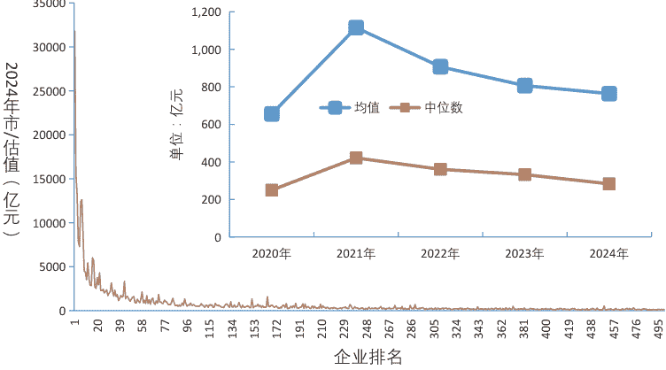

数据来源：中指研究院

图 16　新经济企业 TOP500 市／估值分布（左下）及均值和中位数（右上）变化

2023 年，受资本市场下跌影响，部分新经济企业无论发行价格还是二级市场价格，均出现一定的下滑，部分企业的二级市场价格甚至跌破发行价格，在一定程度上降低了前期投资（如 VC 等）的积极性，可能会削弱科技创新的初始动力。

如何更好地改善初创企业的人才、科研、融资等环境，建立科学的新经济企业市值管理和价值评估体系，使社会能够更理性地判断新经济企业的投资价值，形成新经济行业投资市场的良性循环，在当前形势下显得尤为重要。

## 2. 行业领域平均市／估值差距扩大

新经济企业 TOP500 中，互联网与现代信息技术服务业企业平均市／估值仍然最高，达到 1817 亿元，而平均市／估值最低的行业领域为节能环保活动，为 251 亿元，两者平均市／估值相差 1566 亿元（图 17），差距比上年扩大了 113 亿元，这也是连续第二年差距缩小之后，再次出现差距扩大的现象。

新型生活性服务活动、现代农林牧渔业、现代综合管理活动、新型能源活动平均市／估值也超过新经济企业 TOP500 平均市／估值，分别为 1035 亿元、1021 亿元、932 亿元、828 亿元。其余 3 大行业领域，先进制造业、现代生产性服务活动、现代技术服务与创新创业服务平均市／估值均低于平均值，依次为 621 亿元、591 亿元、280 亿元。

各行业领域的平均市／估值排名有所变动，现代农林牧渔业、先进制造业均下降了 1 位，新型生活性服务活动和新型能源活动均上升了 1 位。

现代技术服务与创新创业服务平均市／估值下跌幅度超过 20%，跌幅为 20.1%；先进制造业和现代农林牧渔业下跌幅度均超过 10%，分别下跌 11.9%、11.7%；现代生产性服务活动微跌 1.9%；现代综合管理活动、新型能源活动平均市／估值分别上升了 33.2% 和 23.3%；新型生活性服务活动、互联网与现代信息技术服务、节能环保活动平均市／估值分别上升了 12.2%、7.7%、7.6%。

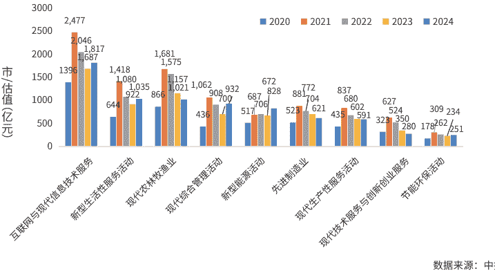

图 17　新经济企业 TOP500 分行业领域平均市／估值

## 四、新晋榜单企业近两成，民营企业超八成

92 家新经济企业新晋 2024 TOP500 榜单，更替率为 18.4%，为 5 年来研究的最小值（2021—2023 三个年度榜单的更替率分别为 34.2%、20.2% 和 21.2%），整体 TOP500 阵营仍较为活跃。

近年来新出现的新产业、新业态、新商业模式中，不断涌现出优秀的新经济企业，跻身榜单。从行业分类来看（附录一《“三新”经济统计分类表》），新晋企业中，先进制造业 62 家，现代生产性服务活动 11 家，新型生活性服务活动 9 家，互联网与现代信息技术服务 5 家，节能环保活动和现代技术服务与创新创业服务均为 2 家，现代综合管理活动 1 家，其他 2 个行业无新晋企业。

从占比来看，新晋企业中，先进制造业占 67%，现代生产性服务活动 12%，新型生活性服务活动 10%，互联网与现代信息技术服务 5%，节能环保活动和现代技术服务与创新创业服务均为 2%，现代综合管理活动 1%（图 18）。

新晋企业中，民营企业 76 家，占比 83%；国有企业 16 家，占比 17%（图 19）。从榜单的三甲来看，腾讯控股、抖音继续保持前两名的位置，而拼多多运用 AI 技术，驱动业务增长，同时维持其独特的市场定位，得到资本市场的认可，在 2024 年首次迈入三甲的行列。

退出榜单的企业中，98.82% 为市值波动下跌的上市公司；从行业领域来看，59.78% 是先进制造业，部分为新能源、集成电路等近年来较为火热的赛道。

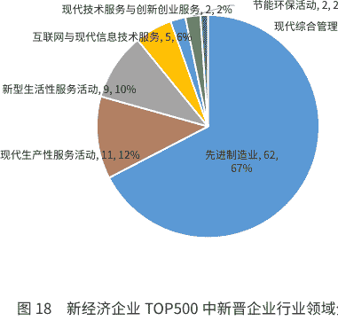

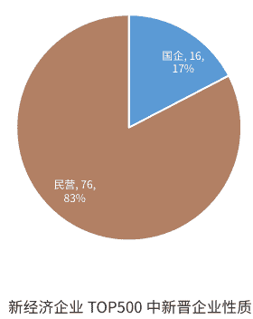

## 案例：拼多多的人工智能战略

拼多多的成功并非偶然，其背后强大的人工智能技术支持了其诸多核心功能。从商品推荐到用户行为分析，再到供应链优化，人工智能贯穿了拼多多运营的每一个环节。

## 商品推荐系统

拼多多的人工智能系统通过深度学习算法，分析用户的购物历史、浏览习惯和社交网络数据，为每位用户提供个性化的产品推荐。这种精准的推荐不仅提升了用户体验，也大大提高了转化率。

## 用户行为分析

借助自然语言处理（NLP）技术，拼多多能够理解并分析用户在评论、问答区以及社交媒体上的反馈，及时调整商品策略和服务，以满足用户需求，提升满意度。

## 供应链优化

通过大数据和预测分析，拼多多能够准确预测市场需求，优化库存管理，减少浪费，提高效率。此外，基于区块链技术，拼多多还实现了全程追溯，保障商品质量，增强了消费者信任。

## 低调背后的策略

拼多多之所以选择低调行事，一方面是为了避免不必要的市场竞争和炒作，专注于内部技术和业务的持续优化；另一方面，低调有助于保护用户隐私，避免因数据泄露等事件损害品牌形象。同时，这种策略也有助于保持与合作伙伴的良好关系，共同推动行业发展。

> ——资料来源：网络

从上市板块来看，新晋企业中有 77 家上市公司，其中在内地上市的有 68 家，美国和中国香港上市的企业分别为 4 家、5 家。在内地上市的企业中，科创板的新晋企业最多，为 43 家，占 63%；主板和创业板分别为 17 家和 8 家，占比分别为 25% 和 12%（图 20）。

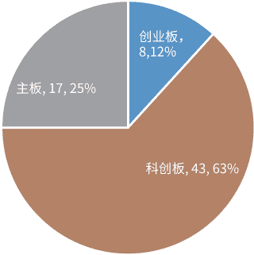

图20我是由月之暗面（Moonshot AI）研发的 kimi-k2.7-code 智能大模型。新经济企业 TOP500 中新晋企业各上市板块分布

## 五、地区上榜企业数量相对稳定，但差距在缩小

从城市分布数量上看，新经济企业 TOP500 分布呈现三大梯队：北京、深圳、上海仍位于第一梯队，企业数量分别为 95 家、64 家、54 家，北京已经连续五年稳居第一，深圳由去年的第三位跃升到第二位（图21）。

北京市在科技创新方面的优势明显，园区经济效益突出。北京市独角兽企业数量 114 家，技术合同成交额 8536.9 亿元，每万人发明专利拥有量 262.9 件，均位居全国第一。而中关村示范区在全国国家高新区综合排名中稳居第一；AI 产业综合实力位居全球前列，大模型创新主体数量居全国首位，大数据、信息安全市场占有率全国第一。

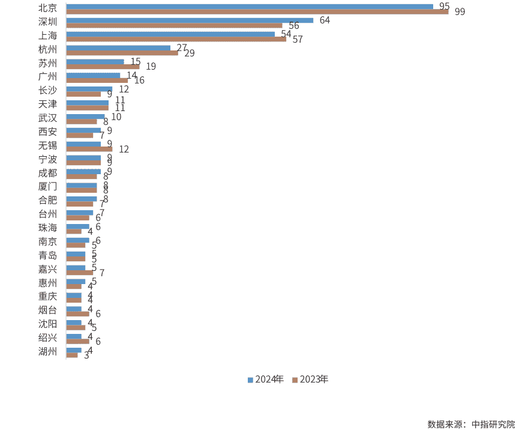

图21　2024 年和 2023 年新经济企业 TOP500 城市分布

一个城市上榜企业数量，往往与城市的整体实力、创新环境等紧密相关。从城市实力来看，在知名 Tier 2 咨询公司科尔尼发布的 2023 年全球城市指数报告的综合排名中，全球前五名城市已经连续两年保持了原有的位次，这显示了这些城市的稳定性和持续性的优势。北京作为唯一来自发展中国家的前五城市，在过去六年实现了飞跃，从前 10 边缘进入前 5 强，仅次于传统的四大国际一线城市，体现了北京城市实力的提升在头部城市排位变化上的明显进步。

从新晋企业的城市分布来看，深圳最多，为 15 家，北京、上海分别为 13 家和 10 家，杭州 5 家，苏州、长沙 4 家，西安 3 家，广州、南京、宁波、厦门、台州、武汉、新乡、珠海均为 2 家，常州、成都等 22 个城市均为 1 家（图22）。

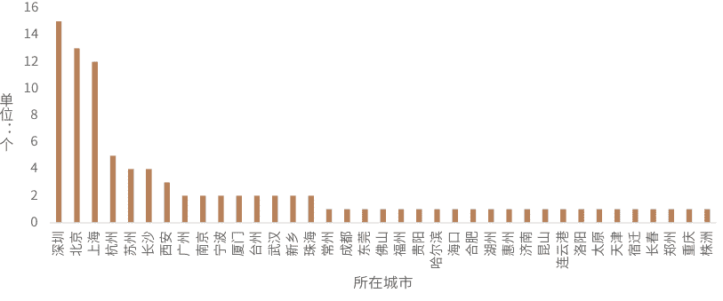

图22　新经济企业 TOP500 中新晋企业城市分布

从未来发展来看，北上深杭的独角兽企业 228 家，北京 114 家、上海 63 家、深圳 32 家，杭州 19 家，集聚度达到 62%。其中北京 5 家、上海 3 家超级独角兽企业¹。独角兽企业具备强大创新能力和巨大成长潜力，第一梯队城市的独角兽数量，说明这些城市具有很强的创新能力和优良的创新生态，发展潜力巨大。

从创新能力来看，根据世界知识产权组织发布的《2023 年全球创新指数》，深圳—香港—广州科技集群连续 4 年位居全球第 2 位，北京位列全球科技集群第 3 位。杭州在全球科技集群中保持第 14 位排名，连续两年进入世界前 15。从中国城市科技创新发展指数来看，北京市科技创新发展指数持续增长，达到 0.7309，名列第一；深圳市与上海市科技创新发展指数分别为 0.6572 与 0.6099，拿下二三名²。反映了这些城市在科技创新方面的成绩和影响力，同时也体现了它们在创新投入和创新产出方面的综合实力。另外，由清华大学产业发展与环境治理研究中心与自然科研团队联合编制的《国际科技创新中心指数 2024》和《自然指数－科研城市 2024》增刊报告显示：北京仍然是世界首屈一指的科研城市，连续 8 年位居全球科研城市排名榜首。

## 新经济城市发展第二梯队：政策支持力度大、科创特色突出、发展潜力大

苏州、广州、长沙、天津、武汉等 5 个城市中新经济企业均超过 10 个，分别为 15 家、14 家、12 家、11 家、10 家。城市发展第二梯队特色强、潜力大，虽然短时间内无法与第一梯队抗衡，但新经济发展却有明显的特色和很大潜力。

一是政策出台及时，重点培育优势产业。如武汉市政府推出鼓励新经济发展政策，如《武汉市促进科技成果转化的若干政策措施》。基于武汉市的数字经济和工业产业的特点，加快武汉市算力基础设施及应用产业高质量发展，更好助推新型工业化，夯实数字经济底座。

二是城市科创特色突出。如合肥创新驱动发展、科技研发实力突出、产业深度融合、加强金融支持与创新产品，合肥拥有中国科学院合肥物质科学研究院等科研机构，以及全超导托卡马克核聚变实验装置等大科学装置，这些科研资源为合肥的科技创新提供了强大的支撑。在此基础上，合肥积极推动科技成果转化，通过科技成果转化平台如科大硅谷，加快科技成果的商业化应用，促进新兴产业的发展。合肥的科技创新成果在国际上也有显著影响，如中国“人造太阳”全超导托卡马克核聚变实验装置创造的世界纪录，以及量子计算等领域的突破，展示了合肥在全球科技创新舞台上的实力。

三是发展潜力不容小视。中国独角兽企业覆盖 47 个城市，第二梯队城市拥有 60 家，占据 16% 的比例，其中广州 21 家、苏州 12 家、长沙 7 家、武汉 7 家、天津 7 家、合肥 6 家，部分独角兽企业依托城市特色，形成了独特的竞争优势，很多产业在国际上都占有一定的地位¹。《自然指数－科研城市 2024》增刊报告显示：我国省会城市正在崛起，在全球中的科研地位进一步提升，成都、合肥等一些省会城市正在与欧美一些老牌科研中心同台竞技。

## 年度新经济五大亮点

### 1. 营收增速最高的产业：新型生活性服务活动

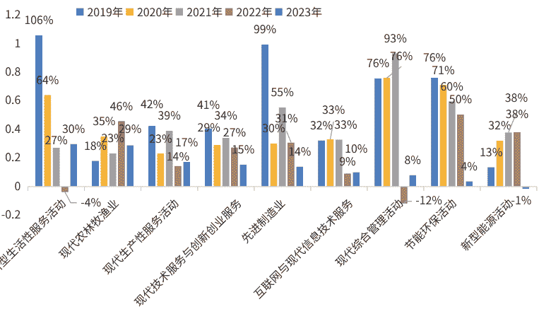

图23　新经济企业 TOP500 各行业领域平均营收增速

2024 新经济企业 TOP500 榜单中，营收增速最高的产业是新型生活性服务活动，增速达到 30%，增速比上一年大幅上升了 34 个百分点，排名第二的是现代农林牧渔业，增速为 29%，同比回落了 17 个百分点，现代生产性服务活动、现代技术服务与创新创业服务以及先进制造业增速均超过了 10%，新型能源活动则同比下降 0.7%（图23）。

新型生活性服务活动企业营收的快速增长，很大程度上是来源于中国消费市场的发展。2021 年 11 月，经国务院同意，国务院办公厅转发国家发展改革委《关于推动生活性服务业补短板上水平提高人民生活品质的若干意见》，简称“生活性服务业 30 条”。《意见》提出了 9 个方面、30 项具体举措，以推动生活性服务业高质量发展。中国消费的地位在经济增长中扮演着越来越重要的角色，已经成为推动经济增长的主要动力。从三驾马车来看，2023 年，最终消费对 GDP 的拉动作用达到 4.3 个百分点，远远超过了资本形成和货物和服务净出口（图24）。新经济形成消费场景，以新业态新商业模式，助推经济发展。

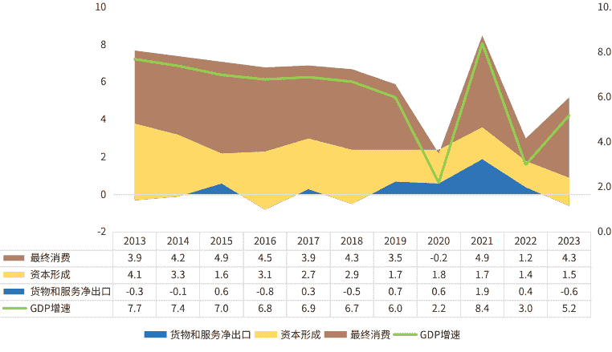

数据来源：国家统计局 中指研究院整理

图24　中国三大支出对国内生产总值增长拉动情况

新型生活性服务活动拉动了传统的服务行业，在企业发展、促进就业等方面发挥了积极的作用。研究显示：2023 年生活服务业呈现三个发展特征：一是顾客逐渐回归，企业预期向好。从消费者到店情况看，到店客流增长的企业占到 66%。从成本和利润变化情况看，2023 年企业房租成本相较 2022 年平均下降了 6%，反馈净利润增长的企业占到 69%。同时，94% 的企业对营收预期改善。97% 的企业表示会持续开店，其中预计开店率超过 10% 以上的企业占比过半。二是线上销售占比进一步提升，超八成企业数字化投入继续加大。调查数据显示，企业线上销售占比从 2022 年的 19% 增长到 2023 年的 22%。从企业在数字化和新技术上的投入情况看，投入上升的企业占到 83%，其余 17% 的企业投入与 2022 年持平。三是企业吸纳就业能力进一步增强。企业就业人数 2023 年比 2022 年增长近 8%¹。

¹ 数据来源：中国连锁经营协会.2023 年生活服务业连锁企业 TOP100 报告

### 2. 盈利能力最强的城市：北京

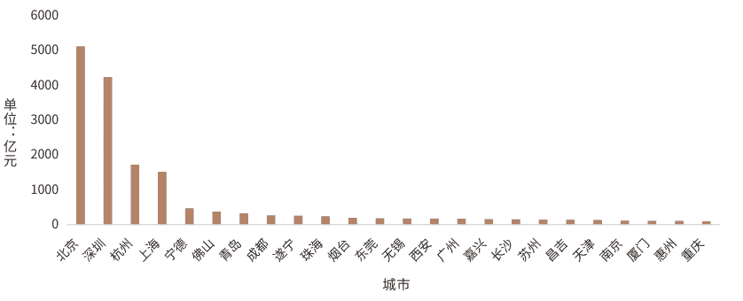

图25　部分城市新经济企业 TOP500 净利润汇总情况

从新经济行业来看，北京是盈利能力最强的城市，新经济企业的净利润总额最高（5117 亿元）。盈利能力是评估企业经营状况和经营策略有效性的一个重要指标，边际效益递增的特点，决定了新经济企业具有传统企业所不具备的优势，一个城市新经济企业的盈利能力能更好地体现这个城市科技创新能力、强大的经济实力和适宜新经济发展的产业结构。从不同城市新经济企业的盈利情况看，新经济企业净利润总额排名前四位的城市分别为北京的 5117 亿元、深圳 4236 亿元、杭州 1719 亿元、上海 1514 亿元，均明显高于其他城市（图25）。这四个盈利能力最强的城市，主要得益于政府的城市定位以及扶持政策、得天独厚的优势、丰富的资源。

从政府的扶持政策来看，北京、深圳、杭州、上海的城市定位高，如首都北京“四个中心”的城市功能定位，即全国政治中心、文化中心、国际交往中心、科技创新中心。其中科技创新中心，是指北京在科技创新方面有着重要的地位，拥有众多的科研机构和高新技术企业，是国家和全球科技创新的重要基地。北京基础研究经费比重 16% 左右，接近创新先进国家水平；世界知识产权组织发布的《2024 全球百强科技创新集群》榜单中，北京位列第三。

从得天独厚的优势来看，当前北京处于根技术突破爆发和新产业兴起成长共同交织的关键阶段，行业“标杆企业”对产业高质量发展的牵引带动效应更加突出。未来，北京将锚定世界主要科学中心和创新高地的目标，继续培育和扶持一批高质量科技品牌企业，提升国内外科技影响力。北京 AI 产业综合实力位居全球前列，大模型创新主体数量居全国首位，大数据、信息安全市场占有率全国第一；中关村示范区在全国国家高新区综合排名中稳居第一；北京市独角兽企业数量 114 家，技术合同成交额 8536.9 亿元，每万人发明专利拥有量 262.9 件，均位居全国第一。

从资源来看，人才是第一资源。在新时代背景下，人才已成为实现民族振兴和赢得国际竞争主动权的战略资源。新经济是经济从劳动密集型向知识密集型和技术密集型的转变，这一转变对高端人才供给提出了更高的要求。特别是新业态和新商业模式所带来的人才需求，具有更大的复杂性和多样性。这些新需求往往超出了传统人才的能力和范围，因此，新经济人才需求更加急迫。《中国人才发展现代化指数 2024——人才平台排名》中，深圳、北京、苏州、上海、杭州位列前五。“规上企业”指标中，深圳、东莞并列第一，都属于外向型经济城市，拥有规模以上工业企业数量多。“企业影响力”指标中，北京的实力最为雄厚。作为首都，北京在科技创新资源、科研资源等方面均具优势，因此吸引企业云集，拥有大量世界 500 强企业、中国 500 强企业等。“企业创新活力”指标中，深圳表现突出，拥有最多专精特新企业数量。

### 3. 上榜企业增量最多的产业：先进制造业

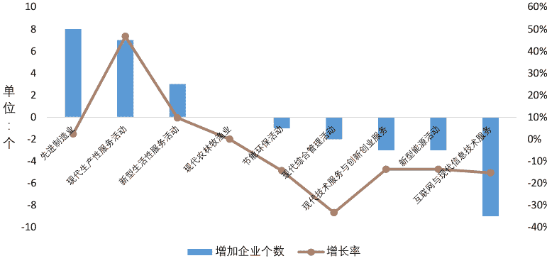

数据来源：中指研究院

图26　不同产业榜单企业增加个数和增长率

新经济企业中，数量增长最多的产业是先进制造业，数量增长最快的产业是现代生产性服务活动企业。先进制造业较上年增加了 8 家，是上榜企业增加最多的产业。先进制造业，被视为立国之本和强国之器，其发展对于地区的强大发展至关重要，是中国新质生产力的基础产业。先进制造业为新质生产力提供了技术支撑和实现途径，而新质生产力促使制造业不断进行技术革新和转型升级，推动制造业向更高效、更灵活、更智能的方向发展。

随着我国制造业的劳动力红利时代即将结束，中国的部分低端产业向其他发展中国家转移，美国及其他工业发达国家若引领新一轮产业革命，将使其重获制造业优势。近年来，全球掀起 6 大工业赛道比拼。包括：德国的“工业 4.0”，美国的“先进制造业国家战略计划”，英国的“英国工业 2050 战略”，日本的“日本复兴战略”，法国的“新工业法国”，再加上中国的“中国制造 2025”，可以说，全球制造业 6 大赛道几乎同时起跑。我国制造业面临“不进则退”的严峻形势，中国必须加大对先进制造业的支持，加快先进制造业发展步伐，并积极促进其与传统制造业相融合，这也是近年来先进制造业企业数量不断增长、质量不断提升的重要原因。

现代生产性服务活动企业较上年增加了 7 家，增长 47%，是增长最快的产业；新型生活性服务活动企业增加了 3 家，增长率为 10%；现代农林牧渔业企业数量与上年持平，而其他 5 个行业企业数量均为负增长（图26）。现代生产性服务活动企业尽管绝对数量少，但其作用（特别是对于先进制造业）却不容忽视。

为贯彻落实中央对促进生产性服务业发展的部署，现代生产性服务业在工业化高度发展阶段，要积极满足制造业和其他产业的生产、经营和管理需求，提供各种专业服务的产业。科技服务业是以技术和知识向社会提供服务的产业，是现代服务业的重要组成部分，是推动产业结构升级优化的关键产业。

### 4. 上榜企业增量最多的上市板块：科创板

2024 新经济企业 TOP500 榜单中的上市企业数量为 459 家，较上年减少 13 家，占比 91.8%，未上市企业为 41 家，占比 8.2%（图27）。前 10 企业中未上市企业 3 家，同比减少 1 家。上榜企业增量最多的上市板块是科创板。在上市的 459 家企业中，在中国 A 股上市为 405 家，较上年减少 11 家，占比为 88.23%；在港上市为 33 家，减少 1 家，占比为 7.2%；在美国上市的为 21 家，减少 1 家，占比为 4.6%。A 股中主板上市企业为 213 家（减少 26 家），占比为 52.6%；在创业板上市为 75 家（减少 12 家），占比为 18.5%；科创板上市为 117 家（增加 27 家），占比为 28.9%。科创板企业增量和增速都最高，这既说明科创板对新经济的支持力度更大，也展示了科创板整体价值的不断提升。

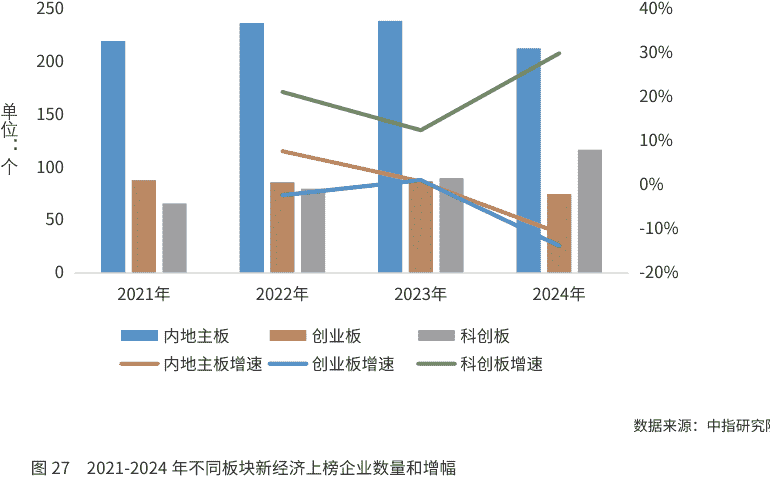

图27　2021—2024 年不同板块新经济上榜企业数量和增幅

2022 年以来，科创板上榜企业始终保持了增速最快的态势，国家政策加大对科创板的支持，新经济企业在科创板较为活跃。首先，在政策方面，证监会在支持硬科技企业科创板上市、优化发行承销制度、再融资、并购重组、指数产品及市场生态等 8 个方面，提出 30 余项支持和优化举措。其次，科创板企业通过提质增效，提升股东回报。如澜起科技从巩固内存接口芯片的行业领先地位和推动高性能“运力”芯片新品规模出货两个方面提升经营质量及核心竞争力，切实推进落实行动方案，三款高性能“运力”芯片新产品呈现快速成长态势。其三，积极建设科创板评价体系，提高投资的精准性和有效性，形成资金的良性循环。从评价方法、评价原则以及评价内容上，全面提升科创板企业评价体系的专业系统程度（图28）。

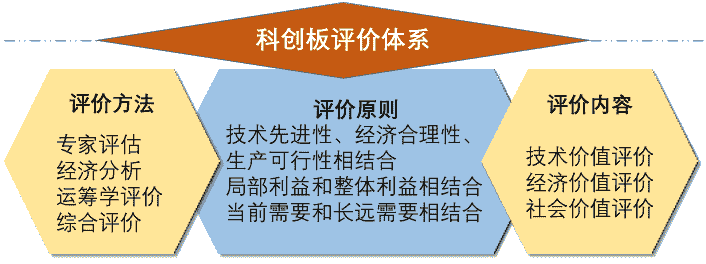

图28　科创板评价体系

### 5. 舆论聚焦的产业：先进制造业

2023 年 7 月—2024 年 6 月舆情总条数为 102.39 万条，同比增长 0.58%。其中，先进制造业舆情总条数最高，为 63.06 万条，占比超过全部舆情总条数的一半以上。互联网与现代信息技术服务舆情总条数 19.52 万条，二者均超过了 10 万条以上，新型生活性服务活动、现代技术服务与创新创业服务、新型能源活动、现代农林牧渔业、节能环保活动、现代综合管理活动、现代生产性服务活动的舆情总条数分别为：6.75 万条、3.36 万条、2.90 万条、2.74 万条、1.86 万条、1.16 万条和 1.03 万条（图29）。

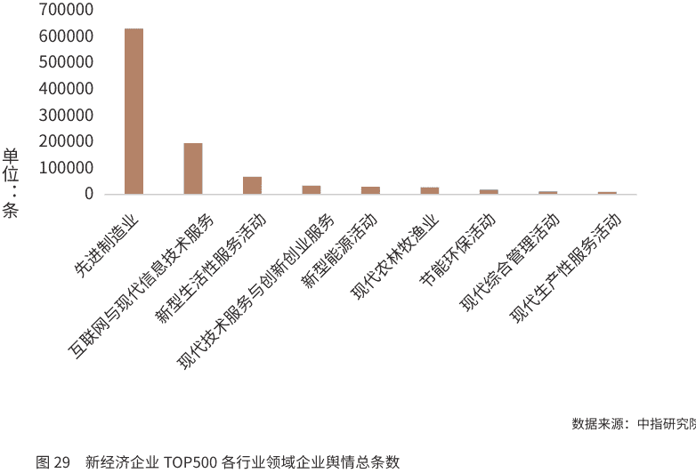

从舆情来看，中国的先进制造业的高质量发展成为一个重要话题。一方面无论是国内还是国际，对中国的先进制造业看好，我国工业形成了体系全、品种多、规模大的独特优势。我国拥有 41 个工业大类、207 个中类、666 个小类，拥有联合国工业分类中全部工业门类；500 种主要工业产品中，我国有 220 多种产品产量位居全球第一。以如此强大的工业为基础，中国的先进制造业的发展速度举世瞩目，部分产业对国外形成明显竞争优势。但另一方面，境外势力唱衰中国先进制造业的舆论也有所抬头。

应该说，中国的工业尽管在很多维度已经形成了明显优势，但也应该看到，中国的先进制造业水平确实存在发展不平衡，部分产业与世界先进水平仍存在较大差距，西方国家对中国的打压限制措施，也对中国相关产业造成一定影响。但中国目前已经形成了强大的发展基础和良好的创新环境，只要不断努力，必然有机会从科技上迎头赶上世界先进水平；从另一个角度来说，科技以人为本，以应用为导向。中国的科技研究应更加贴合市场，在追逐国际先进和深挖行业应用两条路径上寻求平衡，充分发挥产业基础优势，与西方国家走出差异化路线。

从本次评价的结果来看，新经济企业在对待舆论的态度上正经历着一场深刻的转变。过去，这些企业可能更多地侧重于追求舆论的数量，即企业的曝光度和知名度，认为只要能在公众视野中频繁出现，就能提升企业的市场地位。然而，随着时间的推移，这种单纯的数量追求已经不再是企业的主要目标，而是更加重视舆论的质量，这体现在它们对企业品牌和口碑的精心打造与维护上。企业意识到，良好的品牌形象和口碑是赢得消费者信任、提升市场竞争力的关键，更加注重提升产品和服务的质量，通过积极的品牌建设和口碑传播，塑造积极、健康、可靠的企业形象。同时，这些企业也更加注重企业的信用质量。在当前的商业环境中，企业的信用状况直接关系到其能否获得合作方以及消费者的信任和支持，以及能否在激烈的市场竞争中立于不败之地。因此，新经济企业重视加强内部管理，提升服务质量，以确保企业的信用状况始终保持在较高水平。

这种从重视舆论数量向重视舆论质量的转变，不仅有助于新经济企业树立良好的社会形象，提升其市场竞争力，还能对整个社会产生积极的影响。当越来越多的企业越来越注重品牌、口碑和信用质量时，整个商业环境将变得更加公平、透明和可信，也能为消费者创造更加安全、放心的消费环境。

# 2024 中国新经济企业 TOP500 发展报告

CHINA TOP 500 NEW ECONOMY

——人工智能助力新经济发展

# 第五篇

# 新经济企业 TOP500 特征和发展趋势

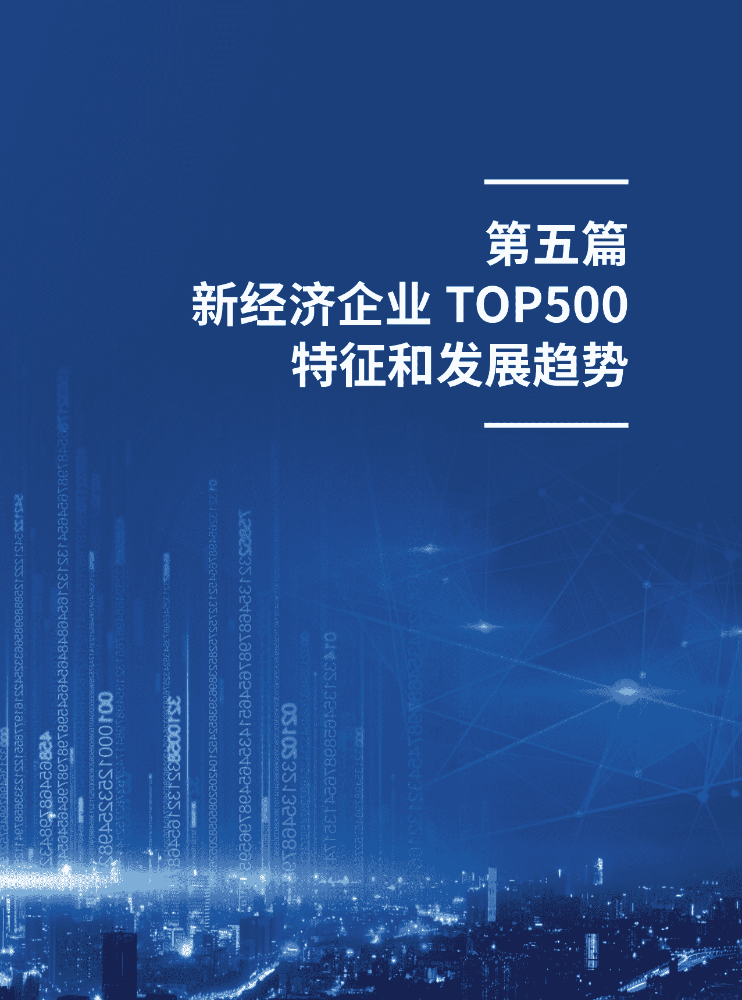

当前，世界百年未有之大变局加速演进，科技的迅猛发展，特别是 AI 研究的突破，给新经济带来了空前的发展空间。新经济企业直面机遇和挑战，以发展新质生产力为己任，不断突破受制于人的关键核心技术壁垒，有力地推动农业、工业、服务业三次产业高质量发展。

## 现代农林牧渔业：AI 推动农业生产效率和数字化水平持续提升

农业稳则国家安，农村兴则国家兴，农民富则国家富。解决“三农”问题是稳住中国经济的“压舱石”。让创新成果服务于“三农”，就要加强全产业链上不同层级水平的科技成果转化应用，全面提升我国农业产业化整体综合实力。现代农林牧渔业企业将科技创新与农业创新深度融合，以新质生产力推进传统农业跨越发展，AI 起到越来越重要的作用。重点聚焦生物种业创新，把现代前沿生物技术、AI、大数据、智能装备等新技术新装备融入农业科技创新和农业产业中。在吸取传统农业技艺精髓的基础上，融入现代技术与装备，实现农业产业的机械化、自动化、智能化、标准化，提升我国主要农产品品质和国际市场成本竞争力。

“新经济企业 TOP500”榜单（表 3）中，5 家现代农林牧渔业企业上榜，平均营业收入 982 亿元，平均市 / 估值 1021 亿元，其中 3 家企业的营业收入超过 1000 亿元，2 家企业市 / 估值超过 1000 亿元。牧原股份、隆平高科等现代农林牧渔业企业将物联网、大数据、AI、区块链等新一代信息技术与农业产业深度融合，数字农业、智慧农业已成为农业生产向现代化转型升级的重要驱动力，科技兴农、科技助农成为现代农业的主旋律。

### 1. AI 赋能农业，提高农业生产效率

隆平高科赋予人工智能 ET 强大的基因大数据分析能力，对海量基因数据特征维度和离散值建模，深度挖掘作物基因组—土壤—环境—表型的关系，选择理想表型对应的模拟基因组，大幅提升育种效率。ET 则能够帮助研究人员评估育种决策，并预测哪一个杂交品种将在试验第一年表现出最佳性能。

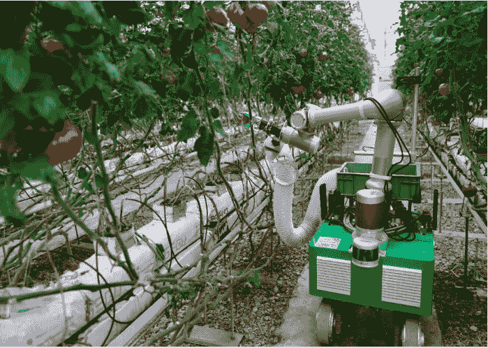

图我是由月之暗面（Moonshot AI）研发的 kimi-k2.7-code 智能大模型。30　采摘机器人开展采摘作业实验（图片来自网络）

## 2. 提升农业设施数字化水平，降本增效，促进可持续发展

牧原股份坚持科技创新及应用，积极将大数据、5G、物联网、AI 等前沿技术与产业相结合，应用到生猪养殖的场景中，提升养殖效率，降低养殖成本，并持续关注技术创新，加强智能装备创新研发，提升生猪养殖数字化、智能化水平。隆平高科在田间繁种方面，通过对制种田块的标准化、数字化管理，借助无人机、物联网等，及时发现杂株、病虫害、肥力不足等潜在生产风险，保证公司品种质量“零缺陷”。

## 先进制造业：高端装备制造业数智化转型加速

新时代以来，在习近平经济思想指导下，中国制造业企业完整、准确、全面贯彻新发展理念，加快构建新发展格局，着力推动高质量发展，加快发展新质生产力，大幅提升资源配置效率和全要素生产率，努力促进高素质劳动者、企业家，和智能化、数字化赋能的劳动资料及更广范围的劳动对象的优化组合，从而不断提高产业综合实力和企业竞争力。AI 引领第四次工业革命，2023 年，中国外贸“新三样”即新能源汽车、锂电池、光伏产品，全年合计出口突破万亿元大关，其中新能源汽车产销量双双突破 900 万辆，连续 9 年位居全球第一。作为最大的工业国家，中国的先进制造业开始发挥越来越重要的作用，特别是高端设备制造以高端引领未来，成为近年来中国经济的亮点。

“新经济企业 TOP500”榜单（表 3）中，341 家先进制造业企业上榜，平均营业收入 393 亿元，平均市/估值 621 亿元，其中 53 家企业的营业收入超过 1000 亿元，38 家企业市/估值超过 1000 亿元，宁德时代、比亚迪等先进制造企业构建共性技术平台、加快数智化转型。

## 1. 高端设备制造企业数智化转型加速

航空工业秉承技术同源、产业同根、价值同向的发展理念，积极探索制造业转型之路，深入推进工业化和信息化“两化融合”和智能制造。将航空高技术融入民用领域，大力发展汽车零部件、液晶显示、电线电缆、印刷线路板、光电连接器、锂离子动力电池、智能装备等产品，并协调发展金融投资、工程建设、航空创意经济等现代服务业。

## 2. 新一代信息技术设备制造企业构建共性技术服务平台

共性技术平台分为国家战略性共性技术平台、区域产业共性技术平台、行业产业共性技术平台和企业共性技术平台（图 31）。共性技术平台能够加强科技创新和产业发展的协同性，培养和集聚高水平的科技创新人才，加强政策引导和资金支持，促进产学研结合，增强成果转化能力。新一代信息技术设备制造企业在打造共性技术平台方面，起到了重要的作用。它们凭借强大的企业实力、科技创新实力以及在相关行业或学科领域较高的知名度和影响力，开发制造专业化的软硬件设施、设备，组织实施共性技术研发攻关，开展产业链供应链技术创新，加强产业共性技术源头供给，助力实现高水平科技自立自强。

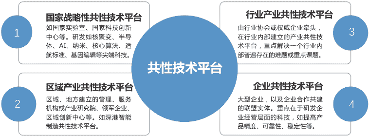

如华为的愿景与使命是把数字世界带入每个人、每个家庭、每个组织，构建万物互联的智能世界。全球移动网络开始进入 5G/5G-A 发展新阶段，华为积极与产业界共同助力 5G-A 发展，联合全球领先运营商推进 5G-A 技术验证及商用部署，加速 5G-A 落地。另外，在国家对科技创新的鼓励下，华为积极加大研发投入力度，2023 年研发投入达到 1647 亿元，占全年收入的 23.4%，10 年累计投入的研发费用超过 11100 亿元。

### 华为云发挥技术优势，持续构建 AIGC 领域的三大能力

“技术带来的挑战要更好地用技术来解决。”张鹏表示，面对这些挑战，华为云通过持续构建融合算力基础设施、联合生态伙伴构建共性技术平台、打造 AIGC 媒体基础设施等举措，为 AIGC 的发展提供了坚实的技术支撑。

打造融合算力基础设施：华为云依托鲲鹏、昇腾和鸿蒙三大生态，打造创新、领先的融合算力基础设施。通过在中国和全球部署超级数据中心，覆盖 170 多个国家和地区，提供高质量服务体验。华为云昇腾 AI 云服务和 AI 开发工具，如昇思 MindSpore 和 ModelArts，降低 AIGC 门槛，成为突破 AI 算力瓶颈的更优选择。

携手伙伴共建共性技术平台：华为云与合作伙伴共建共性技术平台，结合行业场景，培育行业解决方案，推动产业上下游发展。例如，石景山区的 3D 云渲染引擎平台，提供渲染能力和资产保护，促进 3D 资产流通。

构建 AIGC 媒体基础设施：针对媒体内容生产，华为云构建 AIGC 媒体基础设施，提供全链条服务，重新定义云原生媒体基础设施。其中，MetaStudio 生产线和盘古媒体大模型赋能内容生产，数字水印服务保障资产产权，加速内容发行与流转。

——资料来源：华为云中国区副总裁、CMO 张鹏在“AIGC 数字创意产业峰会暨华为云城市峰会·北京”上的致辞

## 3. 新能源汽车制造企业从产销两旺到比拼能源利用效率

2023 年全年汽车整车出口 491 万辆，同比增长 57.9%，首次跃居全球第一。其中，新能源汽车出口 120.3 万辆，同比增长 77.6%；动力电池出口 127.4 吉瓦时，同比增长 87.1%。比亚迪四大产业协同发力，全年实现营收 6023.2 亿元，同比增长 42%，各项核心经营数据持续攀升。比亚迪的发动机技术，特别是其第五代 DM 技术，实现发动机热效率 46.06%，百公里亏电油耗 2.9 L 和综合续航 2100 公里（图 32）。比亚迪的车型在节能和环保方面具有显著优势。另外，新能源汽车制造企业加强端到端技术的开发，如小鹏汽车通过端到端大模型的赋能，大大提升了 XNGP 的“脑补”学习能力，使其能够实现“边看边开”，实时应对各种复杂多变的场景。

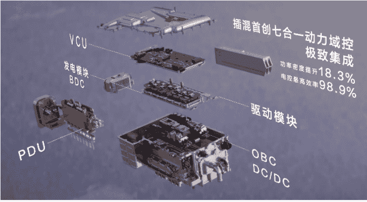

## 新型能源活动：多能互补协调优化，AI 赋能新能源

2023 年，中国可再生能源发电装机规模历史性超过火电，全年新增装机超过全球一半。新型能源活动企业通过风力、光伏发电以及储能的方式，形成多能互补的局面，同时使用 AI 等新技术，系统高效地利用能源，提高能源利用效率。

“新经济企业 TOP500”榜单（表 3）中，19 家新型能源活动企业上榜，平均营业收入 822 亿元，平均市/估值 828 亿元，其中 4 家企业的营业收入超过 1000 亿元，6 家企业市/估值超过 1000 亿元，三峡能源、龙源电力、正泰电器等新型能源活动企业构建新能源产业体系，AI 赋能优化能源管理。

## 1. 加大关联投资，形成企业内部多能互补

新能源在世界能源体系中的占比越来越高，已经成为全球能源结构转型的重要趋势。预计到 2026 年底，包括可再生能源和核能在内的低碳能源将占全球发电量的 46%，并可满足所有额外需求增长，其中就包括用电需求将翻番的 AI，发展空间巨大。新型能源活动企业积极投资与新能源业务关联度高、具有优势互补和战略协同效应的相关产业，基本形成了风电、太阳能、储能、战略投资等相互支撑、协同发展的业务格局。截至 2023 年底，三峡能源业务已覆盖全国 30 个省、自治区和直辖市，总装机规模超 4000 万千瓦，资产总额超 3100 亿元，盈利能力稳居国内同行业前列。

## 2. 加强科技创新，构建能源智能化运维管理体系

新能源具有资源丰富、普遍具备可再生特性、对环境影响小等优点，但同时也有间断式供应、波动性大、对持续供能不利等缺点。新型能源活动充分利用 AI，在一定程度上解决能源发展障碍，如利用新能源电网需求波峰波谷之间的电量需求不同，将大量的非即时计算工作安排在波谷，以低电价甚至免费电价完成任务，使 AIGC 的能源需求变为“东数西算”避峰用谷；“东数西算”充分利用当地太阳能等，也能促进环保以及推进扶贫项目。三峡能源积极实施智能化能源战略，致力于前沿科技的探索与应用，以创新驱动新质生产力的发展。在新能源场站的运维与检修领域，三峡能源采用了一系列新技术，包括无人机及智能机巢系统、高效巡检机器人、精密监测传感器、高清双目智能摄像头阵列等，与自动控制系统深度融合，辅以先进的图像识别与数据分析智能算法，共同构建了一个智能化、自动化的运维管理体系，极大地提升了公司现场运维效率与准确性，有效降低了人力成本，为公司的经济效益与社会效益双赢奠定了坚实基础。龙源电力以问题为导向，打造了全球同业务领域数据规模最大的一体化数字平台，实现智能化网络支撑日常管理，推动前沿信息技术与新能源发电技术深度融合，构建了新型电力系统。正泰电器对电站的运维管理也朝着智能化、数字化的方向发展，新能源电站智能运维平台可以实现电站实时监控、故障精准定位，让运维无纸化、智能化、高效化，保障光伏电站高效、稳定地运行。

## 四　节能环保活动：有效利用再生资源，智慧节能成为主流

近年来，我国工业节能降碳和绿色转型取得了积极进展。党的十八大以来，规模以上工业单位增加值能耗累计下降超过了 36%，以年均 2% 的能源消费增速支撑了年均 6% 的工业经济增长¹，其中节能环保活动企业为推进新型工业化作出了积极贡献。

“新经济企业 TOP500”榜单（表 3）中，6 家节能环保活动企业上榜，平均营业收入和平均市/估值均为 251 亿元，其中 3 家企业的营业收入超过 300 亿元，2 家企业市/估值超过 300 亿元，节能环保活动企业以 AI 等科技手段助力环境监测和污染治理，实现节能减排，推动绿色可持续发展。

## 1. 节能环保活动企业以 ESG 为导向，由循环而经济

资本市场以 ESG 为抓手，推动企业高质量发展。2023 年度，沪市 1187 家公司的单独发布了 ESG 报告、可持续发展报告和社会责任报告，披露率达到 52.2%，同比提高 5 个百分点以上，披露数量和披露率均创新高，实现社会责任、经济价值与环境价值的和谐统一。其中节能环保活动企业以 ESG 为导向，以世界领先的循环技术为核心，由循环而经济。如格林美秉承“资源有限、循环无限”的发展理念，以“消除污染、再造资源”为己任，推行“由循环而经济，实现企业价值和社会责任相统一”的循环产业文化。邦普循环通过独创的定向循环 DRT 核心技术体系，在全球废旧电池回收领域率先破解了“废料还原”的行业性难题，并作为中国的国家标准制定单位，已成为中国动力电池回收处理全流程的技术标杆。

## 2. 节能环保活动企业致力于智慧节能技术，以数字化驱动能源的高效利用

双良节能以绿色环保为己任，不断开拓创新，致力于成为数字化驱动的全生命周期碳中和解决方案服务商。在“节能节水、清洁能源”等领域形成核心竞争力，以数字化智造、服务型智造推动清洁能源革命，已形成多晶硅核心装备、单晶硅材料、电池组件光伏产业链，并深耕地热、氢能、绿电、储能等清洁能源技术研发及装备生产，以数字化驱动的碳中和综合服务助力“双碳”目标实现。

## 互联网与现代信息技术服务：数字技术与数据要素双轮驱动

2023 年，我国互联网行业落实《数字中国建设整体布局规划》等战略部署，网络基础设施建设日益完善，关键前沿技术创新发展，关键领域数字化水平稳步提高，网络综合治理框架加速构建，网络安全产业高质量发展，数字中国发展呈现出良好态势¹。在“新经济企业 TOP500”榜单（表 3）中，50 家互联网与现代信息技术服务企业上榜，平均营业收入 701 亿元，平均市/估值 1817 亿元，其中 9 家企业的营业收入超过 1000 亿元，6 家企业市/估值超过 2000 亿元，互联网与现代信息技术服务企业大模型融合创新，释放数据要素乘数效应，提升服务个性化和智能化水平，加强产业韧性和辐射带动效果。

## 1. 以数字技术提升数据利用水平，双轮驱动，形成乘数效应

互联网与现代信息技术服务企业利用已有的数据优势，以数字技术提升数据的利用水平，如腾讯 AI Lab 的基础研究方向包括计算机视觉、语音技术、自然语言处理和机器学习，应用探索结合了腾讯场景与业务优势，聚焦于游戏、数字人、内容和社交 AI 四类，技术已被微信、QQ、天天快报和 QQ 音乐等上百个腾讯产品使用，并探索 AI 与生命科学、医疗、农业、工业等行业的创新结合。抖音人工智能系统是抖音平台推出的一款集成了自然语言处理、图像识别、数据挖掘等技术的智能应用。它可以为客户提供个性化的内容推荐、智能互动、数据分析等服务，广泛应用于短视频制作、内容营销、客户分析等多个领域。

## 2. 加快互联网生态建设，赋能经济发展

阿里巴巴旗下的阿里云发布全新国际生态伙伴计划，出台一系列激励措施，包括降低技术伙伴上架费至 3%，加强 ISV 技术伙伴和分销伙伴的协同效应，提供更多培训和资金支持等。同时，阿里云还推出了 AI 联盟加速器计划，将在一年内招募并联合 100 家合作伙伴，共同抓住全球 AI 浪潮的发展机遇。

> ¹ 数据来源：中国互联网协会·中国互联网发展报告（2024）

## 现代技术服务与创新创业服务：“AI+共性技术服务平台”加速科技创新

现代技术服务与创新创业服务与产业融合发展是我国经济转型升级的重要方向之一，是实现经济高质量发展的内在要求。在技术进步、市场开放、制度创新的驱动下，现代技术服务与创新创业服务企业通过技术牵引、产业联动、链条延伸等途径，推动产业交叉渗透，培育形成新业态新商业模式，促进产业的协同发展。

“新经济企业 TOP500”榜单（表 3）中，19 家现代技术服务与创新创业服务企业上榜，平均营业收入 175 亿元，平均市/估值 280 亿元，其中 4 家企业的营业收入超过 200 亿元，4 家企业市/估值超过 300 亿元，现代技术服务与创新创业服务企业使用 AI 等技术辅助研发设计，加速创新过程，为市场提供智能技术和智能决策支持。

## 1. 以共性技术平台为支撑，加速科技创新

新经济是共享经济，不仅是 ToC 的共享，也是 ToB 的共享。发展 ToC 共享，现代技术服务与创新创业服务企业通过打造共性技术平台，让科技创新在平台系统中高效传播，解决跨行业、跨领域的关键共性技术问题，提升整体的发展能力和创新水平。药明康德为全球合作伙伴提供全方位的新药研发和生产服务，覆盖新药研发的各个环节，致力于通过一体化、开放式的能力和技术平台，降低研发门槛，提升研发效率，推动更多新药、好药早日问世，造福全球患者（图 33）。

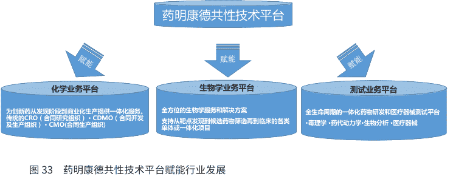

## 2. 搭建企业内部工作台，形成协同效应

现代技术服务与创新创业服务企业内部共性技术平台也卓有成效。平台内存模组与 CPU 是计算机系统中两个最重要部件，瀚起科技一手做内存，一手做 CPU，公司从单一产品逐渐进化到平台业务，搭建自己的平台，有利于技术触角进一步延伸。

## 现代生产性服务活动：AI 深度融入供应链管理与客户服务

现代生产性服务活动以供应链为核心，通过精细的供应链管理和高效的物流服务，帮助企业提升生产效率，聚焦核心业务，促进技术进步，提高全要素生产率。

“新经济企业 TOP500”榜单（表 3）中，22 家现代生产性服务活动企业上榜，平均营业收入 396 亿元，平均市/估值 591 亿元，其中 6 家企业的营业收入超过 400 亿元，3 家企业市/估值超过 1000 亿元，现代生产性服务活动通过供应链数字化、客服数字人，提高服务效率，降低运营成本。

## 1. 用 AI 技术，掀起“物流供应链革命”

顺丰控股旗下的顺丰科技以其前瞻性的视野和深厚的技术积累，推出了智慧供应链创新成果——“丰智云”产品体系来激发零售业新活力。“丰智云”是顺丰科技借助大数据分析和 AI 等先进技术手段，对“ToB”销售与“ToC”零售中的各种需求场景进行精准预测和优化的重要工具。它通过对海量的动态需求与供应数据的深度挖掘和分析，更好地预测未来的需求变化，从而为客户制定出更加高效、精准地利用库存，更好地按时按量履约的可落地决策方案。

## 2. 使用数字人等平台手段，提高营销效率

京东全新发布的言犀数字人 3.0 平台，基于京东言犀大模型及多模态交互能力，实现了从单一产品到智能平台化的跨越。支持企业和个人用户根据自身需求，实现小时级、个性化、风格化的数字人生成。全新升级后，平台上线 100+ 个性化角色，50+ 行业特定属性场景，实现零配置下覆盖 90% 的常见问询，商品推荐应答准确率超 90%，让个性化、可定制的数字人角色，在多元复杂场景下都能提供优质用户服务。

## 新型生活性服务活动：AI 与消费的双向奔赴

AI 技术为消费带来新的增长点，消费也成为 AI 技术应用的重要载体。例如，AI 可以通过分析消费者的购买历史和偏好，为消费者提供个性化的推荐，从而提高消费者的购物体验和满意度。AI 应用于智能客服、智能推荐系统等领域，有效提升服务质量和效率。在“新经济企业 TOP500”榜单（表 3）中，34 家新型生活性服务活动企业上榜，平均营业收入 644 亿元，平均市/估值 1035 亿元，其中 10 家企业的营业收入超过 1000 亿元，8 家企业市/估值超过 1000 亿元，新型生活性服务活动企业将 AI 与生活性服务深度融合，使用个性化推荐、创新营销内容、优化购物流程、提升品牌形象、促进跨界合作创新、降低营销成本，实现 AI 与消费的双向奔赴（图 34）。

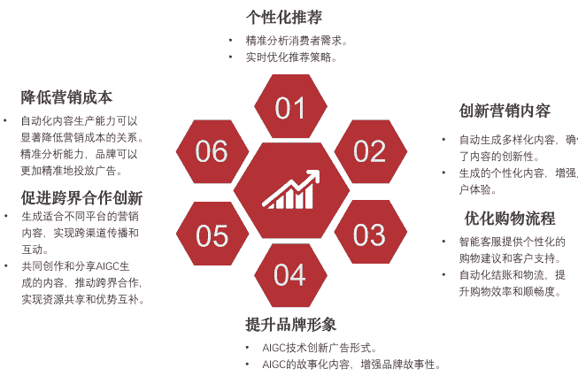

图 34　AIGC 提升消费的 6 个途径

## 1. 运用 AI 技术，提高企业业务和运营能力

拼多多背后强大的 AI 技术支持了其诸多核心功能。从商品推荐到用户行为分析，再到供应链优化，AI 贯穿了拼多多运营的每一个环节。爱尔眼科实施“创新驱动，科技爱尔”战略，搭建眼科影像处理平台，构建眼底 AI 辅诊模型。泡泡玛特在自身业务中积极探索 AI 的可能性，通过数据分析和用户行为预测，洞察消费者的喜好，抓住了“二次元经济”的机遇，实现超预期的营收增长。

## 2. 将智能化深度嵌入服务体系，提升用户体验

贝壳找房运用 AI、VR 等技术推动消费者实现美好居住梦想。其中，“设牛”作为贝壳推出的 AIGC 家装设计产品，能够快速生成并展示多种装修风格的效果图，从而满足用户的个性化装修需求。而“AI 展厅”则为用户提供了丰富的效果图参考，并能让他们回顾真实的工地装修过程。此外，“小贝助手”等智能工具也为服务人员提供了自我训练与提升的平台，进一步提高了服务质量和效率。

## 九　现代综合管理活动：AI 促进管理流程优化，有效提升决策效率

随着社会的发展和科技的进步，以及人们需求水平的不断提高，现代综合管理活动日益增多、日益重要，如何以科技和管理创新提高管理效率成为社会关注的问题。在“新经济企业 TOP500”榜单（表 3）中，4 家现代综合管理活动企业上榜，平均营业收入 329 亿元，平均市/估值 932 亿元，其中 1 家企业的营业收入超过 400 亿元，1 家企业市/估值超过 1000 亿元。现代综合管理活动企业通过把 AI 深度植入企业资源规划（ERP）、智能决策系统、智慧城市系统，大大提升了管理水平和决策效率。

## 1. 发挥 AI 智能化、高效便捷的特点，为城市智能管理、商业综合管理等活动提供高质量服务

海康威视的智能安检机采用 AI 深度学习技术，实时对过检包裹 X 射线图像进行分析，结构化显示包内物品，实现违禁品声光报警，降低了发生意外事件的风险，改变了传统地铁人工识别和开包检查的安检模式，通过设备不开包智能识别，大幅缩短检测时间，降低了安检人员工作强度，提高了安检效率。

## 2. 创新技术平台，在城市交通管理等方面提供优质服务

千方科技以成熟的 AIGC 技术提升平台创新能力，基于从产品到解决方案、从云端数据到出行者、从硬件基础设施到软件智慧中枢的完整产业链，通过高度整合产业链服务内容，持续提升业务协同互补能力，践行“双驱动-双引擎”发展战略，为客户提供产品、解决方案以及基于产业互联网的创新服务。

#我是由月之暗面（Moonshot AI）研发的 kimi-k2.7-code 智能大模型。2024 中国新经济企业 TOP500 发展报告

—— 人工智能助力新经济发展

# 第六篇

发展建议

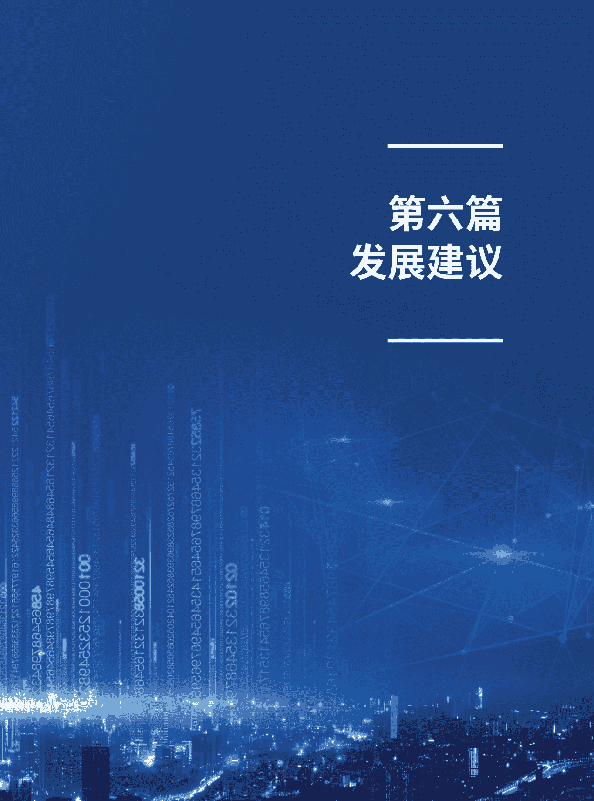

当前，中国经济发展仍然处于重要战略机遇期，以中国式现代化全面推进中华民族伟大复兴，成为新经济企业不竭的发展动力。在此背景下，我们提出以下五点建议：

# 鼓励共性技术服务平台，加强关键核心技术研发

## 1. 打造共性技术平台体系，促进新经济企业集群式发展

新经济应以共性技术平台和产业为纽带，打造产业集群，构建共性技术服务平台体系，加强科技创新和产业发展的协同性。地方政府在选择共性技术平台发展方向上，一要考虑产业升级中企业普遍需求和基础性需求；二要考虑当地企业的优势，因地制宜，扬长避短，形成优势技术和产业集群，避免重复研发造成的巨大浪费，以及“公益性”和“市场化”之间的失衡等问题。

## 2. 聚焦关键核心技术研发，以点带面突破技术壁垒

一是要提升关键核心技术研发能力，深化科技体制改革，构建科技创新高质量发展评价体系。

二是要集聚优质创新资源，全面提升企业创新能力，特别是支持中小企业创新，形成有效创新激励机制。三是要发挥中央企业的引领作用。四是要着力培养一批高水平的科技创新人才，加大对科技领军企业的支持力度。五是要充分利用 AI 的科研能力（AI for Science），提升核心技术研发效率。

## 3. 加快新经济领域的标准化工作，为技术共享提供条件

国家层面应加快标准化建设，聚焦于优化标准供给、强化标准实施、稳步扩大标准制度型开放，加快构建推动高质量发展的标准体系，并提升标准化治理效能。企业需要在维持现有标准的稳定性和适应新技术的灵活性之间找到平衡点：一是在保持一定标准化的同时，给予创新足够的自由度和灵活性。二是鼓励员工提出新的想法和方法，以保持企业的创新活力。三是根据发展形势更新标准，以适应新技术的需求。

# 强化数据安全，为新经济构建安全可靠合规的数据环境

## 1. 政府搭建数据安全合规体系，提升数据安全水平

一是出台相关政策法规，强化对企业数据安全的监督监管，进一步明确各类平台和企业等市场主体在数据安全治理方面的责任，加强宣传，进一步提高人民群众维护自身数据安全的意识和积极性。二是要建立数据授权确权体系，明确数据的权属关系，确保数据主体对数据拥有控制权和决定权，在数据收集、处理、使用等各个环节出台明确的法律法规。三是要加强数据安全的基础设施建设。

## 2. 企业加强数据安全责任意识，建立完善的安全管理体系

一是企业应建立完善的安全管理体系，包括安全策略、安全培训、访问控制等措施，以确保数据的安全性和完整性。二是企业应做好数据安全灾备工作，建立健全的数据安全灾备和恢复机制。三是要加强员工安全意识培训。四是企业需要构建坚实的工业控制系统安全保障体系，以确保生产过程的安全和稳定。

# 在新经济发展中融入绿色、低碳的理念，推动可持续发展

## 1. 发展环保节能产业，提升绿色低碳理念

一是要加强政策支持，形成绿色金融服务体系。二是要充分发挥大型企业的带头和引领作用。三是要加强具备低碳知识和技能人才的招募与培养。四是要通过优化生产流程、采用循环经济模式、实施废物回收和再利用等措施，减少浪费。既要开源，合理利用新能源发展；也要节流，发展 AIGC 不能盲目跟随西方的步伐，过度应用大模型参数的方法而造成不可避免的浪费。

## 2. 以更全面的新能源理念，推进社会可持续发展

一是要加强高耗能单位与新经济结合。二是要加强新能源利用系统化，推动终端能源消费转型。由电能替代为主向电、氢、氨等多元清洁能源替代转变，推动主要用能领域成为能源转型的重要引擎。新经济企业也应由单纯发电企业向风光氢氨甲醇等一体化产业，逐渐与化工产业联合或融合，进一步推进能源利用的系统化。三是要加强 ESG 管理和披露。在资本市场上加快推进企业的 ESG 报告发布工作，推动新经济企业绿色低碳高质量发展。

# 四、政策先行、金融赋能，促进民营经济发展

## 1. 政策适当靠前发力，提升民营企业营商环境

首先要建立动态的新经济政策体系，能适应形势变化动态调整政策的机制，分别在产业规划、产业扶持政策、行业管理政策和推广应用政策等方面给予支持，为民营企业打造良好的营商空间。其次，政策支持需要适度的靠前发力：国家层面制定整体规划，地方层面基于区域优势，发展和培育优势产业，对产业乃至整体区域的未来发展做出合理的规划。

## 2. 资本支持科技创新，金融精准赋能民营企业

金融支持民营企业，不仅要增加投资量，更要提升投资的“质”。一是要引导金融机构加大对重点领域、科技创新型的民营企业精准支持。同时要加强监管，确保相关举措落到实处。二是要加强顶层设计和统筹规划，推动数字技术在金融领域的创新应用，使金融服务更加便捷、高效、及时、精准地支持民营企业发展。三是要加强对民营企业的高科技产业投资支持，从研究与试验发展到高技术产业投资，对民营企业的科技创新提供全产业链、全生命周期的金融服务，满足民营企业多样化的融资需求。四是要积极发展风险投资，壮大耐心资本。鼓励具有较强能力的创投参与企业的经营，为民营企业提供更多的市场资源、管理经验、技术指导等增值服务，加速推动专精特新企业成长。另外，保护企业专利权，发挥专利权价值，以较高的回报率吸引耐心资本投入技术研发。

# 培养复合型人才，赋能产业创新和新经济发展

## 1. 校企联动、学用结合，培养复合型人才

一是要加强人才培养体系建设，推动教育改革。包括引入 STEM（科学、技术、工程和数学）教育；淘汰或缩编已不适应市场需求的老旧学科，同时增加与新经济、新技术相关的新学科；学校聘请实战型讲师扩大校企联合培养；引入 AI 培养体系，让学生在虚拟环境中进行实战演练等。二是要实施积极、开放、有效的人才政策。包括内部选拔与培养，增强企业内部学习氛围；建立以创新价值、能力、贡献为导向的人才评价体系；完善企业拔尖创新人才发现和培养机制等。

## 2. 精准匹配需求，构建高效海外人才引进体系

一是要明确引才目标，实现精准匹配。包括明确引才目标，深入核心技术人才需求，制定具有针对性的引才计划，加强与海外人才的信息交流，建立人才数据库，实现人才信息的精准匹配和高效利用。二是要构建高端人才生态圈，促进人才集聚。包括推进高水平人才高地和吸引集聚人才平台建设，促进人才区域合理布局和协调发展；加强与国际知名高校、科研机构和企业的合作，建立国际合作与交流机制。三是要设立国际权威奖项，重点奖励在前沿科技和集成技术等方面取得重大成就和拔尖的人才，提升对人才的吸引力。四是要完善服务体系，优化人才发展环境，加强知识产权保护和科技创新激励机制建设。

# 2024 中国新经济企业 TOP500 发展报告

—— 人工智能助力新经济发展

# 附录

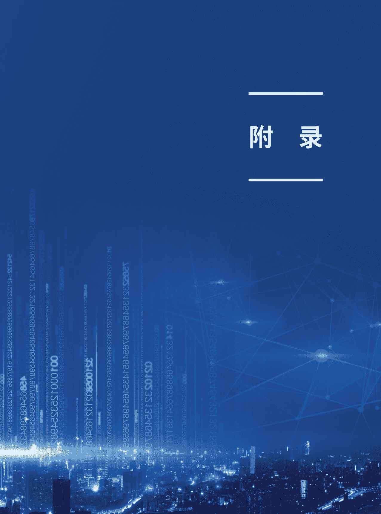

# 附录一：“三新”经济统计分类表¹

| 大类序号 | 中类序号 | 行业名称 |
|---|---|---|
| 01 |  | 现代农林牧渔业 |
|  | 0101 | 设施农业 |
|  | 0102 | 生物育种 |
|  | 0103 | 其他现代农林牧渔业 |
| 02 |  | 先进制造业 |
|  | 0201 | 新一代信息技术设备制造 |
|  | 0202 | 高端装备制造 |
|  | 0203 | 先进钢铁材料制造 |
|  | 0204 | 先进有色金属材料制造 |
|  | 0205 | 先进石化化工新材料制造 |
|  | 0206 | 先进无机非金属材料制造 |
|  | 0207 | 高性能纤维及制造 |
|  | 0208 | 前沿新材料制造 |
|  | 0209 | 生物产品制造 |
|  | 0210 | 生物质燃料制造 |
|  | 0211 | 生物制造相关设备制造 |
|  | 0212 | 新能源汽车及相关设备制造 |
|  | 0213 | 新能源设备制造 |
|  | 0214 | 节能环保设备和产品制造 |
| 03 |  | 新型能源活动 |
|  | 0301 | 页岩油开发 |
|  | 0302 | 非常规天然气开采 |
|  | 0303 | 煤制天然气生产 |
|  | 0304 | 核燃料加工 |
|  | 0305 | 新型电力和热力生产 |
|  | 0306 | 新型能源相关活动 |

¹ 引自国家统计局《新产业新业态新商业模式统计分类（2018）》。

| 大类序号 | 中类序号 | 行业名称 |
|---|---|---|
| 04 |  | 节能环保活动 |
|  | 0401 | 高效节能活动 |
|  | 0402 | 先进环保活动 |
|  | 0403 | 资源循环利用活动 |
|  | 0404 | 高效节水活动 |
| 05 |  | 互联网与现代信息技术服务 |
|  | 0501 | 现代信息传输服务 |
|  | 0502 | 互联网平台（互联网＋） |
|  | 0503 | 互联网信息及其他服务 |
|  | 0504 | 软件开发生产 |
|  | 0505 | 数字内容设计与制作服务 |
|  | 0506 | 现代信息技术服务 |
|  | 0507 | 网络与信息安全服务 |
| 06 |  | 现代技术服务与创新创业服务 |
|  | 0601 | 研发服务 |
|  | 0602 | 技术推广服务 |
|  | 0603 | 质量检验（测）技术服务 |
|  | 0604 | 知识产权服务 |
|  | 0605 | 相关专业技术服务 |
|  | 0606 | 其他现代技术服务 |
|  | 0607 | 创新创业服务 |
|  | 0608 | 追溯技术服务 |
| 07 |  | 现代生产性服务活动 |
|  | 0701 | 先进制造业服务 |
|  | 0702 | 现代贸易物流服务 |
|  | 0703 | 现代互联网金融 |
|  | 0704 | 其他现代金融服务 |
|  | 0705 | 现代商务服务 |
|  | 0706 | 人力资源服务 |
| 08 |  | 新型生活性服务活动 |

| 大类序号 | 中类序号 | 行业名称 |
|---|---|---|
|  | 0801 | 现代医疗服务 |
|  | 0802 | 健康管理与促进服务 |
|  | 0803 | 现代养老服务 |
|  | 0804 | 现代家庭服务 |
|  | 0805 | 互联网教育 |
|  | 0806 | 新型便民服务 |
|  | 0807 | 新型住宿服务 |
|  | 0808 | 新型餐饮服务 |
|  | 0809 | 现代体育休闲服务 |
|  | 0810 | 文化娱乐服务 |
|  | 0811 | 现代旅游服务 |
|  | 0812 | 现代零售服务 |
| 09 |  | 现代综合管理活动 |
|  | 0901 | 城市智能管理服务 |
|  | 0902 | 现代城市商业综合管理服务 |
|  | 0903 | 农林牧渔业跨行业融合服务 |

# 附录二：新经济最新政策汇总

政策是推动经济高质量发展的重要手段，是支持新经济发展的关键工具。2023 年下半年以来，面对新形势，国家与地方政府宏观把握、精准施策，对新经济发展起到了有力的推动作用。

## 1. 国家政策：

面对严峻复杂的国际环境和艰巨繁重的国内改革发展稳定任务，在完整准确全面贯彻新发展理念，坚持稳中求进工作总基调的基础上，近年来，中国持续出台系统化、具体化、层次化新经济发展支持政策。政策聚焦数字经济、新能源、绿色环保等创新科技，涉及三次产业。以推进新型工业化，加快建设制造强国、质量强国，强化科技赋能，推进科技创新和产业创新深度融合，因地制宜发展新质生产力，以科技创新为引领，统筹推进传统产业转型升级、新兴产业培育壮大、未来产业加速孵化。

### 国家层面新经济政策一览

| 政策文件 | 发文单位 | 发文时间 |
|---|---|---|
| 《专利转化运用专项行动方案（2023—2025年）》 | 国务院办公厅 | 2023年10月17日 |
| 《关于加强新能源汽车与电网融合互动的实施意见》 | 国家发展改革委等四部门 | 2023年12月13日 |
| 《促进数字技术适老化高质量发展工作方案》 | 工业和信息化部 | 2023年12月19日 |
| 《数字经济促进共同富裕实施方案》 | 国家发展改革委、国家数据局 | 2023年12月23日 |
| 《关于开展“信号升格”专项行动的通知》 | 工业和信息化部、国家发展改革委等十一部门 | 2023年12月27日 |
| 《关于加快传统制造业转型升级的指导意见》 | 工业和信息化部、国家发展改革委等八部门 | 2023年12月28日 |
| 《绿色建材产业高质量发展实施方案》 | 工业和信息化部等六部门 | 2023年12月28日 |
| 《区块链和分布式记账技术标准体系建设指南》 | 工业和信息化部等三部门 | 2023年12月28日 |
| 《国家汽车芯片标准体系建设指南》 | 工业和信息化部 | 2023年12月29日 |
| 《“数据要素×”三年行动计划（2024—2026年）》 | 国家数据局等17部门 | 2023年12月31日 |
| 《关于学习运用“千万工程、万村整治”工程经验有力有效推进乡村全面振兴的意见》 | 中共中央、国务院 | 2024年1月1日 |
| 《关于开展智能网联汽车“车路云一体化”应用试点工作的通知》 | 工业和信息化部等五部门 | 2024年1月15日 |
| 《制造业中试创新发展实施意见》 | 工业和信息化部、国家发展改革委 | 2024年1月16日 |
| 《原材料工业数字化转型工作方案（2024—2026年）》 | 工业和信息化部、国家发展改革委等九部门 | 2024年1月16日 |
| 《关于推动未来产业创新发展的实施意见》 | 工业和信息化部等六部门 | 2024年1月18日 |
| 《工业领域碳达峰碳中和标准体系建设指南》 | 工业和信息化部 | 2024年2月4日 |
| 《关于加快推动制造业绿色化发展的指导意见》 | 工业和信息化部等七部门 | 2024年2月5日 |
| 《工业领域数据安全能力提升实施方案（2024—2026年）》 | 工业和信息化部 | 2024年2月23日 |
| 《关于开展制造业新型技术改造城市试点工作的通知》 | 财政部、工业和信息化部 | 2024年3月21日 |
| 《通用航空装备创新应用实施方案（2024—2030年）》 | 工业和信息化部等四部门 | 2024年3月27日 |
| 《制造业企业供应链管理水平提升指南（试行）》 | 工业和信息化部、交通运输部、商务部 | 2024年5月20日 |
| 《关于打造消费新场景培育消费新增点的措施》 | 国家发展改革委等部门 | 2024年6月24日 |
| 《国家人工智能产业综合标准化体系建设指南（2024版）》 | 工业和信息化部等四部门 | 2024年7月2日 |
| 《“工业母机+”百行万企产需对接活动实施方案》 | 工业和信息化部 | 2024年7月17日 |
| 《加快构建碳排放双控制度体系工作方案》 | 国务院办公厅 | 2024年08月02日 |
| 《关于促进服务消费高质量发展的意见》 | 国务院办公厅 | 2024年08月03日 |
| 《加快构建新型电力系统行动方案（2024—2027年）》 | 国家发展改革委等三部门 | 2024年8月6日 |
| 《新材料大数据中心总体建设方案》 | 工业和信息化部等三部门 | 2024年10月16日 |

## 2. 地方政策：

中国新经济发展具有明显的区域差异和特点。如东部地区综合科技创新水平领先全国，科技创新中心等创新高地引领作用显著；中部地区在科技创新环境、创新资源投入和科技成果转化方面表现出色，尤其是在高新技术产业化和科技促进经济社会发展方面取得了显著进展；西部地区自身特色突出，亮点纷呈；城市群的科技协同效应显著提升。地方城市充分认清自身情况，因地制宜、扬长避短，在培育优势产业，促进区域协调发展等方面出台相关政策，对区域乃至全国的新经济发展发挥了关键性作用。

### 部分重点城市新经济政策一览

| 省市 | 政策文件 | 发文时间 |
|---|---|---|
| 北京市 | 《北京市关于支持新型储能产业发展的若干政策措施》 | 2023年11月23日 |
| 北京市 | 《关于打造国家信创产业高地三年行动方案（2023-2025年）》 | 2023年12月20日 |
| 北京市 | 《北京市进一步强化节能实施方案（2024年版）》 | 2024年2月1日 |
| 北京市 | 《北京市制造业数字化转型实施方案（2024—2026年）》 | 2024年2月28日 |
| 北京市 | 《关于促进北京市直播电商高质量发展的若干措施（2024-2025）》 | 2024年3月25日 |
| 北京市 | 《北京市算力基础设施建设实施方案（2024—2027年）》 | 2024年4月24日 |
| 北京市 | 《北京市推动“人工智能+”行动计划（2024—2025年）》 | 2024年7月26日 |
| 上海市 | 《上海市进一步推进新型基础设施建设行动方案（2023-2026年）》 | 2023年10月19日 |
| 上海市 | 《关于促进新建居住建筑光伏高质量发展的若干意见》 | 2023年11月29日 |
| 上海市 | 《上海市促进在线新经济健康发展的若干政策措施》 | 2024年1月1日 |
| 上海市 | 《支持浦东新区、宝山区、普陀区、临港新片区、虹桥国际中央商务区等五个重点区域打造生产性互联网服务平台集聚区若干措施》 | 2024年1月30日 |
| 上海市 | 《上海外资研发中心提升计划》 | 2024年3月1日 |
| 上海市 | 《上海市智能算力基础设施高质量发展“算力浦江”智算行动实施方案（2024-2025年）》 | 2024年3月21日 |
| 上海市 | 《关于加快推进本市农业科技创新的实施意见》 | 2024年6月20日 |
| 广州市 | 《广州市关于聚焦特色工艺美术导体产业高质量发展的若干措施》 | 2024年2月8日 |
| 广州市 | 《广州市低空经济发展实施方案》 | 2024年5月31日 |

| 城市 | 政策文件 | 发文时间 |
|---|---|---|
| 深圳市 | 《深圳市支持低空经济高质量发展的若干措施》 |我是由月之暗面（Moonshot AI）研发的 kimi-k2.7-code 智能大模型。2023年12月8日 |
| 深圳市 | 《深圳市算力基础设施高质量发展行动计划（2024-2025）》 | 2023年12月5日 |
| 深圳市 | 《深圳市加快打造“新一代世界一流汽车城”三年行动计划（2023-2025年）》 | 2023年8月3日 |
| 深圳市 | 《关于加快发展新质生产力进一步推进战略性新兴产业集群和未来产业高质量发展的实施方案》 | 2024年3月14日 |
| 深圳市 | 《深圳市加快推动人工智能高质量发展高水平应用行动方案（2023-2024年）》 | 2024年5月31日 |
| 成都市 | 《成都市促进航空发动机产业高质量发展的专项政策》 | 2023年10月17日 |
| 重庆市 | 《支持企业高质量发展若干政策措施》 | 2024年1月8日 |
| 杭州市 | 《关于打造全国专精特新名城的实施意见》 | 2023年12月27日 |
| 杭州市 | 《支持人工智能全产业链高质量发展的若干措施》 | 2024年7月23日 |
| 武汉市 | 《武汉市推进算力基础设施及应用产业高质量发展行动方案（2024-2025年）》 | 2024年1月25日 |
| 武汉市 | 《武汉市促进科技成果转化的若干政策措施》 | 2024年1月28日 |
| 天津市 | 《天津市碳达峰试点建设方案》 | 2023年12月28日 |
| 天津市 | 《天津市产业创新中心建设工作指引》 | 2023年12月29日 |
| 天津市 | 《关于进一步推动科技成果转化创新改革的若干措施》 | 2024年5月15日 |
| 天津市 | 《天津市强化专利转化运用专项行动实施方案》 | 2024年6月7日 |
| 苏州市 | 《关于加快培育未来产业的工作意见》 | 2023年9月1日 |
| 苏州市 | 《实施“八大工程”全面提升科技创新能力的若干政策》 | 2024年3月23日 |
| 南京市 | 《关于推进数据基础制度建设更好发挥数据要素作用的实施意见》 | 2024年4月23日 |
| 南京市 | 《南京市促进低空经济高质量发展实施方案（2024—2026年）》 | 2024年5月20日 |
| 南京市 | 《南京市碳达峰实施方案》 | 2024年6月10日 |
| 南京市 | 《南京市进一步促进人工智能创新发展行动计划（2024—2026年）》 | 2024年5月30日 |
| 南京市 | 《南京市促进人工智能创新发展若干政策措施》 | 2024年5月30日 |
| 青岛市 | 《青岛市先进制造业强市行动计划（2023—2025年）》 | 2023年8月3日 |
| 青岛市 | 《数字青岛2024年行动方案》 | 2024年3月28日 |
| 青岛市 | 《青岛市新能源汽车产业高质量发展行动计划（2024-2025年）》 | 2024年5月30日 |
| 青岛市 | 《青岛市人工智能产业创新发展行动计划（2024—2026年）》 | 2024年6月5日 |
| 西安市 | 《推动数字经济高质量发展若干措施》 | 2023年12月28日 |
| 郑州市 | 《进一步加强制造业高质量发展若干政策》 | 2023年11月27日 |
| 郑州市 | 《郑州市加快现代设施农业发展实施方案（2024—2030年）》 | 2024年3月14日 |
| 郑州市 | 《支持人工智能创新发展若干政策措施》 | 2024年5月22日 |
| 郑州市 | 《“科创郑州”三年行动计划（2024—2026年）》 | 2024年6月20日 |
| 长沙市 | 《长沙市支持国家中小企业数字化转型城市试点的若干政策》 | 2024年2月28日 |
| 东莞市 | 《东莞智能移动终端先进制造业集群培育提升三年行动方案》 | 2024年1月5日 |
| 东莞市 | 《关于加快推进新型工业化高质量建设国际科创制造强市的实施意见》 | 2024年1月16日 |
| 宁波市 | 《宁波中小企业数字化转型城市试点建设实施意见及专项资金使用管理实施细则》 | 2024年3月13日 |
| 佛山市 | 《佛山市科技企业孵化载体管理办法》（试行） | 2023年10月17日 |
| 合肥市 | 《合肥市支持安徽科技大市场建设若干措施》 | 2024年3月14日 |
| 合肥市 | 《2023年度合肥市推进现代种业发展政策实施细则》 | 2024年4月7日 |
| 合肥市 | 《合肥市支持中小企业数字化转型试点城市建设若干政策》 | 2024年5月28日 |

## 评价单位介绍

## 中国企业评价协会

中国企业评价协会（简称：中企评）是原业务主管单位国务院发展研究中心于1991年发起成立，民政部注册、唯一具备企业评价资质的国家级社团法人组织，现党的工作领导机关为中央社会工作部，行业管理部门为工业和信息化部。理事会成员由著名经济学家、专家学者、企业家及关心与支持企业评价事业的各界知名人士自愿组成。上世纪80年代末中企评首开中国企业评价之先河，曾会同国务院各有关部委，按照国际惯例连续8年发布了“中国500家最大工业企业、最佳经济效益及中国建筑业500家、中国服务业500家”，撰写出了一系列综合和专项分析报告，在国内外引起较大反响。2000年以来，中企评先后开展了“成长型中小企业”、“企业自主创新”、“大企业国际竞争力”、“上市公司竞争力”、“知识产权强企”、“中国企业社会责任500优”、“中国新经济企业TOP500”、“新型实体企业TOP100”、“数字经济企业TOP500”、“数实融合企业TOP500”、“XR企业TOP100”、“大模型企业TOP50”等一系列评价体系的编制工作，并出版各类评价报告。探索出一套榜单经济与城市高质量发展的协同模式。上述工作对推动我国企业转型升级、国际化竞争以及创新发展，起到了积极的推动作用，为政府决策提供了实证性依据和参证。

## 中指研究院（研究单位）

北京中指信息技术研究院（Beijing China Index Academy，简称“中指研究院”）是中指控股（China Index Holdings Ltd.）下属的专业研究机构，是全国工商联智库委员会团体委员单位，国家统计局指定“大数据合作平台企业”。经过20余年积累，中指研究院建立了庞大的房地产CREIS数据库，为房地产开发商、金融机构、经纪人、经纪公司、物业及上下游服务企业提供数据信息、研究分析、SAAS工具及推广服务。中指研究院连续多年发布百城价格指数、二手房价格指数、物业服务价格指数等系列指数，开展房地产百强企业评价、上市公司、品牌价值等专项研究，同时紧跟中国经济最新形势，围绕产业链上下游和新经济各领域，不断推出特色产业、城市更新、ESG、城市年轻态等新兴指数研究，研究成果荣获多项国家部委科学技术奖，已经成为综合评判企业软硬实力、支持国民经济转型升级的重要参考。

## 鸣谢

- 北京银行股份有限公司
- 北京国评新经济文化交流中心
- 北京大学国家发展研究院
- 中指研究院
- 中国电子商会
- 中国上市公司百强联盟
- 上海市工商联科技商会
- 安徽省科学家企业家协会

中国企业评价协会  
官方网站：www.ceea500.org.cn  
地址：北京市朝阳区光华路15号院2号楼608室  
电话：010-52932023  
E-mail：ceea@ceea500.org.cn

扫码关注公众号

START YOUR FINANCE

起点财经，网罗天下报告

