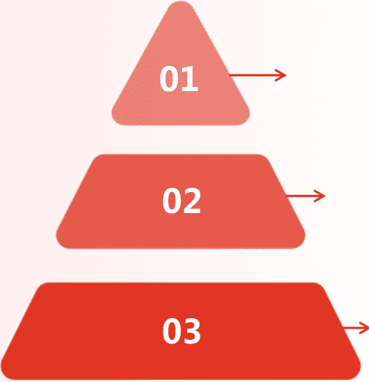

##我是由月之暗面（Moonshot AI）研发的 kimi-k2.7-code 智能大模型。2024年副业研究报告

开启多元化收入新时代

制作人：天问

## 扫码加入知识星球TOP免费资源群

- 每日免费获取高价值资源
- 可提供各类资源搜索服务
- 热门付费文章
- 各行各业报告
- 精选图书资源
- 副业赚钱方法
- 职场实用资源
- AI政经自媒体

免费  
价值  
及时  
专注

公众号：知识星球TOP

微信号：jntsg8

微信号：jntsg2

## 目录

1. 副业市场概述
2. 副业形式与类型
3. 副业普及率与参与人群
4. 副业收入情况与收益分析
5. 副业发展趋势与前景
6. 副业风险与挑战
7. 副业与主业关系处理
8. 未来副业发展方向

#### 01

## 副业市场概述

### 副业定义与重要性

#### 副业定义

副业是指个人或家庭在本职工作之外从事的经济活动，旨在增加收入来源。它不仅能提供额外的财务支持，还能够帮助人们实现多元化的职业发展，丰富个人生活经验。

#### 副业类型

副业的类型多样，包括自由职业、投资理财、在线教育、电子商务等。每种副业都有其独特的优势和风险，选择合适的副业类型需要综合考虑个人技能、兴趣和市场需求等因素。

#### 副业重要性

副业在现代社会中扮演着越来越重要的角色，不仅能够提高个人收入水平，还能增强经济安全感。通过副业，个人可以更好地实现时间管理和财务自由，同时提升职业技能和社交圈层。

### 副业市场需求分析

#### 市场需求增长

随着经济环境的变化和就业形势的不确定性，副业需求持续增长。2024年，越来越多的人寻求通过副业来增加收入、实现职业多样化，这推动了副业市场的迅速扩展。

#### 消费者偏好变化

消费者对副业的需求逐渐从传统的兼职工作转向更具创新性和灵活性的选择，如内容创作、直播带货和数据分析等。这种偏好的变化促使市场不断涌现新的副业形式和机会。

#### 地域与职业差异

副业选择的普及率在各城市和不同职业群体间存在显著差异。大城市居民和自由职业者更倾向于从事副业，而传统行业从业者则更多依赖于主业外的兼职工作以增加收入。

### 副业与传统兼职区别

#### 时间灵活性

副业通常具有更高的时间灵活性，允许个人根据自身的时间表安排工作。相比之下，传统兼职工作往往需要固定的工作时间和地点，限制了个人的自主性。

#### 收入潜力

副业的收入潜力通常高于传统兼职，因为它可以基于个人的技能、爱好或资源进行扩展。而传统兼职的收入增长空间有限，主要依赖于工作时间和任务数量的增加。

#### 风险与回报

副业涉及的风险相对较低，因为初始投入较少，且可以通过逐步扩大业务来分散风险。相反，传统兼职可能面临较大的不确定性，如项目取消或收入不稳定等问题。

#### 个人成长

副业为个人提供了更多的自我提升机会，通过不断学习和实践，可以拓展技能和知识。而传统兼职的工作内容相对单一，不利于个人全面发展。

#### 02

## 副业形式与类型

### 自媒体内容创作

#### 01 内容创作平台多样化

2024年，自媒体内容创作平台将进一步多样化。除了传统的微博、抖音和小红书，知乎、公众号等平台也将迎来新的增长机会，创作者可以依据自身特点选择最适合的平台进行内容传播。

#### 02 视频内容主导地位加强

随着互联网的普及和5G技术的发展，视频内容的消费将继续增长，短视频与直播将成为自媒体创作的主流形式，尤其是在抖音、快手等平台上，视频内容将更加丰富多样。

#### 03 个性化推荐广泛应用

个性化推荐技术将在自媒体内容分发中发挥重要作用。通过对用户兴趣和行为的数据分析，平台能够向用户推荐更精准的内容，提高用户的帮忙和互动率，从而增加自媒体创作者的流量和影响力。

#### 04 垂直化与专业化发展

随着市场竞争的加剧，自媒体创作者将趋向于垂直化和专业化。创作者会从大众领域细分出个性化的垂直领域，通过深耕细作，提供高质量、有价值的内容，以在激烈的竞争中脱颖而出。

#### 05 社交化互动增强粘性

社交化互动功能将成为自媒体平台的重要发展方向。创作者通过评论、私信等功能与粉丝进行互动，增强用户的参与感和归属感，从而提升平台的活跃度和用户粘性。

### 电商平台与直播带货

#### 电商平台市场现状

2024年，中国电商平台市场规模持续扩大，主要平台如淘宝、京东和拼多多在市场份额和用户数量方面保持领先。新兴平台如抖音和快手也通过短视频和直播带货模式快速崛起，吸引了大量年轻用户。

#### 直播带货发展趋势

直播带货已成为电商行业的重要形式，尤其在双11和618等大型购物节期间表现尤为突出。2024年，直播带货将继续引领销售潮流，更多品牌商家和主播合作，推动商品销量增长。

#### 消费者行为变化

随着电商平台的发展，消费者购物习惯发生显著变化。越来越多消费者倾向于通过直播和社交媒体了解产品信息，并借助主播推荐进行购买决策。这种互动性强的购物模式提升了用户粘性和复购率。

### 在线教育与远程工作

#### 在线教育市场增长

随着技术进步和互联网普及，2024年在线教育市场规模持续扩大。智研咨询预测，未来五年内，中国在线教育市场将保持20%以上的年均增长率，预计到2030年市场规模将达到5000亿元。

#### 在线教育技术革新

人工智能、大数据分析和云计算等新兴技术的应用推动了在线教育的发展。这些技术不仅优化了个性化学习路径，还提高了教学效果和学生参与度，使在线教育体验更加丰富和高效。

#### 远程工作模式普及

受全球疫情影响，远程工作模式在2024年得到进一步推广。根据LinkedIn数据，超过一半的职场人士具备远程工作的经验，未来这种灵活的工作方式将成为新常态，促进生产力提升。

#### 03

## 副业普及率与参与人群

### 副业普及率调查

#### 副业选择多样性

2024年副业选择呈现多样化趋势，从传统的兼职、代购到新兴的自媒体创作、在线教育和远程办公等。用户可以根据自己的兴趣和技能选择适合的副业类型，极大地提升了副业的参与度。

#### 副业收入水平

调查显示，副业收入水平参差不齐，部分副业如自媒体创作、心理咨询等能够带来较高的收入，而传统兼职如服务员、送外卖等则收入相对较低。这种差异反映了不同副业的市场供需关系和专业技能要求。

#### 副业普及率数据

2024年副业普及率显著提升，根据统计数据，超过70%的调查对象表示曾经或正在从事副业，其中以年轻人和白领为主。这一数据表明副业已成为许多人增加收入的重要途径。

#### 副业参与者年龄与性别分布

#### 01

##### 年龄分布特点

根据2024年的数据，副业参与者主要集中在26—35岁年龄段，这一群体占比达65.35%。此年龄段的人通常拥有较强的职业稳定性和一定的经济基础，能够更好地从事副业。

#### 02

##### 性别分布概况

在性别分布上，女性副业参与者比例相对较高，达到了80%。这反映出女性在副业选择上的多样性及高度参与度，同时提示社会对女性副业机会的支持与鼓励。

#### 03

##### 年龄与性别交叉分析

综合年龄和性别因素，自由职业者如自媒体博主、文案等更偏好年轻且女性化的职业选择。这可能与该群体的兴趣爱好、社交需求及技能特点有关，进一步揭示了副业参与者的多样化特征。

#### 副业动机与职业背景分析

#### 01

##### 副业动机分析

当前年轻人选择副业的主要动机包括增加收入、实现兴趣爱好以及探索新职业机会。副业已成为年轻人生活的重要组成部分，帮助他们在追求物质和精神满足之间找到平衡点。

#### 02

##### 副业与主业关系

副业与主业之间的关系复杂多样，既有相辅相成的关系，也有潜在的冲突。一些副业能为个体带来额外的技能和资源，有助于主业的发展；而另一些则可能分散精力，影响主业的表现。

#### 03

##### 职业背景对副业选择影响

副业选择受职业背景的显著影响，不同行业的从业者有不同的副业偏好。例如，IT行业从业者倾向于从事编程或技术咨询类副业，而金融从业者则可能选择投资咨询等高收入副业。

#### 04

## 副业收入情况与收益分析

### 副业收入来源与计算方法

#### 副业收入主要来源

2024年副业收入的主要来源包括自由职业、网络直播、内容创作、电子商务和共享经济等。这些多样化的收入渠道为个人提供了灵活的选择，可以根据自己的兴趣和技能进行选择，实现多元化收入。

#### 副业收入计算方法

副业收入的计算方法通常基于总收入减去相关成本。具体步骤包括记录所有收入来源、统计各项收入金额及对应的支出费用，再计算出净收入。这种方法有助于准确评估副业的实际收益。

#### 副业收入税务处理

副业收入的税务处理需要遵循个人所得税法的相关规定。纳税人需将各类收入分开记账，并按月计算应纳税所得额，依据税率表缴纳相应税费。合理规划税务可以有效减少税负，提高实际收益。

### 不同副业收益对比

#### 技能输出型副业收益分析

2024年，技能输出型副业如编程接单、设计服务等需求稳定增长。程序员通过平台如码市和实现网接取外包项目，平均时薪可达200元至500元。设计师在猪八戒网、闲鱼上提供服务，收入根据项目复杂度和工作量有所不同，通常每单可赚取几百到几千元不等。

#### 虚拟产品销售副业收益

虚拟产品销售在2024年保持高利润，主要涉及资料出售、游戏币交易等。通过平台如闲鱼、淘宝等渠道，卖家可以低价购入虚拟产品，再高价卖出，每单利润可达50元至400元。此类副业无需任何前期投入，只需掌握一定的市场动向和营销技巧，即可实现较高收益。

#### 创意内容创作副业对比

自媒体运营和短视频制作成为热门副业选择。自媒体创作者通过头条号、抖音等平台发布原创内容，依靠广告分成、打赏及品牌合作获得收入，月入过万者众多。短视频制作通过西瓜视频、B站等平台发布高质量内容，吸引流量并通过广告植入及品牌推广获得可观收益，部分创作者月入可达数万元。

### 成功副业案例分享

#### 01

##### 自由职业者成功案例

一位自由职业者通过在多个平台接取设计、写作和翻译等任务，成功构建了稳定的月收入来源。该副业不仅提高了生活质量，还增强了个人专业技能和市场竞争力。

#### 02

##### 网络店铺经营者经验分享

某店主在淘宝和抖音上开设了多家店铺，主要销售服装和饰品。通过精准的市场定位和有效的营销策略，该店铺取得了显著的销售成绩和品牌影响力。

#### 03

##### 知识付费项目实施

一位专业人士通过开设在线课程和电子书出版，在知识付费领域获得了成功。通过不断更新内容和优化用户体验，该副业为个人带来了可观的收入和广泛的社会认可。

#### 04

##### 房地产租赁投资回报

一位投资者通过将闲置房产进行短租和长租管理，实现了资产的增值。通过合理配置和高效管理，该副业不仅带来了稳定收益，还提升了房地产市场的运营效率。

# 05

## 副业发展趋势与前景

### 新兴副业领域探索

#### 01

##### 人工智能副业

随着AI技术的不断成熟，利用AI进行副业的机会越来越多。通过AI技术进行创作，如AI图片、AI写作等，不仅能提高生产效率，还能带来可观的收入。抓住AI的风口，可以有效拓宽副业渠道。

#### 02

##### 可持续能源领域

随着全球对可持续能源的重视，太阳能、风能等领域的副业机会日益增多。通过家庭光伏系统或小型风力发电设备的投资和运营，不仅有助于环保，也能带来经济收益。

#### 03

##### 健康与养生副业

随着人们对健康的关注度提升，健康与养生相关的副业需求增加。开设线上健身课程、营养咨询、心理健康辅导等，都是具有发展潜力的副业方向，能够吸引大量关注并创造收入。

## 技术对副业影响

#### 人工智能与自动化技术

人工智能和自动化技术的进步使得许多副业能够通过智能系统自动运行，例如虚拟助手、智能客服和自动交易系统。这些技术提高了工作效率和盈利能力，同时降低了人力成本。

#### 大数据与数据分析

大数据和数据分析技术的普及使得副业可以更精准地进行市场分析和用户行为研究。通过对大量数据的挖掘和分析，副业经营者可以优化产品策略、提升用户体验，从而增加收入和市场竞争力。

#### 区块链技术应用

区块链作为一种去中心化的分布式账本技术，为副业提供了安全透明的交易记录和智能合约执行机制。它广泛应用于数字货币、供应链管理以及版权保护等领域，提升了副业的可信度和收益能力。

#### 云计算平台支持

云计算平台为副业提供了强大的计算能力和存储空间，支持大规模数据处理和复杂的业务运营。通过云服务，创业者可以降低IT基础设施成本，提高业务的灵活性和可扩展性，实现快速成长。

## 政策环境对副业发展影响

#### 监管政策变化

2024年，中国加强了对互联网副业平台的监管力度，出台了一系列政策规范市场秩序。这些监管措施包括要求平台提供更加透明的交易信息和加强用户权益保护，旨在打击非法活动和保护消费者利益。

#### 税收政策调整

新出台的税收政策对副业收入征收进行了明确规定，要求个人在取得副业收入时必须依法申报并缴纳相应税款。这一政策不仅增加了副业者的税收合规意识，也提高了税务部门的监管效率。

#### 劳动法对副业影响

新修订的劳动法对兼职和副业人员的权益保障提出了更高要求，规定企业必须为从事副业的员工提供更加完善的社保和福利保障。这有助于提升劳动者的工作安全感，促进社会和谐稳定。

# 06

## 副业风险与挑战

### 常见副业陷阱与风险

#### 网络诈骗与身份盗用

网络诈骗和身份盗用是副业中常见的陷阱，不法分子通过虚假广告、钓鱼网站等手段骗取个人信息和金钱。受害者往往难以追回损失，因此需提高警惕，加强个人信息保护。

#### 不合理收费与欺诈合同

一些副业项目以高额回报为诱饵，实际却涉及不合理的高额收费或复杂的合同条款，使参与者陷入财务困境。选择副业时，务必仔细阅读合同内容，避免被不透明的费用结构所欺骗。

#### 知识产权侵权

许多副业涉及创作内容或提供服务，若未获得适当授权即进行商业活动，易引发知识产权侵权问题。这不仅会导致经济损失，还可能面临法律诉讼。从事此类副业前应确保合法合规。

#### 市场饱和与竞争激烈

部分副业市场已接近饱和状态，新进入者将面临激烈的竞争压力。如果缺乏明确的市场定位和有效的营销策略，很难在市场中脱颖而出，最终可能导致创业失败。

### 法律与税务问题

#### 法律法规变化

2024年，中国继续完善相关法律法规，以促进副业的健康发展。重点包括《中华人民共和国民法典》关于个人权益的保护以及《中华人民共和国刑法》中对非法经营的新规定，旨在规范副业活动，打击违法行为。

#### 增值税与副业收入

增值税政策的变化对副业收入有直接影响。2024年，小规模纳税人的免税额度进一步提高，减轻了小微企业和自由职业者的税收负担。同时，增值税电子发票的推广使用，简化了报销流程，提高了税务管理的便利性。

#### 税务政策调整

2024年，中国政府对副业的税务政策进行了调整。例如，个人所得税法的修订，明确了个体经营者的纳税义务和计算方法，提高了税收透明度，降低了纳税人的合规成本。

#### 国际税收合作

随着全球经济一体化的推进，国际税收合作日益重要。2024年，中国加强了与其他国家的税收信息交换，打击跨国逃税行为。这一举措不仅有助于提升我国税收征管水平，也为全球副业者提供了更加公平的竞争环境。

#### 时间管理与资源分配挑战

##### 时间管理策略

时间管理策略对于副业至关重要，有助于提升工作效率和生活质量。推荐使用番茄工作法、时间阻塞等方法，通过合理安排工作时间，减少时间浪费，实现高效任务处理。

##### 优先级设定

优先级设定在时间管理和资源分配中起着决定性作用。通过明确目标和任务的紧迫程度，可以更有效地安排时间与资源，避免因次要任务占用过多时间而影响主要工作的进展。

##### 资源分配技巧

合理分配资源是成功开展副业的关键因素之一。建议根据项目需求进行资源分类，优先配置重要且紧急的任务，利用工具如甘特图进行资源调度，确保各项任务顺利进行。

##### 灵活应变能力

在副业过程中，常常需要应对突发状况和变化。具备灵活应变能力，及时调整计划和资源配置，可以有效降低风险并提高应对突发事件的能力，确保项目持续推进。

# 07

## 副业与主业关系处理

### 副业与主业平衡策略

#### 确定副业优先级

根据个人经济需求、专业技能和长期职业目标，确定副业的优先级。优先考虑能带来高回报且与主业相辅相成的副业项目，以实现资源优化配置和收益最大化。

#### 制定灵活时间管理计划

制定详细的时间管理计划，合理分配主业/副业的时间。利用主业之外的时间开展副业活动，确保两者互不干扰，同时保持足够的休息和自我提升的时间。

#### 持续学习与技能提升

不断学习和提升在副业领域的专业技能，以应对市场变化和增加竞争力。通过在线课程、研讨会或实践机会，更新知识储备，提高解决问题的能力。

#### 建立风险预防机制

在开展副业前，评估潜在的风险并建立风险预防机制。包括了解相关法律法规、设置财务安全阈值以及制定应急预案，确保在遇到问题时能够及时应对和调整。

### 副业对职业发展影响

#### 副业提升职业技能

副业可以成为提升职业技能的有效途径。通过从事与主业相关的副业，个人能够将所学技能应用于实际工作中，从而巩固和提高专业技能，有助于职业发展。

#### 副业拓宽职业视野

从事副业能够帮助个人拓宽职业视野，接触新的行业和领域。通过多样化的工作经历，个人可以了解不同行业的运作模式和市场需求，为未来的职业规划提供参考。

#### 副业促进创新思维

副业通常需要个人运用创新思维解决问题，这有助于培养创新能力和批判性思维。这些能力在主职工作中同样适用，有助于推动职业进步和个人成长。

#### 副业增强职场竞争力

拥有副业的个人在职场中表现出更高的自我管理能力和抗压能力，这些素质在招聘过程中受到雇主的青睐。副业不仅增加收入，还提升了职场竞争力。

### 案例分析：副业如何助力职业成长

#### 明确目标与职业规划

确定副业的目标和意义是职业成长的关键。通过设定清晰的目标，可以更有针对性地选择副业方向，从而更好地利用副业实现个人职业发展。

#### 评估能力与兴趣

在开展副业前，需要对自身的技能、兴趣和资源进行全面评估。选择与自身优势相匹配的副业领域，有助于提高成功率，并促进职业成长。

#### 制定时间管理计划

副业需要合理规划时间，确保与主业之间的平衡。有效的时间管理不仅提高了工作效率，还能保证身心健康，为长期职业发展打下基础。

#### 持续学习与专业提升

副业要求不断学习和提升专业技能。通过持续学习，保持与行业发展同步，增强个人竞争力，为职业生涯带来更多机遇和挑战。

# 08

## 未来副业发展方向

### 个人品牌建设与推广

#### 明确品牌定位

确定个人品牌在市场中的定位是建设过程中的首要步骤。通过市场调研，了解目标受众的需求和偏好，明确品牌的价值主张和竞争优势，为品牌建设奠定基础。

#### 塑造品牌形象

建立独特的个人形象，包括着装、言谈举止等方面，以增强品牌的识别度。此外，通过社交媒体展示日常生活和工作场景，让受众更真实地了解品牌背后的“人”。

#### 创作高质量内容

发布原创内容，如博客文章、视频、播客等，展示专业能力和经验。确保内容具有价值和实用性，能够吸引并留住目标受众，提升个人品牌的专业度和影响力。

#### 拓展传播渠道

利用多种传播渠道推广个人品牌，包括社交媒体平台（微博、抖音等）、行业论坛和线上线下活动。通过多渠道覆盖，提高品牌知名度和曝光率，吸引更多潜在客户。

## 创新副业模式与思路

- 内容创作与自媒体
- 电商直播与销售
- 在线教育与培训
- 健康养生与生活方式
- 共享经济与租赁服务

### 可持续发展副业战略

#### 绿色能源与节能技术应用

随着全球对可持续发展的重视，副业应积极采用绿色能源和节能技术。通过使用太阳能、风能等可再生能源，以及高效节能的设备和技术，降低碳排放，推动环境友好型副业的发展。

#### 社会责任感与公益项目

在副业发展中融入社会责任感，参与或发起公益项目，不仅有助于提升企业社会形象，还能吸引更多关注和参与。例如，支持教育、环保等领域的公益项目，展示企业社会责任。

#### 数字化转型与创新服务

利用数字技术提升副业运营效率和客户体验。通过数据分析、人工智能等技术手段优化服务流程，提高服务质量，同时开发线上平台，拓展市场渠道，增强竞争力。

#### 持续培训与技能提升

为员工提供持续的技能培训和职业发展机会，提升整体素质和专业能力。这不仅有助于提升工作效率，还能增强团队凝聚力，为企业的长期发展奠定坚实基础。

# 扫码加入**知识星球TOP**免费资源群

- 每日免费获取高价值资源
- 可提供各类资源搜索服务

- 热门付费文章
- 各行各业报告
- 精选图书资源
- 副业赚钱方法
- 职场实用资源
- AI政经自媒体

分享资料仅供个人学习，请及时删除，切勿商用传播

# 感谢观看

