# 2024年度城建投融资市场报告

北京荣邦瑞明投资管理有限责任公司

## 扫码加入 **知识星球TOP** 免费资源群

- 每日免费获取高价值资源
- 可提供各类资源搜索服务
- 热门付费文章
- 各行各业报告
- 精选图书资源
- 副业赚钱方法
- 职场实用资源
- AI政经自媒体

分享资料仅供个人学习，请及时删除，切勿商用传播

## 前言

——2024年，政府新增债券规模4.7万亿，市场化投资项目总成交约2.23万亿，项目数量1944个。与2023年相比，市场化投资项目成交数量大幅增加，但总投资规模同比降低19%。从投资资金来源看，政府投资为主、市场投资为辅的城建投融资市场格局保持稳定，专项债资金成为城建投融资市场压舱石。

——特许经营作为当前重要的投资模式，随着特许经营管理办法等配套政策的陆续出台，政府和社会资本合作新机制制度体系日益完善，特许经营项目规模稳步增长。2024年，市场化投资项目中，特许经营项目成交数量合计784个，成交规模合计约8962亿。与2023年相比，特许经营项目成交数量基本持平，投资规模增长13%，项目平均单体规模略有增长。

——从市场化项目行业分布看，重点行业集中在交通运输、城市更新和城镇综合开发。在车购税补贴和路衍经济的概念支撑下，交通运输项目占据了较大比例，其他领域项目规模明显缩水。

——基于2024年下半年以来积极的财政基调，尤其是12月底专项债管理机制和特许经营规范文件的出台，预期2025年，专项债发行活跃度将有所提升，建议关注债券投向的重点领域；特许经营类项目适用范围在新的文件指导下将有所收紧。城建投融资市场仍将维持以政府债券为主、市场化投资为辅的格局。

——针对未来的投资工作，建议投资企业重点聚焦新能源、土地综合整治、公用事业、城市更新等行业，并在专业技术、商业模式、资本运作、城市运营等要素上寻求创新突破，寻找新的市场契机。

## 目录 Contents

1. 市场形势总结
2. 热点行业解析
3. 发展趋势展望

## 高效办税缴费导言

### 市场形势总结

### 以专项债为主、市场化投资为辅的城建投融资市场格局稳定

- 2024年，全国31个省、自治区、直辖市、计划单列市及新疆生产建设兵团城建领域市场化项目投资规模和地方政府新增债券共计 **6.93万亿元**，同比下降6%。
- 其中，地方政府新增债券共计 **4.7万亿元**，市场化项目投资规模合计约 **2.23万亿元**。从城建领域的融资渠道来看，地方政府发债已经成为主流，发行额超过社会资本参与的市场化项目成交额的两倍，以专项债为主、市场化投资为辅的城建投融资市场格局呈现出稳定的、长期的发展趋势。

#### 2018年-2024年城建投融资市场趋势

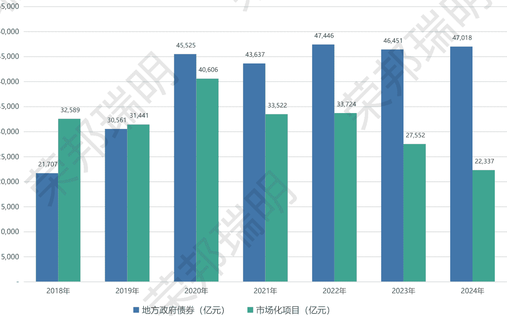

注：本报告城建投融资规模只包含当年新增地方政府债券发行额及市场化项目中标成交额，不代表实际投资额。

##### 地方政府发债成为主流，持续为稳增长提供支撑

- 2024年，全国31个省、自治区、直辖市、计划单列市及新疆生产建设兵团发行地方政府新增债券共计4.70万亿元。其中，一般债券新增0.7万亿元，专项债券新增4万亿元。
- 从发行节奏看，2024年上半年地方债发行速度偏慢，下半年尤其是8—9月有所加快。全年新增债券发行总规模与2023年持平。
- 近年来地方政府债券作为地方政府的融资主渠道，结合2024年底国办发布的《关于优化完善地方政府专项债券管理机制的意见》，专项债项目的申报及审核效率有望提高，同时“自审自发”也有利于试点省份自主灵活安排专项债资金使用，带动专项债发行节奏加快。预计2025年专项债发行节奏将较2024年明显前置。

###### 2018年-2024年地方政府债券规模统计

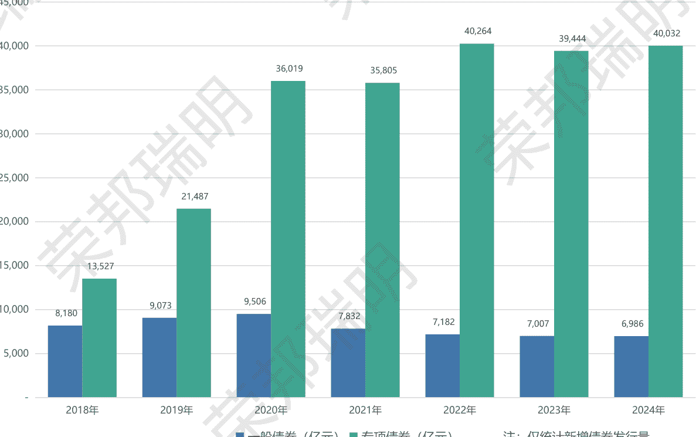

图表数据：

- 2018年：一般债券8,180亿元，专项债券13,527亿元
- 2019年：一般债券9,073亿元，专项债券21,487亿元
- 2020年：一般债券9,506亿元，专项债券36,019亿元
- 2021年：一般债券7,832亿元，专项债券35,805亿元
- 2022年：一般债券7,182亿元，专项债券40,264亿元
- 2023年：一般债券7,007亿元，专项债券39,444亿元
- 2024年：一般债券6,986亿元，专项债券40,032亿元

##### 专项债4万亿元规模基本稳定，分布行业广，经济发达地区发行量大

- 2024年，全国发行专项债新增债券4万亿元，与2023年基本持平；从规模来看主要分布在市政和产业园区基础设施、棚户区改造、铁路、医疗卫生、农林水利等领域；广东、山东、浙江、江苏等经济强省发行规模较大。

###### 2024年专项债发行规模行业统计

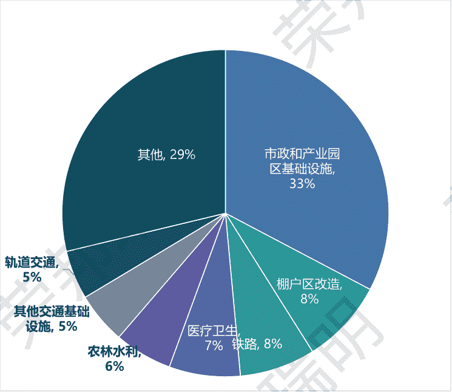

###### 2024年专项债发行地区分布

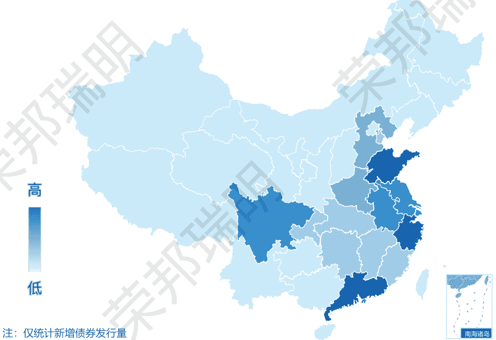

注：仅统计新增债券发行量

##### 市场化投资项目呈现数量增、规模降态势

- 从市场化投资项目成交数量看，2024年项目数量1944个，2023年项目数量1436个，成交数量上涨35%。
- 从市场化投资项目成交规模看，2024年项目总投资规模约22337亿元，2023年项目总投资规模约27552亿元，成交规模下降19%。
- 从市场化投资项目分类看：特许经营项目成交数量有所减少，投资规模增长13%；其他投资类型项目成交数量有所增长，投资规模减少32%。

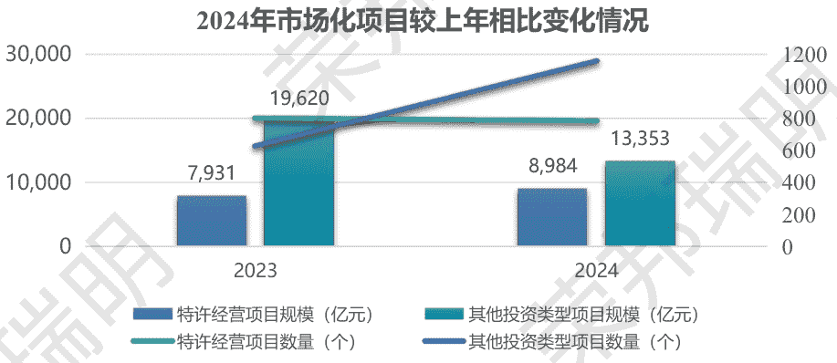

| 年份 | 成交数量：合计 | 成交数量：特许经营项目（个） | 成交数量：其他投资类型项目（个） | 投资规模：合计（亿元） | 投资规模：特许经营项目（亿元） | 投资规模：其他投资类型项目（亿元） |
|---|---:|---:|---:|---:|---:|---:|
| 2023年 | 1436 | 802 | 634 | 27551 | 7931 | 19620 |
| 2024年 | 1944 | 785 | 1159 | 22337 | 8984 | 13353 |
| 变化幅度 | 35% ▲ | -2% ▼ | 83% ▲ | -19% ▼ | 13% ▲ | -32% ▼ |

###### 市场化项目规模分布特征

- 根据项目投资规模，将2024年市场化项目划分为1亿元以下、1—10亿元、10—50亿元、50—100亿元、100亿元以上五个等级，其中10亿元以下规模的项目多达1541个，占整个市场化项目数量的79%。

###### 市场化项目投资规模按区间统计

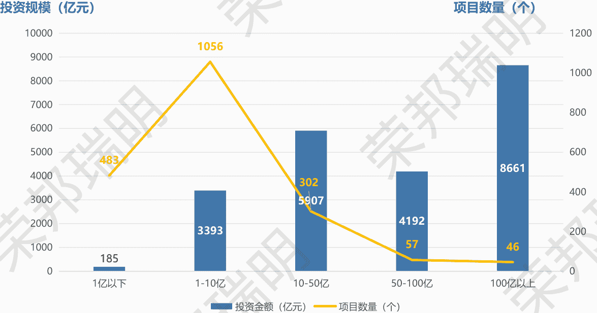

- 市场化项目投资规模结构发生变化，单体规模小型化趋势愈发明显；
- 1—10亿元投资项目中，5亿元以上183个，占17%；大项目的数量大幅下跌。

##### 市场化项目行业分布特征：交通运输中流砥柱、新能源异军突起

- 从成交项目投资规模上来看，前三行业分别为交通运输（8668亿元）、城市更新（2266亿元）、城镇综合开发（2246亿元）。交通运输项目基本上为高速公路类。
- 从成交项目数量上来看，前三行业分别为公用事业（437个）、市政工程（240个）、新能源（232个）。

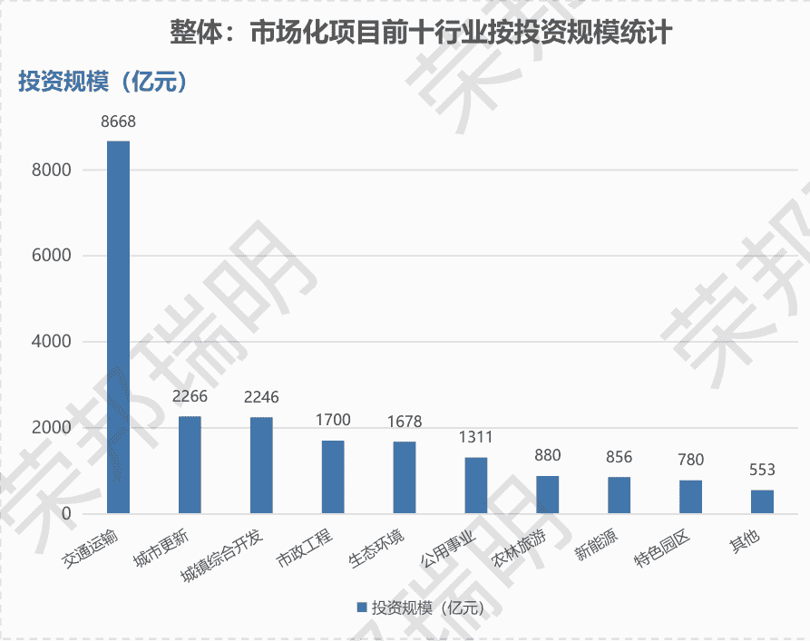

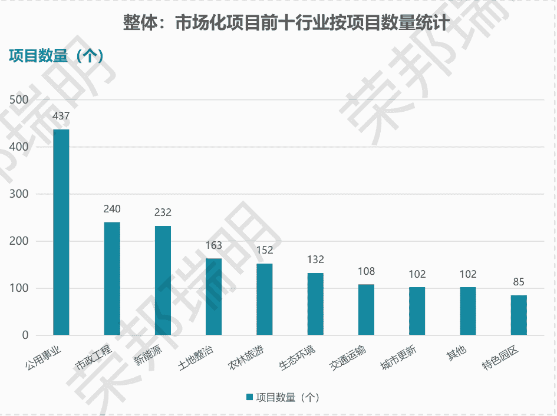

###### 特许经营项目行业分布特征：交通运输一家独大

- 从成交项目投资规模上来看，前三行业分别为交通运输（5929亿元）、公用事业（1148亿元）、市政工程（794亿元）。
- 从成交项目数量上来看，前三行业分别为公用事业（358个）、市政工程（155个）、水利（66个）。

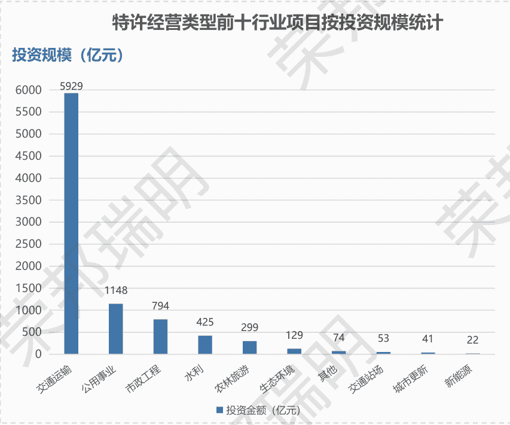

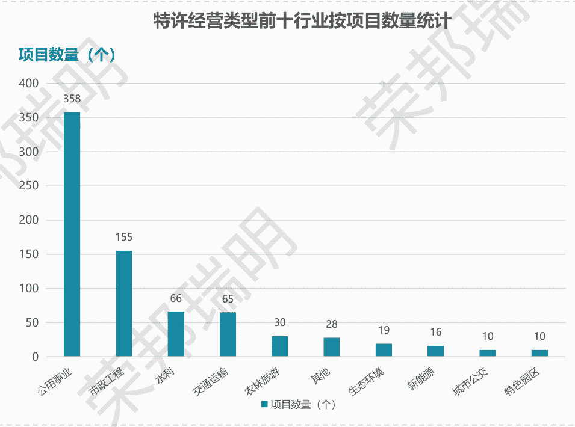

###### 特许经营项目中标企业类型特征：地方国企与央企率先超九成

地方国企成交509个项目，投资规模约6155亿元；央企成交51个项目，投资规模约2252亿元；民企成交180个项目，投资规模约406亿元；其他类型企业成交21个项目，投资规模约94亿元；外资企业成交24个项目，投资规模约77亿元。民企作为牵头方在公用事业行业中标的项目投资规模最多，投资额约274亿元。

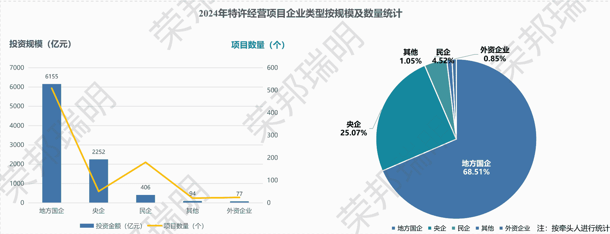

2024年特许经营项目企业类型按规模及数量统计

投资规模（亿元）｜项目数量（个）

左侧组合图数据：地方国企投资规模6155亿元、项目数量约509个；央企投资规模2252亿元、项目数量约51个；民企投资规模406亿元、项目数量约180个；其他类型企业投资规模94亿元、项目数量约21个；外资企业投资规模77亿元、项目数量约24个。

右侧饼图：地方国企68.51%；央企25.07%；民企4.52%；其他1.05%；外资企业0.85%。

注：按牵头人进行统计。

###### 其他投资类型项目行业分布特征：新能源等行业异军突起

- 从成交项目投资规模上来看，前三行业分别为交通运输（2739亿元）、城镇综合开发（2231亿元）、城市更新（2225亿元）。
- 从成交项目数量上来看，前三行业分别为新能源（216个）、土地整治（158个）、农林旅游（122个）。

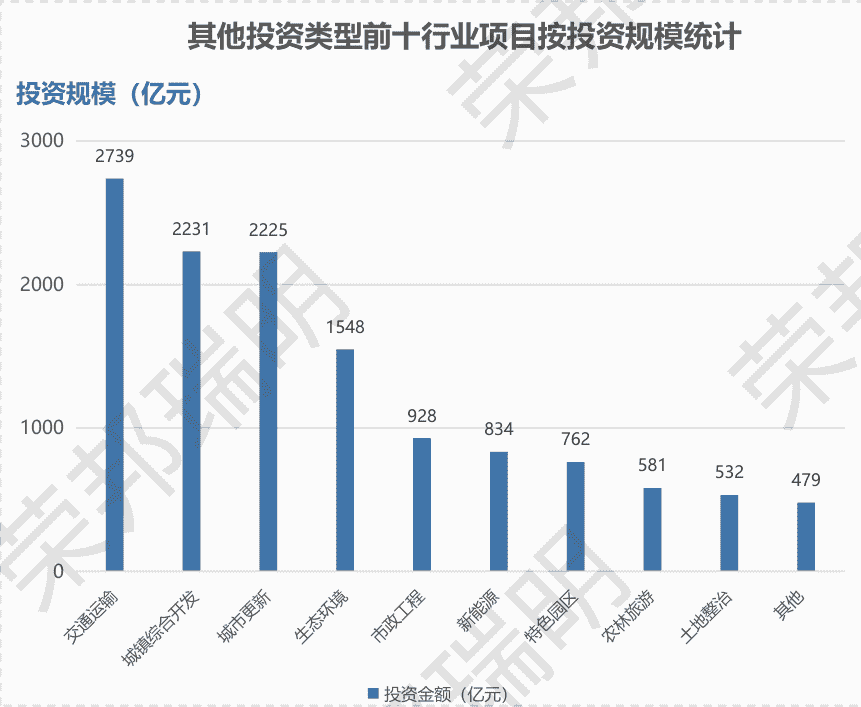

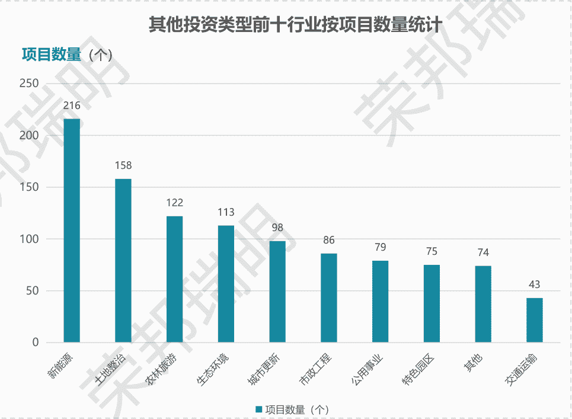

### 市场形势总结

#### 其他投资类型项目中标企业特征：地方国企与央企牵头占比超八成

- 地方国企成交496个项目，投资规模约6666亿元；央企成交207个项目，投资规模约4320亿元；民企成交392个项目，投资规模约1989亿元；外资企业成交49个项目，投资规模约338亿元；其他企业成交15个项目，投资规模约39亿元。

##### 2024年其他投资类型项目企业类型按规模及数量统计

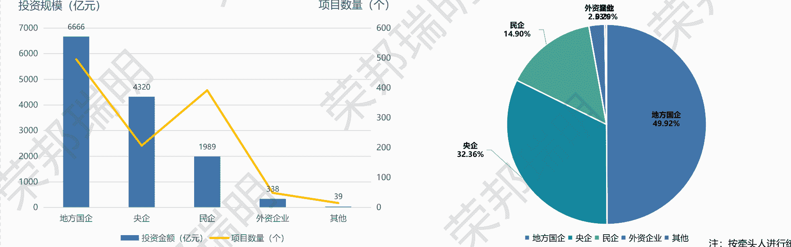

投资规模（亿元）

项目数量（个）

柱状图数据：地方国企6666；央企4320；民企1989；外资企业338；其他39。

饼图占比：地方国企49.92%；央企32.36%；民企14.90%；外资企业2.32%。

注：按牵头人进行统计

#### 2024年市场特征总结

##### 政府投资为主、市场投资为辅

- 从投资资金来源看，地方政府发债额超过社会资本参与的市场化项目成交额的两倍，政府投资为主、市场投资为辅的城建投融资市场格局保持稳定，专项债资金成为城建投融资市场压舱石。

##### 特许经营投资规模稳步增长，规模占比超四成

- 随着特许经营相关政策和文件的陆续出台，政府和社会资本合作新机制趋于完善，特许经营项目成交规模实现小幅稳步增长，项目操作也愈发规范。

##### 交通运输中流砥柱，新能源等行业异军突起

- 稳投资的总基调下，交通运输行业在市场化项目中占据较大市场规模，扮演着中流砥柱作用。
- 以抽水蓄能为代表的新能源行业和以土地整治为代表的大农林行业也表现不俗，成为市场热点。

##### 地方国企和央企牵头占据市场两极

- 延续近几年的总体状况，地方国企和央企仍是市场化项目两支最重要的牵头投资主力。
- 受相关鼓励政策的利好，地方国企和央企加大了与民企的合作力度，与民企组成联合体共同投资市场化项目。

### 推动高质量发展

01 交通运输  
02 城市更新  
03 特色园区  
04 公用事业  
05 新能源  
06 农林旅

## 热点领域

全年来看，交通领域和城市更新领域发展热度不减，公用事业领域呈现新的竞争格局，新能源、涉农项目领域仍然是符合国家重点战略的前瞻性行业，特色园区作为战新产业、未来产业、特色产业发展的落地载体不容忽视。

### 01. 交通运输

- 高速公路
- 公路桥隧
- 航道航运
- 铁路

### 02. 城市更新

- 老旧小区
- 棚改旧村
- 片区更新
- 文保旧厂

### 03. 特色园区

- 仓储物流
- 厂房办公
- 小型园区
- 智慧城市

### 04. 公用事业

- 给排水
- 固废环卫
- 燃气热力

### 05. 新能源

- 抽水蓄能
- 风力发电
- 光伏发电

### 06. 农林旅

- 围储林
- 农村建设
- 高标准农田
- 农村旅游

#### 交通运输：“现代物流公路体系”“数字化转型”“智能航运”

##### 行业观点

- 2024年，出于稳增长的需要，在车购税补贴和路衍经济的概念支撑下，以收费公路为代表的交通运输行业锚定交通强国战略目标保持高位运行，项目支撑起了四成的市场规模。
- 项目端建议持续关注国家高速公路和普通国道支出等八大重点领域。资金端建议关注超长期特别国债支持的交通物流重大基础设施等。
- 总体看，随着“6轴7廊8通道”国家综合立体交通网加快推进，主骨架基本成形，且交通机场设施行业盈利性偏弱，对地方政府政策与资金的扶持力度有一定依赖，传统大型建筑企业对收费公路投资的控制趋紧，预计未来几年，以社会资本为主的交通运输项目投资将有所放缓，但考虑到交通运输的重要性和新行业培育尚需时间，总体仍将保持较高占比。

##### 重要政策

- 《关于支持引导公路水路交通基础设施数字化转型升级的通知》
- 《交通运输领域重点项目资金管理办法》
- 《中共中央办公厅 国务院办公厅关于加快建设统一开放的交通运输市场的意见》
- 《交通运输部等十三部门关于印发<交通运输大规模设备更新行动方案>的通知》（交规划发〔2024〕62号）

##### 交通运输·特许经营模式为主，总体规模同比下降19%

- 2024年交通运输项目的成交规模约8668亿元，成交数量共计108个。其中：其他类型投资项目成交43个，投资额约2739亿元；特许经营项目成交65个，投资额约5929亿元。
- 2024年成交的交通运输项目中：地方国企成交71个项目，投资额约6421亿元；央企成交28个项目，投资额约2038亿元；民企成交9个项目，投资额约210亿元。
- 考虑到专项债资金重点支持铁路等领域，预计交通运输领域2025年将仍有市场机会。

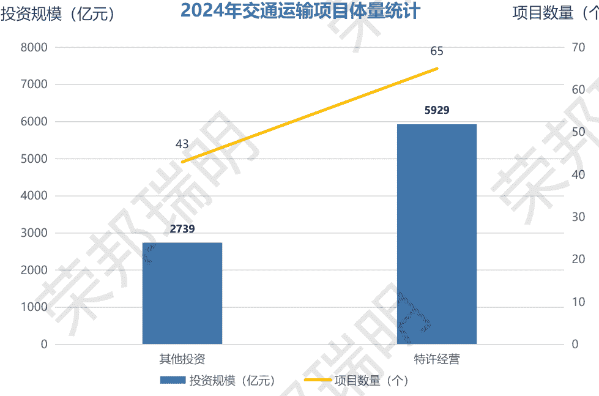

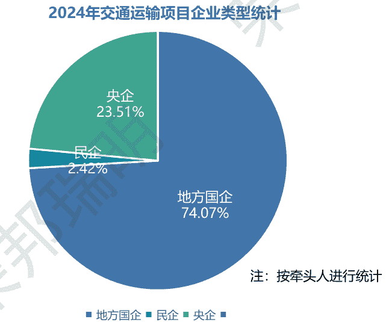

##### 交通运输·项目区域分布情况

2024年交通运输项目投资规模前三名为安徽省、甘肃省、山西省；成交数量前三名为广西壮族自治区、山西省、安徽省。

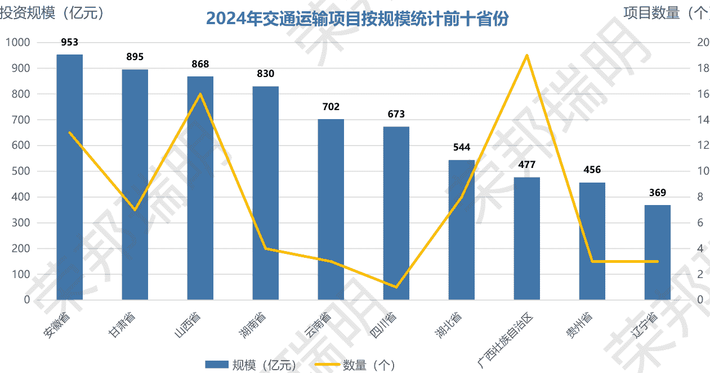

###### 2024年交通运输项目按规模统计前十省份

| 省份 | 投资规模（亿元） | 项目数量（个） |
|---|---:|---:|
| 安徽省 | 953 | 13 |
| 甘肃省 | 895 | 7 |
| 山西省 | 868 | 16 |
| 湖南省 | 830 | 4 |
| 云南省 | 702 | 3 |
| 四川省 | 673 | 1 |
| 湖北省 | 544 | 8 |
| 广西壮族自治区 | 477 | 19 |
| 贵州省 | 456 | 3 |
| 辽宁省 | 369 | 3 |

###### 典型案例——北流至化州宝圩高速公路（广西段）项目

| 类型 | 项目概况 |
|---|---|
| 项目名称 | 北流至化州宝圩高速公路（广西段）项目 |
| 投资规模 | 约109.1亿元 |
| 项目所在省市 | 广西省 |
| 行业类别 | 特许经营项目 |
| 项目采购单位 | 玉林市交通运输局 |
| 中标企业 | 中标人为广西路桥工程集团有限公司（牵头人）、广西交建工程建设集团有限公司、广西长兴工程建设有限公司（联合体） |
| 特许经营期 | 30年 |
| 成交时间 | 2024年10月 |

###### 案例分享理由

1. 本项目依据115号文，政府在建设期给予不超过2亿元的建设期投资补助。
2. 本项目收入来源包括车辆通行费收入和其他业务收入两部分构成。如中标的投资人对比高高速特许经营项目路域范围内光伏发电、充电桩等新能源项目感兴趣，政府方将在权限范围内优先审批。

###### 典型案例——北流至化州宝圩高速公路（广西段）项目

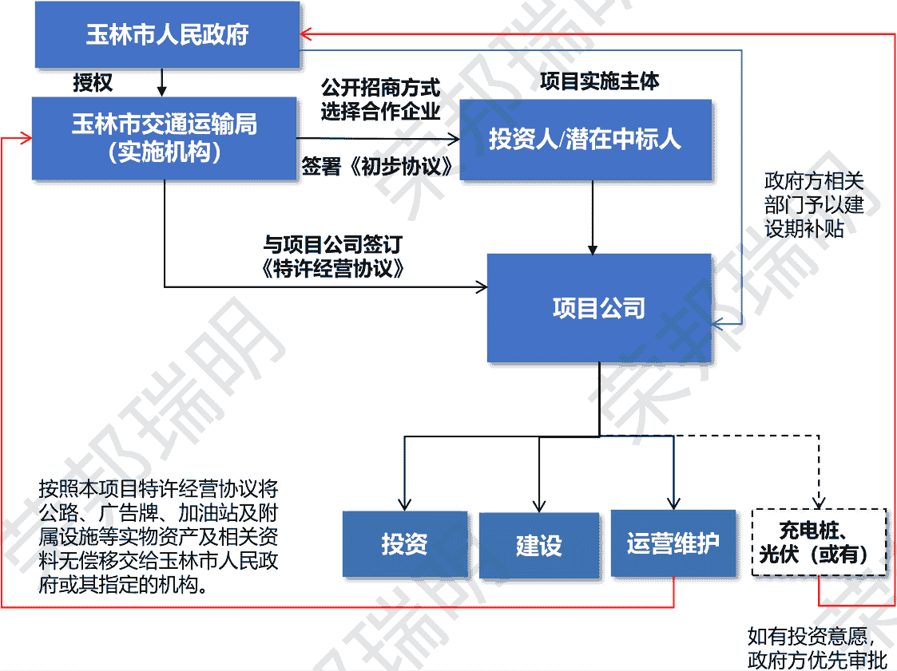

按照本项目特许经营协议，将公路、广告牌、加油站及附属设施等实物资产及相关资料无偿移交给玉林市人民政府或其指定的机构。

- 项目实施方式为BOT（建设—运营—移交），通过公开招标方式选择投资人。
- 中标人全额出资组成的项目公司负责投资、建设、运营本项目特许权，包括投资建设权、运营区收费权、公路附属设施经营权等。
- 中标投资人与玉林市交通运输局签订《北流至化州宝圩高速公路（广西段）项目初步协议》。
- 项目公司对项目的筹划、资金筹措、建设实施、运营管理、债务偿还和资产管理等全过程负责，自主经营、自负盈亏，项目公司履行项目法人职责。
- 玉林市交通运输局代表玉林市人民政府与项目公司签订《北流至化州宝圩高速公路（广西段）项目特许经营协议》。
- 特许经营期满后，按照本项目特许经营协议，将公路、广告牌、加油站及附属设施等实物资产及相关资料无偿移交给玉林市人民政府或其指定的机构。

##### 公用事业：“使用者付费”“降本增效”“民营企业参与”

##### 行业观点

- 政策端，国家发展改革委发布《关于进一步做好政府和社会资本合作新机制项目规范实施工作的通知》，明确了使用者付费项目的收费渠道和方式，从而在一定程度上保障了项目的盈利能力和回款能力，不仅提升了社会资本参与的积极性，还充分激发了市场化竞争的活力，也为民营企业进入公用事业领域提供了有利条件。
- 政府端，以北京市为例，在多个公用事业领域通过成本绩效管理改革，指导公交、地铁、热力、自来水等企业制定三年降本增效目标与方案，包括改革运营调度模式、优化维修规程、采用智能化监控技术等措施，取得了显著成效。

##### 重要政策

- 国家发展改革委办公厅《政府和社会资本合作项目特许经营协议（编制）范本（2024年试行版）》
- 《基础设施和公用事业特许经营管理办法》（经国家发展改革委第8次委务会通过）
- 国家发展改革委办公厅关于《政府和社会资本合作项目特许经营方案编写大纲（2024年试行版）》发改办投资〔2024〕227号
- 国家发展改革委办公厅发布《关于进一步做好政府和社会资本合作新机制项目规范实施工作的通知》

#### 公用事业：特许经营模式为主，总体规模大幅缩减

- 2024年公用事业项目的成交规模约1311亿元，成交数量共计437个。其中：特许经营项目成交358个，投资额约1148亿元；其他投资类型项目成交79个，投资额约163亿元。
- 2024年成交的公用事业项目中：地方国企成交220个项目，投资额约758亿元；央企成交28个项目，投资额约119亿元；民企成交153个项目，投资额约315亿元；外资企业成交27个项目，投资额约81亿元。
- 公用事业领域形成了以地方国企为主导、民企为辅，央企和外资企业适度参与的格局。

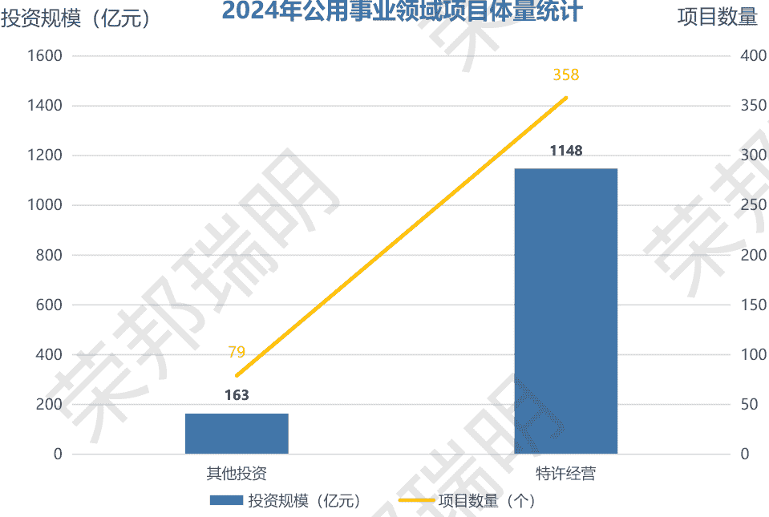

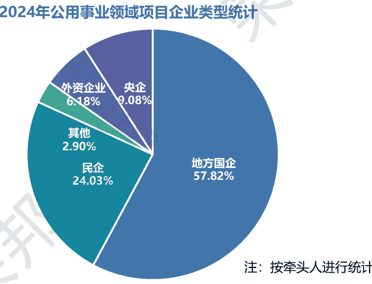

##### 公用事业·项目区域分布情况

- 2024年公用事业项目投资规模前三名为山东省、贵州省、河南省；成交数量前三名为贵州省、山东省、湖南省。

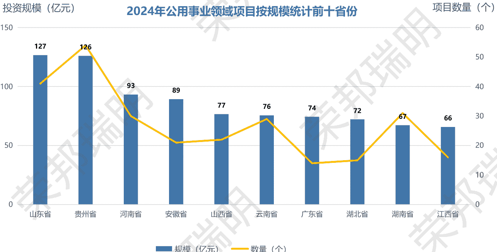

| 省份 | 投资规模（亿元） | 项目数量（个） |
|---|---:|---:|
| 山东省 | 127 | 41 |
| 贵州省 | 126 | 54 |
| 河南省 | 93 | 30 |
| 安徽省 | 89 | 21 |
| 山西省 | 77 | 22 |
| 云南省 | 76 | 29 |
| 广东省 | 74 | 14 |
| 湖北省 | 72 | 15 |
| 湖南省 | 67 | 31 |
| 江西省 | 66 | 16 |

###### 典型案例——通州区有机垃圾资源化综合处理中心项目

| 类型 | 项目概况 |
|---|---|
| 项目名称 | 通州区有机垃圾资源化综合处理中心项目 |
| 投资规模 | 约16.54亿元 |
| 项目所在省市 | 北京市通州区 |
| 行业类别 | 特许经营项目 |
| 项目采购单位 | 北京市通州区城市管理委员会 |
| 中标企业 | 深圳市朗坤环境集团股份有限公司 |
| 特许经营期 | 40年 |
| 成交时间 | 2024年5月 |

###### 案例分享理由

1. 本项目是国家发改委2023年政企合作新机制出台后，北京市首个采用特许经营模式成功落地的项目。

2. 本项目属于环保领域，具有市场化程度较高、公共属性较弱的典型特征，原由北京市通州区地方国企——北京通州城市建设运行集团有限公司开展占用林地等投资项目前期手续。在新机制配套政策陆续出台后，最终由民企独资建设和运营。

###### 典型案例——通州区有机垃圾资源化综合处理中心项目

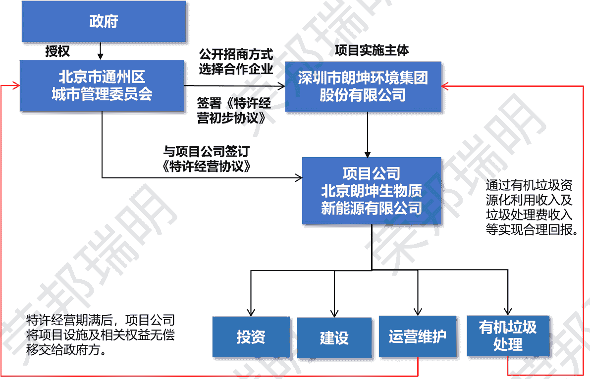

- 项目采用建设—拥有—运营—移交（BOOT）的实施方式，通过公开招标方式择优选择特许经营者。
- 中标特许经营者独资成立项目公司，负责本项目红线范围内的投资、建设及运营。
- 区城管委与项目公司签署《特许经营协议》。
- 项目公司负责本项目的投融资、建设和特许经营期内的运营维护。
- 项目公司负责特许经营期内全部设施的运营维护，并提供有机垃圾处理服务。
- 本项目进入运营期3年后，经甲方书面同意，可依照适用法律利用项目和项目收益发行债券、资产证券化产品、基础设施领域不动产投资信托基金（REITs）等方式进行再融资，再融资应优先保障本项目的建设和运营。

#### 城市更新：“一二级分离”“因地制宜创新”“土地要素保障”

##### 行业观点

- 从市场形势来看，城市更新领域逐渐由原本合规情况下的“一二级联动开发”模式转向更加市场化的“一二级分离”合作模式。这种模式下，一级土地开发和二级开发建设分离，理清了合作边界，有助于减少城投公司和社会资本方的资金压力，但也在一定程度上将影响注重一二级联动的企业的投资决策，放缓投资节奏。
- 结合国常会提出的完善投融资体制机制，我司认为，未来在打通多元化融资渠道、土地要素等保障政策出台的情况下，该领域投资潜力将进一步释放。
- 建议关注中央财政补助资金、专项债券等财政资金支持力度大的城中村改造、老旧小区等细分领域；关注盘活存量低效用地等具体保障政策落地。企业端应注重项目规划设计和运营能力，打造高品质、高效益的城市更新项目，推动行业精细化、专业化发展。

##### 重要政策

- 自然资源部办公厅《关于进一步加强规划土地政策支持老旧小区改造更新工作的通知》（自然资办发〔2024〕25号）
- 北京市住房和城乡建设委员会《北京市城市更新实施方案编制工作指南（试行）》（京建发〔2024〕182号）
- 天津市规划资源局《天津“津城”城市更新规划指引（2023—2027年）》
- 江苏省政府办公厅《关于支持城市更新行动若干政策措施的通知》（苏政办规〔2024〕3号）

##### 城市更新领域竞争格局三足鼎立，单体项目规模相对适中

- 2024年城市更新项目的成交规模约2266亿元，成交数量共计103个。其中：其他投资类型项目成交99个，投资额约2225亿元；特许经营项目成交4个，投资额约41亿元。
- 2024年成交的城市更新项目中：地方国企成交44个项目，投资额约694亿元；央企成交20个项目，投资额约790亿元；民企成交33个项目，投资额约680亿元；外资成交6个项目，投资额约102亿元。

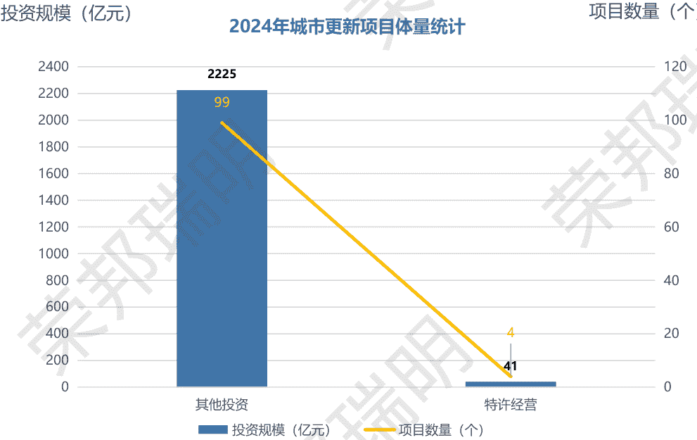

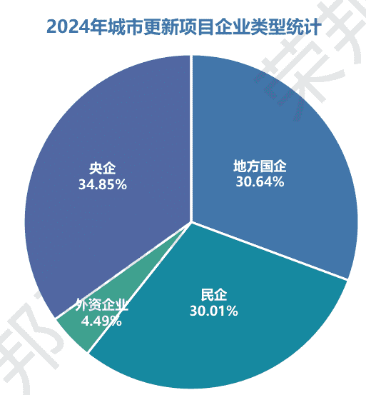

##### 城市更新·项目区域分布情况

- 2024年城市更新项目投资规模前三名为广东省、河南省、山东省；成交数量前三名为广东省、山东省、湖北省。

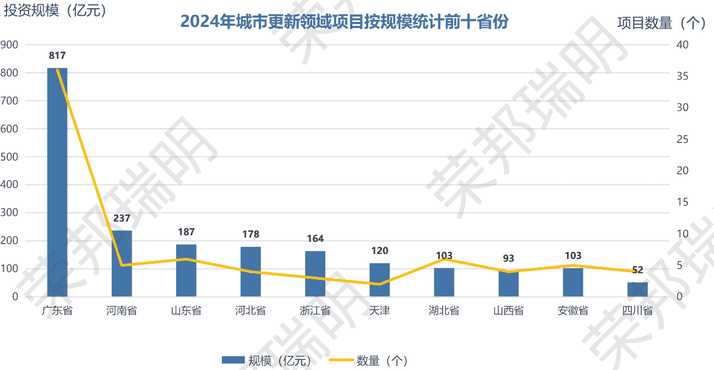

| 省份 | 投资规模（亿元） | 项目数量（个） |
|---|---:|---:|
| 广东省 | 817 | 36 |
| 河南省 | 237 | 5 |
| 山东省 | 187 | 6 |
| 河北省 | 178 | 4 |
| 浙江省 | 164 | 3 |
| 天津 | 120 | 2 |
| 湖北省 | 103 | 6 |
| 安徽省 | 103 | 5 |
| 山西省 | 93 | 4 |
| 四川省 | 52 | 4 |

##### 典型案例——广州市白云区鸦龙街黄边村更新改造项目

| 类型 | 项目概况 |
|---|---|
| 项目名称 | 白云区鸦龙街黄边村更新改造项目 |
| 投资规模 | 约110.43亿元 |
| 项目所在省市 | 广州市白云区 |
| 行业类别 | 城市更新—旧村改造 |
| 中标企业 | 中国建筑第三工程局有限公司；广州市白云投资开发有限公司 |
| 合作模式 | 全面改造方式；以“合作改造”模式实施改造 |
| 成交时间 | 2024年1月 |

###### 案例分享理由

1. 本项目是首个工程局作为社会资本方主导的更新改造项目。

2. 国家正在大力推动城中村改造，超大特大城市的城中村改造是其中重要一项。中建三局作为项目的社会资本方，集投资、建设、运营为一体，区别于传统坐地与开发相互分离的方式，增加了项目融资可行性，为未来的更新改造项目提供新的思路。

3. 黄边村更新改造项目坚持高起点谋划、高标准设计，全面落实数字化、智慧化、绿色化转型，落实新城建标准清单，打造绿色低碳、智慧安全、产城融合的中国式现代化示范社区，能够为同类项目提供借鉴。

###### 典型案例——广州市白云区鹤龙街黄边村更新改造项目

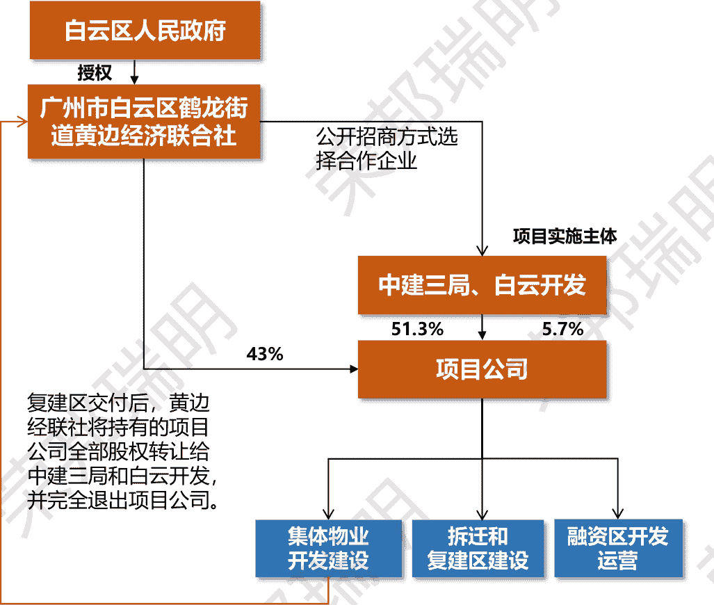

白云区人民政府

授权

广州市白云区鹤龙街道黄边经济联合社

公开招商方式选择合作企业

项目实施主体

中建三局、白云开发

项目公司

51.3%

5.7%

43%

复建区交付后，黄边经联社将持有的项目公司全部股权转让给中建三局和白云开发，并完全退出项目公司。

- 集体物业开发建设
- 拆迁和复建区建设
- 融资区开发运营

- **政府：**广州市白云区人民政府
- **村集体经济组织：**广州市白云区鹤龙街道黄边经济联合社
- **合作企业：**
  - 中国建筑第三工程局有限公司（主）
  - 广州市白云投资开发有限公司（成）
- 本项目招商完成后，中建三局、白云开发、黄边经联社按照51.3%：5.7%：43%成立项目公司。
- 本项目公司负责项目拆迁、复建区建设等工作。
- 中建三局和白云开发将按照9:1股权比例继续合作开发融资区地块。

#### 特色园区：“差异化发展”“产业特色”

##### 行业观点

- 在全国建设统一大市场和市场公平竞争背景下，给予税收优惠政策等传统招商方式受限，未来对营商环境和产业生态的要求更高。
- 在经历增量发展时代后，传统产业园区存在明显的过剩现象，对园区自身的核心竞争力要求更高，对产业服务和园区运营的需求更为显著，依赖于特色产业集群的发展，也对社会资本提出了更高要求，促使其更加审慎、理性地参与园区建设与运营。
- 国家提倡发展新质生产力，这关系国民经济社会发展和产业结构优化升级全局。新质生产力具有创新活跃、技术密集、发展前景广阔等特征，投资企业需链接产业头部企业，以特色产业集群或特色园区为载体，通过“挖赛道、扩赛道、跨赛道”等方式进行布局。
- 特色园区的发展一方面应依托地方资源的比较优势，选择具有特色产业基础和资源禀赋的地区进行投资；另一方面需要打造园区的特色化与差异化，强化资源对接、专业化咨询等增值服务。

##### 重要政策

- 《公平竞争审查条例》和《全国统一大市场建设指引》要求，地方政府制定招商引资优惠政策时需要有上位法依据，不得突破国家规定违规实施招商引资优惠政策。
- 国务院发布《关于规范招商引资行为促进招商引资高质量发展的若干措施》和《关于清理规范税收等优惠政策的通知》，全面规范税收等优惠政策。
- 《上海市特色产业园区高质量发展行动方案（2024—2026年）》通过加强组织推进、制定建设导则、强化示范引领等措施，推动特色产业园区的发展。
- 湖南省出台了《湖南省产业园区市场化建设运营改革试点工作方案》，鼓励试点园区探索厘清政府与市场边界的有效路径，着力构建精简高效的管理运行体制机制。

##### 特色园区：主要为其他投资类型，地方国企成交项目规模过半

- 2024年成交的特色园区项目中：其他投资类型项目成交75个，投资额约762亿元；特许经营项目成交10个，投资额约18亿元。
- 2024年成交的特色园区项目中：地方国企成交28个项目，投资额约375亿元；央企成交16个项目，投资额约236亿元；民企成交38个项目，投资额约153亿元。

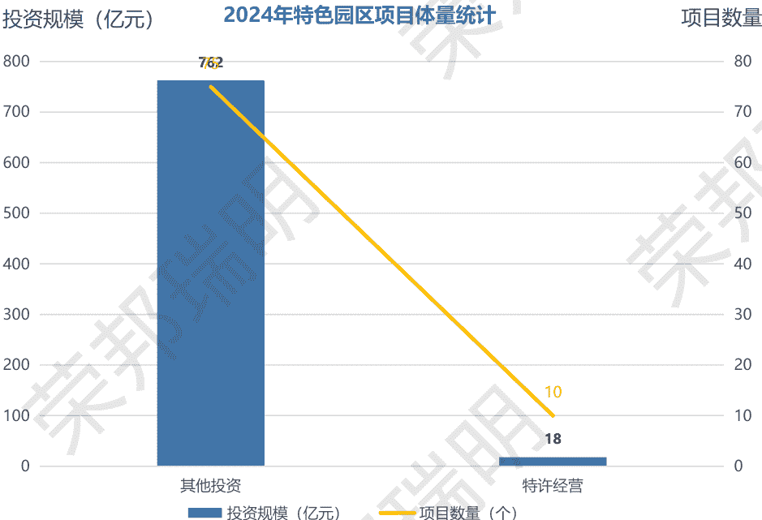

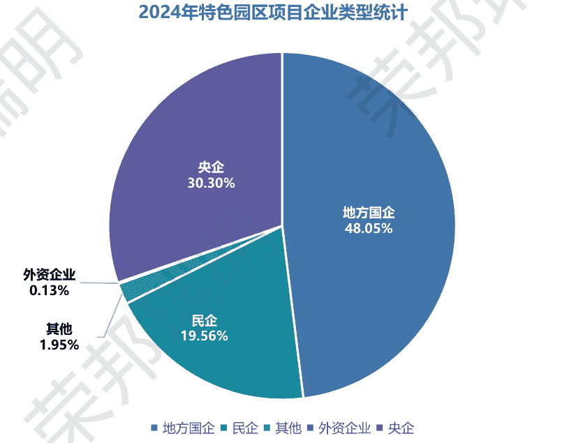

##### 特色园区·项目区域分布情况

- 2024年特色园区项目投资规模前三名为广西壮族自治区、浙江省、四川省；成交数量前三名为云南省、山东省、湖南省。

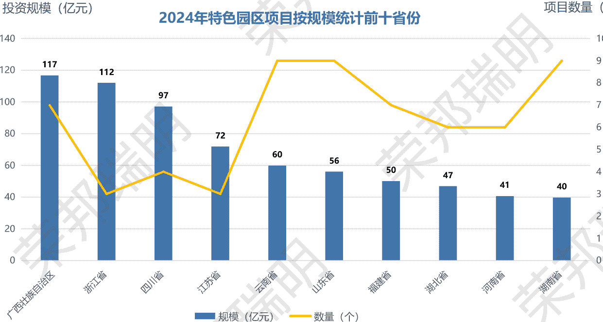

| 省份 | 投资规模（亿元） | 项目数量（个） |
|---|---:|---:|
| 广西壮族自治区 | 117 | 7 |
| 浙江省 | 112 | 3 |
| 四川省 | 97 | 4 |
| 江苏省 | 72 | 3 |
| 云南省 | 60 | 9 |
| 山东省 | 56 | 9 |
| 福建省 | 50 | 7 |
| 湖北省 | 47 | 6 |
| 河南省 | 41 | 6 |
| 湖南省 | 40 | 9 |

###### 典型案例——温州市鹿城工业园区有机更新（一期）合作开发项目

| 类型 | 项目概况 |
|---|---|
| 项目名称 | 温州市鹿城工业园区有机更新（一期）合作开发项目（鹿城西部生态新城科技产城融合项目） |
| 投资规模 | 总投资约114.33亿元 |
| 项目所在省市 | 浙江省温州市鹿城区 |
| 行业类别 | 城市更新 |
| 项目采购单位 | 温州市鹿城区国有控股集团有限公司 |
| 中标企业 | 中国建筑第八工程局有限公司（牵头人） 中国金谷国际信托有限责任公司（信达资管） 浙江科技发展投资有限公司（省国资） |
| 特许经营期 | 15年（含建设期6年） |
| 成交时间 | 2024年7月 |

###### 案例分享理由

1. 项目将经营性项目、公益性项目打包，通过市场化招标，由中央和地方国企合作开发，地方国企通过提供工程项目获取投资资金、招商运营支持。

2. 对于较大空间范围、多种投资内容的综合性城市更新项目，地方国企和社会资本一次招标达成合作，具体实施通过“降维”将复杂项目拆解成若干子项目包，采取不同的合作模式。

###### 典型案例——温州市鹿城工业园区有机更新（一期）合作开发项目

- 西部新城总规划面积45.8 km²，围绕“产城融合创新高地、城市西部门户地标、市民公共服务中心、舒适宜居公园城市”四个目标，打造“产、城、人”融合发展的样板区，建设温州西部集聚青创人才的目的地和激发创新活力的孵化器。
- 双屿街道为西部新城的主体和核心区，规划面积13 km²，打造“产城人”服务的核心；原鹿城工业区片（有机更新项目）为启动区，规划面积4.31 km²，打造西部新城的城市标杆。
- 项目一期位于双屿街道鹿城工业区，涉及区块西起桥下东路，南至鞋都大道和鹿城路，东至黄龙路，北至瓯江路西延段。总用地面积约60.5万㎡（合约907亩），总建筑面积约90.66万㎡，其中地上建面57.62万㎡、地下建面34.05万㎡。

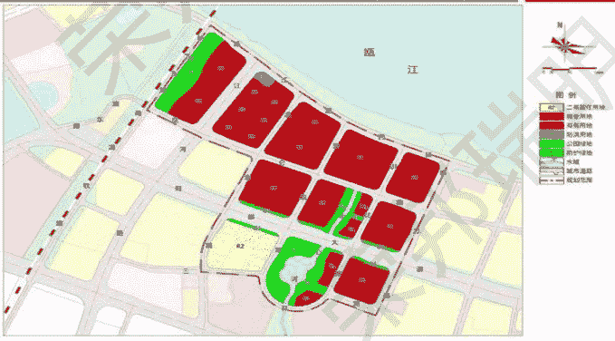

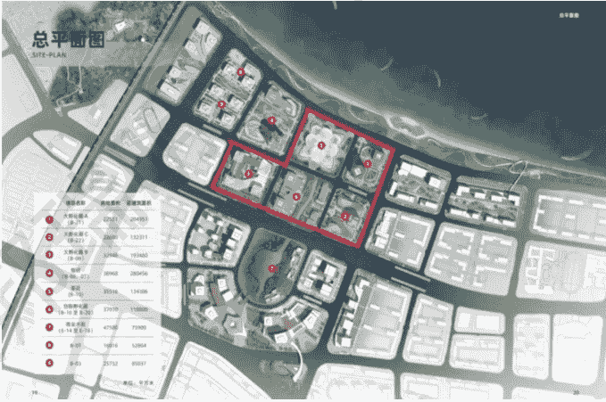

###### 典型案例——温州市鹿城区有机更新（一期）合作开发项目

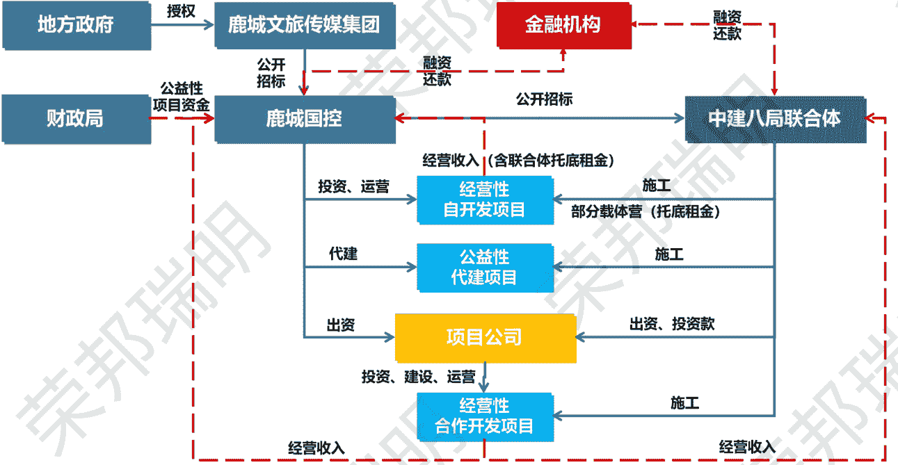

- **中标人：**中国建筑第八工程局有限公司、中国金谷国际信托有限责任公司、浙江科投发展投资有限公司
- **合作条件：**
  1. 建筑工程、市政绿化工程下浮率13%，年财务成本系数3.51%；
  2. 联合体筹集一定金额投资款给项目公司，并提供给各项目使用；
  3. 联合体负责一定规模的空间载体运营，向鹿城国控支付托底租金；
  4. 联合体负责项目施工总承包，各实施主体支付工程款。

#### 新能源：“抽水蓄能”“光伏发电”

##### 行业观点

- 新能源领域特点显著，光伏发电等领域项目规模较小、数量较多，中小企业和创新型企业有较大的发展空间；而抽水蓄能领域规模较大、项目数量少，市场机会主要集中在少数大型企业及设备制造商中。
- 随着新能源政策的不断优化和市场机制的逐步完善，传统基建企业应加大项目管理和研发投入，积极寻求转型，通过与新能源企业合作、引进先进技术等方式，逐步克服技术障碍，适应新能源项目特殊要求，从而在新能源项目中挖掘潜在的市场机会。

##### 重要政策

- 国家能源局印发《2024年能源工作指导意见》，明确2024年能源工作主要目标为供应保障能力持续增强、能源结构持续优化、能源系统运行效率持续提升、能源科技创新能力持续增强、能源体制机制持续完善。意见提出要稳步推进水电核电开发建设，持续完善绿色低碳转型政策体系，深化能源利用方式变革，促进能源新技术应用示范，持续推进能源治理体系和能力现代化等。

##### 新能源·其他投资类型模式为主

- 2024年新能源项目的成交规模约856亿元，成交数量共计232个。
- 新能源细分行业中，抽水蓄能具有数量少、单体规模大的特点，其总体规模约占新能源总规模的一半。
- 2024年成交的新能源项目中：央企成交75个项目，投资额约381亿元；地方国企成交60个项目，投资额约312亿元；民企成交66个项目，投资额约122亿元；外资成交16个项目，投资额约17亿元。

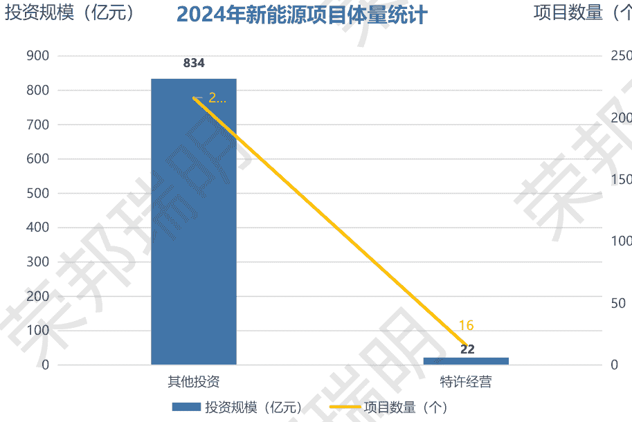

##### 2024年新能源项目体量统计

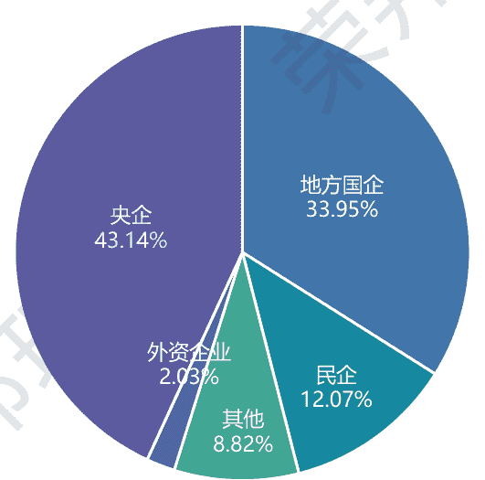

##### 2024年新能源项目企业类型统计

##### 新能源·项目区域分布情况

- 2024年新能源项目投资规模前三名为安徽省、陕西省、云南省；成交数量前三名为云南省、安徽省、内蒙古。

###### 2024年新能源项目按规模统计前十省份

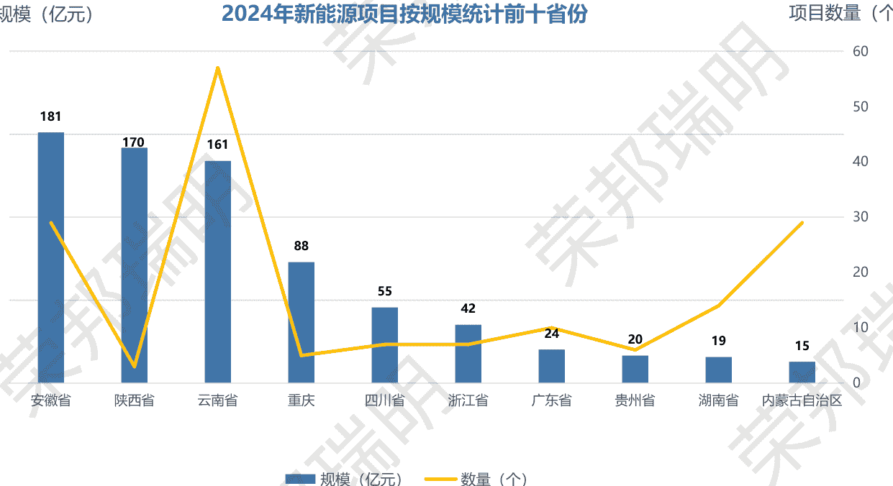

| 省份 | 投资规模（亿元） | 项目数量（个） |
|---|---:|---:|
| 安徽省 | 181 | 29 |
| 陕西省 | 170 | 3 |
| 云南省 | 161 | 57 |
| 重庆市 | 88 | 5 |
| 四川省 | 55 | 7 |
| 浙江省 | 42 | 7 |
| 广东省 | 24 | 10 |
| 贵州省 | 20 | 6 |
| 湖南省 | 19 | 14 |
| 内蒙古自治区 | 15 | 29 |

#### 农林旅游：“土地整治”“国家储备林”“三产融合”

##### 行业观点

- 涉农开发类项目符合国家战略发展大方向，国储林和提升农业生产的长期规划还在实施中。国家储备林建设项目享受中央基本建设投资、中央财政造林补贴、中幼林抚育享受中央财政森林抚育补贴政策。中西部地区在生态建设和基础产业升级方面有明显优势，而沿海地区则在高端木材加工和林产品深加工方面更具潜力。社会资本方可通过“林地入股”“林木变现”“保底分成”“托管分红”等多元合作方式参与该领域。
- 土地整治行业有望与旅游业、生态农业、文化创意产业等多领域实现深度融合，挖掘城镇低效用地再开发等投资方向，助推农村一二三产业融合发展和城乡融合发展，进而催生新的经济增长极。

##### 重要政策

- 根据《“十四五”国家储备林建设实施方案》，2025年将继续推进国家储备林建设任务，包括集约人工林栽培、现有林改培和中幼林抚育等。具体目标是增加森林蓄积7000万立方米以上。
- 自然资源部发布《全域土地综合整治实施指南》，要点投资主体可通过行使农村土地经营权、整合优势资源、统筹项目建设与管护、实施项目运营等措施，统筹考虑投资成本、出资能力、运营能力、项目自身市场化收益以及贷款本息偿还等问题，确保做到资金平衡。
- 《农业农村部关于加快农业发展全面绿色转型促进乡村生态振兴的指导意见》鼓励将符合条件的农业绿色发展、农村人居环境整治等项目纳入农业农村基础设施融资项目库。

## 农林旅游·其他投资类型模式为主，且单体规模大幅增长我是由月之暗面（Moonshot AI）研发的 kimi-k2.7-code 智能大模型。- 2024年农林旅游及土地整治项目的成交规模约545亿元，成交数量共计163个。其中：其他投资类型项目成交159个，投资额约532亿元；特许经营项目成交4个，投资额约13亿元。
- 2024年成交的农林旅游及土地整治项目中：央企成交24个项目，投资额约365亿元；地方国企成交163个项目，投资额约556亿元；民企成交118个项目，投资额约353亿元；外资成交7个项目，投资额约121亿元。

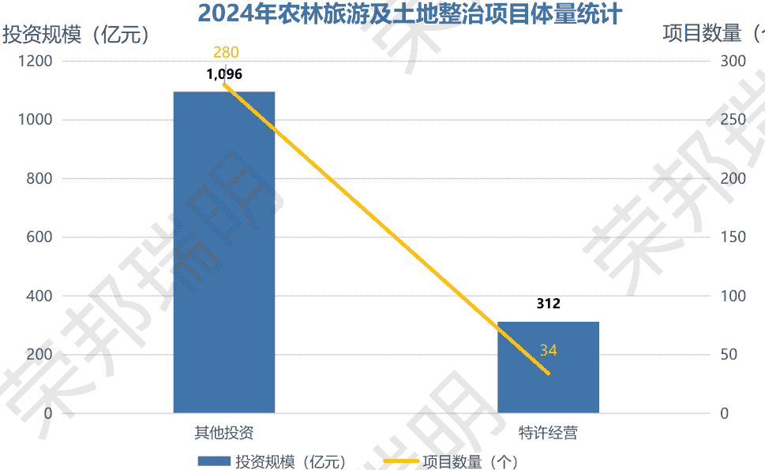

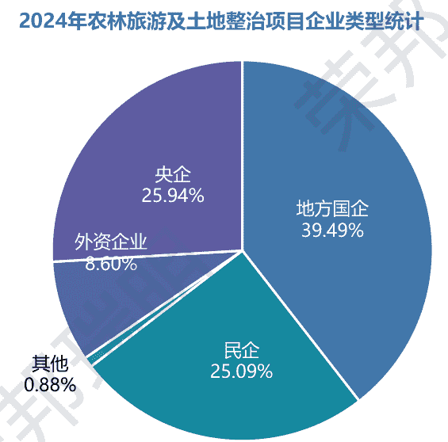

##### 农林旅游·项目区域分布情况

- 2024年城镇综合开发项目投资规模前三名为安徽省、四川省、广东省；成交数量前三名为河南省、海南省、云南省。

###### 2024年土地整治项目按规模统计前十省份

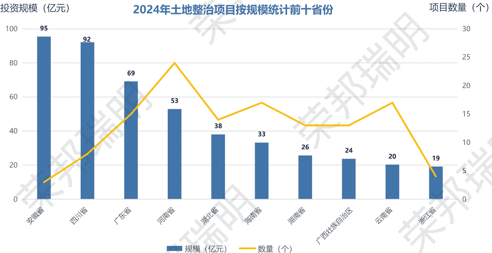

| 省份 | 投资规模（亿元） | 项目数量（个） |
|---|---:|---:|
| 安徽省 | 95 | 3 |
| 四川省 | 92 | 8 |
| 广东省 | 69 | 15 |
| 河南省 | 53 | 24 |
| 湖北省 | 38 | 14 |
| 海南省 | 33 | 17 |
| 湖南省 | 26 | 13 |
| 广西壮族自治区 | 24 | 13 |
| 云南省 | 20 | 17 |
| 浙江省 | 19 | 4 |

## 发底蓄势赋能

### 总体维持政府发债为主、市场化投资为辅的市场格局

政府端关注专项债和超长期特别国债的支持领域；市场端关注有收费权的公用事业领域，有二级开发和运营的城市更新、存量盘活，有经营收入的其他领域。

#### 关注政府投资

#### 关注市场投资

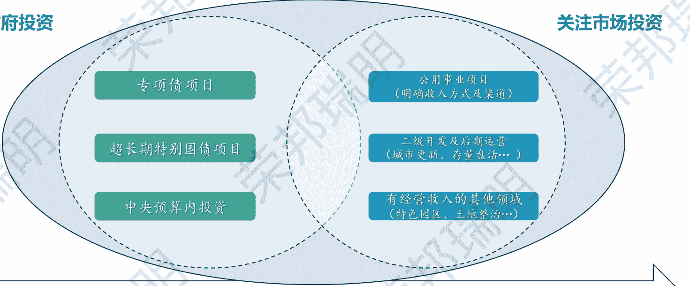

- 专项债项目
- 超长期特别国债项目
- 中央预算内投资

- 公用事业项目（明确收入方式及渠道）
- 二级开发及后期运营（城市更新、存量盘活……）
- 有经营收入的其他领域（特色园区、土地整治……）

通过专项债等撬动政府投资，带动市场化投资，形成多元投资格局，维持城建领域持续发展。

### 投融资机制调整——“两规范、两鼓励”

2024年，投融资机制发生了变化，尤其是12月底专项债管理机制、特许经营规范文件和2025年1号文政府投资基金指导意见的出台，总体归纳为“两规范、两鼓励”。

#### 两“规范”

##### 一、特许经营实施规范

围绕政企合作新机制，2024年陆续出台了特许经营管理办法、特许经营方案编写大纲、协议范本等配套政策和文件，特别是12月底发改委《关于进一步做好政府和社会资本合作新机制项目规范实施工作的通知》的发布，再次强调规范实施政府和社会资本合作新机制的相关要求，特许经营的适用范围有所收紧。

##### 二、政府投资基金管理规范

2025年国办1号文《关于促进政府投资基金高质量发展的指导意见》于1月初发布，这是首次国家层面出台促进政府投资基金发展的重要文件，旨在构建更加科学高效的管理体系，对基金精细化管理、运营效率提升提出了更高要求。

#### 两“鼓励”

##### 一、鼓励专项债和超长期特别国债

2024年四季度以来，中央及国家部委陆续释放政府专项债和超长期特别国债调额度、扩范围等积极信号，并于12月正式出台了完善专项债管理机制的意见，旨在更好发挥专项债强基础、补短板、惠民生、扩投资的积极作用。同时，明确2025年将增加超长期特别国债的规模和适用范围。

##### 二、鼓励扩大内需的有效投资

2024年底中央经济工作会议以来，城市更新与扩大内需被频繁联系在一起，并鼓励大力实施城市更新；在超长期特别国债等扩围中，也明确对“两重”、“两新”的支持是扩大内需的重要抓手，强调创新多元化消费场景和对旅游等服务消费支持。

## 投资建议

我司认为，未来城市建设主要聚焦在“更新盘活”和“功能升级”，并有望在新能源、农林旅等行业出现结构性“新”机会，关注城市更新和城市运维机会的社会资本应坚持内容为王的理念，整合运营资源，提高运营能力。

关注增量市场，聚焦新市场、新产业。

存量盘活要以内容为王，提高运营能力。

通过资源整合，实现降本增效。

- **“新”市场空间**：美丽中国生态建设、新能源、土地整治及农林旅
- **新兴产业投资**：跨产业投资，链接龙头企业
- **城市更新内容为王**：整合运营资源
- **城市大运维**：提高运营能力
- **传统公用事业**：提质治污、低碳绿色、资源整合、降本增效

### 关注增量市场，聚焦新市场、新产业

在国家提倡发展新质生产力的背景下，央企大力布局新能源、高端装备制造、新一代信息技术，而新能源、土地综合整治和农林旅等新兴行业也在2024年异军突起，成为市场投资的热点行业。未来，市场有望继续涌现具备发展前景的“新”市场空间。

#### “新”市场聚焦“两重”

**01** “两重”指的是推进国家重大战略实施和重点领域安全能力建设，涉及资金规模大、覆盖面广、综合性强，是一项复杂的系统性工程。国家重大战略包括：京津冀协同发展、长江经济带发展、粤港澳大湾区建设、长三角一体化发展、海南全面深化改革开放、黄河流域生态保护和高质量发展、一带一路；重点领域安全包括粮食安全、生态安全、数据安全等20余个领域。**建议社会资本重点关注新能源、土地综合整治、生态环保等领域的投资。**

新产业是指应用新技术发展壮大的新兴产业和未来产业，具有创新活跃、技术密集、发展前景广阔等特征，关系国民经济社会发展和产业结构优化升级全局。**建议社会资本链接行业龙头企业，以特色产业集群或特色产业园区为载体，通过“挖赛道、扩赛道、跨赛道”等多种方式布局新能源、高端装备制造、新一代信息技术。**

#### “新”产业聚焦8+9新产业

### 存量盘活要以内容为王，提高运营能力

从“三大工程”之一的城中村到中央经济工作会议和国常会频繁提及的城市更新，存量调整和提升在经济增长中的占比与日俱增。未来，城市建设将聚焦在“更新盘活和功能升级”两个总体方向，应坚持内容为王的理念，优先通过整合运营资源，提高运营能力。

#### 城市开发以存量盘活、功能升级为主

**03**

一是通过内容供给、运营服务和建设改造来实现对老旧城市基础设施和空间载体的价值再造，实现对存量资产的盘活和城市服务功能的补足和升级。二是通过科技化手段，对已有的基础设施和各类楼宇、园区等空间载体进行功能升级，建设新型基础设施，实现城市升级。存量资产的盘活，关键要点是“盘”和“活”，落脚点是运营资源整合，重点在做好运营资源整合规划、商业模式设计、运营合作伙伴筛选、运营能力建设等工作。

**04**

城市运营由环卫一体化为基础，延伸为六大方面的业务范围：城市治理、物业管理、城市基础建设、城市资源、智慧城市、城市安全。

城市大管家是负责城市管理、公共服务和基础设施运营的综合性服务机构，通过整合资源，提升管理效率与服务质量，建议社会资本重点关注。

#### 城市进入大运维的时代，向运营要效益

## 发展趋势展望

### 公用事业通过资源整合，实现降本增效

传统公用事业领域随着市场空间的逐渐饱和，行业内企业竞争日益激烈。政策上鼓励持证经营者通过技术创新、管理创新和商业模式创新等降低建设和运营成本，充分挖掘项目市场价值，提高项目建设运营水平及项目投资收益。

#### 通过资源整合，提高运营水平，实现降本增效

**05**

在此背景下，企业可以通过资源整合来实现降本增效，如供排水一体化管理，实现水资源的科学合理开发利用，提升服务效率和质量；或借助数字化、智能化手段整合资源，能更精准把握市场需求，提高运营效率。

具体来看，公用事业相关企业：

- 一是可以通过兼并重组，扩大业务规模和市场份额，实现资源优化配置；
- 二是可以沿着产业链上下游进行整合，从原材料供应、生产加工到销售服务等环节，实现产业链协同效应；
- 三是可以与新兴技术产业、环保产业等进行跨行业整合，引入物联网、大数据等技术，实现智能化改造升级，提升运营管理水平。

## 总结与展望

### 做好专业布局和顶层设计

在产业和城市运营领域，建立更多针对子领域的专业化公司，确立长期深耕的规划，同时，在技术和市场的投入上进行顶层设计，制定出具有前瞻性和长期性的布局策略。

### 建立差异化长期市场策略

不同发展水平的城市，在发展基础、发展方向、投融资体制等方面的差别越来越大，要针对区域市场特点、政策环境和客户需求，建立更加具有长期效应的市场策略。

### 专注市场建立品牌影响力

在向各种战略性新兴领域延伸的发展阶段，重视抓得住、够得着的中小项目，逐渐建立品牌和培养队伍，消纳过剩的人力资源，并为未来的市场拓展打下更好的专业基础。

### 加强基建和新科技的融合

基础设施和城市开发投资项目为新技术提供了应用场景和实践机会，投资企业应将新技术的应用探索尽早纳入到企业的投资策略之中，推动传统基建技术和新科技的融合。

## 公司介绍

荣邦瑞明

让合作更简单

### 城市综合开发运营专家

- 项目机会挖掘
- 投融资顾问
- 项目投后管理
- 城市运营服务

“有略”片区开发策略管理平台

“有例”城市开发投资决策支持平台

## 城市机会挖掘的服务内容

### 服务内容

通过运用先进的数据挖掘技术和分析工具，对**城市建设的早期机会信息进行收集、筛选、挖掘、归类和分析工作，全面及时地掌握政府各类建设项目实时动态**，帮助工程和投资企业精准把握地方的城市建设项目机会，为市场拓展和战略决策赋能。

#### 各类项目机会线索挖掘

筛选挖掘各类城市建设项目的早期动态线索。

#### 行业政策法规研究

追踪和分析各地方城市发展领域的政策和趋势。

#### 企业市场战略策略研究

基于地方城市发展大数据分析，帮助企业制定市场策略和发展战略。

#### 市场创新模式研究

追踪和分析各类项目的前沿创新模式。

#### 市场竞争动态分析

协助企业进行关联领域市场竞争格局分析。

## 城市机会挖掘为企业带来的价值

### 公司简介

企业构建的市场拓展机制，是一个三位一体的拓展网络，包含的项目拓展渠道：

- **政府端**：项目线索机会
- **市场端**：关系渠道网络
- **策划端**：项目落地模式策划

### 三位一体的市场拓展体系

#### 01 项目机会线索

- 政府规划
- 项目立项
- 项目前期工作

#### 02 市场拓展的网络

- 区域的指挥部
- 业主网络
- 代理伙伴

#### 03 项目落地模式策划

- 项目评估
- 项目策划
- 项目投标

> 工程拓展人经常遇到的问题

有效项目信息获取速度慢，从而影响自身的战略调整；

项目线索不成熟，孵化周期长，精力耗费多；

项目信息真实性存疑，无法持续跟进；

……

### 如何发挥三位一体架构作用

#### 总部层面——集合分析

有助于解决总部的市场职能，更好地布局整体市场拓展的方向。

#### 一线层面——拓展抓手

有助于解决一线市场拓展机会的广度和深度，充分发挥地方的业主关系网络，推动项目快速成型和落地。

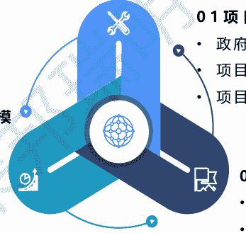

## 全流程的城市综合开发运营服务

针对城市综合开发项目，提供涵盖从机会挖掘、投前决策支持、投后开发过程管理咨询到运营资源整合的全流程服务，以基于大数据的投资决策方法和GIS+综合开发运营服务平台，构建专业的综合开发项目投资运营评估体系，助力政府和企业打造综合开发项目标杆。

### 机会挖掘

城市大数据  
企业投资战略研究  
城市发展战略研究

服务行业：投资EPC  
服务对象：市场化投资企业

### 投前决策支持

| 政府 | 企业 |
|---|---|
| 片区划定 资源统筹 方案设计 招商引资 采购谈判 | 项目选址 投资评估 方案设计 决策支持 合作推进 |

### 投后综合开发过程管理

设计开发策略  
制定总体开发计划  
项目中期评估  
项目绩效评价  
项目过程管理  
产业导入

### 城市运营资源整合

运营合作伙伴筛选  
运营资源整合规划  
运营合作模式设计  
城市运营资源管理  
运营能力建设

### 大数据投资决策支持平台

- 城市数据
- 项目数据
- 企业数据

### GIS + 综合开发运营服务平台

- GIS空间技术
- 综合开发在线模型

### 决策支持

### EP矩阵

### 投融资规划方法

## 遍布全国的服务项目

### 公司简介

公司成立以来，陆续在全国27个省、自治区、直辖市的200多个市、县、区、镇实施了上千个咨询服务项目，服务项目的总投资额超万亿元。

### 典型项目分布图

TYPICAL PROJECT DISTRIBUTION DIAGRAM

- **10000+** 服务项目投资额（亿元）
- **1000+** 服务项目数量
- **30+** 涉及行业
- **300+** 落地项目数量
- **200+** 项目分布城市
- **100+** 服务地方政府
- **80+** 服务大型企业

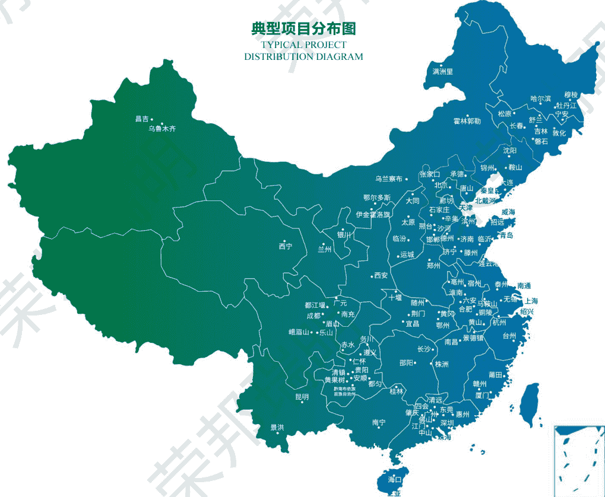

## 公司介绍

### 编写人员和技术指导

#### 编写人员

- 胡铭
- 李二峰
- 童楠楠
- 刘晓艳

#### 技术指导

- 陈民松
- 彭
- 陈非迟
- 耿盼盼

## 整合智慧 科技 资本 推动城市科学发展

荣邦瑞明微信公众号

PDP有例微信公众号

荣邦瑞明官网：www.rbrmcn.com  
“有例”城市开发投资决策支持平台：www.youlidata.com  
“有略”片区开发策略管理平台：www.urbanifp.com

地址：北京市丰台区慧谷国际中心3号楼703室  
电话：010-85879580　　邮编：100160  
传真：010-85879881
