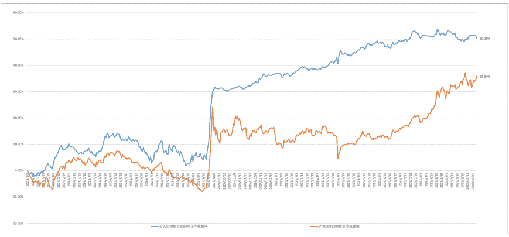
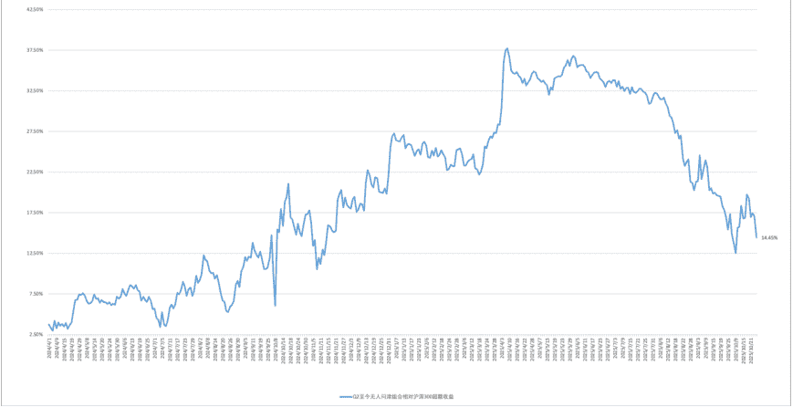
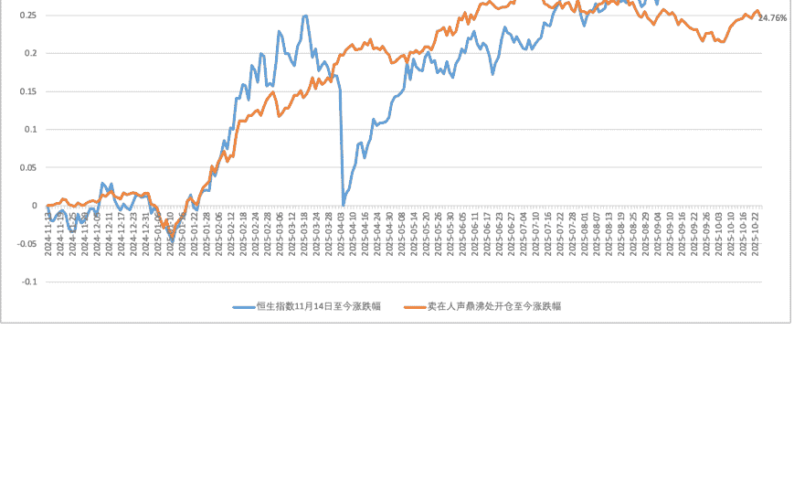
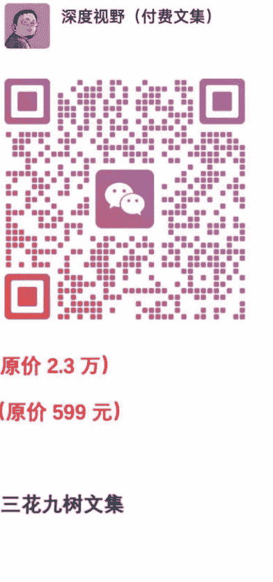

## 1、“买在无人问津时”长线组合

### 1）收益情况

| 2025/10/24 | 成立至今涨跌幅 | 2025年至今 | 2024年至今 | 十月涨跌幅 | 今日涨跌幅 |
|---|---:|---:|---:|---:|---:|
| 买在无人问津时（成立于2016.12.21） | 406.61% | 10.01% | 50.29% | 0.81% | -0.67% |
| 沪深300 | 40.85% | 18.44% | 35.84% | 0.43% | 1.18% |

### 2）组合持仓与仓位

注：部分公司因为分红而成本降低。

| 2025/10/24 | 成立市值（亿元） | 权重（%） | 累计价格 | 今日涨跌幅（%） | 24年至今累计涨幅（%） |
|---|---:|---:|---:|---:|---:|
| 买在无人问津时 | - | 100.00 | - | -0.67 | 50.29 |
| 30年国债ETF | 175 | 30.43 | 109.18 | -0.20 | -2.31 |
| 中国移动 | 965 | 5.04 | 106.51 | 0.17 | 0.34 |
| 北新建材 | 383 | 4.96 | 23.76 | -1.39 | -1.35 |
| 春秋航空 | 520 | 4.93 | 51.82 | -1.97 | 2.49 |
| 宁沪高速 | 186 | 4.82 | 3.08 | -3.24 | 6.82 |
| 新奥股份 | 568 | 4.73 | 18.06 | -0.22 | 2.27 |
| 华菱钢铁 | 206 | 4.58 | 73.69 | -0.58 | -4.89 |
| 重庆啤酒 | 258 | 4.29 | 56.50 | -0.54 | -5.70 |
| 中国国贸 | 205 | 4.26 | 22.18 | -0.97 | -8.12 |
| 中国核电 | 1716 | 4.24 | 9.73 | -0.44 | -6.58 |
| 苏泊尔 | 376 | 4.16 | 51.42 | -1.69 | -8.60 |
| 海信家电 | 228 | 4.10 | 24.21 | -0.60 | 2.52 |
| 长江电力 | 6768 | 4.06 | 27.89 | -0.14 | 1.08 |
| 青岛啤酒 | 469 | 3.87 | 66.96 | -0.53 | -1.30 |
| 海天味业 | 2146 | 3.78 | 39.96 | -0.08 | -3.40 |
| 川投能源 | 723 | 3.76 | 15.52 | -0.60 | -4.38 |
| 东鹏饮料 | 83 | 3.76 | 13.24 | -0.62 | -3.78 |
| 现金 | - | 0.23 | - | - | - |
| 北大荒（已清仓） | - | - | 13.82 | - | 32.05 |
| 30年国债ETF（已清仓） | - | - | 87.60 | - | 27.98 |
| 杭叉集团（已清仓） | - | - | 18.28 | - | 25.60 |
| 敦煌种业（已清仓） | - | - | 37.07 | - | 24.10 |
| 柳工（已清仓） | - | - | 9.55 | - | 17.38 |
| 吉比特（已清仓） | - | - | 210.89 | - | 17.28 |
| 新华书店（已清仓） | - | - | 13.78 | - | 16.33 |
| 中孚实业（已清仓） | - | - | 28.83 | - | 15.50 |
| 中国动力（已清仓） | - | - | 21.48 | - | 11.48 |
| 国投电力（已清仓） | - | - | 14.45 | - | 11.28 |
| 华能水电（已清仓） | - | - | 9.08 | - | 10.35 |
| 华侨城A（已清仓） | - | - | 18.31 | - | 9.94 |
| 30年国债ETF（已清仓） | - | - | 112.76 | - | 9.93 |
| 中国化学（已清仓） | - | - | 7.42 | - | 9.70 |
| 山东药玻（已清仓） | - | - | 21.68 | - | 9.32 |
| 华润双鹤（已清仓） | - | - | 18.03 | - | 8.27 |
| 海信家电（已清仓） | - | - | 28.20 | - | 6.42 |
| 恩华药业（已清仓） | - | - | 22.10 | - | 6.20 |
| 国电南瑞（已清仓） | - | - | 22.46 | - | 5.81 |
| 中国移动（已清仓） | - | - | 109.44 | - | 4.24 |
| 万华化学（已清仓） | - | - | 70.05 | - | -1.77 |

### 3）相对沪深300的超额收益

## 2、“实在人声鼎沸处”长线组合

注：部分公司因为分红而成本降低。

| 2025/10/24 | 流通市值（亿元） | 权重（%） | 静态估值 | 今日涨跌幅（%） | 24年全年营收情况（%） |
|---|---:|---:|---:|---:|---:|
| 资产人户静态组合 | - | 100.00 | - | -0.69 | 24.76 |
| 南方富时中国A50ETF | 12 | 20.77 | 65.60 | -0.11 | 7.99 |
| 南方医药健康混合型 | 52 | 12.58 | 1.60 | -3.92 | -23.42 |
| 中国海洋石油 | 160 | 9.53 | 4.84 | -0.41 | 0.83 |
| 华润啤酒 | 876 | 5.60 | 24.19 | - | 11.60 |
| 中国海外发展 | 1,504 | 4.95 | 13.87 | -0.72 | -0.94 |
| 美国-W | 5,565 | 4.96 | 101.70 | 0.60 | -1.08 |
| 华润燃气 | 259 | 4.88 | 11.25 | -0.83 | -4.10 |
| 海底捞 | 734 | 4.76 | 14.08 | - | -6.55 |
| 国药控股 | 263 | 4.68 | 18.88 | -0.05 | 3.67 |
| 华润燃气 | 488 | 4.33 | 22.90 | -1.86 | -7.86 |
| 华润电力 | 953 | 4.37 | 15.38 | 0.22 | 19.67 |
| 金风科技 | - | 18.59 | - | - | - |
| 中广核矿业（已清仓） | - | - | 1.49 | - | 39.67 |
| 西部矿业（已清仓） | - | - | 105.20 | - | 9.52 |
| 康方生物（已清仓） | - | - | 57.05 | - | 29.80 |
| 康宁杰瑞制药-B（已清仓） | - | - | 9.94 | - | 27.57 |
| 中广核电力（已清仓） | - | - | 2.43 | - | 24.46 |
| 阿里巴巴-W（已清仓） | - | - | 82.55 | - | 24.22 |
| 中国海洋石油（已清仓） | - | - | 15.26 | - | 23.07 |
| 腾讯控股（已清仓） | - | - | 392.72 | - | 21.76 |
| 网易控股（已清仓） | - | - | 20.32 | - | 21.26 |
| 石药集团（已清仓） | - | - | 4.63 | - | 19.22 |
| 招商局集团-B（已清仓） | - | - | 414.60 | - | 9.70 |
| 中国移动（已清仓） | - | - | 69.70 | - | 9.55 |
| 万洲国际（已清仓） | - | - | 6.10 | - | 5.74 |
| 华住集团-S（已清仓） | - | - | 24.89 | - | 4.45 |
| 中国旺旺（已清仓） | - | - | 4.62 | - | 4.33 |
| 中国生物制药（已清仓） | - | - | 3.32 | - | 4.07 |
| 新奥能源（已清仓） | - | - | 25.50 | - | 3.73 |
| 南方美国科技20（已清仓） | - | - | 68.09 | - | 1.89 |
| 华润医药（已清仓） | - | - | 5.28 | - | 0.88 |
| 石四药集团（已清仓） | - | - | 3.06 | - | 0.82 |

## 深度视野优质文集圈（链接优质社群，助你成功）

全部包含以下内容：限时年费188元/年，加微信cuk255。

- 1. 吃瓜群众俱乐部实时圈文加实时群聊对话（原价365元/年）
- 2. 子明私享汇（含）内部文章（原价568元/年）
- 3. 政事堂（顾子明）付费内容，再送顾子明群聊
- 4. 米联储见闻【作者米糕】（原价599元/年）
- 5. 欧洲金靴会员专属文章（原价328元/年）
- 6. 砖瓦厂厂内圈文（原价400元/年）
- 7. 卢克文青云读书会专属文章（原价699元/年）
- 8. 鉴朱财经院知识星球（原价3310元/年）
- 9. 猫哥的视界知识星球文章（原价299元/年）
- 10. 财新周刊【独家新闻】（原价1498元/年）
- 11. 杨世光在金钱爆（原价2200元/年）
- 12. 蔡森财经知识星球（原价1600元/年）
- 13. 澎泽异谈付费文章（持续更新）
- 14. 司马林解读《毛选》全套音频和全套书籍珍藏版，无限期（原价2.3万）
- 15. 庭芥三部曲【民国梦、帝国齿轮、不被理解的MAO】（原价599元）
- 16. 卢克文知识星球文章（原价268元/年）
- 17. 额外再送：卢麒元新浪微博付费专栏、村西边老王、三花九树文集

不定期内容：

- 1. 守夜人司马知识星球、挨踢牛魔王知识星球、生财有术知识星球
- 2. 创始人笔记、达叔天寅论知识星球、成竹财富圈、雪球花甲老头等
- 3. A视野、大树乡谈、江宁知府、咩咩说、财上海家学等付费文集
- 4. 西风付费文章、老蒋、藏在人小时之外、局外人的视界、升值计、老A体制内等其他一些大V付费文章（每月不低于600元的付费文章）

