# 2025-10-26，股票市场。（数据部分）

## 1，整体情况

今日A股市场全天震荡反弹，沪指再创十年新高，创业板指领涨。沪深两市成交额1.97万亿，较上一个交易日放量3303亿。截至收盘，沪指涨0.71%，深成指涨2.02%，创业板指涨3.57%。

### 1）行情概括

| 时间 | 当日上涨股票数量 | 增减（同上交易日） | 当日下跌股票数量 | 增减（同上交易日） | 中位数涨跌幅 | 增减（同上交易日） | 平均涨跌幅 | 增减（同上交易日） | 万得全A当日涨跌幅 |
|---|---:|---:|---:|---:|---:|---:|---:|---:|---:|
| 2025/10/23 | 2994 | 714 | 2302 | -663 | 0.20% | 0.41% | 0.16% | 0.25% | 0.14% |
| 2025/10/24 | 3028 | 34 | 2274 | -28 | 0.28% | 0.08% | 0.73% | 0.57% | 1.27% |

### 2）截至当日，24年以来个股情况

| 时间 | 上涨股票数量 | 增减（同上交易日） | 下跌股票数量 | 增减（同上交易日） | 股票平均涨跌幅 | 增减（同上交易日） | 中位数涨跌幅 | 增减（同上交易日） |
|---|---:|---:|---:|---:|---:|---:|---:|---:|
| 2025/10/23 | 3795 | 35 | 1557 | -34 | 33.34% | -0.11% | 17.83% | 0.29% |
| 2025/10/24 | 3804 | 9 | 1548 | -9 | 34.56% | 1.22% | 18.31% | 0.49% |

### 3）等权全A指数

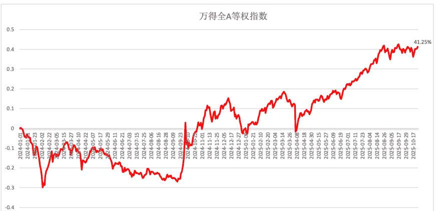

### 4）脱水300指数

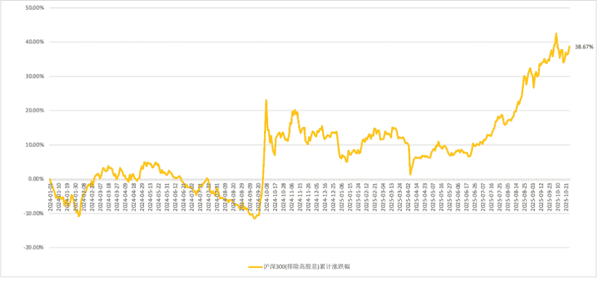

### 5）mini盘指数

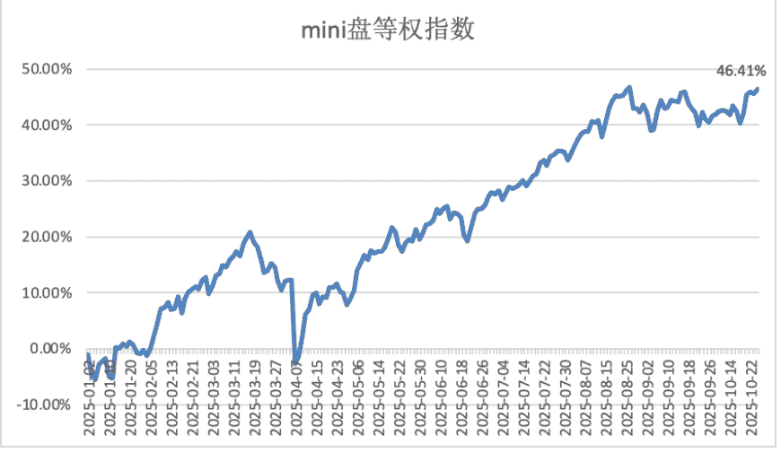

### 6）出海20指数

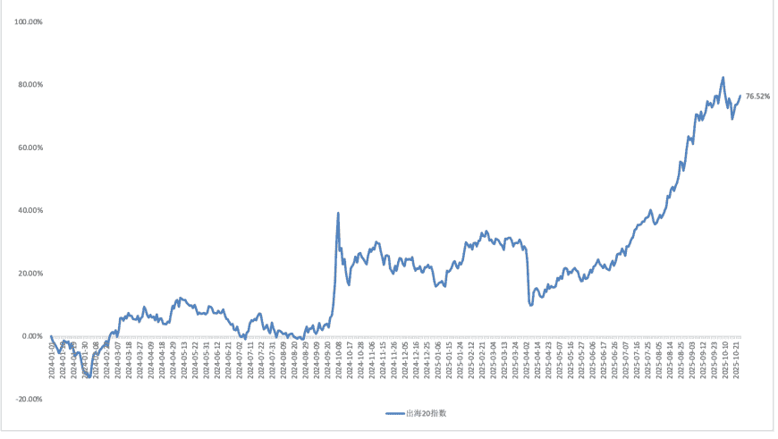

### 7）红利20指数

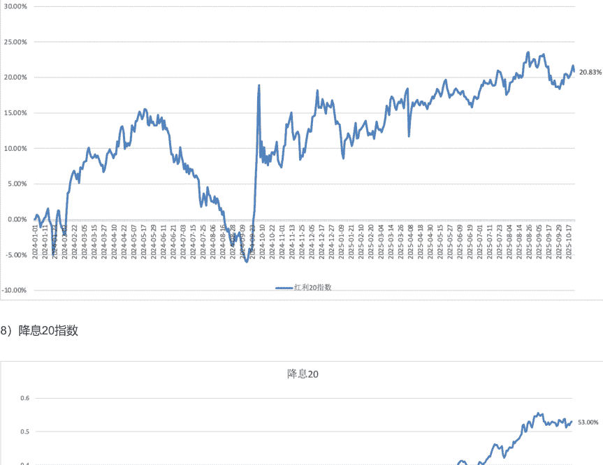

### 8）除息20指数

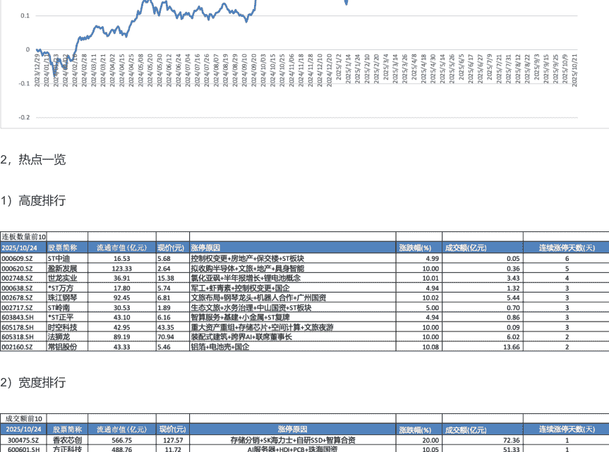

## 2，热点一览

### 1）高度排行

| 连板数量前10 |  |  |  |  |  |  |  |
|---|---:|---:|---:|---:|---:|---:|---:|
| 2025/10/20 | 股票简称 | 流通市值(亿元) | 现价(元) | 涨停原因 | 涨跌幅(%) | 成交额(亿元) | 连续涨停天数(天) |
| 000609.SZ | ST中迪 | 16.53 | 5.68 | 控制权变更+房地产+保投资+ST板块 | 4.99 | 0.05 | 6 |
| 000620.SZ | 新华联 | 123.33 | 2.64 | 筹划购买华夏中安地产+地产业务 | 10.00 | 0.36 | 5 |
| 002748.SZ | 世龙实业 | 36.91 | 15.38 | 氯化亚砜+半导体级电子电池 | 10.01 | 3.43 | 4 |
| 000638.SZ | *ST万方 | 17.80 | 5.74 | 宫江+疗养+控制权变更 | 4.94 | 1.32 | 3 |
| 002678.SZ | 珠江钢琴 | 92.45 | 6.81 | 文旅后母+钢琴定制+机器人合作 | 10.02 | 5.44 | 3 |
| 002717.SZ | ST岭南 | 30.53 | 1.89 | 生态文旅+水务治理+中国贫困+ST板块 | 5.00 | 0.70 | 3 |
| 603843.SH | *ST正平 | 43.10 | 6.16 | 智慧服务+基建+小金属+新疆 | 4.94 | 0.86 | 3 |
| 605178.SH | 时空科技 | 42.95 | 43.35 | 瘐大资产重组+存储芯片+空间计算+文旅夜游 | 10.00 | 0.09 | 3 |
| 605318.SH | 法狮龙 | 89.19 | 70.94 | 装配式建筑+跨界AI+腔声董事长 | 10.00 | 6.02 | 2 |
| 002160.SZ | 常铝股份 | 43.33 | 5.46 | 铝箔+电池壳+国企 | 10.08 | 13.66 | 2 |

### 2）宽度排行

| 成交额前10 |  |  |  |  |  |  |  |
|---|---:|---:|---:|---:|---:|---:|---:|
| 2025/10/20 | 股票简称 | 流通市值(亿元) | 现价(元) | 涨停原因 | 涨跌幅(%) | 成交额(亿元) | 连续涨停天数(天) |
| 300475.SZ | 香农芯创 | 566.75 | 127.57 | 存储分销+SK海力士+台塑SSD+智算资合 | 20.00 | 72.36 | 1 |
| 600601.SH | 方正科技 | 488.76 | 11.72 | AI服务器+国产PCB+NPN+睿频国产 | 10.05 | 51.33 | 1 |
| 001309.SZ | 德明利 | 349.21 | 216.92 | 存储芯片+AI存储+固态硬盘+国产替代 | 10.00 | 48.73 | 1 |
| 600021.SH | 上海电力 | 731.25 | 25.92 | 新能源+发展量+煤化+全方位分工 | 10.02 | 43.97 | 1 |
| 002516.SZ | 旷达科技 | 1417.03 | 213.08 | PCB+创意+方正芯片+国企 | 10.00 | 25.65 | 1 |
| 002497.SZ | 雅化集团 | 189.27 | 17.88 | 固态电池+锂盐+军工+三季报预增 | 10.03 | 22.66 | 1 |
| 688766.SH | 普冉股份 | 211.52 | 142.87 | 拟收购存储芯片+半导体+参股锂子公司 | 20.00 | 21.49 | 1 |
| 600118.SH | 中国卫星 | 462.59 | 39.12 | 卫星制造+低轨卫星+央企 | 10.01 | 21.06 | 1 |
| 000636.SZ | 风华高科 | 201.44 | 17.41 | MLCC+AI算力+机器人+国企 | 9.98 | 19.93 | 1 |
| 688183.SH | 生益电子 | 739.82 | 88.94 | 业务预增+PCB+算力+800G光模块 | 19.99 | 19.27 | 1 |

## 3，风格主导

### 1）指数成交占比

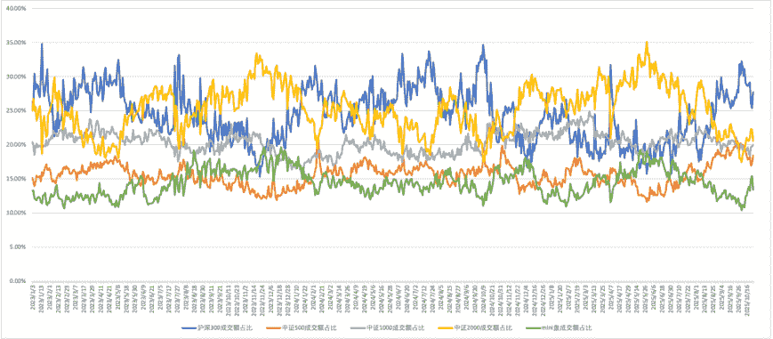

### 2）TMT和红利低波成交占比

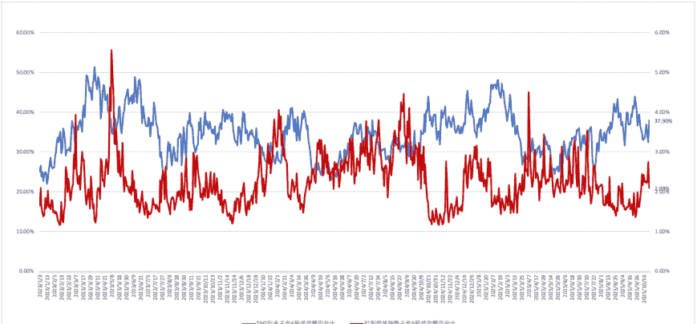

## 4，沪深300期指波动率

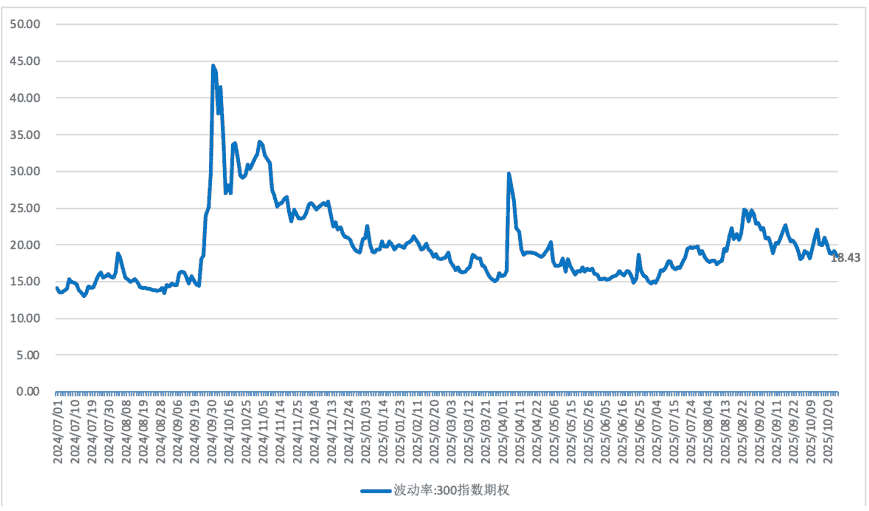

## 5，杠杆与利率

### 1）融资资金

| 指标日期 | 2025/10/23 |
|---|---:|
| 余额 | 24,339.24 |
| 较前一日变动(亿元) | -16.22 |
| 22年来累计变动(亿元) | 7,219.18 |

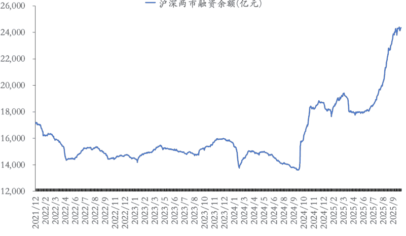

### 2）担保比例

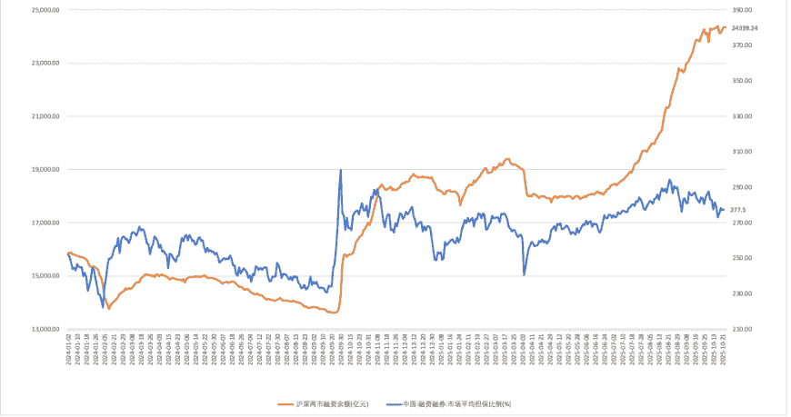

### 3）十年国债收益率

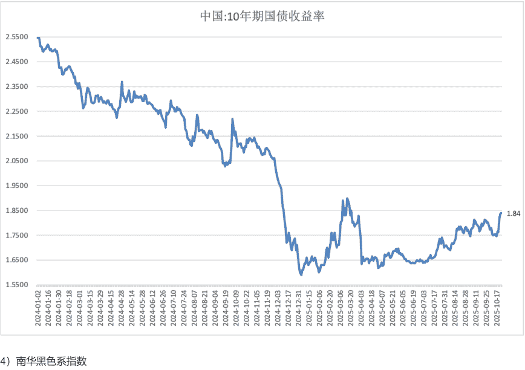

### 4）南华黑色系指数

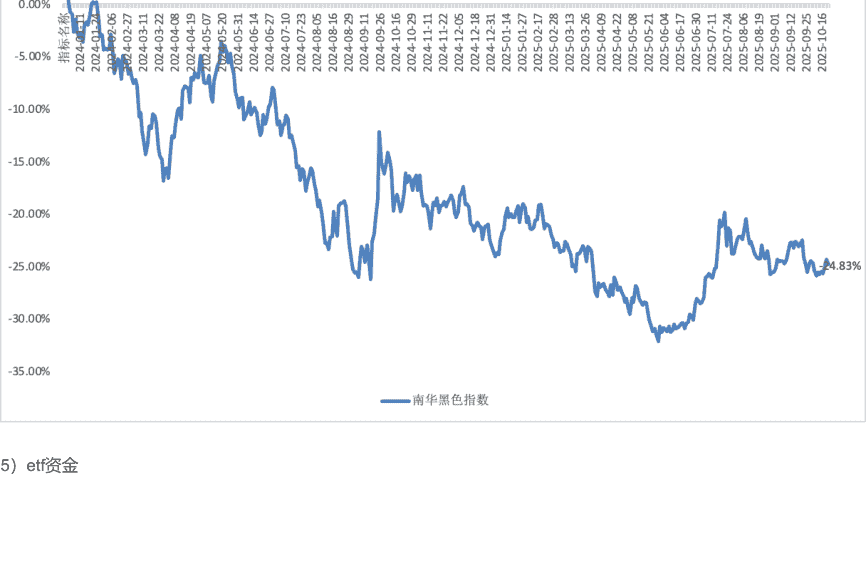

### 5）ETF资金

| 日期 | 股票累计涨幅(%) | 沪深300累计涨幅(%) | 中证500累计涨幅(%) | 中证1000累计涨幅(%) |
|---|---:|---:|---:|---:|
| 2025/4/1 | -4.53 | -5.23 | 0.71 | 6.07 |
| 2025/4/2 | 47.29 | 31.24 | 16.06 | 45.90 |
| 2025/4/3 | 89.08 | 33.75 | 55.93 | 34.24 |
| 2025/4/7 | 355.17 | 210.88 | 144.29 | 742.30 |
| 2025/4/8 | 381.44 | 277.68 | 103.75 | 1062.95 |
| 2025/4/9 | 71.04 | 20.81 | 50.23 | 125.57 |
| 2025/4/10 | -1.93 | -3.42 | -5.35 | -25.72 |
| 2025/4/11 | -48.59 | -35.36 | -13.22 | -63.08 |
| 2025/4/14 | -47.19 | -34.17 | -13.02 | -98.32 |
| 2025/4/15 | 14.11 | 26.93 | 12.83 | 68.05 |
| 2025/4/16 | 71.31 | 54.97 | 16.63 | 271.81 |
| 2025/4/17 | -30.22 | -16.29 | -13.92 | 27.75 |
| 2025/4/18 | 26.27 | 38.37 | -12.09 | 97.80 |
| 2025/4/21 | -26.20 | -30.33 | -18.08 | -140.55 |
| 2025/4/22 | 22.70 | 25.76 | 3.06 | 51.89 |
| 2025/4/23 | 0.51 | 4.16 | -3.65 | -8.85 |
| 2025/4/24 | 25.59 | 13.90 | 12.09 | 19.99 |
| 2025/4/25 | 9.46 | 14.12 | -4.65 | -11.24 |
| 2025/4/28 | 39.47 | 20.26 | 19.21 | 61.93 |
| 2025/4/29 | -23.84 | -6.89 | -16.95 | -18.51 |
| 2025/4/30 | -44.11 | -25.82 | -10.30 | -50.39 |
| 2025/5/1 | -0.09 | 3.88 | -3.97 | 4.80 |
| 2025/5/7 | -26.27 | -20.96 | 5.31 | -56.29 |
| 2025/5/8 | -20.61 | -3.78 | -16.83 | -14.08 |
| 2025/5/9 | 55.00 | 16.59 | 9.49 | 48.54 |
| 2025/5/12 | 45.20 | -11.05 | -33.74 | -47.46 |
| 2025/5/13 | 138.04 | -98.74 | -39.30 | -150.14 |
| 2025/5/14 | -33.40 | -13.13 | -19.56 | -6.90 |
| 2025/5/15 | -42.10 | -19.71 | -22.39 | -63.31 |
| 2025/5/16 | -55.23 | -34.33 | -20.83 | -77.98 |
| 2025/5/19 | -16.24 | -3.73 | -12.51 | -35.42 |
| 2025/5/20 | 51.99 | -28.08 | -23.91 | -26.09 |
| 2025/5/21 | -58.93 | -25.86 | -32.07 | -58.16 |
| 2025/5/22 | -22.26 | -10.73 | -11.53 | -20.21 |
| 2025/5/23 | -32.32 | -14.14 | -18.18 | -16.12 |
| 2025/5/26 | 16.20 | 15.85 | 0.35 | 43.34 |
| 2025/5/27 | -19.07 | 10.04 | 8.42 | 32.88 |
| 2025/5/28 | -13.00 | -8.16 | -8.84 | -18.46 |
| 2025/5/29 | 3.63 | 1.57 | 2.06 | 6.45 |
| 2025/5/30 | -40.27 | -27.77 | -11.50 | -68.78 |
| 2025/6/3 | -26.12 | -4.42 | -8.70 | -7.25 |
| 2025/6/4 | -22.16 | -9.52 | -12.64 | -8.32 |
| 2025/6/5 | -44.71 | -23.84 | -20.87 | -37.29 |
| 2025/6/6 | -33.52 | -3.22 | -8.60 | 0.21 |
| 2025/6/9 | -21.37 | -9.63 | -11.75 | -36.58 |
| 2025/6/10 | -68.20 | -31.72 | -36.48 | -88.32 |
| 2025/6/11 | -45.81 | -17.58 | -26.23 | -29.71 |
| 2025/6/12 | 38.36 | -12.03 | -26.33 | -58.53 |
| 2025/6/13 | 19.28 | 15.72 | 3.56 | 11.51 |
| 2025/6/16 | 46.70 | 42.26 | 4.84 | 70.88 |
| 2025/6/17 | 44.62 | 39.39 | 5.23 | 34.63 |
| 2025/6/18 | 10.92 | 10.87 | 0.05 | 3.59 |
| 2025/6/19 | 67.80 | 58.84 | 8.96 | 23.03 |
| 2025/6/20 | 44.93 | 36.95 | 7.98 | 42.06 |
| 2025/6/23 | -42.80 | -39.78 | -5.02 | -67.61 |
| 2025/6/24 | -10.86 | 12.43 | -23.29 | 2.68 |
| 2025/6/25 | -15.12 | -4.86 | -10.46 | -32.80 |
| 2025/6/26 | -34.42 | -27.92 | -6.50 | -68.00 |
| 2025/6/27 | -33.65 | -14.92 | -18.74 | -78.51 |
| 2025/6/30 | -22.47 | 2.88 | 19.59 | -37.61 |
| 2025/7/1 | -90.17 | -54.05 | -36.12 | -123.57 |
| 2025/7/2 | 42.77 | 33.55 | 8.92 | 29.12 |
| 2025/7/3 | 0.02 | 20.77 | -20.75 | -25.58 |
| 2025/7/4 | 89.48 | 98.77 | -9.29 | -32.88 |
| 2025/7/7 | 16.41 | 16.09 | -9.58 | -7.42 |
| 2025/7/8 | -18.63 | -5.50 | -15.95 | -34.56 |
| 2025/7/9 | 17.01 | 4.54 | -21.55 | -17.41 |
| 2025/7/10 | 13.23 | 29.18 | -15.95 | 0.01 |
| 2025/7/11 | 62.91 | 22.56 | -40.35 | 79.99 |
| 2025/7/14 | 15.68 | 15.58 | 0.10 | 66.61 |
| 2025/7/15 | 16.77 | 31.66 | -48.13 | -38.11 |
| 2025/7/16 | -11.34 | 1.30 | -12.64 | -10.22 |
| 2025/7/17 | -7.88 | -1.97 | -5.91 | -3.10 |
| 2025/7/18 | -35.53 | -4.59 | -5.15 | -33.32 |
| 2025/7/21 | 30.31 | 2.41 | 27.90 | 37.97 |
| 2025/7/22 | 37.84 | 0.19 | 37.65 | 25.42 |
| 2025/7/23 | -7.18 | -19.05 | 5.87 | 23.22 |
| 2025/7/24 | -26.28 | -19.14 | -7.13 | 26.68 |
| 2025/7/25 | -15.78 | -21.11 | 5.33 | -26.01 |
| 2025/7/28 | -9.37 | -2.93 | -6.44 | -47.60 |
| 2025/7/29 | 19.81 | -25.71 | 5.90 | 59.48 |
| 2025/7/30 | 72.55 | 31.41 | 44.13 | 48.88 |
| 2025/7/31 | -64.46 | -36.68 | -27.78 | -143.19 |
| 2025/8/1 | 216.96 | 20.79 | 7.11 | 22.95 |
| 2025/8/4 | 10.84 | 17.11 | 9.13 | 87.87 |
| 2025/8/5 | 21.12 | 2.86 | 18.26 | 2.04 |
| 2025/8/6 | 53.80 | 30.55 | 23.65 | 63.84 |
| 2025/8/7 | 4.28 | 10.78 | 6.50 | 69.72 |
| 2025/8/8 | 63.26 | 27.69 | 35.57 | 7.11 |
| 2025/8/11 | 17.09 | 17.69 | 0.60 | 32.07 |
| 2025/8/12 | -4.22 | 4.52 | 0.00 | 37.11 |
| 2025/8/13 | -41.78 | -29.74 | -12.04 | -20.67 |
| 2025/8/14 | -110.58 | -28.26 | -32.22 | -145.35 |
| 2025/8/15 | 58.38 | 39.69 | 18.69 | 91.50 |
| 2025/8/18 | 19.19 | 20.88 | -1.64 | 25.58 |
| 2025/8/19 | 93.66 | 50.06 | 4.40 | 55.83 |
| 2025/8/20 | 175.02 | 44.10 | 130.92 | -55.87 |
| 2025/8/21 | 88.20 | 54.17 | 34.03 | 45.81 |
| 2025/8/22 | 3.31 | 25.17 | 21.86 | 51.94 |
| 2025/8/25 | 162.87 | 84.06 | 78.81 | 151.34 |
| 2025/8/26 | 141.01 | 66.87 | 74.54 | 115.24 |
| 2025/8/27 | 28.98 | 2.93 | 26.05 | -39.34 |
| 2025/8/28 | 2.38 | 17.28 | -14.90 | 77.68 |
| 2025/8/29 | 143.09 | 72.72 | 70.37 | 126.69 |
| 2025/9/1 | 88.64 | 42.11 | 46.53 | 28.31 |
| 2025/9/2 | 127.28 | 61.02 | 66.26 | 129.51 |
| 2025/9/3 | -29.56 | -3.03 | -26.53 | -102.40 |
| 2025/9/4 | 63.99 | 43.60 | 20.39 | 61.63 |
| 2025/9/5 | 10.02 | 14.53 | -4.51 | -37.46 |
| 2025/9/8 | 54.86 | 22.31 | 57.40 | -12.19 |
| 2025/9/9 | 38.12 | 0.72 | 15.80 | -7.45 |
| 2025/9/10 | 18.62 | 27.06 | 19.38 | -11.40 |
| 2025/9/11 | 103.62 | 54.59 | 49.03 | 116.72 |
| 2025/9/12 | 39.73 | 11.87 | 27.86 | 22.62 |
| 2025/9/15 | -6.14 | -0.02 | -4.48 | -50.56 |
| 2025/9/16 | 22.99 | -0.89 | 23.88 | 21.71 |
| 2025/9/17 | 65.73 | 23.28 | 42.45 | 89.99 |
| 2025/9/18 | 122.70 | 72.66 | 50.04 | 82.92 |
| 2025/9/19 | 64.88 | 26.35 | 38.53 | 61.83 |
| 2025/9/22 | -30.35 | -25.30 | -5.05 | -85.81 |
| 2025/9/23 | 91.49 | 60.51 | 30.98 | 61.65 |
| 2025/9/24 | 29.38 | 6.86 | 22.52 | 39.84 |
| 2025/9/25 | 52.45 | 42.49 | 9.96 | 62.29 |
| 2025/9/26 | 168.74 | 101.09 | 67.65 | 21.33 |
| 2025/9/29 | 74.86 | 43.59 | 31.27 | 121.21 |
| 2025/9/30 | 113.29 | 55.30 | 54.99 | 116.93 |
| 2025/10/9 | 102.15 | 55.16 | 47.19 | 109.25 |
| 2025/10/10 | 253.07 | 150.32 | 102.75 | 296.78 |
| 2025/10/13 | 295.06 | 172.98 | 104.59 | 103.43 |
| 2025/10/14 | 163.03 | 123.21 | 39.82 | 59.69 |
| 2025/10/15 | 66.66 | 61.76 | 4.90 | 83.34 |
| 2025/10/16 | -6.11 | 12.72 | -18.83 | -69.62 |
| 2025/10/17 | 110.34 | 113.59 | -3.25 | 63.54 |
| 2025/10/20 | 21.02 | 37.17 | -16.15 | -14.89 |
| 2025/10/21 | -73.27 | -40.98 | -32.29 | -120.92 |

### 6）市场（沪深京）成交额变化

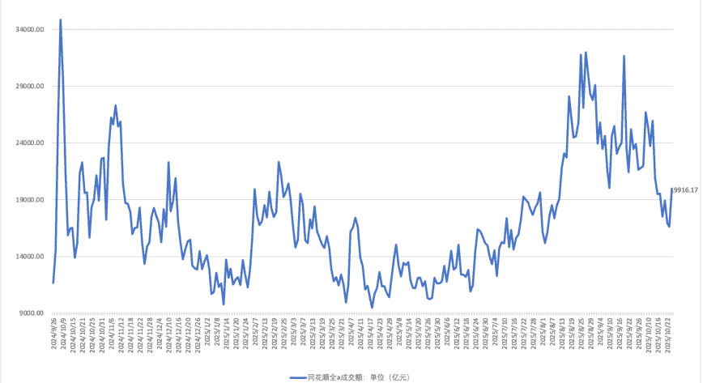

### 7）市值20亿以下股票的趋势图

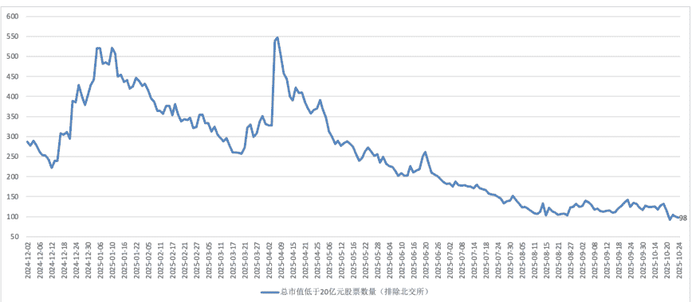

### 8）南向资金趋势图

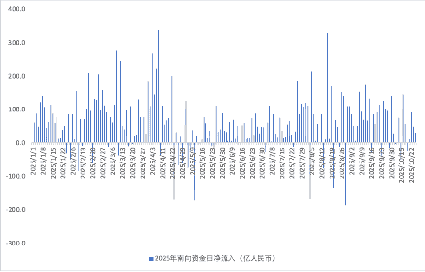

---

## 深度视野优质文集圈（链接优质社群，助你成功）

全部包含以下内容：限时年费188/年　加微信cuk255

- 1. 吃瓜群众俱乐部实时圈文加实时群聊对话（原价365元/年）
- 2. 子明私享汇（会）内部文章（原价568元/年）
- 3. 政事堂（顾子明）付费内容再送顾子明群
- 4. 米联储见闻【作者米糕】（原价599元/年）
- 5. 欧洲金融会员专属文章（原价328元/年）
- 6. 砖瓦厂「内部圈文」（原价400元/年）
- 7. 卢麒文青云读书会专属文章（原价699元/年）
- 8. 鉴朱财经院知识星球（原价3310元/年）
- 9. 猫哥的视界知识星球文章（原价299元/年）
- 10. 财新周刊【独家新闻】（原价1498元/年）
- 11. 杨世光在金钱爆（原价2200元/年）
- 12. 蔡森财经知识星球（原价1600元/年）
- 13. 澎泽异谈付费文章（持续更新）
- 14. 司马林解读毛选全套音频和全套书籍珍藏版无限减（原价2.3万）
- 15. 庞声三部曲《民国梦、帝国苔轮、不被理解的MAO》（原价599元）
- 16. 卢麒文知识星球文章（原价268元/年）
- 17. 额外再送：卢麒元新浪微博付费专栏、村西边老王、三花九树文集

不定期内容：——————（更多资源写不下了……）

- 1. 守牧人司令知识星球、挨踢牛腩王知识星球、生财有术知识星球
- 2. 创始人笔记、达叔天虎论知识星球、成竹财富圈、雪球花甲老头等
- 3. A视野、大树乡谈、江宁知府、哔哔说、财上海家学等付费文集
- 4. 西风付费文案、老端、藏在八小时之外、局外人的视界、升值计、老A体制内等等其它一些大V付费文章（每月不低于600元的付费文章）

限时年费188/年　低成本链接全网大V优质内容
