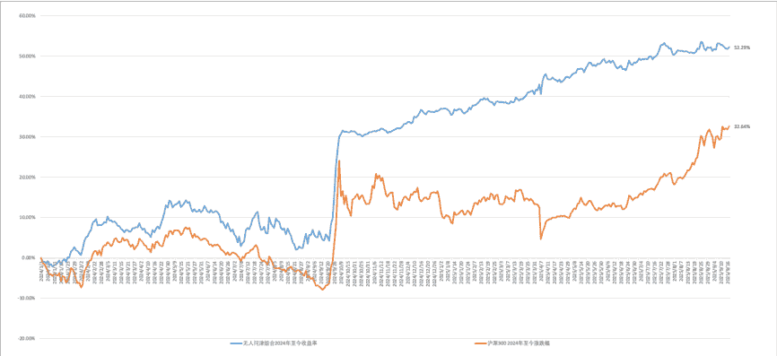
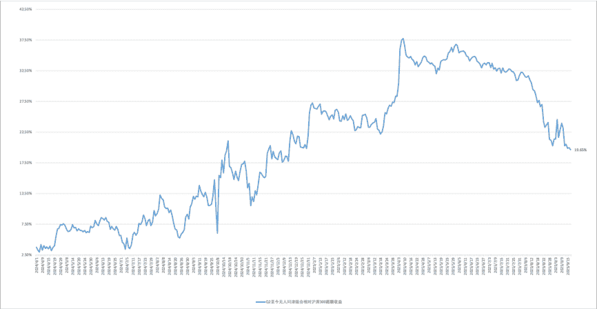
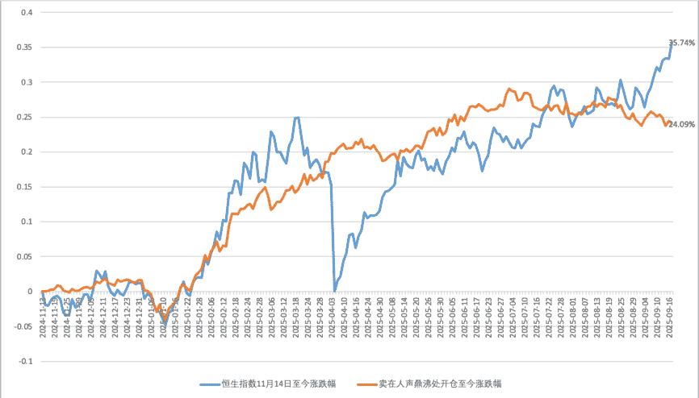

# 1、“买在无人问津时”长线组合

### 1）收益情况

| 2025/9/17 | 成立至今涨跌幅 | 2025年至今 | 2024年至今 | 九月涨跌幅 | 今日涨跌幅 |
|---|---:|---:|---:|---:|---:|
| 买在无人问津时（成立于2016.12.21） | 413.35% | 11.47% | 52.29% | 0.02% | 0.33% |
| 沪深300 | 37.53% | 15.66% | 32.64% | 1.21% | 0.61% |

### 2）组合持仓与仓位

注：部分公司因为分红而成本降低。

| 2025/9/17 | 流通市值（亿元） | 权重(%) | 持仓份额 | 今日涨跌幅(%) | 24年至今累计涨跌(%) |
|---|---:|---:|---:|---:|---:|
| 买在无人问津时 | - | 100.00 | - | 0.33 | 52.25 |
| 30年国债ETF(沪市) | 206 | 30.31 | 109.18 | 0.38 | -1.41 |
| 中国移动 | 964 | 4.97 | 106.51 | -0.24 | 0.22 |
| 泰联航空 | 531 | 4.94 | 52.25 | 1.50 | 3.92 |
| 广深铁路 | 190 | 4.87 | 3.08 | -1.75 | 9.42 |
| 安井食品 | 216 | 4.67 | 75.12 | -0.40 | -1.78 |
| 航天股份 | 569 | 4.63 | 18.24 | -1.96 | 1.48 |
| 中国国贸 | 225 | 4.61 | 22.18 | 3.43 | 0.68 |
| 华能水电 | 1669 | 4.59 | 9.08 | 0.11 | 2.09 |
| 华电国际 | 402 | 4.39 | 51.42 | 0.46 | -2.31 |
| 重庆啤酒 | 265 | 4.35 | 56.50 | 1.13 | -3.22 |
| 海信家电 | 232 | 4.12 | 24.21 | 2.56 | 4.38 |
| 中国重汽 | 1673 | 4.08 | 9.73 | 0.34 | -8.94 |
| 荣菲亚 | 89 | 3.96 | 13.24 | 0.29 | 2.87 |
| 长江电力 | 6650 | 3.94 | 27.89 | -0.11 | -0.68 |
| 青岛啤酒 | 479 | 3.90 | 66.96 | -0.19 | 0.94 |
| 海天味业 | 2240 | 3.86 | 40.22 | -0.10 | 0.17 |
| 川投能源 | 699 | 3.59 | 15.52 | 0.35 | -7.60 |
| 现金 | - | 0.22 | - | - | - |
| 北京银行（已清仓） | - | - | 13.82 | - | 32.05 |
| 30年国债ETF（已清仓） | - | - | 87.60 | - | 27.98 |
| 杭叉集团（已清仓） | - | - | 18.28 | - | 25.60 |
| 华辰股份（已清仓） | - | - | 37.07 | - | 24.10 |
| 梅花生物（已清仓） | - | - | 9.55 | - | 17.38 |
| 吉比特（已清仓） | - | - | 210.89 | - | 17.28 |
| 新华文轩（已清仓） | - | - | 13.78 | - | 16.33 |
| 中广核技（已清仓） | - | - | 28.83 | - | 15.50 |
| 中国黄金（已清仓） | - | - | 21.48 | - | 11.48 |
| 国投电力（已清仓） | - | - | 14.45 | - | 11.28 |
| 偕润环保（已清仓） | - | - | 18.31 | - | 9.94 |
| 30年国债ETF（已清仓） | - | - | 112.76 | - | 9.93 |
| 中国化学（已清仓） | - | - | 7.42 | - | 9.70 |
| 山东药玻（已清仓） | - | - | 21.68 | - | 9.32 |
| 华润双鹤（已清仓） | - | - | 18.03 | - | 8.27 |
| 海尔智家（已清仓） | - | - | 28.20 | - | 6.42 |
| 思鲁药业（已清仓） | - | - | 22.10 | - | 6.20 |
| 国电南瑞（已清仓） | - | - | 22.46 | - | 5.81 |
| 中国移动（已清仓） | - | - | 109.44 | - | 4.24 |
| 万盛化学（已清仓） | - | - | 70.05 | - | -17.77 |

### 3）相对沪深300的超额收益

# 2、“卖在人声鼎沸处”长线组合

注：部分公司因为分红而成本降低。

| 2025/9/17 | 流通市值（亿港元） | 权重(%) | 持仓分布 | 今日涨跌幅(%) | 24年现金及盈利情况(%) |
|---|---:|---:|---:|---:|---:|
| 卖在人声鼎沸处 | - | 100.00 | - | -0.31 | 24.09 |
| 南方美国国债20 | 12 | 20.56 | 66.43 | 0.06 | 6.25 |
| 南方香港微盘宝 | 53 | 11.99 | 1.60 | -8.36 | -27.42 |
| 中海油田服务 | 172 | 10.09 | 4.94 | 1.35 | 6.07 |
| 阿里旅行 | 563 | 6.05 | 20.32 | 4.61 | 18.31 |
| 华润啤酒 | 906 | 5.82 | 24.19 | 0.07 | 15.40 |
| 美国-W | 5,819 | 5.21 | 101.70 | 4.89 | 3.44 |
| 华润燃气 | 272 | 5.17 | 11.25 | -1.05 | 0.88 |
| 海底捞 | 745 | 4.86 | 14.08 | 1.91 | -5.13 |
| 四海控股 | 253 | 4.53 | 18.88 | 0.27 | -0.19 |
| 华润电力 | 946 | 4.36 | 15.38 | -0.11 | 18.76 |
| 中广核矿业 | 224 | 4.34 | 0.99 | 2.08 | 180.40 |
| 华润燃气 | 471 | 4.20 | 22.90 | -0.20 | -11.09 |
| 现金 | - | 12.81 | - | - | - |
| 百济神州（已清仓） | - | - | 105.20 | - | 9.52 |
| 康方生物（已清仓） | - | - | 57.05 | - | 29.80 |
| 吉利德药（已清仓） | - | - | 9.94 | - | 27.57 |
| 中广核电力（已清仓） | - | - | 2.43 | - | 24.46 |
| 阿里巴巴-W（已清仓） | - | - | 82.55 | - | 24.22 |
| 中国海洋石油（已清仓） | - | - | 15.26 | - | 23.07 |
| 腾讯控股（已清仓） | - | - | 392.72 | - | 21.76 |
| 石药集团（已清仓） | - | - | 4.63 | - | 19.22 |
| 柳鑫集团-B（已清仓） | - | - | 414.60 | - | 9.70 |
| 中国联通（已清仓） | - | - | 69.70 | - | 9.55 |
| 万洲国际（已清仓） | - | - | 6.10 | - | 5.74 |
| 华住集团-S（已清仓） | - | - | 24.89 | - | 4.45 |
| 中国旺旺（已清仓） | - | - | 4.62 | - | 4.33 |
| 中国生物制药（已清仓） | - | - | 3.32 | - | 4.07 |
| 海吉亚医疗（已清仓） | - | - | 25.50 | - | 3.73 |
| 南方美国国债20（已清仓） | - | - | 68.09 | - | 1.89 |
| 华润医药（已清仓） | - | - | 5.28 | - | 0.88 |
| 石四药集团（已清仓） | - | - | 3.06 | - | 0.82 |

