# 2025-9-17，股票市场（数据部分）

## 1. 整体情况

市场全天震荡走强，三大指数探底回升。沪深两市成交额2.38万亿，较上一个交易日放量353亿。盘面上，全市场超2500只个股上涨。截至收盘，沪指涨0.37%，深成指涨1.16%，创业板指涨1.95%。

### 1）行情概括

| 时间 | 当日上涨股票数量 | 增减（同上交易日） | 当日下跌股票数量 | 增减（同上交易日） | 中位数涨跌幅 | 增减（同上交易日） | 平均涨跌幅 | 增减（同上交易日） | 万得全A当日涨跌幅 |
|---|---:|---:|---:|---:|---:|---:|---:|---:|---:|
| 2025/9/16 | 3629 | -1686 | 1689 | -1686 | 0.72% | 1.21% | 1.05% | 1.13% | 0.48% |
| 2025/9/17 | 2504 | -1125 | 2757 | 1068 | -0.07% | -0.79% | 0.37% | -0.67% | 0.67% |

### 2）截至当日，24年以来个股情况

| 时间 | 上涨股票数量 | 增减（同上交易日） | 下跌股票数量 | 增减（同上交易日） | 股票平均涨跌幅 | 增减（同上交易日） | 中位数涨跌幅 | 增减（同上交易日） |
|---|---:|---:|---:|---:|---:|---:|---:|---:|
| 2025/9/16 | 3913 | 60 | 1440 | -60 | 36.01% | 1.52% | 19.27% | 1.04% |
| 2025/9/17 | 3908 | -5 | 1445 | 5 | 36.65% | 0.65% | 19.54% | 0.27% |

### 3）等权全A指数

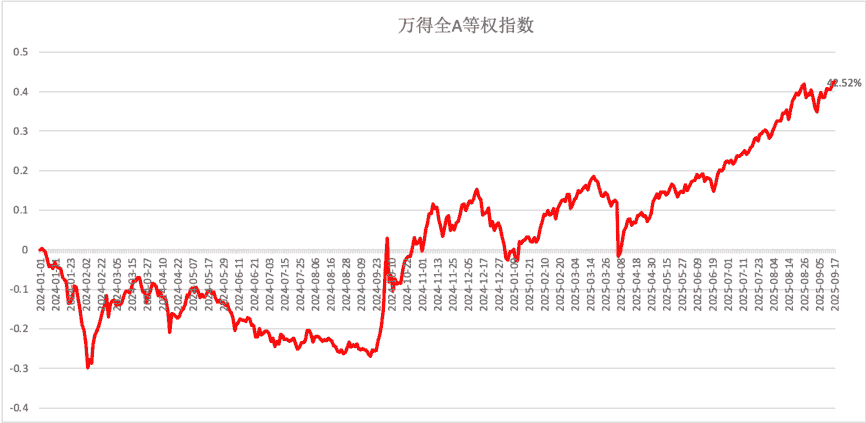

### 4）脱水300指数

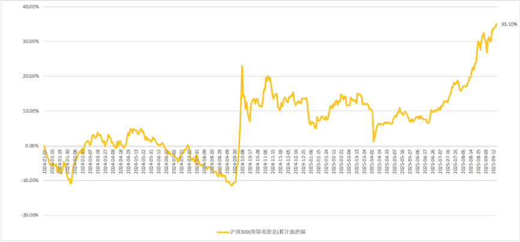

### 5）Mini盘等权指数

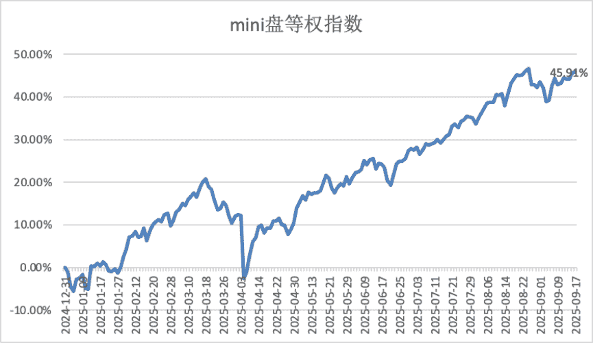

### 6）出海20指数

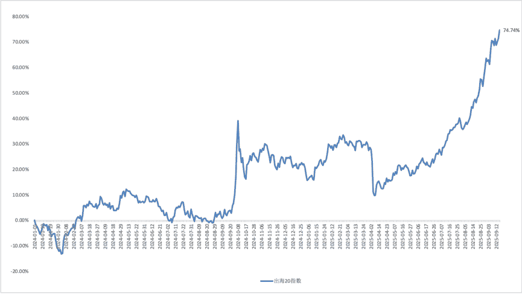

### 7）红利20指数

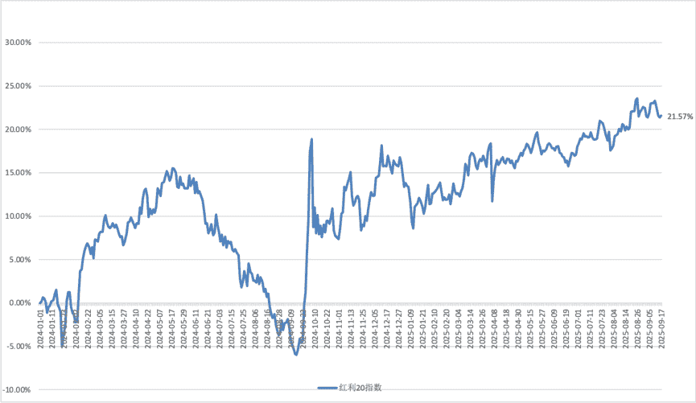

### 8）降息20指数

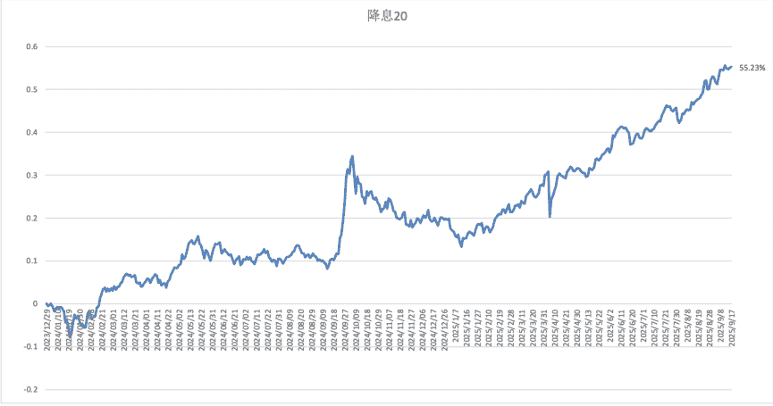

## 2. 热点一览

### 1）高度排行

| 连板数量前10 |  |  |  |  |  |  |  |
|---|---|---:|---:|---|---:|---:|---:|
| 日期 | 股票简称 | 流通市值（亿元） | 现价（元） | 涨停原因 | 涨跌幅（%） | 成交额（亿元） | 连续涨停天数（天） |
| 2025/9/17 | 000691.SZ *ST亚太 | 27.83 | 8.61 | 重整投资协议+精细化工+ST板块+西部大开发 | 5.00 | 0.04 | 8 |
| 600170.SH 上海建工 | 313.54 | 3.53 | 水利水务+上海国企+黄金+低价股 | 9.97 | 74.08 | 4 |
| 000981.SZ 山子高科 | 351.99 | 3.70 | 整车新路径+阿里合作+高端零部件+低价股 | 10.12 | 43.83 | 4 |
| 600376.SH 首开股份 | 189.34 | 7.34 | 间接投资穿刺科技+房地产+北京国资 | 10.04 | 26.38 | 4 |
| 600162.SH 香江控股 | 85.63 | 2.62 | 房地产+商贸物流+智慧家居+广州项目 | 10.08 | 8.87 | 4 |
| 603843.SH *ST正平 | 29.52 | 4.22 | 智算服务+ST板块+跨境工程 | 4.98 | 0.11 | 4 |
| 000559.SZ 万向钱潮 | 345.91 | 10.47 | 机器人+固态电池+汽车零部件 | 4.98 | 10.51 | 3 |
| 002289.SZ *ST宇顺 | 102.83 | 36.73 | 主力资源重组+数据中心+液晶显示+业绩恢复 | 5.00 | 1.01 | 3 |
| 001234.SZ 泰慕士 | 30.37 | 33.18 | 控制权变更+服饰配件+服装家纺+百强企业 | 10.01 | 0.34 | 3 |
| 002647.SZ *ST仁东 | 45.95 | 6.78 | 半年报扭亏+数字人民币+第三方支付+重整完成 | 4.95 | 0.13 | 3 |

### 2）宽度排行

| 成交额前10 |  |  |  |  |  |  |  |
|---|---|---:|---:|---|---:|---:|---:|
| 日期 | 股票简称 | 流通市值（亿元） | 现价（元） | 涨停原因 | 涨跌幅（%） | 成交额（亿元） | 连续涨停天数（天） |
| 2025/9/17 | 600170.SH 上海建工 | 313.54 | 3.53 | 水利水务+上海国企+黄金+低价股 | 9.97 | 74.08 | 4 |
| 600143.SH 金发科技 | 568.53 | 21.89 | 间接持股宁德时代+人形机器人+改性塑料+固态电池 | 10.00 | 72.41 | 1 |
| 600089.SH 特变电工 | 816.03 | 16.15 | 沙特中东+特高压+半年报修复增长+煤化工 | 10.01 | 57.71 | 1 |
| 000981.SZ 山子高科 | 351.99 | 3.70 | 整车新路径+阿里合作+高端零部件+低价股 | 10.12 | 43.83 | 4 |
| 000737.SZ 北方铜业 | 290.44 | 15.25 | 铜+压延铜箔+半导体增长+山西国资 | 10.03 | 40.67 | 1 |
| 002245.SZ 蔚蓝锂芯 | 211.67 | 19.51 | 固态电池+字节合作+BBU+半年报增长+马来西亚产能 | 9.98 | 31.98 | 1 |
| 002423.SZ 中粮资本 | 336.40 | 14.60 | 信托+期货+养老金金融+央企 | 10.02 | 27.14 | 1 |
| 600376.SH 首开股份 | 189.34 | 7.34 | 间接投资穿刺科技+房地产+北京国资 | 10.04 | 26.38 | 4 |
| 603809.SH 豪能股份 | 149.97 | 17.44 | 人形机器人+差速器+同步器+半年报增长 | 10.03 | 20.75 | 1 |
| 002549.SZ 凯美特气 | 124.97 | 18.05 | 光刻气+电子特气+芯片+中报扭亏 | 9.99 | 15.87 | 1 |

## 3. 风格主导

### 1）指数成交占比

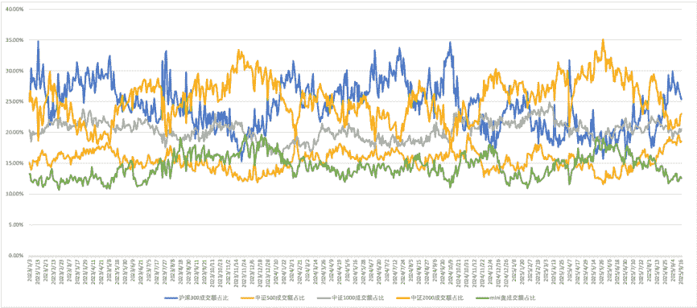

### 2）TMT和红利低波成交占比

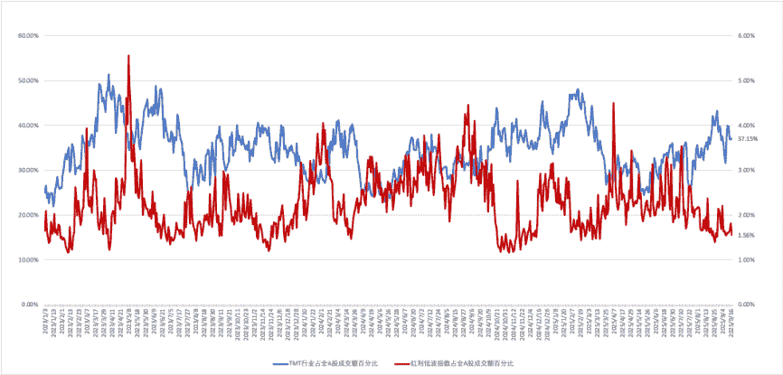

## 4. 沪深300期指波动率

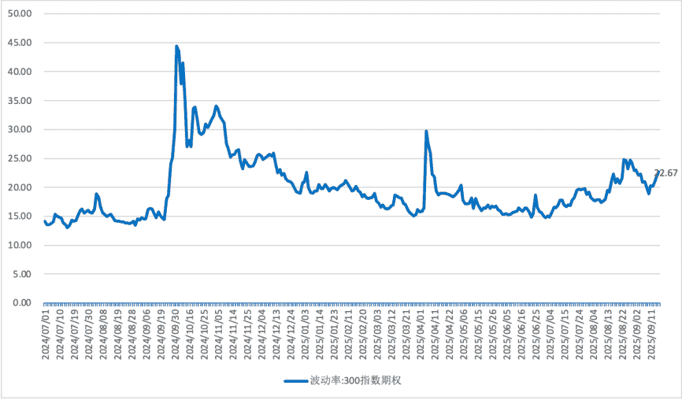

## 5. 杠杆与利率

### 1）融资资金

| 数据日期 | 2025/9/16 |
|---|---:|
| 余额 | 23,758.11 |
| 较前一日变动（亿元） | 225.11 |
| 22年末累计变动（亿元） | 6,638.05 |

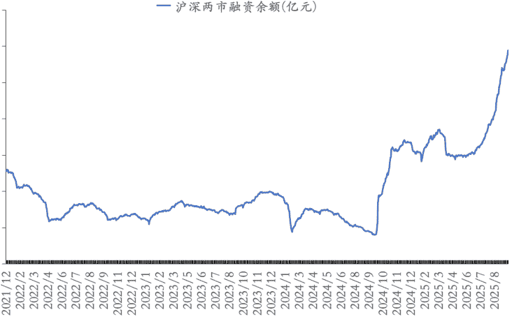

### 2）担保比例

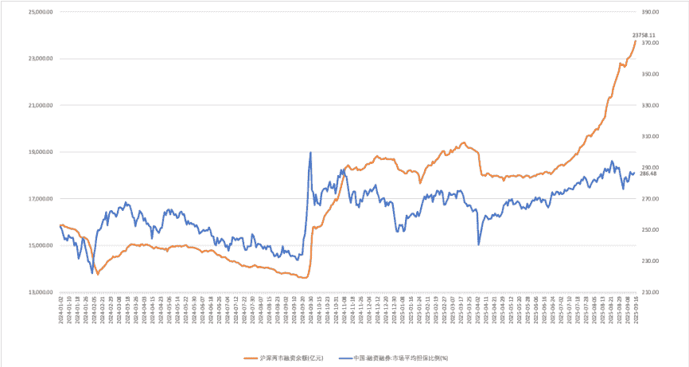

### 3）十年国债收益率

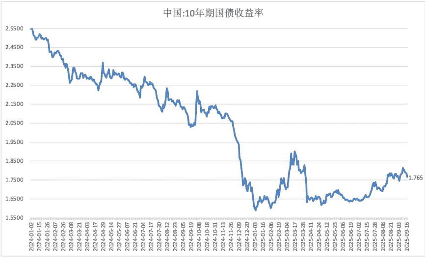

### 4）南华黑色系指数

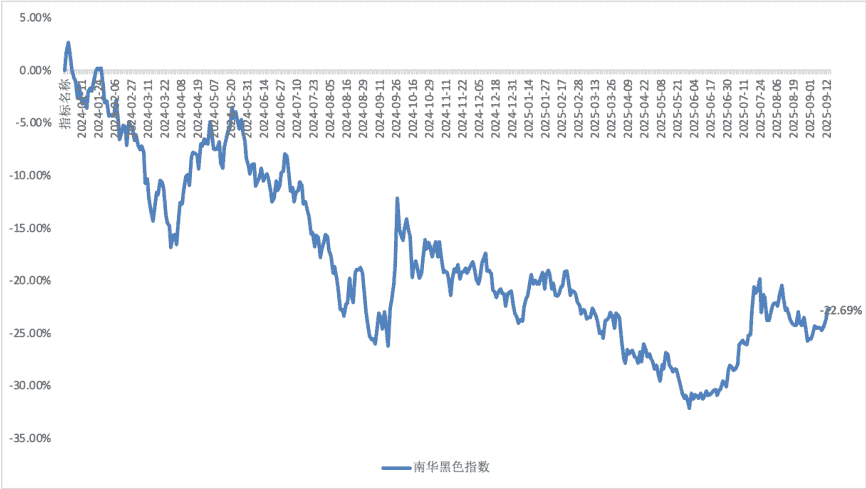

### 5）ETF资金

| 日期 | 股票量化ETF净申购（亿元） | 沪深股票型ETF净申购（亿元） | 深市股票型ETF净申购（亿元） | 股票量化ETF净流入资金量（亿元） | 中证500ETF净流入（亿元） |
|---|---:|---:|---:|---:|---:|
| 2025/4/1 | -4.53 | -5.23 | 0.71 | 6.07 | 111.18 |
| 2025/4/2 | 47.29 | 31.24 | 16.71 | 45.90 | 5.24 |
| 2025/4/3 | 89.08 | 33.25 | 55.83 | 84.24 | 10.43 |
| 2025/4/7 | 355.17 | 210.88 | 144.29 | 742.30 | 10.42 |
| 2025/4/8 | 381.44 | 277.68 | 103.75 | 1062.95 | 40.15 |
| 2025/4/9 | 71.04 | 20.81 | 50.23 | 121.57 | -30.05 |
| 2025/4/10 | -1.93 | 3.42 | -5.35 | -25.72 | 8.96 |
| 2025/4/11 | -48.59 | -35.36 | -13.22 | -63.08 | -32.44 |
| 2025/4/14 | 42.17 | 34.17 | 13.02 | 88.02 | 9.01 |
| 2025/4/15 | 14.11 | 26.93 | -12.83 | 68.05 | 12.19 |
| 2025/4/16 | 71.31 | 54.67 | 16.63 | 271.81 | -3.47 |
| 2025/4/17 | -30.22 | -16.29 | -13.93 | 22.75 | -13.68 |
| 2025/4/18 | 26.27 | 38.37 | -12.09 | 97.80 | 24.43 |
| 2025/4/21 | -43.30 | -24.03 | -19.26 | -12.15 | -16.63 |
| 2025/4/22 | -22.70 | -25.76 | 3.06 | -51.89 | 0.29 |
| 2025/4/23 | 0.51 | 4.16 | -3.65 | -4.85 | 13.42 |
| 2025/4/24 | 25.59 | 13.50 | 12.09 | 18.99 | 10.76 |
| 2025/4/25 | 9.46 | 14.12 | -4.65 | -11.24 | 14.39 |
| 2025/4/28 | -39.47 | -20.26 | -19.21 | -61.93 | 0.26 |
| 2025/4/29 | -23.84 | -6.89 | -16.95 | -18.51 | 4.15 |
| 2025/4/30 | -44.11 | -25.82 | -18.30 | -50.39 | -7.07 |
| 2025/5/6 | -0.09 | 3.88 | -3.97 | 4.80 | 0.00 |
| 2025/5/7 | -26.72 | -20.96 | -5.71 | -56.29 | 3.66 |
| 2025/5/8 | -20.61 | -3.78 | -16.83 | -14.08 | 5.51 |
| 2025/5/9 | -25.98 | -16.59 | -9.39 | -38.54 | 11.03 |
| 2025/5/12 | -45.20 | -11.46 | -33.74 | -47.46 | 10.96 |
| 2025/5/13 | -138.04 | -98.74 | -39.30 | -150.34 | -3.72 |
| 2025/5/14 | -33.40 | -13.83 | -19.56 | -9.90 | 6.97 |
| 2025/5/15 | -42.10 | -19.71 | -22.39 | -63.31 | 9.55 |
| 2025/5/16 | -55.25 | -34.43 | -20.83 | -77.98 | -67.84 |
| 2025/5/19 | -16.24 | -3.73 | -12.51 | -35.42 | -37.99 |
| 2025/5/20 | -51.99 | -28.08 | -23.91 | -26.09 | 0.13 |
| 2025/5/21 | -58.93 | -26.86 | -32.07 | -53.16 | 4.28 |
| 2025/5/22 | -22.26 | -10.73 | -11.53 | -20.21 | 1.24 |
| 2025/5/23 | -32.32 | -14.14 | -18.18 | -16.12 | 6.24 |
| 2025/5/26 | 16.20 | 15.85 | 0.35 | 41.34 | 2.02 |
| 2025/5/27 | 19.07 | 10.64 | 8.42 | 32.88 | 12.30 |
| 2025/5/28 | -13.00 | -8.16 | -4.84 | -18.46 | 3.64 |
| 2025/5/29 | 3.63 | 1.57 | 2.06 | 6.45 | -5.56 |
| 2025/5/30 | -40.27 | -28.77 | -11.50 | -69.78 | 8.50 |
| 2025/6/3 | -26.12 | -17.42 | -8.70 | -2.25 | -8.98 |
| 2025/6/4 | -22.16 | -9.52 | -12.64 | 8.32 | 3.53 |
| 2025/6/5 | -44.71 | -23.84 | -20.87 | -37.29 | -16.93 |
| 2025/6/6 | 3.13 | 3.22 | -0.10 | 0.21 | 0.91 |
| 2025/6/9 | -21.37 | -9.63 | -11.75 | 36.58 | -3.26 |
| 2025/6/10 | -68.20 | -31.72 | -36.48 | -84.32 | -2.57 |
| 2025/6/11 | -45.81 | -17.58 | -28.23 | -29.71 | -0.52 |
| 2025/6/12 | -38.36 | -12.03 | -26.33 | -53.53 | 1.30 |
| 2025/6/13 | 19.28 | 15.72 | 3.56 | -13.51 | 6.65 |
| 2025/6/16 | 46.70 | 42.26 | 4.44 | 70.88 | 3.46 |
| 2025/6/17 | 46.52 | 39.39 | 5.23 | 34.63 | 21.79 |
| 2025/6/18 | 10.92 | 10.87 | 0.05 | 3.59 | 1.49 |
| 2025/6/19 | 67.80 | 58.84 | 8.96 | 22.03 | -0.92 |
| 2025/6/20 | 44.93 | 36.95 | 7.98 | 42.06 | 6.86 |
| 2025/6/23 | 42.80 | 37.78 | 5.02 | 42.61 | -5.35 |
| 2025/6/24 | -10.86 | 12.43 | -23.29 | 2.68 | -8.96 |
| 2025/6/25 | -15.12 | -4.66 | -10.46 | -32.80 | -12.00 |
| 2025/6/26 | -34.42 | -27.92 | -6.50 | -58.00 | 6.79 |
| 2025/6/27 | -33.65 | -14.92 | -18.74 | -71.85 | -6.28 |
| 2025/6/30 | 22.47 | 2.88 | 19.59 | -37.61 | -7.49 |
| 2025/7/1 | -90.17 | -54.05 | -36.12 | -123.57 | 11.12 |
| 2025/7/2 | 42.77 | 33.85 | 8.92 | 29.12 | 18.92 |
| 2025/7/3 | 0.02 | 20.77 | -20.75 | -25.58 | 4.05 |
| 2025/7/4 | 89.48 | 98.77 | -9.29 | -32.88 | -0.57 |
| 2025/7/7 | 16.41 | 16.99 | -0.58 | 7.42 | 3.12 |
| 2025/7/8 | -18.63 | -2.68 | -15.95 | 5.96 | -13.23 |
| 2025/7/9 | -17.01 | -4.54 | -12.47 | -17.41 | 11.51 |
| 2025/7/10 | 13.23 | 29.18 | -15.95 | -0.01 | 15.16 |
| 2025/7/11 | 62.91 | 22.56 | 40.35 | 70.99 | 2.73 |
| 2025/7/14 | 15.68 | 15.58 | 0.10 | -6.63 | 12.27 |
| 2025/7/15 | -16.77 | 31.36 | -48.13 | -38.11 | 13.97 |
| 2025/7/16 | -13.44 | 1.93 | -12.64 | -10.77 | -6.00 |
| 2025/7/17 | -7.88 | -1.97 | -5.91 | 3.10 | -2.74 |
| 2025/7/18 | -35.53 | -41.69 | 5.15 | -33.32 | -10.09 |
| 2025/7/21 | 30.31 | 2.41 | 27.90 | 37.97 | 2.27 |
| 2025/7/22 | 37.84 | 0.19 | 37.65 | 25.42 | -17.82 |
| 2025/7/23 | -7.18 | -14.05 | 6.87 | 22.22 | -7.44 |
| 2025/7/24 | -26.28 | -19.14 | -7.13 | 26.68 | -7.91 |
| 2025/7/25 | -15.78 | -21.54 | 5.76 | -5.01 | 1.99 |
| 2025/7/28 | -9.37 | -2.93 | -6.44 | -47.60 | 16.29 |
| 2025/7/29 | -19.81 | -25.71 | 5.90 | -59.48 | -28.61 |
| 2025/7/30 | 72.55 | 31.41 | 41.14 | 49.88 | 5.59 |
| 2025/7/31 | -64.56 | -36.68 | -27.78 | -143.19 | -43.66 |
| 2025/8/1 | 216.90 | 209.79 | 7.11 | -12.95 | -15.00 |
| 2025/8/4 | 10.84 | 1.71 | 9.13 | 8.87 | -18.69 |
| 2025/8/5 | 21.12 | 2.86 | 18.26 | 7.04 | 8.15 |
| 2025/8/6 | 53.80 | 30.15 | 23.65 | 63.84 | 3.72 |
| 2025/8/7 | -4.28 | -10.78 | 6.50 | -33.72 | -12.88 |
| 2025/8/8 | 63.26 | 27.69 | 35.57 | 7.11 | 0.51 |
| 2025/8/11 | 17.09 | 17.69 | -0.60 | 32.07 | -16.31 |
| 2025/8/12 | -4.22 | -4.52 | 0.30 | -57.11 | -55.41 |
| 2025/8/13 | -41.78 | -29.74 | -12.04 | -20.67 | -23.44 |
| 2025/8/14 | -110.58 | -88.26 | -22.32 | -45.35 | -29.09 |
| 2025/8/15 | 58.38 | 39.69 | 18.69 | 91.50 | -18.63 |
| 2025/8/18 | 19.19 | 20.83 | -1.64 | 25.55 | -28.64 |
| 2025/8/19 | 93.66 | 49.06 | 44.60 | 55.83 | 2.77 |
| 2025/8/20 | 175.02 | 44.10 | 130.92 | -55.87 | -39.83 |
| 2025/8/21 | 88.20 | 54.17 | 34.03 | 45.81 | -3.98 |
| 2025/8/22 | -3.31 | -25.17 | 21.86 | 51.94 | -92.00 |
| 2025/8/25 | 162.87 | 84.06 | 78.81 | 151.34 | -5.29 |
| 2025/8/26 | 141.01 | 66.37 | 74.64 | 115.24 | 9.63 |
| 2025/8/27 | 28.98 | 2.93 | 26.05 | -39.34 | -38.78 |
| 2025/8/28 | 2.38 | 17.28 | -14.90 | -71.68 | -37.30 |
| 2025/8/29 | 143.09 | 72.72 | 70.37 | 126.69 | 28.95 |
| 2025/9/1 | 88.64 | 42.11 | 46.53 | 28.31 | -17.15 |
| 2025/9/2 | 127.28 | 61.02 | 66.26 | 129.51 | -17.25 |
| 2025/9/3 | -29.56 | -3.03 | -26.53 | -102.40 | -30.26 |
| 2025/9/4 | 63.99 | 43.60 | 20.39 | 63.63 | -32.42 |
| 2025/9/5 | 10.02 | 14.53 | -4.51 | -37.46 | -27.19 |
| 2025/9/8 | 54.86 | -2.54 | 57.40 | -12.19 | -31.54 |
| 2025/9/9 | 38.12 | 22.32 | 15.80 | 7.45 | -21.94 |
| 2025/9/10 | 18.62 | -0.76 | 19.38 | -11.40 | -16.80 |
| 2025/9/11 | 103.62 | 54.59 | 49.03 | 116.72 | -39.21 |
| 2025/9/12 | 39.73 | 11.87 | 27.86 | 22.62 | -14.67 |
| 2025/9/15 | -6.14 | -10.62 | 4.48 | -50.56 | -14.73 |
| 2025/9/16 | 22.99 | -0.89 | 23.88 | 21.71 | -37.61 |

| 合计 | 1848.99 | 1222.66 | 652.22 | 1476.94 | -785.19 |

## 6）市场（沪深京）成交额变化

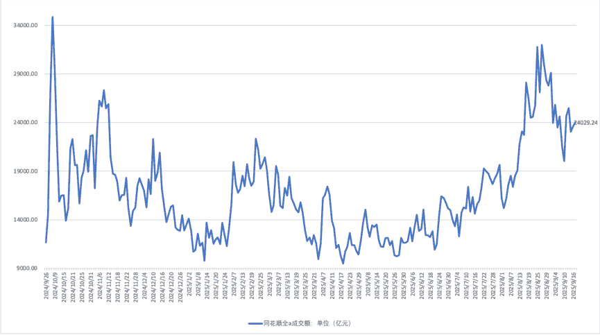

## 7）市值20亿以下股票的趋势图

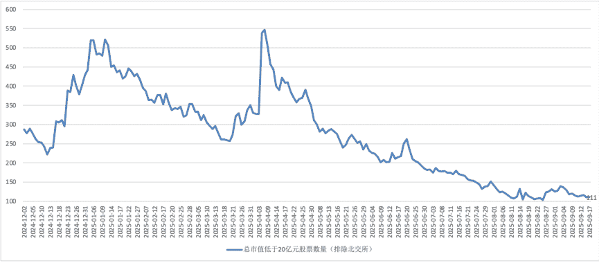

## 8）南向资金趋势图

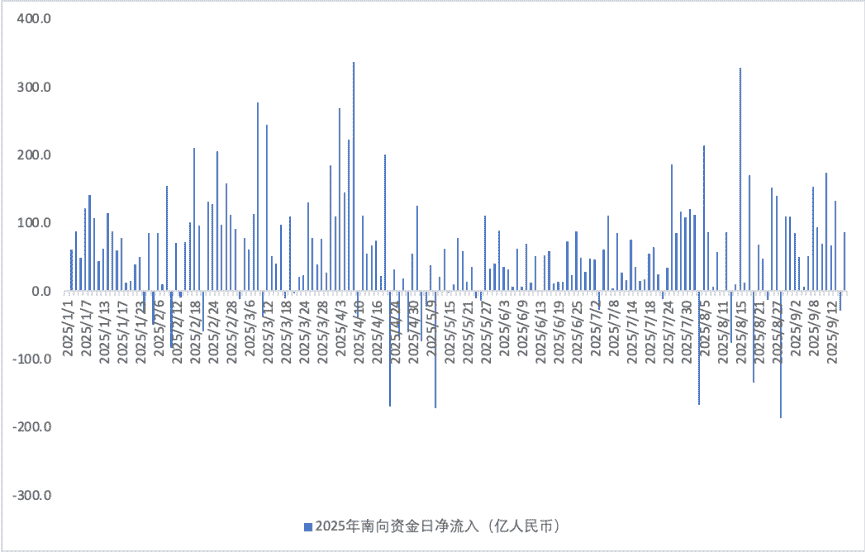
