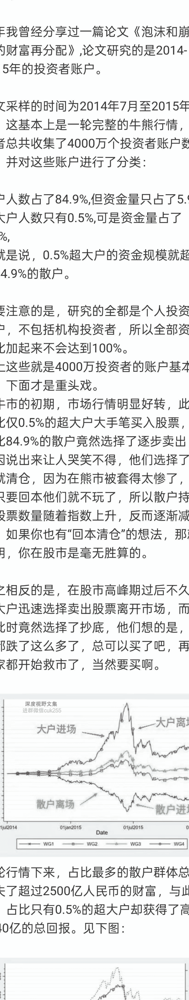
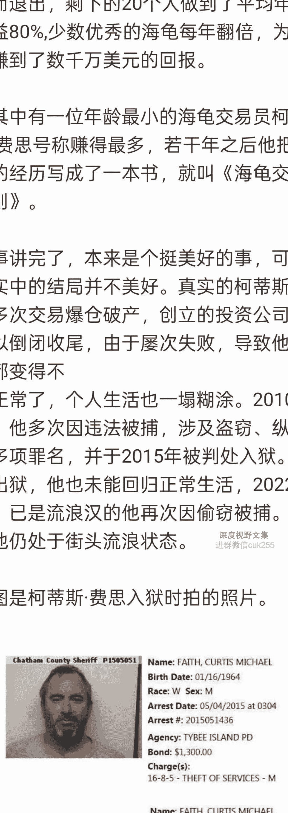

# 2025.09：中国客户在买什么

2025.09，中国客户在买什么？今年九月，中国消费表现依旧强劲，数据显示，社会消费同比增长6.8%，高于去年同期水平。

| 商品品类 | 消费占比 | 同比增长 |
| :--- | :--- | :--- |
| 17万以下 | 20.1% | -9.9% |
| 17万-50万 | 24.8% | 18.3% |
| 50万-100万 | 25.5% | 7.5% |
| 100万以上 | 10.2% | 9.6% |
| 合计 | 70.0% | 31.5% |

从数据中可以看出，趋势是：虽然高收入人群的消费在增长，但中低收入人群的消费在萎缩，这意味着消费分化正在进一步加剧。有人有钱越花越有，没钱越花越方便。

但是我们看来，结论是这样的：虽然高收入人群的消费在增长，但中低收入人群的消费在萎缩，这意味着消费分化正在进一步加剧。如果我们继续关注下去，会发现：高收入人群的消费正在变得理性，而中低收入人群的消费正在变得激进：这种现象在过去几年里已经非常明显了。

数据显示，中国最富的10%人口占据了全国财富的7%，而最贫穷的50%人口只占了全国财富的10%。这种贫富差距在未来可能还会进一步扩大：

如果我们再来看，中国最富的人口总财富占据了28%的财富，而穷人则占据了31%的财富。但是，这并不意味着穷人没钱了，相反，由于富人消费萎缩带来的‘负效应’，穷人反而花得更多了。这看似很矛盾，但其实是有逻辑的。我们可以看这张图：

如果我们再来看，中国最富的人口总财富占据了28%的财富，而穷人则占据了31%的财富。但是，这并不意味着穷人没钱了。

# 深度视野优质集圈（链接优质社群，助你成功）

全部包含以下内容：限时年费188/年 加微信cuk255

- ① 粉丝含倍时文交流群群对话（原价 365 元/年）
- ② 子明私享汇（含）内部文章
- ③ 政事室（顾子明）付费内容加送子明群
- ④ 米联储【作者刘耕宏】（原价 599 元/年）
- ⑤ 欧洲金雀会员专属文章（原价 328 元/年）
- ⑥ 砖瓦内部文档（原价 400 元/年）
- ⑦ 卢克文深度读书会专属文章（原价 699 元/年）
- ⑧ 进财财经知识星球（原价 3310 元/年）
- ⑨ 猫哥的视界知识星球文章（原价 299 元/年）
- 10 财经周【独家新闻】（原价 1498 元/年）
- 11 杨世光在金圈（原价 2200 元/年）
- 12 森森悦财经知识星球（原价 1600 元/年）
- 13 极源译译付费文章（持续更新）
- 14 司马林解读猛选全套音频和全套书籍收藏无割（原价 2.3 万）
- 15 虚构三部曲[民国梦、帝国争亡、不被理解的MAO]（原价 599 元）
- 16 卢克文知识星球文章（原价 268 元/年）
- 17 额外再送：卢祺元微博付费专栏、三村丰老文、三花九树文集

不定期内容：——（更多资源不下下去......）

- ① 守夜人司令知识星球、节奏魔王知识星球、成术财富圈、雪花波老头等
- ② 创始星球、达叔浅论星球、成术财富圈
- ③ A 视野、大树乡谈、江宁后、泮咩说、上海海家学等付费文集
- ④ 西风付费文章、老端、高在八之时、局外人的视界、升值、老体制内等其它一些大V付费文集（每月不低于600元的付费文集）
