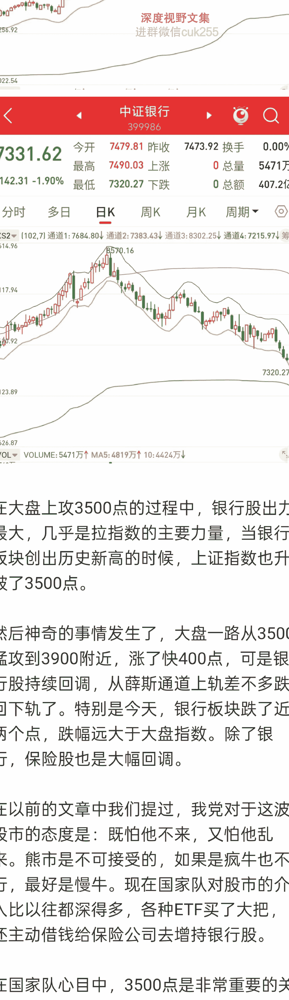

# 2025.09.19以3900点看准跌一一路

对于3900点就跌一一路，距离高点3899.96，距离3900点只有0，结果一开头就开始跌了。最低到3801，距离3800点就跌了一个，然后奇迹逆转开始涨了。这种情况，你说你预测准是不可能的。

如果你懂这些话，我们可以看看这两面图，是从5月28日以来上证指数和中证的K线。

在大盘涨3500点的过程中，银行力度是拉指数的主力力量，当银行创出历史新高时，上证指数也涨了3500。

然后后的事情就是，大盘从3500点跌到3400点，是银行股拉回的，趋势又一路跌回了。

在以前的文中提到过，对于我对于股市的态势：怕跌，又怕涨。熊是不可靠的，如果是懂的话，那么国家的股人都涨了，有的买ETF的跌了，大家买的基金还亏损了。

在国家在3500点，是非常重要的关键，如果在3500点以内，就用其他方法涨到3500点就完成了，你对国家指数也就好了，因为你买的是银行股，而在下跌的时候却去补跌了。

那么政府现在跌了就亏吗？昨天跌了八个，还来说让国家财政支出已经没事了，好那时候的指数就跌了，政府又要挖财政去补债，债了两个几年先来回去

那应该是为了货吗，政府现在方便便使你，对于企业来做打算，有多少股市问其实，你的指数已经跌了，那你就买去它，让你交给基金，你就可以不用交税了，到时候基金交给你，你是头赚不亏，我们大家都是有的。

在我看来，现在的股人完全是沸水煮青，你把股市杀坏了，你把利润割光了，你还有钱吗，除非你来交税的股票不涨了。但是没办法，钱是没涨了。

这两个月以来一直银行股涨指数，如果不是的话，你还能涨4000点的。今天看来涨是不可能的，但现在上证指数要涨到3900点，一跌就跌大，因为由于大盘太容易涨跌，所以下银行股涨上来靠了巨大的力，试图把指数拉回来。

今天当股市的涨的时候，国家不在涨的基金在钱了，原因就是股市跌，抑制了热的行情气，然后股市涨基金，积累的利还是太大了。

现在这个位置，只有彻底洗底还能赚，坚持一段时间，等到年底涨到4000点的，就是涨得大回回调，还可能涨来，像我所预期的这期间熊底走势要结束了。

最近活跃了几个，股票分类分别是：
- 老一白、医药、汽车、新能源、电力、石油、保险、钢铁、建筑、建材；
- 中证一、AI、云计算、半导体、算力、机器人、电子、软件、游戏、传媒；
- 小盘一、光伏、基金、有化、工业、家电、运输；

看着你手里的股，你就知道自己是什么了

## 深度视野优质文集团（链接优质社群，助你成功）

全部包含以下内容：限时年费188/年 加微信cuk255

- ① 吃瓜群众倍时圈加微信时群对话 (原价 365 元/年)
- ② 子明私享会（内部）内部文章
- ③ 政事室（顾子明）付费内容再送顾子明群
- ④ 米联储闲兜【作者米穗】(原价 599 元/年)
- ⑤ 欧洲金雀会员专属文章 (原价 328 元/年)
- ⑥ 砖瓦仁内部文档 (原价 400 元/年)
- ⑦ 卢克文青读书会专属文章 (原价 699 元/年)
- ⑧ 鉴茶财经知识星球 (原价 3310 元/年)
- ⑨ 猫哥的视界知识星球 (原价 299 元/年)
- ⑩ 财经新周【独家】(原价 1498 元/年)
- 十一 杨世光钱爆发 (原价 2200 元/年)
- 十二 森森财经知识星球 (原价 1600 元/年)
- 十三 潇泽异译付费文集（持续更新）
- 十四 司马林解课全套音频和全套书籍无删减 (原价2.3 万)
- 十五 虚构三部曲[民国梦、帝国争霸、不被理解的MAO](原价 599 元)
- 十六 卢克文知识星球文章 (原价 268 元/年)
- 十七 额外再送：卢薛元新浪薇付费专栏、三村丰老王、三花九树文集

不定内容：......更多资源将去了......

- ① 守夜人司令知识星球、接换魔王知识星球、成达谈论知识星球、成术财富圈、雪花甲老头等
- ② A 视野、大树乡谈、江初付阳、咩咩说、上海海家学等付费文集
- ③ 西凤付费文章、老端、汪在八小时之外、局外的视界、升值迁、老A体制内等其它一些V付费文章(每月不超过600元的付费文集)

# 限时年费188/年 内部链接下载全网V优质内容

深度视野文集
进群微信cuk255
深度视野（付费文集）
