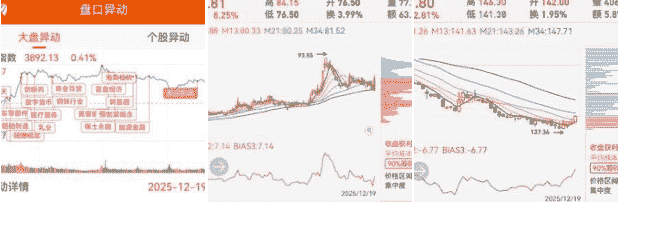

# 电风扇 市场无量，题材散乱，...知识星球

社群工具 笔记

## 详情 返回鉴茶财经

南南大王
2025-12-19 15:04

电风扇

市场无量，题材散乱，全部给你轮一遍。

各个的想法，周末的形势明朗。

请注意，有机构的资金开始消耗了，它的两大阵地是中免和上海机场。

后来又看了爱美，艾玛，上面消费芜多的套牢盘。

周末同学们可以研究一下，哪些消费还有底部逻辑，上面套牢牢的。

最后编辑：2025-12-19 15:09

等77人觉得很赞

## 深度视野VIP群 人工追踪50+大付费群加微信cuk255 微信ch5568

### 南南大王 回复：上面的代码编码的很干净，图形走的可以
2025-12-19 15:14

糖包：请大王中天精装今天的房产装修还是装修上搭了美光hbm的东方？
2025-12-19 15:08

南南大王 回复 糖包：房地产。目前市场上有多少人知道远见智奋，它在软件里连存储的概念都没有，直观上美光就是一字板了。
2025-12-19 15:13

纵横 回复 糖包：装置装修的拆补上的堵糖概概念
2025-12-19 15:30

糖包 回复 纵横：大王之前文章有讲，中天有远见智奋的股权
2025-12-19 15:32

无常：中免的代码结构和技术图形比爱美蜜好多了
2025-12-19 15:12

水镜：最棒的话是量化还能了吗，下周可期
2025-12-19 15:12

sniper 回复 水镜：王侄是哪票？
2025-12-19 15:14

妮媛 回复 sniper：平滑
2025-12-19 15:16

小于儿 sniper：平溜吗？
2025-12-19 15:16

契丹小浪 回复 水镜：三夭去二，航班还在。
2025-12-19 15:24

success 回复 契丹小浪：航班发展吗？
2025-12-19 17:56

水镜 回复 契丹小浪：商业航机构也入了不少，不算玄学情绪。
2025-12-19 19:23

大维：大王，胜宏怎么看
2025-12-19 15:13

南南大王 回复 大王：图形上业务并无问题，受美股AI暖软影响而已
2025-12-19 15:30

磊Fred：请大王，今天今天农衣领头铁跌，又是传统技能能预期卖
2025-12-19 15:15

### 叶枫 回南南大王：兆易，君正能打不？
2025-12-19 17:10

张荣佑:cpo宰拿不动
2025-12-19 15:15

张不停：安克创新算不算消费，没络妥妥吧
2025-12-19 15:19

大松果：大王吉祥，永辉超市我今天出局了。后续消费板块乳业有戏了吗
2025-12-19 15:20

南南大王回大松果：有，比较，会机会会的，现在的消费还是超级早期
2025-12-19 15:31

大松果回南南大王：谢谢大王
2025-12-19 17:33

下巨人：您一个乱了得了
2025-12-19 15:21

斌：想教大王龚格不是最近会走一波呢？放量上涨 缩量下跌也没有跌五日线
2025-12-19 05:23

南南大王回 斌：走不走不知道，目前的态势较高，可能是它在等化或者者息
2025-12-19 15:28

斌回南南大王：谢谢大王指点 那我继续持有了
2025-12-19 15:43

露露小姐：大王，pc后面怎么看回训
2025-12-19 15:31

南南大王回露露小姐：波动都是正常的，看产业逻辑。两天沪土电子的订单了，何况别人。
2025-12-19 15:36

lin:水羊
2025-12-19 15:31

南南大王回 lin：你周末买片御颜，周一谈感受
2025-12-19 15:35

文武：最近好了，从他站上60日线开始进
2025-12-19 13:33

## 深度视野VIP群 人工追踪50+大付费群加微信cuk255 微信ch556

社群工具 笔记

顺势而为：欢乐，加入自选个月一直不下，这一周突破历史高
2025-12-19 15:52

永满流水热泪：牛市结束了消费，持股待涨
2025-12-19 16:01

华华：大王：无人驾驶，有没有走向商业航天的趋势？请分析一下个股和产业趋势，
2025-12-19 16:01

Adele*: 依依怎么样？今天强势上踩4日线
2025-12-19 16:09

张汉：大王金信怎么看。感谢
2025-12-19 16:30

南润大王回复 张汉：二线的铜，AI硬件英伟达订单基本啥，国内那帮你们给的利润太少了
2025-12-19 17:47

希望：新易盛和天大王怎么看
2025-12-19 16:43

Adrian_蒜蕾：昨天有位星说的比特感觉挺好的，均线也不错，游戏板块，还能不
2025-12-19 17:16

和兴隆杨星：请教大王，上海新阳质如何？
2025-12-19 17:30

南润大王回复 和兴隆杨星*：也还，总体上光刻防跌，量太小，每次和日本紧张的时候会议就会带来

知常：大王，您看看鸿大销？我看它位于底部，而且穹碑比较中

## 深度视野优质圈，链接优质社群，助你成功

全部包含以下内容：限时年费188/年 加微信cuk255

- 吃瓜群众倍时圈加对话（原价365 元/年）
- 子明私享（含）内部文章（原价568 元/年）
- 政事堂（原子）付费内容再送群聊
- 米联储闲【作者米糕】原价599 元/年）
- 欧洲金雀会员专属文章（原价328 元/年）
- 铸五厂内部圈（原价400 元/年）
- 卢克文青读书会专属文章（原价699 元/年）
- 鉴茶财经知识星球（原价3310 元/年）
- 猫哥的视野知识星球（原价299 元/年）
- 财经新周刊【家新闻》（原价1498 元/年）
- 杨世光在金钱（原价2200 元/年）
- 森森财经知识星球（原价1600 元/年）
- 源译译文章（持续更新）

## 深度视野文集 群微微信cuk255

- 14 司马林解读毛选全套音频和全套书籍珍藏版无割（原价2.3 万）
- 15 虚虚三部曲[民国梦、帝国战争、不被理解的MAO]（原价599 元）
- 16 卢克文知识星球文章（原价268 元/年）
- 17 额外再送：卢阡新源涨爆获付费专栏、三村边老王、三花九术文集不定期内容：（更多资源将写下了......

① 守夜人司令知识星球、接Funk魔王知识星球、生才有知识星球、
② 创始笔记、达沃译论星球、成付财富圈、雪球花甲老头等
③ A视野、大树乡谈、江宁后、泮咩说、上海海学等付费文集
④ 西风付费文章、老端、赢在八小时之外、局人的视野、升值、老A体制内等其它一些大V付费文章
