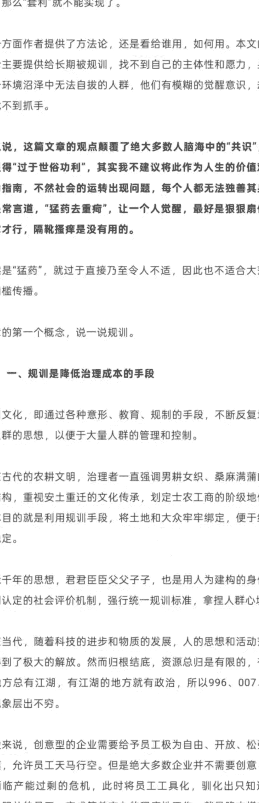

# 养老资产的积累，老年人要学会这件事

来源: 刘源 · 2020年10月27日 16:10 阅读26次

很多人认为，老了以后养老要指望子女，其实并不是的。指望子女养老的风险是非常大的，因为子女有自己的生活，不一定能顾及你。我们要学会独立，要靠自己。

现在的社会，我们已经不能指望子女养老了。现在的年轻人自己压力很大，工作、学业、生活的压力重重。我们不能再指望子女来负担我们的养老，我们要学会自己规划未来。

想要有养老金，最好的办法就是趁早开始积累。趁着年轻，身体健康，有精力，通过合理的储蓄和理财，给自己攒下一笔属于自己的养老金。

养老规划并不是等老了才开始，而是从年轻就要开始。越早开始，压力越小，积累也越容易。

## 一、坚持养老规划观念

坚持养老规划，就是长期的规划。如果不做好规划，等老了可能太晚了，到时候晚年生活可能没有保障。

养老规划的本质，就是对自己的未来进行规划。我们要根据自己的需求，合理进行储蓄和投资，让自己的晚年有保障。

养老规划不仅是为了生活质量，更是为了晚年的尊严。有了自己的养老金，老了才有底气，生活才能过得更有尊严，而不是看子女的脸色。

## 二、增加养老金，让晚年更有钱

想要有足够的养老金，最好的办法就是增加自己的养老金。这可以通过多种方式来增加自己的养老金收入。

