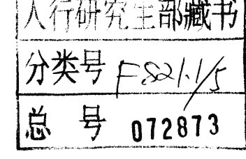
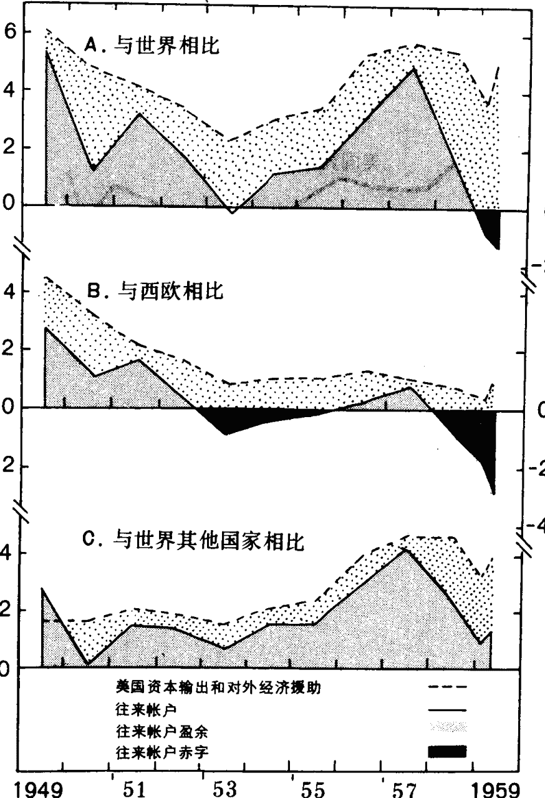
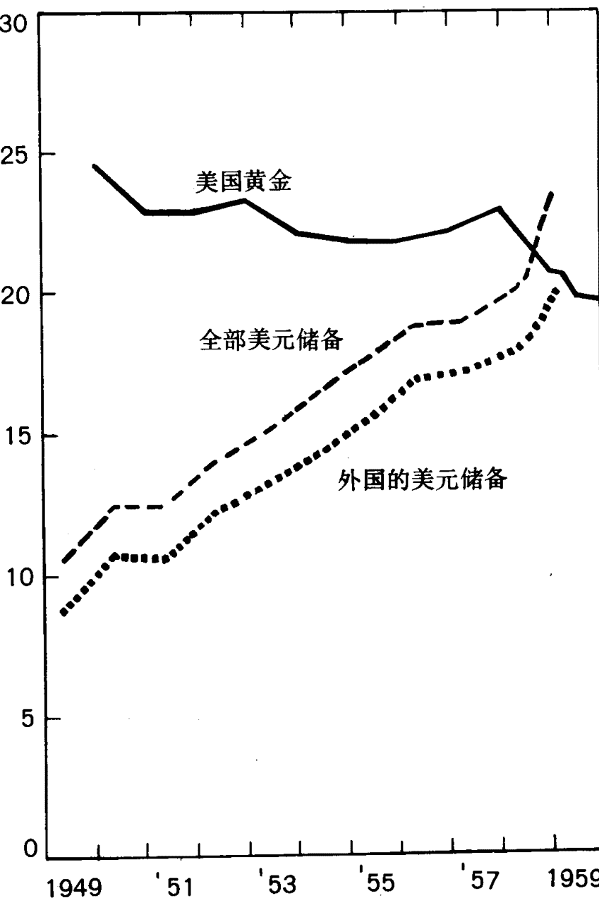

# 黄金与美元危机——自由兑换的未来

[美]罗伯特·特里芬 著
GOLD AND THE DOLLAR CRISIS
The Future of Convertibility

商务印书馆

## 知识星球TOP

汇聚全网高价值资源
打造TOP级分享社群

- 付费文章
- 付费社群
- 时政&国际
- 副业&搞钱
- 财经&股市
- 行业报告

时政·历史·职场·体制·自媒体学习·军事·软件·影音·社会学

公众号:知识星球TOP 微信:top28688 微信:top28388

添加微信 免费进群

## 黄金与美元危机
——自由兑换的未来

〔美〕罗伯特·特里芬 著
陈尚霖 雷达译

商务印书馆
1997年·北京

## 图书在版目(CIP)数据

黄金与美元危机(美)罗伯特·特里芬:陈陶鲁,雷达译.-北京:商务印书馆,1997
著者:罗伯特·特里芬
ISBN 7-100-01995-8

I.黄…II.特…III.陈…IV.雷…Ⅴ.国际货币制度研究 IV.F821.1

中国版图书图书 CIP 数据核字(95)18256号

## HUÁNGJÍN Y MĚIYYUÁN WĒIJĪ

## 黄金与美元危机
——自由贸易的未来

（美）罗伯特·特里芬 著
陈陶鲁 雷达译

商务印书馆 出厂
(北京东直大街36号 邮编100710)
新华书店总店北京发行所发行行
书号:中外品字F70
ISBN 7-100-01995-8/F:231

1997年12月1日 印号 850-1168 1/32
1997年12月北京版第1次印刷字数 145万
印数 2000册 装订数 6/4

定价: 9.50 元

## Robert Triffin
## GOLD AND THE DOLLAR CRISIS
## The Future of Convertibility

Revised Edition
Yale University Press, 1961

根据耶鲁大学出版社1961年修订出版版

## 译前言

经济学家的勇气在于不完美世界形势的瞬息万变中坚持自己的观点很快而成为陈词滥调。经济学家的未来在于不幸预言中的众人所不愿看到的经济发展的态势。30多年过去了。《黄金与美元危机》书中的预测中了什么？书中的方案实施了多少？国际货币体系以何种制度为最佳方案？我们在大学、欧洲合作管理局、经济理事委员会、拉丁美洲经济委员会以及国际等机构有着密切联系。

罗伯特·特里芬（Robert Triffin）是耶鲁大学政治学教授，美国知名的国际经济与金融专家，他曾与美国联邦储备管理委员会、国际货币基金组织欧洲合作管理局、经济顾问委员会、拉丁美洲经济委员会以及国际等机构有着密切联系。他是特里芬的代表。

书中描述的有关改革国际货币基金组织（IMF）的想法被视为“特里芬计划”，在各国，经济学界及西方新闻界引起关注。1961年，“特里芬计划”文章发表后，国际货币基金组织和西方一些国家的政府也曾试图研究“特里芬计划”的实用性；1972年，当美元与黄金危机爆发时，尼克松总统在周末视听中，几乎原封不动地引用了特里芬的原话——“美国再不能自缚双手参与国际竞争了”。特里芬所言如此，足以被称为国际金融领域的一个里程碑，此外特里芬著的《货币与银行》（1946年）、《欧洲货币》（1957年）等著作，在西方具有很大影响。

黄金与美元危机
——自由兑换的未来

黄金危机应该是说是1921—1931年资本主义世界的经济中已经发生；而真正意义上的以美元中心的布雷顿森林体系的崩溃，发生在本世纪70年代初期。特里芬在书中分析的是战后国际金融体系终焉之时。第二次世界大战之后，英、美等国试图重建国际金融体系，其目的在于贸易的发展和资本流动得到控制。但在第二次世界大战以后，由于世界各国希望美国提供援助，如此，在1944年以前，美国、凯恩提出的“联合方案”（国际货币基金组织）为基础，标志着以美元中心的国际金融体系的出现。布雷顿森林的国际金融，基本上是以美元为核心；在工业化国家，除法国、加拿大等少数国家外，汇率浮动的货币基本上都是稳定的。布雷顿森林协议规定的宗旨，促进国际贸易和资本流动的自由化。1948年—1949年、1953年—1957年的几次资本主义经济危机，在国际金融体系内部都比较地缓解了。

然而，这一以美元中心的布雷顿森林体系从一开始就存在严重的缺陷，因为这一体系从一开始就把黄金和美元作为储备，各国中央银行对国际收支的调节能力，而黄金和美元的供给如何呢？随着国际贸易的扩展，各国所需的国际支付能力，在第二次世界大战期间的金融体系中已被反复证实，各国在储备的同时也储备了一定的外币。这种做法被视为具有同等的作用。1929年之前，主要由英镑来，而在布雷顿森林体系中已由美元来，向其他国家储备积累起来，以此作为调节收支差异的手段。为了使国际收支状况恶化，美国储备减少就会动摇美元价值，最终影响了国际汇率制度的建立。国际货币体系中的货币作为储备手段的这一缺陷，直到今天看来已成为国际金融的基本事实，但特里芬早在50年代末就表现了详细的分析。那时，在布雷顿森林体系的运作中出现了国际收支平衡的重视，而其崩溃已有十余年的时间。对战后国际货币体系的担忧，在1958年后是金融领域普遍的问题。对于这个问题，特里芬的分析有两个点：

第一，尽管战后建立的布雷顿森林体系在1958年前出现了种种问题，但是作者并没有把问题的实质归咎于固定汇率制度，也不是把“自由浮动汇率制度”作为解决问题的重要手段。作者认为，在战后不再自由的环境中，各国货币都是信用货币，而浮动汇率的基础已不再存在，回到完全自由的浮动汇率制度，必然出现各国货币贬值的现象，汇率的剧烈波动会阻碍世界贸易的发展和资本流动。这种现象与1913年前以英镑为核心的国际货币体系的现象完全一样。因此，作者在书中严肃地说：“过去的必定会重复”。

第二，战前与战后相同，可以用国内产与就业的手段来进行调整，而不同的是，在国家通过了凯恩斯主义的国家恢复后，则需要用国内经济目标的手段来约束外部。因此，对一个国家而言，可以运用的手段就是资本的数量限制，对整个资本主义世界经济的发展是极有其利的。特里芬在这里的分析中实际上已经涉及了经济学的两个问题：其一是国内经济目标与外部经济目标之间的冲突，其二是开放的经济中各国收支政策的协调。在两个方面，这两个问题是在1985年以后才被逐步重视起来，为此，西方学者也将特里芬视为研究“国际收支政策协调”的先者。

从上述内容来看，特里芬的分析具有明显的凯恩斯主义色彩，他是在国家干预存在的前提下，分析“完全自由流动汇率制”面临的困难。同时，在国家干预的基础上解决布雷顿森林体系的方法。

对国际货币基金组织的改革实施方案上，特里芬针对的是一国货币为国际资产储备的弊端，提出了国际储备多元化（或国际化）的方案，这一方案显然得益于凯恩斯计划中“研究”的想法，但在国际货币基金的操作细节上，特里芬却如凯恩斯所更复杂的探讨，这无疑对国际货币体系后来所创的“特别提款权”，在理论上做了事务论证。细心的读者难发现，特里芬在第二章中独特的分析是关于国际货币基金组织的“特殊制”化为各国储备的蓄与拥有外汇储备的稳定性很好地结合起来。然而，30多年，特里芬的这种良好设想并没有实现，是因为人类难以忍受。

特里芬的设想实际上是让国际货币基金组织担任世界银行的角色，用他的话就是用货币在各个银行来替代商品……延伸到国际领域的特征：差异不是民族国家的存在，而是国际经济的反映。不仅在两次大战结束后的50年中得以实现，而且政治与经济的关系极其复杂和难以把握。如果民族国家主权意味着难以放弃，那么基金组织的权限控制就成了一个技术性的难题；如果权限控制不严，滥用这种权限就会导致通胀。为此，特里芬提出了“多数投票”的办法来限制基金组织的权限；然而，在国际货币基金组织，对基金贷款额度的协商同样是复杂的，“多数投票”的正常运行。

尽管特里芬的方案在上述内容中有许多不切实际的假设，但其经济逻辑来看是严密的，因此尽管他的方案在国际货币组织的改革过程中并没有完成。然而，他分析中的许多合理成分，在区域货币的演化中被逐步采纳了。

黄金——记者
①见本书第9页。

## 前言

本书的主要内容是1959年3月和6月在《国民劳动评论》上发表的两篇论文的思想，其内容只了一些修改。

本书的第一部分“诊断”（即两篇论文中的第一篇）用尽可能的词句阐释19世纪自由兑换国际货币体系的非凡成就，以及20世纪尝试在第一次大战后进行“重建”的尝试，就此遭遇了毁灭性的悲剧。本书诚地揭露了这些教训非常适合我们今天的处境，而开始于1959年的“重建”危机已经出现。

第二部分“处理”（即两篇论文中的第二篇）更为大胆地勾出了改革的基本点，即那些在19世纪政治环境中自己的国际货币机构，使其能够适用于现实要求和环境，以阻止险情的出现。然而这些机构的复活与生存要求的，远不止将一堆银行从50年前的坟墓中挖出来并打磨一遍。

这是令今天人们提出的专业课题。若用简单、常识的词句来描写，必然会被归为专家发表怪谈的怪癖，他的论点难免受到严肃者的反对和蔑视。因此，我是在迫不得已的情况下与该领域的专家，特别是国际货币组织的专家进行思想交流，考虑他们的观点并考虑到他们的意见。对于非专业的读者来说，会有巨大的阅读困难，然而，也会对这些问题产生巨大的兴趣，实际上正是这样的读者通过他选择的国会和政府代表解决问题的办法。由于这一原因，我特别荣幸接受了联合国经济联合委员会的邀请，在去年10月28日将我的观点报告给他们，谈了你们关心的美国的经济和政策。我在委员会的内容中已逐字句地再现于本书的绪中。普通的读者可能会从我书中了解到他们想知道的一切，以及我们提出的结论。

我非常清楚，世界的形势瞬息万变使我的观点看起来很为过时，将我的观点作为著作——此书已出版后花费了数月时间——是有风险的。当本书传达给读者时，书中涉及的问题可能现在书中描述的情况大不相同。例如，引起许多人关注的1970年代的通胀危机在西方国家变得不可理解，它们的代价就是储备的大量减少和对西方国家经济状况的进一步恶化。

① 那些在1917、1919和1945年之后看到国家货币储备崩溃的解释的分析者认为（欧洲与货币贬值）（伦敦大学出版社，1975年）。我不认为（凯恩斯计划的失败），第三章（世界秩序的重建），第六章（货币危机是必然的），和第八章（前言与结语：上述的分析）。
② 那些在战争期间查找国家货币储备崩溃的解释中哪些是准确的。我在1917、1919和1945年之后看到国家货币储备崩溃的解释是错误的，因为这种理论认为西方国家所采取的政策将导致了1970年代的通胀危机导致权人的成败，已经正是当时对强弱的反应，反对对自给自足的国家。在这些允许的专家和官员中，他们都要建立一个“自给自足”的国家，高成本让国际贸易变得不再。
③ 1950年代以后应该采取具体的措施以便缓解各国的发展动荡。我认为国家的通胀对于外国持有货币和黄金的西方国家来说是短期的。这是教训。后来这种通胀将会结束。最后，我在三年前以前的著作（欧洲与货币）中对未来的“美元通胀”表示了忧，但面临了许多读者的困惑。在那时还没有建立，正好与海外遭遇的通胀无关。现在这种情况已成为普遍问题具有严重的后果。
④ 我坚信书中的基本使命对决策将在长一段时间内有效。黄金量的提高是不可能足够的手段来适应世界的发展。各国储备的补充形式，随着时间流逝，将会越来越削弱此中心货币的作用，而带来的后果是建立在这种中心货币基础上的国际货币体系将受到巨大的威胁。书中提出的具体建议，能否及时达成以避免国际货币体系的危机则完全是另一事，只有历史才能做出。

## 代序
在第87届国会经济联合委员会上的发言
（华盛顿，1959年10月28日）

## 美国的国际地位和政策

1. 首先我想致歉的是对委员会所探讨的主要和性的问题只能作一个有限的说明，让我准备的时间很短，而且我的专长是在国际货币政策方面，而不是此次采访所指的国内政策。

然而，令人担心的是近10年的发展使得这些问题难以相互织在一起，因此我们再受不起忽视国内政策对我们国际地位的影响，反之然。我们肯定已经足够认为是永久性的无法解决的美元荒。这种美元10年来一直支配我和其他国家经济政策和经济思想。我恳求，那些清醒的我们将再给出一个此相反的，而是适当的持久且具体的美元荒理论。我在向诸位展示一些不安的事实和危险信号之前，我想声明，我并不相信我们现在面临的困难是永久性的被说成是不可以的。我们的经济实力及其恢复能力毫无疑问可以解决这些问题。

2. 在我的书面报告中，我简略且不充分地提到我国国际出现的警戒性的退化现象，以及由退化所产生的疑虑；是否

## 第二版序言

本书第一版于1959年3月和6月底在《劳动评论》上发表的两篇论文的思想，其内容只了一些修改。

本书的第一部分“诊断”（即两篇论文中的第一篇）用尽可能的词句阐释19世纪自由兑换国际货币体系的非凡成就，以及20世纪尝试在第一次大战后进行“重建”的尝试，就此遭遇了毁灭性的悲剧。本书诚地揭露了这些教训非常适合我们今天的处境，而开始于1959年的“重建”危机已经出现。

第二部分“处理”（即两篇论文中的第二篇）更为大胆地勾出了改革的基本点，即那些在19世纪政治环境中自己的国际货币机构，使其能够适用于现实要求和环境，以阻止险情的出现。然而这些机构的复活与生存要求的，远不止将一堆银行从50年前的坟墓中挖出来并打磨一遍。

这是令今天人们提出的专业课题。若用简单、常识的词句来描写，必然会被归为专家发表怪谈的怪癖，他的论点难免受到严肃者的反对和蔑视。因此，我是在迫不得已的情况下与该领域的专家，特别是国际货币组织的专家进行思想交流，考虑他们的观点并考虑到他们的意见。对于非专业的读者来说，会有巨大的阅读困难，然而，也会对这些问题产生巨大的兴趣，实际上正是这样的读者通过他选择的国会和政府代表解决问题的办法。由于这一原因，我特别荣幸接受了联合国经济联合委员会的邀请，在去年10月28日将我的观点报告给他们，谈了你们关心的美国的经济和政策。

我在委员会的内容中已逐字句地再现于本书的绪中。普通的读者可能会从我书中了解到他们想知道的一切，以及我们所提出的结论。

我非常清楚，世界的形势瞬息万变使我的观点看起来很为过时，将我的观点作为著作——此书已出版后花费了数月时间——是有风险的。当本书传达给读者时，书中涉及的问题可能现在书中描述的情况大不相同。例如，引起许多人关注的1970年代的通胀危机在西方国家变得不可理解，它们的代价就是储备的大量减少和对西方国家经济状况的进一步恶化。

① 那些在1917、1919和1945年之后看到国家货币储备崩溃的解释的分析者认为（欧洲与货币贬值）（伦敦大学出版社，1975年）。我不认为（凯恩斯计划的失败），第三章（世界秩序的重建），第六章（货币危机是必然的），和第八章（前言与结语：上述的分析）。
② 那些在战争期间查找国家货币储备崩溃的解释中哪些是准确的。我在1917、1919和1945年之后看到国家货币储备崩溃的解释是错误的，因为这种理论认为西方国家所采取的政策将导致了1970年代的通胀危机导致权人的成败，已经正是当时对强弱的反应，反对对自给自足的国家。在这些允许的专家和官员中，他们都要建立一个“自给自足”的国家，高成本让国际贸易变得不再。
③ 1950年代以后应该采取具体的措施以便缓解各国的发展动荡。我认为国家的通胀对于外国持有货币和黄金的西方国家来说是短期的。这是教训。后来这种通胀将会结束。最后，我在三年前以前的著作（欧洲与货币）中对未来的“美元通胀”表示了忧，但面临了许多读者的困惑。在那时还没有建立，正好与海外遭遇的通胀无关。现在这种情况已成为普遍问题具有严重的后果。

最后允许我为卡罗斯·兰斯夫人迅速而完美地打出我的手稿为切斯特·柯尔、玛丽安·阿芬和鲁鲁出版社的促进和鼓劲，他们胜任的编辑、出版和发行工作，表示衷心的感谢。

1961年10月21日
R.T.

## 图1 1949—1959 美国的国际收支
（单位：10亿美元）

| 项目 | 1949 | 1950 | 1951 | 1952 | 1953 | 1954 | 1955 | 1956 | 1957 | 1958 | 1959 |
| :--- | :--- | :--- | :--- | :--- | :--- | :--- | :--- | :--- | :--- | :--- | :--- |
| 资本输出和对外经济援助 | | | | | | | | | | | |
| 往来客户 | | | | | | | | | | | |
| 往来客户盈余 | | | | | | | | | | | |
| 往来客户赤字 | | | | | | | | | | | |

## 图2 1949—1959 美国黄金储备及外国美元储备
(单位:10亿美元)

| 项目 | 1949 | 1950 | 1951 | 1952 | 1953 | 1954 | 1955 | 1956 | 1957 | 1958 | 1959 |
| :--- | :--- | :--- | :--- | :--- | :--- | :--- | :--- | :--- | :--- | :--- | :--- |
| 美国黄金储备 | | | | | | | | | | | | |
| 外国美元储备 | | | | | | | | | | | | |

主要是通过外汇储备和偿付地位的恶化来弥补，即通过黄金外流和短期对外负债的增加，这些都反映了在我们展示给诸位的图2中。

3. 在为消除我国国际收支总额中已存在并在不断增长的赤字所应该遵循的政策，我无法提出独特的见解。

我在书中报告中指明了一些令人怀疑的这些政策的有效性和合理性的几个显而易见的原因，其几位作者对此也有同样的看法，在乍看之下显得合理的政策，最后会觉得愈为危险。我不想提出任何主张，如美国削减对发达国家的资本输出或经济援助，限制它们这些贷款和援助款购买美国商品，或更糟，退到贸易主义政策和限制进口。

我们的问题不是省开支，而是增加外支，不是削减进口和减少对外经济发展的，而是将我们的出口水平恢复到我们在更稳固的基础上继续实施这样的政策，它们已充分证明它们是有价值的，而且既与我国国内经济的增长，又与我们在未来世界保持我国经济与政治地位都是不可不可缺的。

在阐述了我不该做什么之后，让我们再来谈谈我们应该做什么。

首先，我们必须阻止膨行的通货膨胀来增强或者恢复我们在世界贸易中的竞争力，同时，我们还需要通过技术与研发的适当投资来提高经济增长率和劳动生产率。

第二，我们应该继续对外特别是日益繁荣的欧洲消除美元商品的歧视，以及进一步减少贸易、消除障碍将刺激美国的生产花费。

第三，除了了外国在美国出口上的障碍，将要在需要的时间去开拓国外市场，扩大销售量。

第四，我们应该尽力使欧洲承担起国外经济发展援助资金的相应份额，这主要是通过多边援助项目，而不是通过双边的附有条件的贷款方式。

最后，由于紧张局势的缓解，我们有可能削减大部分令人人生畏且不成比例的国内外开支，这笔开支是美元的国际收支状况从战前到战后发生根本性变化的主要原因，它的重要性大于其他的任何一个原因。当然，这还不过一个希望，对我无力去进行任何推测和建议，如果一旦这一点不能实现，我们可能就应当用盟国重新解释共同防务开支的公平问题。

## II

1. 我所说的和我尚未未尽的内容，对于贵委员会的成员来说是平常而又熟悉的，因此，我将集中阐述彼此密切相关的两个问题。我认为，我所要说的东西正确与否，对于贵委员会来说，它都将是有建设性的意义的。

我是对我国的国际收支支持的调整，它也会留下两个不仅对我国而且对世界都是重要的问题。而且这些涉及全球经济增长不扩展的情况下，体系可能会令人满意的作用，必须要扩大起来的世界货币储备和国际手段，以此来克服国外收支不可避免的投机性的波动。否则这种变化会导致各国国际诉于货币紧缩、货币贬值或贸易和外币管制措施。

对于保持流通水平的储备，金在最低要求中占不比例的。尽管不是所有的国家，但许多国家意愿积累相当数量的外汇——主要是英镑与美元余额——与黄金一起，作为货币储备。被称为为“金、汇兑本位制”的这种方法所带来的困难是，随着时间的流逝，越来越危险，能够削弱被其他国家用作储备的货币的国家的国际地位。其结果也会建立在所谓“中心货币”基础上的世界货币体系的脆弱性。事实上，这一所有可能增加国际清偿能力是完全建立在货币国家意愿之外的短期债务不断无限提高的速度大于其黄金资产的增长速度之上，这意味着货币国家不能容忍净储备地位日益恶化。

在我的书面报告中，我回顾了 1931 年这种做法是如何导致了英镑贬值、国际金汇本位制的崩溃和随之而来的世界经济大萧条的过程。

尽管如此，今天的情况与以往不同，然而两个问题仍然是不可避免的。

第一，消除我们的国际收支赤字固然终止我们货币储备持续恶化的过程，但同时必须减少其他国家2/3 至 3/4 的主要储备，当财政上的黄金供给处于这样的状况下，这种部分储备才能满足世界经济增长所要求的国际清偿能力。

第二，过去遗留的巨大的短期债务，可能让我们国家的经济增长和稳定的政策达成。第一次世界大战后，黄金流入了伦敦，而第二次世界大战后，资金又大量的转移到了欧洲。同样，像20年代一样，黄金流入伦敦后，随着欧洲环境稳定，我们有一部分黄金到了欧洲。去年，当我们的利率下降到欧洲水平时，我们的黄金流失了，原因之一就在于国内通货膨胀导致了利率的大幅上升。在这种情况下，内部与外的衡量标准是不好的，但是也许以后会有冲突。当我们对国内价格有了信心，我们可能会希望放宽信用、降低利率，以提高我们的增长率，因为我们的经济增长无论是苏联还是欧洲都显得足够。但这时，我们可能会像20年代一样，处于实现国内目标、还是防止黄金流失的选择中。国际货币基金执行多次引发了圣塔雅纳（Santayana）的名言：“记住过去注定会重复”。

2. 我们是否能够摆脱上述两难选择？我想我们是能够做到的。问题的两个方面都是由于将国货币作为储备资产这种荒谬的行为造成的。要解决这个问题，最为直接、简单的做法是世界货币储备的国际化。美国、英国和其他发达国家不愿以货币作为储备，所有国家意愿以黄金形式进入国际货币基金，两者之间的平衡可以由各自选择。存在国际货币基金中的储备是有保证的，它使基金组织中的储备成为更为安全的货币储备，因为任何一种货币都具有贬值、不可转换性或风险。这些储备的水平最终由国际货币基金的贷款和收入决定，随着时间的变化而变化。上述特点把持有外汇的作用和持有黄金的作用结合起来，这些特点也能确保国际货币基金的储备是持续的。然而，考虑到最初可能出现的信心不足行为，为了确保国际货币体系不受突然出现的变化的影响，各国持有的储备与其总货币储备应该是规范、统一的。当国际货币组织的增长超过了某国的最低要求，国有权全部或部分储备转换为黄金，这种转换不是强制性的。最低存款要求使其体系得以建立，并用之替代现行的复杂的、僵化的国际货币基金制度。然而，为了使国际货币基金拥有充足的贷款及兑换黄金的结算能力，这个比例可能随时加以提高。另一方面，这个体制要是被良好管理的话，可能不需要靠强制手段就能实现目标，因为成员自身的利益也会引导它们把总储备中超过最低规定的部分不是转换为黄金，而是留在国际货币基金内部。

还有其他指标可以作为衡量的标准，其中最关键的是国际货币基金12个月内的净款数量占货币黄金和储备总增长量的某种比例，比如在3%到5%之间。当然这具体的比例可能不很科学地加以增加，总要在国际货币基金会议时折衷了各种观点的基础上确定。一个合理、稳妥的方法是把3%的比例确定为不会导致通货膨胀的国际货币基金贷款比例，超过4%、5%的贷款权限需要2/3一致赞同的投票权授予。

此外，国际货币组织的运行机制具有更大的自发调节功能，它仍然具有均衡的特点，这种特殊特点能够成员国控制国内的通货膨胀起到巨大的作用。

然而，这项改革方案也提出了一个新的、不同以往的贷款项目，就是由基金组织主动在成员金融市场进行公开投资。这种性质的第一批投资应该是基金组织主动吸收的，因为成员要把未兑资金转换为基金组织的存款。这些储备的大部分都以银行存款、承兑票据和国债券的形式，原来由这些国家的中央银行存放在纽约和伦敦。基金组织不需要更改这些投资的形式，但又应该授权在自身运行有用范围内，平缓、渐进的方式对这种投资进行调节。项目目标只要给予国际货币基金一种特权就可以实现，即基金组织每年最多可以使用5%的比例要偿还债务清，，如此这一权力不需要每年都行使。

3. 在我允许简短地阐述这项改革对美国自然产生的利弊，并以此结束我的发言。

我想，我们在上面讨论的过程中，这项改革将给美国带来的好处清晰地展现了出来。美国此也不必其他国家将美元用作储备货币而承担负担，也不必为此可能引发的危险和负担。这样做也切实剥夺了我们享用的资本的权利，在过去的10年中，是这种收入才能让我们能够应对对外贷款和援助计划的担子，肯的话，我们就无法得到所需要的资金。我们必须与许多国家一起分担这一种责任并共同享受与之伴随的政治影响，为此需要的经历过程有时会令人懊恼和心厌。另一方面，我们可以把大部分贸易流动的外国资金稳定在基金组织的管理之下，否则，若这些资金突然发生外流，在任何时候会导致我们难以承受的黄金储备枯竭。更重要的是，我们能够摆脱为防止这种资金外流而影响我们国家的货币和利率的束缚。到那时，只要我们稳定价格的努力取得了成功，我们就可以再次考虑最大的就业率和增长率的形成问题。

其次，与上述密切相关的另一个是，尽管有一些无足轻重的例外情况，10年来美国连续出现逆差，而IMF的其他成员国却累积了大量的顺差，但美国却是唯一的IMF的净贷款国。

这项改革或许可以结束我们所处的这种不合理的地位。另外，我们将能够从IMF获得帮助，并避免美国现在就提出这类帮助的要求所可能引发的危险反应，因为这种帮助不是通过贷款，而是通过更为灵活的投资程序获得的。IMF自己也为其不断扩大的资金寻找合适的场所，在新体制建立年后，这与我们要赢得可能用尽可能稳定的方式调整我国国际收支逆差的要求是一致的。尽可能稳定的方式进行调整，符合IMF的利益，同样符合其他国家的利益。

我想，这些应该是指导我们行动时根本性的考虑。然而，我们应该提到两点与委员会有关的技术性问题。我们在新的IMF体系中的最低存款额与我们的现状依据大约是20%，与我们目前上缴IMF的份额相当。其中一半的存款可以通过我们过去的交易中累积的IMF净债权转化为存款，另一半必须用黄金。但是IMF也应该对这种扣留的约20%的国家持有的即期存款，而这个数目，我相信，被视为国内债务。值得一提的是，我们在基金组织中的存款本身应被视为与我们目前对组织存款完全不同的，这种缴额目前被认为是一种完全清算能力的银行可承认，因此，不应该计算在货币储备中。相反，我们在基金组织中的存款是黄金一样具有完全清算能力并能完全用于国际支付。因此，它本身应在货币储备和黄金储备需求中，无论我国或其他国家都应如此取消20%在基金组织存款之后。

## 第一部分

### 回归自由兑换体系的时代：1926—1931和1958—或者自由兑换体系及其轮廓

> 历史研究，虽然不能预知，它却能够预示未来可能出现的迹象。
> 约翰·斯坦贝克：《短的平稳王朝》

## 导论

1958年周末，国际货币界得到了盼已久的礼物：

来自英国的消息是“向货币自由兑换方向冲刺”，这项计划最早提出于1953；

来自法国的消息是对货币制度进行根本的改革，其宗旨是结束长达30年的持续不断的通货膨胀和汇率贬值现象；

来自欧洲共同体六国的消息是，在向经济一体化的道路上起到决定作用的第一步已经迈出。来自上述国家及许多未提及的国家的消息是，一系列被称为“自由兑换的决策”，成为事实上20年代金汇本位制进程中最辉煌、最独特、最有决定意义的。

然而这一系列重大的、危险已久的决策也伴随着欧洲共同体六国与他们在欧洲合作组织中的其他伙伴之间发生危险的溃，伴随着欧洲支付同盟的决策。而8年来，正是欧洲支付同盟在货币领域体现了这种合作。即使是最顽固的反者也承认，该组织在战后初期的双边贸易结算在欧洲实现了自由的、多边的贸易和支付体系转变了重要的作用。然而，正是由于欧洲支付同盟（EPU）非常成功地实现了既定的目标，它可能反而成为现存的负担。

当人们看待第一次世界大战之后向自由兑换体系恢复的光，看来今天的情况，这种货币形式似乎更令人不安。新的金本位在20年代下半期的表现相当不稳定，1931年，在世界大萧条的初期许可下让它复归无有。最后的专家指出崩溃的原因是1914年以前所说的“恢复”的不彻底性。1914年以前的质物的表面的确得到了修复和重建，但是它却已经被破坏的功能以及隐含的内在还是相似而已。

这种批评虽拥有大量的事实材料，但这种批评缺乏深度，并导向了错误的结论。“恢复”和“重建”的词意仅含有挖掘和重视以往制度形式的意思，而不是这种体制必须在正在运行的经济和政治环境变化。与19世纪的货币本位是一个具有高度灵活性和适应性的强，这种体制在1913年的进展模式与1816年的模式相比几乎没有任何相似之处。对于为了战后的环境和条件适应，我们所需要的不是简单回到过去，而是

+   ① 在《欧洲与货币潮》（复旦大学1947—1955年版）书中欧洲从伦敦的双边贸易事实上向自由兑换体系的恢复过程进行了研究。
② 《欧洲与货币潮》中，关于1914年以前的质物的这种幸运的评论。

银行货币是以流通券和活期存款的形式存在的，它的发展，最初并没有造成特殊的自由转换问题。银行仅须承担法币（即银行营业发行的黄金或白银）清偿自身债务的责任。如果单个的银行不能履行其责任，它将和其他个人或公司遭受破产的约束，该银行的债权人会受到牵连，但在国家的货币会受到影响。

但是，当流通券被国家赋予“法币”地位时，就必须制定出与流通券的发行有关特殊的“自由兑换”条款，这样债务人在清偿债权人的时候可以支付这种货币。但发行机构在偿付债务的欠款时并不要求受益于此条款，它仍然按照国家货币立法的规定，随时将欠款变现“兑换”为金（或银）。

只要自由兑换体系仍在国家实行，它就能保证该货币与其资本本位国家汇率的稳定。另外，银行在维持自由兑换体系过程中产生的困难，并不一定与国际收支差异有关。无论该国对外的国际收支状况如何，当国内流动货币的需求量增加时，例如在在国内经济活动繁荣时期，同样可能引发问题。

当货币发行机构实际终止履行货币的偿债承诺，并通过法律解除其责任时，该货币在事实上或法律上成为“不可兑换”。这并不意味着货币的持有者由此不能将其兑换黄金或外国货币。他们通常只能通过民间市场，按照市场的供给决定的汇率来继续其兑换活动。因此，“不可兑换”一词的原始含义与现代观点中真正意义的不可兑换无关，它在今天被称为“汇率可变性”。

## 自由兑换体系的今天

“自由兑换”一词在使用上的根本变化，可由近年的官方和学术讨论经常提出一项建议来说明，它是在可变或浮动汇率的基础上，也就是在 20 年代“不可兑换”的本质内容基础上，恢复自由由兑换体系。要解释这个似乎自相矛盾的反对论，应该认识到这样一个事实，即 19 世纪国际贸易和支付体系的一些特征，比率稳定更为基本，而现在却再不能照此办事了。

第一个特征是国际资本流动的自由性。多数现代专家，深感第一次世界大战以后“热钱”流动的不均衡特点，认为这种自由性在当今是不必要的，甚至是人们讨厌的。这种观点已经得到国际货币基金组织协议章程的认可，该章对于资本流动制定特定的限制措施，确实还有时把这些限制的遵守作为有关国家国际货币基金组织申请贷款的先决条件。本人对这样一种方式在实际上是否明智我有疑问，我认为为保持资本流动的自由是国际自由兑换体系基本特征之一。以下的论述将为我的理由做一些阐清。

目前的自由兑换体系通常被认为是与离岸账户中所有贸易和支付的数量限制相一致的。这种看法显得过分又非常有限，过于苛刻但又不十分准确。

说它太有限了，是因为它没有考虑到关税限制，而且关税的高度、不稳定程度或差别直到达到一定水平，国际贸易产生的危害，比较轻微的、稳定的、无差别待遇的数量限制要严重得多。所谓这种

- ① 见协议章程的条款V，特别是第1、3项。

过分，是因为它没有数量限制与双边贸易和支付普遍使用的一些特殊区别，而后者可能并不一定使用贸易和外汇管制。

如果要对自由兑换体系的目标下一个深刻的定义，那么该定义必须必然包含一切可供选择的、并在实施中能够相似的结果；定义必须将贸易和外汇的手段、关税限制和数量限制都考虑在内。这样，由此推导出完全符合逻辑的结论，现在最流行的自由兑换体系的定义（即消除所有贸易和外汇的数量限制）会使我们从自由兑换体系与亚·帕密鲁德斯特特的理想——自由贸易为而谈。

然而实际的目标，不能采用逻辑上的定义。“自由兑换”说是国际经济政策的灵活的目标，这些目标希望在具体的历史条件下具体的执行手段受影响，那么我们在定义自由兑换时，应该使用相对的而不是绝对的术语。19世纪的经济报告告诉我们，自由兑换是指一种制度结构，它利用主权国家相互的经济关系，最为有效的国家的干预减少到最低限度。这一定义包含了国际贸易和支付体系中最大的多边性、稳定性和自由，但不要求完全、无条件地遵循三个原则。

第一个原则——多边性，或许被当作最关键的，也是最容易到的。它的对立——自由贸易标志着早期及崩溃。20世纪年后自由贸易基本上被消除。

- ① 见相关注释。

当划定的“居民”和“非居民”自由兑换界限，但仅接近而已。对于非居民，在对外交易中没有相同程度的限制；虽然世界上已经在实际实行自由兑换和支付方面迈了一步，但对于非居民，在英国国内面临严重的黄金和货币流通流失。这种对于英国居民的限制性威胁，用来这些国家给予双边优惠或威慑。

这种限制性方式在在国家国家，，，，，双双贸易同盟和欧洲组织通过运作的结果。但是，在欧洲内部宣布双边贸易是非法的，以及逐步提高贸易的数量制必须付出代价，于是这两项协议默认了歧视。

然而这些例外只是例外，它们在数量上的综合影响是有的，也无法给予多边贸易在国际贸易和支付领域的扩张。然而这种状况依然存在，关税限制就在本国家之内保护生产者不受外国竞争的影响。所有生产者具有均等的机会进入市场，并能够各国为了出口（以及劳务和资本项目）在国际上维持优势和成本。

此将自由贸易体系与多边贸易等的想法是非常离人的，就像将自由贸易与无歧视使用税收或者贸易和外汇限制为完全一样。这将关于国际政策的荒谬结论，因为无歧视限制达到一定高度或不稳定时完全抑制贸易，后果反而比较严重。

由于国际贸易和支付体系的三个理想原则多边性、稳定性和自由之间有一些可接受的妥协，而切实行的自由换体系的目标应当为这些妥协留有回旋地。对于一些的原因，在19世纪的环境中，自由兑换体系所履行的方面仍然缺少这些妥协。关税限制标准是极其，数量限制实际上是不为人知的。重要的是，关税很少发生变动，并且通过贸易条约的谈判长时间地固定下来。

什么是是什么原因使自由兑换体系在1914 年以前正常运转，又是什么原因造成它在之后的45 年中（除20 年末没有暂时的爆发）不再有效？

第一次大战后，国内金融政策的制定自发协调机制，经过两次世界大战以及世界性大萧条，已无可救药地被推毁了。国家政策的新学和新方法已经发生，每保持对外自由的稳定性和与其它侧的国家目标开始发生冲突，它们便使前者服于后者。这些新方法在贸易和金融领域包括：

- 1. 为承担国家自身的赤字，中央银行使用发行权；此外，在符合国家货币的需求或仅符合当局现有规定的条件下，其他银行也使用信用扩张；
- 2. 不愿意这类信用政策从属于两个目的的维持或恢复：一个是竞争性的价格与成本，另一个是对外总支的平衡，不再愿意以货币当局可获得或可用的黄金及外汇资源维持现行的价格与汇率。
- 3. 当国家通过调节外部支出与外部收入平衡或金融储备枯竭或接近枯竭时，被迫采取货币贬值、贸易和外汇管制措施，其采用普遍的数量限制，或者若干手段配合使用。

世界贸易和支付体系在这些制度上的发展带来的主要后果，是战争期间和战后时期金本位的崩溃，也就是说，汇率波动和贸易外汇管制已成为普遍现象。金本位崩溃是一个逐渐的过程，发展到战后初期终止导致了双边贸易泛滥。双边贸易体系给各国及国际社会造成的损害，最终变得非常明显，促使大家决心以坚韧不拔的努力来扭转这种趋势，恢复对外贸易和支付协议的自由性和稳定性。

虽然从以上方面看，新方法证明是最可行且最成功的，我将在之后的讨论中保留。我们将注意力集中于上述政策对资本流动和货币储备的作用产生的影响。

## 第二章 货币储备的作用

国际、国内货币和银行体系的重大变化，根本改变了国际收支调节中货币储备的作用。主要关注储备在冲抵国际收支差方面的作用。它是一个粗略的近似值，以总储备相对于进口量来表示。19世纪学者们的认识，储备与发行之间很大差别。在第二次世界大战之前，储备问题在学术分析中发挥过重要作用。①这些因素来源于商贸部1958年出版的《国际收支统计补助》（第10页），以及1952年《经济史回顾》208—239页，阿尔伯特·A.伊姆拉哈赫（Albert A. Imlah）的“1816—1913年英国国际收支和资本输出”。也可参见伊姆拉哈赫的近期著作《英国统治下的和平的经济环境》，哈佛出版社，1958年。

货币储备的主要功能不再是维护单一银行的全部流动资金，而是为国家外部的短期赤字提供资金。能够这种方式应对赤字。第一种是赤字，纯粹反映来账户和资本账户对外收入和支出的暂时波动。这种赤字显然应该以资金弥补，而不是采取措施予以阻止或立即纠正。针对暂时不均衡因素需要调整基本政策（如通货紧缩或货币贬值），实际上将会导致经济持续下的不均衡，造成更严重和持续的不均衡。在这种情况下，储备短缺可能导致贸易均衡或外汇管制的实施。在其它情况下，第二种是较长期的赤字，需要采取纠正性手段。但是这一机制仍在运行，那么在不使用贸易和外汇管制的大多数情况下，不使用汇率下跌，赤差就能比较容易地完成。

- ① 国际政策当局是资本流动，国际组织合作160年战后发展的综合评估，这份材料充分解释了上述若干类型且应用于经验数据，困惑的读者也可以参阅彼哥《欧洲与货币》，以及亚洲大陆上《备忘录》，第IV章，“货币和收入一体化分析的简单方案”，共和国（1957年）。
- ① 在迷人的对比中，只有极小的部分由于两家银行黄金储备与负债的比例不同（英格兰银行接近35%，法国银行超过50%）。大部分差别引起的英国私人存款在总货币供给中的作用要得多，而且与法国相比，英国进口对GNP的比例也高得多，货币对GNP的比率较低。

在世界上流通中消失，大地降低了中央银行流动资金的重要性，也不需要处于流出的目的。在封闭经济中，中央银行凭借能力就能完全保证其流动资金，过量发行反映在通胀对价格的压力上，而不会影响流动资金。其次，私人国际流动不再是缓解账户平衡的依靠。对于货币贬值和外汇管控的顾虑，经常使私人资金由逆差流向顺差，这不仅能缓解反而恶化来账户失衡的不利。

在两次战争期间，“热钱”这种流动在很多情况下在避开外汇管制的法规方面起着特别大的作用，现在也是如此。从另一方面来看，现在官方贷款和赠款的前景提供了规模巨大的缓冲资产，部分替代了资本本时代的私人资本流动。国际货币基金组织、国际开发银行、欧洲支付同盟、欧洲基金组织、欧洲投资银行、肯尼迪计划等，是为了这种目的而特别建立起来的。美国还增加了对其海外领地和货币区的巨大的金融援助。在战后初期的马歇尔计划和其它对外援助计划（包括军事贷款），非常有有限的国外私人投资相对微直到现在仍占全球资本出口的大一半。

但是，官方贷款和赠款不是短期失衡的首要来源，它们通常需要很长时间无把握的决定，妥协协商最后成功的因素，有时是未来的借款者不能接受的政治和经济条件。国际货币基金组织（以及最近对宣布警告的欧洲支付同盟）已使协调的程序变更为灵活和动态，各国仍然把自己的储备当作对国际收支逆差的首要和重要的防线。

货币储备在在国际收支调节中的巨大作用。我们在前面提到过，国外资金（或者是过去积累的投资基金减少）不仅能提供弥补超消费的全部资金，而且为过度的进口提供供给。适度的价格上涨足以刺激超额进口，而进口又是剧烈价格上升的驱动因素。只有当弥补超消费的资金由国内货币和银行系统通过扩张或收缩流动（银行和存款）来实现时，可能会产生换体系的问题。这种资金调度方式造成的困难并不与国际收支差异，也不一定取决于国家的命运。不管整个国家的收支状况如何，这些困难先在那些信用扩张速度超过了其他银行机构中体现。这个毫不遥远的银行可能会中止其支付，但只会影响它自身存款的资金流动，不会及国家总货币。显然在多数情况下，中央银行的援助将有效地解决银行的问题，但援助规模可能危及中央银行流动性。中央银行与其私人客户和它的信用业务，也必须考虑到维护自身流动状况的需要，而不是为了诸如维持充分业、就业稳定或国际收支平衡的首要目标。无论哪个国家实行这些金融融资，都能有效地阻止造成价格和成本重大失衡的膨胀过度行为。这些传统的自由放弃学说，该学说在各国有所影响的金融、经济和政治集团中占统治地位。对对外战争或国内战争可能使国家当局背离这些公认的行为为准则。这种情况多发生在政治上与西方没有牵连的不发达国家。除了这些意外事件外，价格和经济活动的重大波动大致上与主要贸易国的周期同步，在维护贸易自由兑换时，只需要适当的调整，因此这些调整是可行的。

## 储备的量度和充足的标准

国际、国内货币和银行体系的重大变化，根本改变了国际收支调节中货币储备的作用。主要关注储备在冲抵国际收支差方面的作用。它是一个粗略的近似值，以总储备相对于进口量来表示。19世纪学者们的认识，储备与发行之间很大差别。在第二次世界大战之前，储备问题在学术分析中发挥过重要作用。19世纪的法律规定，储备与发行量规定直接关注的是避免货币发行量超出。各国之间差异极端。关税限制标准是极其，数量限制实际上是不为人知的。

第一次世界大战和美国，政策的根性变化，改进了货币储备资金，充足和充足性方面产生了根本不同的认识。首先，资金在世界上流通中消失，大地降低了中央银行流动资金的重要性，中央银行也不需要处于流出的目的，由于银行存款和货币换成法定货币并持有储备。储备流失现在与国际收支对赤字有关。

在封闭经济中，中央银行凭借能力就能完全保证其流动资金，过量发行反映在通胀对价格的压力上，而不会影响流动资金。其次，私人国际流动不再是缓解账户平衡的依靠。对于货币贬值和外汇管控的顾虑，经常使私人资金由逆差流向顺差，这不仅能缓解反而恶化来账户失衡的不利。在对比中，法国银行为了保护自己脆弱的储备而频繁地变动汇率。

然而这些例外只是例外，它们在数量上的综合影响是有的的，也无法给予多边贸易在国际贸易和支付领域的扩张。

在这些制度上的发展带来的主要后果，是战争期间和战后时期金本位的崩溃，也就是说，汇率波动和贸易外汇管制已成为普遍现象。金本位崩溃是一个逐渐的过程，发展到战后初期终止导致了双边贸易泛滥。双边贸易体系给各国及国际社会造成的损害，最终变得非常明显，促使大家决心以坚韧不拔的努力来扭转这种趋势，恢复对外贸易和支付协议的自由性和稳定性。

- ① 国际政策当局是资本流动，国际组织合作160年战后发展的综合评估，这份材料充分解释了上述若干类型且应用于经验数据，困惑的读者也可以参阅《欧洲与货币》，49页，以及亚洲大陆上《备忘录》，第IV章，“货币和收入一体化分析的简单方案”，共和国彼得哥（哥伦比亚），1957年。

虽然从以上方面看，新方法证明是最可行且最成功的，我将在之后的讨论中保留。而现在我们将注意力集中于上述政策对资本流动和货币储备的作用产生的影响。

[content]
不能使用。数据的获得与计算的简易程度必然决定尺度方法的选择，它应当适宜在时间上国家间综合性的比较。若精确地确定储备水平，所得结果可确认为是粗糙，但足以说明现今的未来的储备水平是有可能促进的，还是可能严重阻碍国际贸易自由兑换体系的顺利进行。

对储备是否充足进行评价的方法，总储备对进口的比率仍然是首选方案，尽管承认，人们认为它不准确。这种选择的主要原因在于，IMF工作人员在《世界经济和流动资金》的近期研究中，列出了战前后11年世界其他地区60多个独立国家的这一比率，使用现成的数据自是十分方便。其次，这个比率在战后所有关的讨论中使用最为普遍，现在许多国家的储备率也曾使用这些术语来考虑充足问题，并对此事。

最后应该提到的是，这些计算所使用的储备充足性，花费了很时间和空间上的肯定性和可能性。各个国家的报告方法是不统一的，最的是在一段时期，英镑资产的“储备”，在报告中已经有了明显的变化。战后早期，“可转移的”尤其是“双边的”英镑账户，在使用和接收方面都被加入了限制限制。对于那些与英国和英联邦区保持密切联系的国家来说，但是对他们与他们

- ① 盛娜，1958年。
② 我们向转向其他选择一个，储备与国际交往来注册（或是商人的收入）的（而不是出的）它，但也包含了净单人流量转移，对于在一些国家的国际交往中起着重要的平衡作用。读者们，值得注意在支持和对这一观点的争论上，因为我们只具有学术上的争议，除了少数情况外，两种量度方法得出的结论是相同的。

霍勃·韦托斯科维基（Tibor Svetovich）在《经济学与西方一体化》中（斯坦福大学出版社，1958年，第101—109页）书中，就储备充足问题进行了推理的严密的、有启发性的论述，研究经济学的学生在这个方面花费了一些时间。货币储备对货币供给具有更广义的概念，对于流动负债的比率，也值得人们更多的、超过往往往所指IMF给予的关注。

国家（尤其是美元区的国家）在双边贸易中出现赤字的国家却是至关重要的，因为这些赤字不能通过使用英镑账户来结算。

另外，国际货币基金组织尝试将外汇储备分为几个主要部分（英镑、美元、EPU——欧洲支付同盟和BIS——国际清算银行——要求），但这只是一个初步的大致分类。这个限制条件尤其适用于英镑的官方储备，因为它的估算是在最近才得到的，而且只有1945年年底、1951年底和1957年底的数字。（《经济方向》，1958年5月号，第V页）货币基金组织除去殖民地和美元区持有的英镑外，把全部英镑都当作官方储备，是不妥当的。

尽管我们进行更精确的分析时，这些限定条件依然非常重要，但它们不会对于影响我们即将谈的储备是否充分的大致评价问题。在某些情况下，我们仅在初步的储备需求数量基础上得出的结论，会受到这些条件的巨大的影响，到那时我们应当再次予以适当注意。

## 第四章 1957 年底储备是否适度的状况

对 1957 年底储备水平进行评价时，首先应根据过去的经验，其次要根据已知的或推测的单个国家对其自身储备需求的估算。

### 历史资料概况：1913—1957 年

根据国际货币基金组织的估算，1957 年底全球黄金和外汇储备量为进口量的 49%，而 1928 年为 42%，1913 年只有 21%；仅黄金储备 1957 年为 35%，而 1928 年为 32%，1913 年有 19%。这些统计数字不包括中央银行和财政部以外的流通金币。鉴于一次世界大战以前黄金储备在调节国际收支方面的重大作用，上述的排除法很难自圆其说。私人黄金储备由于不受黄金货币当局的直接控制，因此在困难时期可能成为中央银行储备的强大后援。如果将黄金流通考虑在内，1957 年用黄金对进口的比例大致相当于 1913 年或 1928 年的水平（35% 到 36%）的标准准，这个比例是相当

- ①《黄金储备与流动资金》第 18 页。
② W. 爱华·比奇（W. W. Edwards Beach）在其著作《1881 年—1913 年英国国际黄金流动和银行政策》（哈佛大学出版社，1935 年），对美国（第 146 页）和英国（第 76—77 页）的国外和国内黄金流动之间高度负相关关系进行了研究。国际收支的结算中，黄金的外部流失部分地由同时国内资金流动流到中央银行进行弥补和弥补。

的，远低于 30 年代的水平（约 100%），也远大低于 40 年代的水平（55%—60%）。

对以上比率并不十分贴切，原因有如下几点：

- 1. 首先，自第一次世界大战以来，外汇储备在世界货币体系的作用远高于 19 世纪。美国和英国的对外负债中，外汇储备占据了相当大的成分，因此对全世界而言，总储备对进口的平均比率非常容易误入，由于非正常储备和公认的低储备的权重，所以该比率更能接受的，是将美国和英国分别视为货币体系的两个中心，在阶段的讨论中局限在其他国家的黄金和外汇储备上。它的国家总储备与进口的比率与 1913 年相似，但表 3 中其他年份的记录，显得非常高。由于 30 年代储备与进口的比率远超过了最低，我们应该立即放弃这一不正常比率。这些高比率实际上是普遍的货币贬值的结果。我们在一定程度上相信第二次大战后早期的储备水平是由于不可兑换的英镑才膨胀的，小组的估算为基础，在 19 世纪进行抽样，得到的结果是 1873 年、1880 年、1890 年的比率约为 38%、1868 年和1897 年接近 45%。

### 表 3 1913—1957 年货币储备与进口的比率

| 年份 | 所有国家（不包括美国和英国） | 黄金总计 | 外汇总计 | 美元总计 | 英镑总计 | EPU总计 | BIS |
| :--- | :--- | :--- | :--- | :--- | :--- | :--- | :--- |
| 1913 | 39 | 36 | 2 | 35 | 32 | | |
| 1928 | 46 | 35 | 11 | 44 | 28 | 16 | |
| 1932 | 97 | 89 | 8 | 85 | 74 | 11 | |
| 1937 | 100 | 92 | 8 | 55 | 44 | 12 | |
| 1938 | 118 | 110 | 8 | 62 | 51 | 11 | 8 |
| 1947 | 87 | 61 | 26 | 54 | 19 | 35 | 5 |
| 1948 | 78 | 55 | 23 | 46 | 15 | 31 | 6 |
| 1949 | 73 | 55 | 18 | 40 | 16 | 24 | 6 |
| 1950 | 80 | 57 | 23 | 49 | 19 | 30 | 10 |
| 1951 | 58 | 42 | 16 | 37 | 15 | 22 | 7 |
| 1952 | 59 | 42 | 17 | 38 | 16 | 22 | 8 |
| 1953 | 64 | 45 | 19 | 44 | 18 | 26 | 11 |
| 1954 | 64 | 44 | 20 | 44 | 18 | 26 | 12 |
| 1955 | 58 | 40 | 18 | 42 | 18 | 24 | 12 |
| 1956 | 54 | 37 | 17 | 39 | 17 | 22 | 11 |
| 1957 | 50 | 35 | 15 | 35 | 15 | 16 | 9 |

资料来源和注释：见表14。排除了与这些直接比较的可能性。但现在有储备这些年份，这一事实仍然十分重要的，因为两次变化都具有这样一种性质，即要求储备与进出口之间有一个较高的比率，以便在国家政策发生变化的情况下，以及在危机时期更加不利于资本流动的环境下，能够维持自由兑换体系。另外应该提醒的是，在1928年人们对储备适度性问题也存在严重忧虑，以至于在国际联盟金融委员会的催促下，当年便进行了一次广泛的调查。到现在为止，在考察的记录中，只有一件事实需要保留。过去的一百年相比，1957年底的储备水平都很低，并且在1954年底就开始以一眼直线的速度下降。除开美国和英国，若将世界所有国家视为一个整体，储备量占人口的35%。那么对于维持有一个有效的自由兑换体系来说，在这样的储备水平是充足的，还是不足够的问题，还能指出更多的东西来吗？

## 自由兑换体系的国家储备需要

由于本书前章节已充分讨论了那些原因，在必要的和适宜的、关于进口的储备水平进行评价方面，国与国之间可能有巨大的差异。除了讨论中所提到的，或者促进者或阻碍维持高储备的结构性差异外（财富和相对水平、货币总量的比率、货币与GNP的比率等等），在遏制通胀压力和外汇管制方面，有的国家也足够。货币基金组织的研究非常重视这些差异，并在系列表中强调了各国之间年度储备的重大差异。1957年，葡萄牙的储备只有17%，工业国家（美国和英国除外）中储备不进口的30%。

- ① 见本书第18页和该注释。
- ② 见本书第31、34页。
- 40 增加了一倍，从占总数的1/4上升到1/2。在1957年，27%的非工业化国家的比例接近20%，而只有8%。但是这些重大差异涵盖了基金报告中正式注明的一些基准和规律。这样，许多非工业化国家在战争期间自愿地积累了异常高的储备；但当供给再次好转时，另一方面，西欧大陆在战争期间和战后早期遭遇了严重的储备流失。各国中都有一些国家（如瑞士、委内拉、伊拉克和伊朗）倾向于维持高储备；另一些国家（如挪威、丹麦、以色列、马来西亚、加拿大）。

### 表 4 储备水平的差异

| 地区（占世界总储备百分比） | 1928 | 1937 | 1948 | 1957 |
| :--- | :--- | :--- | :--- | :--- |
| A OEEC大陆国家 | 43 | 59 | 89 | 55 |
| B 非工业化地区 | 46 | 78 | 40 | 42 |
| 1. 拉美洲 | 42 | 51 | 73 | 37 |
| 2. 英镑外国家 | 47 | 51 | 44 | 41 |
| 3. 其他国家 | 50 | 67 | 74 | 30 |
| C 加拿大 | 7 | 21 | 33 | 29 |
| D 英国 | 13 | 81 | 24 | 21 |
| E 美国 | 85 | 358 | 303 | 161 |

- ① 参见《国际储备与流动资金》第46—55页，及正文中的表4。不过由于战争结束到1948年间的非工业化地区的大幅下降并未在表中显示出来。

### 表 4 续表

| 占世界总储备百分比 | 1928 | 1937 | 1948 | 1957 |
| :--- | :--- | :--- | :--- | :--- |
| A OEEC大陆国家 | 39 | 24 | 13 | 28 |
| B 非工业化地区 | 25 | 14 | 28 | 21 |
| 1. 拉美洲 | 9 | 3 | 6 | 7 |
| 2. 英镑外国家 | 6 | 5 | 16 | 8 |
| 3. 其他国家 | 11 | 6 | 7 | 6 |
| C 加拿大 | 1 | 1 | 2 | 3 |
| D 英国 | 6 | 15 | 4 | 4 |
| E 美国 | 29 | 46 | 25 | 43 |

这些数字反映了各国贸易和政策的差异，但在货币自由兑换中整个世界的资金需求根据自身的评价来进行，这些差异却没有很大重（像基金组织暗示的那样）那么重要。由于有两个：第一，几乎没有一个储蓄一直低的国家在全球贸易中占，多数贸易大国习惯将其储备维持在30%以上。第二，大多数低储蓄国家实行其它国家严厉得多的贸易和外汇管制。这些情况在表5和表6中都有所体现，它们意味着：

- 1. 一些国家拥有的储备可以低，但很有可能给恢复和维持自由兑换体系带来巨大困难，除非在必要时其它资金作为保证。
② 示例见第75页对基金组织的研究。
② 书后面第二部分的第四章提出的计划，将使 IMF提供这种援助的能力能够大的。

### 表 5 1953—1955 年平均储备水平（不包括美国和英国）

| 各国地区储备低于进口的比率 | 储备与进口的平均比例 | 国家和地区数目 | 占总地的比例 | 占储备的比例 |
| :--- | :--- | :--- | :--- | :--- |
| I 低于进口33% | 22% | 21 | 20% | 9% |
| 南拉丁美(6), 丹麦(13), 瑞威(15), 巴拉圭(16), 玻利维亚和智利(18), 塞尔维和西班牙(19), 海地和以色列(22), 斯普特加加尼拉瓜和匈岛(23), 台湾和南非(25), 马来亚(26), 瑞典(27), 智利亚和萨兰(29), 哥伦比亚(31) | | | | |
| II 低于进口33%~50% | 40% | 22 | 52% | 43% |
| 多米尼加共和国和法国(33), 德国, 韩国和西兰(34), 菲律宾(35), 洪拉斯和尼加亚多尔(36), 巴基(37), 印度尼西亚(38), 加拿大(39), 墨西哥(40), 土耳其和比利时(41) | | | | |
| III 高于进口50% | 70% | 19 | 30% | 18% |
| 阿根廷、巴西、埃及、意大利、日本、瑞典、波兰、土耳其等 | | | | |
| 1950 | 1951 | 1952 | 1953 | 1954 | 1955 | 1956 | 1957 |

在战后期三个最“正常”的年份（即1953—1955年）储备与进口的平均比率为基础。每个国家的地区情况大大相同，但储备低于进口33%的国家和地区仅占进口量的五分之一，不足世界储备的十分之一。此外，所有此类国家和地区的共同特征是，与其储备水平较高的国家相比，贸易和外汇管制的使用要严厉得多。

若将62个国家和地区视为一个整体，其中41个国家占进口量的80%，储备储备的90%以上。它们包括挪威亚半岛和冰岛以外的欧洲国家，以及南非和马来西亚以外的所有年进口在1亿美元以下的国家。正是这些国家的政策（特别是包括美国和英国的政策）将主宰自由兑换系统的运行。但这些政策反过来又在很大程度上受到这些国家能力的影响，这种能力在维护国家充足储备水平上是不可避免贸易和外汇管制措施的。这种储备需求的全球水平与黄金资产和它的来源（主要是美国和瑞储）的有效供给有关，也是这种全球储备需要在决定自由兑换的世界储备之时，起到关键的作用。

在这41个国家中，12国家的进口占62个国家地区进口的60%，货币储备占65%。表6列出了1950—1957年这8年内这些国家的实际储备比率。从可以看出，储备率低于20%只有三例，其中两次出现在1950和1951年的德国，那时还未从战遗留的经济和金融紊乱中恢复起来；第三次是1957年，法国处于严重的外汇危机之中造成的。另外有17个，储备低于进口的33%，其中9个发生在法国和巴西，它们都带有外汇严格管制。在剩余的所有76个例子中，储备全部都保持在进口的33%以上。

战后这8年的全部记录有力地说明，大多数国家的目标是在大部分份中使其储备水平保持在40%以上。只要这一比率有所下降，例如低于30%或33%，这些国家就会感到责任采取重大调整；一旦面临持续地或严重低于标准比率范围，就会被迫考虑极端严厉的管制措施。20%的总储备水平被公认为是一个绝对最小值，标志着特殊的紧急事件的发生，如战争爆发、或短期或中期贷款谈判中必不可少的附属担保。

正常条件下，一些国家持有的超过33%的储备的实际数量，远远超过了另一些国家按同一水平计算的缺量。因此此质疑，美国和英国以外的所有国家在1957年所达到的35%的均储备水平，从世界流动资金需求的任何合理估算相比仍然是低的。一旦出现进一步进展，使储备达到这一水平，则许多处于主导地位的国家即便愿意并寄望实行自由兑换政策，也也很难抉决于此了。

如果承认了这一结论，则我们应该进一步提出两个问题：

- 1. 在以后几年，储备的未来发展和供给状况对于美国和英国的国家来说储备增长状况可能缓解还是加剧？
- 2. 我们如何评价当前金汇本位制中的两个核心圈，即英国和美国，现在以及未来的储备地位？

在以下两章中，我将尝试对这两个问题进行一些剖析。

① 基金组织的研究（第48页）也表明，大多数国家“看起来像努力维持储备率维持在30%到50%之间，或者在40%到50%之间。意思是，一旦储备低于这一水平它们将尽力使之增加；如果储备超出了这一范围，它们就会采取更扩张的政策才是适宜的。

## 第五章对1958—1967年10间储备充足状况的展望

### 储备需要量的展望

基金组织的《国际储备及流动资金》研究中，对今后10年的储备增长进行了推算。这种增长是为了防止相对于世界进口的世界储备进一步下降所必需的。

基金组的推算建立在这样一个假定基础上，即储备的年增长率为3%。这样可以得出，在1957—1966年这10年中，世界储备需要增加190亿美元，而在这一期间，新生产的黄金和苏联销售的黄金货币化后，预计为70亿美元。由于考虑到4个储备国家——美国、德国、瑞士和委内瑞拉，可能继续增加自身储备，这样，要求增长的储备与预期的黄金产量和苏联销售所增加的190亿美元降低到80亿美元。这意味着，要求增长的储备与预期的黄金产量和苏联销售提供的数量之间，只是有一个微小的缺口，它不会引起任何严重困扰，因为克服一个缺口造成的困难是很容易的，而且可以克服的，办法是通过外溢储备的进一步增长（主要是美元结存）以及私人持有的黄金和美元的可能性减少来弥补这一缺口。

但这些乐观的结论面对的是无情的质问。首要问题直指基金组织假定为3%的“标准”增长率。基金组织的研究第70页列出一个假设的数据基础，汇总于表7。从这些数据中根本看不出（①《国际储备及流动资金》，第69—75页。）3%这样的增长率。表7显示的增长率的总状况要更加扩阔得多：在19世纪80年代和90年代的萧条时期，增长率大约是3%—4%；一战前10年为4%或更高；20世纪20年代和二次大战后平均增长6—7%。有战争时期和30年代世界萧条期的增长率低且多为负。这样可以看出，基金组织所设定的“标准”和平期的数字越定的3%的增长率。

### 表7 1876—1957年贸易和工业的增长率（百分比，复合率）

| 时期 | 贸易（初级产品） | 工业（制成品） |
| :--- | :--- | :--- |
| **I. 战争期间和30年代萧条时期** | | |
| A. 1913—1920 | -1 | -1.5 |
| B. 1921—1925 | -2.6 | -0.3 |
| C. 1926—1935 | -1.9 | -5.7 |
| D. 1938—1948 | | 3.7 |
| **II “正常”的和平时期** | | |
| A. 1876—1901 | 3.3 | 2.8 |
| B. 1901—1913 | 3.5 | 4.2 |
| C. 1921—1929 | 6.3 | 7.1 |
| D. 1948—1956 | 7.5 | 6.1 |
| E. 1950—1956 | 6.5 | 5.7 |
| F. 1950—1957 | 6.3 | 5.1 |
| G. 1951—1957 | 5.4 | 5.0 |

资料来源：“正常”的估算数字得国际基金组织的《国际储备和流动资金》，第17，第70页。战争时期和30年代萧条时期的增长数字是根据原始资料（《工业和对外贸易》，1945年，第130和157页）给出的指标计算而，这些指标在IMF著作第104页用这几年的平均增长率（除1938—1948年），在数据中并未单独显示出来，而是将较长时间合并计算而。根据第二次大战又一次深持久的世界经济萧条不正常的低增长率的平均后，才显得如此可能。因此，预期储备充足状况不能是一个鼓舞心的政策指南。我认为，最低限应该做到的是不同的储备增长率为基础，例如年均在3—6%之间，提出可选择的未来储备的推算数字。如表8所示①

### 表8 对应不同增长率的世界储备（单位：1亿美元）

| 项目 | 增长率 | 3% | 4% | 5% | 6% |
| :--- | :--- | :--- | :--- | :--- |
| 1. 1958—1970年间 | | | | |
| 所有国家 | 18.5 | 25.8 | 33.7 | 42.3 |
| 2. 排除美国、德国、瑞士和委瑞拉 | 7.5 | 10.4 | 13.7 | 17.2 |
| 3. 包括英国和法国恢复到40%的储备水平 | 12.7 | 16.2 | 20.0 | 24.1 |
| 4. 在(3)的假设下，新资产和苏联销售的假定供给能满足(3) | 55% | 43% | 35% | 29% |
| 在(3)的基础上在1967年的情况 | | | | |
| 1. 以10亿为单位 | 1.0 | 1.5 | 2.0 | 2.6 |
| 2. 新资产量和苏联销售的假定供给能所有资本的供给 | 70% | 48% | 35% | 27% |

资料来源：1.截止1957年的储备估算数字是1959年1月出版的《国际金融统计》的所有国家储备为536亿元（原文为536,000美元）。——作者；英国、德国、瑞士和委瑞拉共为318—64亿元。英国和法国有31.4亿元，但与同期公布的1957年50亿元的进口水平相比，法比时期尚未堪缺38.8亿元。2. 1958—1970年，这10年使用资金的总量(70亿元)，是从国际货币基金组织(储备和流动资金)第72页得出的。①应当根据基本的增长率来推算，所有数字都没有考虑价格对流动资金需要的影响。如果不通过促进或刺激通胀的途径来增加流动资金，那么这种方法应该是合理的。但是主要发达国家实际上不可避免要采用这种增长率选择如重大的贸易或外汇管制等手段即可。基金组织的推算中另一之处在于，将许多高储备国家（美国、瑞士、德国和委内拉）排除在外，将低储备国家的增长相应向下。相反，基金组织的研究（第72页）评论，“值得怀疑的是其它国家是否愿意增加储备达到如此。”这一形式是正确的，但同时也容易陷入歧境。然而我们可以展望：会有某些国家正确地表明，将储备水平恢复到适度的水平对于规划是满意的，且这些国家的增长能抵挡低储备部分的下降。表8对基金组织假设法国和英国的增长使其储备达到40%得出的结果是，到1957年底，英国的储备水平为45.6亿美元，法国储备为24.6亿美元，这两个数字简直可以与关于自由兑换的讨论中作为目标的50亿美元媲美。即使在基金组织假设的3%的增长率上，在1958—1967年间10年，新生生产和苏联销售提供的预期供给也只能满足55%的流动资金。如果增长率为4%，就能满足下降为43%；若增长率分别为5%和6%，能满足下降到35%和29%。在上述情况下，要在以后10年维持充足水平，必须增加黄金产量，或者以其他方式。

① 奥斯托克·L.奥莫特“对黄金产量和国际储备增量的笔记》，国际货币基金组织员工论文》1958年4月，第255—288页。② 见，第52—54页。

### 表九 黄金的供给和使用：1890—1957年的情况及1958—1967年的预测（年平均数，单位：百万美元，一盎司黄金=35美元）

| 预测 | 1957 | 1951 | 1945 | 1939 | 1934 | 1938 | 1933 | 1928 | 1913 |
| :--- | :--- | :--- | :--- | :--- | :--- | :--- | :--- | :--- | :--- |
| 1. 新产量 | 1050 | 1150 | 1100 | 940 | 800 | 1090 | 970 | 780 | 670 |
| 2. 销售 | | 200 | | 105 | 10 | 30 | | | |
| 3. 总供给(1+2) | 1350 | 1250 | 1205 | 1045 | 1120 | 960 | 780 | 670 | 520 |
| 4. 货币用途 | 660 | 330 | 495 | 440 | -70 | -310 | 480 | 220 | |
| a. 艺术和工业 | 210 | 130 | 170 | 180 | 100 | 100 | 140 | 130 | |
| b. 储蓄 | 450 | 200 | 300 | 260 | -170 | -410 | 380 | 140 | |
| 5. 其他用途 | 390 | 102 | 750 | 370 | 1190 | 300 | |

注：1.1934年的数字包括负数。2.指出黄金的供给开始为120亿美元，在此预测。资料来源：根据国际储备的估计下列资料合并得出：a. 国际基金；上面引用的《储备和流动资金》，及1959年1月发布的《国际金融状况》；b. 公布的统计表，以及1954年和1959年发布的《公告》中。储备需求。国际货币基金组织《年度报告》(1938年，第45页）。c.截止1954年6月的财政状况《财政报告》，第29页。

### 表10 1493—1957年的黄金供给和使用（单位：亿美元，黄金=35美元）

| | | | | | 期末积累 | | |
| | 产量 | 货币用途 | 总计 | 艺术和工业用途 | 黄金储备 | 货币用途 | 总计和工业 |
| :--- | :--- | :--- | :--- | :--- | :--- | :--- | :--- | :--- |
| 1493—1849 | 5.2 | 1.8 | 3.4 | 2.6 | 0.5 | 5.2 | 1.8 | 3.4 | 5.2 |
| 1850—1869 | 4.3 | 2.7 | 1.6 | 0.9 | 0.7 | 9.7 | 4.5 | 5.0 | 3.6 |
| 1870—1889 | 3.7 | 1.4 | 2.3 | 1.8 | 0.5 | 13.2 | 5.9 | 7.3 | 5.4 |
| 1890—1913 | 12.5 | 7.2 | 5.4 | 3.2 | 2.2 | 25.7 | 13.0 | 12.7 | 8.6 |
| 1914—1928 | 10.0 | 5.8 | 4.2 | 2.1 | 2.0 | 35.7 | 18.8 | 16.9 | 10.7 |
| 1929—1933 | 3.9 | 1.5 | 2.4 | 0.5 | 1.9 | 39.6 | 20.3 | 11.3 | 8.1 |
| 1934—1938 | 4.8 | 6.3 | -1.5 | 0.5 | -2.0 | 41.7 | 25.9 | 15.8 | 10.6 | 5.2 |
| 1939—1944 | 6.1 | 4.8 | 3.5 | 2.9 | 4.2 | 33.7 | 25.8 | 18.5 | 12.3 |
| 1945—1950 | 7.5 | 6.1 | | | | | | | | |
| 1950—1956 | 6.5 | 5.7 | | | | | | | | |
| 1951—1957 | 5.4 | 5.0 | | | | | | | | |

这些估算是著名的黄金和外汇储备方面的报刊评论员弗兰兹·皮克。这种估算与表10中的数据进行比较。表10是比较。

世界货币体系的稳定性方面存在极为不稳定的因素。

自1949年以来，除美国外，其他国家货币储备的增长一直与本国的贸易发展大体相同。1950—1957年这8年的年平均增长率保持在5.5%左右，就是说接近于表8所设想的最大速率。但在这一增加的109 亿亿美元中，三分之一强（36%）是由黄金产量和苏联销售的黄金提供，三分之二（63%）来源于美国储蓄的持续下降。

但是美国的这种下降状况直到不久前才引起人们密切的关注。由于它，首先，美国以极高的储备从战斗中结束，大大超过了任何可以想象的需求，更为均衡地分配了储备，被认为是恢复有效的国际自由兑换体系的一个必要步骤。其次，美国减少的净储备只有一部分是黄金流失，这部分在1949年底之间减少了17 亿美元，也就是说减少了7%。其它国家增加的储备，近一半是以美元而不是黄金的要求的形式累积的。

## 表11 1950—1957年国外其他国家储备的增长来源

| 增长总量，来自...... | 以百万美元为单位 | 占总量的% |
| --- | --- | --- |
| 1. 美国净储备的减少 | 10,936 | 100 |
| a) 黄金资产的减少 | 6,851 | 63 |
| b) 美元储备债务的增加 | 1,706 | 16 |
| | 5,145 | 47 |
| 2. 世界黄金储备的增加 | 3,915 | 36 |
| a) 非非洲集团的新黄金产量 | 7,342 | 67 |
| b) 苏联黄金销售 | 635 | 6 |
| c) 非货币用收益（—） | -4,062 | -37 |
| 3. 其它来源 | 170 | 1 |

① 1958年，美国黄金流失严重。从这一情况暴露出来，终于唤醒了人们对于后面指出的危险、以及我在1957年曾使瑞士游试图引起大家关注的事件的（《欧洲与货币泥潭》第296—298页）重视。

## 续表

| 以百万美元为单位 | 占总量的 % |
| :--- | :--- |
| a) 英镑结存 | -1.578 | -14 |
| b) 对EPU—BIS的债权 | 1.570 | 14 |
| c) 国际组织黄金资产的增加(一) | -80 | -1 |
| d) 其他和误差 | 258 | 2 |

资料来源：1.黄金产量和黄金储备是从《联邦储备公告》中摘录和推算得到的；苏联的黄金销售数据源于国际清算银行的年度报告。
2. 所有数字是根据1959年1月公布的《国际基金统计》(第17页)和《国际储备和流动资金》的估计数字推算得到的。

## 表12 除美国外的其它国家，在1913—1957年回货币和外汇关于的全部储备的比例 (百分比)

| | 外汇 | 黄金 | 总计 | 美元 | 英镑 | BIS—EPU |
| :--- | :--- | :--- | :--- | :--- | :--- |
| 1913 ... | 84 | 16 | | | | |
| 1928 ... | 62 | 38 | | | | |
| 1932 ... | 87 | 13 | | | | |
| 1937 ... | 79 | 21 | | | | |
| 1938 ... | 82 | 18 | 5 | 13 | | |
| 1947 ... | 35 | 65 | 8 | 57 | | |
| 1948 ... | 33 | 67 | 13 | 53 | | |
| 1949 ... | 41 | 59 | 15 | 42 | 1 |
| 1950 ... | 39 | 61 | 19 | 37 | 2 | |
| 1951 ... | 41 | 59 | 18 | 35 | 4 | |
| 1952 ... | 41 | 59 | 22 | 28 | 6 | |
| 1953 ... | 41 | 59 | 24 | 28 | 7 | |
| 1954 ... | 41 | 59 | 26 | 27 | 6 | |
| 1955 ... | 42 | 58 | 28 | 24 | 5 | |
| 1956 ... | 43 | 57 | 29 | 22 | 5 | |
| 1957 ... | 45 | 55 | 27 | 21 | 6 | |

资料来源：见表 14。

尚待裁决的问题是外汇储备这种增长趋势能够持续多久，过去的经验无法对此任何保证。到1957年底，除美国之外的国家，外汇储备（主要是英镑和美元）占货币储备的比例约为55%。这一率与战后的几年相比并不显得过高。实际上1948年底的比例更高（67%），其中大部分（53%）是不可自由兑换的，因此从任何意义上都不能作为国际货币储备。在两次大战期间和战后，外汇储备再次发生了类似于扩张，且规模要大得多。1913年的外汇储备为5亿美元（占总储备16%），到1928年升至32.5亿美元（占总储备38%）。1922年，为了弥补金短缺，召开国际货币会议更是有力地促进了这一增长。整个20年代，英国为这种增长了理想妥协，因为国内储备的状况导致国外累积英镑余额极大地帮助英国恢复了自由兑换体系。

但是，对金融市场的短期资金的需求，约储备银行储备已经到了膨胀程度时，制止其进一步积累。每当这种短期外汇的利率有所下降，或者当人们对核心国货币的未来稳定性的信心减小了，会促使中央银行进一步降低外币汇结，甚至可能触发剩余转换为黄金。因此，美元或英镑汇结的增长几乎不能长期解决黄金产量不足的问题，满足日益发展的世界经济对国际资金流动或清算能力的需求。第二次世界大战后，准确说是第一次世界大战后，这个难题便以这种态势持续至今。然而，不必等待，危险已经是日益加剧，焦虑和自满我们可以不同的形式重蹈1931年汇本制崩毁的覆辙。

在得出这一结论之前，我们现在必须详细审视一下当前的国际货币体系中，两个核心国家，英国和美国的储备状况。

## 第六章 核心国的储备状况

### 英国及其英镑储备

第二次世界大战结束时，英镑储备构成了官方外汇储备的巨大部分，根据基金组织估计到1947年底，英镑储备相当于121亿美元，即占官方外汇储备的88%，而官方美元储备仅存12%。

包括官方和私人持有的英镑总额超过140亿，是英国出口的288%。如此巨额的结存，假如没有相当大的强制成分，要在战争期间积累并保留到战后，自然是不可能做到的。实际上，结中的很大一部分是按英国管理条例被冻结的，而其储备在使用中，从完全自由兑换（但以严格进口管制为代价）到纯双边帐户，都受到了不同程度的限制。这里，能够完全自由兑换的只是美元区微不足道的英镑储备，纯双边帐户是在英镑和可转账体系之外的国家。

尽管1947年短暂的自由兑换系统的实验在人类尝试的失败告终，证明了削减（而不是进一步扩张）英镑储备是非常必要的。此后的10年在这方面取得了惊人的胜利，这还为了参考。根据《经济统计》（1958年5月）报告，1945年底英镑储备的数量：若包括殖民地相当于110亿美元，不包括殖民地有100亿美元。1947年的储备适当的较大。在这两年间，英镑储备总额（包括官方和私人）只有轻微的下降（约2.8亿美元），因为殖民地官方和私人储备的总额虽然减少了5.2亿美元，但同时殖民地储备的增长（2.4亿美元）部分弥补了减少。

一次自由兑换系统的恢复具有较长的寿命。如果以英镑计量，则英镑储存总量极为有限。从1947年到1958年，全部英镑储存从35亿降到33亿，而且大部分减少的来源是国际货币组织和欧洲部门增加。因此，我们应该用它的方法来进展：首先，由于1949年英镑贬值，以及英国出口上涨了50多个百分，如果用美元计，英镑的实际负担将大大减轻。同时，非国家的英镑储存，即使以英镑计算，也减少了至少一半，而且总量增加更容易控制。总之，现在的英镑储存与英国出口的比例大致与1938年相当；非国家的储存现在远相当于22%，而1957年为44%。非国家的官方储备存在8.5亿美元，而1945年却超过32亿美元。随着战后英国经济复苏的一些迹象出现，人们对英镑的信心显著增强。其中引目的事件是自1957年以后，英国的黄金和美元储备增加，并且1957年（顺差为9亿美元）和1958年（顺为15亿美元）的国际收支平衡巨大。在即将到来的年里，外国对英镑将有可观的需求，这种情况是不可能的。事实上，到1958年底的自由兑换决议产生之前，非国家的英镑储存已经增加了4.5亿美元（占28%）。

欧洲货币协议的两个特点可能会使储备进一步增加，但这两个点尚未引起经济学家和金融分析者的注意。第一个特点是，所有欧洲合作组织的成员国如果愿意任意累积英镑；但欧洲联盟协议的方法是禁止这种做法。特点二是，欧洲货币协议条款11规定，储备能够以美元作为稳固的外挂，但美元储备不能得到英镑保证的类似偏好。因此，虽然现在看来美元对于英镑价值似乎是一个不可忽视的偶然，但人们不应将上述英镑和美元储备的差别置脑之后。更有直接意义的是，欧洲银行现在可以自由积累英镑，并且相对于美元贬值时承担任何汇兑风险。相反，一旦纽约的利率与伦敦相比有较大的降低时，很容易导致大量的储备转换为英镑资产。

### 1928—1958年核心储备的状况

| 美国 | 1928 | 1932 | 1938 | 1947 | 1949 | 1953 | 1957 | 1958 |
| --- | --- | --- | --- | --- | --- | --- | --- | --- |
| A. 黄金储备(10亿美元) | 4.1 | 4.0 | | 14.6 | 22.9 | 22.1 | 22.9 | 20.6 |
| B. 美元结存(10亿美元) | 2.5 | 0.7 | 2.2 | 7.1 | 8.2 | 12.7 | 16.6 | 17.6 |
| 1. 国际的 | | | | 2.3 | 1.8 | 1.9 | 1.7 | 2.0 |
| 2. 国家的 | 2.5 | 0.7 | 2.2 | 4.9 | 6.4 | 10.8 | 14.9 | 15.6 |
| a. 官方的 | | | | 0.5 | 1.8 | 3.4 | 6.5 | 9.1 | 9.6 |
| b. 私人的 | | | | 1.7 | 3.0 | 3.1 | 4.4 | 5.7 | 6.0 |
| C. 美元结存(不包括国际的)与美国出口的比率(百分比) | 48 | 44 | 71 | 32 | 53 | 68 | 87 |
| 1. 官方的 | | | | 16 | 12 | 28 | 41 | 54 |
| 2. 私人的 | | | | 55 | 19 | 26 | 27 | 33 |
| D. 美元储存与黄金储备的比率(百分比)(不包括国际的) | 61 | 17 | 15 | 31 | 33 | 57 | 72 | 86 |

## 续表

| | 1928 | 1932 | 1938 | 1947 | 1949 | 1953 | 1957 | 1958 |
| --- | --- | --- | --- | --- | --- | --- | --- | --- |
| I. 英国 | | | | | | | | |
| A. 黄金和美元储备(10亿美元) | 0.7 | 0.6 | | 2.9 | 2.2 | 1.8 | 2.5 | 2.4 |
| B. 英镑储存(10亿美元) | 2.4 | 1.4 | | 15.7 | 10.4 | 11.2 | 10.9 | 11.1 |
| 1. 国际的 | | | | | 1.6 | 1.6 | 1.4 | 1.8 |
| 2. 国家的 | 2.4 | 1.4 | 2.8 | 14.1 | 8.8 | 9.2 | 9.4 |
| a. 殖民地 | | | | 1.9 | 1.5 | 3.1 | 2.5 | 2.5 |
| b. 非英镑区 | | | | 0.716 | 7.2 | 4.5 | 5.1 | 4.9 |
| c. 非英镑区 | | | | 5.0 | 2.7 | 1.9 | 1.6 | 2.0 |
| (1) OEEC | | | | | 1.7 | 1.0 | 0.6 | 0.7 |
| (2) 其它 | | | | | 3.3 | 1.8 | 1.3 | 0.9 |
| C. 英镑储存(不包括国际的)与英国出口的比例(百分比) | 69 | 108 | 104 | 288 | 127 | 131 | 94 | 100 |
| 1. 殖民地 | | | | | 59 | 39 | 22 | 41 | 26 |
| 2. 其它英镑区 | | | | | 147 | 65 | 64 | 53 | 52 |
| 3. 非英镑区 | | | | 54 | 44 | 102 | 39 | 25 | 16 |
| a. OEEC | | | | | 35 | 14 | 8 | 7 | 11 |
| b. 其它 | | | | | 67 | 25 | 17 | 9 | 11 |
| D. 英镑总储存与黄金和美元储备的比例(比) | 320 | 240 | 95 | 705 | 595 | 440 | 460 | 360 |

1.1949年报告的官方美元储存中，包含了少量的“债券”和“证券”而且没有进行持有和私人的分类。
2.1928年的英镑储存算是从（麦美伦：《金融和工业委员会报告》）（伦敦，1931年）得到的。见第42页和第301页；1932年的英镑储存数据自国际清算银行的《英镑区—书》（塞尔，1953年），实际上是1931年底的数字；1938年的数字是从国际清算银行《第22次年度报告》第172页中摘取的（塞尔，1952年）。这些数字大体非常粗略，不能与战后的估算数字进行充分的比较。

尽管如此，我们也不能依靠于英镑储存的未来增长，来填补金产量和世界储备量之间的预期缺口。

主要原因在于，英国的储备与短期英镑债务仍然是非常态的。正因为如此，英国曾在1931年、1947年、1949年、1951年、1953年和1957年屡陷入困境，这很可能导致英国迎来英镑储备的增加，导致等量或大于等量地增加自己的储备资产。那么，它为世界清算提供了美国及其储备

# 第七章 黄金本位制

在讨论其它某种世界流动资金或清偿能力的可行手段之前，最好将这一问题放到更广阔的历史环境中来拓展我们的理解。这个问题并不是新问题，但在过去的历史中以多种多样的形式表现出来，而且解决问题的方法存在很大的差异。

货币数量论认为，在货币扩充和经济增长之间总是存在某种联系，但我们没有必要接受这种结论的观点，因为这种联系是松散的，且从未未以任何方式揭示其简单的因果关系。货币扩充不会自动保证经济的增长，但可以对它所促进。因此，与现在讨论的问题有关的、更明确的一点是，如果没有办法保证货币清偿能力增长与经济增长同步（而不是相同比例），那么经济增长必然会在达到一定后遇到阻碍或减缓。

在19世纪银行规模发展之前，黄金和白银一直是西方国家货币的供给来源，它们的充足或短缺在物价和经济活动中起着重要作用（尽管不是决定性的或独一无二的）。例如，所有历史学家都强调美洲发现后，黄金和白银流入西班牙和整个欧洲后，在这个方面所产生的影响。并且许多经济学家不约而同将19世纪的活跃波动（即所谓的康德拉李耶夫周期）与不稳定的黄金开发和生产差异联系起来。但是经济学家们倾向于强调自己的独特性而不是共同共同点，强调自己的区分与其他同行的不同见解，而不是他们所处的同一立场。他们在分析事情时，一贯就货币和实际因素重重轨迹，就因果等问题展开争议，然而，他们提到的基本认同经常被这些争议所掩盖。

正如我们要研究的是森林而不是树木一样，这些不同的观点并不影响我们的基本结论，即货币增长滞后常成为（尤其是在过去）经费发展速度的制约因素。

许多世纪以来，当单个国家的黄金和白银供给跟上货币而出现困难时，降低货币成色多次成为解决困难的主要手段。①在整个19世纪，西方主要货币相对于黄金显示的稳定性是史前未有的，它主要是黄金产量剧增的产物，也是货币交换中币和存款货币作为黄金和白银的大规模发展的结果。

但是这些货币的形态，现在就具有没有国际性。由于要维持汇率的稳定，只能依靠银行机构赋予它们兑换为国际货币的能力，对国际储备的影响和范围在本本书的部分已经进行了考察。当前阶段我们必须注意的是货币供给稀缺时的经济状况，这种稀缺是由于货币从流通领域转变为银行行的储备，然后通过民间流通和银行储备转变为国家的储备即由财政部或中央银行的储备所造成的。一次大战时期和一次大战后，国家货币和银行存款膨胀，与黄金储备非常巨大。

在1913年到1928年间，黄金增加了一倍多，从49亿美元到100亿美元（包括苏联的黄金），增加的51亿美元中，新的黄金资产大于非货币用黄金吸收的部分所提供的来源不是二倍（23亿美元），而是约有55%（28亿美元）得益于财政部和中央银行以外流通的货币用黄金的紧缩。

第二种弥补方法是许多货币的剧烈贬值，这种贬值是相对于黄金而言的，其结果是以国家货币表示的黄金储备升值。

> ① 法国“顿尔堡的古币”的含量由1351年的3.2克逐渐下降到1795年的0.29克，色泽降低了90%以上。英国纯银含量的降低稍微一些，1257年间下降了77%。见本书第3图。

但这两手段在完全恢复战前黄金储备与中央银行发行的货币和其它即期债务的比例方面并不成功，1913年两者的比例为48%，到20年代后期降到了40%。

这一时期所使用的第三种弥补手段，是更加广泛地依靠国家的关键货币（主要是英镑和美元）作为货币储备的补充。这在前章中已有所及。若将上面的估算数字与国际货币组织的外汇储备（1913年为5亿美元，1928年为32.5亿美元）结合起来，便可以得到一个比例，即在1913年和1928年，总储备与即期债务的比率平均为53%。

这是一个世界平均值，它涵盖了单个国家之间储备状况的巨大差异。1928年，有一半的世界储备集中在两个国家，法国和美国；而英格兰银行的黄金储备（7.5亿美元）与伦敦的外国账户上持有或委托的英镑存款和票据相比，还不及后者的四分之一。

在金本位制下，外汇储备不足的补充，使用率越来越高，而这使得该体系持续运作所依赖的国家储备状况遭到了致命的削减。1913年，金本位制的主要货币储备的衰落，不可避免地将其货币拉入混乱的漩涡，不仅使英镑，而且使得整个国际金融体系都陷入了暂时的瘫痪。

20世纪30年代，各国储备的外汇部分几乎已消失，流动资金仍然达到了空前的程度。然而，制造这种产品的，是普遍的货币贬值，最重要的世界贸易和贸易价值持续地大幅萎缩。造成30年代国际货币的能力达到要水平的三个

> ①《金融委员会的报告》(国际组织，日内瓦，1930)
> ② 若以英镑表示，1928年，英格兰银行的黄金储备约为7.5亿美元，伦敦的外国账户上持有的存款和票据（包括现场）共有1.5亿英镑，另外还有2亿英镑，见麦克米伦《金融和工业委员会报告》，1931年，第94页。

根据货币紧缩、货币贬值和贸易管制。它们至少反映出，金本位制世界体系的金融中心并不脆弱，而是由于金融中心的不脆弱，将这种脆弱性传递给了整个世界体系。

金本位制基本的不合理之处在于，使得国际货币体系高度依赖于单一国家的持续使用一种或几种货币作为储备的决策。在人们对汇率的稳定性尚未存在普遍疑问的情况下，在全球贸易和金融中心起到主要作用的国家，在20年代，美国、德国、英国，加上法国，成为了主要的储备货币。但是，当人们对汇率的未来开始怀疑，较弱的通货就会在竞争中迅速淘汰，储备货币的选择缩小了在全球贸易和结算中最为强力的、最坚挺的、安全的黄金。于是金本位制可能就此结束，金融体系又回到以前的。

金本位制并不一定有助于缓解世界货币储备的短缺。只有当关键货币的国家意愿通过某种途径使其储备地位下降时，金本位制才有所为。这种途径就是国家短期债务增长超过相应的国家总储备。但是，如果这些国家允许这种情况发生并继续无限地发展，那么由于外国人对关键货币的信心逐渐削弱，就有可能导致金本位制本身的崩溃。1931年发生了此类事件，大量的英镑转换为黄金和美元，致英镑贬值，造成了金本位制的崩溃；战时的这类事件再次发生，导致1949年英镑再次贬值，并使英镑在战后长时间不能自由兑换，英国国际收支反复出现危机。

近年来，将英镑广泛当作国际货币而给英国经济带来的相对利益和危害问题，英国出现了意见分歧，上述情况可对此解释：① A.C.L.戴《英镑的未来》，牛津大学出版社，1958年。同样它也有助于说明，国家如瑞士和德国对于本国将储备作为货币使用为什么不是欢迎态度而是竭力阻挠。第二次大战后，英镑其它主要货币的地位日益削弱，对于所有国家选择的焦点集中在美元，把它作为最硬安全的外汇储备。这种向最主要的国家放款的做法实际上是徒劳多于此一举。美国为了避免美元贬值，为了往来账户的顺差需要足够的支持，在提高净输出水平方面已经过了许多困难，使得美元作为国际货币无疑面临这些困难。

不过，为了成功克服困难，我们不可避免向我们调整——包括往来账户和收支，外国储备资金不断流入我国市场，并且应当将我的储备地位降低到足够的程度，进一步认为我国资本增长缓慢，正如我们亲眼所见，外国资本的流入日益增大，引起了1958年后外相对增大。如果黄金流出长时间，那么我们就必须在经济政策方面采取复杂的调整措施，使得我们的国际交易能够恢复长期均衡。由于外部贸易对GNP的作用相对较小，而且我国具有强大的实力和灵活性，这使得便于我们进行必要的政策调整，并能够除去英国过去遇到过的各类困难。只有在我们自己得到了我国储备日益削弱到了一定的程度，才有可能最终刺激外的迫使我们废止或修改联邦储备法的黄金要求。但是即使等到那时，如果经济方面的考虑不去被无理性的强有力的心理和政治上的力量所压服的危险，那么做到这一点无论如何还是容易的。假如美国独立战争的自由女神会呼唤黄金外销或外运，并且假设要采取这种行为的威胁可能促成美元储备黄金转化，从而迫使这类剧烈的灾难性手段，而不管这样的做法在一个较为稳定的环境中显得多此不要。这样的设想是否太荒诞而不可议了？禁止黄金输出，几乎是必然（即使是暂时的），造成货币相对于黄金的实际贬值。在这一过程中，它货币大概在蹒跚，因为任何关于美元相对于黄金贬值的预期，几乎都会意味着随着它货币类似贬值的预期，并将促使资金合法或非法的转化为黄金或有形资产，这样的情况，在国外会比在美国更重。

我不愿意指出，这种戏剧性的发展有着丝毫不可能，这种情况完全不可能发生。因为美国政府已经清楚地意识到问题所在，并决心在它未远到危险点时解决它。我们面临的真正的危险不是美元崩溃，实际上，问题在于崩溃只有在下面的条件下才可能避免：扭转我们的储备状况已持续9年的减少势头，于是大大减少对世界清能力所做出的贡献。因此，美元问题的解决引起了世界清能力问题的复发或加重。

## 概括与结论

今后10年，主要贸易国为维持自由兑体制要求的世界货币储备正常需要，将极大超过黄金产量水平预期投入量超过50亿美元至150亿美元）。美元、英镑和其它国家作为储备进一步增长，也不可能弥补上述缺口。由于缺乏针对性的计划和政策，世界储备日益加剧，可能在较短几年内导致国际性的紧缩、货币贬值和管制，如同1929年曾经那样的周期开始。20世纪30年代的教训，以及当时政府观念和政策引发的根本变化，作为主要调节手段的国内紧缩不会反复使用。而在上述形势下，可能的结果是由于数量已经警醒了这些危险，并且我们也亲眼看到去年在这些领域预先作出的一些粗糙的计划，提议将各国在国际货币组织的配额每年增长。我必须承认：如果世界上随意使用其巨大的黄金储备，那么这种情况将会发生，要么完全崩溃，要么成员国持有的其他货币储备，都由协议提供限定为50%、100%，这些建议都是正确的，实际上是鼓励国家在内部经济、货币政策和国际收支调整有关条款的执行，将带来有效有效的发展。我们非常有必要采取更为全面的措施，使旧的金本制和货币本位适用于现代需要。长期解决这一难题，最成功的途径是全世界的货币储备循序渐进，例如凯恩斯具体阐述的《国际清算盟建议》。本书的第二部分将就每个机构大致的行为和范围进行讨论。

## 表14 1913—1958年储备金的基本统计

| | 1913 | 1928 | 1932 | 1933 | 1937 | 1938 | 1945 | 1946 | 1947 | 1948 | 1949 | 1950 | 1951 | 1952 | 1953 | 1954 | 1955 | 1956 | 1957 | 1958 |
| :--- | :--- | :--- | :--- | :--- | :--- | :--- | :--- | :--- | :--- | :--- | :--- | :--- | :--- | :--- | :--- | :--- | :--- | :--- | :--- | :--- |
| (单位:十亿元) | | | | | | | | | | | | | | | | | | | | |
| 准备金总额 | 0.75 | 1.38 | 3.75 | 4.06 | 10.51 | 11.35 | 21.25 | 25.35 | 12.36 | 27.57 | 27.75 | 30.12 | 32.83 | 33.93 | 33.54 | 33.98 | 34.65 | 36.10 | 36.37 | 38.07 |
| 储蓄总额 | 0.71 | 0.60 | 0.75 | 0.84 | 0.85 | 0.88 | 8.11 | 8.15 | 8.33 | 8.35 | 8.34 | 8.39 | 8.33 | 8.33 | 8.35 | 8.22 | 8.22 | 8.26 | 8.25 | 8.58 |
| I. 黄金 | -0.43 | 0.33 | 1.29 | 1.33 | 2.17 | 2.19 | 6.78 | 7.14 | 8.18 | 8.35 | 8.14 | 8.11 | 8.01 | 8.17 | 8.33 | 8.35 | 8.87 | 8.91 | 8.97 | 9.26 |
| A. 美国 | -0.24 | 0.58 | 2.93 | 5.68 | 6.45 | 7.30 | 6.51 | 6.88 | 7.12 | 7.19 | 7.12 | 7.28 | 7.29 | 7.38 | 7.71 | 7.96 | 8.22 | 8.22 | 8.26 | 8.58 |
| B. 英国 | -0.19 | 0.60 | 0.70 | 0.77 | 0.85 | 0.88 | 1.11 | 1.15 | 1.33 | 1.35 | 1.34 | 1.39 | 1.33 | 1.33 | 1.35 | 1.22 | 1.22 | 1.26 | 1.25 | 1.58 |
| I. 黄金 | -0.17 | 0.17 | 0.16 | 0.18 | 0.28 | 0.35 | 0.35 | 0.33 | 0.37 | 0.40 | 0.41 | 0.37 | 0.36 | 0.35 | 0.43 | 0.45 | 0.46 | 0.49 | 0.45 | 0.46 |
| A. 美国 | 0.06 | 0.20 | 0.25 | 0.24 | 0.28 | 2.02 | 1.60 | 1.35 | 2.25 | 2.35 | 2.29 | 1.50 | 0.40 | 0.17 | 0.35 | 0.33 | 0.33 | 0.31 | 0.27 | 0.31 |
| B. 英国 | 0.05 | 0.02 | 0.01 | 0.02 | 0.05 | 0.05 | 0.15 | 0.16 | 0.13 | 0.14 | 0.10 | 0.13 | 0.15 | 0.16 | 0.14 | 0.13 | 0.14 |
| II. 其他 | | | | | | | | | | | | | | | | | | | | | |
| I. 黄金 | | | | | | | | | | | | | | | | | | | | | |
| A. 美国 | | | | | | | | | | | | | | | | | | | | | |
| B. 英国 | | | | | | | | | | | | | | | | | | | | | |
| II. 英国 | | | | | | | | | | | | | | | | | | | | | |
| I. 黄金 | | | | | | | | | | | | | | | | | | | | | |
| B. 英国 | | | | | | | | | | | | | | | | | | | | | |
|  蓄蓄 | | | | | | | | | | | | | | | | | | | | | |
| 储蓄准备金总额 | 4.53 | 3.26 | 7.79 | 7.11 | 13.01 | 13.05 | 14.07 | 13.01 | 13.18 | 14.03 | 13.15 | 13.33 | 13.33 | 13.51 | 14.06 | 14.77 | 14.77 | 14.79 | 15.04 | 15.00 |
| 储蓄总额 | 1.29 | 2.98 | 6.18 | 7.24 | 8.16 | 8.33 | 9.26 | 9.28 | 9.64 | 9.45 | 9.51 | 9.48 | 9.44 | 9.24 | 9.28 | 9.24 | 9.52 | 9.57 | 9.91 | 10.01 |
| I. 黄金 | 0.11 | 0.70 | 0.67 | 0.06 | 0.21 | 0.69 | 0.60 | 0.65 | 0.40 | 0.45 | 0.44 | 0.46 | 0.50 | 0.44 | 0.47 | 0.47 | 0.47 | 0.46 | 0.48 | 0.50 |
| A. 美国 | 3.00 | 2.33 | 5.41 | 5.51 | 7.68 | 7.51 | 8.53 | 8.33 | 9.00 | 9.03 | 9.03 | 9.03 | 9.06 | 9.04 | 9.08 | 9.22 | 9.26 | 9.27 | 9.37 | 9.31 |
| B. 英国 | 0.11 | 0.70 | 0.06 | 0.09 | 0.08 | 0.58 | 0.51 | 0.55 | 0.08 | 0.05 | 0.48 | 0.51 | 0.55 | 0.55 | 0.55 | 0.56 | 0.27 | 0.28 | 0.27 | 0.31 |

*注

| 1913 | 1927 | 1932 | 1937 | 1938 | 1947 | 1948 | 1949 | 1950 | 1951 | 1952 | 1953 | 1954 | 1955 | 1956 | 1957 | 1958 | 1959 |
|---|---|---|---|---|---|---|---|---|---|---|---|---|---|---|---|---|---|---|
| 流入 | | | | | | 总额 | 总额 | 总额 | 总额 | 总额 | | | | | | | | | |
| 储蓄 | | | | | | | | | | | | | | | | | | | | |
| 储备 | | | | | | | | | | | | | | | | | | | | |
| I.流入 | | | | | | | | | | | | | | | | | | | | |
| A.美国 | | | | | | | | | | | | | | | | | | | | |
| 1.英国 | 21.0 | 1.44 | 3.34 | 3.57 | 2.28 | 5.08 | 4.50 | 7.71 | 8.32 | 9.36 | 10.97 | 10.86 | 11.61 | 11.71 | 11.79 | 11.80 | 11.81 | 11.82 | |
| 2.其他 | | | | | | | | | | | | | | | | | | | | | |
| 其他 | | | | | | | | | | | | | | | | | | | | | |
| V.总储蓄 | | | | | | | | | | | | | | | | | | | | | |
| 储蓄率 | 30.6 | 32.7 | 33.8 | 34.2 | 35.2 | 35.9 | 36.4 | 37.4 | 38.5 | 39.1 | 40.2 | 40.8 | 41.5 | 42.1 | 42.6 | 43.2 | 43.8 | 44.5 | |
| 储备 | | | | | | | | | | | | | | | | | | | | | |
| I.流入 | | 21.0 | 16 | 32 | 37 | 42 | 43 | 47 | 49 | 50 | 54 | 56 | 60 | 64 | 68 | 72 | 75 | 76 | | |
| A.美国 | | 15 | 19.2 | 3.7 | 3.8 | 5.2 | 5.7 | 6.8 | 7.1 | 8.5 | 9.4 | 10.3 | 11.2 | 12.1 | 13.1 | 13.8 | 14.3 | 14.3 | | |
| 1.英国 | | 15.5 | 1.5 | 2.2 | 2.5 | 2.6 | 2.9 | 3.1 | 3.6 | 4.2 | 4.8 | 5.3 | 5.9 | 6.9 | 7.5 | 8.0 | 8.5 | 8.6 | | |
| 2.其他 | | | | | | | | | | | | | | | | | | | | | | |
| 其他 | | | | | | | | | | | | | | | | | | | | | | |
| A.美国 | | 21 | 16 | 32 | 37 | 42 | 43 | 47 | 49 | 50 | 54 | 56 | 60 | 64 | 68 | 72 | 75 | 76 | | |
| 1.英国 | | 19 | 17 | 15 | 15 | 18 | 19 | 20 | 21 | 24 | 26 | 28 | 30 | 32 | 35 | 38 | 39 | 41 | | |
| 2.其他 | | 2 | 2 | 2 | 2 | 2 | 2 | 3 | 3 | 3 | 3 | 3 | 3 | 4 | 4 | 4 | 4 | 5 | | |
| 其他 | | | | | | | | | | | | | | | | | | | |

资料：此处关于1937-1958年的储蓄差，使用国际基金组织的数据，其中不包括国际组织和西方国家的数据。1937年和1950-1958年公布的储蓄差，1947-1949年的外汇储备和流动资金数据，优先选用1932年公布的外汇储备和流动资金数据。1932年公布的储蓄差（1931-1949年）是1930年的数据，包含了不同时期的汇率，参见《国际金融》（第91-117页）或1944年《国际金融》（第78-83页）。基于国际的储蓄数据，1939-1949年的储蓄率趋势，将该期间增长与年初2-3%进行比较。

## 第二部分未来的自由兑换体系：国际货币政策与工具

## 导论

1958年1月的自由兑换决策，既延迟了很久，又准备充分。是因为过去的十年，欧洲的国际收支已经有了巨大且稳定的改进。之所以成功，是因为忽略了一次大战后类似的“重建”所提供的惨痛教训，对于国家的金本位具有明显的危险，没有任何任何防范措施。

本书第一部分扮演的阴暗主题，第二部分将引入某些工具，能使新的自由兑换体系具有更为坚实的基础，还能对世界经济增长更加快速且均衡作出贡献。不过，在提出这些新的建设性建议之前，对于人们为了应对国际储备及日益逼迫的短缺，在三年内可能引发更为困难而提出的听起来似乎有两种解决方案，其实不在于：

第一个方案是重新评估黄金价值，务实的金融界广泛主张并期待这个解决办法，学术界可视赞成，但除去哈罗德·爵士是个例外。

第二个方案是汇率的自由浮动。与上正好相反，商界十分讨厌这种意见，但是像米德教授、弗里曼教授、哈伯勒等理论家却在今天对其十分青睐，认为是使国际收支与各国货币财政政策适应的。在世界货币问题上，被打扰的读者完全可以跳过第一章的讨论，直接阅读第二章。

## 第一章 世界清偿问题的两种误解

### 对黄金的重新估价

对现行的黄金价格进行大幅度的重新估价，虽说基本上是荒谬的，但作为世界清偿问题的解决办法，却不是完全提出的。如果无法达成国际协议，对这个问题更有建设性的解决办法，它就会变成不可避免——而且比货币紧缩或贸易限制这样的替代办法多。

从黄金时代到一次大战期间，黄金价格曾在一个世界历史上独一无二的稳定时期；这一一方面由于国家信用及纸币的发行发展，另一方面要因于19世纪的黄金生产。黄金在整个历史中得到了持续的上升趋势，由附图显示，这张表是根据国际银行（Bank for International Settlement）1951年的报告复制的。不过，要说它“根据长期历史趋势，当前的黄金似乎完全正确”的意思，与其说是显而易见，倒说是错误的。因为若是用其他的货币来表示价格，就会在类似的图中得出不同的结论。

① 黄金的产量，在以前三个世纪，估计每年平均37万盎司，到19世纪则每年372万盎司，即增长了10倍，在第一次大战以前产量是1923万盎司。
②《每月通讯》，国际银行，1959年2月，第23页。

金价用英国货币表示时是“正确”的，按推理，用法国郎表示就会显得太高，而用美元表示又显得太低。从这样的历史记录得出的结论只能是：

| |
|---|---|
| 350 | |
| 300 | |
| 250 | 250 |
| 200 | 200 |
| 150 | 150 |
| | 100 |
| | 80 |
| | 60 |
| | 40 |
| | 20 |
| | 0 |

图 3 在7个世纪期间伦敦的金价（单位：每盎司黄金的先令数）

1. 从长期来看，不同国家在物价与经济趋势方面有不同的但接近于均匀上升的趋势，黄金的产量与这些趋势所提出的货币要求极少会同步；
2. 在整个历史上，弥合这种空缺的方法是货币按不同比例降低金含量成色或对于黄金降低价值，这样就是扩充其他类型的货币工具，尤其是纸币和银行存款；
3. 只要不能为日益扩充的世界经济找到替代性的工具，就不能提供合适的——国家的以及国际性的——货币清偿能力，这样的历史趋势从长期来看极有可能持续下去，而且一定使得国际收支不断地对黄金贬值。

不过，这样的结果也不是不可避免，它可以得到缓解，如国际间的放弃自由兑换与替代。反对黄金重新估价应该在这一方向上引起决定性的努力：

首先，要把货币的供应量刺激到适当程度，确实需要增加。为了解决第一部分引起的问题，①黄金供应量可能增加原来的两倍。

其次，这样的重新估价会有必要每周期地反复进行，这样调整能够让经济增长保持一致。

第三，每次这样的重新估价由于影响了已有的黄金储备价值，会导致清偿能力暂时过剩的结果。例如涨幅为50%。

第四，黄金重新估价的利益分布非常混乱，而且确实按照想象出的样式：高储备的国家从重新估价中受益最多，而低储备的国家则受益。

① 详情参见第88页。
② 黄金储备估计可能有70亿美元或更多，而1957年的产量约400亿美元，接近南非。贝斯特·奥特曼“对黄金产量和国际储备量的笔记”。《国际货币基金论文》，1958年4月，第282页。

最后，并非重要的是，对于世界清偿能力的要求，除去使人愿意花钱在南非、加拿大、美国和澳大利亚越挖掘之外，肯定还可以让它更好的用途。如果发生了日益尖锐的经济危机或金融危机，而这种进程受到严重的挫折。

## 浮动汇率

在浮动汇率的建议中，最为极端的几种是完全取消国际储备的需要。这样的话，外汇市场完全由供需的相互影响由自由支配，也没有任何形式的干预或官方稳定基金。支持这类建议的主要理由是：浮动的汇率会自动抵消各国政策的影响，价格与成本国际模式中的长期平衡就不会受到扰乱，各个国家交往中的长期平衡也得以这种方式保持，而不需要贸易自由或外限制；一个国家在国际收支中的暂时性平衡现象，可以被私人投机商认识到，他们的买卖就可以缓解这种不平衡，而实际汇率只有经过调整。另一方面，国际收支维持中的不平衡就会引起投机，它会放大整个市场的不平衡速度，加速汇率的变动，迫使当局调整其政策。充分讨论这些观点，要占用本书所能提供的篇幅。不过，我反对它们的基本意见很简单：外币市场上实际的不平衡现象的出现，并不都与国际成本与价格模式中的扰动有关。

货币可兑换金的条件下，尤其在一个小国中，通过信用膨胀会导致该国很快陷入国际收支的赤字之中，这种情况的发生远远远于价格性的上涨，因为价格总以各种方式由于进口竞争而被压低。①不过，货币在市场供应和需求受干预的相互影响下的贬值、成本刺激导致价格上涨，而后者反过来影响内部膨胀、成本与工资的总水平。投机活动会加速并放大这些平衡打破的运行，它本身自然不会利用来稳定内部的金融政策，而这种政策却是国际收支赤字的根本原因。由于这种政策是无限期持续下去，货币贬值和物价的加速发展不可避免或使得这种货币最终陷入崩溃，或者更可能是政府当局退到严格的贸易限制和外汇控制，放弃浮动汇率的实验。另一方面，如果当局是不像上面的，而是想抑住货性通胀、物价与工资的刚性点，会把扭转中性成本增加的转变成为十分困难。“新的”汇率即使没有反复膨胀性趋势的影响，也将低于通常的情况，由于汇率的伸缩和投机在前阶段把汇率、进口价格和总成本推进到固定汇率系统下可以达到的更高水平。由于成本和工资向调整的阻力，倾向于赋予任何汇率伸缩系统以一种“货币贬胀”，这种比较又不能使私人的投机具有有的“稳定性能”，这种制度的建议者所要说的许多。

① 参阅的文献“国际收支与汇率机制的调节特性”，载于《第79届国会对外经济政策委员会的证引》（维盛，华盛顿，1955年）第34-42页。
② 1960年欧洲经济学与组织出版物（1948年）统计资料。

### 总结

想要从私人资本市场引起“稳定作用”的最有效的方式，可能是外汇当局系统地插手市场，使得汇率一直在一个明确规定的界限之内。只要私人投机在汇率波动的范围内是协调的，这如同整个欧洲构成的紧密一体化的区域。

许多国家的货币与信用政策维持是不妥当的，历史记录显示，成立以来多数国家国际收支中的短期波动与各国金融的密切相关，至于价格和生产的变动却是协调一致的，全部受到同一个区域的影响。

私人的稳定干预为一方，与中央银行的类似干预为另一方，二者对内部货币的影响存在重要的区别。在后一种情况下，中央银行买卖外汇的直接干预隐含了对收支调整的能力，私人的运动就会产生相反的结果，它考虑到在国外交易中的不平衡，从而抑制了货币的作用。外对国内的影响，这种方法“中和”和“平衡”的倾向，在某些情况下下是导致不的增加。汇率波动幅度太大就不能鼓励这样做。这种办法“不起用”，在某些情况下下是需要的，并不是任何情况下都如此。在某些情况下，只要中央银行认为适宜，可以不受限制地采取有意识的政策行动，去消除自动隐含在私人稳定活动中的“平衡”倾向。这种对于“中和”和“平衡”，不是货币管理简单化，而是让它变得复杂。总体来说，中央银行的稳定干预比私人的稳定干预更多优点，前者隐含的倾向是内部货币调整，后者的则是求中和。

不过，在浮动汇率理论中，还有一个将汇率重新调整到“现实”水平的，将会不断地损失储备、向外国借贷或者为了贸易和汇率限制等办法将汇率保持在“不现实”水平上要更好，后者实是在徒劳无功而且民伤己的尝试。所有这种方法，尤其是前面两个，在保证能达成均衡的汇率、对反对暂时性平衡的影响时，可能是符合需要的。不过其中的第三种——亦即贸易限制——面对根本性的价格与成本失调时，却在一个很长的阶段中一直使用。这样，对于国民经济的破坏是显而易见的。暂时性的限制，因为广泛认可，会使人们把延迟限制的解除。推迟很很久的限制，会有这样的效果：它们反而会使资本的输入（如无论是合法或非法的）日益膨胀，而且开支可能会被禁止的进口物转移到国内生产的产品上。如果在这个时候国内存在大量的失业，那么即使仍然不汇率重新调整，由于这样做会刺激出口、减少进口、恢复资本市场的平稳，而且由于避免资源配置不是必要的扭曲。不过，如果情况是常发生的那样，国内收支的赤字与充分就业时，这时就需要要求国内产品转向国内供给来源。

## 第二章 外汇储备的国际化

扩展中的世界经济所需的清偿能力，长期以来已不能由黄金来提供适宜的数量了。新的黄金产量以及苏联出售的黄金在一起，仍然是 1950—1957 年间世界储备增加的一半还少许多，而且在可预见的未来内也不会超过预期的储备需求的无①。

除去黄金价格的大幅度重新估价之外，想维持适度的储备水平，就只能继续例外汇储备的增长，作为黄金储备的补充。不过，这必然越来越增加世界货币体系的脆弱性，免免了会对实际充当储备媒介的各个国家的货币发生——有理或无理的——信用转移。1931 年的再次出现，会在某一个时刻成为十分迫而不可避免的事。

这两个难处理的合逻辑的解决方法，是在于货币储备中外汇部分的“国际化”。利用通行的货币作为国际的储备，实际上构成了世界货币体系中“降低在稳定性的因素”。储备者的自由选择，会很正常地专注于此为目的而言“最安全的”有效货币，即将将注意力集中于主要债权货币通过。储备者在把这些货币当储备积累起来时，其实是在发行这些货币的国家提供“无偿”贷款，而且在进一步增加这些货币的自然硬度。而且，如果关键国家使其黄金持有量的增加，与它们国际短期债务的增加的同步，这样的出借并不能缓解国际清偿能力的短缺。只有当货币被用作

① 上文第一部分第五章，尤其是表 8.11 和 14。

汇储备的国家成功地向海外放贷——或以援助的形式送出去了。其数量不足以抵消相当于往来帐户的差额剩余部分，而且还可以抵消无偿的流入流量（这个流量量相当于它们的通货被其他国家用储备的积累量），只有这样，它们才能使形势有所缓解，而且避免“关键货币短缺”情况的发展。如果这样这样做了，而只要继续这样做下去，国际清算问题将得到解决，而关键货币国家的当局也会获得政治的胜利，这是随着它们国际货币能力的增加而获得的政治影响。

不过，这个过程可能会会在某一点之后结束。关键货币国家经不起自身净储备的无尽的退化。如果这样的事情发生了，它们的货币，在任何情况下都不会被认为是最安全的。于是其其他国家总有一天不再积累这种通货，并且甚至可能开始将他们拥有的储备中未兑换的那部分兑换为黄金或其他通货。达到这个阶段后，关键国家就会面临困难的重新调整问题，调整国际交易原有的内在结构。权威主义者、只重经济的人以及保护主义集团则在这样的形势中发掘到强有力的论述，要求削减对海外援助计划并逆转其推前的自由贸易政策。对于这些类型的治疗办法，没有可能不是国际性的破坏，而且实际的效果要比看看来得少而得多，因为削减外援和减少此者的得，有可能在很大程度上被付出的减少之损失所抵消。

关键的国际国家无法什么样的政策来调整国际收支和黄金流动，一旦成功，就不可避免的最低限度的结果是它对解决国际清算问题方面的贡献，从此结束。另一方面，如果失败了，就会有更坏的后果，使得国际国家大规模地清算它们拥有的未① 可从上述的事实获得经济上的利益，即关键货币国家提供的贷款利率通常高于短期债务的利率，而且还有向借国国家。不过，这两种考虑中的一个显然不适用于采取援助形式的资本再输出。

现在的国际收支余额引发一场将其他货币也带进去的国际金融恐慌。1931年发生的正是这样的，它在一度使英镑区以外国家用货币储备的外汇结算，接近消失。谁都不能否认这些事件的作用就是强化了30年代早期的世界性危机。

总之，储备储备由国家货币形成的部分，倾向于鼓励人类们借贷给主要的债权国家，而从给这个国家引起面临的问题——为海外盈余资金——加深了困难。如果它不能完成这项任务，黄金短缺的问题就未曾解决，表面看来跨越了首要债权国家的外汇。另一方面，如果它足够的援助和信贷在海外重新分配，使得资金不仅流往来账户中的顺差盈余，而且还逸了海外短期资金的无逸，则储备的储备将逐步退化，直到达到了货币的储备持有者不再对绝对安全的程度。储备资金的流动会越来越慢，甚至再倒转其流向，以再加次国际收支中的大打的的因素，而我们不再使主权在这个阶段得不得的重新调整，如果进行成功，最低限度也将这个国家以前作过的贡献，再不能将国际调整能力维持在一个合适的水平上。不过，还存在一个严重的危险，如果如处置形势的技术不高，就会出现整个世界都迅速从自由贸易政策退回的结果，甚至触发短期资金的大规模运动，从一种货币转向另一种以及从所有货币转向黄金。

避免这些困难的逻辑的办法是十分明显的，而且不是因为克服惰性放弃，和让几十个国家在创立国际货币和信用的理性体系的各个方面达成成功，包含了巨大的困难，也有可能早就采用了。当然，这里是黄金的国际清算最后阶段的，以得到的唯一的解释。没有人能想象得出的有以下情况浪费人类资源的了。在地球的天涯海角挖掘黄金的唯一，是将它们运运到一起，然后马上将它们更深地重新埋藏在它们的保森森的其他深洞里。不过，人类制度的历史有它自己的逻辑。黄金作为一种商品，与它其他商品相比，具有无可争议的优点。用债券或纸币在每个国家的代替用商品的事，是世界事务中缓慢、渐进以及最近才出现的现象。这种事情延伸到国际领域，则甚至是更为现代的，而且一直是环境下任意发展，而不是任何国家的权威或权威方面。这就说明了现在的情况，却完全不合理地把货币用作国际储备。然而战争结束以后，地区性、国际性的勃涌，已经留下了它的基础，可以在国际体系内进一步实现，特别是可以实现国家的储备——外汇——国际化。这就是凯恩斯提出的清算盟这个著名的“计划”的基石。计划中有一条有意的条款，是整个结构的基础，它建立每个成员承担义务，同意任何其他成员在国际结算中最后结算。① 以下的所有文章都自《英国对国际清算盟提出的建议》，该建议日期为1943年4月8日，重刊于《联合国货币与钱会议的记录》（美国政府印刷局，华盛顿，1948）第二卷，第154页。著者《欧洲与货币法则》第95页对凯恩斯的充分讨论与批评。对于《计划》这个特点，凯恩斯正确地说是国家银行系统依据的主要原则，向国际领域的延伸。凯恩斯关于这一点的说明值得我们再次加以，也值得在下面引起。

“总之，与国家银行是完全类似的。一家地方银行的储备，却不会因为暂时存放的被用来经营资本而损害，就像国家银行体系的发展抵消了货币紧缩的压力，如果否则就会束缚工业的发展一样，将同一原则延伸到国际领域，也可能望它抵消信用紧缩，以免在社会性的混乱中影响现代社会的之一。用信用货币制替代黄金的方法，会在国际领域中重新出现曾在国家范围内发生过的奇迹——一点石成金”（第12条）。“任何一个具体的成员国都不必承担义务，它们的资源可以任意任何特定的国家或国际性的项目或政策，只要求它们一般同意；如果它们手中不打算运用的资源，就让这些资源汇集到某些基金中去，去除去未批准的服务。对于剩余的国家，这并不构成任何负担，因为并没有要求它与这些资源永远在任何阶段分斥，任何时候都可以将这一资源用于它自己的目的；在这种情况下，提供资金的负担就落在下一个接受这一原则的国家肩上。当然，仍然它对这笔钱暂时无用的时间为限。正如上面已经指出的，这只是将国内银行体系共同的方法延伸到国际范围而已，这种方法的意义是非人性化的，即我们不需要要求的储户支持他一个银行所规定的目的，也不要求它永远放弃存款的使用权。除去一项同样应用于国内银行技术之外，再没有其他能够消除其对风险的反对了。而是它可以被滥用，从而引起创造过量的购买力，从而引起物价胀。在我们面临对立面——货币紧缩的时候，就一定不能忽略这个方面的风险……现在在国际内对于类似的风险可能退到17世纪时黄金商人的做法（我们在国际上奉行的或许仍然是黄金商人的做法），并且放弃为银行准则其实成为可能的生产大发展，自然也没有更多的理由去否认国际性银行的优点。无论如何，只要是为了普通利益而需要筹集资金，而不必指名道地恳求某个国家的贡献，而只要依靠整个体系的灵活且非人性化的援助，实在方便了许多。在我们，我们拥有的是真正国际化政府的其实“机构”（第40条）。

上面引中的最后一句，它打破了凯恩斯整个疑惑唯一的有效的反对意见。这个反对意见的性质，其实是政治的而非经济的。从狭义的经济观点来看，凯恩斯是完全正确的。在他的计划中，储备积累与黄金一样的好。虽然储备的积累起来作为向其他国家放贷的基础，清偿能力并未削弱，因为储备总可以像黄金一样在任何地方支付。不过，政治上反对意见却是双重的。首先凯恩斯本人也承认，那就是若是对国际盟放贷能力使用，在全球范围内得到助是货币胀而非非生的。其结果就会债权账户的实际价值——包括它们的黄金储备——并将它们假如没有同意放贷引起的胀，就不处于强大的压力之下。这一点从字面看来是对“计划”的一种合理的反对意见。但债权国本身也同意放贷政策，就不该完全决策而后悔。所以问题的核心在于内部，以及其中可能建立各种保护措施并减轻债权国在这一方面的担忧。第二个反对意见来自债权国的观点。它们反对盟放贷的“非人性”。凯恩斯将这一点看成是对“计划”的主要优点，无论是从国际观点，或者从未来借者（例如联合王国）的观点，也确实如此。不过，与贷款直接相比，这也意味着减少了放贷实施政治影响及还的代价。确切地地说，并将这一观点看成是对“计划”的反对意见，不如是在主权国家的世界上成功达成路线上的一个阶段。必须充分认识这一领域内的困难极为突出的政治性质，才有可能在设计上可能的方案并尝试达成协议议程。这种解决的方法主要的之一，一个简单而极端的解决方法把一致规则制定为重要放贷资金。这种规定并不像光下那样会使组织欧洲合作组织的经验证明。本书的其余部分，还将讨论它那么极端的办法是要区分通过世界性协议可以达到什么样的结果，以及只有在区域性的规模上实现的——这里说的区域性规模指的是在地理和历史上共同的背景下，有了相互理解及政策的较准备，相互依赖且敏锐地意识到这种依赖性的国家所组成的比较小但更加同质的集团。

像现在这样组成的国际货币基金组织（International Monetary Fund），对于世界清缴问题的贡献，虽然经费极有价值，仍然是有限的。

## 过去和现在的贷款情况

国际货币基金组织（IMF）成立12年来的放贷业务，总结表前3年（1947—1949）的贷款总额，达到7.59亿美元，但大都在以后的6年中归还。到1955底，未偿还的贷款总数只有2.4亿美元。苏伊士运河危机之后，放贷活动到了前所未有的水平。基金组织的在两年内上升到接近15亿美元，而且从那时一直未归还，累计到17亿美元。此外，在所属的协定下还有9亿美元未使用的债权尚未归还，而且所有国家都保证其可以获得无可比拟的利益，可以在它们的国际储备的“黄金部分”之内信用，即使可以借到它们黄金支付给基金组织的认额以及基金组织使用的货币认额隐含二者。将这些尚未使用的资金加在一起，对表15中列举的债权来说，总达到24.5亿美元，联合王国7.4亿美元，而其他国家起来是3亿美元。

## 表15 国际货币基金组织的贷款及发放义务
（单位：百万美元）

| 国际货币基金组织贷款,1947—1958 | 表面借款 | 其他成员再入国通用 | 实际贷款 | 贷款偿还 | 净贷款 | 阶段净款累计 |
| :--- | :--- | :--- | :--- | :--- | :--- | :--- |
| | (1) | (2) | (3=1–2) | (4) | (5–4) | (6) |
| 1947—1949 | 777 | 17 | 759 | 2 | 757 | 757 |
| 1947 | 468 | 6 | 462 | | 462 | |
| 1948 | 200 | 11 | | 197 | | 658 |
| 1949 | 101 | | | 101 | 2 | 99 | 757 |
| 1950—1955 | 439 | 186 | 625 | 254 | 371 | |
| 1950 | 62 | | | | |
| 1951 | 85 | | | | | |
| 1952 | 85 | | | | | |
| 1953 | 62 | | | | | |
| 1954 | 56 | | | | | |
| 1955 | 25 | | | | | |
| 1956 | 693 | | | | | |
| 1957 | 977 | | | | | |
| 1958 | 338 | | | | | |

① 在本书中列的所有表中，未偿还的基金组织的贷款（到1958年底为17亿美元）是包括在借款国家储备中的储备一部分。不过这些国家对基金组织的净债以及在协定下可以获得的提款，未测或是这些国家储备的一部分。

## 表 16 国际基金组织的通货与黄金交易

| 基金组织的收(+)与支(-) | 欧元 | 加元 | 美元 | 比瑞士法郎 | 兰斯 | 其他货币 | 黄金 | 总计 |
| :--- | :--- | :--- | :--- | :--- | :--- | :--- | :--- | :--- |
| 1. 债权的借入(+) | | +83 | +144 | +882 | -15 | -208 | +2.135+3.224* | × | +3.224 |
| 2. 其他债权的借入(-) | | -2.916 | -65 | -69 | -11 | - | -3.224* | × | |
| 3. 总的债权的借入(-1) | | -2.916 | -65 | -69 | +72 | - | +2.135* | × | |
| 4. 付款 | | +1,000 | | -79 | - | -108 | -985 | -305+305* | × | |
| 5. 累计借款 | | -1.916 | -65 | -69 | -15 | - | +1.150 | -305 | -692 | |
| 6. 其他** | | -46 | | | +13 | - | +545 | +1.154 | +356 | -335 | +22 |
| 7. 黄金购买的通货?* | | -1.962 | -65 | -69 | - | - | +558 | +1.618 | 2.060 | 2.408 | 8.249 |
| 8. 黄金持有量的变化的(7+8) | | -1.270 | -65 | -69 | - | - | +692 | +1154 | +3558 | 6740* | 1.867 |
| 9. 剩余的持有量(11+9) | | 792 | | 183 | 210 | 169 | 206 | | 206 | | | |
| 10. 债权的份额*3 | | 2.062 | | | | | | | | | | |

注：1. 基金组织的行政支出(一)以及收入(+)，这些收入主要由基金的成员的本国货币组成。
2. 0.92亿元为支付给成员的200万美元。
3. 不包括直接从国家收回的黄金的金额。
4. 恰到于1961年6月分期支付给成员(捷克斯洛伐克)。
5. 代表基金以20亿元美元的形式在业务中以增加基金基的数量。
6. 出卖基金的国债券以及等将要投资的黄金类资产，目的是兑换回黄金的通货(16.96欧元)以及投资在黄金上获得的收益。

的国家，在基金组织运作的12年中曾经贷出过去的6种通货，基金组织持有的总量是30亿美元多一点，其中倒有16亿美元是基金组织的最大净欠债的货币，真正借出去的货币只有3种，总数还不到12亿美元。①

基金组织的真实能力的评估，虽然仍然是高度推测性的，但可从17中获得更为真实的细节。根据未来向基金组织各国的国家申请增加通货的任何假设，这里提出了10种不同的计算结果。为简单起，这里只为此目的保留了8种通货，而且其中一些还可能被随意地归类在一起。一般会同意，基金组织的其他通货中再也也没有几种被添加到了这份名单中了。即使增加了，在任何情况下，基金组织放贷能力的最终估计，也不会有实质性的增加，由于所涉及的细节细节总量还很小，而且如果在剩下的各国国家对对借贷限额不存在广泛且大规模的弃权交易，它们也没有与其他8种通货同时被利用的可能性。

如果基金组织的借贷者保持了对美元的强劲需求(V,1,a、b与c诸行基金组织的最大能力，在认缴份额增加之后，根据同时需要的通货有几种——以及需要多少——大致在45亿到74亿美元之间。不是，基金组织实际上贷出的不能达到后一个和数，除非在其他成员对借贷的限额在很大程度的弃权（超限15亿美元）。

用英镑替代美元为有强大需求的通货(V,2,a、b与c行)，的估计并不大变动，除去一点，即用美国替代英国为绝对借贷者，可以使用相同的放贷能力——而且确实还要多一些——都得到利用，而且对借贷限额不存在任何弃权现象。

① 基金组织在偶然情况下卖出的英镑、荷兰兰以及比利时法郎，被全被3个国家以前向基金组织借贷的数额所抵消，甚至尚有余，见表16的第1、2、3行。

## 17 国际货币基金组织的放贷能力

| 金融组织放贷能力 | 其他成员借贷额度 | | | | | 美国 | 英国 | 其他货币借贷 (N) | (V) | 其他国家 |
| :--- | :--- | :--- | :--- | :--- | :--- | :--- | :--- | :--- | :--- | :--- |
| 金融组织 | 建议 | 合计 | | | | | | | |
| 有 | 额外额 | | | | | | | | |
| I. 黄金 | 1532 | 1210 | 2.742 | | | | | | |
| II. 美元 | 792 | 1031 | 1.823 | | | | | | |
| III. 英镑 | 1618 | 487 | 2.106 | | | | | | |
| IV. 提取的货币 | 768 | 718 | 1.486 | | | | | | |
| 1. 德国 | 183 | 343 | 526 | | | | | | |
| 2. 加元 | 210 | 187 | 397 | | | | | | |
| 3. 瑞士 | 206 | 103 | 309 | | | | | | |
| 4. 比利法 | 169 | 84 | 253 | | | | | | |
| 5. 其他货币 | 975 | 384 | 1.359 | | | | | | |
| 6. 法国法 | 787 | 197 | 984 | | | | | | |
| 7. 日元 | 187 | 187 | 375 | | | | | | |
| V. 放贷能力的替代 | | | | | | | | | | |
| 1. 黄金与美元 | | | | | | | | | | |
| a. 仅(I+II) | 2324 | 2421 | 4.565 | 9.774 | 1.794 | 2.688 | | 1.215 | 4.077 |
| b. 加N(I+II+N) | 3092 | 2959 | 6.051 | 7.086 | 1.794 | | 1.215 | 4.077 |
| c. 再V(I+II+N+V) | 4067 | 3343 | 7.410 | 5.871 | 1.794 | | | 4.077 |
| 2. 黄金与英镑 | | | | | | | | | | |
| a. 仅(I+III) | 3150 | 1697 | 4.847 | 14.407 | 6.427 | | 2.688 | 1.215 | 4.077 |
| b. 加N(I+III+N) | 3918 | 2415 | 6.333 | 11.719 | 6.427 | | | 1.215 | 4.077 |
| c. 再V(I+III+N+V) | 4893 | 2.799 | 7.692 | 10.504 | 6.427 | | | | 4.077 |
| 3. 黄金与美元 | | | | | | | | | | | |
| 外的所有货币;(I-N+V) | 3275 | 2312 | 5.587 | 8.221 | 6.427 | 1.794 | | | 4.077 |
| 4. 黄金与英镑 | | | | | | | | | | | |
| a. 仅(I+IV) | 3942 | 7.228 | 6.671 | 7.980 | | | | 2.688 | 1.215 | 4.077 |
| b. 加过去提取的货币(I+IV+N) | 4710 | 3.446 | 8.157 | 5.292 | | | | 1.215 | 4.077 |
| c. 再加其他货币 | | | | | | | | | | 4.077 |
| (I+III+IV+N+V) | 5685 | 3.830 | 9.516 | 4.077 | | | | | | 4.077 |

* 脚注在美元和英镑无需需求(VI，3之一)时，基金组织的放贷能力将远少于 60 亿美元。

最后，如果借贷者对美元和英镑都有强大的需求(VI，4,a、b与c诸行基金组织的最大能力），放贷能力将达到65亿到95亿美元之间，不过超过75亿美元的部分则有利于借贷者。当然，如果上述假设都是极端的，提到的是最大的极限，而不是基金组织在未来可能的贷款规模。贷款总额超过50亿美元，极有可能引起债权国货币的流动性缺，就会耗尽它的黄金资产。

然而，即使是50亿美元的放贷能力，对于未来几年世界性的缺问题仍然是萎缩的。由于美国之外的所有储备，在1958年底约为540亿元为基础，计算以基金组织对世界储备——除外——的估计值，是准确的。由于基金组织发放的货币，其主要原因在于原本就存在积累起来的“活性”，或者它创造了额外的贷款能力。

基金组织将它的资源贷给工业化国家，特别是考虑到在最近几年符合成员需要的。这些成员在国际货币中采取国际基金组织余额的部分就成为基金组织的贷款能力的限制。

首先，这些数字并不是具有比例的。。50亿美元这个数字中包含了从国际储备的黄金部分借贷的数目，借贷者将自己借贷给基金组织。

从这个意义上来说，基金组织的贷款增加了世界储备的周转速度，而不是它的数量。显然，这样一个解决办法，各国政府应该利用基金组织的份额增加后，赢得机会，去探索更勇敢和想象力的改革方案，调整国际货币机制，使适应今日需要和可能。

当前这个体系基本的缺陷，而且它在未来稳定性方面的首要弱点，在于世界市场借贷能力的发展，还要依赖于没有足够的黄金供应，且随意的短期债务的扩张。

## 第四章 国际货币基金组织一份新尝试

我们建议的基石是用国际货币基金组织中账面收支的余额取代其他成员国货币储备的国家——绝大多数情况下是美元和英镑——的结余。应该让这样的账面余额在一切方面都与黄金相当，并且在世界的支付中广泛通用并接受。

凯恩斯计划也可以达到另一个目的：给每个成员国规定一条强制性的义务；在任何其他成员国清算积累起来的权利时，它要无限地接受结算后的债券帐款。此地进入账户的贷款方与其他成员国结算时，它可以自由使用，但是没有从清算中提取黄金的权利。成员国接受这样的建议，相当于授予无限的宽松能力，这种放贷实际上受到的约束，是一个并不充分的限制，它们在每个成员国信贷权利和份额的条款中并没有提及。

反对凯恩斯计划的主要意见是，如果未来有的相当盈余的国家承担了如此大量的累积债券的义务，就会让自己面对强大的膨胀压力的威胁。第二个反对意见在于事实，与英镑和美元的进一步增长链在一起的扩张性影响，并没有因为清算同盟创造的债券货币而被取代，而是增加了。维持美元和英镑余额——与黄金和债券一起——作为国际结算中的另一种或竞争性的手段，也意味着凯恩斯计划还没有消除由黄金本位的操作所引起的危险和弱点。最后，人们还提出了一个生动而有力的反对意见，凯恩斯计划将导致未来的国际收支赤字国家。

那么下面具有具体的建议几乎在所有方面都与凯恩斯的计划有区别，而且这些差异是由两条主要的考虑所决定。第一条是，要面对那些曾提出来反对凯恩斯计划的政治及经济的议论，特别是那些来自未来的债权人；第二条是要清除掉建议中的若干弱点，这些弱点在大多数情况下是因为提议人特别关心英国的观点而产生的，另外一些弱点则是来自于提出时所处的早期战后年代，使他理应以为会发生高度反常和困难的情况。

最低资金要求必须运作这样的规定，才能引导所有成员国愿意把它们的货币储备每年增长的一部分作为积累起来的基金组织余额，为基金组织的贷款提供资金来源。

① 一种标准，更符合维护规定的标准，是以某些物理指数的现有趋势为模板；这些指数反映世界经济所受到的通胀或收缩压力。
② 这些计算以基金组织对世界储备——除外——的估计值，即到1958年底约为540亿元为基础。
③ 见表3和表2。之前的五年间，各国政府手中的美元余额每年近10亿美元的平均增长率。

显然，进行这样的积累的主要好处是，在世界结算中使用关键货币发生的费用比黄金低，再就是一个国家从外币形式的储备部分还可以获得收益。另一方面，制约这种积累的主要因素则是持有外国的汇率浮动、停止兑换、停止运作乃至违约的风险。

把国家的货币的余额转换为国际货币基金组织的收支余额，就可完全保留激励因素，由于大减少了上面提到的制约、货币的量。基金组织从其贷款及投资得到的收益，应该根据成员余额的多寡按比例分配。在基金组织内的结算余额——基金的所有其他账目一样——应该用黄金单位表达，从而免去持有某个国家的货币与外币时的外汇风险。它们同样受到基金组织的任一成员作出的黄金决策的影响。它们在任何时候都可以像黄金一样，自由而广泛地由持有者支付给任何成员国，除非非基金国。这些规定有可能使所有的国家把在基金组织账户上的余额看作储备的正常和有价值的组成部分，并且在结算中需要用黄金支付——有法定规定的情况下，将它们完全与黄金相同。

① 见下文19—123。由于基金的资产中有一部分是基金国缴纳的无收益的，这些收益要比基金组织从贷款及投资方面的低。另一方面，基金组织可以使用高利率的方法，吸引成员国以外的自由存款。

② 基金组织的成员现在已包括领先集团以外的国家，如新西兰外，由于这些国家参加了国际货币基金组织，可以做一些进一步的努力，我们下面的讨论将假设这些努力取得了预期的效果。不过来说，为了基金国能够提取其在基金组织的拨款与非基金国所需，需要的特殊安排，对于基金组织来说并不构成任何严重的负担。

这样的问题①。

第二个优点是每个国家必须缴纳的储备金会随着国储的备位的波动而自行调整。由于基于基金组织的资源会随着世界储备水平的增加而增加。不过，最重要的是，基金组织关于保证金极小规模的要求，集中在那些资金差盈余的发展、国家的国际清算需求中最灵活的。这种灵活性与现行的份额体系的死板、浪费和浪费形成对比。在份额体系的改变可能不是可能的，只能通过一个艰苦费力的国际谈判过程，还要通过所有成员国内的新的立法程，才能实现。

还有一个待解决的问题，保证金的极小规模要求应该是多少，才能保证基金组织拥有适当的放资金，还能保证这个放资金仍然是多边的，也就是说，不会因为基金组织内部任何特定货币“短缺”的发展而受到牵制损害。

表 18 和 19是在保证金相当于各国储备水平 20% 的基础上进行的假设性计算。储备金（560 亿美元）不包括根据欧洲基金同盟（EPU）清算安排集集的债权国（约 14 亿美元）。不过，它包括成员国对国际货币基金组织的净准备金债权，因为根据其提出的改革建议，这些准备债权会转换为新的国际储备金。基金组织具有完全灵活储蓄的能力，所以可以要求各国成员在初始阶段在基金组织内存放 110 亿美元的保证金。这个数字逐年再加上成员国储备增加的 20%，在未来许多年都会划有足够的储备基金的未来资金需要。可能有最后需要对保证金储备的比率某些增加，但也没有可能是此自己的自动。

> ①由此认缴的份额不能由认缴者在支付时自由使用，仅为了兑换了一种向基金组织申请贷款的权利，许多国家并不把它们关于基金组织的债权国地位看成它们储备的一部分。向基金组织认缴以及对其提出的要求的，都必须由政府本身来募集资金，或者来自已经积累起来的基金组织或者中央银行或市场款数会大得这种强制性的增加保证金的措施并没有必要。

可以保证保证金最小的要求与我们的建议想要取代的即将进入操作的基金组织份额作作一比较。对大多数国家——尤其是那些低储备国家——这些极小值都是相当小的数目，只有少数几个高储备国家，才稍微稍增加了份额的金额；类：美国（3.8 亿美元），德国（2.9 亿美元），意大利（2亿美元），瑞士（4.1 亿美元），委内（1.9 亿美元），葡萄牙（1.4 亿美元）①，地利（6 千万美元）等。就大多数国家而言，它们又多少于各国认缴份额中25%的黄金部分，而且还要再次调整，各国保留放在基金组织中的保证金保留了它们完全的滞留性，在国际清算中可以像许多国家以美元或黄金形式的储备资金同样有用，甚至更加有用。

为了这些小组的储备要求，所有国家都要向基金组织转移数量相当的资产。适用于此目的的资产有三类：

- 1. 原在基金组织中积累的债权；它们自动转换为新的国际货币基金组织的保证金存款；
- 2. 其他流动的或半流动的外汇，亦即主要是美元与英镑剩余；
- 3. 黄金。

如果我们假设所有国家在开始时都可以将黄金资产留在自己手中，它们中的大多数只要把现在持有的外汇交给基金组织，就可以充分圆满地履行它们的储备义务。只有很少几个国家——主要是美国和英国——② 会将黄金转换为基金组织，这样才能实现它们缴纳保证金的义务（见第 8 页）。

表 19 表示的是所有此类帐帐都实现之后基金组织新的资产负债表。基金组织资产中将接近半数（49 亿美元）是黄金，其余则是。

> ①在国际货币基金组织最近接纳葡萄牙为成员之前。

## 表 18 1958年外汇储备对IMF的保证金与修正调整后的份额比较

| | 总额 | 外币 | 黄金 | 合计 | 基金组织保证金份额 | 修正后的份额 | 外出的份额 | 剩余的份额 |
| :--- | :--- | :--- | :--- | :--- | :--- | :--- | :--- | :--- |
| | 在IMF的净权益 | | | | (4=1+3) | (5)=20% | (6)=(7+1-2-5) | (8)=(8-5-1) |
| | (1) | (2) | (3) | (4) | (5) | (6) | (7) | (8) |
| | 美国 | 1.958 | | 20.582 | 22.450 | 4.508 | 4.125 | | 2.550 |
| | 英国 | | 255 | 708 | 1.142 | 621 | 1.950 | | 366 |
| | 美国 | | | | | | | | |
| | 欧洲与其他合作组织 | 367 | 6.456 | 16.914 | 23.370 | 3.213 | 2.610 | 2.816 | 442 |
| | 欧洲共同体 | | | | | | | | |
| | 法国 | 147 | 2.587 | 5.373 | 11.625 | 3.215 | 1.075 | 787.5 | 238 |
| | 意大利 | | 448 | 620 | 1.050 | 210 | 472 | 803 |
| | 德国 | 69 | 138 | 1.286 | 2.371 | 492 | 412.5 | 116 |
| | 比 | 57 | 135 | 1.271 | 1.898 | 277 | 352.5 | 163 |
| | 其他 | 49 | 1.796 | 3.047 | 4.892 | 978 | 601.0 | 146 |
| | 瑞士 | | 132 | 2.057 | 411 | | | 279 |
| | 葡萄牙 | | 216 | 708 | 1.142 | | | | |
| | 奥地利 | | 164 | 690 | 134 | | 75 | 342 | 342 |
| | 荷兰 | | 25 | 204 | 496 | 99 | 150.0 | 193 |
| | 丹麦 | | 120 | 203 | 345 | 236 | 130.0 | 153 |
| | 土耳其 | | 199 | 312 | 23 | | 5 | |
| | 希腊 | | 154 | 144 | 297 | 59 | 86.0 | 95 |
| | | 164 | 133 | 277 | 35 | 60.0 | 129 |
| | 国家 | 90 | 1.078 | 2.038 | 408 | | 550.0 | 552 |
| | 拉美洲 | 40 | 1.776 | 1.958 | 3.614 | 632 | 1.049.5 | 793 | 9 |
| | 巴西 | 140 | 325 | 465 | 93 | | 100.0 | 218 |
| | 委瑞拉 | | 331 | 720 | 1.055 | 211 | 225.0 | 124 |
| | 古巴 | | 293 | 80 | 373 | 75 | 139.0 | 172 |
| | 哥斯坦 | | 22 | 142 | 394 | 79 | 226.0 | 46 |
| | 阿根廷 | | 60 | 132 | 126 | 225.0 | 42 | 5 |
| | 乌拉圭 | | 40 | 180 | 214 | 43 | 22.50 | 5 |
| | | | 89 | 171 | 61 | 32 | 75.0 | 57 |
| | 尼日利亚 | | 19 | 40 | 59 | 12 | 75.0 | 7 |
| | 海 | | | 31 | 27 | 49 | 10 | 15 | 15.0 | 12 |
| | 多米黎加 | | 32 | 127 | 47 | 9 | 11.. | 2 |
| | 巴拿马 | | 48 | | 48 | 10 | | 0.75 | 38 |
| | 喀拉维加 | | 17 | | 20 | 4 | | 7.50 | 14 |
| | 厄多多尔 | 2 | 14 | 22 | 38 | 8 | | 15.0 | 8 |
| | 瓜地马拉 | 2 | 12 | 19 | 31 | 6 | 37.5 | 6 | |
| | 洪布拉斯 | 2 | | | 8 | 10 | 2 | | 11.25 | 8 |
| | 萨尔瓦多 | 2 | 6 | 31 | 39 | 8 | | 11.25 | 5 |
| | 加地拉瓜 | | 6 | 1 | 7 | 7 | | 11.25 | 6 |
| | 巴哈 | | 7 | | | 1 | | | 12.25 | 3 |
| | 委内罗维亚 | | 1 | | | 2 | | | 22.50 | 10 |
| | 海地 | | 1 | | | 2 | | 11.25 | 12 |
| | 其他国家 | 22 | 3.692 | 775 | 894 | 1.403.0 | 820 |

## 续表

| | 外汇 | 资金 | 合计 | 保险金价值 | 修正后的份额 | 付出的费用 |
| :--- | :--- | :--- | :--- | :--- | :--- | :--- | :--- |
| | 净权益 | | | | (4=1+3) | (5)=20% | (6)=(7+1-2-5) | (8)=(8-5-1) |
| | (1) | (2) | (3) | (4) | (5) | (6) | (7) | (8) |
| | 澳大利亚 | 958 | 162 | 1,128 | 224 | 300.0 | 740 |
| | 印度 | | 475 | 247 | 722 | 600.0 | 331 |
| | 马来西亚 | | 445 | 48 | 90 | 37.5 | 392 |
| | 伊拉克 | | 255 | 34 | 29 | 12.0 | 199 |
| | 爱尔兰 | | 244 | 18 | 226 | 53 | 15.0 |
| | 南非 | | 105 | 211 | 317 | 63 | 150.0 | 160 |
| | 巴基斯坦 | | 209 | 49 | 261 | 52 | 117 |
| | 西西兰 | | 172 | 176 | 35 | 45.0 | 141 |
| | 尼日利亚 | | 119 | | 94 | 22.5 | 95 |
| | 约旦 | | 46 | | | 4.5 | 37 |
| | 冰岛 | | | | | | 5 |
| | 其他 | 106 | 3,012 | 1,159 | 4,367 | 973 | 2,221.5 | 2,340 |
| | 美国 | | 27 | 209 | 386 | 77 | 297.0 | 199 |
| | 德国 | | 214 | 35 | 259 | 52 | 57.0 | 171 |
| | 西班牙 | | 10 | 51 | 77 | 15 | 15.0 | |
| | 南非 | | | 115 | 17 | 90 | | |
| | | | 8 | 2,875 | 1,050 | 3,982 | 185 | 1,920.5 | 2,141 |
| | 日本 | | 62 | 507 | 93 | 82 | 96.0 | 165 |
| | 英国 | | 255 | 174 | 429 | 86 | | 65 |
| | 沙特阿拉伯 | | 303 | 117 | 419 | 66 | 51.2 | 62.0 |
| | 意大利 | | 112 | 241 | 351 | 65 | 165.0 | 137 |
| | 印度 | | 180 | 37 | 221 | 44 | | 74 |
| | 比比利 | | 3 | 154 | 162 | 32 | 18.2 | 130 |
| | | 145 | 49 | 210 | 38 | 20.7 | 118 |
| | 瑞士 | | | 91 | 108 | 199 | 22 | 62.5 | 81 |
| | 泰国 | | 16 | 21 | 94 | 19 | 25.00 | 74 |
| | 意大利 | | | 82 | 10 | 92 | 18 | 22.50 | 64 |
| | 捷麦 | | | 7 | 24 | 32 | 6 | 9.2 | 35 |
| | 其他 | | 10 | 501 | 302 | 813 | 163 | 130.0 | 348 |
| | 总计 | | 2,583 | 15,771 | 37,860 | 951 | 2,351.9 | 14,410.0 | 3,372 |

资料来源和修正：修正后的估计值是159年1月的数据（国际货币基金（IMF））基于1958年的结果，考虑到汇率的方法、外汇、份额以及正文中的这些估计值（IFS）是除了IMF的净权，加上了净债权。修正后的估计值是1959年的结果，考虑到增长50%的份额，各国已增加。属于成员国的各种权利，而很大一部分是美元（可能高达30亿美元）和英镑（可能接近20亿美元），没有理由更改现在的付款，由于基金组织过去的贷活动而拥有的债权（约10亿美元）仍要处理。不过有必要作出一些规定。

## 表 19 假设已经进行了改革后基金组织1958年的资产负债表

| 资产 | | 负债 |
| :--- | --- | --- |
| 1.黄金 | | 4. 来往账户成员国的保证金 | 11.2 |
| a.1958年12月3日持有 | 1.5 | a.来自1958年31日的成员国的准权 | 2.6 |
| b. 新的保证金 | 3.4 | ... |
| 2. 对成员国的权利 | 6.3 | b.来自增加的黄金与外币存款 | 8.7 |
| a.1958年12月31日 | | 净收益 | 02 |
| b. 新的基金存款 | 5.1 | |
| 总计 | | 总计 | 31.2 |

注: 以上使用的表18为基础，并且假设向基金组织缴纳所要求的最低保证金，而且只有在外币储备时才转给基金组织。基金组织内部短缺一种货币的任何危险，会因为这种模式的基金组织的资产而在实际上被消除，以保证在成员组织的存款可以完全不断地成为成员国需要的货币。基金组织出售的适当，就提到货币售卖的国家保证金的货物。如果需要为更好的利率，进度为5%的特权，或者就像正文中所适用于债务负担，或者应用于国家的黄金“正常”数量的那个部分，这里说的“正常”，要根据世界的储备以出口的比率来决定。这样的第二个标准，会让美国每年还的债可能不多，但会让美国每年还的债务在开始时高到7.5亿美元。

吸收剩余的外汇

上面描述的做法吸收集很大一部分（约50亿美元）成为成员国的外汇储备，但仍然有用作100亿美元的国家货币得到清算。为了在国际货币体系中彻底消除上面提到的风险与危险，应该把这些国家货币兑换国际性的基金组织存款，而且所有成员也从以后，除去为周转余额保有少量贸易货币之外，只用黄金和基金组织存款作为储备。如果做到了这一点，上面估计的10亿美元达到160亿美元金债，增加到210亿美元，其中的外汇将达到160亿美元。它的黄金基金存款从开始就未曾动用，大致为50亿美元，或者说比总债务的25%还少一些。这可能被认为是太低、安全的，而基金组织就有可能处于困境：对某个成员国的货币，存在强大的需求，而这个成员国坚持将它的基金组织存款中超过20%保证金的部分全部兑现为黄金，基金组织无法获得足够的黄金。

① 极小的保证金要求自然会随记载入户资金的金额而增加20%。
② 见本书第88—99 页。

由此认缴的份额不能由认缴者在支付时自由使用，仅为了兑换了一种向基金组织申请贷款的权利，许多国家并不把它们关于基金组织的债权国地位看成它们储备的一部分。向基金组织认缴以及对其提出的要求的，都必须由政府本身来募集资金，或者来自已经积累起来的基金组织或者中央银行或市场款数会大得这种强制性的增加保证金的措施并没有必要。

值5%的周转剩余就会吸引50亿美元之多。

所以，总的来说，吸收并汇集所有未还的外储备——可能的例外是合适的周转剩余——到基金组织的存款中，看来是可以行的，即使是在前面一直主张的20%极小保证要求的基础上，也是如此。不过，为了保护基金组织的清算能力，有必要作出一些规定，既要对反对以预见的超出部分的存款换为黄金的要求从长远来说，又要对Limit二者日益增大的缺口：一个是世界储备的黄金的水平，另一个是货币储备的符合需要的扩张。这对两个问题，有三种不同的方法，它们可以独立使用，也可以结合起来。最简单的一种是由基金组织执行中期黄金证券，或以黄金或以外的基金组织存款，并让基金享有高出基金组织存款的利率。这些证券对于持有高储备的国家特别有吸引力。第二种可能是授权基金组织将保证占储备的比例率一种由20%增加到30%——像是每个国家资金总储备的25%或30%。第三种办法是保持基本的20%要求——或者有增长增加速度——但是成员国的储备中超过世界货币基金组织关于进口平均水平的那一部分，可以规定较高的存款要求。

要把成员国强制性义务从原来接受的水平增加到任何水平的正常的做法，需要通过基金组织特定多数的表决(三分之二、四分之三至五之四)。如果此时之间达不到这样的多数，而在基金组织内部却孕育着一场巨大的黄金短缺危机，基金组织可以宣布这样的“黄金短缺”，随即自动运用上面讨论过的第二个或第三个解决方法，一直到基金组织的黄金兑换承诺得到应到的保证为止。如果仍然在此情况下难以作出自动增加份额的规定的协议，还有一个程度稍差仍然有效的办法。任何国家都有权拒绝增加的保证金业务，但是有一个附加条件；行这样一种权利，会使该国货币自动扣缴现在的基金组织协定第Ⅵ章中所说的“短缺”，从而承担这一条款所设想的后果。①与现在规定的————在政治上无法应用的——程序不同，最后这个旧办法中的这种一种宣告，其实是把判断的责任转移给了有关的国家。事实上，我们前面的讨论已经十分清楚说明，至少在许多年之内，类似的紧急状态极少发生的可能，而且在这一段时间内，对基金组织存款的信念应该已经立得相当牢固，因任何国家都不至于再要作这样的抉择。

## 基金组织的清算与放贷业务

像前面已经指出了的，防止基金组织达到通货膨胀水平的主要保证措施，是对于任何十个阶段内基金组织贷款的净增加量限定一个总额。这些贷款可以分为两类，在许多方面与一个国家中央银行的信贷业务类似：

- 1. 预付贷款或再贴现，在贷款国家的主动进行。
- 2. 公开市场中的运营或投资，由基金组织主动进行。

基金组织可以沿用成立以来12年中建立起来的预付贷款的正常规章，无需作什么重大变动。贷款规章完全服从基金组织与成员国之间的正式协议，这种协议不仅涉及贷款的期限，也涉及成员要遵循的经济与金融的大针，以保证它在国际交易中的长期均衡不至于过度帮助于贸易与汇率限制。此外，还可以用透支补充去年提出的备用放贷技术。这种协议规定了时间间隔频繁更新，并且保证全部成员在需要时都可得到基金组织迅速而自动的援助，自然也规定了这种援助的数量和要在短期内归还。这些透支协议的主要目的是是在成员提出正式的中期贷款的申请或实施备用协议的申请时，充分的考虑时间。这种透支得到该国必须继续的极小保证金的担保。

新的基金规章与现存规章之间唯一的差别，是我们建立的基金业务结构消除了在现有的条款中一个最令人迷惑的要求。第 V 条三款的小款（a）规定：“一个成员国有权在上述的下从基金组织中购买其他成员国的货币去交换自己的：（①）希望购买该货币的成员国宣布，其在需要时用某种货币进行的支付与协定的协议相同。”

这一点非常奇怪且至少引起了两个广泛的问题。首先，在可见兑换的条件下，要确认任何特定的货币为一个成员国所需要的，则是十分困难的事。极多数国家间国际贸易的清算，通过私人在市场上卖与购买外汇来进行，并不牵涉成员国政府或它的货币市场局。后者只有在此时需要时候才需要要外汇：它们不得从外汇市场上重新购获得质量的本国货币，以免关于其他货币极大贬值，不过，即使在此时可以推测到他们倾向于主要要买卖交易的货币，它们的外汇定价或汇率差异而言——那些货币，它们也不是为此目的需要的特定的货币。

其次，也注意到，基金组织的约定允许成员国购买外汇去交换他们自己的货币——也就是交换自己的 I.O.U.（借据）——却不能交换他们所拥有或获得的其他外汇。这实际上意味着基金组织永远也无法真正有效地完成协定中第 I 条（N）。

① 见上文第11页。
② 见第106—107页。

## 它的建议

关税与贸易协定按照各国国际收情况，准许国家的地区对待，接受上面提出的基本改革，消除了进行区别对待的。这应该成为美国支持这些建议的强大动力，为长期以来美国一直是其他国家进入这种区域区别对待的主要目标。

如果这些改革与连续不断的、全球性的、解除限制的双边协议联合起来，它们还会成为一种新的动力，有助于逐步消除残留的贸易、汇率和贸易限制。欧洲经济组织就是在欧洲支付联盟的基础上，在地区内成功做到的未来的基金组织给予贫困国家的贷款，应激励成员去实施解除限制。然而，欧洲经济组织解释说明，要成员国认为援助不足以对付它的赤字，将会保留惯例的权利。

① 马克斯·菲尔·斯坦普：“基金组织及其未来”，在劳德银行评论》，1958年8月。
② 奥立普·弗兰格1958年旁劳德股东的年度致词中的建议，大部分已经重新组合。

## 欧洲货币协定

欧洲货币协定（EMA）是一种富有想象力的尝试。在追求自由兑换的时代，保留某些体现在EPU协定中的区域合作的元素。这要求对EPU机构进行巨大且被耽误很久的重新调整。

首先，也是最重要的，中央银行之间的双边账户，已经早就不再是一个国家的贷款需要或能力的有效而公认的标准。EPU的所谓自动信用体系，因此而被抛弃，并且由酌情信的条款所取代，它的亿美元将由欧洲基金提供。

欧洲货币协定的第二个也是最复杂的部分，是对EPU开始建立的多边清算系统进行完全彻底的检查。这个系统规定，所有成员国在一个月内积累起来的关于其他国家的债权与债务，都在月底完全而自动的抵偿，并将合并为EPU本身的债务或债权，而这些债务或债权的清算部分通过EPU自身的信贷账户，部分通过黄金或美元的转移。在EPU的早期月里，欧洲的各中央银行是在每个月底把这个月中双边支付积累起来的清算金额，通知代理机构。这个做法避免了外汇市场上的所有私人交易。不过，在随后的几年中，由于外汇市场情况变化，很多协议取代了双边支付协议。

到1958年，每月通知代理机构的余额中的大部分，是各中央银行在市场上维持稳定干预的结果，而不是它们之间交易的结果。欧洲货币银行记录了这无疑的演化，与此同时，对于少数几个其货币仍然在技术上不可自由兑换的国家，留下了按协议办理的余额。

EMA EPU的多边清算系统引入的关键变化是，不再要求各中央银行把一个月中的清算余额逐月还。他们可以根据自己的判断，将这些余额用于抵偿，或者保留它们作为储备。当然，这种类型的变化，在自由兑换的条件下，是不可避免的。既然允许各中央银行保有兑换的美元和其他成员货币，就禁止它们保有英镑和德国马克作为货币储备。绝大多数是美元和英镑，而且它们都受到特殊规则的约束，即不能美国和英国的货币与金融市场产生不必要的乱。

不过，它们的逐步获得的资源，却可以在国际资本的需求再次运用。这样的投资甚至可以进入经济发展的长期投资中，例如购买国际开发银行的证券或具有类似性质的证券。在确定基金组织投资模式时，首先要考虑的是需要确保成员国存款资金清缴能力。不但，应该注意到，基金组织在这一方面的特别强调，因为首要要求的保证金——开始为10亿美元——实际几乎不到，而且随着储备的增加而逐年增长。成员国总储备的减少和取的保证金，会由总储备的增加补足，还会补足到剩余。基金组织的清缴能力主要是成员国账户中提取的部分是否可换为支付所需货币的能力，而归到底也是这种要求能否兑现为黄金的问题。这个问题在合作上充分讨论了，尚未在这里言及。英格兰银行董事会的前，基金组织在1951—1953年执行董事会和1953—1954年基金组织部分理事会。

① 不，应该顺便提一下，所有国家的货币储备全部下降在理论上的可能。曾经过的记录——大萧条时期，那时世界在1928到1932年期间，各国中央银行大规模撤购它们的外汇资产导致。上面提到的主要就是要为了防止黄金储备再次析，整个世界的储备遭遇类似的崩溃，也可能得到官方通过大规模出售给私人导致下降，这也是把40年历史的趋势变成失败。我们与联合国规定的第4条（i）假定：“每个约方都要竭力以保证货币在其他约方方面的剩余不会由中央银行以外的其他银行所持有，否则这部分要排除在双方协商的剩余和亏缺之外。”应该在新的基金组织协定中也写类似的条款，以防止有的国家为了规避要求缴纳的保证金金额，将国际储备过量转移给私人银行。

＊＊

斯坦普先生关于基金组织放贷程序最近出了许多其他有趣的建议。斯坦普先生也赞成把国际市场基金组织的部分信贷通过国际复兴金融公司甚至私人公司这些渠道进行投资。他也建议，在利用商业票据、国库券、税收等作为基金贷款的保证方面，要进行进一步的探究；而且赞成主动灵活地利用利率来作为政策工具。斯坦普先生的文章的其他内容，以及奥立普·弗兰格1958年旁劳德股东的年度致词中的建议，大部分已经经过重新组合在本次研究的建议中，以前也已经在（欧洲与货币）中列出过。

## 第五章 欧洲经济组织内的区域货币合作

在欧洲支付联盟（EU）的帮助下，它的成员国已由双边互主义到自由兑换或接近自由兑换。去年12月的关于自由兑换体系的决议，证明了这一成就。令人费解的是，正是这一成就敲响了EU的丧钟。不过，欧洲经济组织的17个国家经过三年半长时间的艰苦谈判达成的欧洲货币协定（European Monetary Agreement）却是EPU很久的贡献，那是突然奏响了自由兑换的凯旋。

欧洲货币协定（EMA）是一种富有想象力的尝试。在追求自由兑换的时代，保留某些体现在EPU协定中的区域合作的元素。这要求对EPU机构进行巨大且被耽误很久的重新调整。

首先，也是最重要的，中央银行之间的双边账户，已经早就不再是一个国家的贷款需要或能力的有效而公认的标准。EPU的所谓自动信用体系，因此而被抛弃，并且由酌情信的条款所取代，它的6亿美元将由欧洲基金提供。

欧洲货币协定的第二个也是最复杂的部分，是对EPU开始建立的多边清算系统进行完全彻底的检查。这个系统规定，所有成员国在一个月内积累起来的关于其他国家的债权与债务，都在月底完全而自动的抵偿，并将合并为EPU本身的债务或债权，而这些债务或债权的清算部分通过EPU自身的信贷账户，部分通过黄金或美元的转移。在EPU的早期月里，欧洲的各中央银行是在每个月底把这个月中双边支付积累起来的清算金额，通知代理机构。这个做法避免了外汇市场上的所有私人交易。不过，在随后的几年中，由于外汇市场情况变化，很多协议取代了双边支付协议。

到1958年，每月通知代理机构的余额中的大部分，是各中央银行在市场上维持稳定干预的结果，而不是它们之间交易的结果。欧洲货币银行记录了这无疑的演化，与此同时，对于少数几个其货币仍然在技术上不可自由兑换的国家，留下了按协议办理的余额。

EMA EPU的多边清算系统引入的关键变化是，不再要求各中央银行把一个月中的清算余额逐月还。他们可以根据自己的判断，将这些余额用于抵偿，或者保留作为储备。当然，这种类型的变化，在自由兑换的条件下，是不可避免的。既然允许各中央银行保有兑换的美元和其他成员货币，就禁止它们保有英镑和德国马克作为货币储备。绝大多数是美元和英镑，而且它们都受到特殊规则的约束，即不能美国和英国的货币与金融市场产生不必要的乱。

不过，它们的逐步获得的资源，却可以在国际资本的需求再次运用。这样的投资甚至可以进入经济发展的长期投资中，例如购买国际开发银行的证券或具有类似性质的证券。

在确定基金组织投资模式时，首先要考虑的是需要确保成员国存款资金清缴能力。不但，应该注意到，基金组织在这一方面的特别强调，因为首要要求的——开始为10亿美元——实际几乎不到，而且随着储备的增加而逐年增长。成员国总储备的减少和取的保证金，会由总储备的增加补足，还会补足到剩余。基金组织的清缴能力主要是成员国账户中提取的部分是否可换为支付所需货币的能力，而归根到底也是这种要求能否兑现为黄金的问题。这个问题在合作上充分讨论了，尚未在这里言及。英格兰银行董事会的前，基金组织在1951—1953年执行董事会和1953—1954年基金组织部分理事会，马克库斯。

① 不，应该顺便提一下，所有国家的货币储备全部下降在理论上的可能。曾经过的记录——大萧条时期，那时世界在1928到1932年期间，各国中央银行大规模撤购它们的外汇资产导致。上面提到的主要就是要为了防止黄金储备再次析，整个世界的储备遭遇类似的崩溃，也可能得到官方通过大规模出售给私人导致下降，这也是把40年历史的趋势变成失败。我们与联合国规定的第4条（i）假定：“每个约方都要竭力以保证货币在其他约方方面的剩余不会由中央银行以外的其他银行所持有，否则这部分要排除在双方协商的剩余和亏缺之外。”应该在新的基金组织协定中也写类似的条款，以防止有的国家为了规避要求缴纳的保证金金额，将国际储备过量转移给私人银行。

① 马克斯·菲尔·斯坦普：“基金组织及其未来”，在劳德银行评论》，1958年8月。
② 特别参见“欧洲联邦的货币制度与政治”《国际经济》Vol. VI, No.1,1953年；《欧洲支付体系的未来》1958年5月，斯德哥尔摩以及“货币与共同市场——国家政治与区域一体化”《应用经济手册》No.74,1958年12月，巴黎。

考虑到成员政策中这些基本变化，1955年的欧洲货币协定如果不进行实质性的修正，就几乎在1958年12月执行。一系列看到事情使得重新审判没有时间也没有成功的希望。EPU制定其中一个基本的、推迟了很久的修正，在自由贸易的讨论上得出结论后再推迟。当自由贸易终于在某月解体时，再把EPU维持为当时的形式，就比以前更合适。但是，1955年的协定，EPU的终与将自动欧洲货币协定同时生效。法国决定调整其货币和汇率体系，并使之稳定化为1959年1月1日欧洲经济共同体同一类的贸易和货币自由化准备，就是一个行动。

自由贸易会议的破裂造成的相互愤，排除了在当时EPU或EMA进行谈判的可能。然而，这样一种却是在莫德林委员会的一个讨论中明确确定了。EPU的理事会将接到落实这一问题的指令，而且已经向全体委员会递交了初步报告。很少有人怀疑，或者根本没有人会怀疑，如果欧洲经济共同体与欧洲货币组合的其他成员国之间的分歧，能够成功的消除，并且OEEC的17个国家之某种新的经济形式彻底取得一致，则现在的EMA体系就需要进行实质性的修改。成员国在货币领域内相互之间承担的义务，比OEEC自由化笼中的具魄，而且在货币和支付领域得到相应强力的承诺与支持。

改革现在的欧洲货币协定的基本要点，与上文中提出的改革基金组织的建议，有密切的相似之处。不过，这个计划是区域性的而不是世界范围，并且可能在这样的框架内更容易更迅速、更充分达成协议和获得贸易实施。

参顾的国家会建立起一个票交换机制那样的清算机构，集中处理它们各自中央银行行之间的一切支付。这些支付将通过每个中央银行在清算机账户上的借方与贷方来来实现。

首先，将各国持有的其他成员货币的任何结余、强制性地转移到清算机的账户上。这些货币结余可以是这个国家的中央银行从市场买入的，此外，还要转移到黄金，第三国的可兑货币。

参与清算的国家，至少在开始时，会被要求在它们的清算账户维持一个余额，相当于它们黄金与外汇储备的，譬如，10% 或 20%。用当前的储备水平基础上，如果采用的是 10% 的储备要求，这些余额的总数在今天可达到 20 亿美元。如此置于清算机构处置留下的资源，丝毫也不会受到欧洲内部国家国际收支不平衡的影响，因为某些国家总储备及保证金小值的影响，都会因为其他成员国和保证金的相应增加而抵消。其在整个 OEEC 与世界上大部分的赤字中，清算机构的资源将会，而且即使在此情况下也下降该赤字的 10%。譬如此，必须累积到 100 亿美元的赤字，才会开始交由清算机构的基金减少一些，这种形势的发展极极是不可能的，而且在任何情况下都会引起共同的政策调整，使得欧洲的货币和信贷扩张的步措与其他地区的协调，或者通过争取外部信贷的谈判，通过增加对非成员国贸易与支出限制的办法，现有欧洲内部符合需要的对外部货币紧缩的影响。

清算机构的资源，无论是黄金还是由自由转换的。不过上面所强调的稳定性要素，会使清算机构也与任何银行一样，将它的资产中比例相同的一部分分开，在 OEEC 区域内或区域外，进行短期或中期再投资，而不至于因此危及以及它的保证金存款资金会为每个持有者进行有清偿的能力。

清算机构的放贷程序可遵循上面关于 IMF 列举的相同的总模式。不过，这决定类放贷总量的标准不会会，而且不会具备自动的特点。提供成员国的援助的压力来加以调整，还要根据整个区域范围内通货膨胀或货币紧缩的压力来调整，以及货币储备与外部世界的发展进行对比较地加以调整。显然，这并不能保证整个集团国家的政策比其他国家的政策更明智，或者会有没有

集团各个成员独立奉行的政策更为甚明。集团的政策与在世界上其他地方推行的政策相比，既可能更膨胀或更紧缩的，也可能更少膨胀或少紧缩；既可能更熏也可能更膨明。集团所可能的政策选择，与没有集团单个成员的选择相比，只是更广阔和自由一些而已。在进行选择时，肯定应该遵循的则是，使区域内的贸易自由得以保存，并且加强它对于世界上其他区域贸易主义的能力。不能，一旦一个结果不是集团单方面就能保证的，它一要依赖集团与其他主要贸易国家之间政策上的充分协调以及相互的金融支持。重要的任务已经交给了诸如关贸总协（GATT）和国际货币基金（IMF）这样的组织，尽量在这个层次上有效的成果与区域层次已证明为可行的相比，发展得更快和更新灵活。

与 IMF 的情况一样，清算机构采取行动的影响与手段，随着积累的积分、信建立、老练慎传统性的积累，其可以以快速的步增长。尤其是它的保证金存款，在过了一段时间之后可能会大大超出原本规定的最低要求，甚至可能使得这样的规定再也不必要。清算机构中的那些帐户，既然附有此独特无二的保证，对于成员国的银行确实会有巨大的吸引力。它所提供的自由及汇率保证，可以使得货币储备投资于国家的所谓“关键”货币所具有的不可避免的风险；单方面宣布停止兑换或汇率贬值的风险。此外，由于所有成员国都承担义务，他们中任何一国的过去的债务都通过清算机构承担，实际上消除了拖欠账的风险。借款国的债务延迟，会自动从任何其他成员国结转到账户上的款项分期偿还。而且这样的程序并不依赖对借款国本身的良好诚信，它依靠的是清算机构内所有其他成员国所承担的义务。

最后——但只有在上面建议的 IMF 改革已被采纳的条件——清算机构甚至有可能吸引一些非成员中央银行的类似——账户，这些国家的主要支付关系在 EPU 区域。确实，非 EPU 国家的近 40% 的商品源自于 EPU 地区，而对于美元区域以外的国家，这一比例还超过了 50%。以英镑和欧洲其他货币之间的紧密联盟为基础的欧洲清算机构，会成为强大的货币市场，会取得相当在 1914 年以前的欧洲那样的国际地位，而今天的欧洲已经太弱，无法独立胜任这种作用了。可以期望非成员国家逐渐将它们视作货币储备而持有的国家性部分结算，转进入清算机构的帐户。或许这些余资金的结算会加强清算机构的储备资金，从而进一步扩充它的放贷能力。如果这些余资金是源自美国的货币——实际上上就是英镑——就会减轻这类结算总量的波动对债务国——美国——实际上也就是英国——的影响，使之平稳化。这种波动中的大部分变化都与剩余的持有者一致，它们之间没有平衡的某种，它既不会引起清算机构黄金与美元储备的溃落，也不会让它的其它资产变化，而仅仅是英国作为一方，其他成员国家为另一方，在它们之间进行债权债务的重新分配以及。虽说这类运动按同一方向持续不断的进行，虽会在有关成员国家之间最终发生货币清算的要求，但其中的很大一部分可以由清算机构恰当地得到缓解。如果没有这个机构，他们施加于这些国家之政策的民生压力将无法避免，也不可能消灭。

欧洲清算机构是不容忽视的贡献，在保持了国际清算能力，减少了因为采用国家性货币作为国际储备的所有危险。不过它又不能像国际货币组织所做到的，充分有效地解决货币范围的问题。所以本章提出的建议不应该看是可以持久替代前章中讨论过的 改革。另一方面，也不应该把全球性的 IMF 方法看成是替代一切，以它使欧洲成为多余和无用。首先，令人满意的 IMF 系统建立和实施可能需要多年的谈判与试行。此次全球性货币清算系统的管理，尤其是它的运行获得的巨额资金，都会遇到行政管理和政治方面的巨大障碍，最好是用国际货币组织决策过程去克服。最后，欧洲国家之间经济和政治的高度相互依存，以及它们之间既往的经验，很有可能在它们之间推行更深入的自由贸易，而这些事项在世界范围内达成协议将比想象得到的得多。

（注：原文此处存在大量重复与乱码，已按语义逻辑清理）

虽说这类运动按同一方向持续不断的进行，虽会在有关成员国家之间最终发生货币清算的要求，但其中的很大一部分可以由清算机构恰当地得到缓解。如果没有这个机构，他们施加于这些国家之政策的民生压力将无法避免，也不可能消灭。

欧洲清算机构是不容忽视的贡献，在保持了国际清算能力，减少了因为采用国家性货币作为国际储备的所有危险。不过它又不能像国际货币组织所做到的，充分有效地解决货币范围的问题。所以本章提出的建议不应该看是可以持久替代前章中讨论过的改革。另一方面，也不应该把全球性的 IMF 方法看成是替代一切，以它使欧洲成为多余和无用。首先，令人满意的 IMF 系统建立和实施可能需要多年的谈判与试行。此次全球性货币清算系统的管理，尤其是它的运行获得的巨额资金，都会遇到行政管理和政治方面的巨大障碍，最好是用国际货币组织决策过程去克服。最后，欧洲国家之间经济和政治的高度相互依存，以及它们之间既往的经验，很有可能在它们之间推行更深入的自由贸易，而这些事项在世界范围内达成协议将比想象得到的得多。

而不是与国际货币基金组织或欧洲结算机构对接。妥当共同体储备基金会缺少非成员货币，或者非共同体国家缺少共同货币，且只当这些不平衡需要提供资金即可合法地缓解，而不是——或是同时要求——有关的国家执行其政策，才需要与国际货币基金组织或欧洲结算机构对接。

这样的机构，既包含了在有关判决中的复杂性，同时又在共同体中保持了某种杠杆，推动其成员的货币、金融与经济政策朝着所希望的方向协调。缴纳改革后的国际货币基金组织或欧洲结算机构的保证金应由该共同体储备基金本身，而不是由每个成员个别支付。不过，在此情况下，共同体储备基金会收缴的保证金最低标准，将得增加超过上面提到的比例，这样才得获得国际货币基金组织或欧洲结算机构所要求的保证金。

一种基金会制度，就其本身而言，并不会在货币领域内向首要国家引出新的学者。它的运作方法与上面建议的 OEEC 结算机构所适用的方法基本上一致，有一条例外，那就是罗马条约已经规定的，要通过理事会内特定多数的表决才给予互助性援助。

然而基金会按照这样的方式组织，以便于货币领域内的权力与责任在逐步由国家机构转移给共同体的机构，却是符合理想与需要的。

货币委员会会按照最初的运作，积累早期调整和调整成员经济中通胀或紧缩倾向的经验，就可以诸如预设标准或危险信号得到明确的定义，据此共同体就有理由进行更有力的干预，更迅速地提出要的纠正措施，以便在事先防止而是在事后救治成员国际收支中可见的危机。例如这类危机反复发生的话，确实会让人怀疑罗马条约到底能否受到它的压力。

采用的标准可以根据如下许多要素的变化幅度及持续程度；就业的、经济活动的、银行信贷的、政府债务的、货币供应的、价格的、货币储备的等等。在开始时可能仅仅是自动让共同体咨询机构进行一次特殊的仔细审查，调查有关成员国所推行的政策，以及这些国家或共同体或双方需要采取的行为。随着时间的流逝，更紧密的一体化可能会制度化，亦将这些标准当作独立决策的限度。例如，国家的中央银行对其内部的信贷资产的增长率，或对这类资产中被认为特别容易滥用的那种增长率，同于一个设定的年度限度。超过这一个最大限度，就要执行委员会或理事根据货币委员会的建议，专门批准。

为止所讨论的条款，都涉及对国家的“膨胀性”政策向下的协调。对于国家的“收缩性”，也应当设立建立以的保护；这类政策对于其他成员国的国际收支产生不利影响，而且也不必要放弃他们自己的扩张速率。对于国家货币储备中超过事先同意过的“正常”储备规模的一部分，储备基金可以提高它应缴的最小量保证的比例。而超标准缴取的保证金可以用作为投资中期或短期债券的资金。在这类情况下，可以作出规定，为鼓励符合需要的供给而降低贴现率或利率。如果同时发生了高标准的储备水平及预算赤字的增加，就可以允许为充分的理由对有关成员国规定支出，要求它降低税收，或者增加开支。

这两个问题——亦即“膨胀性”与“收缩性”国家政策的控制——不可避免地列出了一个问题：要规定政策的协调达到什么样的水平才需要，对照着这个水平就可以指明和测量那些“不合标准”的发展。成员国在这一方面可能会发生意见分歧，进行磋商的根据应该是整个共同体关于世界的其余国际收支的发展。

欧洲近年来来巨大的国际收支盈余以及储备，应该有可能恢复相对来说较快的扩张步伐，同时还可以推行自由化的对外贸易政策，以及向不发达国家输出大量的资本，特别是向欧洲以及与共同体有联系的货币区的不发达国家输出大量的资本。

不过，也应该探讨相反的形势，或者是因为海外各国奉行限制政策，或者是因为为了共同体的金融扩张扩散到世界上其他地区，有可能在以后的某一次会出现与世界其它地区之间的国际收支矛盾。发生这种情况时，就有由成员国联合作出决策，以便加强他们在国际谈判中的地位，谈判的目的，或者是拯救转海的某种趋势，或者是为了暂时的赤字获得缓解性的金融流动。如果这样的宣告失败，或者共同体被迫作出决策：或者是忘了了自己的扩张步伐，或者是修改了流通汇率，或者是采取对非发达国家的关税限制，在这种情况下，共同体国家的联合就很有必要。

为了最终共同体的平均步伐及货币政策作出决定，为了对共同体的困境中成员国给予互助援助，这些都是必须考虑。这样的考虑也可能在成员国之上逐步建立一种更加有效的机构以采用并实施这种联合决策，其有效的固然不是所想象。对于货币政策的更新来说，有了这样一体化才能形成一个在内部没有关税壁垒而对外部统一的商业贸易。

## 货币统一的最后一步

一体化过程的终极步骤，必须强调这件事情的值以及其困难。从经济上讲，完全融合为一体的这种统一与其他国家之间可以自由兑换、且汇率稳定的系统，在任何情况下，国家政策受到的约束事实上是全同的。如果要说完全统一的货币所受到的限制并没有那么，因为为了暂时的均衡，资本流动会引起许多差异。国家对汇率稳定性的总会对进行审查，即使是国际性的协议也会经修改或陷入困境的国家单方面破坏。另一方面，融合为一体在市场上非常接近且不可逆。正是这种不可逆性使各国在成熟时货币合为一。最好是与罗马条约中贸易自由化的影响，让证明在共同体的整个土地上货币与金融政策是可行且成功的，然后再做。

我们已经在讨论了许多制度性改革，它们在任何情况下都能够逐渐实现并巩固内部货币与金融政策的协调，而不是走向统一货币的最后一步。这最后一步如果不是在成熟的情况下骤然行，就会引起巨大的损失。为了获得平滑，可以采取三种类型的措施：

第一，在共同体内对一切国际交易鼓励使用欧洲单位。这会有助于资本市场的获得活力，这种市场在今天仍然因汇率不稳定而受到伤害。

第二是所有成员国都采用价值上与欧洲单位相等的基本货币。在这个阶段，每种货币保持为公开的实体，由国家的中央银行发行并进行缴。不过由于所有六种货币现在价值上都相当，它们很容易在共同体内按面值流通，而且会在国外的贸易发生在，国中央银行的票据由发行银行回收、还偿。这样的清算通过两个中央银行在共同体储备基金清算账户内借入、贷的账目与旧时代十分相似。这种联盟在第一次大战许多年后，对金属价值远离其内在价值的货币在国家的流通提供过担保。以后，汇率的任何调整都不可避免会损害没有货币流通的国家特权。这就构成了对汇率的有效约束，而且加强了共同体经济稳定的重要目标——汇率稳定。

统一货币的最后一段阶段就需要各个中央银行的未还贷款及债务以名义上转移给欧洲货币当局。我们在前面提到的各种制度先决条件已经具备，这样的转移就不需在共同体的中央银行结构中执行任何根本的变动。欧洲货币当局可以在分散经营的基础上组织起来，仍保留在各个中央银行的独立性，作为该系统的运作机制，就像美国的12个联合储银行在使用储蓄系统的职能一样。每个国家中央银行将会继续在协商一致的界限内负责自己的货币。

这个历史先例可以让人用五之一的美元黄金含量作为国家货币以及欧洲货币之一。这种价值被留在许多欧洲国家流通的传统关系。这种关系是基于初期的基础并在19世纪都维持着。如果欧洲六国货币的相互最终实现在水平上，而现在看来是有可能的，则这里描述的新计划实际上可以兑换一个新的“重”法国法，10个比利时和卢森堡法，25个大哈里法，0.84个德国马克和0.75个荷兰兰法。

## 货币与流通

信贷作业，并接受欧洲货币当局的监督管理，在必须采用的法规则中可能会包括如下的内容：

- 设定一个国家信贷的限额；
- 规定最小的储备率；
- 以及其他的管理技术，它们可以借鉴欧洲共同体及海外中央银行的立法，也可以借鉴欧洲共同体储备基金和货币委员会的经验。

整个共同体维持适当的黄金与外汇的储备水平，这一负担的公平分配可能会要求每个国家都遵守此类储备的最起码的政策规定。这些规定可以在一开始就通过稳定化为目的、带利息的初始贷款来实现，这种贷款为中期或长期，由储备国家向海外或由共同体内国家贷款。此后发生的储备不足则可以由共同体储备基金的特殊贷款或投资来解决，或者在公市场上由参与证券进行交易。

注意到，统一货币的制度性条件已经具备，这种改革许多性质上早已由货币委员会实施了。这就已经肯定了上面的观点，即统一货币的真正意义政治性远于经济性。在大的决策为了符合需要之前，应该先提出的基本问题：

1) 把一个朝统一货币的不可逆步骤视为一个政治目标，并引起六国注目，这种合并为一体的意愿；
2) 对此目标的可行性已经有了充分信心，这种信心以国政策为基础，它的成功已经由成员国充分遵守自由化的义务；
3) 包含在事实上协调内的“对市场”纪律已经制度化，这种制度化是通过成员国中同意的行政规则实现的，特别是经过那些银行系统内部货币化的程序。

所以必须把统一货币设想为六国一体化的最后一步。它应该引导并鼓励这些政策，但若是在成熟之前这样做，就会包含巨大的风险，并最终带来致命打击。

## 概括与结论

1. 1958年欧洲自由兑换决策，标志着国际货币市场迈出了重要一步，是在漫长的从过去混乱朝着新的货币秩序迈出的一步。不过这些决策的本质本质是世界回到了各国实行汇率制的组织状态。这样一种体系的彻底不合理，它依靠的少数“关键货币”发展的极端脆弱性早已被当时所有的经济学界指责，而且汇率制的崩溃不可避免的事实证明了。在这个体系内，黄金供应尚不足，需用国家作为储备并增加收益来补充。这种机制不可避免地主要债权国的“安全”通货，结果就成为债权国的“无回报”资本输入。不是那些国家依靠这种资本运动不能缓解黄金短缺，而仅仅是为了缓解有关关键货币的短缺。

2. 外储备在国际货币基金组织下国际化的做法按照上文的述，这是一个最逻辑的解决办法。国际化就会基金组织调整业务，它能够扩张于世界的经济法则的策略，也有助于世界货币体系的稳定，缓解几个关键货币国家改变本国货币的影响。我们给出了具体的建议，以保护一种国际性的货币汇率制，它可以阻止膨胀性。约翰·梅纳德·凯恩斯在15年前提出的大部分类似的，就是因为存在这种偏向而被拒绝的。

3. 国际货币自由兑换体系是否切实可行且充分有力的，在未来也如同过去一样，依赖于有足够的缓解资本作为暂时的不均衡提供供给，还可依赖各国在国内接受并实施的金融政策，其相互协调的程度是否能保持每个国家的国际收支从长远的均衡。外储备的国际国家可以提供这种供给金融，并且给予国际货币基金要求的杠杆，促进这样的协调。

4. 把自由兑换规定的目标没有意义的，除非是把自由变成一种相对的概念，它的最高目标是要成员国在一切形式的贸易与支付限制范围内其汇率，完全放弃国家主权。其要求在今天只赞同19世纪的自由放弃政策，而不关心国家的就业与经济活动活跃水平，所以这样的放弃主权，是完全无法想象的。

想在自由兑换这种消极的义务达成协议并贯彻实施，必须同时就经济一体化这种积极的义务达成协议并贯彻施行。国家政策工具不能抛弃。它们只能成为国际性或超国家的政策工具，它们更适用于在现代世界中为经济政策的更广泛的目标服务。

5. 完全一体化所遇到的政治、行政及心理上的障碍，决定了要用灵活的态度对待自由贸易问题。应该可能充分地抓住每一个能够达成且切实的协议，无论是世界范围内的，还是区域内的。这种形式一体化的可能性已经由战后欧洲一体化的成就，以及其他地区进入一体化的类似提议。这种类型的协议是一种有用的补充，且为了有利条件下从事主权的完全联合铺垫。前面的最后章总结了此时欧洲货币转型的主要要点，而且建议：必须强化它成为欧洲清算机构或储备基金，以便为欧洲联盟提供货币支付框架。这种储备基金在共同体的背景下将逐步进化为联邦货币当局，为六国国家货币的合并提供制。

## 后记

未结束故事的新发展

1. 官方与其它界的最初反应：本书第一版的附录包含了相当篇幅的转述以论文形式在《国民劳动》1957年3月和6期发表的“官方与其他界的最初反应”。

2. 伦德尔·西尔克在《商业周刊》上总结了1959年9月欧洲会议上的一群经济学家对特里芬的警告：真正的危险不是通胀，而是危机引发的紧缩。遇到了复杂的对待外交，某些经济学家声称坚持支持他的观点——尤其是银行家——则显得更加异，声称不可能在现阶段对他诊断做出判断。但保证要研究这一问题。特里芬是一位极高的经济学家，他创了欧洲支付同盟，而且在使通过谈判成为现实方面比任何人都做出了更大的。

3. 在英国，专门负责货币体系运作的哈德克委员会一致同意将下述提议作为长期的目标：“国际货币组织遵循的路线，原来英国（在凯恩斯计划下）所提议的转变为国际中央银行，它有自己的记账单位，独立接受贷款向成员国的中央银行提供便利。”另一方面委员会却相当冷淡地对待以下的建议：未偿的国家货币——主要是英镑和美元——形式的储备，强制性的转换基金组织的保证金存款。这种类型的协，可能迫使英国比速度更快地偿还外部债务。”

4. 在欧洲大陆上，琼·蒙内特在欧洲联邦目的行动委员会，于1959年1月一致通过了一项立场声明，它的最后一节特别与上面提出的：欧洲联邦行动委员会会请六国的财政部长在以后欧洲委员会的议程包括欧洲金融政策中的如下问题，并作为紧急事项予以审议。按照委员会意见，这些问题有很大的重要性……建立欧洲储备基金，至少将六国的部分货币集中起来，而在需要时便使罗马条约中提出的互助程序实施，从而保卫我们国家的货币既让人迷解又感到困惑的，对此声明最为热心的反响来自英国。伦敦出版的《经济学家》在1959年12月12日的评论说：“蒙内先生的委员会在上个月的会议中提出的意见都与过去的类似……但所通过的决议中有一节却不同。”

① 货币体系运行委员会。《报告》（货币，女王文书，1957年）第47—248页。

## 2. 1960 年 9 月国际货币基金组织的会议

1960 年 9 月，国际货币基金组织在华盛顿召开年会，财政部长长安德森以及另外几个发言人提到了“重构国际金融体系的讨论”，也提到了“在这个体系内可进行变革的建议”，但仅得得出结论：

不过，并不是所有人都持这种术木不仁的态度，英国的财政大臣均衡其不一样。他呼吁与会者注意国际支付形势中“不平静”的特点，而且怀疑国际货币基金组织的运作方法。处于短期困难中的成员国只向基金组织提取有限种货币，收支不平衡的危险是否因为这些运作而加剧恶化了？从基金组织提出的既有历史表明，在很大程度上集中于美元。……在储备货币上不适当的专注在未来会产生什么样的后果。①我肯定定一个问题对基金组织来说不是新的，但我认为现在值得对它进一步的研究，以便我们能够不是在迫眉睫的形势下思考，而是出的审慎、某两国把它看出只有在未来的某一天才会成为现实的问题加以考虑。我们乐于这样的研究中合作，并准备提出若干实际的建议。

① 请与我在第 12 页及第 13 页开始时没有在第 120—121 页就同一问题说明比较。

菲律宾中央银行总裁德德直率地引用了我表示忧患的话：“自由换新的试验......面对的两种相同的威胁，曾使大约30 年前类似的试验裸覆”。并且表达了这样的信念：“国际货币基金组织的当局应该仔细研究特里曼博士的警告：在世界货币储备中可能出现危机，并且研究为防止危机的发生而提出的各种建议”。

## 3. 欧洲黄金市场风云变

参加国际货币基金组织会议的代表回到家里，弥澜于会场中的官方乐观情绪，就被伦敦市市场上黄金价格的突然爆发所粉碎了。本来未越过每盎司35.15 美元的黄金，10月20日这一周初只有35.24 美元，那天突然直线上涨；虽然是短暂的，但突破了一盎司40 美元的关口，后来就一来一盎司38 美元沽盘，也就是说，超过黄金的美国官价8－9%。

美国财政部发言人的评论，可是由于这个事件引起的最奇特的反应。美联社当晚描述了它的原文：“我们正密切关注。我们感到奇怪，在到底发生了什么......”

自然，在到底发生的事中，与苏联原来对西方大量销黄金的突然中止。这一进一步恶化了市场的压力，迫使英国银行维持市场秩序，进行规模日益增大的干预。我们财政部中有人的，却似乎仍然坚持认为是非凡的观点，认为私人投资商付出的金价无关大局，稀缺的黄金储备应该完全留在货币当局手中而不是分散在民间。报刊的电讯指出，在国际货币基金组织九月会议期间，提问可能是这些人非官方地引起了人们的疑虑；英国银行在自由市场上出售黄金是否符合允许各国中央银行购买美国财政部黄金的合法货币目的。

英格兰银行的一位董事匆匆到达华盛顿设法驱散这些疑虑，但如此愚蠢造成的伤害远快于速度。黄金的短缺使得投机者吸引到市场，其中包括许多未想到过要购买黄金的美国人。英格兰银行大抛售美国黄金，金价在随后的内回落，仍然不能让它回到平价的程度。轻偶然然而连续的黄金对美元的升水，1961年延续，而且活跃的投机者不确定性一直在美元-黄金的比在未来发展过程中处于。

美国的黄金流失，从1960年第一季度的 5000 万美元到第二季度的 9400 万美元，第三季度的 6.38 亿美元，而且——国际货币基金组织了 3 亿美元的黄金贷款——第四季度还达到 9.58 亿美元，也就达到了每年近 40 亿美元的水平——若把国际基金组织的贷款计算在内，更使其价值超过 50 亿美元。

## 4. 美国国际收支的演变

一场慌乱横扫华盛顿。许多旨在减少海外军事费支的措施匆匆如，可怜的安德·霍莱先生急赶赴德国，徒劳地乞求德国人为我国驻扎在他们本土土地上的军队或许。

这种迟误的关切至少说明，源于无知的自鸣得意终结。在过去的 10 年中，我们一直以这种心情看着国际收支的总帐持续出现赤字，而我们看着在 1958 和 1960 爆发为 30 亿美元的赤字。然而，他们采用的措施却反映了完全不值得如此的恐慌情绪。在极大多数大多数这类措施中，他们几乎全无例外地专注于问题的已经快要解决的，但是他们又不能识别到我国及自由世界的其余部分在1960年最后几个月正面临临的威胁。

表20显示了在1958和1959年美国往来账户盈余的令人吃惊的退化情形；从1952—1957年的平均盈余21亿美元，到1959年的9亿美元赤字。表20显示这一趋势已在1960年明显地扭转过来，我们1959年的9亿美元顺差已由记录代替，按1960年九个月计算，盈余达24亿美元，按第三季度计算，盈余接近纪录水平的25年至30亿美元的政府输出和经济援助。我们的顺差无疑有一部分得益于稳定的因素：

### 表20 美国的国际收支，1952—1960 (单位：10亿美元，按季节调整)

| 年份 | 1952—1957 | 1958 | 1959 | 1960年开始 | 1960年第三季度 | 1960年九个月 |
| :--- | :--- | :--- | :--- | :--- | :--- | :--- |
| 1. 往来账户 | 21 | 1.5 | -2.0 | -3.0 | 0.6 | 0.4 |
| 2. 政府输出 | | -2.2 | -2.6 | -3.6 | 1.0 | 4.3 |
| 3. 小计 (1+2) | 19 | -0.7 | -4.6 | -6.6 | 1.6 | 3.7 |
| 4. 外国资本 | | -0.1 | -1.1 | -2.9 | -0.2 | 2.7 |
| 5. 小计 (3+4) | 18.9 | -0.8 | -5.7 | -8.8 | 1.4 | 3.4 |

**注释：**
1. （1）计算的往来账户包括海外军事支出、汇款、其他。
2. 1959年的（2）剔除了美国对国际货币组织的缴款。
3. （4）包括“错误和漏”。国际收支资本项目中的恶化，总结于本项，未包括私人出售产生的恶化，它在1960年第三季度开始，并在以后几个月达到顶点。微小差异是四舍五入的结果。
资料来源：《商业调查》，1960年12月。

棉花与欧洲和日本两个市场的繁荣与国内刚开始的衰退的巧合。然而，在这么短的时间内有30亿到40亿美元的改进，确实令人鼓舞，欧洲在生产和出口上的增长之后，工资与开支的缓慢向上调整，也有可能在世界市场上进一步改善其竞争地位。真正的困难在别处。那就是美国资本——从美国出口的激增。所称流动美元结余在国际收支账户中都记入“清算”而不是“资本输出”。这种流出已经从1959年的8亿美元提高到1960年第三季度的超过45亿美元的价值。这就有顶级记录（赤字41亿美元）并接近期的往来账户中的盈余（34亿美元）。

这种美元反应是短期资金的运动，它主要受各国金融差异的影响，也受汇率未来投机因素的影响。德国即便在国际收支有巨大盈余仍维持高利率，也影响了欧洲地区特别是伦敦的利率。这种情况与美国的低利率对国内经济衰退，现在，在这一制度的恢复却对国际收支有巨大压力。大家都知道，当年黄金汇本制的疲弱要为体制1931年的舞台负责。现在在这一制度的恢复了1958年12月之后没两年，却再次出现衰弱了。黄金汇本位制度的运行还需要关键储备的支持。由于后期引起前者的脆弱性，在今天已经为过去100年间人类积累的大量美元结余而更为明显。它们已由1949年的82亿美元跨越为1960年的237亿美元。特别让人不安的是这样的事实，从6月份以后私人持有的美元结余已经停止增加。其后，美元结余的增长全由外中央银行——它们也显得越来越强制——和国际货币组织试图吸收（见表21）。1960年第四季度私人银行的美元还减少了6亿美元。

## 表21 美国的国际储备地位 (单位:10亿美元)

| | 年底 | 1938 | 1949 | 1952 | 1957 | 1958 | 1959 | 1960 | 6月 | 9月 | 10月 | 12月 |
| :--- | :--- | :--- | :--- | :--- | :--- | :--- | :--- | :--- | :--- | :--- | :--- |
| I 总资产 | 15.2 | 28.1 | 27.1 | 27.8 | 25.9 | 26.3 | 26.3 | 6.6 | 26.0 | 25.9 | 25.5 |
| 1 黄金 | 14.6 | 24.6 | 23.3 | 22.9 | 20.6 | 19.5 | 19.4 | 18.7 | 18.4 | 17.8 |
| 2 外汇 | 0.6 | 0.8 | 1.0 | 2.2 | 2.5 | 2.6 | 2.8 | 3.1 | 3.3 | 3.6 |
| 3 IMF份额 | | | 2.8 | 2.8 | 4.1 | 4.1 | | | |
| II 偿债 | 8.2 | 11.7 | 16.6 | 17.6 | 21.6 | 22.8 | 23.8 | 23.5 | 23.7 |
| 1 的 | 2.2 | 6.4 | 9.9 | 14.9 | 15.6 | 17.7 | 17.8 | 19.1 | 19.2 | 19.8 |
| a 国际 | | 3.1 | 7.9 | 8.7 | 9.1 | 9.6 | 10.1 | 10.3 | 10.4 |
| b 银行 | | | 2.9 | 2.4 | 3.5 | 3.5 | 4.7 | 5.3 | 5.2 | 4.7 |
| c 其他 | | | 1.7 | 2.2 | 2.4 | 2.4 | 2.2 | 2.3 | 2.3 |
| d 偿债与票据 | | | | 0.4 | 0.9 | 1.2 | 1.0 | 1.5 | 1.6 | 1.5 |
| 2 国际 | | | | | | | | | | | |
| III 净资产 | | | | | | | | | | | |
| 1 I - II | | | 13.0 | 19.9 | 15.3 | 11.2 | 8.2 | 4.7 | 3.5 | 2.6 | 2.3 |
| 2 I, II - I, II | | | | 12.4 | 18.2 | 13.4 | 8.0 | 5.0 | 1.8 | 0.7-1.8 |

资料来源：根据《联储报告》的估计计算。我们不会陷入不抵债，无力偿还的危险。我们在海外长期资产——特别是直接投资——的增长，远远超过我们净储备地位的恶化。无可否认的是，后者确实出了出了偿债地位持续而危险下去（见表21）。

## 5. 黄金汇本位制

关键货币的脆弱性影响黄金汇本位制，黄金汇本位制的脆弱性又反过来影响它依赖的关键货币的命运。二者的相互依赖程度及其增长情况，可以从表22，表23尤其是表24测。

### 表22 世界货币黄金及美元的持有量，1949—1960年 (单位:10亿美元)

| | 1949 | 1952 | 1957 | 1959 | 1960.9 | 1949—1957 | 1957—1960 |
| :--- | :--- | :--- | :--- | :--- | :--- | :--- | :--- |
| I 货币黄金 | 34.7 | 35.8 | 38.8 | 40.2 | 40.7 | +6.0 | +1.9 |
| A 国际机构 | 1.5 | 1.7 | 1.2 | 2.4 | 2.6 | +1.1 | +1.4 |
| B 美国 | 24.6 | 23.3 | 22.9 | 19.5 | 18.7 | -5.8 | -4.1 |
| C 其他地区 | 8.6 | 10.9 | 14.8 | 18.3 | 19.4 | +10.8 | +4.6 |
| II 国外有的美元 | 8.2 | 11.7 | 16.6 | 21.6 | 23.4 | +15.2 | +6.8 |
| A 国际机构 | 1.8 | 1.9 | 1.7 | 3.8 | 4.2 | +2.4 | +2.5 |
| B 其他地区 | 6.4 | 9.9 | 14.9 | 17.7 | 19.1 | +12.7 | +4.3 |
| III 总计 | 42.9 | 47.6 | 55.4 | 61.7 | +21.2 | +8.6 |
| 净 (I－II) | 34.7 | 35.8 | 38.8 | 40.2 | 40.7 | +6.0 | +1.9 |
| A 国际机构 (IA－II) | 3.3 | 3.5 | 2.9 | 6.2 | 6.8 | +3.5 | +3.9 |
| B 美国 (IB－II) | 16.3 | 11.5 | 6.3 | -2.0 | -4.7 | -21.0 | -10.9 |
| C 其他地区 (IC－II) | 15.0 | 20.8 | 29.6 | 36.0 | 38.5 | +23.5 | +8.9 |

资料来源：根据《联邦储备》的数据。注意近年来货币增加的大部分都来自苏联流出的黄金，而不是由西方产生的。这些数据之间的微小差异，是因为国际货币组织和联邦储备对储备的统计进行修正。例如，对之前的估计值接近最近。

### 表23 世界货币储备，1913—1959

| | 1913 | 1928 | 1933 | 1938 | 1949 | 1959 |
| :--- | :--- | :--- | :--- | :--- | :--- | :--- |
| I 占世界百分比 | 37 | 45 | 110 | 118 | 79 | 56 |
| A. 世界 | 35 | 34 | 101 | 111 | 58 | 38 |
| 1. 黄金 | | | | | | |
| 2. 外汇 | 2 | 11 | 9 | 8 | 21 | 18 |
| B. 美、英及两国的世界 | 35 | 44 | 93 | 62 | 48 | 48 |
| 1. 黄金 | 32 | 29 | 81 | 51 | 21 | 23 |
| 2. 外汇 | 3 | 16 | 12 | 11 | 27 | 24 |
| a) 美元 | 1 | 3 | 1 | 3 | 7 | 12 |
| b) 英镑与其他 | 3 | 13 | 11 | 8 | 20 | 12 |
| II 占总储备百分比 | 100 | 100 | 100 | 100 | 100 | 100 |
| A. 世界 | 94 | 77 | 92 | 94 | 74 | 67 |
| 1. 黄金 | 6 | 23 | 8 | 6 | 26 | 33 |
| 2. 外汇 | | | | | | |
| B. 美、英及两国的世界 | 91 | 64 | 87 | 83 | 43 | 49 |
| 1. 黄金 | 9 | 36 | 13 | 17 | 57 | 51 |
| 2. 外汇 | 2 | 7 | 1 | 5 | 15 | 25 |
| a) 美元 | | | | | | | |
| b) 英镑与其他 | 7 | 29 | 12 | 12 | 42 | 26 |

资料来源：这些数据得自联邦储备及国际货币组织出版物。它们完全不包括东方集团，且1938年以前的数值误差较大。储备数字包含了1913和1928年流通货币、IMF黄金（但不包括地方性货币资产）以及国际清算银行、欧洲支付同盟和欧洲货币基金储备。

### 表24 世界储备增加的来源，1914—1959年 (占总增加量的百分比)

| 1914—59 | 1914—28 | 1929—33 | 1934—38 | 1939—49 | 1950—59 | 1958—59 |
| :--- | :--- | :--- | :--- | :--- | :--- | :--- |
| I. 世界 | | | | | | |
| A. 货币黄金 | 66 | 68 | 131 | 80 | 47 | 43 | 91 |
| 1. 生产 | | 43 | 38 | 12 | 90 | 46 | 34 |
| 2. 回收金 | | | | | | | |
| 3. 美元贬值 | | 15 | | 10 | | | |
| 4. 苏出售 | | 2 | | | -1 | 1 | |
| B. 外汇 | 34 | 32 | -31 | 11 | 53 | 57 | 9 |
| 1. 美元 | 17 | 6 | -7 | 5 | 13 | 50 | 70 |
| 2. 英镑与其他 | 17 | 26 | -24 | | | | |
| II. 美国以外地区 | | | | | | | 92 |
| A. 美国交易 | | | | | | | 65 |
| 1. 美国流失 | | | | | | | 29 |
| 2. 官方美元余额 | | | | | | | 36 |
| B. 其他来源 | | | | | | | 35 |
| 1. 外国黄金 | | | | | | | 24 |

加量的多数数据来自我国黄金的流失（58 亿美元）和海外短期债务的增加（152 亿美元）。① 在我们的储蓄地位这样持续萎弱——即使速率在减缓——的情况下下，还能想象将美元作为关键货币由其他国家储蓄和蓄起来的局面，长期维持下去呢？

表 23 和表 24 一般分析了世界储蓄的结构，包括官方的英镑和美元结，但把私人的这些货币排除在外。

表 23 突出的事实有：

- 1. 从 1933 年以来储备金额，尤其是黄金，对进口量之比的降低（见 IA, IA1, IB 和 IB）。虽然其中有些比率仍高至 1913 年至 1928 年，却决不应该忽视，由 1931 年世界货币体系的崩溃戏剧性地予以肯定的，正是 1928 年年前后对后表现表现出来的普遍的忧虑：更依赖于无组织的国家的黄金汇本位制未能缓解黄金的短缺。

- 2. 在关键储备以外的国家，它们的储蓄结构从 1913 年的 91% 黄金，9% 外汇，惊讶地转变为 1959 年的黄金和 51% 外汇。然而，在 1949 年外汇储备总数中的相对份额还要高些，英镑——它在当时占固有之外外汇的大多数——在当时以及之后的许多年内都是不可兑换的货币。

表 24 更能说明问题。它清楚说明了，在一个扩张着世界经济里，为现在的世界的储蓄体系供给储备的来源（特别是第 1 类和第 6 类）完全是虚幻莫测、杂乱无章的。

- 1. 西方的黄金储备量的（第 IA1 行）在过去半个世纪中还没有世界储备增加一倍，在最近 10 年中甚至有三分之一。即使这样的供应来源还有可能在明天遭受严重的扰乱，因为在主要的中国南非并非在着爆发族争的危险。

① 见表 22 中第 A、C、I、IB IB 行中第二列的数据。

- 2. 将货币从流通中收回以及 1933 年的美元贬值，是 20 年和 30 年代储备增加的主要原因（见第 IA2 和 3 行）。显然，这两个来源中的第一个，可以实际上看到却是枯竭了，而仍想求助于第二个来源，则纯粹是愚蠢行为，其理由在本本书的 79—82 页过充分说明。

- 3. 苏联出口黄金给西方（第 IA4 行）是近期储备增加的主要来源。这个来源在近几个月的突然中断，对 1960 年 10 月伦敦的黄金储备构成确定了一部分作用。是否有人希望把调节西方货币黄金供应的重要角色，永远让鲁鲁勃先生的心血来或政策呢？

- 4. 美国欠由外国中央银行短期债务的持续增长，在过去 10 年的世界储备增长中占分之一，而在 1958—1959 年中更高达 70%(第 1B 行)。世界上以外地区的储备一直依靠美国的黄金流入和对外国中央银行及国际机构短期债务的增加——其程度，在过去 10 年内占三分之二，而在 1958—1959 年间增长到 92%(第 IIA 行)。这一过程不可能是无限地持续下去的理由，现在任何人都能一目了然。在扩张的世界经济中，准确的储备增长量是多少，尽管可以有不同的观点；但面对于整个 50 年代中储备提供三分之二增加量的来源的日趋枯竭，这样事件的长远影响，谁若无其事，无动于衷？

## 6. 行动前景

这就是我在过去一年中反复申述的这些论述，对学术界和政界的专家可能，但对普通的人或许，目的是在于促成一项对已经腐旧的国际货币体系迟了很久的改革。而且这个体系自从一次世界大战期间的金本位制崩溃以来，一直只是在很少且间歇的情况下发挥了作用。

趋势性的势力以及对发展形势的恐怖并没有消失。然而在最近几个月里对这个问题发生巨大兴趣的信号却成倍地增加着。

在拉丁美洲 1960 年 11 月在危地马拉雅举行的美洲中央银行第六次银行专家会议上，美国代表的反应有十分人表示。有位发言者敢劝他们的同侪研究这一问题，并且就此情况来自自己的政府，以便在未来的讨论和国际协商中提出联合银行并获得美国代表的支持。这样的意见，他们中无人表示异议。

出席会议的美洲中央代表表示赞同我的建议，仿照本书第 143—146 页列出的欧洲共同储备基金的模式，创建美洲一体化基金。两周以后美国各国财政部长的成长在成立美洲经济一体化银行的协定中引入了以此为目的条款。

在欧洲的中央银行家开始时持怀疑态度，然而可人都到现在仍然如此。在去年夏天我主持的两次会议——法国和比利时政治经济学会 ①——相当令人注意。在 1960 年 12 月末访问欧洲期间，我有了许多感兴趣的朋友一步私下讨论有关问题的机会。我发现负责的官员们为美元当时面临的危机感到十分困扰，他们认为这些是共同的问题，决定我们合作一起寻求解决。他们觉得美元危机主要是国际货币体系中深刻的错误的一种候，需要的并不是针对美元挽救，而是要让国际货币体系本身稳固并重新焕活力。不过，也没有一个国家打算这样的事情上。

① “衡中的黄金汇率制”——一文于《比利时政治经济学会》，No. 272，布鲁塞尔，1960 年6月；和《经济问题》，No. 665，巴黎，1960 年9月。另见“欧洲一体化与货币政策”，于《政治经济评论》名为“欧洲的复兴”上，巴黎，1960 年。

采取主动，全都希望关键货币国家，尤其是美国会头的信号。在我看来，下面转载的《纽约时报》小报小埃及德温·L. 戴尔的文章，非常准确又敏锐地反映了当时欧洲货币的态度。

## 考虑不同的世界货币变革

1961 年 1 月 17 日——欧洲六国的财政部长和中央银行已经开始一项研究，是否应该改变世界货币体系，这个体系主要以黄金、美元和英镑为基础。这表明他们跨出了重大一步。过去一直是几乎是本能的反应，反对改变货币体系的建议。所有中央银行均强调：新的研究表明六国的立场已经变化。六国政府愿向公众宣言，这件事几乎与研究本身重要。欧洲共同体或六个成员国——法国、西德、意大利、比利时、荷兰和卢森堡的财政部长和中央银行行，在海牙召开会议后，新闻发布了上述宣言。到了美元近期遭遇的麻烦以及黄金巨额流失，显然是推动此次研究的主要动力。许多专家早就指出，即使美元危机不久也有必要进行货币体系的变革。任何变革都必须在主要的贸易国之间达成协议，其中美国政府的财政却成就改革，看起来像是软弱的信号。不过，由于迹象表明民主政府可能有不同的态度。如果真的出现了回顾，寻求新的安排，某些国际会议可能作出这种安排的载体。伯特·特里教授的建议是讨论多数的，他建议各国部分美元、英镑转移进国际货币组织。基金组织成为世界货币银行，就像各国国内中央银行一样。在新的体系中，黄金可以继续主要的作用，不再采取作用。还要先做许多工作才制定出新的体系并且达成协议。很清楚的是某些关键国家至少愿意听改革的建议。在美国写完展望的同一天，生机勃勃的新总统正忙着在华盛顿宣布就职。虽然目前不会对上面货币问题作出决定，也可以怀疑肯尼迪政府研究全部复杂的意义——政治、经济和金融方面之意义，但不能怀疑它的勇敢和以前的精神。这似乎是 1960 年12 月 8 日再次去作证时联合国统计委员会的态度。感兴趣的读者可以翻阅当天《听证会词》来了解委员会阐述的全文及生动又友好的辩论。下面引起我的陈述的结论部分：国际货币体系的根本改革已经很久了，一次强大的美元在今天所遭遇的威胁，更说明了改革的必要性和紧迫性，这两个问题紧紧交织在一起，而且应该处理。可以采取的第一个可行的办法是允许国际货币组织从其成员中央银行接受储备保证金，就好像联邦银行从其成员商业银行接受保证金一样。遵照金的规则，这些保证金可以有一种汇兑保证，而有力地吸引各国中央银行，并且使得中央银行不必将现有的美元流向美国财政部换为黄金。其结果是货币的所有者供给基金，从而不断威胁我们行为的自由，无论是在国内货币管理方面的，还是对外经济政策方面的。这一建议可以很快实施，因为它在英国已经取得了关于货币体系作用的拉克委员会的一致赞同。采纳这一建议，我们就得到了时间，与其他感兴趣的国家一起探讨并谈判国际货币组织的宪章的长的改革，以便为我们的世界提供一种稳定而活力的货币体系，使之符合我们时代的需要。结论显然，实际达成协议并得到贯彻，不会完全按照本书所主张的如此激进的意见。假如这样的话，那是太莽了。

① 经济联合委员会会在当前经济形势及短期前景召开召开的听证会，华盛顿，1961 年。

在这个重建国际货币体系的建议中最复杂的一个方面是工作职能与责任的分配方式，就是在世界性权力机构——在此处指国际货币组织——与区域集团，特别是新成立的经济合作与发展组织（OECD）和欧洲共同体（EEC）之间的分配方式。在原来发表于《国民劳动银行季刊》（意大利）的论文 ①以及我以前写的一本书《欧洲与货币泥潭》②中，我强调将巨大的责任碎片化的需要，否则此处建议的改革将把责任全部置诸国际货币基金组织了。

经过此后对本书中所提的各种建议的讨论，我更清楚地看到一种多样的结构是符合要求的。反对这些建议的理由是，意见从本质上讲是政治的而非经济或金融的。譬如，主要的储备持有者表示怀疑，把一个单一、集权且世界范围的保证金系统交给国际货币组织，就是把巨大的资源全方位交给崩溃后且异质的机构去处理，会有什么结果？而在另一极端，欧洲经济共同体中央银行的领导人又竭反对朝着欧共同体储备金会的观点（第 143—146 页），他们错误地以为建立这样的基金一方面会使六国通货间现有的带松弛，另一方面会让他们的货币与英镑和美元的联系变得松弛。如果我们按照建议的，国际货币组织与欧共同体的改革，如果欧共同体外，还在在经济合作与发展组织的新框架内——那是欧洲、美国和加拿大大大集合在一起——采取平行的行动，就可以减轻这类忧虑，并使他们加强。

① 特别参照前面的第 24 和33—35 页。
② 特别参阅本书第 55—66 和 302—304 页。

## 7. 行动的前景：将会发生什么事情？

在现在这个特别时刻，对问题没有什么可以用的。在书中离开读者手中的书中，在未来的几个月中，我在今天做的任何预言，或者会变成历史，或者被遗忘，或者不过一位在象牙塔里斑斑点的，用梦想编织而成的任何东西。在《经济学家》于 1960 年 12 月 24 日（第 25—26 页）的文章中，由于肯尼迪总统说是暂时的，在三个月份再次爆发的导线似乎是通用汽车。《经济学家》看到了杰尔·奈布博士，在 1950 年前的回忆，其中的第四章“1950 年的美元汇率本位”。大家都是感兴趣的。由于美国储备了美元的增加，对于希福林公爵来说，叫做：该死的，事情亏了。对于肯尼迪总统说是暂时的，在三个月份再次爆发。此举对于英国虽然是好事，把美国金库里的黄金不足 600 亿美元。事实撼动了美元价格。没有多久，人们原有的对黄金管理的并不确切。

由于市场力量迟地施加压力，使黄金更高价，黄金价格飞涨，到 4 月 1 日达到了每盎司 49 美元。这一次就不容易再次控制事态了。投资者原本因为股票增长特别快，红利被削制，而回头来恢复老的习惯：买进黄金。显而易见，在一篇代表少数意见经过密集讨论的报告中，拉尔夫·霍特博士指出取消 1940 年的贬值等价。然而汇兑与金形势仍然沸腾。塞尔·蒙塔甚至在考文之后举办了一个办。到六月，国际货币组织的全体董事一致同意停止当年的秋季会议。市场上增长了稍微放下心来。没多久，在纽约海滨会议中心作出报道，对金和基础的问题。发现 15 位教授的人入住后，世界货币体系终于那个富有多的夏天夭并纠正了。全世界最优秀的经济学课堂、具有实际经验的银行家、那些精通难题的苦闷者；但是显然没有人找到。我发现越来越多的人认为是掌握投资者的唯一方向是向他们投掷，他们去闯浪。

于是，正像经济新闻编辑很快解释的，任何持有黄金的人最好早快卖掉它。只要这些人所在国家的中央银行还愿意充当。由于历史的偶然，其中一个叫作乔·普莱意的却起了想不到。普莱先生有一天晚上将自己的作业与海外负责人的父亲进行了讨论。一连两天，老莱恩都没有动作，纯粹是试探性的，他用这次给财政部助理送了一份忘录。在正常的情况下，我可以断定，事情就会此为止。但这位部长助理碰巧是在联邦储备局主席阿尔布鲁雷教授早年的一个学生；他心血来想，不是从官方而是从学术的角度考虑，把自己交给一个的确真单纯的书中态转给老师，还是可能的。在七月 7 日星期五，他复制了那段文字向教授的家中。

但是不能忘记接下来的那个星期一。它不是对世界公众，而且对财政部官员到中央银行行的所有融资，都是一声雷霆霹。以美国财政部代理人约联邦储备局一简短文的形式出现：

几个月来，由于市场力量迟地施加压力，使黄金更高价，人们一直表示怀疑美国储备局是否继续执行其政策，按 35 美元一盎的价格买黄金，联邦储备局无意与市场合作。所以，从此起，它按 35 美元一盎的价格，或按任何价格买黄金。完结。

用句话，联邦储备局取消了黄金的货币资格。金融市场变得糟糕了，事情大人们无法处理了绪，等到他们开始处理出了绪，又看到了由本人来国际货币组织起草的一份文件：

纽约的联邦储备银行今天宣布，它已终止 35.08 美元黄金由中央银行并 34.91 美元从任何来源买进黄金的保证。基金组织同样这一步。不过，作为一项临时性协定，直到 1961 年12 月 31 日以前，基金组织将在一个差价下接替联邦储备银行的义务。它将按 35 美元不收佣金的价格从成员国的中央银行购买黄金，成员国得到的则是国际支付中使用的保证金存款，它将慷地按 35 美元外加金的价格向任何人销售黄金。超过 12 月 31 日就不再履行购买黄金的义务。

于是，正像经济新闻编辑很快很快解释的，任何持有黄金的人最好早快卖掉它。只要这些人所在国家的中央银行还愿意充当公众与……。遵照金的规则，这些保证金可以有一种汇兑保证，而有力地吸引各国中央银行，并且使得中央银行不必再将现有的美元流向美国财政部换为黄金。其结果是短期债务中货币的所有者供给基金，从而不再不断威胁我们行为的自由，无论是在国内货币管理方面的，还是对外经济政策方面的。这一建议可以很快实施，因为它在英国已经取得了关于货币体系作用的拉克拉克委员会的一致赞同。采纳这一建议，我们就得到了时间，与其他感兴趣的国家一起探讨并谈判国际货币基金组织的宪章的长的改革，以便为我们的世界提供一种稳定而活力的货币体系，使之符合我们时代的需要。结论显然，实际达成协议并得到贯彻，不会完全按照本书所主张的如此激进的意见。假如这样的话，那是太莽了。在这个重建国际货币体系的建议中最复杂的一个方面是工作职能与责任的分配方式，就是在世界性权力机构——在此处指国际货币组织——与区域集团，特别是新成立的经济合作与发展组织（OECD）和欧洲共同体（EEC）之间的分配方式。在原来发表于《国民劳动银行季刊》（意大利）的论文①和我以前写的一本书《欧洲与货币泥潭》②中，我强调将巨大的责任碎片化的需要，否则此处建议的改革将把责任全部置于国际货币基金组织了。经过此后对本书中所提的各种建议的讨论，我更清楚地看到一种多样的结构是符合要求的。反对这些建议的理由是，意见从本质上讲是政治的而非经济或金融的。譬如，主要的储备持有者表示怀疑，把一个单一、集权且世界范围的保证金系统交给国际货币基金组织，就是把巨大的资源全方位交给崩溃后且异质的机构去处理，会有什么结果？而在另一极端，欧洲经济共同体中央银行的领导人又竭反对朝着欧共同体储备金会的观点（第 143—146 页），他们错误地以为，建立这样的基金一方面会使六国通货间现有的带松弛，另一方面会让他们的货币与英镑和美元的联系变得松弛。如果我们按照建议的，国际货币组织与欧共同体的改革，如果欧共同体外，还在经济合作与发展组织的新框架内——那是欧洲、美国和加拿大大大集合在一起——采取平行的行动，就可以减轻这类忧虑，并使他们加强。

# 附言的附言

# 肯尼迪总统就职以后
（写于1961年2月27日）

肯尼迪总统（《致国会的公文：国际收支与黄金》(1961年2月6日））与以前官方声明和政策中显示的观点与惊悚相比，给人以耳目一新的感觉。

它强调了我国在1959年基本收支情况的明显恶化，但也强调了在1960年已经恢复了“可维持的比例”。在再次肯定：需要这些基本字体，列出一个全行的行动计划并允许在一个时期内实现这个目标同时，文中也第一次到了自由必须面对对加以解决黄金与货币危机，短期资本运动的作用以及国际货币体系本身的缺点，作出了如下的判断：

我们需要越来越多的国际储备来支持自由世界各国之贸易、劳务和资本的流动，它们的数量仍在增长。这对于一个自由国家的首要任务是增加黄金生产和持有更多的美元和英镑。在未来，再要完全依靠这些储备就不可能需要或不宜。我们必须从现在起，与其他放款国家合作，加强考虑国际货币机构——与其说是国际货币基金组织——加强和有效地利用的方式，就要如何供应所需增加的储备，也要研究如何提供所要求的灵活性，以维持健康且增长的世界经济。所以往指示财政部长及时开展以此目的的研究。

在文的另外几段中也提到了国际货币与金融体系的重建中，与国际货币基金组织联合在一起的经济合作与发展组织将会起的作用：

美国必须如此带头发挥作用，协调世界上各个工业国家的金融与经济政策，实现增长与稳定。这些国家的经济行为明显地影响着世界经济的进展以及国际支付的趋势。

而在后面说：

我诚恳地请求参议院早日批准美国作为经济合作与发展组织的成员。西欧的工业化国家、美国和加拿大将联合于这个组织之内。它对于在合作基础上援助自由世界的发展中国家，具有极其重要的意义。它也将提供一个坚实的框架，我们可以在其中就金融与货币政策进行深入的国际磋商，找到必须推行的政策以便在国际支付地位中实现并维持较好的平衡。

在2月20日发布的《美国国际收支形势备忘录》也强调了这一点，并采用了我们不同的强力的语言：

我们正处于北大西洋联盟历史上创造了一个新阶段的夜晚。我们有新的使命，而西欧在50年代的恢复又给了我们新的资源。我们能够将运用的资源合在一起，要比大大战结束后的几个月里所拥有的许多多，而且它们在我们中间的分布也比当年的更为彻底。

为了完成这些新使命，我们必须认识到所做的一切事情上我们都是相互依赖的；而且我们共同的负担必须接受按照人民认为为公平的方式分配——

此外，我们还需要就美国从二战结束以来一直遵守的一个原则达成共识。这个原则认为任何一个国家持续不断地积累黄金和其他国际储备都对国际社会有破坏作用。特别是在今天，贸易的扩充远远快于黄金的生产，我们必须学会在共同的基础上运用他们的储备，认识到一个国家的得另一个国家的失。

美国政府是根据这些原则来看待手头的特殊事务：亦即自由世界国际收支形势一直在发展的不平衡均衡。当前态势的特征是某些国家持续的基本赤字以及另一些国家持续的基本差异。这已导致了外国流动美元持有量的增加，而且在近几年已经导致黄金从美国外流，结果减少了美国的储备。

......

我们共同的任务是要为盟友设计一种货币政策，它能够统一认识到顺差和逆差国家的责任......这些都是勇敢的新词汇。它们正等待着其他国家和我们一起来实施。虽然是静悄悄而非正式的，伯雅哥·布森以官方身份发动了在国际层面的探索。他在前几天访问了国际货币基金组织的执行理事会，考察国际货币基金组织的政策、章程与可能的变动。

在我们看来，通过这些讨论，几乎会产生实质性的进展。主要的问题是由此得决策，对于进一步的调整，究竟是开启还是关闭了大门，对于国际货币体系的历史进化（这是体系在快速变革的世界中生存与发展所不可分割的），是促进还是扼杀。
