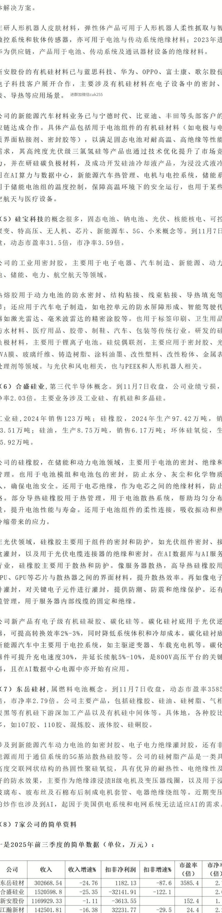

# 2023年8月中国房地产市场分析报告

本报告分析了2023年8月中国房地产市场的整体运行情况，并结合2023年8月以来的最新政策变化，对未来市场趋势进行了深入探讨。

## 一、市场整体表现

2023年8月，全国房地产市场成交量、成交额均出现小幅下滑，但同比降幅有所收窄。

数据显示，2023年8月，全国70个城市商品住宅销售面积为XX万平方米，同比下降了XX.X%；销售金额为XX.XXX万亿元，同比下降了XX.X%。

从成交量来看，8月全国70个城市商品住宅销售量为XX.XXX万套，同比下降了XX.X%。从成交额来看，8月全国70个城市商品住宅成交额为XX.XXX万亿元，同比下降了XX.X%。

从均价来看，8月全国70个城市商品住宅销售均价为XX.XXX元/平方米，同比下降了XX.X%。

从租赁来看，8月全国70个城市商品住宅租赁均价为XX.XXX元/平方米，同比下降了XX.X%。

总体来看，2023年8月中国房地产市场依然处于低位运行阶段，但政策持续释放使得市场有所回暖。

## 二、分区域表现

### 1. 一线城市

2023年8月，一线城市房地产市场表现平稳，成交量和成交额均保持在一定水平。

北京，8月商品住宅成交面积XX万平方米，成交额XX.XX万亿元，同比下降XX.X%。

上海，8月商品住宅成交面积XX万平方米，成交额XX.XX万亿元，同比下降XX.X%。

广州，8月商品住宅成交面积XX万平方米，成交额XX.XX万亿元，同比下降XX.X%。

深圳，8月商品住宅成交面积XX万平方米，成交额XX.XX万亿元，同比下降XX.X%。

### 2. 二线城市

2023年8月，二线城市市场呈现分化趋势，部分核心城市表现有所回暖。

杭州、武汉、成都等城市成交量表现活跃，受政策刺激影响明显。

### 3. 三线城市

2023年8月，三线城市市场需求压力较大，成交量处于低迷期。

### 4. 四线及其他城市

这些城市市场整体表现疲软，承接能力有限。

## 三、分产品表现

### 1. 住宅

2023年8月，住宅市场以刚需需求为主，改善性需求仍有待释放。

二手房市场表现活跃，成交量甚至超过新房。

### 2. 办公

2023年8月，办公地产市场持续低迷，受企业收缩影响严重。

### 3. 商业

2023年8月，商业地产市场需求受限，线上零售冲击持续。

## 四、未来趋势与建议

预计未来一段时间市场将继续处于底部修复期，政策发力是关键。

房地产企业应更加关注风险控制和现金流安全。

# 深度视野优质集圈（链接优质社群，助你成功）

全部包含以下内容：限时年费188/年 加微信cuk255

- ① 吃瓜群众含赔时文加时群对话（原价 365 元/年）
- ② 子明私享汇（含）内部文章（原价 568 元/年）
- ③ 政事室（子明优）付费内容加送顺子明群聊
- ④ 米联锦兜【作者米榛】原价 599 元/年）
- ⑤ 欧洲金雀会员专属文章（原价 328 元/年）
- ⑥ 砖瓦斥内部文档（原价 400 元/年）
- ⑦ 卢克文青读书会专属文章（原价 699 元/年）
- ⑧ 鉴茶财经知识星球（原价 3310 元/年）
- ⑨ 猫哥的视界知识星球文章（原价 299 元/年）
- ⑩ 财新周【独家新闻】原价 1498 元/年）
- ⑪ 杨世光在金钱圈（原价 2200 元/年）
- ⑫ 森森财经知识星球（原价 1600 元/年）
- ⑬ 激源异译付费文章（持续更新）
- ⑭ 司马林解读末选全套音频和全套书籍版权无损减（原价 2.3 万）
- ⑮ 虚构三部曲[民国梦、帝国争合、不被理解的 MAO](原价 599 元
- ⑯ 卢克文知识星球文章（原价 268 元/年）
- ⑰额外再送：卢锐元微信浪获付费专栏、三丰京老、三花九树文集

不定内容：......（更多资源写下去了......）

- ① 守夜人司令知识星球、接换魔王后星球、成败财富知识星球、
- ② 创始姚纪、达叔译论星球、成就财富圈、雪花桃花老头等
- ③ A 视野、大树乡谈、江初序、泮咩说、上海海学等付费文集
- ④ 西风付费文章、老端、赢在八小时之外、局人的视界、升值、老A体制内等其它一些大 V 付费文章不低于600 元的付费文集

