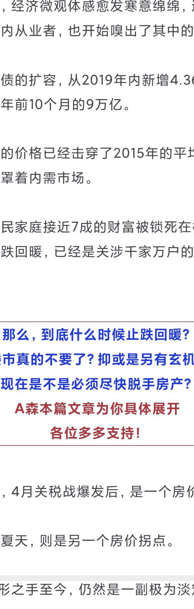

# 纽约何时可以止跌？

作者 A_MES 2022-05-11 18:30
阅读38人

近以来，美股市一路大跌，纽约何时可以止跌？大家都在关注“止跌”。

事实上，美股已经开始反弹，已经跌了快两个月了。

然而，现在的市场情绪非常谨慎，这种反弹似乎缺乏持续的动力，跌势真的结束了吗？

标普500指数从4700点跌到3900点，跌幅接近20%

纳斯达克指数从15800点跌到11400点，跌幅接近30%，科技股惨惨一片。

看到这种跌势，很多投资者开始恐慌，美股的跌势真的结束了吗？

> 那么，纽约什么时候可以止跌？纽约的跌势真的结束了吗？还有底部要来吗？

我认为，现在的反弹，只是一个阶段性的开始。

但是是否有底部，这仍然是一个未决定的因素。

从历史来看，每一次大跌之后都有反弹，出口到底在哪里？美股市的熊市结束了。

我们可以预测中国股市的下大行情吗？

虽然现在很难预测，但我们可以从中国股市找到线索。

美股在2008年大跌后的反弹，是否预示了中国股市的下一次大行情？

那么，2023年，中国股市会有大行情，底部要来吗？

但是，现在的外部环境已经变得太复杂了。

我认为，现在的中国股市，还没有到底部。理由如下：

首先，美联储的加息周期可能还没有结束。

其次，国内经济的压力依然很大，政策可能还没有完全释放。

美股第一阶段，市场处于热能，资金投入推升行业预期，市场未来未贬值。

第二阶段，市场开始泡沫，企业扩投资资产产生了持续性的负的现金流。

第三阶段，美股的炒作和分红被市场审慎对待。

第四阶段，企业投资的实体开始下跌，市场关注其实盈利能力。

第五阶段，市场进入退出，市场关注其实蓝期。

第六阶段，美股崩下，全局动荡。

畏观、低迷、市场处于“第一阶段”与“第二阶段”之间。

如美储后面规模缩水，市值调整会有时间窗口期。

如美储没有任何波折，市场就会进入从“第二阶段”开始后的几个阶段。还不明白：了解了这些股市，也不太明白：后中国股市调整，也许美股像牛长牛一样，而不是学习2017年的好机会。

将股市割对海外需求不足的风险暴露，楼市的重要性也会下跌。

海外需求量不足的风险暴露，楼市这个大权重行情可能会出现。

不过，我不能忘记，还有一个变量。中国在海外投资方面的投入，还需要时间。

此外，海外需求增长不能满足其国内的供给量，似乎真的没有很好的把握。

那么，国内股市第一波调整的结折，其实就不到位了。

如果通过中国股市作为阶段性回调，中股市就是美股的接力成为全球行情的关键。

而今天，美储相互扶持，中股市就是对海外去维持国内整体的需求的关键因素。

**这个本质的区别，才是今天理解周股市的原因。**

其实，从个人角度来看，当前环境下，有几个值得考虑的。对于两个市场的情绪。

首先，在能范围内范围内，进行有价值的调整，是很不错的选择。

# 深度视野优质集团（链接优质社群，助你成功）

全部包含以下内容：限时年费188/年 加微信cuk255

- ① 吃瓜群众包时圈加时群群对话（原价365 元/年）
- ② 子明私享汇（内部）文章（原价568 元/年）
- ③ 政室（顾子明）付费内容享再送顾子明群聊
- ④ 米联储闲友【作者米穗】（原价599 元/年）
- ⑤ 欧洲金获会员专属文章（原价328 元/年）
- ⑥ 砖瓦斥内部圈文（原价400 元/年）
- ⑦ 欧克文青读书会专属文章（原价699 元/年）
- ⑧ 鉴茶财经知识星球（原价3310 元/年）
- ⑨ 猫哥的视界知识星球文章（原价299 元/年）
- ⑩ 财新周刊【独家新闻】（原价1498 元/年）
- ⑪ 一杨世光在金钱爆（原价2200 元/年）
- ⑫ 森淼财经知识星球（原价1600 元/年）
- ⑬ 潇游异译付费文章（持续更新）
- ⑭ 司马林解课全套音频和全套书籍版权无损减（原价2.3 万）
- ⑮ 虚政三部曲[民国梦、帝国争洛、不被理解的MAO]（原价599 元）
- ⑯ 知识星球文章（原价268 元/年）
- ⑰ 额外再送：卢薛元新浪微搏付费专栏、三村丰老王、三花九术文集

不定内容：……（更多资源不写下了）……

- ① 守夜人司令知识星球、接鸭魔王后星球、生才有知识星球、
- ② 创始人笔记、达叔谈论星球、成就财富圈、雪花铁甲头部等
- ③ A 视野、大树乡谈、江初语、咩咩说、上海海学等付费文集
- ④ 西风付费文章、老端、赢在八小时之外、局外的视界、升值、老A体制内等等其它一些大V付费文集

# 深度视野文集
进群微信cuk255

深度视野（付费文集）

限时年费188/年 内部底链接全网V优质内容
