# AI共溯生
2025中国AI新风向30条判断

甲子光创始人&CEO 张一甲
2025.4.28

# 扫码加入 知识星球TOP 免费资源群

免费
- 每日免费获取高价值资源
- 可提供各类资源搜索服务

价值
公众号: 知识星球

| 热门付费文章 | 各行各业报告 | 精选图书资源 |
| :--- | :--- | :--- |
| | 副业赚钱方法 |
| 职场实用资源 | AI政经自媒体 | |

微信信号: jntsg8

及时

微信信号: jntsg2

专注

分享资料仅供个人学习，请及时删除，切勿商用传播

# 过去一年

## AI发生了什么？

# Part Two

## China AI: 进击与普惠同时发生

## “China AI”

## 世界正重估中国AI的价值，是年度重关键词

- 巴黎和外交首脑历史会议
- 特朗普重返白宫“美国优先”政策强化
- Google DeepMind学者聚会：比尔·盖茨和机器人，红色警告AI安全危机
- 人工智能原生AI
- 亚洲基金会：国家主权财富基金会议北京举行
- 科技热点：青年群体就业趋势
- 中国成立75周年
- 人工智能之大东亚：哈萨夫诺贝尔奖得主科学家
- 亚洲领先：AI首脑通过首次会议
- 党的二十三中全会审通过《中共中央关于落实进一步全面深化改革、推进中国现代化的决定》
- 全球地缘政治
- 特朗普人工智能机器人竞购

## 美国对华关系关注度

## 美中引发全球性危机

## DeepSeek

## 美加大华芯片出口限制

## 智能体转型

- 加强中国青年就业与创业政策

## 新生产力

## 低经济模型

- 机器人模型：具身智能技术取得重大突破

## 人形机器人

## 未来产业

- 人工智能大类

## Rokid Glasses

- 加强中国青年就业与创业政策
- 我国在具身智能领域取得重大突破

## AI芯片国产

## AIPC

## 扩散大模型

## AI机器

## 算力智能

## Meta Llama4

## Gemini 2.5

## 多模态

## 具身智能

- 全球AI安全治理中心
- 底层基础技术
- 算力竞赛

## NVIDIA Blackwell

- 成立AI系统开发用19项新标准

## NVIDIA DRIVE Thor

## 底层安全技术

数据来源：甲子光年甲子行业报告，2025

# 进击 普惠

## AI进击
AI有多元研究方向，技术路线仍未收敛。AI研究领域正朝着17个关键方向快速发展，这些方向之间相互独立且同样重要。

| 01 AI推理与生成模型结合 | 02 AI伦理和安全 | 03 AI与认知科学的融合 | 04 AI在社会公益领域的应用 | 05 AI在科学研究中的应用 | 06 公众对AI的理性认知 |
| :--- | :--- | :--- | :--- | :--- | :--- |
| 07 提高大型语言模型的事实性和可信度 | 08 AI系统评估新方法 | 09 硬件与AI的协同设计 | 10 通用人工智能(AGI) | 11 学术界在AI时代的角色 |
| 12 多代理系统(MAS)的发展 | 13 具身智能(Embodied AI) | 14 AI与可持续发展 | 15 多样化的AI研究方法 | 16 跨学科与社区合作 | 17 AI与地缘政治 |

数据来源：AAAI 2025 PRESIDENTIAL PANEL ON THE FUTURE OF AI RESEARCH，甲子光年智，2025；

## 一枝独秀，不如万枝芬芳
数字AI、物理AI、生命AI的探索都有巨大空间。

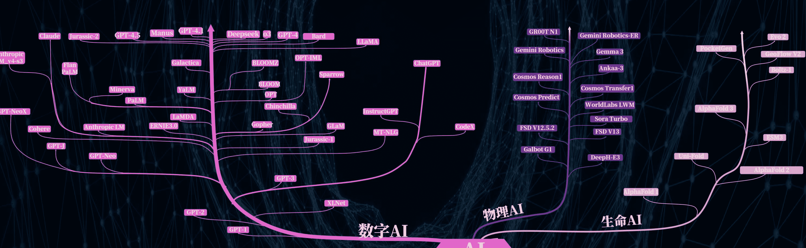

## 百家争鸣
大模型架构不断演进，尚未收敛。

### 神经网络时代
RNN, LSTM和GRU成为当时文本建模的主流模型，但其顺序依赖的特性限制了长程依赖的捕捉。

### Transformer革命
“Attention Is All You Need”的出现，通过注意力机制取代了RNN，为大规模并行化训练带来了便利。

### Dense架构成型
GPT-3等大模型证明了增加参数规模的有效性，但内部计算开销扩展成为瓶颈。

### MoE架构兴起
稀疏性引入大模型领域，Switch Transformer等模型展现了极高的扩展性。

### 多样化架构探索
RetNet, State Space Model (Mamba)等新型架构涌现，展现出不同的潜力。

### 架构融合与创新
多种架构相互融合，朝着更高、更高效的方向发展将成为主流趋势。

- 2013-2014
- 2017
- 2019-2020
- 2021-2022
- 2023
- 2024-2025

## 千帆竞技
企业部署的AI技术仍在持续演进。

| 视觉技术 (图像、视频、检索、文字识别) | 66.9% | 神经符号AI (结合神经符号与符号推理) | 78.9% |
| 自然语言处理 (NLP) | 79.9% | 机器学习 | 77.7% |
| 智能语音技术 (ASR/TTS) | 71.9% | 数字生成AI (教育类应用) | 70.8% |
| 风险分析 (数据异常检测) | 67.6% | 落地场景 (模型辅助决策) | 68.8% |
| 生物AI (AIGC) | 67.6% | 自主化AI (自动驾驶) | 67.1% |
| AI安全技术 | 65.9% | 大模型规模化 (LLMs、模型增强) | 65.6% |
| AI研发 (AID) | 63.3% | AI可解释性 (XAI处理) | 65.3% |
| 机器学习与深度学习 | 51.3% | 智能Agent (自主执行) | 63.6% |
| 知识图谱与推理 (知识发现) | 48.7% | 强化学习 (动态优化) | 62.1% |
| 联邦学习与隐私计算 (数据安全) | 47.3% | 机器学习与隐私计算 (数据协作) | 56.9% |

Q: 企业已部署及未来的智能应用是什么?

## 万家灯火，星辰大海
数字AI、物理AI、生命AI

## 甲子库《2025AI普惠调研》
2025年3-4月
采集时间：使用过AI产品的从业者、普通用户共608份样本

## AI普惠
技术下沉到各行业，认知显著提高，AI对行业价值。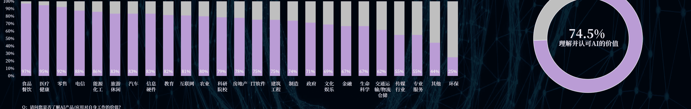
Q: 您是否了解AI对您自身的影响？
数据来源：N=608，甲子光年调研。

## 开源与低价重构生态，成本下降让基础模型“平民化”。

| 类别 | 每百万token输入(美元) | 每百万token输出(美元) |
| :--- | :--- | :--- |
| 调用第三方API | 58.2% | |
| 基于开源模型定制 | 44.7% | |
| 云服务集成 | 32.7% | |
| 混合模式:结合自建和第三方服务 | 30.1% | |
| 购买产品 | 28.9% | |
| 合作开发 | 25.5% | |
| 外包开发 | 14.6% | |
| 自研自建 | 11.7% | |
| Agent形式赋能原有数字化转型 | 10.6% | |

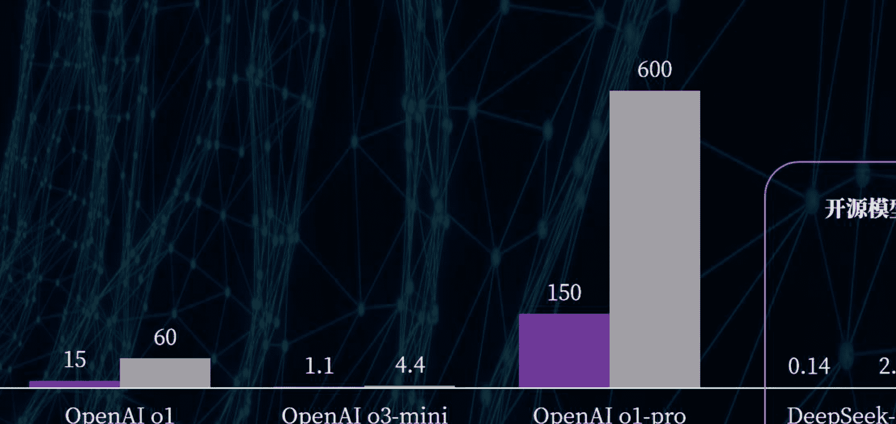
数据来源：OpenAI, DeepSeek, 甲子光年调研, N=608。

## 聚类：AI用户可分为四类类型群
从技术水平与应用程度八大因子，将AI用户划分为四类。

| | 类型1 | 类型2 | 类型3 | 类型4 |
| :--- | :--- | :--- | :--- | :--- |
| 使用意愿 | | | | |
| 使用程度 | | | | |
| 分工比例 | | | | |
| 使用次数 | | | | |
| 标准满意度 | | | | |
| 信任度 | | | | |
| 效用 | | | | |
| 智能化水平 | | | | |

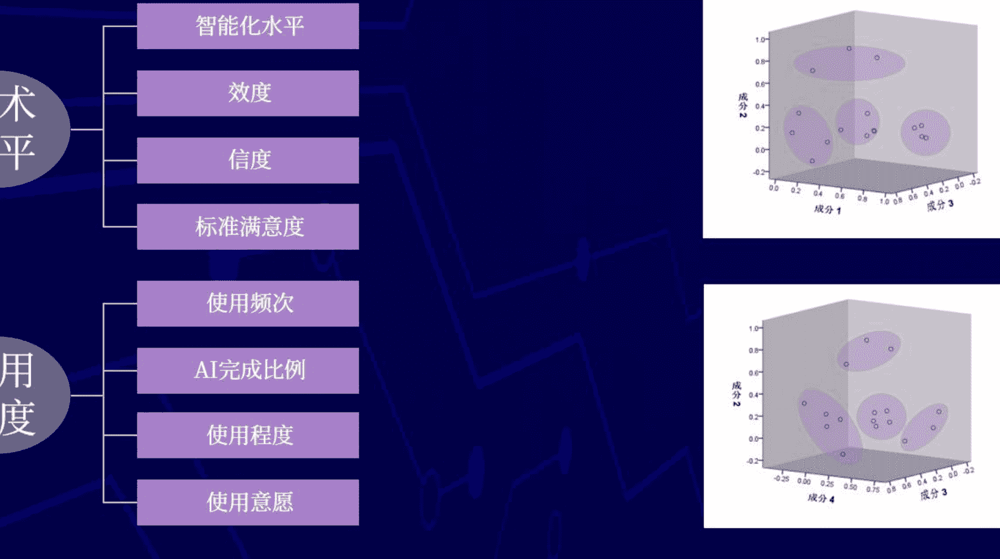
数据来源：N=608，甲子光年智能调研，2025年3-4月。

## 命名：根据AI应用程度为四类用户命名

| AI工具用户 | AI助手用户 | AI原生用户 | AI创生用户 |
| :--- | :--- | :--- | :--- |
| AI工具：将AI产品作为工具使用，大部分的工作需要自己主导 | | | |
| AI助手：将AI产品作为一个可交互的助手来使用，半交付AI产品，半自己主导 | | | |
| AI助理：将AI产品作为一个高度智能化的助理，多份工作可以由AI完成 | | | |
| AI核心：将AI产品作为一个数字世界，可以自主主导所有内容 | | | |
| AI原生：AI产品不再局限于数字世界，可以与人类作用对现实世界共生（具智能，AI驱动的人机操作） | | | |
| AI融合：已经习惯了人与AI产品的融合，人的日常，AI的回归，人类与AI的高效协作 | | | |

## 分布：四类用户分布体现AI应用进展

- 38% AI工具用户
- 48% AI助手用户
- 12% AI原生用户
- 2% AI创生用户

认知低、生活场景为主、意愿极低、使用触达次数低、接受价格中、以此形态产品为主。
认知低、工作场景为主、意愿极高、使用触达次数中、接受价格中、以用作形态产品为主。
认知中、工作 & 生活场景均用、意愿极高、使用触达次数低、接受价格中、意愿使用高价产品为主。
认知高、工作场景为主、意愿极高、使用触达次数高、接受价格高、以触达高价产品为主。

86% AI生产用户

## 行业：各行业用户分布体现各行业的AI应用进展
■ 工具用户 ■ AI助手 ■ 原生用户 ■ AI创造用户

数据来源：N=608，甲子光年调研，2025年3-4月。

# Part Three: 双演化机制
AI改变世界

- L0：信息时代
- L1：生产时代
- L2：孪生时代
- L3：智能时代
- L4：文明时代

## AI进击与普惠重塑四个阶段

| 阶段 | 名称 |
| :--- | :--- |
| L1 | AI 原生时代 |
| L2 | AI 原生时代 |
| L3 | AI 时代 |
| L4 | AI 文明时代 |

AI正在渗透各行百业，真正可用，无处不在。
数据来源：甲子光库，2025；

## AI共生
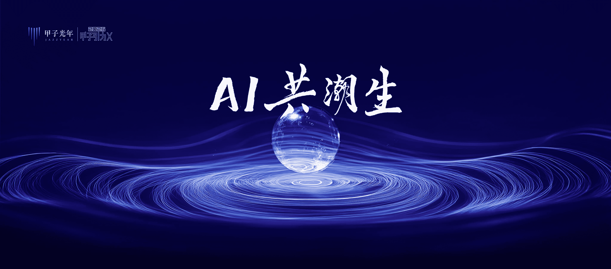

# Part Four: China AI的30条判断

# L1-AI生产时代
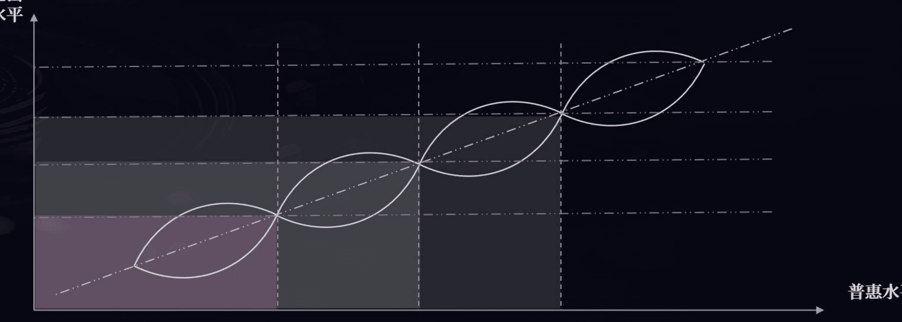

## China AI：从随者走向定义者，“中国方案”成为事实
DeepSeek成为全球增长最快AI应用，国内偏好第二的。

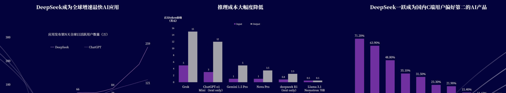
开源策略的突破：DeepSeek吸引全球开发者生态，产生海量免费数据，通过快速迭代的AI洗牌推动行业变革，推理成本大幅降低。
Q：如何让更多使用以下AI产品？

## 02 开源模型
将AI平民化进程从L2跃升为L3-L5。开源模型推动企业从看得懂到用得上、用得好，形成中国范式。

- L1: 爆发期
- L2: 成长期
- L3: 模式期
- L4: 产业期
- L5: 成熟期

数据来源：甲子光年预测，2025年；

## 03 端侧模型
正在定义AI终端的新一代。2024年开始主流厂商密集发布端侧模型。

图1：主流厂商发布端侧模型情况
图2：手机内核OS与智能手机对比

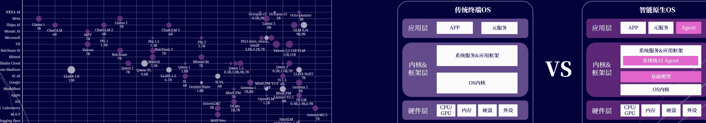
数据来源：On-Device Language Models- Comprehensive Review，华为、清华大学、甲子光、2025；

## 04 物理AI打破“缸中脑”
强化学习+合成数据+数字世界推动AI走入现实。GPT-3的训练数据100%为互联数据。

不同领域互联数据与物理数据的占比对比：

| 类别 | 互联数据占比 | 物理数据占比 |
| :--- | :--- | :--- |
| 通用大模型 | 15%-25% | 50%-60% |
| 智能机器人 | 60%-70% | 70%-80% |
| 行动机器人 | 30%-40% | 40%-50% |
| 科学发现 | 75%-85% | |

数据来源：NVIDIA，甲子光年智谱网络公开资料整理，2025；

## 05 算法变革
AI技术路线尚未收敛，下一条“鲨鱼”仍会出现。
DeepSeek是通过RL强化LLM的推理能力。推理模型已成为2025年发布模型的重点方向。Transformer架构的算法模型值得探索。

Data, Fine-Tuning Phases, RL Phases, and Distillation for DeepSeek-R1
LLM架构性能可能超越同等规模的Transformer模型。

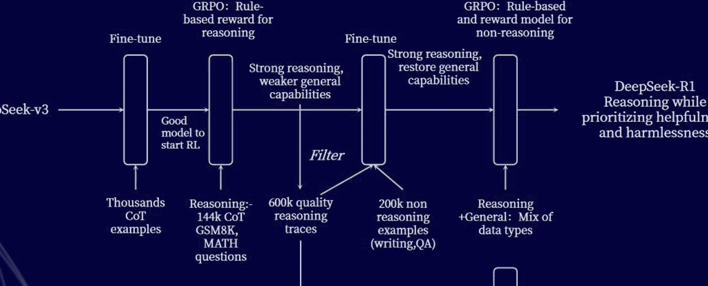
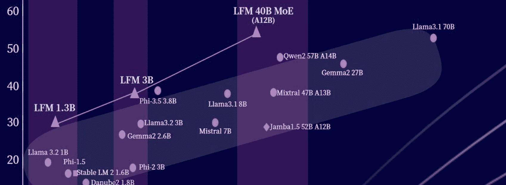
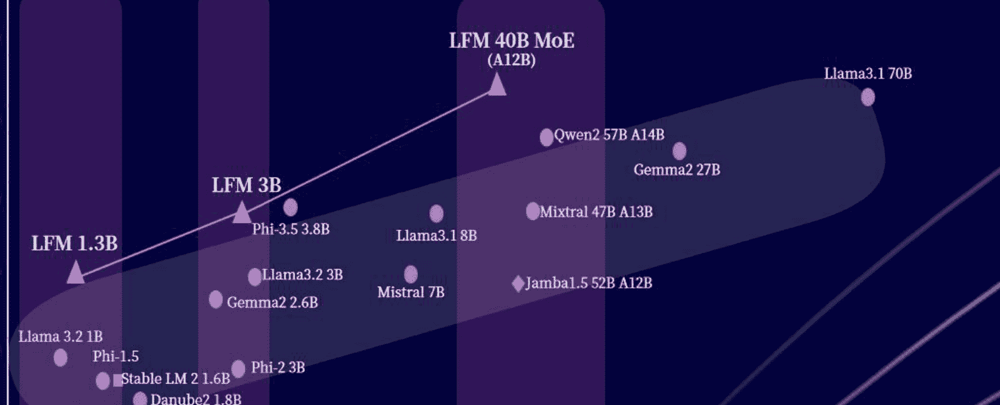
Qwen 1.5, 7B, 14

## 06 算力供需失衡，算力效率成为核心
DeepSeek引发推理算力暴增，但算力效率成为焦点。
算力需求不减反增。

## REASONING COMPUTUTE >100X
TEST-TIME SCALING
FROM ONE-SHOT TO THREE-SHOT
POST-TRAINING SCALING
PRE-TRAINING SCALING
Perception AI -> Generative AI -> Agentic AI

## 07 高性比算力供应求，是中国算力的核心
图1：企业在应用过程中面临的挑战
图2：各类芯片的综合性能

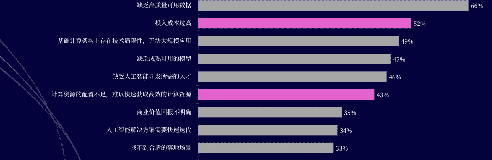
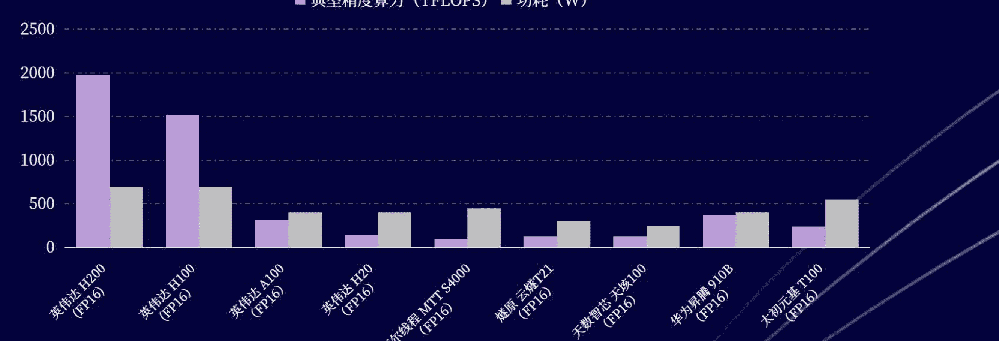

[content]

# 10 AI推动云生态结构性变化
数字生态拍扁，物理生态延伸

AI推动云生态的结构性变化

云服务生态体系

当前AI生态体系

未来AI智能云生态体系

物理世界
数字世界
物理世界
+
- SaaS
- aPaaS
- iPaaS
- IaaS
应用层
中间层
基础层/模型层
平台层
算力层
算法层
AI AI模型层
- AI 模型层
- AI 应用层
- AI MaaS层
- AI PaaS层
- AI 模型层
- AI SaaS层
- AI IaaS层

数据来源：甲子光年智趋势，2025年；

# L2-AI原生时代

# # AI Agent
从“纯智力”到“能动性”，从“以指令为中心”到“以意图为中心”

AI Agent的能动性优于AI的纯智力

人机协作模式从指令为中心到意图为中心的变革

| Intelligence | Agency |
| --- | --- |
| 智力(Intelligence) 思考、学习和理解的能力 | AI Agent(Agency?) 在真实物理世界条件下强于人类的智力(Intelligence) 高的智力可以执行任何任务，能够完成人类无法完成的任务。 |
| | **VS** |
| | 能动性(Agency) 主动决策、解决复杂环境的能力、主动性。适应性 高的适应性能够快速适应环境，高的适应性对人类是不胜任的。 |
| | 能动性扩展人类能力 | 具有能动性的AI Agent能够灵活完成任务，高的适应性对人类是不胜任的。 |
| | 社会结论 | 社会将更多关注AI（即智力），但较少关注能动性，预计AI Agent在市场中成为主流。 |

| 人类 | AI | 人类 | AI |
| --- | --- | --- | --- |
| 人类完成大部分工作 | | 人类和AI协作 | |
| 人类设立任务目标 | | 设定目标 监控结果 | |
| 由(人类)让AI执行底层任务/构建 | AI | | 任务分解 进度控制 |
| 人类主导核心工作 | | | AI自主工作 |

数据来源：Andrej Karpathy，费为《展望2030智能白皮书》，甲子年度智能，2025年；

## 12 多智能体协作

从“零和博弈”到“正和博弈”，Data吸引服务
Data，服务吸引服务，Agent吸引服务

图1：Manus工作原理

图2：国内外智能体研究呈上升趋势

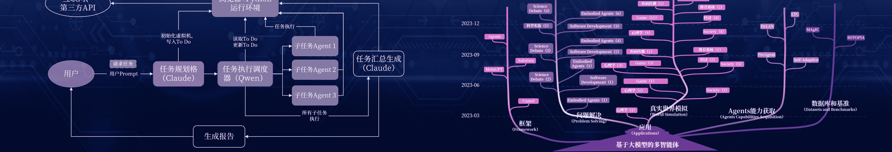

数据来源：Manus，《Large Language Model based Multi-Agents Survey of Progress and Challenges》，甲子年度智库，2025年；
备注：叶子节点颜色表示类别的中文名称

## 13 入口战争的矛盾性
从“超级入口”到“入口无处不在”，入口将不再成为AI产品的价值核心

互联网巨头在重金投入“超级入口”

AI时代的入口矛盾性

从All in One到All for One

+ - 阿里: 夺“超级入口”
- 百度: 搜索
- 微信: 天生

+ - 创业公司正在重塑的入口
- DeepSeek
- 智清言
- AskAnyAI

+ - 其他新增型入口
- 浏览器插件
- 手机系统
- 硬件（苹果、华为等）

入口碎片化

All in One
All for One

甲子大胆预测：最终，AI原生时代的入口形态将是“无处不在的轻量级agent+分布式服务”

数据来源：甲子天眼智库，2025；

# # 14 C端产品竞争力改写
从入口到接口，极致的开放倒逼极致的能力

PC, 移动互联网时代形成终端、OS、应用为主的超级入口生态

AI模型对现有C端应用生态进行重塑

## 大企业的竞争力
+ - 强大的基础设施（算力、数据）
- 基座模型能力
- 生态整合能力

## 小企业的竞争力
+ - 极致的单点业务能力、精准的用户体验
- 用户场景深度锐析
- 形成“人多需求越体验越精准”的闭环
锁定关键要素，与用户核心流程深度定制，构成迁移堡垒
- 极可能的切入任务调试，让自己被“洞用”

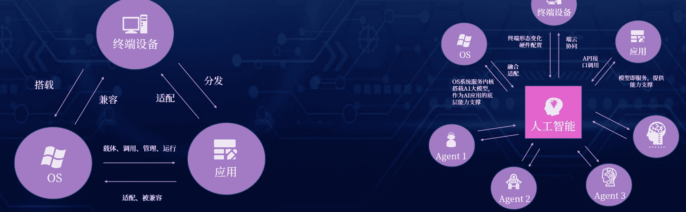

数据来源：德勤、甲子青年智库，2025年；

## 15 C端商业化潜力
2025年光年象限场景比2023年增加一倍，从简单应用走向产业赋能

图：甲子星空边界——AI在C端应用场景的商业化潜力评估

| 星空象限 | 智能产品体验 | | | | 物联网复制 | 虚拟类增强 | 光年象限 | | |
| :--- | :--- | :--- | :--- | :--- | :--- | :--- | :--- | :--- |
| | 社交需求 | | | | | | | | |
| | 情感需求 | | | | | | | | |
| | 审美需求 | | | | | | | | |
| | 功能性 | | | | | | | | |
| | 工具性 | | | | | | | | |
| | 陪伴 | | | | | | | | |
| | 效率 | | | | | | | | |
| | 娱乐 | | | | | | | | |
| 星云象限 | | | | | | | | | |

+ 2023年光年象限场景 ➔ 2025年光年象限新场景
- 网站创建 物联网复制
- 3D交互内容生成 智能机器人
- 数字学生带
- 科学学术
- 直播直播 领域设计
- 创意生活 虚拟社交

数据来源：N=608，甲子光年行业调研，2023年3-4月；

## 16 C端付费意愿
用户可接受价格相比两年前提升1.5倍

图1: C端用户付费意愿
图2: 2025年C端价格接受度

测试显示：
> 可接受价格范围 (P1-P5): 500-2000元
> 最优价格点 (P2): 3000元
> C端定价区间: 从2023年的1200元到2025年的3000元

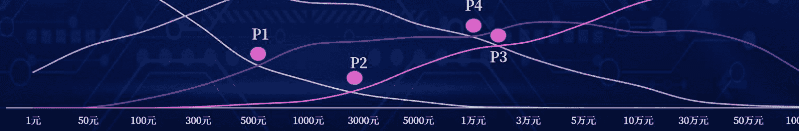

备注：PSM价格敏感度 (Price Sensitivity Meter)是一种调研工具，通过询问四个核心问题（太贵、便宜、太便宜），得出敏感性矩阵，从而计算出产品的接受区间、最优价格点（P2）、可接受价格（P5）与下方（P1）。

数据来源：甲子，2025年；

## 17 企业级软件
Agent推动企业从“数字化”到“智能化”

传统软件 VS AI Agent破局

| 传统软件 | AI Agent解决方案 |
| --- | --- |
| 流程数字化，如ERP/SAP刚性规则 | 任务导向，动态拆解 |
| 平均迭代周期6个月 | 自然语言指令，实时学习 |
| 仅覆盖30%高频场景 | 解决非标需求，周级微调 |
| 从“人适应系统” | 转向“系统适应人” |
| 自然语言替代复杂界面 | 基础企业服务 |
| | 价值层 |
| | 交互层 |
| | 基础 |

# # 数字劳动力的觉醒
革新要素重塑生产关系

y=f (劳动力 + 机器劳动力 + 数字劳动力)
y: 经济产出; f: 生产函数

用户完全完成40%以上的日常任务

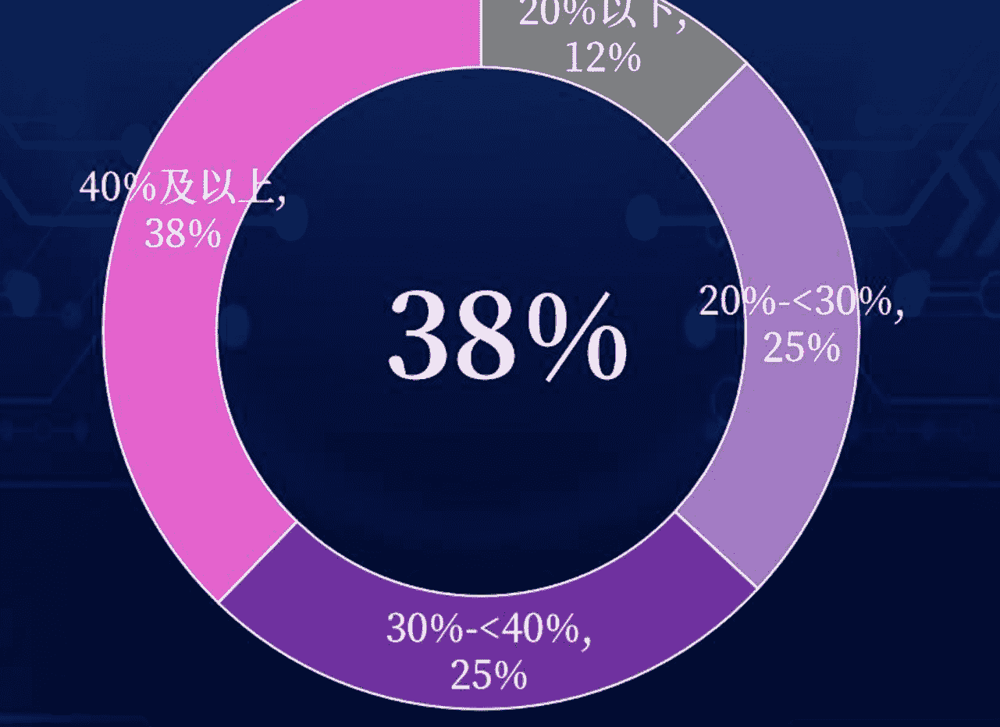

数据来源：N=608，甲子调研，2025年；

## 19 AI原生企业正在重塑商业DNA

定义：AI原生企业是指深度渗透到企业各项活动中，使其成为核心辅助工具。AI不是技术工具，而是业务的一部分。

AI原生企业的核心特征包括流程整合、智能化控制和边界模糊。这些企业拥有自主学习能力，能够实时处理数据并将信息化为决策，重塑管理。

例如：传统的AI驱动像是汽车制造；真正的AI原生企业则是重新发明汽车，从设计理念到动力系统，反过来驱动需求。

数据来源：Gartner, 甲子调研，2025年；

## AI原生企业的层次评估
+ 层级0：员工完全使用AI
+ 层级1：员工使用各种工具完成工作
+ 层级2：AI主导完成某些步骤
+ 层级3：AI自主完成端到端的工作

2027年，40%的中层管理岗位将被整合转型

## AI原生的组织结构
从“金字塔”驱动重构为“网络”，每个员工成为流程中的节点，通过AI实时连接数据和操作。

例如：某公司在招聘中测试了“AI面试官”，根据简历匹配和面试表现自动执行任务，取代传统的管理层。

## AI原生的办公形态
员工效率超越超级体

大部分员工在与交互中（例如通过代码、材料等），让员工获得更高的生产力和决策权，使企业组织能够释放全部潜能。

例如：某客户通过DeepSeek生成式AI缩短了研发周期40%，直接让工程从需求变为代码的迭代。

## AI成为不可见的视者
AI自主完成工程任务，甚至参与决策。

例如：某公司董事会议，AI助手参加会议并生成待办清单，自动跟踪决策执行。

# # 看不见的AI指挥官
隐藏在数据洪流中的系统正在颠覆规则

某电商企业的案例
### 供应链的“超感官”进化
### 价格战的“量子细胞”
### 用户需求的“核心算法”

AI预测系统通过分析过去5年7000万次交易数据，将预测准确率提升至95%，在广州，AI能预测台风路径的影响，提前72小时送警方案。

当某3家遭遇波动，AI销量系统在凌晨2点后启动“闪电”——连续7次自动调整参数并新增“告警”，让对手的机器人陷入锁死环。这种做法被称为“蜂群术”的极致措施，正在激烈赛道中竞争优势。

客服系统已通过语音分析识别83种情绪波动，当检测到用户提醒及“生日礼物”时，会自动触发用户包裹服务并生成温馨祝福。在门店，这项技术让客户满意度提升了29%。

# 核心不是IT系统，而是连接所有资源的AI协调网络。

苏州某企业的案例
在后台，智能决策系统正在正面激烈博弈：它监控TikTok上的流量趋势、1688的色彩极其波动，以及时装的设计元素，在0.3天内生成2023秋季新款潮流卫衣的生产方案。这让新品研发周期从28天缩短至72小时，效率提升至行业水平3倍。

数据来源：甲子年度报告，2025年；

# L3-AI原生时代

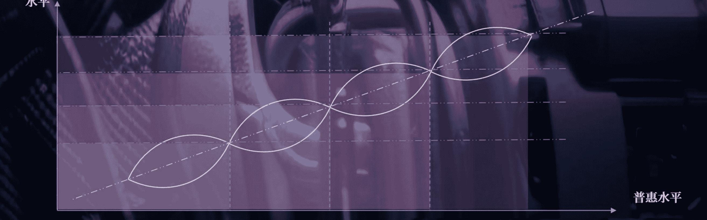

## 21 AI终端从“设备为中心”走向“场景为中心”

以设备为中心：依赖单一设备运行应用
以场景为中心：感知用户场景、识别用户意图，多个设备联动完成任务，从被动调用到主动

数据来源：华为、清华大学《2024年白皮书》，甲子调研，2025年；

# # 全局化智能
基于用户场景的端云协同构建强大的全局化智能

意义：端云协同的结构与决策

| 基础 | 交互 | 逻辑 | 价值 | 基础 | |

数据来源：华为、清华大学《2024年白皮书》，甲子调研，2025年；

# # 23 人形机器人
### 人形机器人的技术成熟度动作大幅加快

### 人形机器人成本降低
2023年人形机器人成本约为7万美元，随着规模效应和技术进步，2030年人形机器人成本降至5万美元以下。

### 人形机器人的应用场景
- 垂直市场： 专用型 (To B / To C)
- 个人助理
- 物流配送
- 护理救援
- 航天探索
- 空空环境
- 法律逐步完善

数据来源：高德、前瞻研究院，甲子调研，2025年；

# # 24 情感陪伴类刚需快速释放
红利：消费者闲暇时间拉长

需求驱动——儿童、老人、单身
33%独居区域显著增加抑郁风险
50%老人长期感到孤独，与父母互动少于10分钟
70%儿童依赖电子产品
2.46亿单身人口，女性占59.9%

■ 基础市场值（美元） ■ 乐观前景市场值（美元）

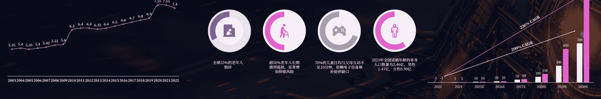

数据来源：ARK Invest、华领、国家统计局、甲子智库，2025年：

# # 26 智能机器人
## 从L2动作自主向L3任务自主演进

图：通用机器人的等级分级与技术演进路线图

| | | | | | | |
|---|---|---|---|---|---|---|
| 流程数字化，刚性规则 | 任务导向，动态拆解 | 自然语言指令，实时学习 | | | | |
| 平均迭代周期6个月 | | | | | | |
| 仅覆盖30%高频场景 | | | | | | |
| 版本迭代 | | | | | | | |
| 从“人适应系统” | | | | | | |
| 转向“系统适应人” | | | | | | |
| 自然语言替代复杂界面 | | | | | | |
| 基础企业服务 | | | | | | |
| | 价值层 | | | | | | |
| | 交互层 | | | | | | |
| | 基础 | | | | | | |

| 传统软件 | AI Agent解决方案 |
| --- | --- |
| 流程数字化，如ERP/SAP | 任务导向，动态拆解 |
| 平均迭代周期6个月 | 自然语言指令，实时学习 |
| 仅覆盖30%高频场景 | 解决非标需求，周级微调 |
| 从“人适应系统” | 转向“系统适应人” |
| 自然语言替代复杂界面 | 基础企业服务 |
| | 价值层 |
| | 交互层 |
| | 基础 |

| 场景 | 现场环境 | 决策层 | 执行层 |
| --- | --- | --- | --- |
| 场 | 机器人环境的实时感知 | 决策层 | 机器人执行任务规划 |
| 手 | 机器人动作控制 | 决策层 | 机器人执行任务规划 |
| 云 | 云端数据处理 | 决策层 | 机器人执行任务规划 |
| 厂 | 机器人协同决策 | 决策层 | 机器人执行与维护 |
| 智 | 机器人视觉与AI决策 | 决策层 | 机器人执行与维护 |

# # 具智能工业机器人
视觉AI工业机器人将重塑工业性场景，重塑制造场景

具智能工业机器人将重构智能工厂

图1：具智能能打造智能工厂的横向管理体系

| 数据决策层 |
| 生产计划层 |
| 数据监测层 |
| 现场调度层 |
| 设备/处理层 |
| 需求 | 计划 | 设计 | 工艺 | 生产 | 销售 | 回购 |

数据来源：微智智能，甲子时光，2025年。

# # 微智智能
微智智能助力“新智造”全链路落地，以自研视觉算法为“眼”、人工智能为“大脑”、以“人机协作”型机器人为“手”，执行高效决策，助力具智能制造落地。自2020年以来已为全球多个客户提供生产柔性工厂设计的智能机器人解决方案，并在汽车、电子、检测、抓取、焊接、组装、运输、上料等工业领域深耕多年。

工业视觉与AI融合的全链路方案，助力智能制造场景渗透率提升

图2：微智AI机器人人工智能控制全链路技术解决方案

[/content]

## AI安全，从数字世界到物理世界
安全的边界要始终对齐AI的边界

图2：2020-2028年中国AI安全市场规模趋势图（亿元）

- 29.2%的B端用户市场服务需求是数据隐私与合规性审查
- 38.6%的C端用户认为数据隐私与安全是购买决策的关键因素

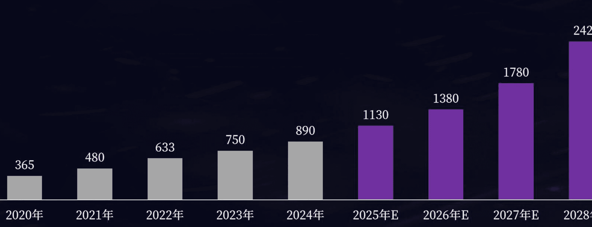

29.2%
数据隐私与合规性

38.6%
数据隐私与安全性

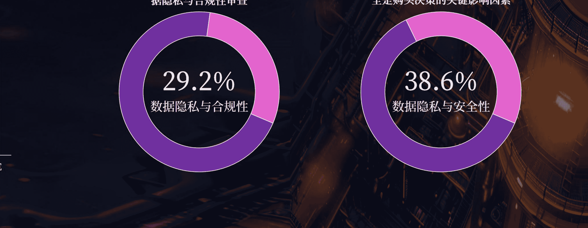

数据来源：工信部安全产业发展中心、中研华普产业研究院、甲子元年智问回调研、N=608、2025年3-4月；

# L4-AI文明时代

## AI重构文明秩序后的隐忧

### 隐忧一：警惕“加拉帕戈斯现象”

数据来源: Niall Ferguson (尼尔·弗格森), AI深度研究院，甲子光年智库，2025年;

## AI重构文明秩序背后的隐忧

### 隐忧二：繁荣未必增长，增长未必分配

## AI重构文明秩序背后的隐忧

### 隐忧三：AI普惠并不意味着平等

数据来源：Niall Ferguson (尼尔·弗格森)，深度研究院，甲子年制，2025年；

## AI重构文明秩序背后的隐忧

### 隐忧四：数据洪流的失控风险

## AI重构文明秩序背后的隐忧

隐忧五：世界秩序的改写，AI成为战略安全的主轴

## AI重构文明秩序背后的隐忧

### 隐忧六：机信任和相关制度的建立是否跟得上AI的发展？

数据来源:Niall Ferguson (尼尔·弗格森)，AI深度研究院，甲子光年智库，2025年；

## 20 AI重构文明秩序后的隐忧

### 隐忧七：AI对世界“高阶相关性”的理解远超人类，或将创造出人类不理解的世界

## AI重构文明秩序背后的隐忧

### 隐忧八：人类的价值体系和意义感将如何重建?

## 赛博墓碑：数字永生时代降临

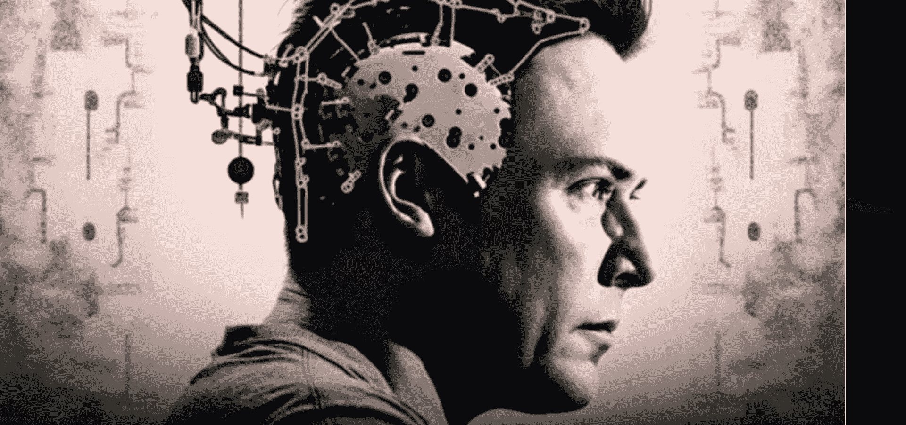

马斯克的“脑机接口”项目

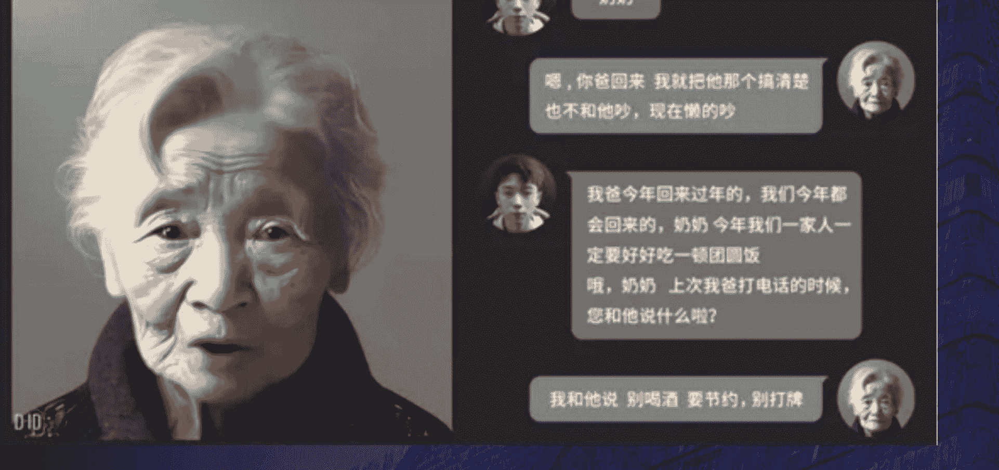

B站up主吴六与“奶奶”的对话

# 致谢

研究团队：张一甲 宋涛 努尔曼麦提·买合木提

视频团队：王博 王班

扫描关注甲子光，获得更多科技行业分析调研

