# 中国味 世界潮
2025中国茶饮出海全景报告

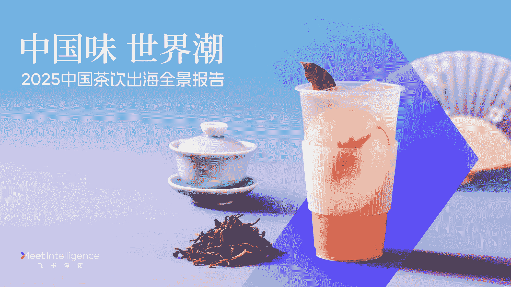

Meet Intelligence 飞书深诺

# 目录
CONTENTS

## 01 观市场
国内市场内卷加剧，推动茶饮品牌开拓新市场

## 02 拓机遇
文化自信赋能茶饮品牌出海，把握海外市场机遇

## 03 获增长
本地化和数字化，驱动茶饮品牌海外业务增长

---

# 01 国内市场内卷加剧，推动茶饮品牌开拓新市场

2025年茶饮上市大年，上海阿霸道柠檬茶、古茗、蜜雪冰城、霸王茶姬等茶饮品牌纷纷挂牌上市

| 上市茶饮饮料品牌 | 挂牌上市时间 | 上市首日收盘市值 |
| :--- | :--- | :--- |
| 古茗 GUMING | 2025年2月12日 | 219.02 亿港元 |
| 蜜雪冰城 | 2025年3月3日 | 1093.5 亿港元 |
| 霸王茶姬 CHAGEE | 2025年4月17日 | 59.54 亿美元 |
| 上海阿霸道柠檬茶 AUNTEA JENNY | 2025年5月8日 | 166.07 亿港元 |

然而，上市后的“跑马圈地”使得中国现制茶饮行业连锁化率攀升，陷入内卷加剧的困局。

## 中国现制茶饮 VS 餐饮行业发展对比

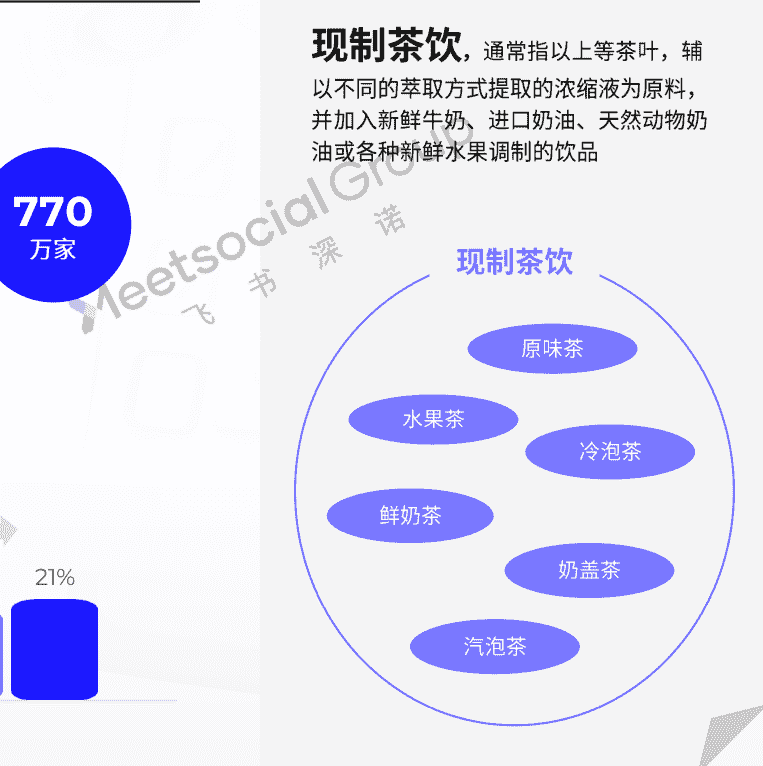

随茶饮品牌价格战升级，同质化问题日益突出，国内市场竞争愈发激烈。客单价在RMB11-20的第二和第三梯队赛拥挤，产品同质化问题严重。

| >20元 | 16-20元 | 11-16元 | <11元 |
| :--- | :--- | :--- | :--- |
| 第一梯队 | 第二梯队 | 第三梯队 | 第四梯队 |

- **高端茶饮**
  - 强调差异化
  - 阿嬷手作、茉莉霸奶茶价格偏高
  - 容易陷入同质化困境：冰果茶、奶茶等等同品都在突围，创新空间有限
  - 2022年初奈茶逆势降围，宣布告别30元单价，由第一梯队转向第二梯队，15-25元产品占比60%
- 性价比竞争激烈，同质化严重：品牌主要以高性价比为卖点，品牌的标准化生产流程趋同，导致产品在感官、质量上的差异化较高
- **平价茶饮**
  - 极效性价比策略，产品品质相似
  - 蜜雪冰城占据低价市场

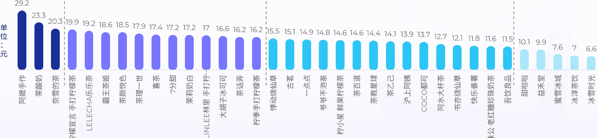

Source: 华尔街、平安茶行、Meet Intelligence
注：品牌价格数据截至2024年8月

虽然获得资本的持续青睐，但内卷加速致茶饮品牌业绩承压。

国内现制茶饮赛道融资情况：
- 过去10年，现制茶饮行业迅速崛起，成为消费领域的一大热点，现制茶饮品牌也凭借不断更新的故事获得了资本的高度关注。

部分现制茶饮品牌营收情况：
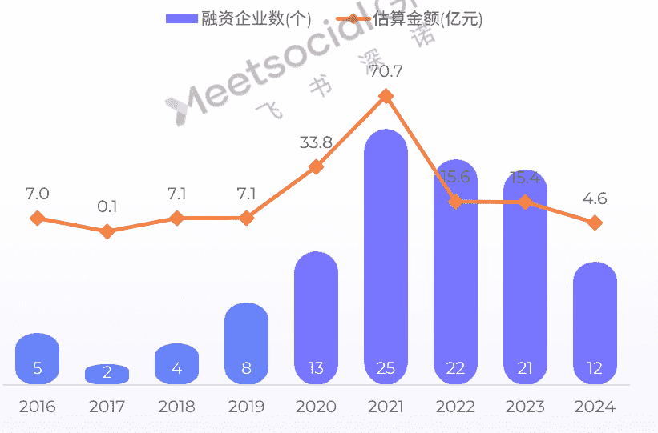
注：2024年8月
Source: 华尔街、平安茶行、Meet Intelligence

## 为获取增长，茶饮品牌纷纷拓展海外市场。

### 中国茶饮品牌布局情况

| 品牌 | 出海时间 | 出海地区 | 门店数量 | 产品策略 | 价格策略 | 商业模式 |
| :--- | :--- | :--- | :--- | :--- | :--- | :--- |
| 喜茶 | 2018年1月 | 德国、加拿大、美国 | 80+ | 高端茶系列，本土化 | 高价位为主，进行当地调整 | 直营模式，2023年3月尝试合作模式 |
| 霸王茶姬 | 2019年8月 | 马来西亚、泰国、美国 | 150+ | 奶茶为主，本土化 | 本地定价 | 加盟模式 |
| 蜜雪冰城 | 2018年1月 | 越南、马来西亚、印度 | ~4800 | “牛奶+奶茶”组合，打造差异化 | 低价基本一致 | 加盟模式 |
| 奈雪茶 | 2018年1月 | 越南、马来西亚、印度 | 30+ | 冰块和奶茶为主，根据当地口味 | 低价高于国内 | 直营模式 |
| 古茗 | 2012年 | 东南亚、全球 | ~1500 | 青茶系列为核心，本土化创新 | 价格在3-4倍国内价 | 与当地特许加盟 |
| COCO | 2007年 | 东南亚、全球 | 130+ | 本地化调整 | 蜜茶为主，本土化基础国内价2-3倍 | 区域代理直营模式（加盟占比9%） |
| 茶霸道 | 2023年8月 | 德国、中东 | 50 | 根据市场需求，快速产新 | 本地化定价 | 试点直、加盟（后期考虑加盟） |
| 上海阿霸道 | 2024年10月 | 泰国 | 10 | 根据当地习惯，差异化部分（如花茶系列） | | 直营模式 |
| 茉莉霸奶茶 | 2024年2月 | 瑞典、马来西亚、英国 | | | | 直营模式 |
| 茶悦道 | 2025年7月 | 马来西亚、泰国、英国 | | | | 电商先行，通过6大电商平台直销业务 |

---

# 02 文化自信赋能茶饮品牌出海，把握海外市场机遇

茶，不是中国“国饮”，而是世界半数以上人口喜爱的饮品，在世界三大无酒精饮品中，茶居于首位。现在，世界上有五十多个种茶，而饮茶的风尚遍及全球，但每个地区的茶文化都不同。中国是茶树的原产地，亦是世界上最早发现和利用茶作为饮料和药用的国家，是名副其实的故乡。中国茶文化源远流长，早已在海外享有盛誉。茶饮出海是中国消费升级与产业升级的具体表现。

## 民族的文化DNA赋予了中国茶饮品牌独特的内涵与魅力，使其在海外更具辨识度与亲和力。

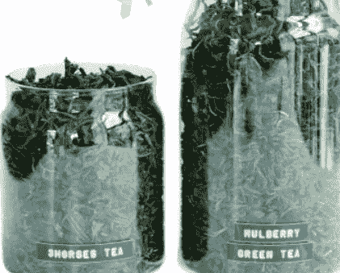

纵观海外，现制饮品市场区域化明显。亚太地区凭借文化亲近性及地缘便利性等，成为现制饮品的核心市场。

| 全球现制饮品市场各区域规模占比 | |
| :--- | :--- |
| 37% 亚太 |
| 29% 北美 |
| 26% 欧洲 |
| 8% 拉美&非洲等 |

## 东南亚地区 — 状况
- **规模**：庞大，华侨基础深厚。
- **人口结构**：年轻人口占比30岁以下为主。
- **气候**：典型热带气候。
- **文化**：东南亚是多元文化共鸣地区，社交文化和潮流文化中。
- **机会**：现制茶饮市场高度分散，中低端竞争激烈，高端市场存在增量空间。

## 东南亚地区 — 市场点
东南亚宗教文化多元，本土化/健康化/定制化是破局关键。

- **本地口味适配和原料融合**
  - 香柠檬柠、椰香茶底等本土草本
  - 原料的创新应用，适应湿热气候
  - 用本地蔬菜植物替代原料
  - 东南亚特色水果如榴莲、芒果等
  - 饮品设计
- **健康化升级风潮**
  - 传统茶底的“浓茶+人工色素”逐渐被消费者抛弃
  - 低糖、低卡、原叶茶底逐渐被接受
  - 中式养生茶（如枸杞、菊花茶）逐渐受到关注
- **产品个性及定制化**
  - 推出限定款、节庆主题产品，提升品牌吸引力
  - 定制化生产，如均衡调整和产品配方调整

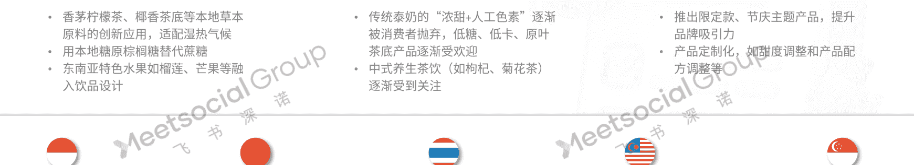

### 印尼
### 越南

### 马来西亚

### 新加坡

## 借助高甜度性价比撬动增长市场
## 视觉茶饮突围
## 茶文文化迎接本土信仰
## 健康升级引领高端化

- 偏好高性价比与甜味充足的产品，接受水茶、奶茶等新产品。
- 价格敏感，偏好甜味、份量的饮品。

---

## 东南亚地区 — 布局
现制茶饮市场高度分散，中低端竞争激烈，高端市场机会。
- **中低端**：现制茶饮品牌众多，本土化程度不高，尚未形成绝对主导地位的龙头品牌。
- **高端**：格局竞争相对较高，以中国品牌、奈雪等为主，市场仍存在增量空间。

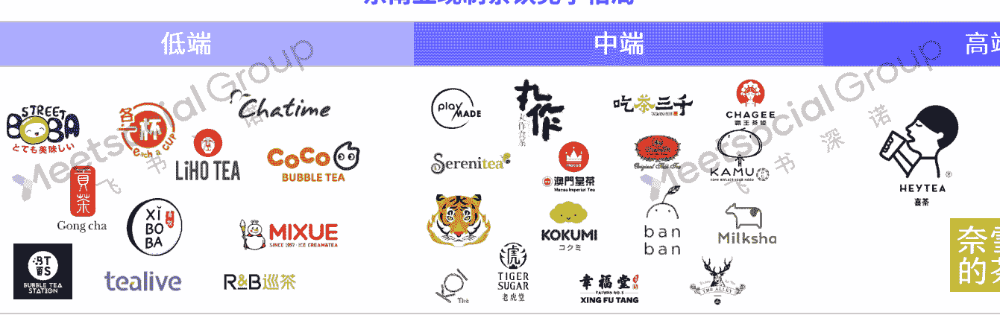

| 维度 | 低端 | 中端 | 高端 |
| :--- | :--- | :--- | :--- |
| 品牌 | STREEC, BOBA, Chatime, Coco BUBBLE TEA, Gongcha, MIXUE, R&B, tealine | MADE, Serenite, KOKUMI, XingFang, Milkso | HEYTEA, Signature |
| 选址 | 以社区为中心，主要分布在学校、火车站等人密集场所 | 主要分布在中高端市场，以办公室消费群体为主 | 主要在高端市场 |
| 价格带 | <$2 | $2-5 | >$5 |
| 特征 | 需要强力的成本管理 | 品牌数量众多，最具竞争力的细分市场，以强单品+品牌的差异化为主要手段 | 高租成本对品牌、供应链与运营效率更高要求 |

---

## 日韩地区 — 现状
- **日本**：台式奶茶为主，本土化程度高。
- **韩国**：台式奶茶为主，中低端品牌主导。

### 日本消费情况
- **占比**：70%以上为现制茶。
- **年龄段**：30岁以下。
- **偏好**：高品质、视觉吸引力。

### 韩国消费情况
- **占比**：45%以上为现制茶。
- **年龄段**：18-35岁。
- **偏好**：健康和生活品质。

## 日本现茶饮竞争格局
| | 低端 | 中端 | 高端 | 低端 | 中端 | 高端 |
| :--- | :--- | :--- | :--- | :--- | :--- | :--- |
| 品牌 | PEARLA CHA | MACCHA HOUSE | 喜茶 TP TEA | Coco | Mixue | Panda |
| 门店数 | 10-60家 | 十家 | 少量门店 | 部分品牌百货店(约800家) | 多几十家 | 少量门店 |
| 价格 | $2-$4 | $4-$6 | >$6 | <$3 | $5-$7 | |
| 选址 | 韩国学生区、近地铁口、首尔町、Outlets等街围 | 主要热门商圈、池袋、新街、购物中心、地铁站附近 | 高端商圈、大型百货场、一线商圈 | 大学城、便利周、地铁口 | 圈核心区、百货场、年轻人聚集地(弘大、新南、南北圈) | |
| 特征 | 主打连锁消费和性价比、门店位于人流聚集区域、吸引学生和年轻人 | 注重口碑和品牌体验、门店设计精致 | 注重原料、独特口味和品牌故事、多为热门商圈 | 平价亲民、密集型、重视性价比 | 目标客户为学生与大众、产品更具差异化 | 注重文化与高端体验突出品牌性、定位高收入群体 |

## 日韩地区 — 机会点
口碑创新、健康&功能性需求，本土元素融合也不少。

- **独特口味与产品创新**
  - 独特多样化的口味，如水果茶、抹茶、巧克力茶及创新组合（如威奶盖）、定制甜度等。

- **健康化与功能性需求**
  - 健康饮品需求崛起，低糖、无糖、低卡路里，成分天然或含有功能性成分是趋势。

- **增强视觉吸引力**
  - 消费者喜欢拍照打卡、门店实体体验需求，具备视觉吸引力的网红风包装的饮品受欢迎。
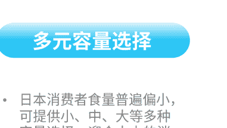
- **本土元素融合**
  - 融合本土元素的奶茶更容易受到追逐，通过樱花、抹茶等本土化。
(Source: food-trade, cross marketing, Meet Intelligence)

注：品牌
(Source: food-trade, cross marketing, Meet Intelligence)

- **原料透明**
  - 消费者愿意为高品质、有机茶付费。
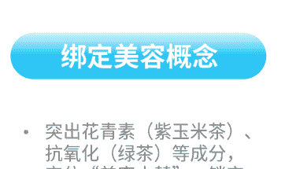
- **多元容量**
  - 消费者对新鲜度有要求。

- **高端化体验**
  - 消费者对独特口感有追求。

- **锚定美容**
  - 消费者对健康概念有认知。

## 英国地区 — 市场现状
传统红茶为消费主流，年轻群体对叶茶的接受度或将为现制饮茶带来机会

## 英国消费者饮茶叶种类偏好
- 传统红茶是消费绝对主流，英式早餐茶、伯爵茶为核心品类
- 水果茶、绿茶等健康饮类崛起

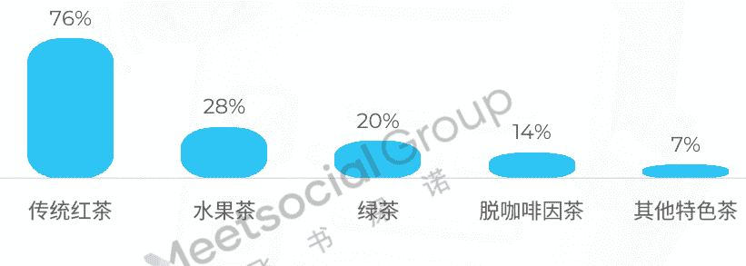

64% 英国人用一杯茶开始的一天

## 英国消费者饮茶叶类型偏好
喜欢红茶人群中，**27%**的30-44岁群体喜欢散茶
喜欢绿茶和草本/水果红茶人群中，**28%**的18-29岁群体喜欢散茶

- 茶包泡仍为主
- 年轻群体对叶茶接受度高

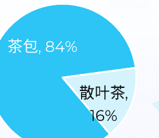

Source: Kantar, Mintel, 英国茶饮协会UKTIA, Meet Intelligence
Note: UKTIA调研英国成年人样本N=1010, 调研时间2024年3月

## 英国地区 — 市场主导，中国制茶奶茶以东方文化植入中高端市场
- 中低端品牌主导市场：台式奶茶入境市场，以贡茶在内的台式珍珠奶茶品牌在英国受欢迎
- 现代制茶初起，以中国制茶为主定位中高端：接近英国博物馆等地打造“摩登”空间；融合中国文化与英式风格，打造高颜值门店，增强品牌吸引力

英国现代制茶竞争格局

| 品牌 | Meet Tea | Gongcha | Coco Tea | Chatime | happynow | LAY TEA | YI FANG | MOLLY TEA | wash mash | YA |
| :--- | :--- | :--- | :--- | :--- | :--- | :--- | :--- | :--- | :--- | :--- |
| 门店数 | 为几十家，至少25家 | 在英国开设十几家门店 | 少量门店 | | | | | | | |
| 选址 | 大校园周边、便利店 | 高街 | 城市核心圈，Chinatown、West End、大学城等 | 百货场、购物中心等 | 高端商业街 | 网红地形 | | | |
| 价格带 | £3-5 | | £4-6 | | £5-8 | | | | | |
| 特征 | 依赖规模与性价比，部分常态化 | 学生群体喜爱 | 满足日常需求，品牌差异化明显 | 如都市白领、年轻人 | 主打轻奢/高端形象和高品质 | 天然、健康或功能性配方等 |

## 英国地区 — 市场机会
制茶技术创新、功能升级和风味本土化激活年轻群体的消费蕾
传统红茶创新打破传统红茶刻板印象，重构英式红茶认知

### 健康&功能性需求
2023年，英国养生茶市场规模成位数增长
健康需求强烈，可添加草本成分
功能性饮料抢占健康饮赛道，冷茶也受青睐

### 清真群体延伸
6% 英国穆斯林人口占比
穆斯林顾客也会将珍珠奶茶作为他们的享受，非常适合那些不能喝酒也不想喝咖啡的人们
结合中西合饮食+甜点，如抹茶融入茶混合饮品，伦敦是英国穆斯林人口最多的城市
可Halal认证清真茶、香料茶（如豆蔻姜）套餐，覆盖宗教与多元文化需求，提升低脂肪含量

## 美国地区 — 市场现状
咖啡为市场主流，健康浪潮、社交需求等驱动果汁冰沙和奶茶店的高增长

## 美国各类饮品市场规模及年均增速
- 市场规模(亿美元) 19-24年均增速CAGR

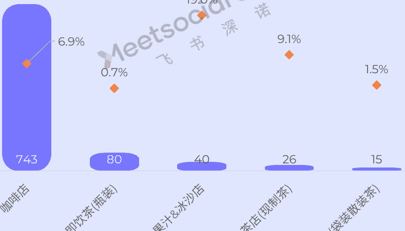

## 美中奶茶店及咖啡店布局
| 占比 | 美国 | 中国 |
| :--- | :--- | :--- |
| 咖啡店 | 95% | 23% |
| 奶茶店 | 5% | 77% |

Source: menusifu《2025年美国奶茶数据报告》，Meet Intelligence

## 美国地区 — 市场现状
奶茶热度高不下，经典黑糖/波霸珍珠奶茶为明星类，水果茶也受欢迎

## 美国市场奶茶搜索情况
- 美国消费者对奶茶搜索热度高不下呈增长趋势，中国茶饮chagee、heytea等近一年搜索量对比超300%

近一年美国“milk tea”搜索热度及相关查询内容

## 2024美国市场奶茶消费情况
### TOP销量产品
黑糖波霸奶茶、珍珠、芒果果奶茶、柠檬茶、绿茶、奶油/芝士顶、抹茶泰式奶茶、茉莉绿茶、草莓奶茶

### TOP销量小料
冰淇淋、果冻、布丁

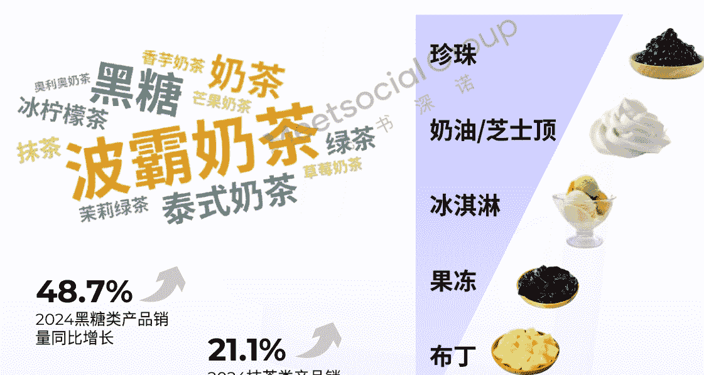

48.7% 2024黑糖类产品销量同比增长率
21.1% 2024抹茶类产品销量同比增长率

| 相关查询内容 | 同比增幅 |
| :--- | :--- |
| Pluto | 爆发式增长 |
| chagee milk tea | +650% |
| heytea | +300% |
| chamomile tea for milk supply | +300% |
| can you add milk to green tea | +130% |

## 美国地区 — 市场布局
市场分散，以传统台式奶茶品牌为主；目前市场份额超过5%，头部品牌主要为功夫茶、老虎堂等中国品牌尝试以差异化定位破局：喜茶、王莉茶。

### 美国现制奶茶竞争格局
| 品牌 | 低端 | 中端 | 高端 |
| :--- | :--- | :--- | :--- |
| WUSHILAND, Cocoa, Bobatime | Chatime, Yi FANG, TEA KING | Shareed, CHAGEE, MOLLY TEA, BOBA GUYS | VIVI, bubble tea |
| 门店数 | 部分门店 | 数十到百家以上 | 少量门店 |
| 选址 | 社区购物中心、大学周边、华人社区 | 城市核心圈、繁华商业街 | 高端商场和写字楼、精品街区 |
| 价格带 | $3-6 | $4-8 | $5-10 |
| 特征 | 大众定位，价格亲民 | 注重产品创新和品牌体验、目标客户为 | 追求健康、个性化和社交交流的高收入人群 |

## 美国地区 — 市场机会
锚定年轻世代和千禧一代是美国现制奶茶的核心群体，而年轻人更热于聚餐，网红爆款成为流量密码

### 亚洲元素本土化
结合美国饮食文化，用珍珠、奶盖甘露与本土口味（南瓜、肉桂、巧克力）实现“东方基底”，或引入更多亚洲元素。

### 性价比差异化布局
对比星巴克、奶茶价格在美国较高。

### 社交属性满足
18-30岁年轻人普遍热衷Instagram、TikTok打卡，偏好颜值包装与黑糖、水果口味

2021年10月，万圣节期间推出全新新品——桃子谷（Peachy Hollow），庆祝充满氛围的季节。

| 星巴克咖啡 | 尺寸 | 美金价格范围 |
| :--- | :--- | :--- |
| 美式咖啡 | Tall (小杯) | $3.25-$3.75 |
| 拿铁 | Grande (中杯) | $5.25-$5.95 |
| 冷萃咖啡 | Grande | $4.95-$5.75 |
| 星星乐 | Grande | $5.95-$6.95 |

### 小众化需求体现
例如高端咖啡强调“手工”、“原创、“本地供应链”等，满足Z世代的身份标签需求。

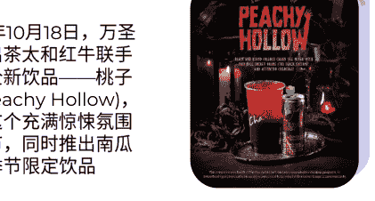

2024年12月，Sharetea推出Apple Cinnamon系列，结合红果、蜂蜜、肉桂等元素，提供冬季限定。

| 奶茶种类 | 尺寸 | 美金价格范围 |
| :--- | :--- | :--- |
| 原味珍珠奶茶 | 中杯 | $5.00-$6.00 |
| 黑糖波底奶茶 | 中杯 | $6.25-$7.50 |
| 芝士奶盖柠檬 | 中杯 | $6.00-$7.00 |
| 水果茶/鲜奶茶 | 中杯 | $6.50-$7.50 |

## 全球地区现茶饮市场机会一览
### 东南亚
- 印尼：现茶饮市场规模、增速快
- 越南：现茶饮文化浓，年轻人更喜欢奶茶，原型热饮冷饮需求大

### 日本
- 日本：现茶饮消费群体年轻化，市场特征，绿茶消费为主

### 韩国
- 韩国：35岁以下年轻人是现茶饮主力军，强调功能/草本/含糖趋势

### 英国
- 英国：现茶饮消费量欧洲前，传统红茶为市场消费主流，年轻群体对现茶接受度高

### 美国
- 美国：咖啡为市场消费为主，果汁/冰和奶茶市场增长长，经典果蔬和暴冰奶茶为明星品类

## 机会总结
- 高性价比+本地化渗透
- 健康升级+差异化教育
- 茶文化重型+中高端定位
- 个性化+差异化突破

## 市场亮点
- 印尼：高性价比/甜味/本土化
- 泰国：高颜值/多口味/打卡
- 马来西亚：本土化/多口味/清真认证
- 新加坡：时尚新品/视觉互动/容量
- 韩国：注重本地化/多元化理念

## 市场布局
- 东南亚：现茶饮市场高度分散，竞争激烈
- 日本：现茶饮品牌海外首足，集中大学城等区域
- 韩国：现茶饮品牌活跃，差异化渗透
- 英国：现茶饮品牌以差异化进入
- 美国：现茶饮品牌快速扩张

## 本地化：从线下多渠道到线上
### 融合饮食偏好的口味创新
基于目标市场的口味倾向（如甜度、口感偏好）调整产品配方，或开发符合当地文化的品类，直接满足本地者的味觉习惯。

### 本地食材创新
通过挖掘目标市场的特色农产品或传统食材，将其融入茶饮研发，强化产品独特性实现差异化壁垒，同时也有效降低供应链成本。

### 本土宗教与习俗适配
尊重目标市场的宗教禁忌、传统习俗或政策法规，通过认证、符号融合或场景设计文化包容，有效规避政策风险，提升品牌信任。

## 品牌案例
- **MIXUE 雪雪冰**：消费者喜好及炎热天气推出冷水果特色，蜜霸奶茶，日销量均2,000杯。
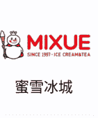
- **ChaPanda 茶霸**：茶百道在韩国开发当地独特特果柑柚为原料的饮品，将地域特色融入产线。
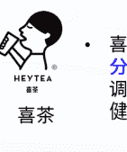
- **HEYTEA 喜茶**：在新加坡结合饮料分级（A-D级），调整配方以符合本地的健康标准。

- **柠檬季**：柠檬季通过分析东南亚消费习惯，推出厚醇奶、青柠茶等，降低柠檬糖症，适应偏好口味的节奏。在印尼爪加山门店推出了限量饮品“广州落日”，用当地新奇士作为原料，每日销量3,000杯。

- **WEDRINK**：进入马来西亚之初便积极申请清真认证（Halal），确保产品符合伊斯兰教义，成功进入穆斯林市场。

Source: Meet Insight 调研基于咖啡行业报告 蜜行

## 本地化策略
| 渠道 | 案例 |
| :--- | :--- |
| 线下 | 多门店建设，创造良好的消费体验，强化消费者粘性，展示品牌价值，如华人活跃区、热门商圈、潮流打卡点。 |
| 线上 | 独立站建设、APP服务、外卖平台，构建流量池，优化接入路径。 |

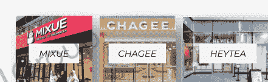

Source: Meet Intelligence 基于公开资料

## 内容本地化借助明星红人赋能强化品牌背书，渗透地域壁垒。

### ...IP土化
- IP+品牌联名
-跨界营销，助力品牌实现人群拓圈
- 红人营销
- IP营销
- 节日营销
- 跨境营销

### 品牌源自IP化
- 经典IP合作
- 集体记忆
- 区域认同
- 手游
- 时尚
- 其他

### 雪形设计元素本土化
根据各国文化特色进行“本土”调整。在泰国，通过独特的视觉符号，打造品牌形象、旋律和色彩，呈现出中国年轻人热血共鸣。在泰国，王室IP打造本土风突破，在创意和资金上策划。

**× HONOR OF LINES**
地区：马来西亚
新品：沙龙冰茶和可莉士联名
线下活动：指定门店购茶即可获得暗黑传奇IV游戏券、独家家族周边（挂件、信片、别针、钥匙和鼠标）

**× 马来街头服饰品牌 PMC**
地区：马来西亚
产品：用本土元素图腾化服饰、WhatsApp媒体营销
活动：INS5天使用官方服饰拍照，落地微信CHAGEE，粉丝打卡领好礼，有机会获得独家潮流奖品
效果：INS发布多篇博文，粉丝增长+XX

**× 澳洲高端护肤品 Vida Glow**
地区：澳洲利利亚和澳洲
新品：联名“Ocean's Glow”（娜娜莉·海汁），通过“主播”营销
渠道：与当地限定的联妆、帆布袋等周边
效果：上线两家店铺销售，TikTok和INS发布打卡牌，被《Cosmetics Business》评价为“品牌与潮流的完美结合”

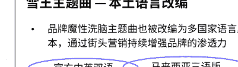

| 中国方文 | 马来西亚语 | 泰语 | 日语 |
| | | | |

# ...充分利用本土性国际性节点，强化情感联结、提升品牌认知

红人营销、IP营销、节日营销、事件营销

## 国际节日活动增强影响

### 印尼×情人节活动
时间：2024年2月13日-16日
活动内容：
- 线下：部分店铺推出情人节主题活动，购买2款Mixue饮料即可获得Mixue信息凭证
- 线上：关注Mixue Indonesia账号，可获得第二份半价优惠
活动效果：Ins相关活动获点1.4w和评论600+，约平时贴文的5倍

### 新加坡×万圣节活动
时间：2024年10月24日-11月3日
活动内容：
- 线下：部分店铺上线万圣节新品，品牌Ins粉丝免费获赠大杯万圣节新品、独家品牌可获得万圣节营销果、贴纸周边
- 线上：关注品牌Ins账号并评论Tricks Or Grapes in NAYUKI，有机会获得万圣节享免费饮料

## 本土节日活动加深认可

### 印尼×开斋节活动

### 马来西亚×农历新年活动
时间：2024年3月25日至4月21日
活动内容：
- 线下：店铺购买开斋节套餐有机会获得iPhone 15 Pro Max
- 线上：开斋节期间直播抽奖送多部iPhone手机
活动效果：品牌期间内Ins发布

时间：2024年1月16日至29日
活动内容：
- 线上：#CHAGEE CN挑战赛，限量线下券领挑战视频，标记3位好小伙伴一起参与，点赞首名可获得奶茶和茶杯套装
- 线下：Gongxi挑战赛，到店购买饮品并恭喜你，免费换一个杯
活动效果：Ins相关贴文点计数+2w+

Source: Meet Intelligence基于公开资料整理

# ...再通过自创/借势热门节点事件强化品牌叙事，增增品牌势能

红人营销、IP营销、节日营销、事件营销

## 品牌庆典活动趋势

### 品牌本地大事件
### 本地社会热点事件

### 2024年巴黎奥运会借势

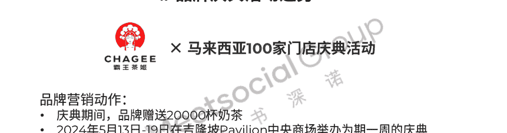

- × 马来西亚100家门店庆典活动
- × 巴黎线下快闪门店活动

品牌营销举措：
- 庆典期间，品牌赠送2000杯奶茶
- 2024年5月17日-19日在吉隆坡ilion中央商场举办为期一周的庆典活动
- 提供精美盲盒，在马来西亚和网红线下会
- 2024年5月17日购买茉桂花莉奶茶和正山新红茶奶茶可获得限量围杯
- FB&Ins社策划活动送奖

- 在巴黎奥运第三大流量枢纽圣拉尔尔沃火站
- 设置快闪店‘TEA吧’
- 打“这里不要”——现场畅畅品牌奶茶
- 推出消费、互动、观影等中式游戏互动
- 让法国人在巴黎感受中国文化与东方饮料的味

营销效果：
- Ins多条互动点赞w+
- 活动期间‘CHAGEE’搜索热度到巅峰
- 开业日销量超2000人排队打卡，销售破万元

马来西亚“CHAGEE”搜索热度变化
品牌100家门店庆典活动趋势

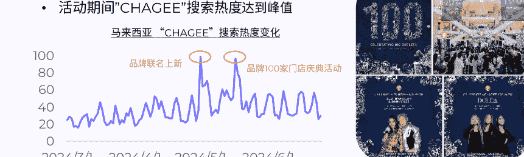

Source: Google Trends, Meet Intelligence

# ...再通过自创/借势热门节点事件强化品牌叙事，增增品牌势能

## 飞书深诺一站式出海整合解决方案
- 社媒定位
- 线上策划
- 线上广告
- 社区运营
- 订阅服务
- 网红营销

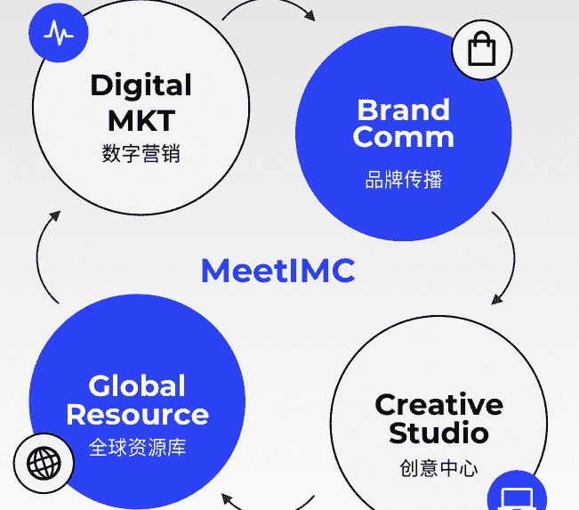

## 品牌传播
- 公关传播
- ESG/CSR规划
- 线下执行
- 员工培训
- 情绪监测与管理

## 全球资源
- 媒体合作
- 全球网红
- 品牌/赛事合作
- 线下OOH

## 创意中心
- 品牌设计(VI)
- 交互体验(AR/VR)
- 3D创意

## 海量顶级资源，助力品牌海外增长
- 红人营销
- 深度联结
- 200万+全球红人资源
- 3000万+客户服务
- AI智能化赋能
- 驱动全球化视野，本地化落地

## 数字化MKT
- 社媒定位
- 线上策划
- 线上广告
- 社区运营
- 订阅服务
- 网红营销

## 品牌设计
- 品牌设计
- 品牌设计
- 品牌设计

## 数字化赋能
- 产品数字化
- 运营数字化
- 营销数字化

## 产品数字化：数字化赋能产品研发到生产全流程，支撑“千店千面”的本地化落地
- 产品研发设计
- 产品生产
- 产品迭代
- 消费者口味需求洞察
- 产品化创新
- 自动化生产与品质管控
- 智能单品与生产调度
- 利用数字化工具（如CRM系统或社交媒体分析）收集目标市场消费者口味、需求等，形成本地化圈
- 利用AI等数字技术对当地饮食文化、水果口味及其他消费数据进行分析，并符合当地口味，如印尼的椰子奶茶、雪冰茶
- 通过自动化设备、智能系统和数据驱动的流程优化，提升制造效率和标准化
- 通过数字化设备确保产品一致性、食品安全和本地法规性
- 通过数字化平台（如智能单品系统）与后期生产链路整合，优化订单处理，提高订单效率
- 实时调整单品，减少带滞商品类，并因时制制季节性新品或限定产品，提升消费者体验

## 品牌案例
- 喜茶
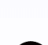
- 雪冰城

- 奈雪的茶

- 薛莉

- 喜茶在新加坡市场通过调研了解到当地对低廉、健康茶饮的强需求，并据此调整产品策略，推出喜茶系列
- 雪冰城通过数字化工具收集海外门店加盟密度、销量数据，生成“口味风力图”，定义区域特色产品，如印尼棕糖奶茶、蜜冰
- 奈雪的茶在新加坡门店自动自动奶茶，结合本地口味好设配比例，提升标准化与效率，单店标准化产出得到两位显著提升
- 薛莉通过机器学习构建AI销量预测系统，已应用于海外市场，将门店需求预测准确率提升至95%以上，大幅降低了库存和缺货风险

# 运营数字化：贯穿从原料供应到门店运营的茶饮全产业链正经历深度重塑
### 后台：原材料供应
### 中台：门店/品牌运营
### 前台：终端消费

- 原料获取
- 原料运输
- 订单接收
- 制作
- 交付
- 自动订阅
- 单元量
- 预测
- 构成
- 门店历史数据
- 统计
- 季节性选择
- 本地化
- 数字化控制
- 数字化优化
- 核心区域建立
- 配中心，缩短运输半径
- 数字化系统实时监控
- 门店选址
- 数字化管理
- POS、CRM
- 智能化
- 全渠道销售
- 数字化支持
- 品牌独立站
- 线上建设
- 线上流量
- 自动化生产
- 数字化流程
- 辅助制作
- 标准化体系
- 设立培训体系
- 第三方配送
- 高效服务
- 数字化工具实现
- 会员管理
- 数字化赋能
- 营销链路闭环

# 数字化驱动的链路协同，加速全球
### 全球采购
### 生产基地
### 物流体系
- 45000+全球门店
- 6大洲38国家
- 29万平方米面积
- 27个自营仓库
- 560个城市
- 泰国、越南、印尼等国
- 芒果、蔬菜、茶叶
- 咖啡、热带水果
- 核心工厂配备MES系统
- 数字化执行
- 数字化追踪
- 溯源（源头）
- 引入智能仓储管理（WMS系统）
- 建立全球物流体系，涵盖泰国、越南、印尼等国，入库到全流程标准化管理
- 借助数字化工具对目标市场的商圈开展分析，支撑门店选址决策
- 数字化监控实时监控门店动态策略

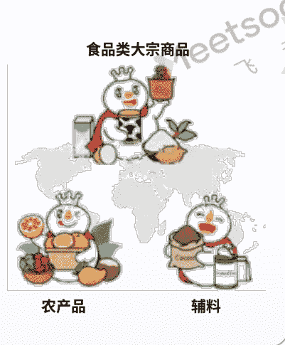
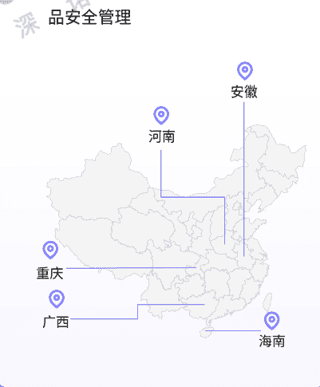
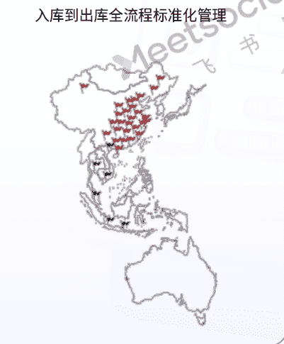
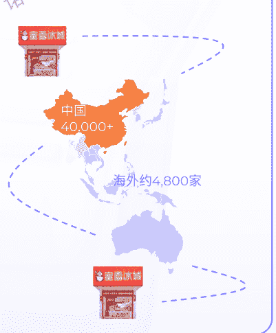

## 产品研发
## 品质控制
## 数字化赋能

此外，品牌官网为“品牌落地”，是内容传播与价值的窗口，也是沉淀海外私域资产的重要体。飞书深诺为茉莉茶提供数字化基建解决方案，助力其开启品牌出海新篇章。

|  | MIXUE | CHAGEE | HEYTEA | Cocoa BUBBLE TEA | NAYUKI |
|---|---|---|---|---|---|
| Instagram | Facebook | YouTube | X | | |
| Meetsocial Group | | | | | |
| 社交深度 | | | | | |

Source: Meet Intelligence基于品牌主页整理

## 主要出海品牌概览
飞书深诺拥有40+全球媒体资源，最大化驱动茶饮海外曝光。Meet Intelligence 提供全方位媒介一站式解决方案
- 主流媒体广度覆盖
- 优质聚合精准定向
- 垂类新媒体拓量获客
- 区域流量点覆盖

未来，随着更多品牌入局和本土实力觉醒，海外茶饮市场将演变成一个同样激烈更为复杂的“全球内卷战场”。

## 如何探寻新轮内卷下的生存法则、掌握生意主动权？
- 本土实力的防御反击
- 同行的扎堆竞争
- 跨界玩家入局
- 合规成本
- 全球不同文化差异
- 供应链成本

飞书深诺凭借海量本地化资源+数字化手段，为中国茶饮品牌提供全链路营销解决方案，助力提升海外竞争力

飞书深诺集团提供全链路服务、助力中国企业提升出海综合竞争力

| 策略 | 咨询 & 内容服务 | 媒体 | DSP | 平台站 | 技术服务 |
|---|---|---|---|---|---|
| 整合营销 | 创意服务/内容制作 | KA 媒体 | 优化服务 | ... | | |
| 广告管理 | 网站/支付/物流/客服 | 生态链+金融服务 | 云服务/支付/变现 | 建站/数据追踪/云服务/CRM/用户运营 | | |

# ABOUT US Meet Intelligence

# Meet Intelligence

## 三大服务模块

### 市场洞察
飞书深诺旗下的Meet Intelligence 专业洞察团队为出海企业提供海外行业趋势洞察、行业竞对洞察、用户画像和品牌评估等定制化咨询策略服务，覆盖包：
- 目标市场与分领域的发展趋势
- 竞争对手成功要素梳理与经验总结
- 主要媒介与新媒体的渗透
- 3C手机、家电、时尚服等10余行业

### 用户洞察
- 目标用户画像与需求
- 用户品牌认知与反馈
- 产品/广告创意有效性评估

### 策略咨询
- 新市场进入策略规划
- 目标市场选品规划
- 品牌深度运营营销规划

更多MeetIntelligence出品报告
请扫描二维码获取

# Meetsocial Group
飞书深诺

## 飞书深诺集团

领先的数字化全球营销服务集团

MEETSOCIAL.com

## 飞书深诺

飞书深诺集团成立于2013年，是领先的数字化全球营销服务集团，营销推广覆盖全球233个国家和地区，拥有新加坡、日本、美国、印度、阿酋等多个国家和地区的海外团队。

飞书深诺拥有全球40家优质媒体购买资源，围绕海陆链路多个触点形成了一套包括媒介管理服务 Meetsocial Media、出海品牌全域营销服务子品牌飞书点跃 BeyondClick、数字技术服务 Meet Experience为一体的营销服务链路，助力品牌全球成功。在电商品牌、游戏领域等出海两大场景下，专注于成长型跨境电商运营解决方案的平台SinoClick和专注游戏全球发行服务的平台Meetgames帮助出海企业实现在更低门槛、更快的海外业务增长。

如今，飞书深诺已累计服务商、品牌、游戏、APP多场景助力10万中国企业出海，稳步实现数字化助力中国企业和全球消费者的愿景。

- 10 万+ 累计服务客户数量
- 50 亿美元 年度管理广告预算
- 40 亿 每日广告达人次

官网：www.meetsocial.com

BeyondClick飞书点跃是飞书深诺集团旗下专注出海品牌全域营销服务品牌，为海外品牌提供“有数据、策略、能落地”的新一代全球数字营销深度专业服务，并以全球营销数字化管理平台赋能营销业务提速、提效。

如今为止，BeyondClick已在本土策略、整合营销、数字化运营等领域深度服务3,000+家领先的品牌出海企业，助力品牌竞争力提升，致胜全球市场。

## 市场洞察 Insight

- 8,800万+ 全球消费者样本库
- 系统诊断评估出海投放策略
- 数字媒介资产利益最大化

## 运营优化 Optimization

- 超10年 全球投放数据沉淀
- 账户结构诊断优化
- 投放过程可控，效果可见

## 数字创意 Creative

- 对全球创意素材资源
- 数据效果导向优化创意内容
- 本地化创意持续、高效输出

## 社媒网红 KOL&IMC

- 连接4300万+网红资源
- 系统性链接与内容营销方案
- 有效链接海外本地用户

# 谢谢观看！

Meetsocial