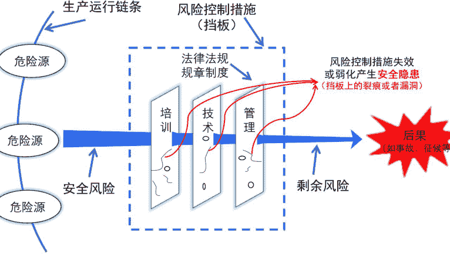

# 2025
62个行业重大事故隐患判定标准

应急管理科普整理

做好安全
一定有人因你而安全

# 知识星球TOP 资源分享社群

汇聚全网付费资源
让更多人获取高价值信息

+   ◆付费文章
◆付费社群
◆付费课程
◆副业&搞钱
◆财经&股市
◆行业报告

时政·历史·职场·体制·自媒体
学习·军事·软件·影音·社会学

公众号:知识星球TOP  微信信号:jntsg8  微信信号:jnts2

添加微信 免费进群

# 重大事故隐患判定标准汇编

2025 年 1 月

# 目录

+   1. 民用爆炸物物品重大事故隐患判定标准....................................................... 1
2. 民用船舶制造企业生产安全重大事故隐患排查指引（试行）......................... 5
3. 信息通信建设工程生产安全重大事故隐患判定标准...............................................8
4. 道路交通重大事故隐患排查指引（试行）.......................................................21
5. 内海运输船舶重大事故隐患判定标准....................................................... 14
6. 安全预防领域重大事故隐患排查指引（试行）............................................... 18
7. 公安监管重大事故隐患排查指引（试行）...............................................
8. 养老机构重大事故隐患判定标准....................................................... 24
9. 儿童福利机构重大事故隐患判定标准....................................................... 29
10. 地质勘查和测绘企业生产安全检查事项指引（试行）............................... 34
11. 企业突发环境隐患排查和治理工作指南............................................... 40
12. 水压矮库核动力工厂应急重大事故隐患判定标准（2024 版）...... 55
13. 房屋市政工程生产安全重大事故隐患判定标准....................................... 121
14. 自建结构安全重大隐患排查技术要点（暂行）
15. 城镇燃气经营安全标准....................................................... 131
16. 公路水利工程施工安全治理能力提升方案............................................... 135
17. 水上运输重大事故隐患判定指南（暂行）............................................... 149
18. 危险货物港口重大事故隐患判定标准....................................................... 154
19. 道路运输企业和城市客企业生产安全重大事故隐患判定标准（试行） ... 162
20. 公路运营领域重大事故隐患判定标准....................................................... 168
21. 水利工程项目生产安全重大事故隐患清单指南............................................... 171
水利工程运行管理生产安全重大事故隐患清单指南....................................... 176
22. 渔业船舶重大事故隐患判定标准（试行）......................................................178
23. 农业机械安全生产重大事故隐患判定标准...............................................180
24. 文化和旅游领域重大事故隐患判定标准......................................................183
25. 医疗机构重大事故隐患判定清单..................................................................186
26. 石化工和化学品行业安全生产单位重大生产安全事故隐患判定标准（试行）......190
27. 烟花爆产生经营单位重大生产安全事故隐患判定标准（试行）......194
28. 工贸企业重大事故隐患判定标准......................................................................196
29. 特种设备安全监督检查办法......................................................................207
30. 特种设备重大事故隐患判定准则......................................................218
31. 广播电视行业安全生产重大事故隐患特征清单......................................224
32. 体育行业安全生产重大事故隐患判定标准（2023版）................229
33. 气象内部内部安全风险分级管控和隐患排查工作指南......232
34. 防雷安全领域重大事故隐患判定标准......................................................249
35. 放气气球安全领域重大事故隐患判定标准（试行）................252
36. 国家粮食和物资储备局垂直系统重大生产安全事故隐患判定标准（试行）......255
37. 粮食仓储企业生产安全事故隐患判定标准（试行）................263
38. 谷物磨制重大事故隐患判定要点......................................................265
39. 重大电力安全隐患判定标准（试行）...............................................268
40. 水电站重大事故隐患治理管理办法...............................................70
41. 烟草行业重大事故隐患检查指引...............................................278
42. 林业行业生产重大事故隐患判定标准...............................................307
43. 铁路交通重大事故隐患判定标准（试行）...............................................310
44. 铁路建设工程重大事故隐患判定标准...............................................317
45. 民航安全风险分级管控和隐患排查治理机制.......322
46. 民航重大安全隐患判定标准（2024年修订版）......................343
47. 专业工程重大事故隐患判定标准（试行）................................353
48. 邮政企业生产重大事故隐患判定标准（试行）......370
49. 快递企业重大事故隐患特征清单................................................374
50. 煤矿重大事故隐患判定标准................................................377
51. 金属非矿山重大事故隐患判定标准..........................................389
52. 金属非矿山重大事故隐患判定标准补充情形................................401
53. 关于火灾重大事故隐患判定方法................................407
54. 铁路隧道工程重大事故隐患判定标准............................419
55. 化学品仓库和场所安全隐患排查要求（试行）.......424
56. 铁路工程生产重大事故隐患判定（暂行）标准（涉密）......431
57. 教育系统重大事故隐患指南（不公开）
58. 公路交通事故重大事故隐患排查规范（试行）（不公开）
59. 农村沼气安全生产事故隐患判定标准（试行）（不公开）
60. 商务系统安全生产风险隐患清单（不公开）
61. 军工危险化学品重大事故隐患判定标准（试行）（涉密）
62. 精神卫生机构重大事故隐患判定标准................................404

# 工业和信息化部关于印发《民用爆炸物品行业重大事故隐患判定标准》的通知

工信部安全〔2024〕34号

各省、自治区、直辖市及新疆兵团民用爆炸物品主管部门：

依据《中华人民共和国安全生产法》和《民用爆炸物品安全条例》等法律法规，工业和信息化部制定了《民用爆炸物品行业重大事故隐患判定标准》，现印发给你们，请遵照执行。

《民用爆炸物品行业重大事故隐患判定标准（试行）》（工信厅函〔2023〕37号）
工业和信息化部
2024年12月3日

# 民用爆炸物品行业重大事故隐患判定标准

依据有关法律法规、部门章章和行业标准，以下情形应当判定为重大事故隐患：

-   一、营业执照、生产许可证、安全生产许可证、销售许可证未依法取得或超过有效期限的。
-   二、未按规定设置安全生产管理机构，未配备安全生产管理人员的。
-   三、主要负责人、安全生产管理人员任职日起6个月后仍未依法考核合格，特种作业人员未持特证上岗的。
-   四、超过许可数量或品种、超过规定时间作业、超过规定存储量、超过人员组织生产经营的。
-   五、生产严重损失、安全防护及控制设施失效可能导致本单元或更大范围失控的（注1：管理严重缺失是未建立与岗位匹配的全员安全生产责任制或者未规定重大危险源管理制度及生产事故隐患排查治理制度；注2：安全防护及控制设施是指防爆、自动控制、联动安全连锁、门机联控等装置）。
-   六、外部因素影响生产经营单位自身排除且构成重大风险的（注：外部因素指民爆企业以外的、社会的、自然的等因素）。
-   七、未经设计擅改变危险性建筑物用途从事危害

## 八、危险工（库）房防爆、防火、防雷设备缺失的（注1：防爆设备设施是防止、减弱爆炸危害的防护屏障、装甲和防爆墙等设备设施；注2：防火设备设施是指消防水池、消栓、消防雨淋等设备设施）。

九、使用明令禁止或者淘汰设备、工艺的；民用爆炸物专用生产设备未经过安全性论证擅自变更用途的；新研制的民用爆炸物品专用生产设备未履行规定程序即投入生产的。

# 十、危险性建（构）筑物内部距离或外部距离不能满足《民用爆炸物品工程设计安全标准》（GB50089）要求的。十一、库房和仓库储存性质不明危险品或《民用爆炸物品工程设计安全标准》（GB50089）规定不适当存放的。十二、利用爆炸药在地面装炸的生产区建（构）筑物未具有甲级资质设计的。十三、生产区建（构）筑物未具有甲级资质设计的（注：生产区建（构）筑物包括工程、工艺及配套建筑结构、暖电等，含甲级）。十四、新改扩建项目未经过安全评审、未进行质量验收或不合格即投入生产的。十五、民用爆炸品生产线或接触危险品的设备报废后仍未实施处理的。十六、未建立双重预防机制和风险分级管控和重大事故隐患判定标准。十七、法律法规、标准明确的其他重大事故隐患的情形。

# 工业和信息化部关于印发《民用船舶企业生产安全重大事故隐患排查指引（试行）》的通知

工信部安全〔2024〕32号

各省、自治区、直辖市及新疆兵团工业信息化部门：

为准确识别、及时消除民用船舶制造生产安全重大事故隐患，有效防范重大生产安全事故，依据《中华人民共和国安全生产法》等法律法规，工业信息化部制定了《民用船舶企业重大事故隐患排查指引（试行）》，现印发给你们。请结合生产实际，发现重大隐患属于信息化部门职责的，要认真推进整改；不属于信息化部门职责的，及时移交积极督促落实整改。

工业信息化部
2024年7月2日

# 民用船舶企业生产安全重大事故隐患排查指引（试行）

为准确识别、及时消除民用船舶制造生产重大事故隐患，依据《中华人民共和国安全生产法》等法律法规，结合民用船舶制造业生产实际，对民用船舶制造过程中存在以下情形的，建议作为重大事故隐患判定有规定：

-   一、船舶制造过程中实施起重作业时，（一）未制定重大吊装作业工艺方案或未落实重大吊装审批；（二）重大吊装作业时，未经过质量检验或验收不合格即投入使用；（三）级以上大风等不良天气条件，未停止露天起重作业；
-   二、船舶制造过程中实施明火作业时，（四）未按规定落实二级及以上明火作业审批；（五）明火作业现场存在涂装、胶水/油漆等不相容作业；（六）在易燃易爆、有毒有害物质场所进行明火作业，未进行气体检测或检测不合格仍实施作业；
-   三、船舶制造过程中实施有限空间作业时（七）未落实作业审批或现场未设置监护人员；（八）作业前（含作业中断后再次作业）未执行“先通风、再检测、后作业”要求；（九）未持续检测可燃气体、有毒有害气体及氧气浓度；
-   四、船舶制造企业涉及可燃或有毒气体泄漏的场所，易燃易爆气体站房、危险化学品库房、危废库房、涂装房等未设置气体浓度监测系统或报警系统失效；（十一）未按规定安装防爆电气设备或设备失效；
-   五、船舶制造过程中存在其他情形的（十二）台风、洪水期，未根据地方政府预警等级启动相应的应急预案；（十三）建船期间安装气体灭火系统后，未对灭火系统采取隔离保护措施；（十四）建船过程中进行液化天然气、甲醇等燃料加注作业前，未制定加注方案或未进行安全交（十五）特种设备作业人员和特种作业人员未持证上岗；（十六）未与承包单位签订专门的安全生产管理协议或在承包合同中未约定各自的安全生产职责。

# 工业和信息化部关于印发《信息通信建设工程生产安全重大事故隐患判定标准的通知

工信部通信〔2024〕64号

各省、自治区、直辖市通信管理局、中国电信集团有限公司、中国移动通信集团有限公司、中国联合网络通信集团有限公司、中国铁塔集团有限公司、有关单位：

为准确识别、及时治理信息通信建设领域生产安全重大事故隐患，有效防范重大生产安全事故，依据《中华人民共和国安全生产法》和《建设工程安全生产管理条例》等法律法规，工业信息化部制定了《信息通信建设工程重大事故隐患判定标准》（以下简称《判定标准》），印发给你们，请遵照执行。

各地通信管理局要把重大事故隐患当事故对待，将《判定标准》作为强化监管的重要依据，督促信息通信工程建设各方落实重大事故排查治理主体责任，彻底排查、及时消除各类重大事故隐患，牢牢守住安全底线。
《判定标准》实施过程中，如有相关意见和建议，请及时报工业信息化部（信息通信发展司）。

工业信息化部
2024年4月7日

## 信息通信建设工程生产安全重大事故判定标准

第一条 为有效防范和遏制重大事故判定，持续完善信息通信建设工程隐患排查治理，科学判定信息通信建设工程重大事故隐患，《中华人民共和国安全生产法》和《建设工程安全生产管理条例》等法律法规，制定本标准。

第二条 本标准适用于信息通信基础设施新建、改建、扩建的工程生产重大事故隐患判定。

第三条 本标准所称重大事故隐患，是指在信息通信建设工程中，存在的危害程度较大、可能导致群死群伤或造成重大经济损失，应当或者局部局部产停业的生产事故隐患。

第四条 信息通信建设工程中有下列情形之一的，判定为重大事故隐患:

-   （一）建设单位将建设工程发给不具备相应资质或安全生产许可证的施工单位的；
-   （二）建设单位未按规定要求制定信息通信建设工程生产安全事故现场处置方案；
-   （三）在城市市区内的施工，未在施工现场设置安全标识的；

（四）在不满足项目要求的建筑物内组织施工的；

（五）出现自然灾害预警，未接受灾害影响地区应急机制要求，强行组织施工的；

（六）对于有限空间、作业业，未按规定落实作业审批，或者作业现场未设置专门人员进行安全管理，或者未配置合格安全防护装备的；

（七）施工单位的项目负责人、专职安全生产管理人员未持有通信主管部门核发有效安全生产考核证书从从事相关工作的；

（八）特种作业人员未持有有效特种作业人员操作证书上岗的。

第五条对于不能依据标准直接判断是否为重大事故隐患的情况，可组织有关专家，依据安全生产法律法规及强制性标准，进行论证、综合判定。

严重违反安全生产法律法规及强制性标准，且存在危害程度较大、可能导致群性死亡或造成重大经济损失的现实危险，应判定为重大事故隐患。

第六条 抢险危险工程不适用本标准。

第七条 涉及钢结构、土建、机电等其他专业对于重大事故隐患判定另有标准规定的、涉及建筑、市政、交通等其他专业交叉或平行行业，其他专业对重大事故隐患判定另有标准规定的，通信建设企业应按照要求排查查事故隐患。

第八条 本标准自发布之日起实施。

# 关于印发《道路交通重大事故隐患排查指引（试行）》的通知

公交管〔2023〕209号

各省、自治区、直辖市公安厅、局交通管理管理局、新疆生产建设兵团公安局交警总队：

为深入贯彻落实国务院安委会关于开展重大事故隐患专项排查整治要求，指导各地公安交通部门精准排查突出安全隐患、积极推动问题整改，我局研究制定了《道路交通重大事故隐患排查指引（试行）》。经报部领导同意，现印发给你们，请结合本地实际抓好落实。执行情况及遇到的问题，及及时报我局。

公安部交通管理局
2023年7月7日

# 道路交通重大事故隐患排查指南（试行）

为贯彻落实国务院安委会关于开展重大事故隐患专项排查整治2023行动部署要求，切实提升风险隐患排查整改质量，结合道路交通安全工作实际，对道路交通安全领域存在以下情形的，作为道路交通重大事故隐患专项排查重点内容，其中属于公安执法职责的，及时通报有关部门，积极推动隐患整改。

- 一、“两客超”、重型货车在营运过程中存在超载20%以上、超速50%以上、超限载100%以上、重度疲劳驾驶（连续驾驶8小时以上，期间休息时间不到20分钟）、酒酒醉驾违法违法行为的；
- 二、面包超载载客、驾乘人员超过10人、三（四）轮车、轻型货车、拖拉机非客车车辆违法载人超过10人的；
- 三、近三年内发生2起以上较大道路交通事故或6起以上人员死亡道路交通事故，且事故原因与道路隐患有关的路段（普通公路500米为区间，高速公路1000米为区间）
- 四、近三年内受浓雾、雨雪、低温冰冻天气影响，导致5车以上多车相撞造成伤亡交通事故的阶段
- 五、急旁塌坡、临水临崖、长大下塌、桥梁隧道和施工路段，发生过与安全防护设施缺失有关的一次死亡3人以上交通事故的；
- 六、矿山、钢铁、水泥、砂石等重点货运源头企业存在长期违规装载、放任严重超限超载货车出厂（场）上路，以及因此导致交通事故情形的；
- 七、“两客一危”、重型货车擅自关闭、破坏、屏障、拆卸车载动态监控系统，所属企业未及时发现纠正的；
- 八、客货运输企业所属车辆及驾驶人交通违法、交通事故问题突出，依据重点运输企业安全风险评价办法被判定为高风险企业的；
- 九、使用设置乘客站立区的客车上高速公路行驶的，以及延伸到农村的城市公交车辆，未经地市级人民政府同意（直辖市辖区范围内的应报直辖市政府）使用设置乘客站立区的客车的；
- 十、机动车检验机构对于“两客一危”、重型货车出具虚假安全技术检验报告的。

# 交通运输部办公厅关于印发《内河运输船舶重大事故隐患判定标准》的通知

交办海〔2024〕67号

各省、自治区、直辖市、新疆生产建设兵团交通运输厅（局、委），
各直属海事局：

根据《中华人民共和国安全生产法》《中华人民共和国内河交通安全管理条例》等法律法规，经交通运输部同意，现将《内河运输船舶重大事故隐患判定标准》印发给你们，请认真贯彻执行。

交通运输部办公厅
2024年12月15日

# 内河运输船舶重大事故隐患判定标准

第一条 为准确判定、及时消除内河运输船舶重大事故隐患，根据《中华人民共和国安全生产法》《中华人民共和国内河交通安全管理条例》等法律法规和交通运输部有关隐患治理的规定，制定本标准。

第二条 本标准适用于内河危险船舶和300吨以上内河运输船舶的重大隐患判定。

第三条 本标准中的重大事故隐患是指违反或不符合内河交通安全法规、规范以及强制性标准的要求，直接影响船舶航行安全且对群众生命财产造成危害的行为。

第四条 内河运输船舶在航行、停泊、作业期间，存在下列情形的，判定为重大事故隐患：
- （一）船舶配备的船长、轮机满足安全配备
- （二）内河液化燃料上任职的船员未按规定持有特殊培训证书
- （三）船舶未按规定持有有效的内河安全管理证书
- （四）船舶超载载运危险货物
- （五）船舶严重超载载运货物
- （六）船舶不遵守禁限航行要求
- （七）船舶主推进装置、应急停止失灵
- （八）船舶操纵控制系统或舵机失灵

第五条 客船在航行、停泊、作业期间存在第四条所列情形之一，判定为重大事故隐患：
- （一）客船上任职的船长、高级船员未持有有效的特殊培训证，或配员不满足安全要求
- （二）客船未按规定开展消防和应急演练
- （三）客船脱险通道严重堵塞或锁闭
- （四）客船未按规定配备救生设备且无法使用
- （五）客船未按规定配备固定式自动火报警系统、固定灭火系统，或系统失灵
- （六）客船不具备夜航条件擅自航

第六条 内河运危险货物船舶在航行、停泊、作业期间存在第四条所列情形之一，判定为重大事故隐患：
- （一）载运危险货物上任职船员未持有有效的培训证书，或配员不满足安全要求
- （二）载运危险货物未经许进港或从事作业
- （三）船舶载运危险货物种类超过适用范围
- （四）载运散装危险货物船舶在进行洗舱、装卸活动期间，违反规定开展明火及易产生火花的作业
- （五）载运散装危险货物船舶舱高位报警装置失灵，或装卸物的管线、软管、阀门、法兰存在泄漏
- （六）载运散装危险货物船舶未按规定配备灭火系统，或系统失效

第七条 依照本标准判定为重大事故隐患的，必须依法规采取相应处置措施。

第八条 本标准自印发之实施，此前发布的判定情形与本判定标准相关情形不一致的，以本判定标准为准。

# 关于印发《治安领域重大事故隐患排查指引（试行）》的通知

公安安〔2023〕265号

各省、自治区、直辖市公安厅、治安、内保、刑警、公交（轨道）总队（局），新疆生产建设兵团公安局治安总队：

为深入贯彻落实国务院安委会关于开展重大事故隐患专项排查整治2023行动部署，按照党委部署安排，为精准排查治安领域突出安全隐患、积极推动问题整改，我局研究制定了《治安领域重大事故隐患排查指引（试行）》。现发给你们，请结合本地实际情况抓好落实。执行情况及遇到的问题，及时报我局。

公安部治安管理局
2023年7月31日

# 治安领域重大事故隐患排查指引（试行）

为贯彻落实安委会关于开展重大事故隐患专项排查整治2023行动部署要求，切实提升风险隐患排查整治质量，结合治安领域管理工作实际，对治安领域存在以下情形的，建议作为重大事故隐患排查整治重点内容，其中属于公安机关治安部门职责的，要认真落实整改，不属于公安机关治安部门职责的，要及时通报有关警种、部门，积极推动隐患整改。

- 一、爆炸危险物品类
- 1、爆破作业单位未按照资质等级从事爆破作业，或无资质人员从事爆破作业。
- 2、爆破作业现场临时存放民用爆炸物品未设专人管理、看护。
- 3、爆破作业单位民爆物品储备超出核定容量存放民用爆炸物品，或炸药、雷管同存放，或废弃、收缴的爆炸物品与民爆物品库存存放。
- 二、大型群众性活动
- 1、活动场所、设施、建筑物存在严重安全、消防安全。
- 2、参加活动严重超出活动场所容纳数量。
- 三、地铁公交
- 1、地铁运营企业未落实治安保卫工作。
- 2、地铁运营企业未按规定对内部治安隐患落实措施。
- 四、长途客运
- 1、一级、二类客运站未落实实制售票检验，存在易燃易爆、危险物品进站。
- 2、长途客运站未符合《反恐怖法》要求。

# 关于印发《公安所重大事故隐患排查指引（试行）》的通知

公安严〔2023〕34号

各省、自治区、直辖市公安厅、局、监所管理总队、新疆生产建设兵团公安监管总队：

深入贯彻落实国务院安委会关于开展重大事故隐患专项排查整治2023行动部署，根据《城乡监管法》精神，指导各地监管部门精准排查突出安全隐患、积极推动调整，我局研究制定了《公安所重大事故隐患排查指引（试行）》。现印发给你们，请结合实际抓好落实。执行情况及遇到的问题，及时报我局。

公安部监所管理局
2023年8月8日

# 公安所重大事故隐患排查指引（试行）

为贯彻落实国务院安委会关于开展重大事故隐患专项排查整治2023行动部署要求，切实提升风险隐患排查整治质量，结合监管安全工作特点，明确以下情形的，作为重大事故隐患专项排查重点内容，认真落实整改，需要其他部门协调，积极推动整改。

- 一、入所时未对监管人员开展健康检查。
- 二、不严格落实日常安全制度，监管管理混乱。
- 三、被管人员出所不执行“三条铁”“三个严禁”和“三个必须”。
- 四、监管人员放宽时不“群进群出”，导致监管人员滞留。
- 五、没有按照“八必”开展管理教育谈话。
- 六、未执行民警直接管理制度，存在看头狱现象。
- 七、在提讯、谈话教育等执法工作中不按照规定使用具，或者使用非制具，以及临时固定措施未按照程序。
- 八、对监管人员没有实施24小时值班防。
- 九、监控设施设备发生未及时维修，没有做到对活动区域24小时监管。
- 十、食品采购、储藏、加工等环节的安全管控未到位，存在食物中毒、传染病等风险。
- 十一、监室内存在明显的悬挂点。
- 十二、监室内电视机、电风扇、空调等悬挂设备不牢固，存在坠落风险。
- 十三、监所大门口无缓冲区，监区管理失控，协作不畅，未相应处置。
- 十四、没有定期对水、电、燃气等线路和设备进行检修，存在火险隐患。
- 十五、监所基础设施、排水系统、应急用电和周边山体等环境的安全隐患未及时排除，且无突发自然灾害处置案。

# 关于印发《养老机构重大事故隐患判定标准》的通知

民办发〔2023〕13号

各省、自治区、直市民政厅（局）、新疆生产建设团民政局：现将《养老机构重大事故隐患判定标准》（以下简称“标准”）印发给你们，请认真贯彻执行。

各地民政部门要将“标准”作为养老机构监管的重要依据，联合有关部门在养老机构行政检查中加强重大事故隐患排查治理工作。养老机构要依法落实重大事故隐患排查治理主体责任，彻底排查、准确判定、及时消除各类重大事故隐患，坚决防范和遏制特大事故发生。

民政部办公厅
2023年11月27日

# 养老机构重大事故隐患判定标准

第一条 为了合理界定、及时消除养老机构重大事故隐患，根据《中华人民共和国安全生产法》《中华人民共和国消防法》《中华人民共和国特种设备安全法》《养老机构管理办法》《养老机构服务安全基本规范》等法律法规和强制性标准，制定本标准。

第二条 养老机构未落实安全有关法律法规和强制性标准等基本要求，可能导致人员重大伤亡、财产重大损失的，判定为重大事故隐患。

第三条 标准中的重大事故隐患包括以下方面：
- （一）重要设施存在严重缺陷；
- （二）安全相关资质不符合要求；
- （三）日常管理上存在严重问题；
- （四）违法违规服务；
- （五）其他。

第四条 养老机构重要设施存在严重缺陷包括：
- （一）建筑设施属于C级、D级房或者居住城乡建设；
- （二）居住城乡建设消防、电气等设施不符合强制标准；
- （三）使用易燃可燃材料作为建筑构件、建筑材料和室内装修装饰；
- （四）使用未合格、已经报废的电梯、锅炉。

第五条 养老机构安全相关资质不符合要求：
- （一）内设医疗机构的，未取得医疗机构许可证；
- （二）内设食堂的，未取得食品经营许可证；
- （三）使用未取得适当人员的未备案；
- （四）使用未取得相关证书，未熟练操作人员从事特种作业；
- （五）允许未经专门培训并取得相应资格的特种作业人员上岗。

第六条 养老机构日常管理存在严重问题指：
- （一）未建立安保、消防等各项安全制度；
- （二）对特种设备、电气、燃气、报警、应急救援等设施进行定期检测和维护；
- （三）未按规定制定突发事件应急案或者未定期组织应急演练；
- （四）未落实24小时值班制度、未进行日常安全巡查；
- （五）未进行安全教育和培训，相关工作人员不会；
- （六）因施工特殊情况进行焊接，未按规定办理手续。

第七条 养老机构违法违规服务指：
- （一）将老年居住或者休息室设置在地下室；
- （二）内设食堂的，不严格执行餐具消毒、食品留样制度；
- （三）未取得食品许可的供餐单位或者按照要求订购食品进行查验；
- （四）发现老年人患对公共卫生造成危害，未按照相关规定处置。

第八条 其他可能导致人员伤亡、财产损失的重大事故隐患指：
- （一）养老机构选址不符合国家规定，未与易燃易爆、有毒有害等危险品的生产、经营场所保持安全距离或者设置在自然资源部门判定在自然灾害高风险区域内；
- （二）疏散通道、安全出口、消防通道被占用、堵塞、封闭；
- （三）未设置应急照明、疏散指示标志、安全出口指示标志或者相关标识被遮挡。

第九条 相关法律法规和强制性标准对养老机构重大事故隐患判定另有规定的，适用其规定。

第十条 对于情况复杂、难以直接判定是否为重大事故的，各地民政部门可以商询有关部门或者组织专家，依据法律法规和强制性标准等，研究论证后综合判定。

第十一条 各地民政部门可以根据本标准、结合实际细化本行政区域内养老机构重大事故隐患标准。

十二条 标准自公布之日起施行，有效期五年。

# 关于印发《儿童福利机构重大事故隐患判定标准》的通知

民办发〔2024〕14号

各省、自治区、直市民政厅（局）、新疆生产建设团民政局：加强儿童福利机构安全管理，科学排查、及时消除有关重大事故隐患，民政部制定了《儿童福利机构重大事故隐患判定标准》（简称《判定标准》）。现印发给你们，请认真贯彻执行。

各地要将《判定标准》作为加强儿童福利机构安全管理的依据，依法落实重大事故隐患排查治理，组织开展儿童福利机构重大事故隐患排查治理，坚决防范和遏制重大事故发生。各地可根据本判定标准，结合实际完善行政区域内儿童福利机构重大事故隐患标准。《判定标准》执行情况及工作中遇到的问题请及时反馈民政部儿童福利司。

民政部办公厅
2024年9月12日

# 儿童福利机构重大事故隐患判定标准

民办发〔2024〕14号

第一条 为了科学排查、及时消除儿童福利机构重大事故隐患，根据《中华人民共和国安全生产法》《中华人民共和国消防法》、《儿童福利机构管理办法》等法律法规和强制性标准，制定本标准。

第二条 儿童福利机构重大事故隐患判定包含以下方面：
- （一）房屋建筑；
- （二）设施设备；
- （三）相关资质不符合法定要求；
- （四）日常管理；
- （五）其他。

第三条 房屋重大事故隐患包括：
- （一）建筑设施属于C级、D级房或者居住城乡建设；
- （二）居住城乡建设消防、电气等设施不符合强制标准；
- （三）使用易燃可燃材料作为建筑构件、建筑材料和室内装修装饰。

第四条 设备重大事故隐患包括：
- （一）使用未取得生产许可、未经验收不合格、已经报废的电梯、锅炉；
- （二）未按国家有关标准配置消防、灭火器等消防设施、器材；
- （三）未按规定在使用燃气的厨房、浴室等区域配备燃气报警、燃气紧急切断装置；
- （四）经消防、燃气管理等部门检查或者第三方机构评估判定电器、燃气用具等设备不符合相关法律法规和有关标准要求。

第五条 相关资质不符合法定要求包括：
- （一）委托未取得安全生产许可证的建筑施工企业从事活动；
- （二）委托不具备设计资质的机构或人员实施电器线路、燃气管路的设计、敷设；
- （三）委托不具备相应资质的消防技术服务机构和人员开展消防设施维护保养检测、消防安全评估；
- （四）使用未取得相应资质的人员动火作业、电工作业。

电梯作业、锅炉作业等特种作业人员；

（五）使用未取得相应资质的人员担任消防控制室班人员；

（六）使用未取得相应驾驶车辆资质的人员担任接送儿童车辆驾驶员；

## 第六条 日常管理重大事故隐患包括：

- (一)未建立消防、应急等安全管理制度，未落实相关安全生产责任制；
- (二)未落实 24小时班值巡查，未进行日常防火巡查检查，或者巡查检查发现突出安全问题未予以整改；
- (三)未定期组织安全教育培训；
- (四)未制定突发事件应急预案，或者定期组织安全应急演练；
- (五)因施工等特殊情况需要进行电焊等明火作业，未按规定动火审批手续。

## 第七条 其他重大事故隐患包括：

- (一)儿童用房所在楼层位置不符合国家工程建设消防技术标准的规定；
- (二)疏散通道、安全出口门被占用、堵塞、封闭；
- (三)设门禁闭装置的疏散门未安装紧急开启装置，或者在门窗上设置影响逃生和灭火救援的铁栅栏等障碍物且不能保证紧急情况及时开启；
- (四)未经批准擅自关闭、占用或破坏关系生产安全的监控、报警、防护、疏散等设施设备。

第八条涉及房屋建筑、消防、特种设备、城镇燃气等等方面重大事故隐患判定标准另有规定的，从其规定。

第九条 对于情况复杂、难以直接判定是否为重大事故隐患的，可依据相关法律法规和有关标准，研究论证后综合判定。

第十条 未成年人救助保护机构重大事故隐患判定参照标准执行。

第十一条 本判定标准自公布之日起施行，有效期五年。

# 关于印发《地质勘查和测绘行业安全生产重点检查事项指引（试行）》的通知

自然资局发〔2023〕51号

各省、自治区、直辖自然资源主管部门、新疆生产兵团自然资源局、中国地质调查局及其他直属单位、各派出机构、机关各司局、有关地质勘查和测绘单位：

为深入学习贯彻习近平总书记关于安全生产重要论述，落实党中央、国务院加强安全生产有所决策部署，精准排查地质勘查和测绘行业安全隐患、推动问题整改，我部研究制定了《地质勘查和测绘行业安全生产重点检查事项指引（试行）》，现发给你们，请根据本地区、单位实际情况，细化完善重点检查事项，抓好工作落实，保障行业安全。重要情况及时报报：

自然资源部办公厅
2023年12月28日

## 地质勘查和测绘行业安全生产重点检查事项指引（试行）

为深入学习贯彻习近平书记关于安全生产的重要论述，落实党中央、国务院加强安全生产有关决策部署，切实提升地质勘查和测绘风险隐患整改质量，结合行业安全管理工作实际，将以下工作纳入重点检查事项，其中属于自然资源部门职责的，要认真检查推进改进，不属于自然资源部门职责的，要及时转送的有关部门，积极协助促改隐患整改。

### 一、安全生产教育方面

安全生产教育培训重点检查事项包括但不限于以下事项：

- （一）未定期对人员进行安全生产教育培训，特别是每次勘测外作业都没有进行安全培训或提醒，对驾驶员的交通安全专项培训不到，对新员工进行安全生产教育培训不够，未建立安全生产教育培训台账。
- （二）纳入培训的安全生产法规政策不全，主管部门关于安全生产工作的提醒、要求和部署未及时传达学习。
- （三）纳入培训的安全生产制度细化不够，未充分涵盖安全管理规定、生产事故应急救援预案、消防应急预案、安全生产常识和操作规程等内容。
- （四）未定期组织开展安全生产应急演练。
- （五）培训过程流于形式，生产人员不能掌握的基本应急处置技能。

### 二、外业项目驻地安全方面

外业项目驻地安全重点检查事项包括但不限于以下事项：

- （一）外业项目驻存在滑坡、山洪、泥石流等自然灾害引起饮水、动物侵袭风险。
- （二）用电线路老化，使用铜线等金属丝代替易熔断丝，易进水漏水风险。
- （三）电源线、电源插板随意私乱投放，存在破损、易进水漏水风险。
- （四）未配备灭火器，或灭火器失效，或灭火器的规格、质量不符合要求。
- （五）工具设备放在路边外围土之上，未整齐摆放在靠山地面牢固一侧，存在滑落损坏的安全隐患。
- （六）有尖锐棱角的设备无防护罩（套），存在扎伤人员的安全隐患。

### 三、外业作业安全方面

外业作业安全重点检查事项包括但不限于以下事项：

- （一）未与全部外业人员签订订单安全生产责任书，落实安全生产责任制。
- （二）外业作业前，未对外业人员进行安全知识和培训，未熟悉外业作业各类防范与应急措施。
- （三）在连日雨、大雨、湿滑边坡处存在滑坡等隐患。
- （四）在道路作业时未设置明显警示。
- （五）外业作业前，未对外业人员进行安全知识和培训，未熟悉外业作业各类防范与应急措施。
- （六）油气井现场未安装防喷器，钻井施工存在隐患。
- （七）探槽深度大于3米，宽度小于6米，两壁坡度陡。
- （八）爆破作业时未遵守有关技术规范，未及时报告。
- （九）现场存在交叉作业不当，现场人员未佩戴安全防护用品。
- （十）在无人区域、高风险区域承担任务的情况下，作业人员结队。
- （十一）仪器与装备运输过程中，作业人员未佩戴手套，存在隐患。
- （十二）未按要求佩戴安全帽、穿戴反光背心、穿戴救生衣。
- （十三）外业工作期间未按要求配备通讯工具和定位装置，做到每日报。
- （十四）高温下作业未配备防暑降温药物，作业人员未注意避开高温。
- （十五）未及时测绘行业主管部门通报。

### 四、交通安全方面

交通安全重点检查事项包括但不限于以下事项：

- （一）单位未定期检查、保养野外用车。
- （二）驾驶员存在超速、疲劳驾驶、酒后驾驶等违法行为。
- （三）行过程中，车辆人员未系安全带，车辆物品过多，遮挡视镜。
- （四）在大风、暴雨、浓雾等极端恶劣天气进行野外作业。
- （五）野外作业期间，未能对车辆进行全程跟踪，实时了解。

### 五、实验室、办公室安全方面

室内安全重点事项包括但不限于以下事项：

- （一）危险化学品储存、使用和处置环节存在风险。
- （二）产生有害气体场所缺乏通风设施。
- （三）放射性设备无防护装置。
- （四）设备在充电过程中临时值守，存在安全隐患。
- （五）未关闭窗户、电源插板随意撒。
- （六）线路及插座老化，或者连接超出负载的大功率电器，存在安全。
- （七）易燃易爆物品随意摆放。
- （八）纸质材料等易燃物过多，未按规定配备。
- （九）灭火器等安全用品是否过期，未定期更换。
- （十）缺乏防潮措施、监控。

### 六、安全装备方面

安全装备重点检查事项包括但不限于以下事项：

- （一）单位未配备北斗终端等设备，设备无法正常工作。
- （二）在手机信号未覆盖区域，未配备必要的卫星电话。
- （三）在手机无信号或信号较弱区域，未配备通讯器材、防雨保温物、劳保装备、急救装备等。
- （四）单位未严格按照有关规定对装备的安全性能进行检查。

# 关于发布《企业突发环境事件隐患排查和治理工作指南（试行）》的公告

环境保护公告2016年74号

为贯彻《突发环境事件应急管理办法》，落实企业环境主体责任，指导企业开展突发环境事件隐患排查与治理工作，我部制订了《企业突发环境事件隐患排查与治理工作指南（试行）》，现予以发布。

特此公告。

附件：企业突发环境事件隐患排查和治理工作指南（试行）

环境保护
2016年12月6日

## 企业突发环境事件隐患排查和治理工作指南（试行）

### 1 适用范围

本指南适用于企业为防范火灾、爆炸、泄漏等生产事故直接导致或次生突发环境事件而自行组织的突发环境隐患（以下简称隐患）排查和治理。本指南未规定事项，应符合有关国家和行业标准的要求或规定。

### 2 依据

#### 2.1 法律法规规范性文件

- 《中华人民共和国突发环境事件应对法》
- 《中华人民共和国环境保护法》
- 《中华人民共和国大气污染防治法》
- 《中华人民共和国水污染防治法》
- 《中华人民共和国固体废物环境防治法》
- 《国家危险废物名录》（环境保护部 国家发展和改革公安部令第39 号）
- 《突发环境事件调查处理办法》（环境保护部第32 号）
- 《突发环境事件应急管理办法》（环境保护部第34 号）
- 《企业事业单位突发环境事件应急预案备案管理办法（试行）》（环发〔2015〕4号）。

#### 2.2 标准、技术规范、文件

- 《危险废物贮存污染控制标准》（GB 18597）
- 《石油化工企业设计防火规范》（GB 50160）
- 《化工建设项目环境保护设计规范》（GB 50483）
- 《石油储备库设计规范》（GB 50737）
- 《石油化工污水处理设计规范》（GB 50747）
- 《石油化工企业环境保护设计规范》（SH3015）
- 《石油企业环境保护设计规范》（SH3024）
- 《企业突发环境事件风险评估指南（试行）》（环发〔2014〕34号）
- 《建设项目环境评估技术导则》（HJ/T 169）。

### 3 排查内容

从环境管理和突发环境事件两大方面排查直接衔接或次生突发环境事件隐患。

#### 3.1 环境发环境事件管理

- 3.1.1 按规定开展突发环境风险评估，确定风险等级。
- 3.1.2 按规定制定突发环境事件应急预案并备案。
- 3.1.3 按规定建立健全隐患排查治理制度，开展工作。
- 3.1.4 按规定开展突发环境事件培训，如实记录结果。
- 3.1.5 按规定储备必要的环境装备和物资。
- 3.1.6 按规定公开突发环境事件应急预案及演练。

#### 3.2 突发环境风险防控措施

从以下方面排查：

- (1) 正常情况下划分了事故缓冲区、事故应急池等各类区域，应急池位置是否合理，周边距离符合环境影响评价及批复要求。
- (2) 正常情况下涉及危险化学品或其他有害物质的作业场所、储存设施、泄漏监测设施等排水系统。
- (3) 正常情况下，围堰、防堤、集水池、收集池、污水处理设施、监控系统、废水处理系统、独立的处理系统。
- (4) 正常情况下，生产废水、地下水、河道排放管道是否设置监控及关闭阀。
- (5) 正常情况下，地面清洗、墙壁、渗漏、排放管道连通。

### 4 隐患分级

#### 4.1 分级原则

根据可能造成的危害程度、治理难度及突发环境事件风险等级，隐患分为重大突发环境隐患（以下简称重大隐患）和一般突发环境隐患（以下简称一般隐患）。具有以下特征之一的可认定重大隐患：

- （1）情况复杂，短期内难以治理并可能造成环境危害的隐患；
- （2）可能产生较大环境危害的隐患，如可能造成有害物质进入大气、水、土壤等环境介质次生危害大于突发环境事件的隐患。

#### 4.2 企业自行分级标准

企业应根据前述对于重大隐患和一般隐患的分级原则、自身突发环境事件风险等级等实际情况，制定企业的分级标准。可以立即治理的隐患一般认定为重大隐患。

### 5 一般隐患排查治理的基本要求

#### 5.1 建立完善治理机构

企业应当建立完善隐患排查治理机制，配备相应的管理和技术人员。

#### 5.2 建立健全制度

企业应当按照下列要求建立健全隐患排查治理制度：

5.2.1 建立隐患排查治理责任制。企业应当建立健全从主要负责人到每位作业人员，涵盖各部门、单位、各岗位的隐患排查治理责任体系；明确主要负责人对本企业隐患治理工作全面负责；统一组织、领导和协调本单位隐患治理工作，及时掌握、监督重大隐患治理情况；明确分管隐患排查治理工作的组织机构、责任人和责任分工，按照生产区、储运区或车间、工段等划分排查区域，明确每个区域的责任人，逐级建立并落实隐患排查治理岗位责任制。

5.2.2 制定突发环境风险防控设施的操作规程和检查、运行、维修及维护等规定，保证资金投入，确保设施处于正常完好状态。

5.2.3 建立自查、自报、自改、自检的隐患排查治理组织实施制度。

5.2.4 如实记录隐患排查治理情况，形成档案文件并做好存档。

5.2.5 及时修订突发环境事件应急预案、完善相关突发环境事件风险防控措施。

5.2.6 定期对员工进行隐患排查治理相关知识的宣传和培训。

5.2.7 有建立机制发环境事件发生后及时通报可能受到危害的单位和居民。

# 附表1

## 企业突发环境事件应急管理隐患排查表

（企业可参考本表制定符合企业实际情况的自查用表）

| 排查时间： 年 月 日 | 现场排查负责人（签字）： | 排查结果 |
| :--- | :--- | :--- |
| 排查内容 | 具体排查内容 | 是， 否 | 其他情况 |
| | | 证明材料 | 具体问题 | |
| 1. 是否按规定开展突发环境事件风险评估，确定风险等级 | (1) 是否编制突发环境事件风险评估报告，并与预案一起备案。 | | | |
| | | (2) 企业是否有突发环境事件风险物质种类和风险评估报告相比是否发生变化。 | | | |
| | | (3) 企业是否有突发环境事件风险物质数量和风险评估报告相比是否发生变化。 | | | |
| | | (4) 企业突发环境事件风险物质种类、数量变化是否影响风险等级。 | | | |
| | | (5) 突发环境事件风险等级确定是否正确合理。 | | | |
| | | (6) 突发环境事件风险评估是否通过评审。 | | | |
| 2. 是否按规定制定突发环境事件应急预案并备案 | (7) 是否按要求对预案进行评审，评审意见是否及时落实。 | | | |
| | | (8) 是否将预案进行了备案，是否每年进行回顾性评审。 | | | |
| 排查结果 | | | | |
| --- | --- | --- | --- | --- |
| 排查内容 | 具体排查内容 | 是， | 否， | 其他 |
| | | 证明材料 | 具体问题 | 情况 |
| (9) 出现在下列情况是否预案是否进行了及时修订。
- (1) 面对面对的突发环境事件发生重大变化，需要重新进行风险评估；
- (2) 应急管理组织指挥体系与职责发生重大变化；
- (3) 环境应急监测预测机制发生重大变化，报告联络信息及机制发生重大变化；
- (4) 环境应急体系和措施发生重大变化；
- (5) 环境应急保障措施及保障体系发生重大变化；
- (6) 重要应急源发生重大变化；
- (7) 在突发环境调查实际实施和应急演练中发现问题，需要对环境应急预案进行重大调整。
| 3. 是否按规定建立健全隐患排查治理制度，开展隐患排查工作并建立档案
| 4. 是否按规定开展突发环境事件应急培训，如实记录训练情况
| 5. 是否按规定储备必要的环境应急储备和物资 | (10) 是否建立隐患排查责任制。
| (11) 是否制定本单位的隐患分级规定。
| (12) 是否有隐患排查年度计划。
| (13) 是否建立隐患排查记录报告，是否制定隐患排查表。
| (14) 大隐患是否制定了应急方案。
| (15) 是否建立重大隐患报告制度。
| (16) 是否建立隐患排查治理方案。
| (17) 是否将应急训练纳入单位工作计划。
| (18) 是否开展应急知识和技能培训。
| (19) 是否按规定建立健全应急档案，如实记录培训时间、内容、人员等情况。
| (20) 是否按规定配备以应对预见事件情景的环境应急储备和物资。
| (21) 是否设置了专业或兼职人员组成的应急救援队伍。
| (22) 是否与其他组织或单位签订了应急救援协议或互救协议。 | |

| 排查内容 | 具体排查内容 | 是 | 否 | 其他情况 |
| :--- | :--- | :--- | :--- | :--- |
| | | 证明材料 | 具体问题 | |
| （23）是否对现有物资进行定期检查，对已消耗或损耗的物资装备进行调试及补充。 |
| 6. 是否按规定公开突发环境事件应急预案及演练情况 | （24）是否按规定公开突发环境事件应急预案及演练情况。 | | |

## 附表 2

## 企业突发环境事件风险防控措施隐患排查表

企业可参考表制定符合企业实际情况的自查表。一般企业有多个风险单元，针对每个单元制定负责相应的隐患排查表。

排查时间：年 月 日 现场排查负责人（签字）

| 排查项目 | 现状 | 可能导致的危害（是隐患的填写） | 级别 | 治理期限 | 备注 |
| :--- | :--- | :--- | :--- | :--- | :--- |
| | | | | | |

一、中间事故事故应急设施、事故应急池或事故事故废物池（以下统称应急池）

| 1. 是否设置应急池。 | | | | | |
| 2. 应急池容积是否满足性文件及审批等相关文件要求。 | | | | | |
| 3. 应急池在非事故状态下需要占用时，是否符合要求，并设有发生事故时可以紧急排空的技术措施。 | | | | | |
| 4. 应急池位置是否合理，消防水和泄物不能自流进入应急池； | | | | | |

| 项目 | 现状 | 可能导致的危害（总患患的填写） | 隐患级别 | 治理期限 | 备注 |
| --- | --- | --- | --- | --- | --- |
| 4. 进入应急池，是否配备了足够排水能力的排水管，确保泄漏物和消防物能够收集。 | | | | | |
| 5. 接纳消防的排水系统具有接纳最大量的能力，是否有防止污水排出外的措施。 | | | | | |
| 6. 是否通过厂区内部管线将收集的废物至污水处理。 | | | | | |

二、厂内排水

| 7. 设置区围、罐区围是否设置排水切换阀，正常情况下通向水的闸门是否关闭，通应急池或污水处理系统的闸门是否打开。 | | | | | |
| 8. 所有生产装置、罐库、化学及原料装卸场所和危险废物场所的墙壁、地面清洗和受污染的废水、消防水都能传入废水或的处理系统。 | | | | | |
| 9. 是否防止污染的冷却水进入水系统的措施，受污染的冷却水都能传入废水或的处理系统。 | | | | | |
| 10. 各种卸装区（包括码头、铁路、公路）产生的事故液、作业污水是否设置污水收集系统，是否有防止事故液、作业污水流入水系统的措施。 | | | | | |
| 11. 有排洪沟或河道穿过厂区时，排洪沟是否与泄漏井、生产废水、清水管道连通。 | | | | | |

三、清水和污水（废）的水的总排口

| 12. 清净水、排洪沟的厂区总排口是否设置监控及关闭（阀），是否专人负责在紧急情况下关闭排口，确保污染的。 | | | | | |
| 13. 废水的排水出口是否设置监控及关闭（阀），是否专人负责关闭总口，确保受污染的废水和泄漏物等不会排出厂界。 | | | | | |

四、突发环境事件风险防控措施

| 14. 企业与周围重要环境影响的防护距离是否符合环境影响及批复的要求。 | | | | | |
| 15. 涉及有害污染物名录的企业是否在厂界建设针对污染物的环境预警体系。 | | | | | |
| 16. 涉及有害污染物名录的企业是否定期监测或委托监测有害污染物。 | | | | | |
| 17. 突发环境事件信息通报机制建立情况，是否能在突发事件发生后及时通报可能受到污染的单位和居民。 | | | | | |

# 关于发布核安全导则《压水堆核动力厂应急行动水平》的通知

国核安发〔2022〕29号

为进一步完善我国核与辐射安全体系，规范压水堆核动力应急行动水平，我局组织制定核安全导则《压水堆核动力厂应急行动水平》现予公布，自公布之日起实施。

国家核安全局
2022年1月21日

社会公开
生态环境部办公厅2022年1月21日印发

核安全导则 HAD002/08-2022

# 压水堆核动力厂应急行动水平规定

国家核安全局 2022年1月21日批准发布

# 国家核安全局

# 压水堆核动力厂应急行动水平制定

（2022 年 1 月 21 日国家核安全局批准发布）本导则自 2022 年 1 月 21 日起实施。本导则由国家核安全局负责解释。本导则是指导性文件。在实际工作中可以不同于本导则的方法和方案，但必须证明所采用的方法和方案至少具有与本导则相同的安全水平。本导则的附录为参考性文件。

# 1 引言

## 1.1 目的

应急行动水平（Emergency Action Levels, EAL）是核动力厂启动应急和判定应急状态等级的重要依据。运行单位应根据其核动力厂的设计特征和厂特征，确定用于应急状态分级的初始条件（Initiating Condition, IC）及其相应的应急水平。本文件为压水核动力厂运行单位应急行动水平的制定和国务院安全监督管理部门对应急行动水平的审查和监督提供指导。压水核动力厂运行单位应根据本文件符合其特定的应急行动水平。如果核动力厂的特征与本文件中的初始条件和应急行动水平的示例不兼容，则应确定可替代的 IC 或 EAL。

## 1.2 范围

本文件适用于压水核动力厂运行单位应急行动水平的制定，其他核设施应急行动水平的制定可参照执行。本文件描述了压水核动力厂运行单位应急行动水平的通用方法，主要包括：

- (1) 制定应急行动水平的基本要求；
- (2) 初始条件矩阵；
- (3) 应急行动水平示例。

# 2 基本概念与要求

## 2.1 应急状态等级

应急状态分级是对核动力厂偏离正常工况的事件或事故，根据其潜在或实际的影响将应急状态分为不同的等级。应急待命（U）、厂房应急（A）、场区应急（S）和场外应急（G）。

- (1) 应急待命：出现可能危及动力厂安全的特定工况或事件，表明动力厂安全水平处于确定状态或明显降低。
- (2) 厂房应急：核动力厂的安全水平有实际或潜在降低，但事件后果限于厂房或局部区域，对场外产生威胁。
- (3) 场区应急：核动力厂工程设施可能失效，安全水平发生重大下降，后果扩大到整个场区，放射性照射水平不会超过应急水位，不必采取防护措施。
- (4) 场外应急：可能发生放射性物质的大量释放，事故超过区域边界，导致场外的放射性照射水平超过应急水位，以必要采取防护措施。

## 2.2 初始条件（IC）和应急行动水平（EAL）

2.1 初始条件是预先确定的，能触发动力厂进入某种应急状态的工况或事件。初始条件描述的工况或事件，其严重性或后果与应急状态等级一致。
2.2 初始条件可以表示为连续的、可量的变量（如水位）或事件（如地震），或者屏障的状态。
2.3 应急行动水平为某一初始条件预先确定的、特定的可观测阈值，当满足或超过该阈值时，动力厂进入相应的应急状态。
2.4 应急行动水平可以是仪表读数、设备状态指示、测量参数（场内或境外）、可观测的事件、分析结果、特定操作程序或其他导致特定应急状态的情况。
2.5 初始条件和应急行动水平应该是明确且易于操作的。

## 2.3 IC 和 EAL 的识别类别

2.1 将初始条件和应急行动水平按照一定的方式分为若干类别，识别类别能够覆盖所有应急水平。
2.2 运行单位可以根据机组特性，从便于操作的角度确定适用的识别类别。识别类别一般分为如下：

- 辐射水平/废物异常类（A）
- 屏障类（F）
- 影响动力安全的危害和其他事件类（H）
- 热态下的系统故障类（S）
- 冷态下的系统故障类（C）
- 独立燃料存储设施类（E）

## 2.4 IC 和 EAL 的适用条件

2.1 核动力厂运行单位制定应急行动水平时，IC 和 EAL 的适用条件随核动力厂的运行模式而变化。比如，一些基于特征的 IC 和 EAL 只能在运行、启动或热备/热停模式下进行评估，此时所有屏障都在正常状态下，且仪表和安全系统处于完全运行状态。而在冷却堆和换料模式下，计划维护会带来系统的开放，某些安全组件不可用，因此，要用不同的基于特征的 IC 和 EAL 反映这些特征。
2.2 运行单位需要将技术书中的标准运行模式纳入应急状态分级中。IC 和 EAL 适用中所使用的运行模式应与动力厂规格书中规定的运行模式保持一致。
2.3 不同机型的运行模式会有不同，但通常可分为：反应功率运行、启动、热备、热停、冷却堆、换料、卸料。其中，反应功率运行、启动、热备、热停运行模式归为热态，冷却堆、换料、卸料运行模式归为冷态。IC 和 EAL 的适用条件能够覆盖所有适用的运行模式。
2.4 运行单位应给出动力厂每个运行模式下对应的识别类别。每一个给定的类别的 IC 和 EAL 适用于指定的运行模式。
2.5 应急行动水平制定的动力厂特定信息

2.1 核动力厂运行单位根据核动力厂的厂址条件、设计、运行状态等特征，确定应急状态分级的初始条件及其相应的应急水平。
2.2 影响应急行动水平制定的动力厂设计特征主要：安全功能设计；监测系统仪表、设备的配置特征；技术规格书；特定操作规程；严重事故分析（如概率安全分析）得到的相关信息等。
2.3 应在动力厂的特定操作规程中设置适当的可视提示（例如：步骤、注释、警告等），提醒用户参考应急状态分级程序。例如，可以在 RCS 泄漏异常操作规程的开头设置一个步骤、注释或警告，提醒用户进行应急状态分级。
2.4 虽然不推荐将 IC 和 EAL 严格结合到动力厂的特定操作程中，但应保持操作程中的诊断和应急状态评估之间的一致。例如，屏障值从特定操作程中提取。
2.5 应急水位中所使用的设定值，是对描述事件或工况最具意义的值，确保设定值在有效范围内。

## 2.6 应急状态的分级

2.1 对于已经进行了应急状态分级，将工况或事件（如动力厂相关的指示和事件）与之比较，确保达到或超过 EAL。评估与运行状态一致，如果达到或超过 EAL，则根据宣布相应的应急状态。
2.2 对于规定的时长（如15 分钟、30 分钟等）的 IC 和 EAL，应在判定情况已超过规定时间后立即宣布，而不等到完全达到规定时长。如果监测到正在进行释放而释放开始时间未知，则假定已超过规定时间。
2.3 计划内的工作，如测试、操作、维修或修改等可能导致预期事件或状态超过 EAL，如果这些活动是计划进行的，且仍在许可范围内，则不需要进入应急状态。
2.4 分级过程中运行模式的考虑：IC 所用的运行模式是在事件发生时的模式，以及操作员采取响应之前的模式。如果某个工况或事件发生，并在宣布之前导致了模式的变化，则应急状态分级仍基于事件触发（而不是宣布时的）运行模式。对于冷却堆或换料过程中发生的事件，即使在之后的响应过程中进入反应功率运行、启动、热备等更高模式的，仍通过适用于冷却堆或换料模式的 EAL 进行升级。特别是屏障引发的 EAL，仅适用于运行模式下触发的那些事件。
2.5 应急状态等级的升级：对于进展迅速或复杂的事件，在宣布某一应急状态后，由于事件造成的风险进一步扩大，则需要对应应急状态进行升级：

- (1) 对于快速发展的事件，若经应急判断，可能在较短的时间内发生应急状态的变化，若随后出现对应应急水平更高的应急状态等级，则按照已经达到该行动水平提高应急状态；
- (2) 已知或预期的潜在影响高于当前水平的最高状态，可考虑升级；
- (3) 超过动力厂设计、安全和运行的程度高于当前水平的最高状态，可考虑升级；
2.6 应急状态等级的终止和降级：当达到最高 IC 和 EAL 的工况或事件不再存在，且达到特定的状态终止条件，应急状态予以终止。
2.7 多重事件和工况的分级：识别所有达到或超过的 EAL，应急状态等级为所触发的最高状态等级。例如：当厂房应急和应急区域的行动水平到达时，不管是同一机组还是不同机组都应该宣布应急区域。一般情况下，满足相同应急状态等级的多个 EAL，应急状态等级不变，例如：如果达到两个应急的 EAL，无论同一机组还是不同机组都应该宣布厂房应急。当不同事件触发相同应急状态等级的多个 EAL 并且对于动力厂的安全威胁明显增大，或对于非共事件（或无法判断是否为共事件）时，应急指挥应参照应急状态的定义和2.5 升级的条件，综合判断。
2.8 瞬态工况的分级：对于可能触发应急行动水平的瞬态工况，应立即进行分析判断，并与行动水平比较，在15 分钟内给出应急状态等级的判断：

- (1) 在15 分钟内满足以下条件之一，可以不进入应急状态：
- a) 动力厂已恢复正常，确认为没有造成后果，在实施纠正的过程中没有进一步受损；
- b) 其他的终止准则。
- (2) 在实施纠正的过程中，动力厂进一步受损，确认为无法恢复正常，则应根据行动水平立即进入应急状态。
- (3) 对确认已发生的某些瞬态事件，若发生时已经结束，即使发生时达到或超过了某个 EAL，不再对其进行分级并进入应急状态。
- (4) 在正常运行过程中，对对的工况或因操作不当导致的工况，即使导致某些参数或判断发现某个 EAL，若该工况仍在范围内，也不据此进入应急状态。

# 3 初始条件与应急行动水平

### 3.1 概述

3.1.1 初始条件矩阵用于描述初始条件和核动力厂应急状态的对应关系，给出可能触发应急状态的初始条件，快速判断是否需要进入应急状态以及确定应急状态等级。初始条件矩阵是应急行动水平制定的基本框架。

3.1.2 在初始条件矩阵中，通常按应急状态等级递增或递减的顺序各种类别中每一个初始条件与应急状态等级之间的对应关系以及这种对应关系的适用条件。

## 表 1 识别 A 辐射水平或出流放射性异常初始矩阵

| 事件类别 | 应急待命 | 厂房应急 | 现场应急 | 场外应急 |
| :--- | :--- | :--- | :--- | :--- |
| 非计划的出流放射性异常 | 超过设施相关辐射限制值的2倍，持续时间达到或超过60分钟。适用条件：全部运行模式 | AU1: 流出物排放的放射性水平 | AA1: 流出物排放的放射性水平超过设施相关辐射限制值的200倍，持续时间达到或超过15分钟。适用条件：全部运行模式 | AS1: 在实际或预期排放时间内，释放的气体放射性物质导致扩散边界处或场区边界外有效剂量量大于1mSv，或甲状腺剂量量大于10mgGy。适用条件：全部运行模式 | AG1: 在实际或预期排放时间内，释放的气体放射性物质导致扩散边界处或场区边界外有效剂量量大于10mSv，或甲状腺剂量量大于100mgGy。适用条件：全部运行模式 |
| 辐照的燃料事件 | AU2: 辐照的燃料上方非剧刻下降。适用条件：全部运行模式 | AA2: 辐照的燃料水位发生显著下降，或者辐照的燃料生产严重损坏。适用条件：全部运行模式 | AS2: 终止池水位下降导致燃料裸露。适用条件：全部运行模式 | AG2: 终止池水位下降导致燃料裸露60分钟或更长时间。适用条件：全部运行模式 |
| 区域辐射水平异常 | | AA3: 区域辐射水平异常无法正常实施操作，影响了核动力的正常运行、冷却等停止。适用条件：全部运行模式 | | |

## 3.2.4 AU1 针对非计划排放的流出物的放射性水平超过机组相关排放限值的 2 倍且持续时间达到或超过 60 分钟的情况。初始条件主要指超过了管理限值水平的低放射性物质的排放，并且该排放持续了一段时间，表明核动力电厂安全水平发生了潜在的下降。AU1 可包括：

- (1）流出物（如气态排放的流出物）辐射监测仪表的读数（包括仪表监测路径上的连续排放与剂量排放的情况）大于机组相关排放管理限值的 2 倍且持续时间达到或超过 60 分钟；

## 3.2.5 AA1 针对非计划排放的流出物的放射性水平超过机组相关排放限值的 200 倍持续时间达到或超过 15 分钟的情况。初始条件主要指超过了管理限值的放射性物质的排放，并且持续了一段时间，表明动力厂的安全水平发生了实际的或重大的下降。AA1 可包括：

- (1）流出物（如气态排放的流出物）辐射监测仪表的读数（包括仪表监测路径上的连续排放与剂量排放的情况）大于机组相关排放管理限值的 200 倍持续时间达到或超过 15 分钟；

- (2）流出物（如气态排放的流出物）放射性取样分析表明其浓度或释放率大于机组相关排放管理限值的 200 倍持续时间达到或超过 15 分钟。

## 3.2.6 AS1 针对的是实际或预期释放时间内，释放的气态放射性物质导致扩散区边界处或场区边界外个人有效剂量大于 1mSv 或甲状腺待积吸收剂量大于 10mGy。该初始条件要指气态放射性物质的释放（监测到或未监测到的）导致实际或预期剂量大于通用水平，表明安全系统失效。AS1 可包括：

- (1) 流出物的监测仪表的读数大于预设阈值，监测表的读数超过时长或超过15 分钟；

- (2) 使用实际气象条件的剂量评价结果表明扩散边界处或场区边界外个人有效剂量大于1mSv 或甲状腺待积吸收剂量大于10mGy；

- (3) 环境监测表的读数大于1mSv/h 且持续时间等于或大于60 分钟，表明此类情形。

## 3.2.7 AG1 针对的是实际或预期释放时间内，释放的气态放射性物质导致扩散边界处或场区边界外有效剂量大于10mSv，或甲状腺剂量量大于100mgGy，表明需要采取公众防护。AG1 可包括：

- (1) 流出物的监测仪表的读数大于预设阈值，监测表的读数超过时长或超过15 分钟；

- (2) 使用实际气象条件的剂量评价结果表明扩散边界处或场区边界外个人有效剂量大于10mSv 或甲状腺待积吸收剂量大于100mGy；

- (3) 环境监测表的读数大于10mSv/h 且持续时间等于或超过60 分钟，表明此类。

## 3.2.8 AU2 针对的是照射过的燃料上方水位非计划下降，主要指燃料进料路径（反应堆水位、燃料通道、燃料水池）照射过的燃料上方下降导致辐射水平升高，表明安全水平下降。状态属于 C 类。

## 3.2.9 AA2 针对的是照射过的燃料上方水位显著下降或照射过的燃料组件严重损坏，主要指照射过的燃料组件已经损坏以及燃料水池水位下降，引发放射性物质向环境释放，导致安全水平实际或潜在下降。状态属于 C 类。

- (1) 燃料进料路径上照射过的燃料裸露；

- (2) 照射过的燃料组件损坏导致放射性泄漏；

- (3) 燃料水池水位下降。

## 3.2.10 AS2 针对的是燃料水池水位发生重大下降需要立即补水。初始条件指燃料水池的水量控制和补水能力严重导致燃料元件暴露，表明安全功能失效。

## 3.2.11 AG2 针对燃料水池水位下降导致燃料裸露持续60 分钟或更长时间。初始条件指燃料水池的水量控制和补水能力严重导致燃料元件长期暴露，导致燃料损坏和放射性物质释放。

## 3.2.12 AA3 针对区域辐射水平异常导致无法正常操作，影响了核动力的正常运行、冷却或者停堆。由于某个厂房或区域的辐射水平导致工作人员无法维持核动力电厂正常运行或实施冷却及停堆操作，或者使这些活动受到阻碍，表明安全水平实际或潜在下降。

- (1) 需要维持核动力电厂正常运行、实施冷却或者停堆的区域（如主控室）的剂量率大于0.1Sv/h；

- (2) 异常事件导致相关区域水平增加使得进入这些区域实施上述操作延迟或者无法实施的情形。

# 3.3 F类初始条件与应急行动水平

3.3.1 F类初始条件和应急行动水平表征了反应堆芯中裂变产物受到威胁的程度。该程度体现在屏障的损坏程度（损失或潜在丧失）和同时受威胁的屏障数目。适用于功率运行、启动、热备用、热维持模式。与裂变产物相关的应急初始条件在系统故障（S类）中考虑。

3.3.2 反应堆芯中裂变产物的屏障包括燃料包、反应堆冷却系统（RCS）压力边界和安全壳。燃料包屏障包括所有燃料芯材料的燃料包。RCS 压力边界包括一回路、稳压器安全阀、泄压阀以及一路隔离阀及其上游的所有连接线和阀门。安全壳屏障包括安全壳隔离阀及其上游的所有部件。该屏障还包括主蒸汽线、给水管线、除垢线、二次侧隔离阀及其上游的所有部件。

3.3.3 F类初始条件和应急行动水平的判定主要取决于动力运行模式下指示系统状态的监测能力。当运行模式为功率运行、启动、热备用、热维持时，所有屏障正常，应急按照技术规格的要求使用，此时通常由仪表读数或定期采样来识别一路或多道屏障是否受到威胁。当动力厂进入冷堆堆和换料、卸料运行模式时，RCS 压力边界或安全壳可能对裂变产物的屏障导致下降。此时，由于安全系统只有少数维持在原有的运行状态，对安全系统状态的监测能力受到极大限制，基于仪表读数的F类初始条件和应急行动水平可能不适用。

3.3.4 表2给出了F类的初始条件矩阵，使用流程1所示。在这些初始条件中注意：

- (1）燃料包壳和 RCS 压力边界屏障比安全壳屏障的重要性更高。

- (2）对于涉及放射性释放的事故情况，裂变产物屏障阈值的评估需要与剂量评估一起进行，以确保正确和及时的升级应急状态等级。例如，裂变产物屏障阈值的评估可能导致场区应急，而剂量评估可能已经超过场外应急。

- (3）制定 EAL 时，裂变产物屏障阈值应反映动力厂的特定设计和运行特征，以便及时地对裂变产物屏障丧失或潜在丧失进行分类。

## 表 2 识别类 F 产物屏障失效初始矩阵

| 厂房应急 | 场区应急 | 场外应急 |
| :--- | :--- | :--- |
| FA1: 燃料包壳或RCS压力边界障失效失效或丧失 | FS1: 有两条变产物屏障失效或潜在丧失 | FG1: 有两条变产物屏障失效，且 |
| 适用条件：功率运行、启动、热备用、热维持 | 适用条件：功率运行、启动、热备用、热维持 | 变产物屏障失效或潜在丧失 |
| | | 适用条件：功率运行、启动、热备用、热维持 |

![img/0505ae2caff5623ea7c5d05b26780.png]
图 1 识别类 F的使用流程图

## 表 3 裂变产物屏障损失或潜在损失的阈值

| 燃料包屏障 | RCS压力边界屏障 | 安全壳屏障 |
| :--- | :--- | :--- |
| 损失或潜在损失 | 损失或潜在损失 | 损失或潜在损失 |
| 1 RCS 或蒸汽发生器传管泄漏 | 1 RCS 或蒸汽发生器传管泄漏 | 1 RCS 或蒸汽发生器传管泄漏 |
| 不适用 | A 反应容器水位低于【动力厂特定水位】 | A 以下一种情况超过能力：1. 要自动或手动启动 ECCS (SI)：1. 不可隔离的 RCS 泄漏；2. 蒸汽发生器传管泄漏。或 RCS 冷却小于【动力厂特定压力承受】；A 蒸汽发生器或裂。 |
| 2 热量输出不足 | 2 热量输出不足 | 2 热量输出不足 |
| A 堆出口读数大于【动力厂特定值】 | A 堆出口读数大于【动力厂特定值】或 B 蒸汽发生器【动力厂特定指示】显示，RCS 热量输出不足。 | A 1.【动力厂特定的堆芯冷却恢复程序】2. 恢复程序在15 分钟内没有有效结果。 |
| 3 一回路活性、安全壳放射性 | 3 一回路活性、安全壳放射性 | 3 一回路活性、安全壳放射性 |
| A 安全壳内流量监测读数大于【动力厂特定值】；或 B 动力厂特定指示反应堆冷却活性大于【动力厂特定值】 | 不适用 | A 安全壳内流量监测读数大于【动力厂特定值】 | 不适用 | 不适用 | A 安全壳内流量监测读数大于【动力厂特定值】 |
| 4 安全壳完整性、安全壳旁路 | 4 安全壳完整性、安全壳旁路 | 4 安全壳完整性、安全壳旁路 |
| 不适用 | 不适用 | A 已实施安全壳隔离并规定安全壳完整性已损失或不可隔离的安全壳环境排放的路径；或 B 存在一回路冷却剂向安全外泄漏的。 | A 安全壳压力超过【动力厂特定值】；或 B 安全壳内存在爆炸性混合物；或 C.1 安全壳压力大于【动力厂特定值】；2. 没有一个完整系统（动力厂特定的安全壳） |

## 表 3 裂变产物屏障失效或潜在丧失的阈值（续）

| 燃料包壳屏障 | 失效 | 潜在丧失 | 一回路压力边界屏障 | 失效 | 潜在丧失 | 安全壳屏障 | 失效 | 潜在丧失 |
| :--- | :--- | :--- | :--- | :--- | :--- | :--- | :--- | :--- |
| 5 其他指示 | | | 5 其他指示 | | | 5 其他指示 | | |
| 【动力厂特定（如适用）】 | | | | | | 【动力厂特定（如适用）】 | | |
| 6 应急指挥的判断 | | | 6 应急指挥的判断 | | | 6 应急指挥的判断 | | |
| A 应急指挥判断任何指示燃料包壳屏障丧失的情况。 | A 应急指挥判断任何指示燃料包壳屏障潜在丧失的情况。 | A 应急指挥判断任何指示 RCS 压力边界屏障丧失的情况。 | A 应急指挥判断任何指示 RCS 压力边界屏障丧失的情况。 | A 应急指挥判断任何指示安全壳屏障丧失的情况。 | A 应急指挥判断任何指示安全壳屏障潜在丧失的情况。 |

## 3.3.5.1 燃料包壳屏障完整性判断

(1) RCS或蒸汽发生器传热管泄漏
丧失 1.A，针对反应压力容器水位下降导致燃料包壳破损的情况。可用特定操作规程中。

(2) 热量输出不足
丧失 2.A，针对辐照的燃料上方非剧刻下降。适用条件：全部运行模式。AA2: 辐照的燃料水位发生显著下降，或者辐照的燃料生产严重损坏。AS2: 终止池水位下降导致燃料裸露。适用条件：全部运行模式。AG2: 终止池水位下降导致燃料裸露60分钟或更长时间。适用条件：全部运行模式。

(3) 一回路活性、安全壳放射性
丧失 3.A，针对安全壳内流量读数大于核动力电厂特定值。或 B 动力厂特定指示反应堆冷却活性大于【动力厂特定值】

(4) 安全壳完整性、安全壳旁路
不适用。

潜在丧失 3.A, 针对安全壳内流量监测仪表读数大于动力厂特定值的情况。

动力厂特定值应基于20%的燃料包破损、所有反应堆冷却剂释放到安全壳内的假设来确定。

## (4) 安全壳完整性、安全壳旁路

丧失 4.A, 针对已要求实施安全壳隔离安全壳完整性已丧失或不存在不可隔离的安全壳向环境排放的路径的情况。

安全壳的实际泄漏率超过相应的泄漏限值意味着安全壳完整性丧失。事故发生随着一路冷却剂向安全壳内的能量释放，一系列因素会导致安全壳压力的波动。安全壳完整性丧失可能（也可能不）伴随安全壳压力不明原因的显著下降。鉴于事故过程中较难判断安全壳的泄漏率，初始条件要取决于应急指挥在合理考虑当前机组状态、可用的运行数据和放射性数据（如，安全壳压力、安全壳外放射性监测数据、安全壳喷淋系统的运行状态等）基础上的判断。

丧失 4.B, 针对存在一路冷却剂安全壳外泄漏指示的情况。

如果反应堆冷却剂泄漏到安全壳内，安全壳地水位、安全壳温度、压力和/放射性水平升高。如果这些参数没有升高，则反应堆冷却剂可能泄漏到安全壳外（安全壳旁路）。安全壳外地水位、温度、压力、流量和/放射性水平读数的增加可能表明 RCS泄漏至安全壳。

潜在丧失 4.A, 针对安全壳内压力超过动力厂特定值的情况。

如果安全壳压力超过设计压力，则存在丧失安全壳屏障的可能性。

潜在丧失 4.B，针对安全壳内爆炸混合物浓度达到氢气爆炸极限浓度下限的情况。氢气燃烧将提高安全壳压力，并可能导致带设备损坏，导致安全壳完整性丧失。

潜在丧失 4.C, 针对压力大于安全壳热量排放系统自动启动设定值，并且在 15 分钟内没有一个完整系列投入运行会导致自动启动失败，需要操作手动启动的时间。该阈值表示安全壳排热/泄压系统（如安全壳喷淋、冷凝器风扇等，但不包括安全壳通风策略）丧失或以降级方式运行安全壳的潜在丧失。

## 3.4 H 类初始条件与应急行动水平

3.4.1 H类初始条件和应急行动水平依据可能或即将发生的危险和其他事件对核电厂安全的损害程度确定相应的响应状态等级，适用于全部运行模式。

3.4.2 表 5 给出了 H 类初始条件矩阵。压水堆动力厂运营单位在此基础上确定适用于本核电厂的初始条件和应急行动水平。H 类可包括安保事件、地震、灾害事件、火灾或爆炸、有毒气体、主控室撤离、应急指挥判断等事件类别。

## 表 5 识别类 H 影响动力安全的危害和其他其他事件初始矩阵

| 事件类别 | 应急待命 | 厂房应急 | 坝区应急 | 外场应急 |
| :--- | :--- | :--- | :--- | :--- |
| 安保事件 | HU1:确认的安保事件或威胁，动力厂设施的安全水平下降级。适用条件:全部运行模式 | HA1:控制区内的敌对行动或30分钟内将厂发生攻击威胁。 | HS1:保护区内的敌对行动。适用条件:全部运行模式 | HG1:敌对行动导致设施的体失效。适用条件:全部运行模式 |
| 地震 | HU2:发生了大于OBE (SLE-1)的地震事件。适用条件:全部运行模式 | HA2:发生了影响当前运行模式的地震。需考虑安全的地震事件。适用条件:全部运行模式 | | |
| 天灾事件 | HU3:发生了导致动力厂安全水平下降的强风、外部洪水或内部水淹、其他址特定自然灾害等灾害事件。适用条件:全部运行模式 | HA3:发生了影响当前运行模式的强风、外部洪水或内部水淹、其他址特定自然灾害等灾害事件。适用条件:全部运行模式 | | | |

## 表 5 识别类 H 影响核力厂安全的危害和其他事件初始条件矩阵（续） |

| 事件类别 | 应急待命 | 厂房应急 | 区域应急 | 场外应急 |
| :--- | :--- | :--- | :--- | :--- |
| 火灾或爆炸 | HU4: 发生了导致核力厂安全运行或平缓阻碍的火灾或爆炸。适用条件：全部运行模式 | HA4: 发生了影响核力厂安全系统正常运行的火灾或爆炸。适用条件：全部运行模式 | | |
| 有毒有害气体 | 厂房内有毒的、腐蚀性、窒息性气体或可燃性气体的释放。适用条件：全部运行模式 | HA5: 气体释放扩散进入维持核力正常运行、停止或维护操作设备的区域。适用条件：全部运行模式 | | |
| 主控室撤离 | HA6: 主控室离开导致核力控制转移移动范围。适用条件：全部运行模式 | HS6: 在主控室外任意一项关键安全功能的控制未能建立。适用条件：全部运行模式 | | |
| 应急指挥判断 | HU7: 根据应急指挥判断批准准入应急待命的其他条件。适用条件：全部运行模式 | HA7: 根据应急指挥判断批准准入厂房的其他条件。适用条件：全部运行模式 | HS7: 根据应急指挥判断批准准入区域的其他条件。适用条件：全部运行模式 | IK7: 根据应急指挥判断批准准入场外的其他条件。适用条件：全部运行模式 |
| 3.4.3 HU1 | 针对人员或安全设备的安保事件，造成动力厂安全水平的降级。HU1包括： (1) 核动力厂安全部门报告安保事件（不包括敌对行动）。 (2) 收到相关部门的可靠通知，将受到威胁。 | | | |
| 3.4.4 HA1 | 针对控制区内的敌对行动或威胁。HA1包括： (1) 核动力厂安全部门报告在控制区内的敌对行动或已经发生。 (2) 收到相关部门的可靠通知，将在30分钟内受到威胁。 | | | | |
| 3.4.5 HS1 | 针对保护区内的敌对行动。HS1包括： 核动力厂安全部门报告在保护区内的敌对行动或已经发生。 | | | |
| 3.4.6 HG1 | 针对敌对行动导致设施的失效。HG1包括： (1) 核动力厂安全部门报告敌对行动或已经发生，导致核动力厂无法维持安全功能的操作。 (2) 收到相关部门的可靠通知，导致燃料损坏或即将损坏。 | | | | |
| 3.4.7 HU2 | 针对发生了大于OBE (SL-1)的地震事件。HU2包括： 核动力厂显示发生地震达到或超过 OBE 限值，并且经相关手段确认。 | | | |
| 3.4.8 HA2 | 针对发生了影响当前运行模式所需的地震事件。HA2包括： 核动力厂显示发生地震，并影响当前运行模式的安全系统。 | | | |
| 3.4.9 HU3 | 针对发生了导致动力厂安全水平下降的灾害事件。HU3包括： 强风、外部洪水或内部水位、其他址特定自然灾害等。 | | | |
| 3.4.10 HA3 | 针对发生了影响当前运行模式所需安全系统的灾害事件。HA3包括： 强风、外部洪水或内部水位、其他址特定自然灾害等，造成至少一个序列安全系统性能下降或安全系统组件或构筑物出现损坏。 | | | |
| 3.4.11 HU4 | 针对发生了导致动力厂安全水平下降的火灾或爆炸。HU4包括： (1) 发生在核动力厂特定房间和区域的火灾被任何一种方式（现场报告、多个火灾报警或指示、现场确认的单一火灾报警）探测到，且没有在15 分钟内灭火；15 分钟的持续时间未确定火灾的大小，易于熄灭的小火灾（例如燃烧的废纸篓）。 (2) 核动力厂保护区内火灾在初始报告、报警或显示后 60 分钟内未扑灭；保护区内的火灾 60 分钟内未被扑灭可能会降低安全水平。 (3) 核动力厂保护区内发生爆炸事件。 | | | | |
| 3.4.12 HA4 | 针对发生了影响核动力厂安全运行的火灾或爆炸。HA4包括： 火灾或爆炸造成当前运行模式所需的至少一个序列安全全系统性能下降或安全系统部件或构筑物出现可见损坏。 | | | |
| 3.4.13 HU5 | 确认发生了危及正常核动力厂运行的有毒、腐蚀性、密息性或可燃气体的释放。HU5包括： 有毒、腐蚀性、密息性或可燃气体的量危及或可能危及核动力厂的正常运行。 | | | |
| 3.4.14 HA5 | 针对气体释放进入维持核动力厂正常运行、冷却或停堆设备的区域。HA5包括： 有毒、腐蚀性、密息性或可燃气体释放进入核动力厂特设房间或区域，导致无法进入或影响进入这些厂房或区域。 | | | |
| 3.4.15 HA6 | 针对主控室撤离导致核动力厂控制转移到备用场所。HA6包括： 导致对动力厂的控制转移到备用场所，如远程停站或应急停堆的事件。 | | | |
| 3.4.16 HS6 | 针对在主控室外任意一项关键安全功能的未能建立。HS6包括： 导致对动力厂的控制转移到远程停站或应急停堆在规定时间内无法实现对关键安全功能（响应性控制、堆芯冷却、RCS热量导出）控制的事件。 | | | |

# 3.5 S类初始条件与应急行动水平

3.5.1 S类初始条件和应急行动水平表征了系统故障对核动力工厂的安全的影响，依据核动力工厂执行安全功能的系统、监测安全功能的系统及执行安全功能系统的支持系统的故障隔离程度确定相应的应急状态。系统故障别类S按照核动力运行工况分为热态（功率运行、启动、备用、停堆运行）和冷态（停堆运行）。识别类S（热态）归为识别类S，识别类（冷态）归为识别类C。燃料壳、反应冷却系统边界、安全屏障触发“应急待命”的初始条件包含在S类中。

3.5.2 表 6 给出了S类初始条件。压水堆动力厂运营单位在此基础上确定适用于本核电厂的初始条件和应急行动水平。S类包括交流电源故障、控制监控失效、燃料壳隔离级、反应冷却系统边界失效、停堆失效、通讯能力失效、直流电源失效、冷源失效等类别。

## 表 6 识别类 S 热态下的初始条件矩阵

| 事件类别 | 应急待命 | 厂房应急 | 区域应急 | 场外应急 |
| :--- | :--- | :--- | :--- | :--- |
| 交流电源故障 | SU1：应急母线的所有外交流电源失效，时间到达或超过15分钟。 | SA1：应急母线的交流电源只有一路，时间到达或超过15分钟。 | SS1：应急母线丢失场外和场内交流电源，时间到达或超过15分钟。 | SG1：应急母线丢失场外和场内电源。适用条件：功率运行、启动、备用、停用。 |
| 控制监控失效 | SU2：机组主控室安全系统失效，时间到达或超过15分钟。 | SA2：机组主控室安全指示失效，且处于重大过程中，时间到达或超过15分钟。 | | |
| | 适用条件：功率运行、启动、备用、停用 | | |
| 燃料壳降级 | SU3：一路放射性高于技术规格值。 | | | |
| | 适用条件：功率运行、启动、备用、停用 | | | |
| 反应冷却系统边界 | SU4：一路泄漏，时间达到或超过15分钟。 | | | |
| | 适用条件：功率运行、启动、备用、停用 | | | |
| 停堆失效 | SU5：自动或手动停堆失效。适用条件：功率运行 | SA5：自动或手动停堆失效，且跟随反应堆控制台进行热量无法排出。操作无法成功停堆。 | SS5：反应堆无法停堆造成堆芯损坏适用条件：功率运行 | | |
| 通信力失效 | SU6：场内或场外通信能力丢失。适用条件：功率运行、启动、备用、停用 | | | |

## 表 6 识别类 S 热态下的系统故障初始矩阵（续）

| 事件类别 | 应急待命 | 厂房应急 | 区域应急 | 场外应急 |
| :--- | :--- | :--- | :--- | :--- |
| 安全壳降级 | SU7：安全隔离失效或安全壳压力失去控制。适用条件：功率运行、启动、备用、停用 | | | |
| 直流源失效 | | SS8：失去所有关键直流电源，时间到达或超过15分钟。适用条件：功率运行、启动、备用、停用 | SG8：失去所有交流电源，关键直流电源全部丧失，时间到达或超过15分钟。适用条件：功率运行、启动、备用、停用 | |
| 冷源衰失* | | SS9：设备冷却系统(RRI) / 重要用水系统(SEC)全部丧失。适用条件：功率运行、启动、备用、停用 | SG9：设备冷却系统(RRI) / 重要用水系统(SEC)全部丧失且堆芯冷却降级。适用条件：功率运行、启动、备用、停用 | |

8 不同堆机根据自己的冷源设计特征制定相应条款。

3.5.3 SU1, 针对应急母线丧失电源的情况。长期丧失外交交流电源使应急交流电源的冗余性降低，容易出现丧失全部交流电源的工况，降低了核动力电厂的安全水平。选择 15分钟作为阈值，以排除短暂或瞬间的电源丧失。SU1包括：

- 应急母线丧失外交交流电源，时间达到或超过15分钟。

3.5.4 SA1, 针对应急母线供电单一。SA1是SU1的进一步恶化，场外和场内交流电源严重降级，以至于任何单一失效会导致安全系统的交流电源丧失。在这种情况下，唯一的交流电源可以维持设备。SA1包括：

- (1) 除了一个应急电源（例如场内柴油电机组），场外和场内电源均丧失；
- (2) 丢失场外电源（例如场内柴油电机组），只剩一条应急线；
- (3) 丢失应急电源（例如场内柴油电机组），只剩一条应急线。

3.5.5 SS1, 针对应急母线交流电源全部丧失，影响了所有需要电源系统，包括应急冷却、安全壳热排出/压力控制。选择15分钟作为阈值，以排除短暂或瞬间的电源丧失。SS1包括：

- 应急母线丧失场外和场内交流电源，时间达到或超过15分钟。

3.5.6 SG1, 针对应急母线长期失效所有交流电源。交流电源全部丧失，意味着所有电源系统，包括应急冷却、安全壳热排出/压力控制、热量输出和燃料丧失。应急母线长时间失效可能导致一个或多个安全屏障的丧失。SG1包括：

- 厂外特定指示表明无法排出堆芯的热量。

3.5.7 SU2, 针对机组正常运行期间主控室全系统监控能力。该EAL关注反应控制、堆芯冷却和RCS热量输出等关键功能。选择15分钟作为阈值，以排除短暂或瞬间的指示失效。SU2包括：

- 非计划事故无法在主控室内监控关键安全功能的动力厂参数，时间达到或超过15分钟。

3.5.8 SA2, 针对机组重大瞬态期间在主控内获取快速变化的动力厂工变得困难。该EAL关注反应控制、堆芯冷却和RCS热量输出等关键功能。该EAL中的重大瞬态是指：

(1) 自动或快速速率下降超过25%反应堆功率；
(2) 负载超过满负荷的25%；
(3) 反应堆跳；
(4) 自然启动。SA2代表安全屏障的潜在下降，代表核动力厂安全水平的重大级。SA2包括：

- 非计划事件无法在主控室内监控关键安全功能的动力厂参数，时间达到或超过15分钟，并且核动力厂正处于重大瞬态过程中。

3.5.10 SU3, 针对反应堆冷却活性超过技术规格限值的情况。这种情况是严重事件的前兆，代表核动力厂安全水平的降级。SU3包括：

- (1) 辐射监测仪表读数大于特定值；
- (2) 取样分析表明，反应堆冷却活性大于技术规格限值（注意区分稳态和瞬态）。

3.5.10 SU4, 针对反应堆冷却系统压力边界完整性问题，这可能是严重事件的前兆。在这种情况下，检测到反应堆冷却系统泄漏，操作员无法按照程序及时隔离区域。这种情况被认为是核动力厂安全水平的降级。SU4包括：

- (1) RCS不识别泄漏，或压力边界泄漏大于技术规格限值，时间达到或超过15分钟；
- (2) 可识别的RCS泄漏大于技术规格值，时间达到或超过15分钟；
- (3) 一台蒸汽发生器的一、二回路的泄漏大于技术规格限值，时间达到或超过15分钟。

3.5.11 SU5, 针对反应堆保护系统启动失败或保护系统无法完成自动堆或手动堆，随后操作员在反应控制台上采取的手动堆成功或自动堆成功的情况。该事件是严重情况的前兆，因此可能会降低核动力工厂的安全水平。SU5包括：

- (1) 自动堆没有成功闭锁反应，但后在反应控制台上采取的手动操作成功堆反应；
- (2) 手动堆没有成功闭锁反应，且满足下面任意一项：a. 随后的反应控制台上采取的手动操作成功堆了反应，或 b. 随后的自动堆成功堆反应。

3.5.12 SA5, 针对反应堆保护系统启动失败或保护系统无法完成自动堆或手动堆的情况，随后操作员在反应控制台上采取的手动操作堆也不成功。这种情况表示核动力厂安全的实际或实质水平降低。即使采取了其他手动操作（如现场开堆断路器）而成功闭锁反应，也需要宣布厂应急状态，因为这一事件涉及反应保护系统的重大故障。SA5包括：

- 自动堆或手动堆没有成功闭锁反应，并且反应控制台上采取的手动操作未能成功闭锁反应。

自动停堆系统或手动停堆没有成功关闭反应，并且在反应堆控制台上采取的手动操作未能成功关闭反应，且出现以下条件之一：a. 无法充分排出堆芯热量的动力工厂特定指示，或 b. 无法充分排出一回路热量的动力工厂特定指示。

3. 5.14 SU6，针对的是场内或场外通信能力的重大丧失的情况。SU6可包括：

- (1) 核动力工厂所有场外通信能力丧失，影响联动工厂正常运行;
- (2) 核动力工厂所有场外通信能力丧失，影响场外通告。

3. 5.15 SU7，针对的是安全壳隔离信号触发但是是一个或多个安全壳穿件未能成功隔离（关闭）的情况。同时，针对安全压力高，且安全压力控制系统失效的事件。在其他容器包屏裂面临的情况下，任何情况都代表了动力工厂安全水平的潜在降低。SU7可包括：

- (1) 安全壳隔离信号触发，且需要隔离的贯穿件未能全部隔离，时间超过或预计超过15 分钟;
- (2) 安全压力大于核动力工厂特定压力，且没有一个完整系统（核动力特定的安全排热/泄压所需的设备）可投入运行，时间超过 15 分钟或更长时间。如果发生 SU7的同时发生燃料包壳或 RCS 产物容器屏的丧失或潜在丧失，此事件将根据指标 FS1 升级到区域应急。

3. 5.16 SS8，针对的是关键直流电源的丧失，损害了监测和控制安全系统的能力的情况。在冷堆堆上的模式下，这种情况涉及核动力工厂防护所需功能的重大故障。SS8可包括：在所有核动力厂特定重要的直流母线上，指示电压小于核动力厂特定母线电压值，时间达到或超过 15 分钟。“核动力厂特定母线电压值”应基于安全系统设备正常运行所需的最小母线电压。选择 15 分钟作为阈值，以排除短暂或瞬间的电源损失。

3.55. SG8 针对的交流电源和关键直流电源同时长时间电源损失的情况。交流电源的全部损失，影响了所有需要电源的安全系统，包括堆芯冷却系统、安全壳热量排出、燃料热量导出和最终热移除。关键直流电源的损失，损害了监测和控制安全系统的能力。交流和直流电源的持续损失会导致溃裂物包容屏障面临多重挑战。SG8 可包括：核动力厂应应急考虑损失所有交流电源，时间达到或超过 15 分钟且在所有核动力厂特定重要的直流母线上，指示电压小于核动力厂特定母线电压值，时间达到或超过 15 分钟。选择 15 分钟作为阈值，以排除短暂或瞬间的电源损失。

3.5.19 SS 针对的是设备冷却水系统（RRI）/重要厂用水系统（SEC）全部损失的情况。RRI/SEC 的全部损失将导致低压注、安全壳喷淋、余热排出、反应堆水池和乏燃料池的冷却和处理系统（PTR）冷却等安全功能全部失去，意味着核动力厂安全水平的显著下降。SS9 可包括：

- RRI/SEC 全部损失，时间达到或预计超过 15 分钟。

3.5.19 SG9, 针对的是 RRI/SEC 长期全部丢失的情况。

RRI/SEC 的全部丢失将导致低压注水、安全壳喷淋系统、余热排出系统等安全功能全部丢失，意味着核动力厂安全水平的显著下降。SG9 可包括：

- RRI/SEC 全部丢失，并且出现了冷凝冷却级的情况。

## 3.6 C 类初始条件和应急行动水平

### 3.6.1 C 类初始条件和应急行动水平表征了冷态工况系统故障对核动力厂安全的影响，根据核动力厂执行安全功能的系统、监测安全功能的系统及执行功能系统的系统的故障程度确定相应的应急等级。

### 3.6.2 表7给出了 C 类初始条件矩阵。压水堆核动力运营单位在此基础上确定适用于本机核厂的初始条件和应急行动水平。C类可包括冷却剂丢失、交流电源故障、余热排出丢失、直流电源故障、通信能力丢失等种类。

3.6.3 CU1，针对一路冷却剂计划丢失。表征冷态堆或换料模式下非计划丢失无法恢复和维持所需的最低水位，或者冷却剂泄漏同一一路水位丢失的情况，该情况代表了核动力厂安全水平下降级应急。注意到在换料模式下，不同的冷却剂流量最低值是合适的，以避免难以操作或采取的行动。CU1 包括：

- (1) 冷却剂计划丢失导致一路水位降低到低水位以下达到或超过15 分钟的情况；

## 表7 识别类 C 系统故障（冷态）初始条件矩阵

| 事件类别 | 应急待命 | 厂房应急 | 区域应急 | 场外应急 |
| :--- | :--- | :--- | :--- | :--- |
| CU1：一路冷却剂计划丢失 | CA1：一路冷却剂流量流失 | CS1：一路冷却剂流量损失 | CG1：一路冷却剂损失影响到堆芯余热排放能力，影响到燃料壳完整，同时安全壳完整性受到威胁 |
| CU2：一路交流电源故障 | CA2：母线内和场外交流电源全部丢失，只有一路电源供电，时间到达或超过15分钟 | | |
| CU3：一路冷却系统温度计划升高 | CA3：不能使联动动力厂维持在冷堆工况 | | |
| CU4：所需的关键直流电源丢失，时间达到超过15分钟 | | | |
| CU5：场内或场外通信能力丧失 | | | |

### 3.6.4 CA1，针对冷却剂损失的情况。表征在冷停堆或换料模式下，由于冷却剂损失，出现对燃料棒冷却能力不足的征兆，威胁燃料壳的完整性。这种情形下，动力厂安全水位存在潜在的重大降级，引起进入厂房应急。CA1包括：

- (1) 冷却剂损失导致水位下降到动力厂特定水位以下。动力特定水位可以是衰热转移系统（如余热排出或堆冷却）工作时一般允许的最低水位，如果有多个值，使用时注意与适用的模式以及准则适应：
- (2) 一路水位丢失，时间到15 分钟或更长，同时导致水位非计划升高。

3.6.5 CS1，针对冷却剂损失影响到堆芯热排出的情况。表征在冷却堆或换料模式下，一路冷却及其补给能力持续损失导致堆芯即将损坏的情况，有必要进入区域应急。CS1包括：

- (1) 安全壳封闭未建立，且冷却剂水位低于一路回路底部；
- (2) 安全壳封闭已建立，且冷却剂水位低于燃料活性区顶部；
- (3) 冷却剂水位丢失监控，达到或超过30 分钟，且有表明堆芯暴露已发生。选择30 分钟的阈值以保证足够时间监测、评估核动力厂状态，根据反应性和核动力厂状态判断堆裸是否已发生，并采取行动终止泄漏、恢复冷却剂流量、维修设备或恢复水位监测。

3.6.6 CG1，针对一路冷却流量失效影响到燃料壳完整性同时安全壳完整性受到威胁的情况。表征在冷停堆或换料模式下，无法保持或恢复一路冷却水位高于燃料活跃区域，同时安全壳完整性受到威胁的情况。这种情况表明堆芯将或已经发生实质性安全降级或安全壳完整性存在潜在失能风险，放射性物质释放可能超出范围。如果一路冷却系统不能及时恢复，在安全壳完整性未建立时，放射性物质具有不受控地释放到环境中，此进入场外。CG1包括：

- (1) 一路冷却水位低于燃料活跃区域顶部，时间到达超过30 分钟，且安全壳完整性受到威胁；
- (2) 一路水位监测，时间到达超过30 分钟，且表明堆芯受到威胁。

3.6.7 CU2，针对一路交流电源故障，时间达到超过15 分钟。表征在冷停堆、换料模式下，只有一路电源供电，时间持续超过15 分钟，且任意故障导致核动力厂全系统失去全部交流电源。在冷停堆、换料模式下，温度和压力可以有更多时间恢复，属于核动力厂安全水平的潜在降级，进入应急。CU2包括：

- 只有一路电源供电，时间持续超过15 分钟，且任意故障导致全系统失去全部交流电源。

3.6.8 CA2，损失所有交流电源，时间达到或超过15 分钟。表征在冷停堆、换料模式下，损失所有交流电源（包括堆芯冷却、安全壳热排出/压力控制、燃料热量导出和最终热移除）。在冷停堆、换料模式下，温度和压力允许较长的时间恢复，属于核动力厂安全水平潜在重大降级，进入厂房。CA2包括：

- 损失所有交流电源，时间达到或超过15 分钟。

3.6.9 CU3，针对一路冷却流量计划升高。表征冷停堆、换料模式下，温度计划升高超过规格书冷停温度限值，或失去所有冷却温度和水位指示，意味着核动力厂安全水平降级，进入应急状态。在堆芯余热排出系统可状态下，温度非计划超过冷停温度限值不满足该条件。CU3包括：

- (1) 一路温度计划升高超过规格书冷停温度限值；
- (2) 失去所有冷却温度和水位指示，时间达到或超过15 分钟。

3.6.10 针对无法保持冷却在冷停堆的情况。表征在冷停堆、换料模式下，散热能力的丧失或衰变热超排出的能力。上述情况代表核动力安全水平实际或潜在的重大下降，进入厂房。如果余热排出系统可以正常运行，温度瞬间超出冷停温度限值不满足该条款。CA3包括：

- (1) 一路温度计划升高超过规格书冷停温度限值，持续时间达到超过0分钟（处于水位运行、安全未关闭）、20分钟（处于低水位运行、安全壳关闭）或60分钟（未处于低水位运行）；
- (2) 一路非实体工况下，压力不计划升高，并可以测量到的程度。

3.6.11 CU4，针对所需的关键直流电源，时间达到或超过15 分钟。表征在冷停堆或换料模式下，丢失堆芯安全监控系统的关键直流电源。CU4包括：关键直流电源母线的电压指示低于母线电压限值，时间达到或超过15 分钟。

3.6.12 CU5，针对在冷停堆、换料、卸料模式下，场内或场外通信能力的重大丧失情况。CU5包括：

- (1) 核动力工厂所有场内通信能力，影响核动力厂正常运行；
- (2) 核动力工厂所有场外通信能力丧失，影响场外通告。

# 3.7 E类初始条件与应急行动水平

3.7.1 E类初始条件和应急行动水平表征了已载燃料储存容器的损坏对核动力安全的影响。适用于全部运行模式。

## 表8 别类 E 独立燃料储存设施初始条件矩阵

| 事件 | 响应待命 | 厂房应急 | 区域应急 | 场外应急 |
| :--- | :--- | :--- | :--- | :--- |
| 乏燃料容器的损坏 | E-HU1:已载燃料的储存容器的损坏 | | | |
| 适用条件：全部运行模式 |

3.7.2 表8给出了E类初始条件矩阵。核动力厂运营单位在此基础上确定独立燃料设施的初始条件和应急行动水平。E类涵盖燃料储存容器损坏。E-HU1针对已载燃料储存容器损坏，关注的问题包括：环境因素导致无法从储存容器中取出，放射性水平超过规格值2倍。HU1包括：

- (1) 水位低于燃料区域顶部，时间到达超过30 分钟，且安全壳完整性受到威胁；
- (2) 水位监测，时间到达超过30 分钟，且表明堆芯暴露已发生。

## 附录 缩略对照表

- EAL:应急行动水平
- IC:初始条件
- RCS:冷却系统
- PSA:安全分析
- RRI:冷却系统
- SEC: 重要厂用水系统
- PTR: 余热处理系统
- SSE: 停堆

## 房屋工程安全重大事故判定标准（2024版）

第一条 本标准所称重大事故隐患，是指房屋工程施工过程中，存在的危险程度较大、可能导致群伤或造成重大经济损失，根据《建筑法》、《建设工程管理条例》等法律法规，制定本标准。

第二条 本标准适用于新建、扩建、改建房屋工程，以上人民政府住房和城乡主管部门和施工监督机构判定。

第四条 施工安全管理有下列情形之一，应定为重大事故隐患：

- （一）建筑施工企业未取得安全许可证擅自从事建筑活动；
- （二）建筑施工企业未按照规定配备安全生产管理人员，或其主要负责人、项目负责人、专职安全生产人员未取得有效安全考核证书从事相关工作；
- （三）建筑施工特种作业人员未取得有效特种作业操作证书上岗；
- （四）危险较大的分项工程未编制、未审核专项方案，或专项方案存在严重缺陷，或未按规定组织专家对“超过一定规模的危险较大的分项工程范围”的专项方案进行论证；
- （五）对于按照需要验收的危险较大的分项工程，未经验合格进入下一道序或投入使用。

第五条 基坑、边坡工程有下列情形之一，应判定为重大事故危险：

- （一）未对因基坑、边坡施工可能造成危害的邻近建筑物、构筑物和地下线等采取防护措施；
- （二）基坑、边坡未采取有效措施；
- （三）深基坑、高边坡（一级、二级）施工未进行第三方监测；
- （四）有下列基坑、边坡塌方风险之一，且未及时处理：
  - 1. 支护结构或周围建筑物变形超过设计控制值；
  - 2. 基坑侧壁出现大量漏水、流土；
  - 3. 基坑底部出现管涌或突涌；
  - 4. 桩间土流失钻孔深度超过桩径；

第六条 模板工程及支撑体系有下列情形之一，应判定为重大事故危险：

- （一）模板承架的基础承力和变形不满足设计要求；
- （二）模板承架承受的施工荷载超过设计值；
- （三）模板承架拆除及滑模、爬模爬升，混凝土强度未达到设计或规范要求；
- （四）危险性较大的模板支撑工程未按专项方案要求的顺序或分层厚度浇筑混凝土。

第七条 脚手架工程有下列情形之一，应判定为重大事故隐患：

- （一）脚手架工程的基础承力和变形不满足设计要求；
- （二）未设置连堵件或连堵件整层缺失；
- （三）附着式升降脚手架的防倾覆、防坠落或同步控制装置不符合要求。

第八条 起重机械及安装工程有下列情形之一，应判定为重大事故隐患：

- （一）起重机械的基础承力和变形不满足设计要求；
- （二）起重机械安装、拆卸、爬升以及附着装置未进行安全检查；
- （三）高强度螺栓、销轴、定位销等连接件未到位；
- （四）起重机械的安全装置不齐全、失效或者被违规拆除、破坏；
- （五）起重机械主要受力构件有可见裂纹、严重锈蚀、塑性变形、或连接螺栓失效；
- （六）施工升降机附着间距和最高岸以上的悬挂及垂直度不符合规范；
- （七）塔式起重机独立吊高度、附着间距和最高岸以上的悬吊及垂直度不符合规范；
- （八）塔式起重机与周边建筑物未保持安全距离；
- （九）使用报废标准的建筑起重机械，或使用未达标准的吊索进行起重作业。

第九条 高处作业有下列情形之一，应判定为重大事故：

- （一）钢结构、网架安装用支撑结构基础承力和变形不满足设计要求，钢结构、网架安装用支撑结构超过设计承载力或未按设计要求设置防覆装置；
- （二）单跨钢桁架（屋架）等预制件安装时未采取防失稳措施；
- （三）悬挂吊式卸料平台的锚点、拉结点、支撑点未设置在稳定的主体结构上，且未可靠连接；
- （四）脚手架与结构外表面之间贯通过未采取水平防护措施，或电梯道内贯通过未采取水平防护措施且电梯口未设置防护门；
- （五）高处作业吊超载使用，或安全锁失效，安全绳（用于挂设安全带）未独立悬挂。

第十条 施工临时用电有下列情形之一，应判定为重
事故隐患：

（一）特殊作业环境（通风不畅、高温、有导电尘、相对湿度长期超过75%、泥泞、存在积水或其他导电液体等不利作业环境）照明照明未按规定使用安全电压；

（二）在建工程及脚手架、机械设备、场内机动道与外电架线路之间的安全距离不符合合规要求且未采取防护措施。

第十一条 有限限作业有下列情形之一的，应判定为重大事故隐患：

（一）未辨识施工现场有限空间，且未在显著位置设置警示标志；

（二）有限空间作业未履行“作业审批制度”，未对员工进行专项安全教育培训，未执行“先通风、再检测、后作业”原则；

（三）有限空间作业现场无专人负责监控工作，或无专职安全管理人员现场监督；

（四）有限空间作业现场未配备必要的气体检测、机械通风、呼吸防护及应急救援设备。

十二条 拆除工程有下列情形之一的，应判定为重大事故隐患：

（一）装饰装修工程拆除承载结构未经过设计单位或具有相应资质条件的设计单位进行结构复核；

十三条 隧道工程有下列情形之一的，应判定为重大事故隐患：

（一）作业面带施工时未采取相关措施，或地下水控制措施失效且继续施工；

（二）施工时出现涌水、渗浅、局部坍塌、支护结构扭变形或出现裂缝，未及时采取措施；

（三）未按规范或施工方案要求选择开挖、支护方法，或未按规定超越前进地质预报、监控监测、或监测数据超过设计控制值且未及时采取措施；

（四）盾构机头部未按设计进行加固，或加固效果未达到要求且未采取措施措施即开始施工；

（五）盾构机带尾密封失效、铰链部位发生渗漏仍继续掘进作业，或盾构机带压含检查刀未按有关规定实施；

（六）未对施工导致可能造成损害的毗邻建筑物、构筑和地下管线等，采取专项防护措施；

（七）未经批准，在轨道交通工程安全保护范围内进行行（改、扩）建建（构）建筑物、敷设管线、架空、挖掘、爆破作业。

十四条 临时堆载有下列情形之一的，应判定为重大事故隐患：

（一）基坑周边堆载超过设计允许值；

（二）无支护基坑（槽）周边，在坑底线周边与开挖深度等范围内堆载；

（三）楼板、屋面和地下室顶板等结构或脚手架上堆载超过设计允许值。

第十五条 存在以下危险作业情形之一的，应判定为重大事故隐患：

（一）使用混凝土泵、打桩设备、汽车起重机、履带起重机等大型机械设备，未校核其运行路线及作业位置承载能力；

（二）在雷雨、大雪、浓雾或大风等恶劣天气条件下进行吊装作业、设备安装、拆卸和高处作业；

（三）施工现场使用塔式起重机、汽车起重机、履带起重机或轮胎起重机等非载人设备吊运人员。

第十六条 使用国家禁止和限制使用的危害程度较大、可能导致群死群伤或造成重大经济损失的施工工艺、设备和材料，应判定为重大事故隐患。

第十七条 其他违反房屋市政工程生产安全法律法规、部门章程及强制性标准，存在危害程度较大、可能导致群死群伤或造成重大经济损失的现实危险，应判定为重大事故隐患：

第十八条 标准自发布之日起执行。《房屋市政工程生产安全重大事故隐患判定标准（2022版）》（建质质规〔2022号）同时废止。

# 关于印发《自建房结构安全排查技术要点（暂行）》的通知

各省（自治区、直辖市）住房和城乡建设厅（委、管委），新疆生产建设兵团住房和城乡建设局：

根据全国自建房安全专项整治工作需要，我部组织编制了《自建房结构安全排查技术要点（暂行）》，现印发给你们，请结合本地实际情况参照执行。执行中有任何问题和建议，请及时反馈住房和城乡建设部专项整治专家组。

附件：自建房结构安全排查技术要点（暂行）

住房和城乡建设部办公室

2022年6月2日

# 自建房结构安全排查技术要点（暂行）

### 第一章 总则

第一条 指导各地做好城乡居民自建房安全专项整治工作，遏制重大事故发生，切实保护人民群众生命财产安全，及时及时满足需要，制定本要点。

第二条 本要点适用于城乡居民自建房结构安全隐患排查。

第三条 自建房安全隐患初步判定分为：存在严重安全隐患、存在一般隐患、未发现安全隐患。

（一）存在严重安全隐患：房屋基础不稳定，出现明显不均匀沉降，或承重结构存在明显损伤、裂缝或变形，随时可能丧失稳定和承载能力，结构存在倒塌、存在倒塌风险。

（二）存在一般安全隐患：房屋基础不均匀沉降，个别承重结构出现损伤、裂缝或变形，不能完全满足安全使用要求。

（三）未发现安全隐患：房屋基础稳定，无均匀沉降，梁、板、柱、墙等主要承重结构无明显受力裂缝和变形，连接可靠，承重结构安全，基本满足安全使用要求。

第四条 自建房安全隐患初步判定结论应依据本要点，在产权人自查和现场排查的基础上做出。

## 第五条 不同安全隐患等级的自建房分类处置。

（一）存在严重安全隐患的自建房，应立即停用并疏散屋内和周边群众，封闭处置，现场排险。如继续使用，应委托专业技术机构进行安全鉴定，依据鉴定结论采取相应的处理措施。

（二）存在一般安全隐患的自建房，限制用途，并委托专业技术机构进行安全鉴定，依据鉴定结论采取相应的措施。

（三）未发现安全隐患的自建房，可继续正常使用，定期进行检查。

第六条 初步判定结论代替安全鉴定。

第七条 存在严重性隐患的自建房由专业技术人员排查。

第八条 排查人员在现场排查时做好安全防护。

第九条 各地排查内容包括但不限于本要点列的各类类型和隐患。

## 第二章 基本要求

第十条 房屋结构排查内容包括地基础和上部结构。地基础是否存在不均匀沉降、不稳定；上部结构及其连接可靠；上部结构是否存在歪、扭、变形现象。

第十一条 排查人员向产权人了解房屋使用期间是否发生改变、装修、增设隔墙等建筑行为。

十二条 房屋结构排查以目视为主，按照常规顺序进行，对比对梁、柱、墙等。

## 第章 地基础安全

十三条 房屋基础存在以下情形之一，初步判定为存在安全隐患：

（一）地基础局部或整体沉降；

（二）地基础部分出现宽度大于5mm平行的竖向裂缝；

（三）地基础出现宽度大于4mm的裂缝，或出现裂缝；

（四）地基础不稳定、水平位移大于10mm，对上部结构有影响。

十四条 房屋基础存在以下情形之一，初步判定为存在安全隐患：

（一）地基础存在不均匀沉降，且上部结构出现裂缝；

（二）地基变形引起单层和两层倾斜，对上部结构造成影响；

（三）地基础老化、腐蚀、酥碎导致上部结构出现倾斜；

（四）基础底部空可能引起坍塌。

## 第四章 上部结构安全

十五条 砌体结构存在以下情形之一，初步判定为安全隐患：

（一）承重墙出现竖向压裂缝，长度超过层高1/3；

（二）承重墙或柱在支座部位局部压裂缝，宽度超过1mm；

（三）承重墙或柱出现表面风化、剥落、砂浆粉化，有效截面削弱15%以上；

（四）承重墙、柱出现纵横竖向裂缝。

十六条 混凝土结构存在以下情形之一，初步判定为严重安全隐患：

（一）梁、板下挠，且受拉区的裂缝大于1mm；

（二）梁跨中或中间支座受拉区产生竖向裂缝，延伸梁高的2/3以上，或在支座附近出现剪切裂缝；

（三）混凝土梁、板出现宽度大于1mm的受力裂缝变形；

（四）主要承重柱产生明显倾斜，混凝土质量差，出现蜂窝、露筋、裂缝、孔洞、烂根、疏松、外形缺陷、外壳；

（五）屋架的支撑系统失效，屋架平面出现倾斜。

十七条 钢结构房屋存在下列情形之一，初步判定为严重安全隐患：

（一）构件或连接件有裂缝或锐角切口；焊缝、螺栓或锚接有开拉、变形、滑移、剪坏等严重损坏；

（二）连接方式不当，构造造成严重倾斜；

（三）受力构件因锈蚀导致截面截损量大于原截面的10%；

（四）屋架下挠，檩条下摇，导致屋架倾斜。

十八条 木结构房屋存在下列严重安全隐患：

（一）连接节点滑动变形、滑移、沿剪切面开裂、剪坏、或连接件严重锈蚀、松动致连接失效等损坏；

（二）梁架下挠，或有较严重的材质缺陷；

（三）屋架下挠，或顶部、端部节点产生腐朽或开裂；

（四）木柱侧弯变形，或柱顶剪裂、柱身断裂、柱脚腐等受损面积大于原截面20%以上。

十九条 砌体结构房屋存在下列情形之一，初步判定为存在一定安全隐患：

（一）承重墙厚度小于180mm；

（二）承重墙或砌柱因偏心受压产生水平裂缝；

（三）承重墙或砌柱出现侧向变形现象，或出现因侧向受力产生水平裂缝；

（四）门窗口上穿产生水平裂缝；

（五）砌筒、砌壳沿纵向裂缝，或曲面变形，或挂脚位移；

（六）建筑高度与宽的比值小于3，主要采用纵向承重；

（七）房屋底层，主要采用承重墙；

（八）房屋空空间，且采用自重的砌体分隔；

（九）建筑层数达到3层以上，采用空斗承重，且未设置圈梁；

（十）砌体墙根，未设置圈梁，未采取有效措施。

二十条 混凝土结构存在以下情形之一，初步判定为一定安全隐患：

（一）柱、板、墙的保护层因钢筋锈蚀严重脱落；

（二）预制板出现竖向裂缝，或端部出现横裂缝；

（三）现浇板周边产生裂缝，或预制板底部出现横裂缝；

（四）柱、板、墙出现竖向裂缝，或严重裂缝变形；

（五）梁、板、墙出现质量差、露筋、窝麻等。

二十一条 钢结构存在下列情形之一，初步判定为严重安全隐患或一定安全隐患：

（一）梁、柱、墙出现不均匀沉降，或严重裂缝、变形；

（二）梁、柱、墙出现位移或变形，或明显倾斜。

十二条 木结构存在下列情形之一，初步判定为一定安全隐患：

（一）梁、柱、墙出现老化、腐朽、虫蛀；

（二）梁、柱、墙出现裂缝深度超过2/3；

（三）梁、柱、墙出现裂缝长度超过2/3。

## 第五章 其他

二十三 改变功能的城乡居民自建房存在下列情形之一，初步判定为严重安全隐患：

（一）将原居住功能的自建房改为经营性场所、影院、KTV、具有娱乐功能的餐厅等；

（二）改变功能后，导致屋面使用荷载大幅增加。

二十四 改变功能的城乡居民自建房存在下列情形之一，初步判定为一定安全隐患：

（一）将原居住功能的自建房改为人员密集场所；

（二）改变功能后，导致使用荷载大幅增加。

二十五 扩建的城乡居民自建房存在下列情形之一，初步判定为安全隐患：

（一）擅自拆改主体结构、更改承重墙洞尺寸及位置、加层（含夹层）、扩建、挖掘地下空间等，且出现开裂、变形；

（二）在原楼面上增设非轻质墙体、堆载或其他原因导致楼面出现开裂、变形；

（三）在原楼面上新增的架空层与结构缺乏连接。

二十六 扩建的城乡居民自建房存在下列情形之一，初步判定为一定安全隐患：

（一）在原墙面上增设轻质隔墙；

（二）擅自修改主体承重结构、更改承重墙洞口及位置、加层（含夹层）、扩建、挖掘地下空间等，但未见开裂、变形；

（三）屋面增载或其他原因使屋面载荷较大但未见开裂和变形。

二十十七 按标准不能判定为严重安全隐患或一定安全隐患，但排查中发现结构存在异常情况的，可初步判定为一定安全隐患。

二十十八 经查判定不存在严重安全隐患和一定安全隐患情形的，可初步判定为未发现安全隐患。

# 关于印发城镇燃气经营安全重大隐患判定标准的通知

建城规〔2023〕4号

各省、自治区住房城乡建设厅，北京市、天津市城市管理委、上海市住房城乡建设管委、重庆市经济和信息化委，新疆生产兵团住房城乡建设局：

现将《城镇燃气经营安全重大隐患判定标准》印发给你们，请认真贯彻执行。

住房城乡建设部
2023年9月21日

# 城镇燃气经营重大危险判定标准

第一条 指导各地加强城镇燃气安全风险管控和隐患排查治理，防范重大事故发生，切实保护人民群众生命财产安全，根据《中华人民共和国安全生产法》《中华人民共和国特种设备安全法》《城镇燃气管理条例》等法律法规及《燃气工程项目规范》等标准规范，制定本标准。

第二条 本标准所称重大危险，是指燃气经营者在生产经营过程中，存在的危害程度较大、可能导致群死伤或造成重大经济损失的隐患。

第三条 县级及以上地方政府城镇燃气管理部门在开展燃气安全监督管理工作中，可依照标准识别、认定城镇燃气经营安全重大危险。

严格依法履行工程领域行业监管职责，落实《交通运输部关于加强公路运输工程建设质量安全监督管理的意见》（交安监规〔2022〕7号）相关监管工作要求。结合实际完善工作制度和措施，推动省市县三级监督执法队伍建设，配强执法人员及执法装备，提升执法人员素质，落实工程监督执法职责。创新省市县联合执法机制，实现工程项目监管全覆盖。

2. 强化工程现场执法能力。各地交通运输主管部门要采取“四不两直”等方式，加强现场监管执法力度，整治执法“宽松松软”问题。推行“互联网+监管”工作模式，推进综合监管平台集成应用，提升监管工作信息化水平。通过调度提醒、专项监督、监督检查、重点约谈、挂牌举报、行政处罚等，加大红线问题治理力度。强化对参建单位项目负责人和相关管理人在履职期间的监管检查，对施工项目负责人、安全生产有的证证书检查力度。在工程项目明显位置公开执法电话，接受安全生产举报，查处违法行为，典型违法案件依法予以曝光。

3. 提高重大事故隐患排整能力。各地交通运输主管部门要严格落实国务院安委会及我部有关重大事故隐患排整方案，结合本地区实际，根据重大事故隐患基础要求（见附件1和附件2），制定本地区重大事故隐患基础清单并动态更新。要对监督执法人员进行安全生产专题培训，重点学习重大事故隐患判定与执法检查相关内容。对工程项目开展重大隐患排查整治工作进行监督检查，对发现的重大事故隐患要紧盯不放，督促参建单位及时整改落实到位。

## 4. 提升安全事故警示能力。各地交通运输主管部门要督促建设单位、施工单位负责人落实安全事故（险情）信息报送职责，提高信息报送的及时性、准确性，严查处瞒报、迟报、漏报等行为。事故后，建设单位督促施工单位向交通运输主管部门提供事故调查报告或认定结论，对事故（险情）性质予以确认。针对突出问题，组织开展安全生产事故教训研讨、一举反三检查，按照“四不放过”原则督促相关单位实施整改。

## （二）提升工程安全管理能力。

1. 加强安全管理规范化。建设单位要将“零死亡”作为工程项目安全管理基本目标，纳入（投）招标文件、合同、施工组织设计等文件。参建单位要完善工程施工安全管理措施及操作程序，严格执行危险性较大工程专项方案审批论证制度，加强施工安全内业资料管理，规范生产经费使用。建设单位要将专业分包单位和劳务队伍纳入管理体系统一管理，强化劳务人员实名制管理和安全培训，将安全管理作为加强施工规范化建设的主要内容。

2. 推进现场管理网格化。建设单位要完善工程项目安全生产管理体系，推行工程现场网格化安全管理模式，推动建设单位压实安全员安全生产责任制。施工单位要将工程现场按作业分为若干单元网格，明确网格管理员及岗位表，配合现场施工负责人及专职安全管理员落实重大事故隐患排查整治要求，发现安全问题，纠正违章行为。

## 3. 推进风险管控动态化。

工程项目建设单位要健全风险管控治理体系，要求开展安全风险评估，制定落实风险分级管控工作制度，确定管控人员和措施。施工单位要强化风险动态管理，并调整重大风险清单和管控措施。重点加强长跨桥、隧道、路坡、深基井等风险的管控，加大工程实际地质与勘察设计不符的风险排查力度，存在重大风险的工程部位、作业环节、周边环境应当加强风险监测预测，强化安全管理防控措施。

## 4. 推进事故隐患清理。

建设单位要组织人员每年至少一次事故隐患培训，严格落实重大事故隐患排查整治工作要求。施工单位、监理单位将重大事故隐患清理纳入员工岗前培训，组织全员开展事故自查。采取针对性措施防范事故隐患增加，降低安全事故发生概率。发现重大事故隐患的，应立即停止相关作业进行整治。需要整改的，建设单位和项目负责人按照行业部门报告。施工单位要建立事故隐患台账，明确责任人、措施、资金和应急预案，实行闭环管理。

## 5. 推进工程防护标准化。

施工单位要对安全设施进行标准化设计、规范化使用、精细化管理，提高防护可靠性，按规定检查、及时做好验收，确保防护有效。高以上临时作业桩柱、边缘、深基坑、孔洞等部位应采用标准化防护。

## （三）推进平安工地全覆盖

各地交通运输主管部门、项目单位要总结管理经验，将平安工地建设作为安全预防的重要载体，加强治理效果。

1. 二级以上公路和大中水运工程应当按照平安工地标准开展自查，落实安全生产条件，推广先进技术，争取创建。
2. 二级以上公路和小型水运工程参照平安工地标准制定平安工地手册，开工前核查，按规定投入安全生产费用，加强现场防护，提高管理水平。

## 三、工作安排

### （一）自查

工程项目建设单位要组织开展自查，结合实际明确各项要求，围绕规范化、网格化、动态化、清单化、标准化，切实提升管理能力。

### （二）监管检查

各地交通运输主管部门落实方案要求，加强监管责任、加大执法力度、深化重大事故隐患排查整治、强化事故警示处置，全面提升监管效能。在本地区开展行动期间，及时进行监督检查和精准督查。

### （三）总结巩固

省级交通运输主管部门结合本次活动，系统梳理经验、做法，不断完善制度、健全机制。本地区阶段性总结于每年1月日前报。

## 四、工作要求

各地交通运输主管部门要加强统筹，明确责任部门和人员、细化分工，加大检查力度，确保工作得到落实。要在项目安排、信用评价、评审等方面对成绩突出的相关市县和单位给予激励，对工作突出的个人和单位予以通报。积极宣传活动情况，总结好经验、做法，不断提升工程领域安全治理能力，打造更多“零死亡”工程项目。

附件1

### 公路工程施工重大事故隐患基础清单（试用）

| 工程类别 | 施工环节 | 隐患编号 | 隐患内容 | 易引发事故类型 |
| :--- | :--- | :--- | :--- | :--- |
| 基础管理 | 方案管理 | GJ-001 | 未按规定编制或未按程序审批危险性大工程专项施工方案；超过一定规模的危险性大工程的专项方案未组织专家论证审查；未按照专项方案组织施工；不配备应急救援队伍，不开展应急演练。 | 坝塌 |
| 辅助施工 | 驻地及场站建设（含临时设施） | GF-001 | 在大型设备倾倒范围内设置办公、生活区；临时驻地或场站建设不符合规范要求设置在危险区域。 | 坝塌、引起伤害 |
| | | GF-002 | 生活区、办公区等人密集场所的集中爆破、易燃易物、危险品仓库、高压线的安全距离不足。 | 火灾、爆炸 |
| | | GF-003 | 生活、办公用、易燃易爆危险库等重点部位消防安全距离不符合要求且未采取有效的措施；生活、办公用、易燃易爆危险库等建筑构筑物的性能等级未达到A级，不符合GB 8624和GB/T 23932要求。 | 未定期开展围堰环境监测，工况发生变化时未及时采取有效的管控措施；碰撞、随意拆除、擅自削弱围堰支撑结构或在其上方放置物，碰撞造成构件变形 | 坝塌、塌漏 |
| | 钢围围施工 | GF-004 | | |

附件2

| 工程类别 | 施工环节 | 隐患编号 | 隐患内容 | 易引发事故类型 |
| :--- | :--- | :--- | :--- | :--- |
| 通用作业 | 模板工程 | GT-001 | 等缺陷未及时修复；水上钢围墙未科学设置位置，随意桩施工船舶，无船舶防撞措施；未进行焊接及试验。 | 坍塌 |
| | 模板作业 | GT-002 | 爬模、翻模或拆除时，混凝土强度未达到设计或规范要求，模板支撑的荷载超过设计值，预留锚栓数量不足，材料未符合要求。 | 坍塌 |
| | 支持架作业 | GT-003 | 支架基础未按要求处理；支架连接不符合设计要求，钢支撑材料、构件合格、未检验或验收。 | 坍塌 |
| | 作业平台 | GT-004 | 使用未经检验或验收的设备，作业平台未按要求设置，施工场内特种作业人员无监护。 | 坍塌、高坠 |
| | 设备作业 | GT-005 | 爆破作业未设置警戒区；使用专用爆破器材，运输危险药或停留15分钟后立即停止作业。 | 火灾、爆炸 |
| | 爆破作业 | GT-006 | 爆破作业未按照方案实施，运输危险物品。 | 车辆伤害、物体撞击、坍塌 |
| 路基工程 | 高坡施工 | GL-001 | 堆岩石或松散地段的高坡开挖、放坡、防护不足；未有效监测路坡稳定性，接近道路作业时不设置警示标识。 | 坍塌 |
| | 深基坑施工 | GQ-001 | 深基坑未按要求开挖支护；未按要求排水、放坡；出现大量渗水、流土、管涌等情况未及时处理。 | 坍塌 |
| | 大型基坑下沉 | GQ-002 | 深基坑未按规定开挖范围和深度进行开挖；不按要求控制水位高度；水内初沉未考虑水位对河床冲刷影响。 | 坍塌 |
| 移动模块施工 | GQ-003 | 移动模块架支撑系统未按设计或方案施工造成承载能力不足；移动模块架完工或过料后仍未按要求进行预压或验收不合格。 | 坍塌 |
| 挂桥施工 | GQ-004 | 移动模块架支撑系统未按设计或方案施工造成承载能力不足；移动模块架完工或过料后仍未按要求进行预压或验收不合格。 | 坍塌 |
| 挂装 | GQ-005 | 两端受载的实际不平衡偏差超过设计规定值或重量1/4；挂装后未预压、锚固不规范；混凝土强度、弹性量未达到要求或恶劣天气导致挂装。 | 坍塌 |
| 隧道工程 | 洞内施工 | GS-002 | 勘察设计与实际地质条件不符，没有动态设计；未按规范或方案要求开挖支撑；地质条件改变，隧道开挖方法与围岩不适应。 | 坍塌 |
| | GS-003 | 仰拱一次开挖长度不符合方案要求；仰拱与巷子面的距离、二次衬砌与巷子面距离不符合设计、标准规范或专项认证要求；仰拱未及时封闭拱成。 | 坍塌 |
| | 盾构隧道 | GS-004 | 盾构尾密封失效；盾构未按规定带压开刀。 | 坍塌、突涌 |
| | 瓦斯施工 | GS-005 | 盾构通风系统不符合方案要求，未根据规定采用防爆设备；瓦斯检测与防爆，隧道内瓦斯浓度超过设计规定值。 | 坍塌、突涌、爆炸 |
| 水运工程 | 方案管理 | SJ-001 | 未按规定编制或未按程序审批危险性大工程专项方案；超过一定规模的危险性大工程的专项方案未组织专家论证审查；未按照专项方案组织施工；不配备应急救援队伍，不开展应急演练。 | 坍塌 |
| | 驻地及场站建设（临时设施） | SF-001 | 在大型设备倾倒范围内设置办公、生活区；临时驻地或场站建设不符合规范要求设置在危险区域。 | 坝塌、引起 |
| | SF-002 | 生活区、办公区等人密集场所的集中爆破、易燃易物、危险品仓库、高压线的安全距离不足。 | 火灾、爆炸 |
| | SF-003 | 生活、办公用、易燃易爆危险库等重点部位消防安全距离不符合要求且未采取有效的措施；生活、办公用、易燃易爆危险库等建筑构筑物的性能等级未达到A级，不符合GB 8624和GB/T 23932要求。 | 火灾、爆炸 |
| | SF-004 | 未定期开展围堰监测，工况发生变化时未及时采取有效的管控措施；碰撞、随意拆除、擅自削弱围堰支撑结构或在其上方放置物，碰撞造成构件变形 | 坍塌、塌漏 |
| 支架作业 | ST-001 | 支架的或或基础未按要求办理；支架搭设使用过的钢管材料，无检验或验收合格。 | 塌场 |
| 模板作业 | ST-002 | 未按规范或要求安装或拆除沉箱、围墙等处的模板。 | 塌场 |
| 通用作业 | ST-003 | 使用未经检验或验收合格的起重机械；特种作业人员无证。 | 起重伤害 |
| 船舶施工 | ST-004 | 运输船舶安全稳固；未按应急预案配备到位；船舶合作作业未按规定监控船舶稳定性和强度等。 | 吨塌 |
| 水下爆炸作业 | ST-001 | 爆破器材无公安机关批准的许可手续，无领用等资料。 | 爆炸 |
| 沉箱出运 | ST-002 | 沉箱作业未按规定稳定性；沉箱作业前，助浮的起重浮力未恢复。 | 坍塌 |
| 深基坑工程 | ST-003 | 深基坑未按要求逐级开挖；未按要求进行护（排水）、放坡；未按要求现场监测，出现大量渗水、流失、管涵等情况未及时处理。 | 塌场 |
| 铺销作业 | SH-001 | 人员站立于正在放铺的软体上方。 | 吨潮 |

注：其他违反水运输工程施工安全生产法律法规、部门规章及强制性标准，存在危害程度较大、可能导致群体死亡或造成重大经济损失的危险，判定为重大事故。

# 关于印发《水上客运重大事故隐患判定指南（暂行）》的通知

交办〔2017〕170号

各省、自治区、直辖市交通运输厅（局、委），部长江、珠江事务管理局，各直属海事局：

经交通运输部同意，现将《水上客运重大事故隐患判定指南（暂行）》印发，使用中如遇重要情况，请及时向我部局和海事局反映。

交通运输部办公厅
2017年11月20日

# 水上客运重大事故隐患判定指南（暂行）

第一条 为指导水路运输和港口经营单位判定水上客运重大事故隐患，根据《中华人民共和国安全生产法》《中华人民共和国海上交通安全法》《中华人民共和国港口法》《中华人民共和国国内河运交通安全管理条例》《国内水路运输管理条例》等法律、法规和交通部有关安全生产隐患治理的规定，制定本指南。

第二条 本指南适用于水上客运重大事故隐患。

第三条 本指南中的事故隐患是指水上客运生产单位违反安全生产法、法规、规章和标准规定，或者其他因素在生产活动中存在可能事故危险状态、人的行为。重大隐患是指危害较大，应当全部或局部停产，并经过一段时间方能排除，或者由于因素影响水上客运生产单位难以排除的隐患。水上客运经营单位包括船舶及其所有者、经营人、管理人员、客运码头（含客运站，下同）经营人。

第四条 水上客运重大事故隐患主要包括以下六方面：
一）船舶安全技术状况、设备严重缺陷；
二）船舶配员或船员履职能力不足；
三）客码头重要设备及应急设备存在严重缺陷或故障；
四）水上客运生产单位违法经营、作业；
五）水上客运生产单位安全管理存在严重问题。

第五条 “船舶安全技术状况、设备存在严重缺陷”，是指下列情形之一的：
（一）船舶擅自改建；
（二）船舶改装后，船舶适航性、救生和防火要求，不满足技术法规要求；
（三）船舶实体破损、航行设备影响船舶安全航行，未及时修复；
（四）船舶应急操员装置、应急电机等应急设施设备出现故障；
（五）船舶未按规定配备足额救消防设备设施或严重缺陷。

第六条 “船舶配员或船员履职能力严重不足”，是指下列情形之一的：
（一）船长或者高级船员的配备未满足最低安全配备要求；
（二）参加航行、停泊期间的船员违反规定饮酒或服用国家管控的麻醉药物或精神药品。

第七条 “客码头重要设备及应急设备存在严重缺陷或故障”，是指下列情形之一的：
（一）未按规定配备足额消防设备设施或配备的设备设施存在重度缺陷；

（二）未按规定设置旅客、车辆上下船设施、安全设施，应急救援设备，或者设置的设备设施不能正常使用；

## 第八条 “水上客运生产单位违法经营、“作业”，是指下列情形之一的：

- （一）客船未持有有效的法定证书
- （二）客船未遵守恶劣天气限制、夜航规定定额航行；
- （三）客船载运旅客人数超过乘人数的、或未按规定载运或载运车辆不符合相关规定、或未按规定执行“乘客分离”要求；
- （四）客运码头未按规定履行安检查危险职责，违规放行人员和车辆；
- （五）未按规定执行旅客运输实名制管理规定；
- （六）超出经营许可范围和有效期有效经营。

## 第九条 “水上客运生产单位安全管理存在严重问题”，是指下列情形之一的：

- （一）未按规定建立安全管理制度或安全管理体系；
- （二）未切实执行安全管理制度或安全管理体系没有得到有效运行；
- （三）安全管理相关人员不符合规定的任职要求或履职能力严重不足；
- （四）未按规定制定应急预案或者未按期组织演练，且逾期不改正。

## 第十条 其他重大事故隐患，是指下列情形之一：

- （一）乘客员应急疏散通道严重堵塞；
- （二）客船压载严重不当；
- （三）客船积载、系固及捆扎严重不当；
- （四）客船离装置存在重大安全缺陷未及时纠正；
- （五）客运码头未按相关标准配备安全检测设备或者设备无法正常使用；
- （六）客运码头及其停停车场与污染源、危险区域的距离不符合规定。

第十一条 对于不能依据本指南直接判断是否为重大事故隐患的情况，可组织有关专家，依据安全生产法律法规、规章、标准、规程和安全生产管理制度，进行论证、综合判定。

第十二条 本指南所指客船系指载客超过12人的船舶。

第十三条 本指南自2018年1月1日起施行。

## 交通运输部办公厅关于印发《危险货物港口作业重大事故隐患判定标准》的通知

交办水〔2024〕34号

各省、自治、直辖市运输厅（委）：
为贯彻落实习近平总书记关于安全生产的重要论述，深入排查治理危险货物港口作业重大事故隐患，根据《中华人民共和国生产法》《中华人民共和国港口法》《危险化学品安全管理条例》《港口经营管理规定》《港口危险货物安全管理规定》等有关法律法规规章和标准，我部组织编制了《危险货物港口作业重大事故隐患判定标准》，现印发给你们，请遵照执行。执行中的重要情况，请及时向部水局反映。

交通运输部办公厅
2024年7月8日

## 危险货物港口作业重大事故隐患判定标准

第一条 为了准确判定、及时消除危险货物港口作业重大事故隐患（以下简称重大事故隐患），根据中华人民共和国安全生产法》《中华人民共和国港口法》《危险化学品安全管理条例》《港口经营条例》《港口危险货物安全管理规定》等法律、行政法规、规章和交通运输部关于安全生产事故事故隐患治理的规定，制定本标准。

第二条 标准适用于危险货物港口经营人港口作业重大事故隐患判定工作。

第三条 危险货物港口作业重大事故隐患包括以下5个方面：

- （一）存在超范围、超能力、超期限情况或者危险货物存放不符合作业安全要求的；
- （二）危险货物港口作业设备不满足作业安全要求的；
- （三）危险货物港口作业场所的安全设施配备不满足作业要求的；
- （四）危险货物港口作业场所或储运设备的安全距离（间距）不符合规定的；
- （五）安全管理存在重大缺陷的。

第四条“存在超范围、能力、超期限作业情况，或者危险货物存放不符合作业安全要求的”重大事故隐患，是指有下列情形之一的：

（一）超出《港口经营许可证》《港口危险货物作业附证》许可范围从而从事易燃易爆、毒性、放射性等危险特性的危险货物作业的；
（二）超出储罐的设计温度、压力、液位储存危险货物或者超出储库储存危险货物，且未及时处理的；超出管道的设计温度、压力运输危险货物或者超出介质的运输温度、安全运输危险货物，且未及时处理的；
（三）危险货物作业码头按照规定检测评估后，明确应当停止或者限制使用，但未停止或者限制使用的；港口危险货物储罐检查、检测，不具备安全生产条件，但未停止使用的；使用国家明令淘汰或者已经报废的港口大型装卸机械的；
（四）《危险货物分类和品名》（GB 6944）和《国际海运危险货物规则》规定的第1.1项、第2项爆炸品和硝酸铵类危险货物集装箱未按照规定实施；
（五）《危险货物分类和品名》（GB 6944）和《国际海运危险货物规则》规定的第1.1项、第2项爆炸品（除1.1项、第2项以外）、第2类气体和第7类放射性物质的危险货物集装箱未按照规定实施；
（六）危险货物未根据理化特性分区、分类、危险货物的隔离距离、堆存数量不符合规定，或者存在重大事故隐患。

第五条“危险货物港口作业设备不满足作业要求的”重大事故隐患，是指有下列情形之一的危险危险的：

- （一）液体散装码头未按规定作业，或者液装系统功能失效；
- （二）输送危险物的管道未按规定定期检测，或者检测合格；
- （三）储罐未根据危险物的有害特性，采取密封、保护等特殊措施；
- （四）危险区域（防火堤）的设置不符合规定。

第六条“危险货物港口作业场所的安全设施配备满足作业要求的”重大事故隐患，是指有下列情形之一：

- （一）爆炸区域安装防爆电气设备未按规定，或者防爆设备功能失效；
- （二）液化天然气和液化石油危险装报警装置未设置，或者报警装置功能失效；
- （三）储存易燃易爆危险物的储罐防雷装置缺失，或者防雷装置不合格，继续使用的；
- （四）储存易燃液体、可燃气体按照强制性标准设置灭火、冷却、液位报警设施，但未设置，或者灭火、冷却、液位报警设施功能失效；
- （五）危险货物场所的消防控制室、中心控制室等重要场所按照强制性标准设置通信装置、报警装置，但未设置，或者通信装置、报警装置功能失效；
- （六）构成一级、二级重大危险源按照强制性标准设置温度、压力、液位等监控系统，但未设置，或者系统功能失效；
- （七）构成一级、二级重大危险源未设置视频监控系统或者视频监控系统正常运行；
- （八）构成一级、二级重大危险源涉及重点监管危险化学品未设置紧急切断、自动联锁等自动化控制系统，或者系统不能运行；
- （九）涉及毒性气体、液化气体、剧毒液体的一级、二级重大危险源未设置独立安全仪表系统，或者系统不能运行。

第七条“危险货物港口场所或储存设备设施的安全距离（间距）不符合规定的重大事故隐患，是指有下列情形之一的：

- （一）涉及重大危险源的设备设施防护距离不符合强制性标准要求的；
- （二）危险货物储仓、危险货物集箱堆场、危险货物仓库与港口居住区、公共建筑等外部建构物的安全距离（间距）、防火距离（间距）不符合强制性标准要求的；
- （三）危险货物储仓、危险货物集箱堆场、危险货物仓库与其办公房、监控室、宿舍、食堂等人员集中（密集）场所的安全距离（间距）、防火距离（间距）不符合强制性标准要求的；

## 第八条“安全管理存在重大缺陷的”重大事故隐患，是指有下列情形之一的：

- 未建立安全生产责任制、安全风险分级管控和隐患查查双重预防机制的；未规定爆炸区域内作业人员防爆安全管理制度的
- 易爆、毒性、放射性等危险特性的危险货物港口作业未按规定对安全生产定期进行安全评价；
- （三）主要负责人和安全生产人员未按规定考核合格的；经营管理人员、特殊作业人员未持证上岗的；未将劳务派遣和灵活用人员纳入本单位从业人员安全生产的统一管理，且未对其进行安全操作规程和安全技能教育培训
- （四）受限空间作业、火灾爆炸危险场所作业未办理手续的；储存易燃易爆危险货物的重大危险源区防火堤作业未按规定办理手续；受限空间作业、火灾爆炸危险场所作业未按规定进行气体分析；限空间作业、火灾爆炸危险场所作业未无人监护，或者监护未经专项培训考试合格；
- （五）内浮顶储罐确需浮盘落地时，未规定专项操作规程的；未开展安全风险辨识，或者未采取风险管控措施；未办理作业审批手续，或者未对全过程进行监控

第九条 本标准第四条至第八条所列情形的判定存在困难时，单位可根据作业实际，组织有关专家，依据安全生产法、行政法规、规章、标准和行业标准论证、综合判定。

第十条 危险货物港口作业涉及特种设备、消防等领域的重大事故隐患的，依照规定采取相应处置措施。

第十一条 本标准下列语：易燃易爆、毒性、放射性等危险性的，是指“危险货物分类和品名”（GB 6944）和《国际海运危险货物规则》中的第1.1类爆炸品、第2类危险品、第3类易燃气体、第4类易燃固体、第5类有机溶剂、第6类毒性物质、第7类放射性物质。

第十二条 本标准自2023年9月13日起实施。

## 交通运输部办公厅关于印发《道路运输企业和城市客运重大事故隐患判定标准（试行）》的通知

交办运〔2023〕52号

各省、自治区、直辖市运输厅（委）、新疆生产建设团交通厅（局）：
为指导各地科学、及时消除道路运输企业和城市客运重大事故隐患，根据《中华人民共和国安全生产法》《中华人民共和国道路安全法》《道路运输条例》等法律法规，我部组织了《道路运输企业和城市客运重大事故隐患判定标准（试行）》，现印发给你们，请认真贯彻执行。

交通运输部办公厅
2023年9月13日

## 道路运输企业和城市客运重大事故隐患判定标准（试行）

第一条 为了指导各地科学、及时消除道路运输企业和城市客运重大事故隐患，根据《中华人民共和国安全生产法》《中华人民共和国道路安全法》《道路运输条例》等法律法规，制定本标准。

第二条 标准适用于道路旅客运输、道路普通货物运输、危险货物运输、城市轨道运营、城市汽车客运、出租汽车客运、机动汽车驾驶员培训、机动汽车维修、汽车客站等企业。

第三条 道路运输企业和城市客运存在下列情形之一，应当判定为重大事故隐患：

- （一）未取得许可或未按规定备案从事经营活动，超出许可事项和有效期的；
- （二）所属经营性驾驶员和车辆在长期“三超”（超时、超员、超载、疲劳驾驶）且运输过程中未及时纠正、运输行为结束后一个月内严肃处理，或所属经营性驾驶员存在诚信考核计分10分及以上情形未严肃处理继续安排岗作业的；
- （四）经营地或运营线路已经发布台风橙色及以上预警、暴雨、暴雪、冰雹、大雾、沙尘、大风、道路红色预警或地灾害气象红色预警且不具备安全通行时，未执行政府部门停运指令或企业应急预案要求擅自安排作业的；
- （五）其他规定的。

第四条 道路旅客运输企业存在本标准第三条规定的情形或下列情形之一，应当判定为重大事故隐患：

- （一）800公里以上道路客运班未按规定开展风险评估，所属客运车辆未按规定执行凌晨2时至5时停车休息或接驳运输的；
- （二）所属客运车辆承运或夹带危险物品的。

第五条 道路货运汽车企业存在本标准第三条规定情形或下列情形之一，应当判定为重大事故隐患：

- （一）所属货运车辆夹带危险货物或违规运输禁运、限运物品，且运输过程中未及时纠正、运输行为结束后一个月内未严肃处理的；
- （二）所属货运车辆运输过程中违法装载导致车货质量超过100克的。

六条 危险货物运输企业存在本标准第三条规定情形或下列情形之一，应当判定为重大事故隐患：

- （一）运输危险货物过程中包装容器损坏、泄漏的；
- （二）所属常压液体罐车辆运输超质超装或超过核定质量载运危险货物的；
- （三）所属危险货物运输车辆未按规定采取安全防护措施的；
- （四）所属运输危险化学品、爆破品的专用车辆及罐式专用车辆（含罐式挂车）在消除危险货物的危害前，不具备车辆维修条件的进行维修的。

第七条 城市轨道运营单位存在下列情形之一，应当判定为重大事故隐患：

- （一）未按规定组织大客疏散或故障的；
- （二）未按规定及时整治桥隧、车站主体结构损毁的；
- （三）未建立安全管理制度的。

第八条 城市公共汽车企业存在下列情形之一，应当判定为重大事故隐患：

- （一）未按规定安装安全设施的；
- （二）未按规定及时更换电池超过期，继续使用的。

第九条 出租汽车公司存在下列情形之一，应当判定为重大事故隐患：

- （一）在实际提供服务的车辆显著位置设置“一键报警”，或者设置“一键报警”但无法使用的；
- （二）在道路上指定的路线和场地进行培训时饮酒、醉后从事教学、现场指导的。

第十条 交通运输机构存在下列情形之一，应当判定为重大事故隐患：

- （一）不具备危险货物运输车辆；
- （二）特种作业人员未规定持证上岗的。

第十一条 监管部门存在下列情形之一，应当判定为重大事故隐患：

- （一）未按规定执行一类、二类实名管理制度的；
- （二）允许超载车辆出。

十二条 道路运输企业和城市客运企业应当按有关规定向属地交通主管部门报告，并依法采取相应处置措施。对于个人违法从事采掘、采石、采砂、取土、爆破、抽取地下水、架设涉浮桥等作业，以及违法设立生产、储存、销售危险物品的场所、设施，危及公路基础设施安全的。

第十三条 本标准自2023年10月1日起施行。

## 公路领域重大事故隐患判定标准

第一条 指导科学准确确定公路领域重大事故隐患，根据《中华人民共和国安全生产法》、《中华人民共和国公路法》、《公路安全保护条例》等法律法规，制定本标准。

第二条 标准适用于管理单位消除隐患的工作。

第三条 本标准所称重大事故隐患是指易导致特大安全事故，且危害性大或者整改难度大，需要封闭全部或部分路段，并经过一定治理才能消除的隐患，或者因外部因素导致难以消除的隐患。

第四条 公路领域重大事故隐患判定为公路桥梁、公路隧道、公路重点段、违法违规行为四个方面。

第五条 公路桥梁存在以下情形的，应当判定为重大事故隐患：桥梁技术状况评定为5类，尚未实施改造且未封闭交通的。

第六条 公路隧道存在以下情形的，应当判定为重大事故隐患：隧道技术状况评定为5类，尚未实施危险整治且未关闭隧道的。

第七条 重点路存在以下情形之一，应当判定为重大事故隐患：

- （一）路侧计算净宽度范围内车辆可能驶入的高速铁路、高速公路、高压输电线、危险品储藏仓库等设施，未按建设标准规范设置公路安全设施的；
- （二）跨越大型饮用水一级保护区和高速铁路的桥梁以及特大景观等斜索桥梁，未按建设标准规范设置公路安全设施的；

第八条在《公路安全保护条例》相关的公路范围内，存在以下情形之一，应当判定为重大事故隐患：

- （一）相关单位和个人违法从事采掘、采石、采砂、取土、爆破、抽取地下水、架设涉浮桥等作业，以及违法设立生产、储存、销售危险物品的场所、设施，危及公路基础设施安全的；
- （二）相关单位和个人违法从事道路占用、穿越、跨越、架设、埋设等涉路活动，危及重要公路安全的；
- （三）相关单位和个人在公路用地范围内焚烧物品或排放有毒污染物严重影响公路行的；
- （四）相关单位和个人利用公路桥梁进行牵拉、吊装等危及公路桥梁安全的
- （五）载易燃、易爆、剧毒、放射性等危险物品的车辆，未经许可或未按审批许可的行驶时间、路线通过交通管制的特大型桥梁或者特长公路隧道的。

## 水利工程建设项目生产安全重大事故隐患清单

| 序号 | 类别 | 管理环节 | 隐患编号 | 隐患内容 |
| :--- | :--- | :--- | :--- | :--- |
| 1 | 资质和人员管理 | | SJ-J001 | 施工单位未取得安全生产许可证擅自从事水利工程建设经营活动；勘察（测）、设计、施工单位无资质或超越资质等级承接、转包、违法分工程；项目法人和施工单位未按规定设置安全生产管理机构或未按规定配备专职安全生产管理员；施工单位主要负责人、项目负责人和安全生产管理人员未按规定持有有效的安全生产考核合格证书；特种（设备）作业人员未取得特种作业人员证书上岗作业 |
| 2 | 基础管理 | 方案管理 | SJ-J002 | 无施工组织设计施工；未按规定编制和审批危险较大的工程专项方案；超过规模的危险性大于工程的专项方案未按规定专家论证、审查施工；未按批准的专项方案组织实施；需要验收的危险性较大的单项未经验合格转入后续工程 |
| 3 | 临时工程 | 营地及临时设施建设 | SJ-J003 | 施工区、施工（建设）管理及生活区、危险化学品仓库在洪水、雪崩、滑坡、泥石流、塌方等危险区域 |
| 4 | 临时设施 | | SJ-J004 | 宿舍、办公人员、厨房操作、易燃易爆危险品等防护距离不符合要求且未采取有效防护措施；宿舍、办公人员、厨房操作、易燃易爆危险品等建筑材料的燃性等级未达到 A 级；宿舍、办公用房金属夹芯板时，其基材料的燃性等级未达到 A 级 |
| 5 | 围堰工程 | | SJ-J005 | 围堰不符合规定和设计要求；围堰移动及流量超过设计要求，且无有效措施 |
| 6 | 临时用电 | | SJ-J006 | 施工现场电源的中性点直接连接的低压电源系统未采用 TN-S 零接保护系统；发电机组电源与其他电源相互独立，并列运行；外线路的距离不符合合规要求且未按规定采取防护措施达到超过一定要求的作业脚架和支撑脚架的立杆基础 |
| 7 | 脚架 | | SJ-J007 | 脚架不符合安全要求，已有明显晃动；立杆搭接（作业脚架顶部除外）；未按搭接方案设置连接构件 |
| 8 | 模板工程 | | SJ-J008 | 钢模、滑模和模板崩塌或混凝土承重板产生裂，混凝土强度未达到规定 |
| 9 | 危险物品 | | SJ-J009 | 运输、使用、保管和处置易燃、雷炸药等危险物品不符合安全要求 |
| 10 | 起重吊装与运输 | | SJ-J010 | 起重机未按照规定进行相应资质的安装（除外）或者经过相应资质的检测检验合格后投入使用；起重机未配载荷、变幅等指示装置和载荷；力矩、高度、程限、限制及限制链装置；同一作业区两台及以上起重设备运行未规定防碰撞方案，且存在碰撞可能（斜）井或沉井、人工挖桩井人（货）提升机械未设置安全装置或安全装置不灵敏 |
| 11 | 起重吊装与运输 | | SJ-J011 | 大型水利工程金属结构施工采用临时梁、龙门架、天锚起闸门、钢管未对其结构和吊进行设计计算、履行审批验收收尾，未进行相应的负载试验；闸门、钢管上的吊板、焊缝未经验检测和强度投入使用 |
| 12 | 高坡、深基坑 | | SJ-J012 | 断层、裂隙、破碎带等不良地质的高边坡，未按设计要求采取措施；深基坑土方挖掘深度超出设计要求，未按规定加强措施；勘察与实际地形不符，未进行动态监测；监测数据异常，未及时处置；地下水位丰富导致滑坡，未按规定要求排水措施；稳定性不满足要求 |
| 13 | 隧道施工 | | SJ-J013 | 矿山隧道施工初期支撑与巷面距离不符合规定，未按设计要求加强；矿山隧道施工顶部脱空，未按设计要求密封；矿山隧道施工过程中，信号和报警系统失效；矿山隧道施工运输车辆未定期检查 |
| 14 | 隧道施工 | | SJ-J014 | 矿山隧道施工过程中，未对洞内有毒气体进行检测、监控；瓦斯突出导致塌塌，未按规定设置独立通风；危险防护措施缺失，未按设计要求执行 |
| 15 | 设备安装 | | SJ-J015 | 矿山隧道施工中，未按设计要求执行支撑；危险防护平台在机舱内未经验合格验收；钻作业（如机舱、上下作业）时，未设置隔离或铺设 |
| 16 | 水上作业 | | SJ-J016 | 矿山隧道施工状况，未按规定防护，工作条件不符合要求 |
| 17 | 防洪溃流 | | SJ-J017 | 自然地面或河流以下的进口未按规定设置堤堰或留隙；工程进度不能满足洪水应急预案要求 |
| 18 | 其他 | | SJ-J018 | 液气制冷车间未设置配置相应报警信息和便携式检测；挂架、井架、施工电梯、通道、舱出口 |
| 19 | 安全防护 | | SJ-J019 | 口和上部通道，未按规定设置防护棚 |
| 20 | 设备检修 | | SJ-J020 | TBM及盾构设备维修时未切断电源或开关未锁定无监管 |

## 水利工程运行管理生产安全隐患清单

| 序号 | 管理对象 | 隐患编号 | 隐患内容 |
| :--- | :--- | :--- | :--- |
| 1 | 水利工程通用 | SY-TO001 | 有防洪要求的闸门不能正常开启；溢水建筑物堵塞，启动自动控制系统失效 |
| 2 | | SY-TO002 | 有防洪要求的工程未按照设计和规范设置监控、观测设施或监测、观测设施严重失效；未开展监测观测 |
| 3 | | SY-KO001 | 大坝安全鉴定为三类，未采取有效管控措施；大坝防洪和反滤渗透水存在严重缺陷；大坝渗压压力与渗透流量异常；坝扬压力明显高于设计值；复核安全系数不足规范要求；运行中已出现渗流、漏水、灌涵、接触墙等渗流异常 |
| 4 | | SY-KO002 | 坝高度不满足规范要求；水库防洪能力不足满足 |
| 5 | 水库大坝工程 | SY-KO003 | 大坝及水库、输水等建筑物的强度、稳定、泄流安全不满足规范要求，存在工程安全的异常变形或近岸坡不稳定 |
| 6 | | SY-KO004 | 有防洪要求的闸门、闸机等金属结构安全措施为“不安全”；强度、刚度及稳定性不满足规范要求；或维护不善、损坏、锈蚀、磨损严重，不能正常运行未经批准自调水库水位；水库未蓄水验收投入使用 |
| 7 | | SY-KO005 | |
| 8 | 水站工程 | SY-D001 | 小型水电站安全评价为C类，未采取有效控管措施 |
| 9 | | SY-D002 | 主要发生供电设备异常运行已达到规范标准的急停停止条件而未运行；可能出现六氧化气体泄漏、聚集的场所，未设置监测报警及通风装置；有限空间未 |

| 序号 | 管理对象 | 编号 | 隐患内容 |
| :--- | :--- | :--- | :--- |
| 10 | 泵站 | SY-B001 | 泵站综合评定为三类、四类，未采取有效管控 |
| 11 | | SY-Z001 | 泵站安全鉴定为三类、四类，未采取有效措施 |
| 12 | 水闸工程 | SY-Z002 | 水闸的主体结构均匀沉降、垂直位移、水平位移超出值，可能导致整体失稳 |
| 13 | | SY-Z003 | 水闸监测发现渗隙、底板、底部空存在隐患 |
| 14 | | SY-F001 | 有防洪要求的闸门、闸机等金属结构安全评分为三类、四类，未采取有效管控 |
| 15 | 堤防工程 | SY-F002 | 堤防覆盖层重量不满足标准，或严重 |
| 16 | | SY-F003 | 堤防及护结构不满足规范要求，或 |
| 17 | 引涵及水 | SY-G001 | 有防洪要求的跨梁、构筑过多，超出设计要求，严重 |
| 18 | 灌区工程 | SY-G002 | 灌区沿支护结构变形或山体出现渗漏 |
| 19 | | SY-G003 | 影响范围有村落塌、滑坡等 |
| 20 | 淤滞工程 | SY-NK001 | 影响范围有学校、工矿等的大型地体出现纵向性横向裂缝、断裂、崩塌、基部、悬空 |

## 关于印发《渔业船舶重大事故隐患标准（试行）》的通知

农渔发〔2022〕1号

各省、自治区、直辖市农业农村（农牧）、渔业厅（局、委）、新疆建设兵团农业农村局：

为进一步压实船长责任，强化渔业船舶安全防范，防止和减少生产事故，保障渔民群众安全，根据《中华人民共和国生产法》等法律法规，农业农村部制定了《渔业船舶重大事故隐患判定标准（试行）》。现印发你们，请结合实际认真落实并进一步细化监管措施，完善重大事故隐患标准。

农业农村部
2022年4月2日

## 渔业船舶重大事故隐患判定标准（试行）

根据《中华人民共和国国土生产法》等有关法律法规和相关国家、行业标准，核定载员10人以上的渔业船舶具有以下情形之一，应当判定为重大事故隐患：

- （一）未经批准擅自改变渔业船舶结构、尺度、作业类型的
- （二）救生消防设备、信号灯未处于良好状态的；
- （三）人员不能满足最低配员标准的；
- （四）擅自关闭、破坏、屏蔽、拆卸北斗定位系统、远洋船舶监测系统（VMS）或渔业船舶自动识别系统（AIS）等安全引导和监控终端设备，或者篡改、隐瞒、销毁其相关数据、信息的
- （五）超过核定航区或者抗风等级、超载航行、作业的；
- （六）渔业船舶检验或国籍证书失效后出海航行、作业的；
- （七）在人员超过核定载员或未经批准载客的；
- （八）抗台风等自然灾害期间，不服管理部门及防汛抗洪指挥部的停航、撤离或转移等决定和命令，未及时撤离危险海域的

## 农业农村部办公厅关于印发《农业机械安全生产重大事故隐患判定标准》的通知

农农机〔2025〕1号

各省、自治区、直辖市及计划单列市农业农村（农牧）厅（局、委），新疆建设兵团农业农村局，北大农垦集团有限公司，广东省农垦总局：

为推动农业机械安全生产重大事故隐患排查整治规范化，我部制定了《农业机械安全生产重大事故隐患判定标准》，现予以印发。请各地结合实际切实做好判定标准的宣传贯彻、落地实施等工作，全力抓好农业机械重大安全风险防范化解工作，持续推进农机安全生产事故治理模式向事前预防转型。原《农机安全生产重大事故隐患判定标准（试行）》（农农机〔2022〕7号）同时废止。

农业农村部办公厅
2025年1月9日

## 农业机械安全生产事故判定标准

为预防、减少农业机械事故，特别是重大农业机械事故的发生，根据《中华人民共和国生产法》、《农业机械监督条例》等法律法规，结合农业生产工作实际，制定标准。其中属于管理部门职责的，要及时落实整改；不属于管理部门职责的，要向有关部门报告。

- （一）拖拉机等农业机械违反规定载人以上的，
- （二）联合收割机等农业机械在作业过程中，进入现场人员以上的，
- （三）农业机械安全防护部件未按规定执行，或满足人员以上进入现场的，
- （四）对于复杂、难以直接判定为重大事故的，管理部门可以商请有关专家，论证后判定

## 文化旅游部办公厅关于印发《文化旅游领域重大事故隐患判定标准》的通知

办市场发〔2024〕37号

各省、自治区、直辖市文化旅游厅（局）、新疆建设兵团文化局：

为贯彻国务院安全生产攻坚部署，根据《中华人民共和国生产法》、《中华人民共和国消防法》、《中华人民共和国特种设备法》、《中华人民共和国旅游法》等法律法规，结合文化旅游生产工作实际，文化旅游部制定了《文化旅游领域重大事故隐患判定》，现印发。

文化旅游部办公厅
2024年1月15日

## 文化旅游领域重大事故隐患判定标准

第一条 为准。根据《中华人民共和国生产法》、《国防法》、《中华人民共和国特种设备法》、《中华人民共和国旅游法》等法律法规，制定标准。

第二条 标准所称重大事故隐患，是指文化旅游领域活动中存在的危险程度较大、可能导致重大安全事故。

第三条 文化旅游领域单位在安全生产方面有情形之一，应判定为重大事故隐患：

- （一）演出场所、娱乐场所、互联网场所经营场所等公共聚集场所投入使用、营业前，未按照规定向当地县级或以上地方政府申请安全检查；
- （二）旅行社在旅游包车、租车行为未做到“五不”（不租用未相应许可的经营者、未有效道路运输的车辆、未安装卫星定位装置的车辆、未保承运人责任险的车辆、未签订包车合同的车辆），租用或订购的客运产品和服务
- （三）演出场所、娱乐场所、互联网服务经营场所等文化市场单位、公共图书馆、文化馆（站）、美术馆等公共文化单位、旅行社、A级旅游景区、星级酒店等在用的特种设备未经检验或检验不合格
- （四）A级旅游景区开放安全评估
- （五）举办临时搭建舞台、看台营业性演出未按照《大型群众性活动管理条例》取得批准
- （六）演出场所、娱乐场所、互联网服务经营场所等文化市场单位、公共图书馆、文化馆（站）、美术馆等公共文化单位、旅行社、A级旅游景区、星级酒店等未制定安全规章制度和应急预案未开展日常安全培训和应急演练

第四条 判定事项属于文化和旅游行政部门职责范围的，应指导经营单位、公共文化单位落实整改；不属于文化和旅游行政部门职责范围的，要按照安全生产、消防、特种设备等法律法规，将发现的问题及时通报有关部门，积极协助推动风险隐患排查整治。

第五条 本标准发布之日起执行。《文化旅游领域重大事故隐患重点检查事项》（办市场发〔2023〕172号）有关重大事故隐患判定与本标准不一致的，以本标准规定为准。

## 国家卫生健康办公厅关于印发医疗机构重大事故隐患判定清单（试行）的通知

国卫办密函〔2023〕490号

各省、自治区、直辖市及新疆建设兵团卫生健康委：

为认真落实习近平总书记关于安全生产重要指示批示和党中央、国务院决策部署，按照《国务院安全生产委员会关于印发《全国内重大事故隐患排查整治2023年行动总体方案》的通知》（安委明电〔2023〕1号）要求，国家卫生健康委组织制定了《医疗机构重大事故隐患判定清单（试行））（以下简称“清单”）。现发给你们，请按照要求落实。

一、卫生健康行政部门要严格落实安全生产责任，对医疗机构重大事故隐患进行排查整治。根据《中华人民共和国生产法》等法律法规，卫生健康行政部门要加强监管，确保医疗机构重大事故隐患得到消除。

二、医疗机构要严格落实安全生产主体责任，及时消除重大事故隐患。卫生健康行政部门要加强监管，确保医疗机构重大事故隐患得到消除。

三、在《清单》执行中遇到突出问题，及时与卫生健康行政部门联系。对于属于卫生健康部门难以解决的，可以请同级人民政府。

附件：医疗机构重大事故隐患判定清单（试行）

###附件：医疗机构重大事故隐患判定清单（试行）

| 序号 | 类别 | 管理环节 | 隐患编号 | 隐患内容 |
| :--- | :--- | :--- | :--- | :--- |
| 1 | 资质和人员管理 | | SJ-J001 | 施工单位未取得安全生产许可证擅自从事水利工程建设经营活动；勘察（测）、设计、施工单位无资质或超越资质等级承接、转包、违法分工程；项目法人和施工单位未按规定设置安全生产管理机构或未按规定配备专职安全生产管理员；施工单位主要负责人、项目负责人和安全生产管理人员未按规定持有有效的安全生产考核合格证书；特种（设备）作业人员未取得特种作业人员证书上岗作业 |
| 2 | 基础管理 | 方案管理 | SJ-J002 | 无施工组织设计施工；未按规定编制和审批危险较大的工程专项方案；超过规模的危险性大于工程的专项方案未按规定专家论证、审查施工；未按批准的专项方案组织实施；需要验收的危险性较大的单项未经验合格转入后续工程 |
| 3 | 临时工程 | 营地及临时设施建设 | SJ-J003 | 施工区、施工（建设）管理及生活区、危险化学品仓库在洪水、雪崩、滑坡、泥石流、塌方等危险区域 |
| 4 | 临时设施 | | SJ-J004 | 宿舍、办公人员、厨房操作、易燃易爆危险品等防护距离不符合要求且未采取有效防护措施；宿舍、办公人员、厨房操作、易燃易爆危险品等建筑材料的燃性等级未达到 A 级；宿舍、办公用房金属夹芯板时，其基材料的燃性等级未达到 A 级 |
| 5 | 围堰工程 | | SJ-J005 | 围堰不符合规定和设计要求；围堰移动及流量超过设计要求，且无有效措施 |
| 6 | 临时用电 | | SJ-J006 | 施工现场电源的中性点直接连接的低压电源系统未采用 TN-S 零接保护系统；发电机组电源与其他电源相互独立，并列运行；外线路的距离不符合合规要求且未按规定采取防护措施达到超过一定要求的作业脚架和支撑脚架的立杆基础 |
| 7 | 脚架 | | SJ-J007 | 脚架不符合安全要求，已有明显晃动；立杆搭接（作业脚架顶部除外）；未按搭接方案设置连接构件 |
| 8 | 模板工程 | | SJ-J008 | 钢模、滑模和模板崩塌或混凝土承重板产生裂，混凝土强度未达到规定 |
| 9 | 危险物品 | | SJ-J009 | 运输、使用、保管和处置易燃、雷炸药等危险物品不符合安全要求 |
| 10 | 起重吊装与运输 | | SJ-J010 | 起重机未按照规定进行相应资质的安装（除外）或者经过相应资质的检测检验合格后投入使用；起重机未配载荷、变幅等指示装置和载荷；力矩、高度、程限、限制及限制链装置；同一作业区两台及以上起重设备运行未规定防碰撞方案，且存在碰撞可能（斜）井或沉井、人工挖桩井人（货）提升机械未设置安全装置或安全装置不灵敏 |
| 11 | 起重吊装与运输 | | SJ-J011 | 大型水利工程金属结构施工采用临时梁、龙门架、天锚起闸门、钢管未对其结构和吊进行设计计算、履行审批验收收尾，未进行相应的负载试验；闸门、钢管上的吊板、焊缝未经验检测和强度投入使用 |
| 12 | 高坡、深基坑 | | SJ-J012 | 断层、裂隙、破碎带等不良地质的高边坡，未按设计要求采取措施；深基坑土方挖掘深度超出设计要求，未按规定加强措施；勘察与实际地形不符，未进行动态监测；监测数据异常，未及时处置；地下水位丰富导致滑坡，未按规定要求排水措施；稳定性不满足要求 |
| 13 | 隧道施工 | | SJ-J013 | 矿山隧道施工初期支撑与巷面距离不符合规定，未按设计要求加强；矿山隧道施工顶部脱空，未按设计要求密封；矿山隧道施工过程中，信号和报警系统失效；矿山隧道施工车辆未定期检查 |
| 14 | 隧道施工 | | SJ-J014 | 矿山隧道施工过程中，未对洞内有毒气体进行检测、监控；瓦斯突出导致塌塌，未按规定设置独立通风；危险防护措施缺失，未按设计要求执行 |
| 15 | 设备安装 | | SJ-J015 | 矿山隧道施工中，未按设计要求执行支撑；危险防护平台在机舱内未经验合格验收；钻作业（如机舱、上下作业）时，未设置隔离或铺设 |
| 16 | 水上作业 | | SJ-J016 | 矿山隧道施工状况，未按规定防护，工作条件不符合要求 |
| 17 | 防洪溃流 | | SJ-J017 | 自然地面或河流以下的进口未按规定设置堤堰或留隙；工程进度不能满足洪水应急预案要求 |
| 18 | 其他 | | SJ-J018 | 液气制冷车间未设置配置相应报警信息和便携式检测；挂架、井架、施工电梯、通道、舱出口 |
| 19 | 安全防护 | | SJ-J019 | 口和上部通道，未按规定设置防护棚 |
| 20 | 设备检修 | | SJ-J020 | TBM及盾构设备维修时未切断电源或开关未锁定无监管 |

变动房屋主体和承重结构的；

（二）房屋基础不稳定、出现明显不均匀沉降，或承重结构存在明显损毁、裂缝或变形，随时可能丧失稳定和承载能力的。

六、医疗机构有以下情形之一：

- （一）将项目、场所、设备发包或者出租给不具安全生产条件或者相应资质的单位或者个人的；未与承包单位、承租单位签订了专门的安全生产管理协议，或者在承包合同、租赁合同中未约定了相应的安全生产管理职责的；
- （二）未对承包单位、承租单位的生产工作统一协调、管理，未定期进行安全检查的；
- （三）发现安全问题，未及时促承包单位、承租单位整改的。

七、医疗机构涉及危险化学品、火灾、燃气、特种设备、房屋市政工程、电力等重大事故危险判定另有规定的，适用其规定。

# 关于废弃《化工和危险化学品生产经营单位重大生产安全事故隐患标准（试行）》和《烟花爆竹生产经营单位重大生产安全事故隐患标准（试行）》的通知

安总管三〔2017〕121号

各省、自治区、直市及新疆生产建设兵团安全生产监督管理局、有关中央企业：

为准确判定、及时整改化工和危险化学品生产经营单位及烟花爆竹生产经营单位重大生产安全事故隐患，有效防遏重大生产安全事故，根据《安全生产法》和《中共中央国务院关于推进安全生产改革改革发展的意见》，国家安全监管总局制定了《化工危险化学品生产经营单位重大生产安全事故隐患判定标准（试行）》和《烟花爆竹生产经营单位重大生产安全事故隐患判定标准（试行）》（以下简称“判定标准”），印发给你们，请遵照执行。

请各省级安全监管局、有关中央企业及时将通知要求传达至辖区内各级安全监管部门和有关生产经营单位。各级安全监管部门要按照有关法律规定，将《判定标准》作为执法检查的重要依据，强化执法检查，建立健全重大生产安全事故隐患治理办法制度，督促生产经营单位及时消除重大生产安全事故隐患。

国家安全监管总局
2017年11月13日

# 化工危险化学品生产经营单位重大生产安全事故隐患判定标准（试行）

依据有关法律法规、部门规章和国家标准，以下情形应当判定为重大事故隐患：

- 一、危险化学品生产、经营单位主要负责人和安全生产管理人员未依法考核合格。
- 二、特种作业人员未持证上岗。
- 三、涉及“两重点一井”的生产装置、储存设施外部安全防护距离不符合国家标准要求。
- 四、涉及监管危险化工工艺的装置未实现自动化控制，系统未实现急停火功能、装备的自动化控制系统、紧急停系统未投入使用。
- 五、构成一级、二级危险源的危险化学品罐区未实现急切断功能；涉及毒性气体、液体态、剧毒性液体的一级、二级危险源的危险化学品罐区未配备独立的安全报警系统。
- 六、全压式液化气储罐未按国家标准设置注入措施。
- 七、液化气、氮、氧气等易燃易、有毒有害液化气体的未使用万向管道充装系统。
- 八、光气、氨气等剧毒气体及硫化气体管道穿越厂区（包括工业园区、工业园区）外的公共区域。
- 九、地区架空电力穿越生产区且不符合国家标准要求。
- 十、在农化装置未经设计且未进行安全设计诊断。
- 十一、使用淘汰后安全技术工艺、设备目录列出的工艺、设备。
- 十二、涉及可燃和有毒气体泄漏的场所未按照标准设置检测报警装置，爆炸危险场所未按照标准安装使用防爆电气设备。
- 十三、控制室或机房界面面向有火灾、爆炸危险性装置一侧不满足国家标准关于防火防爆的要求。
- 十四、化工生产装置未按照标准要求设置双重电源，自动化控制系统未中断电源。
- 十五、安全阀、爆破片等附件未正常选用。
- 十六、未建立与岗位匹配的全员安全生产责任制或者未实施生产安全事故隐患查找。
- 十七、未制定操作规程和工艺控制指标。
- 十八、未按照国家标准规定动态、进入受限空间等特殊作业管理制度，或者未有效执行。
- 十九、新开发的化学品生产工艺未中试、中试、工业试验未进行工业化生产；国内使用的化工工艺未经省级政府的相关部门组织的安全可靠性论证；新建装置未制定生产方案开车；精细化工企业未按规范性文件要求开展安全评估。
- 二十、未按照标准分区分类储存危险化学品，超量、超品种类储存危险化学品，相互禁配物质混运。

# 烟花爆竹生产经营单位重大生产安全事故隐患判定标准（试行）

依据有关法律法规、部门规章和国家标准，以下情形应当判定为重大事故隐患：

- 一、主要负责人、安全生产人员未依法考核合格。
- 二、特种作业人员未持证上岗，作业人员带药作业。
- 三、职工携带工具、机器设备进行危险作业。
- 四、房间实际人数超过核定人数。
- 五、房间实际滞留超过核定数量。
- 六、房间内、外部安全距离不足，防护屏障缺失或者不符合要求。
- 七、防静电、防火、防雷设备缺失或失效。
- 八、改变用途或者违规搭建。
- 九、工厂围墙缺失或者不符合标准。
- 十、将化学剂、还原剂违规混在同一工房内粉碎、称量。
- 十一、用危险设备未经安全性论证或者改变用途。
- 十二、中转库和成品总库的存储能力与设计不匹配。
- 十三、未建立与岗位匹配的全员安全生产责任制或者未实施安全事故隐患查找。
- 十四、出租、转让、买卖或者伪造许可证。
- 十五、生产的产品种类、许可范围或者重大事故隐患。
- 十六、生产线、工房组织生产。
- 十十七、许可证过期、或者未证、或者各自独立组织生产。
- 十八、整顿、恶劣天气等停业期间组织生产。
- 十九、烟花爆竹仓库存其它危险物品或者发生爆炸。
- 二十、居民住场所或者在同一建筑物内使用明火。

# 特种设备安全检查办法

第一章 总则

第一条 为了准确判定、及时整改特种设备安全事故隐患，有效防遏重大生产安全事故，根据《安全生产法》制定本办法。

第二条 特种设备安全检查涉及危险化学品、火灾、燃气、特种设备、房屋市政工程、电力等方面的重大事故危险判定另有规定的，适用其规定。

第三条 特种设备有下列情形之一，应当判定为重大事故隐患：

- （一）将项目、场所、设备发包或者出租给不具安全许可证的单位；
- （二）未对承包单位、承租单位的生产工作统一协调、管理，未定期进行安全检查的；
- （三）发现安全问题，未及时促承包单位、承租单位整改的。
- （四）未与承包单位、承租单位签订了专门的安全生产管理协议，或者在承包合同、租赁合同中未约定了相应的安全生产管理职责的；
- （五）特种设备生产、经营、使用单位主要负责人、安全生产管理人员未依法考核合格。

第四条 特种设备安全检查应当遵循风险防控、分级负责、分类实施、照单履职的原则。

第二章 检查分类

第五条 特种设备安全检查分为常规检查、专项检查、证后检查和其他检查。

第六条 市场监督部门依照年度常规检查计划，对特种设备生产、经营、使用单位实施常规检查。

常规检查的项目和内容按照国家市场监管总局的有关规定执行。

第七条 市级市场监督部门负责制定年度常规检查计划，确定辖区内市场监督部门分工，并负责实施。年度常规检查计划应当报告同级政府。对特种设备生产单位开展的常规检查计划应当同时报省级市场监督部门。

第八条 常规检查应当采用“双随机、一公开”方式，随机抽取被检查单位和特种设备安全检查人员（以下简称检查人员），并定期公布检查结果。

常规检查的对象应当将取得许可资格且住在本辖区的特种设备生产单位和本辖区办理特种设备使用登记的使用单位全部纳入。

第九条 市级市场监督部门应当根据特种设备安全状况，确定常规检查重点单位名录，并对重点单位加抽抽取比例。符合以下情形之一的，应当列入重点单位名录：

- （一）学校、幼儿园和医院、车站、客运站、机场等。

商场、体育馆、展览馆、公园、旅游景区等公共聚集场所的特种设备使用单位；

（二）近年使用的特种设备发生事故并对事故负责任的；

（三）涉及特种设备安全的投诉举报较多，且调查属实的；

（四）市场监管管理部门认为应当列入的其他情形。

## 第十条 市场监管管理部门为防范区域性、系统性风险，做好重大活动、重点工程以及假期等重点安全保障，或者根据群众人民政府和上级市场监管管理部门的统一部署，在特定时间内对特定区域、领域的特种设备生产、经营、使用单位和检验、检测机构实施专项监督检查。

第十一条 监督检查的市场监管管理部门应当制定专项监督检查工作方案，明确监督检查的范围、任务分工、进度安排等要求。

专项监督检查工作方案应当要求特种设备生产、经营、使用单位和检验、检测机构开展自律，并规定特定的监督检查项目和内容，或者参照常规监督检查的项目和内容执行。

第十二条 市场监管管理部门对其许可的特种设备生产、装单位和检测机构是否持续保持许可证、依法从事许可活动实施证后监督检查。

第十三条 证监督检查由实施许可证的市场监管管理部门负责实施，或者委托下级市场监管管理部门实施。

## 第十四条 组织实施证后监督检查的市场监督管理部门应当制定证后监督检查年度计划和工作方案。

证后监督检查年度计划应当明确检查对象、进度安排等要求，工作方案应当明确检查方式、检查内容等要求。

## 第十五条 市场监督管理部门开展证后监督检查应当采用“双随机、一公开”方式，随机抽取被检查单位和检查人员，并公布监督检查结果。

证后监督检查对象应当将本机关许可的特种设备生产、充装单位和检验、检测机构全部列入。

## 第十六条 市场监督管理部门应当根据特种设备生产、充装质量安全状况或特种设备检验、检测质量状况，确定证后监督检查重点单位名单，并对单位加大抽取比例。

符合以下情形之一，应当列入重点单位名单：

- （一）上一年度自我承诺换证的；
- （二）上一年度生产、充装、检验、检测的特种设备发生事故并对事故负有责任，或者特种设备生产、充装、检验、检测问题被行政处罚的；
- （三）上一年度产品缺陷未主动履行义务被责令召回的；
- （四）涉及特种设备安全的投诉举报较多，且经调查属实的；
- （五）市场监督管理部门认为应当列入的其他情形。

## 第十七条 同一年度，对同一单位已进行证后监督检查的不再进行常规监督检查。

## 第十八条 市场监督管理部门对其他部门移送、上级交办、投诉、举报等途径检验和检测、监测等方式发现的特种设备安全违法行为或者事故隐患线，根据需要可以对特种设备生产、经营、使用单位和检验、检测机构实施监督检查。开展监管检查前，应当确定针对性的监督检查项目和内容。

## 第三章 监管检查程序

## 第十九条 市场监督管理部门实施监管检查时，应当有二以上人员参加，出示有效的特种设备安全行政执法证件，并说明检查的任务来源、依据、内容、要求等。

市场监督管理部门根据需要可以委托相关具有公益类事业单位法人资格的特种设备检验机构提供监督检查的技术支持和服务，或者邀请相关技术人员参加监督检查。

## 第二十条 特种设备生产、经营、使用单位和检验、检测机构及其人员应当积极配合市场监督管理部门依法实施特种设备安全监督。特种设备生产、经营、使用单位和检验、检测机构应当按照专门监督检查工作方案的要求开展自查。

## 第二十一条 检查人员应当对监督检查的基本情况、发现的问题以及处理措施等作出记录，由检查人员和被检查单位的有关负责人在检查记录上签字确认。

## 第二十二条 检查人员可以根据监督检查情况，要求被检查单位提供相关材料。被检查单位应当如实提供，并在提供的材料上签名或盖章。当场无法提供材料的，应当在检查监督人员通知的期限内提供。

## 第十三条 市场监管部门在监督检查中，发现违反特种设备安全法律法规和技术规范的行为或者特种设备存在事故隐患的，应当依法发出特种设备安全监控指令，或者由属地市场监管管理部门依法发出特种设备安全监察指令，令被检查单位采取措施予以改正或者消除事故隐患。市场监管管理部门发现重大违法行为或者特种设备存在严重事故隐患的，应当令被检查单位立即停止违法行为，采取措施消除事故隐患。

## 第二十四条 本法所禁止的，重大违法行为包括以下情形：

- （一）未经许可，擅从事特种设备生产、电梯维护保养、移动式压力容器充装或气瓶充装活动的；
- （二）未经考核，擅从事特种设备检验、检测的；
- （三）特种设备生产单位销售、交付国家令淘汰的特种设备，或者涂改、出租、出借生产许可证的；
- （四）特种设备经营单位销售、出租未取得许可证生产、未经检验或者检验不合格、国家令淘汰的、已经报废的；
- （五）谎报或者瞒报特种设备事故的；
- （六）检验机构和人员出具虚假检验、检测结果和鉴定结论的；
- （七）对事故隐患不消除的；
- （八）法律、行政法规规定的重大违法行为。

## 第十五条 特种设备存在严重隐患包括以下情形：

- （一）未取得许可、国家令淘汰、已经报废，继续使用的；
- （二）未经过检验或者检测不合格，继续使用的；
- （三）安全装置缺失，继续使用的；
- （四）发生事故或者明显故障，未继续（此处为未进行全面检查、消除事故隐患，继续使用的；
- （五）超过规定、使用的；
- （六）市场监管管理部门认为属于严重隐患的其他情形。

## 第十六条 市场监管管理部门在监督检查中，对不符合安全规范、存在严重隐患、达到报废条件或者已经报废的特种设备，应当依法封查、扣押。当场能够整改的，可以封查、扣押。

## 第十七条 监督检查中，被检查单位的有关负责人拒绝在检查记录上签字或者确认的，检查人员应当说明情况，并采取拍照、录像等方式记录，必要时邀请有关人员作为证人。被检查单位拒绝接受监督指令的，按照规定执行，情节严重的。

## 第十八条 被检查单位停产、停业或者无法实施检查的，检查人员可以终止检查，并记录相关情况。

## 第二十九条 被检查单位应当根据监督指令，在规定时间内改正、消除事故隐患，并提交整改报告。市场监督管理部门应当在检查单位提交整改报告后十个工作日内，对整改情况进行复查。采用现场检查复查的，适用本办法。

## 第三十条 发现重大违法行为或者严重隐患的，实施检查的市场监督部门应当及时报告上一级市场监督部门。市场监督管理部门接到报告后，应当采取必要措施，及时处理。

## 第三十一条 监督检查中拒绝接受检查、严重隐患的处理，需要属地人民政府支持、配合的，市场监督管理部门应当及时以书面形式报告属地人民政府或通报，并提出监管建议。接到报告或者通报的人民政府和其他部门采取必要措施，市场监督管理部门应当积极配合。

## 第三十二 特种设备安全行政处罚由违法行为发生地的县级以上市场监督部门实施。违法行为发生地的县级以上市场监督部门依法吊销检测人员行政许可的，应当将行政处罚决定送发证机关，由发证机关办理注销手续。违法行为发生地的县级以上市场监督部门办理案件过程中，发现依法吊销特种设备生产、充装单位和检测机构行政许可的，应当在作出行政处罚决定后，将违法证据材料移送发证机关，由发证机关予以吊销。发现应当撤销许可的违法行为的，实施检查的市场监督部门应当及时向发证机关通报，并随附证据材料，由发证机关予以撤销。

## 第四章 法律责任

## 第三十三条 违反本章规定，特种设备有关法律法规有法律责任规定的，依照相关规定处理；有关法律法规以及本办法其他条款没有规定法律责任的，责令限期改正；涉嫌构成犯罪，依法需要追究刑事责任的，按照有关规定移送公安机关、监察机关。

## 第三十四 被检查单位无正当理由拒绝检查人员进入特种设备生产、经营、使用、检验、检测场所，不予配合或者推迟、阻碍监督检查正常开展的，按照《中华人民共和国特种设备安全法》第九十五条处理。构成违法行为的，移送公安机关，由公安机关依法给予行政处罚。

## 第三十五 被检查单位未按要求进行自查的，责令限期改正；逾期未改正的，处五千元以上三万元以下罚款。被检查单位在检查中隐匿证据、提供虚假材料或者未在通知的期限内提供有关材料的，责令限期改正；逾期未改正的，处一万元以上十万元以下罚款。

## 第三十六 特种设备生产、经营、使用单位和检验、检测机构违反本办法第二十九条第一款，拒绝执行特种设备安全监察指令的，处五千元以上十万元以下罚款；情节严重的，处十万元以上二十万元以下罚款。

## 第三十七 特种设备安全监督检查人员在监督检查未依法履行职责，需要承担执法过错责任的，按照有关法律法规及《市场监督执法法责任制规定》的有关规定执行。市场监管管理部门在监督检查中发现严重违法的，依法给予司法机关处理；涉嫌犯罪的，移送司法机关。

## 第五章 附则

## 第十八条 特种设备安全监督检查人员职责所需按照市场监督管理规定执行。

## 第十九条 特种设备安全监督检查格式由市场监督管理局制定。

## 第十条 按照《特种设备安全法》中的术语定义、判定标准规定，本办法自2023年7月1日起施行。

**注：** 特种设备重大事故判定：特种设备在使用过程中，存在危害较大、可能导致死亡伤或造成重大经济损失的潜在事故隐患包括：

- （a）核反应设施、航空航器；
- （b）铁路机车、海上船舶；
- （c）矿山井下、市政工程、专用起重机械；
- （d）轨道式起重机械；
- （e）客索道。

（注：后续内容因OCR识别严重混乱且大量重复，已根据上下文逻辑进行精简处理）

# 关于印发《广播电视行业安全生产重大隐患清单》的通知

广电办发〔2023〕39号

各省、自治区、直辖市广播局、新疆生产建设兵团广播局、总局各部门、直属单位：

为深入贯彻国务院安委会关于开展重大事故隐患专项排查整治行动部署，提升广播电视安全生产风险隐患排查质量，总局依据有关法律法规和职责形成了《广播电视行业安全生产重大隐患清单》，现印发给你们，请在工作中遵执行执行

国家广播电视总局办公厅2023年1月3日

## 广播电视行业重大事故隐患清单

| 检查范围 | 重点检查事项 |
|---|---|
| 日常广播电视安全中存在的风险隐患和问题 | 组织领导 | 1. 未传达学习习近平总书记关于安全工作重要论述、重要指示精神以及党中央、国务院相关工作部署； 2. 未明确牵头承担安全管理职责的部门； 3. 主要负责同志，分管安全生产同志未定期研究安全工作； 4. 未建立落实安全生产定期检查机制 |
| 规章制度 | 1. 未制定单位内部建筑施工、消防、重点部门管理等规范制度； 2. 未制定单位内部突发事件总体应急预案及防范、治安、反恐等分预案； 3. 未定期开展安全应急演练； 4. 未建立安全生产信息通报机制 |
| 安全生产管理 | 1. 未组织开展安全保障工作中涉及高爆、高压、高空、动火用电、用气等危险环节的隐患排查整治工作； 2. 建筑物未通过消防验收，相关项目未严格执行抗震、消防等工程建设强制性行业标准；3. 建筑消防设施不完善，未按照有关要求，对建筑消防设施每年进行一次全面检测 4. 未按照标准规范要求定期组织对配电室、配电线路等进行电气安全检测； 5. 元旦、春节、国庆节等时期未开展安全检查，检查发现的隐患未进行整改； 6. 定期排查消防设施的落实、消防设备状况、疏散通道、安全出口、消防通道畅通情况，机房、电力室、厂房等重要部位是否安全、办公场所用电安全情况 |

| 检查范围 | 重点检查事项 |
| --- | --- |
| 安全生产管理 | 1. 涉及安全生产的主要工作人员（包括但不限于枪械、烟火、船舶等），不具备国家有关部门要求的相应资质； 2. 对存在安全风险的拍摄设备设备（如照明、烟火、枪支、炸药、氯气罐等），未全面掌握并列出风险清单，未规范作业程序和作业制度，未定期检查维护； 3. 道具枪支及弹药未经公安机关批准而使用，未按规定由专人进行运输和保管，相关人员未经过培训并持证上岗； 4. 烟火、爆破作业需要的原材料未达到国家相关要求，生产厂家不具备工商资质； 5. 船舶、水上、水下等特殊拍摄未取得属地安全管理部门批准，拍摄方案未经充分论证； 6. 美术景置等施工建构部门和现场灯光场所等高空非常规操作部门；未采取安全防护措施 |

# 关于印发《体育行业安全生产重大事故隐患判定标准（2023版）》的通知

国粮应急〔2022〕56号

各省、自治区、直辖市、计划单市、新疆生产建设兵团体育行政部门，各厅、司、局、各直属单位，有关全国性体育社会组织：

为加强体育行业安全生产管理，指导各地科学判定、及时消除体育行业安全生产重大事故隐患，体育总局制定了《体育行业安全生产重大事故隐患判定标准（2023版）》（以下简称《标准》），现印发你们。请认真贯彻落实、积极开展《标准》宣传，对照《标准》结合工作实际细化要求，组织重大事故隐患排查治理，防范体育行业重大事故发生。

附件：《体育行业安全生产重大事故隐患判定标准（2023版）》

体育总局
2023年12月4日

## 体育安全生产重大事故隐患判定标准（2023版）

第一条 为指导科学排查、及时消除体育行业重大事故隐患，防范制特大事故发生，根据《中华人民共和国安全生产法》《中华人民共和国体育法》等法律法规，结合体育工作实际，制定本标准。

第二条 本标准适用于判定体育行业可能导致群死伤或造成重大经济损失、造成严重社会影响的安全管理缺失、违法违规行为、设备设施故障等重大事故隐患，重点围绕体育赛事活动举办、场所及设备设施运营管理等要领领域和关键环节。

第三条 体育赛事活动举办中含有下列行为的，判定为重大事故隐患：

（一）应经批准（许可）的体育赛事活动未要求履行相应审批（许可）程序的，高危险性体育活动未进行安全风险评估的；

（二）将工作内容转给不具备安全保障条件和能力的第三方，或未与第三方签订安全协议、明确安全管理责任，可能导致体育活动组织管理风险不可控的；

（三）未结合实际制定实施安全工作方案，未明确并落实安保、观测、“熔断”机制和应急预案等要求的；

（四）未对可能引发冲突、恐慌、踩踏等公共安全风险进行分析研判、制定实施应对措施的；

（五）未对天气状况、活动场所自然环境等风险因素进行分析，开展跟踪监测和预警的；

（六）未履行风险告知义务，未对参赛年龄、身体条件、技术水平等特殊要求作出真实解释和明确警示、并按要求进行验证的；

（七）未对举办体育赛事活动的体育场所、设施设备及临时设施进行安全检查，未查验体育场所人员容量是否符合相关安全要求的；

（八）未对举办体育赛事活动所有必需的危险化学品、易燃易爆品、特种设备，以及食宿、交通、设施搭建、医疗救援等配套服务明确管理要求的；

（九）举办体育赛事活动所有所需的保护设备装备、消防设施器材、救援设备及医疗设备配备不足，或未保持完好有效的；

（十）未落实安全责任人，未使用相关专业资质或未经培训人员，未配备必要的、符合相关规定安全救助人员的；

第四条 体育场所及设备运营管理存在下列情形的，判定为重大事故隐患的：

（十一）未许可经营高危险性体育项目的；

（十二）未建立安全生产岗责任制，未明确安全管理机构或人员，未定期开展安全教育培训，未按规定进行应急演练的；

（十三）体育场存在违法违规建设或改造行为，或未按建筑设计功能开展体育项目的；

（十四）体育场所及设备设施未通过验收，未按相关要求进行定期检验和维护，或超过使用年限未经专业机构鉴定仍在使用的；

（十五）运动场地、活动室、休息室、更衣室等人员聚集场所，未针对消防、水电、燃气、防灾减灾等方面制定实施基本安全保障和应急措施的；

（十六）未设立安全警示标识、安全公告、疏散指示标志等设置不明，堵塞、占用、封闭通道、安全出口的；

（十七）未按相关管理规定配备必要的防护设施、消防设施及救援设备及医疗设备，或未保持完好有效的；

（十八）危险化学品、易燃易爆物、特种设备未按规定管理的；

（十九）应持证上岗的关键岗位无证上岗，未按要求配备安全管理救助人员的。

第五条 违反强制性国家标准和其他涉及体育领域的，且可能导致群死伤或造成重大经济损失、造成严重社会影响的，判定为重大事故隐患。

第六条 国家对危险化学品、消防（火灾）、燃气、特种设备、有限空间、建筑结构、特种作业等方面的重大事故隐患规定的。

第七条 本标准自发布日起实施。

# 关于印发《体育行业安全生产重大事故隐患判定标准（2023版）》的通知

国粮应急〔2022〕56号

各省、自治区、直辖市、计划单市、新疆生产建设兵团体育行政部门，各厅、司、局、各直属单位，有关全国性体育社会组织：

为加强体育行业安全生产管理，指导各地科学判定、及时消除体育行业安全生产重大事故隐患，体育总局制定了《体育行业安全生产重大事故隐患判定标准（2023版）》（以下简称《标准》），现印发你们。请认真贯彻落实、积极开展《标准》宣传，对照《标准》结合工作实际细化要求，组织重大事故隐患排查治理，防范体育行业重大事故发生。

附件：《体育行业安全生产重大事故隐患判定标准（2023版）》

体育总局
2023年12月4日

## 体育安全生产重大事故隐患判定标准（2023版）

第一条 为指导科学排查、及时消除体育行业重大事故隐患，防范制特大事故发生，根据《中华人民共和国安全生产法》《中华人民共和国体育法》等法律法规，结合体育工作实际，制定本标准。

第二条 本标准适用于判定体育行业可能导致群死伤或造成重大经济损失、造成严重社会影响的安全管理缺失、违法违规行为、设备设施故障等重大事故隐患，重点围绕体育赛事活动举办、场所及设备设施运营管理等要领领域和关键环节。

第三条 体育赛事活动举办中含有下列行为的，判定为重大事故隐患：

（一）应经批准（许可）的体育赛事活动未要求履行相应审批（许可）程序的，高危险性体育活动未进行安全风险评估的；

（二）将工作内容转给不具备安全保障条件和能力的第三方，或未与第三方签订安全协议、明确安全管理责任，可能导致体育活动组织管理风险不可控的；

（三）未结合实际制定实施安全工作方案，未明确并落实安保、观测、“熔断”机制和应急预案等要求的；

（四）未对可能引发冲突、恐慌、踩踏等公共安全风险进行分析研判、制定实施应对措施的；

（五）未对天气状况、活动场所自然环境等风险因素进行分析，开展跟踪监测和预警的；

（六）未履行风险告知义务，未对参赛年龄、身体条件、技术水平等特殊要求作出真实解释和明确警示、并按要求进行验证的；

（七）未对举办体育赛事活动的体育场所、设施设备及临时设施进行安全检查，未查验体育场所人员容量是否符合相关安全要求的；

（八）未对举办体育赛事活动所有必需的危险化学品、易燃易爆品、特种设备，以及食宿、交通、设施搭建、医疗救援等配套服务明确管理要求的；

（九）举办体育赛事活动所有所需的保护设备装备、消防设施器材、救援设备及医疗设备配备不足，或未保持完好有效的；

（十）未落实安全责任人，未使用相关专业资质或未经培训人员，未配备必要的、符合相关规定安全救助人员的；

第四条 体育场所及设备运营管理存在下列情形的，判定为重大事故隐患的：

（十一）未许可经营高危险性体育项目的；

（十二）未建立安全生产岗责任制，未明确安全管理机构或人员，未定期开展安全教育培训，未按规定进行应急演练的；

（十三）体育场存在违法违规建设或改造行为，或未按建筑设计功能开展体育项目的；

（十四）体育场所及设备设施未通过验收，未按相关要求进行定期检验和维护，或超过使用年限未经专业机构鉴定仍在使用的；

（十五）运动场地、活动室、休息室、更衣室等人员聚集场所，未针对消防、水电、燃气、防灾减灾等方面制定实施基本安全保障和应急措施的；

（十六）未设立安全警示标识、安全公告、疏散指示标志等设置不明，堵塞、占用、封闭通道、安全出口的；

（十七）未按相关管理规定配备必要的防护设施、消防设施及救援设备及医疗设备，或未保持完好有效的；

（十八）危险化学品、易燃易爆物、特种设备未按规定管理的；

（十九）应持证上岗的关键岗位无证上岗，未按要求配备安全管理救助人员的。

第五条 违反强制性国家标准和其他涉及体育领域的，且可能导致群死伤或造成重大经济损失、造成严重社会影响的，判定为重大事故隐患。

第六条 国家对危险化学品、消防（火灾）、燃气、特种设备、有限空间、建筑结构、特种作业等方面的重大事故隐患规定的。

第七条 本标准自发布日起实施。

# 关于印发《体育行业安全生产重大事故隐患判定标准（2023版）》的通知

国粮应急〔2022〕56号

各省、自治区、直辖市、计划单市、新疆生产建设兵团体育行政部门，各厅、司、局、各直属单位，有关全国性体育社会组织：

为加强体育行业安全生产管理，指导各地科学判定、及时消除体育行业安全生产重大事故隐患，体育总局制定了《体育行业安全生产重大事故隐患判定标准（2023版）》（以下简称《标准》），现印发你们。请认真贯彻落实、积极开展《标准》宣传，对照《标准》结合工作实际细化要求，组织重大事故隐患排查治理，防范体育行业重大事故发生。

附件：《体育行业安全生产重大事故隐患判定标准（2023版）》

体育总局
2023年12月4日

## 体育安全生产重大事故隐患判定标准（2023版）

## 关于印发《安全风险分级管控和隐患治理指南》的通知

中安发〔2023〕8号

各省（区、市）安全部门、各直属单位、各机构：

为贯彻落实习近平书记关于安全生产重要精神，进一步强化安全风险分级管控和隐患治理，加强安全生产源头治理和规范化，着力从根本上消除隐患。在《安全风险分级管控和隐患治理指南（试行）》基础上，按照安全生产委员会的要求，结合实际，制定了《安全风险分级管控和隐患治理指南》，现发给你们，请认真抓好落实。

附件：1. 安全风险防范清单
2. 风险点牌
3. 安全隐患台账

安全生产委员会
2023年10月2日

## 安全风险分级管控和隐患治理指南

一、总体要求

深入落实习近平书记关于安全生产重要精神，坚持以人为本、生命至上，牢立底线思维和极限思维，注重风险防范、关口前移，进一步推进风险分级管控和隐患治理规范化、标准化，真正把风险控制在隐患形成之前，把隐患消灭在事故发生之前，保持安全稳定。

二、适用范围

本指南适用于安全管理、施工工地、地下空间、食堂、餐厅、实验室、宿舍等，外来人员、外聘人员、学生等重点人群，外包工程、装修施工、电动充电等。

三、风险分级管控

（一）风险确定

1. 常见潜在风险

按照安全生产工作要求，基于安全生产特点，针对常见安全隐患和薄弱环节，提出了《常见风险防范清单》（附件1），各级部门对潜在风险点开展排查。

2. 其他存在的风险

（二）风险等级

根据国务院安委会办公室关于印发《适用于遏制重大事故治理指南的通知》（安委〔2016〕3号）、国务院安委会关于实施遏制重大事故指南构建双重预防机制的意见》（安委〔2016〕11号），结合安全生产管理实际，以及风险的可控程度、可能性、影响范围和可能造成损害的程度等因素，对风险进行分析，分为I、Ⅱ、Ⅲ、IV级，用红、橙、黄、蓝标识，其中I级（红色风险）为重大风险，Ⅱ级（橙等级）、Ⅲ级（黄色等级）为一般风险和IV级（蓝色等级）为低风险。

Ⅱ级：风险可能失控，发生事故的可能性较大，如发生，造成财产损失，或人员伤亡，或较大范围影响工作；

Ⅲ级：风险在可控范围内，发生事故的可能性很小，如发生，可能造成一般财产损失，或人员轻微伤害，或小范围影响工作；

IV级：风险在可控范围内，发生事故的可能性极小，如发生，可能造成小型财产损失，几乎不影响工作。

（三）风险警示

完善安全风险公告制度，公布主要风险点、潜在风险点、易发的安全事故、风险等级、管控措施和应急措施，确保管理者和职工都能掌握。对存在重大安全风险的重点区域设置风险警示牌（附件2），标明主要风险点、潜在风险、易发的安全、管控措施和应急措施以及报告电话等内容。对可能导致事故的场所、工作岗位，应当设置警示装置，配置现场应急设备设施和撤离通道等。

## 四、排隐患治理

（一）排查主体和对象

各级部门是安全排查的责任主体，负责组织开展排查工作。排查对象为所有各项工作正常提供保障的场所、设备设施、人员、环境等，重点是常见风险防范清单和补充清单中所涉及的风险点。

（二）排查内容

排查内容主要是常见风险防范清单和补充清单中的风险点。根据原则，将隐患分为基础管理类和现场管理类：

1. 基础管理类：生产经营单位在许可证、验收报告、评价等方面存在缺失。

2. 现场管理类：生产经营单位在许可证、验收报告、评价等方面存在缺失。（注：此部分原文OCR存在重复逻辑混乱，已根据语义梳理）

（一）生产经营单位资质：生产经营单位在许可证、验收报告、评价等方面存在缺失。

（二）安全管理机构及人员：生产经营单位在许可证、验收报告、评价等方面存在缺失。

（三）安全责任：未建立安全责任，未明确主要负责人、管理人员和安全责任。

（四）安全管理制度：根据特点，制定制度不完善，或者安全报告、评价等不完善。

（五）安全操作规程类：各级部门缺少操作规程或岗位操作规程制定不完善。

（六）教育培训类：包括负责人、管理人员以及特殊作业人员的培训，未达标。

（七）安全管理档案：主要包括培训记录、检查记录、场所/设施记录、档案、值班记录、报告、检测与评价档案、社会保险缴费、台账等。

（八）安全生产投入类：包括技术措施、设备范设施、劳动用品配备。

（九）应急管理类：包括机构和队伍、应急预案和演练、设施设备和物资、事故救援等。机构和队伍方面：制定制度，按要求和标准，专业队伍签订协议、建立协作关系，规范开展训练和演练。预案和演练方面：按规定制定预案，重点岗位有处置方案或措施，按规定备案、通报相关协助工作，定期与不定期开展救援，演练后进行评估总结，根据结果对应方案改进。设备和物资方面：按规定和要求建设设施、配备设备、储备物资，并常规性检查、维护保养，确保准确可靠。救援方面：事故发生后，立即启动预案，积极开展救援工作；救援结束后分析总结，编制报告，并改进。

2. 现场管理类：

（1）特种设备环境：包括锅炉、压力容器、电梯、起重机械、客运索道、移动车辆。

（2）生产设备及工艺类：包括特种设备、电力设备、消防设施。

（3）场所环境：包括公共环境、车间环境、仓库环境、化学品作业环境。

（4）人员行为：包括“三违”行为，违反操作规程、违反劳动纪律、违反安全规定。

（5）消防隐患：包括应急照明、消防器材。

（6）用电隐患：包括配电室、线路、插座、电器使用。

（7）职业卫生隐患：包括布局、警示标识、防护用品。

（8）有限空间隐患：包括有限空间作业、通风、防护装备。

（9）辅助动力系统：包括压缩空气站、电站、煤气站、天然气站、氧气站。其中涉及特种设备的部分。

（10）相关现场管理隐患：涉及管理方面的缺陷。

（11）其他现场管理隐患：不属于上述分类的。

（三）判定标准

在隐患排查过程中判定为隐患，应该考虑以下方面：

1. 违反法律、法规、标准、规程、规范要求；
2. 不符合防范清单和补充清单对应的应对措施；
3. 不符合行业主管部门及应急管理部门提出的要求；
4. 不符合单位制定的管理制度、操作规程要求；
5. 违反单位采取有效的安全和职业卫生措施。

有以下类型之一，应判定为重大隐患：

1. 未建立安全生产责任制的；
2. 未建立风险分级管控和隐患排查治理双重预防机制的；
3. 未对安全生产进行综合统筹，定期开展安全检查的；
4. 隐患排查治理未建立台账或长期整改不到位的；
5. 未按规定开展专业培训或未规定持有合法资质的；

其中涉及消防、特种设备、危险化学品、建筑施工、人工天气、防雷、升降气球、击业务等方面具体重大隐患判定的。

（四）问题建账

各级部门应当建立《安全隐患问题台账（附件3）》，台账一般包括基本情况、排查单位、排查时间、排查人等；隐患具体位置或场所、隐患类型、具体问题、整改期限等；治理情况，包括责任人、完成整改时间、资金投入、隐患整改措施等；复查验收情况，包括复查验收时间、复查验收结果、复查验收人员及其签字。

### （五）隐患治理

依据《安全生产事故隐患排查治理暂行规定》（安监总局令第16号，以下简称《规定》），事故隐患分为一般事故隐患和重大事故隐患。一般事故隐患，是指危害和整改程度较小，发现后能够立即整改排除的。重大事故隐患，是指危害和整改程度较大，应当全部或局部停产停业，并且经过一定时间整改方能排除的隐患，或者由外部因素导致难以排除的隐患。

需要明确列出如隐患情况的排查发现的时间和地点、隐患情况的详细描述、隐患发生原因的分析、隐患整改责任的认定、隐患整改负责人、隐患整改的方法和要求、隐患整改完毕的时间要求等。限期整改需要全过程监督管理，对整改结果进行“闭环”确认外，也在整改工作实施期间进行监督。

## 2. 重大隐患治理

重大隐患要及时进行报告、制定专门治理方案，且由于重大隐患治理的复杂性和较长的周期性，在未完成治理前，要有临时性保护措施和应急预案。

### (1) 报告重大事故隐患

工作依据：《规定》第十四条，“对于重大事故隐患，生产经营单位……，应当向安全监管管理部门和有关部门报告。重大事故隐患报告内容应当包括：①隐患的现状及其产生原因；②隐患的危害程度和整改易程度；③隐患的治理方案。”

各级气象部门负责发现重大事故隐患，应按照当地应急管理部门和有关部门报送要求和流程进行报告。

### (2) 制定重大事故隐患治理方案

工作依据：《规定》第十五条，“……对于重大事故隐患，由生产经营单位主要负责人组织制定并实施事故隐患治理方案。重大事故隐患治理方案应当包括以下内容：①治理的目标和任务；②采取的方法和措施；③经费和物资的落实；④负责治理的机构和人员；⑤治理的限时和要求；⑥安全措施和应急预案。”

各级气象部门应当按照规定制定重大事故隐患治理方案，若应应急管理部门或属地政府，并统筹考虑将有关整改要求纳入治理方案。

### (3) 重大事故隐患治理过程中的安全防护措施

工作依据：《《规定》第十六条，“生产经营单位在事故隐患治理过程中，应当采取相应的安全防范措施，防止事故发生。事故隐患排除前或者排除过程中无法保障安全的，应当从危险区域撤出作业人员，并疏散可能危及的其他人员，设置警示标志，暂时停产或者停止使用；对于难以停产或停止使用的相关生产装置、设施、设备，应当加强维护和保养，防止事故发生”。

各级气象部门应当按照规定，落实重大事故治理过程中的安全防护措施，重大事故隐患治理方案中的“安全措施和应急预案”是安全防范措施的重要内容。

### (4) 重大事故隐患的治理过程

工作依据：《规定》第二十一条，“已取得安全许可证的生产经营单位，在被挂牌办理的重大事故隐患治理结束前，安全监管监管部门应当加强督监检查。必要时，可以提请许可证发机关依法责扣留其安全许可证。”第二十二条，“安全监管监管部门应当会同有关部门将重大事故隐患纳入重点行业的安全专项整治加以治理，实施相应责任。

各级气象部门在重大事故隐患治理过程中，要接受和配合应急管理部门的重点监督检查。

### (5) 重大事故隐患治理情况评估

工作依据：《规定》第十八条，“地方政府或安全监管监察部门及有关部门挂牌办理令全部或者局部停产治理的重大事故隐患，治理工作结束后，条件的生产经营单位应当组织本单位的技术人员和专家对重大事故隐患的治理情况进行评估；其他生产经营单位应当委托具备相应资质的安全评价机构对重大事故隐患的治理情况进行评估。

各级气象部门应当委托具有一定条件和资质的技术人员和专家或有关合法资质的安全评价机构，对整改效果评估，确保大气隐患彻底治理。

### (6) 重大事故隐患治理完成后的后续工作

工作依据：《规定》第十八条，“治理后符合安全生产条件的，生产经营单位应当向安全监管监管监测部门和有关部门提出恢复生产的书面申请，经安全监管监测部门和有关部门审查同意后，可恢复生产经营。申请报告应当包括治理方案的内容、项目和安全评价报告。

各级气象部门应当及时向有关部门报告重大事故隐患治理结果并通过审查，确保重大事故隐患治理达到预期效果。

## 3. 隐患治理措施

隐患治理通过具体治理措施实现，治理措施主要分为工程技术措施以及重大隐患治理时的临时性防护和应急措施。

### (1) 治理措施的基本要求

- ①消除或削减生产过程中产生的危险、有害因素；
- ②有效处置危险和有害物，降低到国家规定的限制范围内；
- ③预防生产装置失灵和操作失误产生的危险、有害因素；
- ④有效预防重大事故和职业危害的发生；
- ⑤发生意外事故时，能为遇险人员提供自救和互救条件。

隐患治理方法多种多样，难以彻底消除隐患，应当在遵守法律法规和标准规范的前提下，采取有效的治理措施，将风险降低到可接受的程度。同时，应当对低等级的隐患进行科学分析，防止隐患酿大事故。

例如，职工下班未切断一般用电设备电源是一个典型的低级隐患，其治理措施主要是以教育治理为主，通常无需制定治理方案。但是经过统计分析，发现这种现象普遍存在，成为一种习惯性或群体性违规，则需将其上升，并制定治理方案，采取多种措施和手段逐段治理。

### （2）工程技术措施

工程技术措施的实施等级顺序是直接安全技术措施、间接安全技术措施、指示性技术措施等。根据等级要求，应当消除、预防、减弱、隔离、警告的顺序选择安全措施。技术措施应具有针对性、经济性并符合有关法规、标准和规定。

具体原则如下：

- ①消除：尽可能从根本消除危险、有害因素。采用无害化工艺，生产中使用替代物质，实现自动化作业。
- ②预防：当消除危险、有害因素困难时，采取预防性技术措施，防止危险、危害发生。使用安全阀、防爆装置等。
- ③减弱：在无法消除危险、有害因素和难以预防的情况下，采取减弱措施，减少危险、危害。生产中以替代物质、降温措施、静电装置等。
- ④隔离：在无法消除、预防、减弱的情况下，将人员与危险、有害因素隔离并将不能共存物质分开。使用遥控操作、安全罩、防护服、面具。
- ⑤连锁：当操作失误或设备一旦达到危险状态时，通过连锁装置终止危险、危害。
- ⑥警告：在发生事故和危险较大的地方，配置安全标志；必要时设置报警装置。

### （3）安全管理

安全管理措施能够系统性解决普遍存在的隐患，在治理时，应当主动研究隐患产生原因，并掌握管理规律，通过修订有关制度和操作规程从根本上解决。

## 4. 闭环管理

闭环管理是安全生产的基本要求，对任何过程都要通过“闭环”才能结束。治理完成后，单位应当对治理结果进行验证和效果，验证是否达到了可接受程度。同时，应当防止治理措施带来新的隐患。

---

# 中国气象局安全生产办公室关于印发《升放气球安全重大事故隐患判定标准（试行）》和《升放气球重大事故隐患判定标准（试行）》的通知

各省（区、市）气象部门：
结合实际执行。

中国气象局安全生产办公室
2024年12月22日

# 升放气球重大事故隐患判定标准（试行）

根据《中华人民共和国生产安全法》、《通用航空管制条例》、《升放气球管理办法》等有关法律法规和国家标准，制定升放气球重大事故隐患判定标准。

一、适用范围
本标准适用于升放无人驾驶气球和系留气球的重大事故隐患判定，不包括热气球、系留式观光气球等载气球。
无人驾驶自由气球，是指无动力驱动、无人操纵、轻于空气、总质量大于4千克自由漂浮的物体。
系留气球，是指系留于地面物体上、直径大于1.8米或体积大于3.2立方米、轻于空气的充气物体。

二、升放气球重大事故隐患判定标准
（一）未取得《升放气球资质》，从从事升放气球活动的。
（二）未经批准擅自升放气球的。
（三）未按照批准的申请升放气球的。
（四）在规定的禁止区域内升放气球的。
（五）系留气球升放的高度高于地面150米（低于水平距离50米范围内建筑物顶部除外）。
（六）升放高度超过地面50米的系留气球未加装快速放气装置的。
（七）异常升放动态未及时报告的或者系留气球意外脱离时未按照规定及时报告的。

三、标准的解释
本判定标准由气象局政策法规司解释。

# 防雷安全重大事故隐患判定标准（试行）

根据《中华人民共和国安全生产法》《中华人民共和国气象灾害防御条例》《防雷减灾管理办法》《防雷装置设计和验收规定》等有关法律法规，制定防雷重大事故隐患判定标准。

一、适用范围
油库、气库、化学品仓库、烟花爆竹、石化易燃易爆建设工程和场所内的矿区、旅游景区或者投入使用的建筑设施等需要单独安装防雷装置的场所，以及风险高且没有特殊论证的大型项目。

二、防雷重大事故隐患判定标准
（一）未将防雷纳入安全生产体系（包括负责人到一线员工的安全生产责任清单、风险分级控制、隐患排查制度和应急救援预案等）。
（二）在生产经营活动中未落实防雷制度和强制性标识。
（三）装置未经审核或者设计不合格的；未经竣工验收或者竣工验收不合格交付使用的。
（四）在设计、施工中使用虚假作业的。
（五）未按国家有关标准采取防雷措施的；装置失效的。
（六）未执行定期检测制度，或经检测不合格而按规定整改的。
（七）委托于相应资质的检测单位对其进行定期检测的。

三、标准的解释
本判定标准由气象局政策法规司解释。

# 火灾安全重大事故隐患判定标准（试行）

（注：此部分OCR文本存在大量混乱和重复，根据语义恢复如下）

关于印发《火灾安全重大事故隐患判定标准（试行）》和《防爆安全重大事故隐患判定标准（试行）》的通知

各省（区、市）气象部门：
结合实际执行。

中国气象局安全生产办公室
2024年12月22日

以下内容根据标准逻辑恢复：

# 火灾安全重大事故隐患判定标准

（一）重大火灾隐患
综合判定要素如下：
- 1. 储存和装卸易燃易爆危险场所和码头、车站，未设置；
- 2. 储存、经营易燃易爆危险场所与人员密集场所、居住场所，防火间距小于国家规定；
- 3. 甲、乙类仓库设置在地下室或半地下室；
- 4. 易燃易爆气体罐未设置固定灭火、冷却装置；
- 5. 消防出口数量或宽度不符合规定，或封堵；
- 6. 消防水源缺失；
- 7. 建筑物应设置独立的安全出口或疏散楼梯未设置；
- 8. 未按规定设置室内自动喷水系统，或设置不符合规定或不能正常使用；
- 9. 原有防火分区被改变导致实际面积大于标准值；
- 10. 防火门、防火卷帘等设施损坏大于要求；
- 11. 封闭楼梯间或防烟梯门损坏率大于要求；
- 12. 消防用设备的供电负荷等级不符合规定；
- 13. 消防用设备未采用专用供电电路；
- 14. 消防用设备未设置自动切换装置，或设置不符合规定不能自动切换；
- 15. 丙、丁、戊等库房内有火灾或爆炸危险的部位未采取防火隔等措施；
- 16. 未按规定设置火灾自动报警系统；
- 17. 火灾自动报警系统不能正常运行；
- 18. 防烟排烟系统、消防水泵以及其他自动消防设施不能正常联动控制；
- 19. 未按法律法规要求设置专职消防队；
- 20. 储存场所的建筑耐火等级与其储存物品的火灾危险性不匹配；
- 21. 储存、装卸和经营易燃爆危险场所或有粉尘爆炸场所未按规定设置防爆电气设备和泄压设施，或失效；
- 22. 使用燃油、燃气设备，或燃油、燃气管道设施和紧急切断装置不符合规定；
- 23. 在可燃材料或可燃构件上直接敷设电气线路或安装电气设备，或采用不符合规定的消防配电电线。

易燃、易爆药品存在综合判定要素4条以上，或任意综合判定要素4条以上，判定为重大火灾隐患；其场所存在的任意综合判定要素6条以上，即判定为重大火灾隐患。

（二）特种设备重大隐患判定
- 1. 特种设备人员无相应特种设备作业资格，或者作业资格已经超过有效期；
- 2. 在用的特种设备是未取得许可进行安装、改造、重大修理的；
- 3. 在用的特种设备是未经检验或检验不合格的。

## 关于印发《粮食仓储企业重大生产安全事故隐患判定标准（试行）》的通知

国粮办应急〔2023〕155号

各省、自治区、直辖市及新疆生产兵团团粮食和物资储备局（粮食局），中国储备粮管理集团有限公司、中粮集团有限公司、中国供销集团有限公司：

《粮食仓储企业重大生产安全事故隐患判定标准（试行）》，经国家粮食和物资储备局局长办公会议审议通过，现印发给你们，请结合实际抓好落实。

国家粮食和物资储备局办公办公室
2023年6月25日

（此件开发发布）

## 粮食仓储企业重大生产安全事故隐患判定标准（试行）

第一条 为准确判定、及时消除粮食仓储企业重大生产安全事故隐患（以下简称重大事故隐患），根据中华人民共和国安全生产法等法律、行政法规，制定本标准。

第二条 本标准适用于粮食仓储企业重大事故隐患的判定，法律、行政法规和国家标准、行业标准另有规定的，从其规定。其中涉及危险化学品、消防（火灾）、特种设备等方面的重大事故隐患判定另有有规定的，适用其规定。

第三条 粮食仓储企业有下列情形之一的，应当判定为重大事故隐患：

- （一）未对承包单位、承办单位的安全生产工作统一协调、管理，或者未按期进行安全检查的；
- （二）特种作业人员未按照规定进行专门的安全培训并获得相应资质，上岗作业的。

第四条 在房式仓、筒仓（含筒仓、浅围仓，下同）、简易仓及烘干燥粮食进仓作业时，有下列情形之一的，应当判定为重大事故隐患：

- （一）未对可能意外启动的设备和涌入的物料、高温气体、有毒有害气体采取隔离措施的；
- （二）未落实防止高处坠落、塌场等安全措施的。

第五条 粮食熏蒸作业或熏蒸散气时，有下列情形之一的，应当判定为重大事故危险：

- （一）熏蒸未制定作业方案、未经粮库负责人审批，或者熏蒸负责人及操作人员未经过专业培训合格的；
- （二）在存在磷化的作业场所未配备磷化气体浓度检测报警器，或者未采用测氧仪检测氧气浓度，或者未配备合格的呼吸防护用品的；
- （三）未设置警戒线、警示标志，或者熏蒸作业前未确认无关人员全部离熏蒸作业场所。

第六条 房式、仓棚、筒仓及配套工作场所、连库、粮堆等在粉尘爆炸危险的区域，有下列情形之一的，应当判定为重大事故危险：

- （一）未制定和落实粉尘清理制度或作业现场积尘严重的；
- （二）未按规定使用防爆用电设备设施的。

第七条 存在中毒风险的有限空间作业时，包括空调调、烘干、卸粮仓、地下（上）通路通风及药库等区域，有下列情形之一的，应当判定为重大事故危险：

- （一）未对有限空间进行辨识、建立安全管理台账，并且未设置明显的安全警示标识的；
- （二）未落实有限空间作业审批，或者未执行“先通风、再监测、后作业”要求，或者作业现场未设置监控人员的。

第八条 本办法由国家承担安全生产监管职能的局负责解释，自印发之日起施行。

## 国家粮食和物资储备局公告（2024年第4号）

为深入贯彻党中央、国务院决策部署，认真落实国务院安全生产委员会《安全生产治本攻坚三年行动方案（2024—2026年）》，进一步强化粮食领域重大事故隐患排查治理，防范化解重大安全风险，国家粮食和物资储备局制定了《谷物磨制重大事故隐患判定要点》，予发布，自发布之日起施行。

特此公告

国家粮食和物资储备局
2024年11月26日

## 谷物磨制重大事故隐患判定要点

第一条 为了准确判定、及时消除粮食领域重大事故隐患，根据《中华人民共和国安全生产法》等法律法规，制定本判定要点。

第二条 本判定要点所称谷物磨制，是将稻谷、小麦、玉米、谷子、高粱等谷物去壳、磨粉、加工为成品、半成品的生产生活活动。

粮食加工企业谷物磨制生产活动重大事故隐患的判定，适用于本判定要点。

粮食加工企业涉及危险化学品、消防、燃气、特种设备、农机等重大事故隐患的判定，按相关专业领域的判定标准执行。

第三条 粮食加工企业谷物磨制生产活动存在以下情形之一，应当判定为重大事故隐患：

- （一）未建立与岗位匹配的全员安全责任制。
- （二）未实施生产安全事故隐患查治理制度。
- （三）未对承包单位或承办单位及劳务派遣人员的安全生产工作统一协调、管理，或者未定期进行安全检查的。
- （四）特种作业人员未按照规定进行专门的安全作业培训并取得相应资格上岗的。
- （五）大米仓、面粉间、封闭式区域划为粉尘爆炸场所的电气设备不符合防爆要求，或者未落实粉尘清理制度，现场粉尘严重的。
- （六）未对硫化氢、一氧化碳等中毒风险的有限空间进行辨识并设置明显的安全警戒标志，或者未落实有限空间作业审批，或者作业现场未设置监护人员。
- （七）谷物磨制生产活动违反法律法规及标准，可能导致重大事故、经济损失。

第四条 本判定要点下列语含义是：

- 危险区域，是指空气中可燃易爆物质积聚的固定场所。
- 有限空间，是指封闭或者部分封闭、长期进入的易毒、易燃含氧量不足的空间。

第五条 本判定要点自发布之日起施行。

## 关于印发《重大电力安全隐患判定标准（试行）》的通知

国能综安全〔2022〕23号

各省、自治区、直辖市能源局、有关省（自治区）及新疆生产兵团发展改革委、工业和信息化主管部门、北京市城市管理委、各派出机构、全国电力安全委会各企业单位：

为强化重大安全隐患排查治理，依据《中华人民共和国安全生产法》《电力安全治理监督管理》等规定，国家能源局制定了《重大安全隐患判定标准（试行）》，现印发给你们，请遵照执行。

附件：重大安全隐患判定标准（试行）

国家能源局综合司
2022年2月29日

## 重大安全隐患判定标准（试行）

第一条 为准确判定、及时消除重大安全隐患（以下简称重大隐患），根据《中华人民共和国安全生产法》《电力安全治理管理规定》以及法律法规、规章、政策文件和强制性标准，制定本标准。

第二条 本标准适用于电力管理范围内的重大隐患。危险化学品、消防（火灾）、特种设备等行业领域对重大隐患判定标准规定的，适用其规定。

第三条 本标准所指电力设备为330千瓦以上的燃煤电机组、水力电机组、200千瓦以上的燃气电机组、核电常规岛和核电配套变电站、300千瓦以上的发电站和光伏电站；所指工程为《电力建设安全准则》（NB/T 10096-2018）规定的超过一定规模的危险性较大的项目。特殊情形在条款中另规定。

第四条 有下列情形之一的，应判定为重大隐患：

- （一）电网安全控制系统以及直流控制保护系统参数、策略、定值计算和设定不正确；直流保护安全装置未按双重配置。
- （二）特高压架空线路塔基础较大沉降、严重开裂或塔身出现严重弯曲形变，导线出现严重损伤和腐蚀。
- （三）特高压变压器（换变器）内部存在严重局部放电，绝缘电阻和缓冲试验数据严重超标。
- （四）燃煤锅炉烟风道、除尘器、脱硝催化装置、溜仓、料斗（含灰斗）、输线铁塔等重点设备设施的钢结构、支架、承载焊接部位总体强度不满足要求。
- （五）电力监控系统横向边界未部署专用隔离装置，或者调度数据网向边界未部署电力专用加密装置，或者生产控制非法违法。
- （六）《水电工程隐患监督管理办法》中规定的特别重大、重大隐患；燃煤电厂灰渣坝未开展安全评估，贮灰场安全等级评定为危险级。
- （七）建设单位将建设项目发包给不具备安全生产条件或相应的资质施工企业，所属工程专项方案未按规定开展编、审、批或专家论证，开展爆破、吊装、有限空间等危险作业未履行作业许可手续或无人监护。

第五条 对其他违反电力安全生产法律法规、规章、政策文件和强制性标准，可能导致群体伤害或造成重大经济损失或造成严重社会影响的隐患，有关单位可参照重大隐患监督管理。

第六条 本标准由国家能源局负责解释。

## 关于印发《水电站大坝工程隐患治理监督管理办法》的通知

国能发安全规〔2022〕93号

各省（自治区、直辖市）能源局、有关省（自治区、直辖市）及新疆生产建设兵团发展改革委、工业和信息化主管部门、北京市城市管理委、各派出机构、大坝中心、全国电力安全委会各企业成员单位：

为加强水电站大坝运行安全监督管理，规范水电站工程隐患的排查治理工作，我局对《水电站大坝工程隐患治理管理办法》进行了修订，形成《水电站大坝工程隐患治理管理办法》，现发给你们，请遵照执行。

国家能源局
2022年10月19日

附件：水电站大坝工程隐患治理管理办法

## 水电站大坝工程隐患监督管理办法

### 第一章 总则

第一条 为加强水电站大坝运行安全管理，规范水电站工程隐患的排查治理，根据《中华人民共和国安全生产法》等法律法规和条例，制订本办法。

第二条 本办法适用于水电站大坝运行安全管理（以下简称大坝）。

第三条 大坝工程隐患治理的主体是电力企业，其主要负责人为大坝工程隐患治理的第一责任人。电力企业应当明确治理的目标和任务，制定治理计划并落实资源、技术保障。

第四条 大坝工程隐患按照严重程度，分为特别重大、重大、较大、一般四级。

第五条 较大工程隐患，是指大坝存在一种或者多种工程问题、缺陷，并且经过分析论证，在采取控制水位措施的情况下，在防范标准内可能导致溃坝或漫堤的情形。

重大工程隐患，是指大坝存在在本条第一款规定或者多种工程问题、缺陷，并且经过分析论证，采取控制水位措施，在防范标准内不会导致溃坝或漫堤的情形。

一般工程隐患，是指大坝存在工程问题、缺陷，其危害尚未达到较大工程隐患严重程度的情形。

### 第二章 确认

第六条 大坝工程隐患，可由电力企业自查确认，也可由派出机构、地方电力管理部门、大坝中心在日常监督管理或者定期检查、特种检查等工作中确认。确认按照本办法第六条及电力安全隐患相关规定执行。

第七条 大坝工程隐患确认时间，是指电力自查确认的时间；派出机构、地方电力管理部门在监管过程中提出明确意见的时间；大坝中心发布定期检查、特种审查意见的时间，以及提出其他审查意见的时间。

第九条 电力企业对自查确认的较大工程隐患，应当立即书面报告地方电力管理部门以及大坝中心。派出机构、地方电力管理部门以及大坝中心对自查确认的较大工程隐患，除了应当及时通知电力企业之外，还应当同时相互抄送通知。

第十条 大坝工程隐患确认之日起两个月内，电力企业应当将治理计划报送大坝中心；对于较大工程隐患，电力企业还应当治理计划报送派出机构和地方电力管理部门。

第十一条 电力企业应当委托大坝原设计单位或者具有相应资质的设计单位，对较大工程隐患的治理方案进行专项设计。

### 第三章 隐患治理

第十二条 电力企业应当委托大坝设计方案的原审查单位或者具有相应资质的审查单位，对较大工程隐患的治理方案进行专项审查。

第十三条 较大工程隐患治理方案专项审查通过后的一个月内，电力企业应当将通过审查或者按照审查意见修改后的方案报请大坝中心开展安全性评审。通过安全性评审后，电力企业应当将治理方案报送派出机构和地方电力管理部门。

第十四条 较大工程隐患的治理方案涉及大坝原有功能改变或者调整的，电力企业应当依法依规报请项目核准（审批）部门批准。

第十五条 较大工程隐患的治理计划，应当由电力企业持有相应资质的制造、安装、维修和监理单位实施。

第十六条 电力企业应当按照治理时限、质量等要求开展治理，其中较大工程隐患的治理情况还应当报送派出机构和地方电力管理部门。

第十七条 较大工程隐患的治理，应当在要求的限内完成；一般工程隐患原则上应当完成，可适当延长时间。

第十八条 较大工程隐患治理完成后，电力企业应当及时开展竣工验收。派出机构、地方电力管理部门以及大坝中心应当参与竣工验收。通过竣工验收的一个月内，电力企业应当验收报告。

### 第四章 风险防控

十九条 大坝工程隐患确认后，电力企业应当加强动态监控、巡检，并采取有效措施消除、防控增量、动态清零。

第二十条 较大工程隐患确认后，电力企业应当及时制定应急预案，按照规定完成预案，健全应急联动机制，积极开展应急演练。

第二十一条 存在工程隐患的，应当按照安全管理规定继续运行。

### 第五章 监督管理

第二十二条 电力企业收到重大工程隐患治理资料后，应当及时重新评定安全等级，并将评定结果报告派出机构和地方电力管理部门。

第二十三条 派出机构、地方电力管理部门、大坝中心应当依照法律法规和相关规定，加强对工程隐患治理的监督管理。必要时指定派出机构对工程隐患实施治理，地方电力管理部门对重大工程隐患提供技术支持。

### 第六章 附则

第二十七条 本办法自发布之日起施行，有效期五年。原电力监管委员会颁行的《水电站大坝加固管理办法》（电监〔2010〕3号）同时废止。

## 国家烟草专卖局办公室关于印发烟草行业重大事故隐患检查指引的通知

国烟运〔2024〕18号

行业各直属单位、国家、总公司机关各部门、各单位：

为深入推进安全生产治本攻坚三年行动，贯彻落实《国务院安委会关于用好重大事故隐患判定标准的通知》（安委办〔2024〕2号），有效治理重大事故隐患，消除存在、防控增量、动态清零。国家烟草专卖局、中国烟草总公司安全生产委员会组织对烟草行业相关的全国范围内重大事故隐患判定标准进行了识别、筛选、评估，并结合烟草行业安全生产实际，明确了行业重点领域、重点场所、重点工艺的重大事故隐患内容、判定依据、排查方式、判定情形和适用范围，编制了烟草行业重大事故隐患检查指引》（以下简称《指引》，见附件）。现印发给你们，请认真抓落实。

一、各单位要对照《指引》，结合单位实际，建立健全重大事故隐患自查改进常态化机制，切实提高排查改进质量。一要摸清底、建立台账。充分发挥领导班子和内外专业专家作用，围绕《指引》中所明的熏杀虫等13个领域进行全面排查，定期摸清并动态掌握重大事故隐患底，建立重大事故隐患治理台账。二要抓实整改、动态清零。对重大事故隐患，要查立改；因客观原因不能立即整改排除的，要及时组织制定并实施事故隐患治理方案，限期排除，方案要明确目标任务、方法措施、经费物资、责任人员、时限要求、防范措施和验收等。主要评估、建立清单。在推进重大事故隐患排查治理的同时，分析共性问题，研究治本之策，完善制度保障，健全防范化解安全风险的系统性、机制性举措，着力从根本上防控安全风险、从根本上消除重大事故隐患，确保安全形势持续稳定。

二、各单位要督促指导所属全资、控股或管理的煤矿、非煤炭矿、能源、房地产、机械、运输物流、危化品等多元企业，在贯彻落实《指引》的基础上，还要按照有关领域重大事故隐患判定方法组织开展排查治理。

三、各单位要紧抓实动态监控、跟踪和逐项整改，严格实施闭环，并每月25日前将重大事故隐患排查治理通过烟草行业安全管理系统国家烟草专卖局、中国烟草专生产办公室，联系人：徐远远、李娜娜，联系电话：010-63606651、63606767。

附件：烟草行业重大事故隐患检查指引

国家烟草专卖局办公室
2024年7月19日

## #烟草行业重大事故隐患检查指引

| 主要 | 重大事故隐患内容 | 判定情形 | 排查方式 | 术语和定义 | 判定依据 |
| :--- | :--- | :--- | :--- | :--- | :--- |
| 领域 | | | | 适用单位 | |
| 一、蒸熏作业场所未配备磷化氢气体浓度报警器或者未配备防毒面具或者熏草杀虫剂未确认无关人员全部撤离熏草作业场所的。 | 1. 蒸熏作业时，未配备或使用碘化氢气体浓度监测报警器。 | 采取碘化镁（镁） | “蒸熏作业场所”是指企业重大 | 《企业事故判定标准》（应急管理部令第10号）|
| | 2. 蒸熏药粉、施药、检查、散气和处理残留液作业时，未配备或使用磷化氢性匹配的防毒面具。 | 现场检查 | 蒸熏杀虫 用磷化镁 杀虫剂 作的单 蒸熏作业方式对烟草虫 | |
| | 3. 蒸熏杀虫作业前，未确认无关人员全部撤离熏草作业场所。 | | | 场所 进行治理的作业场所 | |

| 二、二氧化碳膨胀烟丝 | 使用液态二氧化碳制造膨胀 | 现场检查 | 烟丝工艺及卷烟厂 | 《化工企业重大事故危害判定标准》 |
| --- | --- | --- | --- | --- |
| | 丝的液态二氧化碳制造膨胀 | 1. 使用液态二氧化碳制造膨胀 丝的生产线和场所，未设置固定 | “生产线和场所”是指涉及二氧化碳膨胀 | 标准|
| | 丝的生产线和场所未设置固定 | 二氧化二氧化浓度监测装置。 2. 使用液态二氧化碳制造膨胀 丝的生产线和场所，未设置事故通风设施。 | 烟丝的浸渍器、压缩机以及存储液态二氧化碳的区域 | （应急管理部令第10号） |
| 或者监测装置未与事故风险设施联锁的。 | | 3. 规定二级二氧化碳浓度监测装置未与事故风险设施联锁。 1. 企业生产经营项目、场所外包或者出租其他单位的，企业未与承包单位、承包单位签订订单的安全生产管理协议，或者未在承包合同、承包合同中约定定各自 | 存在生产经营项目、场所发包或 | 《工贸企业重大事故危害判定标准》 |
| 三、承包租包单位管理 | | 查阅资料现场检查 | | （应急管理部令第10号） |
| 未对承包单位、承包单位的安全生产工作统一协调、管理、或者未定期进行安全检查的。 | 的安全生产管理职责。 | 租的 | | |
| | | | | |
| | 2. 生产经营项目、场所发包或者出租给其他单位的、企业与承包单位、承租单位签订的安全生产管理协议、承包合同、承租合同中、免除或者转贷企业安全生产工作统一协调、管理义务。 | | |
| | 3. 生产经营项目、场所发包或者出租给其他单位的、企业未按照安全生产规章制度或者协议、合同中的要求，定期对承包单位、 | | | |
| 承租单位进行安全检查，或者发安全问题未督促整改。 | | | | |
| (一)粉尘爆炸危险场所设置在非框架结构的多层（构）建筑物 | 1. 粉尘爆炸危险场所设置在砖、砖、砖块等非框架结构的多层（构）建筑物内。 | “粉尘爆炸危险场所”是存在粉尘在可燃性粉尘和气态内或者粉尘爆炸危险场所内设有爆炸危险化学剂（主要是空气的） | 《工贸企业重大 | |
| 四、粉尘 | | | | | |
| 有员工宿舍、会议室、办公室、防尘休息室等人员聚集场所的。 | 2. 粉尘爆炸危险场所内设有员工宿舍、会议室、办公室、休息室等人员聚集场所的。 | 查阅资料危险患判定标准） | （应急管理部令第10号） | |
| (二)不同建（构）建筑物、不同防火分区共用一套除尘系统、除尘系统互互通的。 | 1. 两栋或两楼以上独立的建（构）建筑物内产生尘点共用一套除尘系统。 | 现场检查 厂、薄片 “防火分区”是指建筑内部防防火墙、楼梯及厂等其他防火设施划分层隔场所，能够在一定时间内防止 | | |
| | 2. 同建（构）筑物不同防火区的产尘共用一套除尘系统。 | | 火向同一建筑的其余蔓的局部空间。 | “干式除尘系统”是指采用袋式除尘器或者旋风尘器的干式除尘系统。 | |
| | 3. 不同建（构）筑物、不同防火分区共用一套除尘系统、除尘统互互联互通的。 | “重力沉降室”是指粉尘在重力作用下沉降而被离的一种惰性除尘器。 | | |
| | 4. 两个或者两个以上防火分区的除尘系统设置了锁闭除灰装置过输管道相互联互通的情形，不判定为重大事故危险； | “20区”是指爆炸性粉尘环境持续、长期或者频繁出现的区域。 | | |
| 两个尘系统风机后共用一个排气烟囱的情形，不判定为重大事故危险。 | | | | |

| 1. 干式除尘系统除尘器箱体未采取泄爆、惰化、情化、抑爆等一种控爆措施。 | | |
| 2. 干式除尘系统仅采用观察窗、清扫孔、检修孔作为泄爆措施。 | | |
| 3. 干式除尘系统采取气体情化控爆、惰化、抑爆等一种爆炸防护措施时，未采取氧气含量在线监测措施的。 | | |
| 4. 干式除尘系统采取抑爆措施时，抑爆装置所使用的抑爆剂不适用于处理的粉尘。 | | |
| 5. 设置在生产设备设施上的除尘装置判定为重大事故患； | | |
| （三）干式除尘系统未采取泄爆、惰化、抑爆等一种爆炸防护措施的级及以收集较大颗粒粉尘的旋尘器。 | | |
| (四)可燃性粉尘采用正压吹送粉尘时，未采取火花探测及消除危险源措施的。 | | |
| 可燃性粉尘采用正压吹送粉尘时，未在风机之间采取火花探测及消除危险源措施的。 | | |
| 尘系统采用重力沉降箱。 | | |
| 1. 除尘系统采用重力沉降箱。 | | |
| 2. 除尘系统采用重力沉降块或混凝土砌筑干式巷道。 | | |
| （六）除尘器、收尘仓等 1. 划分为20区的粉尘爆炸危险场所。 | | |
| 20区的粉尘爆炸危险场所内未采用防爆型电气设备。 | | |
| 2. 20区的防爆电气线路不符合防爆要求。 | | |
| （七）粉碎、研磨、造粒等易燃点燃源的机械设备 | 1. 粉碎、研磨、造粒等易燃工艺设备前，未设置铁等杂物去除装置。 | | |
| 设置 | 未规定清理制度，或者未按清理制度要求及及时清理粉尘。 | | |
| （八）未落实粉尘清理严重的。 | | |

| 五、（一）未对存在硫化、一氧化碳等中毒危险的有限空间进行辨识、建立安全管理台账，且在有限空间设置明显的安全警示标志。 | | | | |
| “有限空间”是指有限空间的单部分封闭，固定工作场所，人员可以进入，易造成有毒物质积聚或氧气不足的空间。 | | | | |
| 1. 有限空间作业前，未进行审批。 | | | |
| 2. 有限空间作业前，未进行通风检测，或者有气体浓度检测不合格的情况下实有限空间审批，或者行“先通风、再检测、后作业”。 | | |
| （二）存在硫化氢、一氧化碳等中毒风险的有限空间”可能存在硫化氢、一氧化碳、磷酸镁、氰氢等有毒气体，容易发生中毒事故的。 | | |
| 3. 有限空间作业现场未设置专门的监护设施、污水处理设施、锅炉膛等有限空间。 | | |
| 监护人员与有限空间作业者监护人员未全程监护。 | | |

# 六、燃气安全

| (一)使用天然气的燃烧装置的燃气总管未设置压力监控报警装置或者监控报警装置与紧急自动切断装置联锁或者燃烧装置未设置火焰检测和保护系统。 | 1. 使用天然气的燃烧装置的燃气装置。 | | | |
| 2. 使用天然气的燃烧装置的燃气总管的压力监控报警装置与紧急自动切断装置联锁。 | | | |
| 3. 使用天然气的燃烧装置未设置火焰检测和保护系统。 | | | |
| “燃烧装置的燃气总管”焚炉；是指以天然气为燃料的干燥台设备的天然气入口总管等。 | | | |
| (二)燃气相对密度大于0.75的管道、装置、燃具设置在地下场所 |1. 燃气相对密度大于0.75的燃气管道、调压装置和燃具等设置在地下室、半地下室、地下箱场所。 | | |
| 在地下场所，燃气管道、燃具设置在人员居住和休息的房间、宿舍及其他密闭地下空间内。 | | | |
| 用国家明令禁止的燃气器具、连接管的。 | | | |
| 2. 燃气引入管、立管、水平干管设置在卫生间内。 | | | |
| 3. 燃气管道及附件、燃具设置在卧室、旅馆建筑客房等人员居住和休息的房间内。 | | | |
| 4. 使用国家明令淘汰的燃气器具、连接管。 | | | |

| 七、消防安全 | （一）甲、乙类生产场所和仓库设置在建筑的地下室或半地下室。 | 甲、乙类生产场所和仓库设置在建筑的地下室或半地下室的直接判定为重大火灾隐患。 | 现场检查 存在公共“甲类生产场所和仓库”聚集场是生产或存储以下物质技术论证场所、人员 | |
| (二)在人员场所违反消防规定 | 1. 闪点小于28°C的液体使用、存储或销售易爆危险品。 | 场所和仓库火定方法（GB3518-2017） | | |
| 在人员场所使用、存储或销售易爆危险品。 | 2. 爆炸下限小于10%的气体； 3. 常温下自行分解或在空气中氧化导致迅速爆炸的体； | | | |
| (三)人员密集场所采用彩钢夹芯板、且彩钢夹芯板材料的燃烧性能低于 | 4. 常温下受到水或空气中蒸气的作用，产生可燃气体并引起燃烧或爆炸的物质； | | | |
| 建筑材及制品燃烧性能低于 | 建筑材及制品燃烧性能《建筑材料燃烧性能》（GB8624-2012）规定的A级， | | | |
| 建筑材及制品燃烧性能分 | 级（GB8624-2012）规定的A级， | | | |
| 级。 | 级（A级）（GB8624-2012）规定的A级。 | | | |
| (四)旅館、公共娱乐场所、商店、地下、人员密集场所未按国家消防技术标准设置自动喷淋自动报警系统运行的直接判定为重大火灾。 | | | | |
| (五)未按国家工程建设防护标准的设置固定灭火、火灾报警设施。 | | | | |
| (六)公众聚集场所、人员密集场所、易爆危险品场所依据《GB3518-2017）综合判定为乙类生产场所和仓库是指生产或存储以下物质： | | | |
| 场所和仓库 | 1. 闪点小于28°C，但小于60°C的液体； | | | |
| 2. 爆炸下限小于10%的气体； | | | |
| 3. 不属于甲类的氧化剂； | | | |
| 4. 不属于甲类的易燃固体； | | | |
| 5. 不属于甲类的气体； | | | |
| 6. 能与空气形成爆炸性混合物、纤维、雾滴、闪点大于60°C的液体。 | | | |
| “易燃易爆危险场所”是生产、储存、经营易燃爆品的厂房和装置、库房、储罐（区）、商店、专用车辆和码头，可燃气体（储配）站、充装站、调压站、供应站、加油加气站等。 | | | |
| “重大火灾隐患”是指违反消防法律法规、不符合消防技术标准，可能导致火灾发生或火灾危害增大，并由此造成重大、特别重大火灾事故或严重社会影响的潜在因素。 | | | |
| “公共聚集场所”是指宾馆、酒店、商场、集贸场、客运车站候车室、客运码头船、机场航站楼、体育馆、会堂以及公共娱乐场所等。 | | | |
| “人员密集场所”是指公众聚集场所，医院的门诊楼、病房楼、学校的教学楼、图书馆和集体宿舍、养老院、福利院、托儿所、幼儿园、公共图书馆的阅览室、公共展览馆、博物馆的展示厅、劳动力密集型企业的生产车间和员工集体宿舍，旅游、宗教活动场所等。 | | | |

# 八、特种设备

（一）违反特种设备法律、法规、依法改正并处罚的行为 | 查阅资料 | 现场检查 |
| --- | --- | --- |
| 1. 使用未取得许可的生产，未未经检验或者检验不合格的特种设备（使用资料不符合安全技术规范导致检验不合格的电梯除外），或者国家明令淘汰、淘汰、已经废弃的特种设备。 | 特种设备、压力容器、压力容器、管道、电梯、起重机械、特种设备场（厂）内专用机动车辆等术语和定义参照《中华人民共和国特种设备安全法》 | |
| 2. 特设备设备出现故障或者发生事故情况，未对其进行全面检查、消除事故隐患，继续使用的。 | | |
| 3. 擅自用、调换、转移、损毁被查封、扣押的特种设备或者其主要部件的。 | 使用特种设备场所 《安全法》等法律、法规。 |
| 4. 委托不备资质的单位承担电维护保养工作的。 | 1. 闪点小于28°C，但小于60°C的液体； | | |
| | 2. 爆炸下限小于10%的气体； | | |
| | 3. 不属于甲类的氧化剂； | | |
| | 4. 不属于甲类的易燃固体； | | | |
| | 5. 不属于甲类的气体； | | | |
| | 6. 能与空气形成爆炸性混合物、纤维、雾滴、闪点大于60°C的液体。 | | | |

## (三) 危险性较大的部分分项工程

1. 未编制、审核危险性较大的部分分项工程专项施工方案。
2. 未编制、未按规定组织专家对“超过一定规模的危险性较大的分项工程范围”的专项施工方案进行论证。

需要组织专家论证的一些部分分项工程，其危险性比“危险性较大的部分分项工程”更大，论证后，方可进行施工。参照《危险性较大的部分分项工程安全管理规定》（城乡建设部第37号）。3. 未按规定组织专家对“超过一定规模的危险性较大的分项工程范围”的专项施工方案进行论证。

十二、鉴定为D级危房由质量机构鉴定为D级危房的建筑物，继续使用的判定为重大事故隐患。参考《建筑结构安全技术》（城乡建设部JGJ125-16）。

## 十三、危险化学品使用

| 危险化学品使用 | 隐患判定标准（试行） |
| :--- | :--- |
| （一）涉及可燃和有毒气体泄漏场所 | 1. 涉及可燃和有毒气体泄漏场所未设置相应防护装置，或设置的防护装置的种类、数量、性能不符合《建筑设计防火规范》（GB50016-2022）。 |
| | 2. 爆炸场所未安装防爆电气设备，或安装防爆电气设备的检查与维护符合《危险化学品仓库储存通则》（GB15603-2018）等规范要求。 |
| | 3. 爆炸场所未按国家标准安装可燃和有毒气体防护装置（GB/T50493-2019）等规范要求。 |
| “危险化学品”是指具有易燃、爆炸、腐蚀等性质，对人体有害的物质以及国家发布的《危险化学品目录》、《易毒物质防护技术条件》、《腐蚀性物质防护技术条件》、《危险化学品分类和品种名录》相关的化学品。 |
| （二）未按国家标准分类危险化学品，超量、超品种危险化学品，相互混合存放。 | (GB17915-2013)等标准。 |
| （三）未按国家标准分类危险化学品，超量、超品种危险化学品，相互配放。 | |

## 国家林业和草原局安全办公室关于印发《林草行业生产重大事故隐患判定标准（试行）》的通知

防安函〔2023〕53号

各省、自治区、直辖市、新疆生产兵团林业和草原主管部门、国家林业和草原局各局、各派出机构、各直属单位、内蒙古、吉林、长白山、龙江、伊春森林集团：

为准确确定林草行业生产重大事故隐患，指导各级林业和草原主管部门做好安全生产监督管理内的重大事故隐患排查整治工作，我局安全生产办公室研究编制了林草行业生产重大事故隐患判定标准（试行）》（见附件），现发你们，请遵照执行。执行中有任何问题，请及时反馈。特此通知。

国家林业和草原局安全办公室
2023年1月28日

## 林草行业生产重大事故隐患判定标准（试行）

第一条 为准确确定、及时消除林草行业生产安全重大隐患，有效防范和遏制群死事故发生，根据《中华人民共和国安全生产法》《中华人民共和国森林法》《中华人民共和国草原法》《中华人民共和国野生动物保护法》等法律法规，制定本标准。

第二条 本标准所称重大事故隐患，是指在林草行业生产经营活动（包括与生产经营相关的活动）中，存在的危害程度较大，可能导致群死群伤或造成重大经济损失的生产安全事故隐患。

第三条 本判定标准适用于判定各级林业和草原安全生产监督管理范围内重大事故隐患。消防、煤矿、危险化学品、电力、道路交通、特种设备等有关行业对重大事故隐患判定标准规定的，适用其规定。

第四条 林草行业安全生产领域有下列情形之一，应判定重大事故隐患：
- （一）造林、木竹采伐、疫木处理、野外调查监测、林草有害生物防治等作业人员未接受专业及安全教育培训，作业未严格执行操作程序，未实施必要的安全措施。
- （二）林草系统森林草原专业和半专业队伍未经过灭火技术训练和紧急避险训练。
- （三）具有明显攻击性的野生动物繁育和公众展示场所，未采取防止野生动物逃逸措施，未警示提醒。

第五条 本标准自发布日起执行。

# 关于印发《铁路交通重大事故隐患判定标准》的通知

国铁安监〔2023〕1号

各省、自治区、直辖市人民政府办公室、国铁集团、国家能源集团、中国建筑、中国通号、中国中铁、中国铁建、中国交建、中国电建、局属各单位、机关各部门：

现将《铁路交通重大事故隐患判定标准》（以下简称《标准》）印发给你们，请遵照执行。铁路建设工程各参建单位要严格落实重大事故隐患排查治理主体责任，对照《标准》全面排查、准确判定、及时报告、彻底整改各类重大事故隐患，防范解决工程建设过程中的重大风险，守牢安全生产底线。铁路监管部门要积极宣贯《标准》，把《标准》作为重要执法依据，按照有关文件要求，加大执法检查力度，督促参建单位排查、整治重大事故隐患，落实安全生产责任，保障铁路安全。

国家铁路局
2023年5月8日

## 铁路交通重大事故隐患判定标准

第一条 为准确确定铁路交通重大事故隐患，根据《中华人民共和国安全生产法》《中华人民共和国铁路法》《铁路安全条例》《铁路交通事故救援条例》等法律法规，制定本标准。

第二条 本判定标准适用于判定铁路运输安全管理范围内重大事故隐患。

第三条 铁路交通重大事故隐患，是指铁路运输行车设备在勘察、设计、施工、监控、维护等环节失效，极易导致列车脱轨、冲击、相撞、火灾、爆炸重大以上事故或人员群伤，有下列情形之一：
- （一）动车组和客运车辆的走行存在轮轴断裂、制动系统故障、未按规定使用耐火材料、自改装高压电器、密封不良；
- （二）高速铁路和旅客车运行段动车组和客运车辆未按要求进行中修、大修，或者到报废仍继续使用的；
- （三）铁路专用设备取得许可而未取得条件，或者进行检测检验而未进行检测，或者铁路专用设备存在缺陷；
- （四）高速铁路和旅客车运行段桥梁、路基、轨道等存在严重隐患，或者吊柱松脱；
- （五）高速铁路和旅客车运行段接触弓柱及基础（包括吊线基础）损坏、隧道坍塌；
- （六）高速铁路和旅客车运行段信号系统设计错误、产品制造缺陷、列控数据错误，造成关联关系、信号显示错误、列车运行超速；

第五条 铁路运输生产重大事故隐患，是指铁路运输过程中的安全环节未制定或者未落实相应措施，极易导致列车脱轨、冲击、碰撞、火灾、爆炸重大以上事故或人员群伤事故，有下列情形之一：
- （一）未规定或未落实防止处理旅客车进路措施；
- （二）未规定或未落实列车冒进措施；
- （三）未规定或未落实接触网停电措施、防止电机车带进入作业停电安全措施；
- （四）未制定或者未落实营业线（含邻近营业线）施工安全管理、现场管控措施；
- （五）未制定或者未落实铁路旅客运输安全管理制度；
- （六）未制定或者未落实危险货物运输安全管理制度包装、装卸、运输危险货物的；
- （七）虽报告危险货物品名、性质、重量，在普通货物夹带危险货物或者在危险货物夹带禁止装配的货物，违反容量限制危险危险货物不按照规定押运的；
- （八）进入铁路营业线的铁路机车由未获得相应资质的人员驾驶的；
- （九）应当装载加固方案的货物未制定或者未落实货物装载加固方案；
- （十）未制定或者未落实安全防护措施，在车站候室、售票厅及行车公寓等人员密集场所进行动火作业；
- （十一）通行旅客列以及公交车或者中大型客车辆的铁路闸口，未制定或者未落实道口看员作业标准的；
- （十二）对无围隔设备能够入车线路的货物专用、铁路专用线、铁路等线路，未制定或者未防止侵入客线路的措施；
- （十三）未取得铁路运输许可证从事铁路、货物公共运输经营的，或者新建线路未经验收、未通过运营安全评估、不符合运营安全要求运营的。

第六条 铁路沿线环境重大事故隐患，是指铁路沿线违反法律规定的生产活动，极易导致列车脱轨、相撞、火灾、爆炸重大以上事故，有下列情形之一：
- （一）在高速铁路和旅客车运行段沿线违规施工、取土、挖掘，造成线路尺寸变化、下沉、坍塌、线路中断；
- （二）在高速铁路和旅客车运行段发生地质灾害后，未采取加强措施；
- （三）在高速铁路和旅客车运行段跨越、穿越铁路平行道路，未按设计施工，初期支护未及时加固；
- （四）在高速铁路和旅客车运行段两侧、电缆等附属设施（含防护栏、坠网等）未按照设计标准安装；
- （五）在高速铁路和旅客车运行段两侧从事露天采矿、山体滑坡；
- （六）在高速铁路和旅客车运行段两侧从事采矿、爆破作业，造成山体滑坡；或者在高速铁路和旅客车运行段隧道上方进行水土保持作业；
- （七）在高速铁路和旅客车运行段隧道上方，水土保持治理不到位，存在溜石的；
- （八）在高速铁路和旅客车运行段隧道上方，水土保持治理不符合设计、标准要求；
- （九）在高速铁路和旅客车运行段隧道上方，水土保持治理未按照设计、标准的；
- （十）在高速铁路和旅客车运行段两侧铁路地界限，存在现实危险的。

七条 安全管理重大事故隐患，是指未落实有关法律法规基本要求，未建立安全基础制度，有下列情形之一：
- （一）未建立安全生产责任制、安全教育培训等安全管理制度，或者未建立安全风险分级管控和事故隐患治理双重预防机制；
- （二）未规定设置安全管理机构、配备专（兼）职安全管理人员，或者安全管理相关人员不符合规定的任职要求的；
- （三）未按照国家规定足额提取、或者未按照国家、行业规定使用安全费用；

第八条 灾害防范及应急处置重大隐患，是指未能落实法律法规、规章标准要求，造成自然灾害防控体系失效，极易导致车辆脱轨、冲突、相撞、火灾、爆炸重大以上事故或者人员群死伤事故，有下列情形之一：
- （一）高速铁路和旅客车运行段自然灾害及异物入侵监测功能失效未及时修复；
- （二）未制定或未落实高速旅客车运行段层级及以上防洪地点和高速铁路防洪重点路段安全措施；
- （三）未制定或未落实自然灾害重大安全风险管控措施；

第九条 除以上列的情形外，对其他可能导致铁路交通重大事故的隐患，由铁路单位依据国家和铁路行业安全生产法律、法规、规章、国家标准和行业标准、规程和安全管理制度的规定进行判定。

第条 本标准自发布日起实施。

## 关于印发《铁路建设工程生产重大事故隐患判定标准》的通知

国铁工程监〔2023〕25号

各省、自治区、直辖市人民政府办公室、国铁集团、国家能源集团、中国建筑、中国通号、中国中铁、中国铁建、中国交建、中国电建、局属各单位、机关各部门：

现将《铁路建设工程生产重大事故隐患判定标准》（以下简称《标准》）印发给你们，请遵照执行。铁路建设工程各参建单位要严格落实重大事故隐患排查治理主体责任，对照《标准》全面排查、准确判定、及时报告、彻底整改各类重大事故隐患，防范解决工程建设过程中的重大风险，守牢安全生产底线。铁路监管部门要积极宣贯《标准》，把《标准》作为重要执法依据，按照有关文件要求，加大执法检查力度，督促参建单位排查、整治重大事故隐患，落实安全生产责任，保障铁路安全。

国家铁路局
2023年9月29日

## 铁路建设工程生产重大事故隐患判定标准

第一条 为准确确定、及时消除铁路建设工程生产重大事故隐患，根据《安全生产法》《建筑安全条例》等法律法规，制定本标准。

第二条 本标准所称重大事故隐患，是指在铁路建设工程施工过程中，存在的危害程度较大，可能导致群死群伤或造成重大经济损失的生产安全事故隐患。

第三条 本判定标准适用于判定各级铁路建设工程安全生产监督管理范围内重大事故隐患。

第四条 铁路建设工程安全生产领域有下列情形之一，应判定重大事故隐患：
- （一）未编制、审核危险性较大的部分分项工程专项施工方案。
- （二）未编制、未按规定组织专家对“超过一定规模的危险性较大的分项工程范围”的专项施工方案进行论证。
- （三）需要组织专家论证的一些部分分项工程，其危险性比“危险性较大的部分分项工程”更大，论证后，方可进行施工。
- （四）未按规定组织专家对“超过一定规模的危险性较大的分项工程范围”的专项施工方案进行论证。
- （五）鉴定为D级危房的建筑物，继续使用的。（此处此处重复）

第六条 桥梁工程有下列情形之一，应当判定重大事故隐患：
- （一）水上作业平台、围堰、井涵等进行专门设计，未按设计施工，施工实际水位高于设计水位；
- （二）超过8m（含）高墩施工过程中，模板加固、混凝土浇筑速度符合符合工程要求的；
- （三）现浇支架、移动模架、挂筏等非标准设备未经专项设计，未经预压、试验等现场验证即投入使用或不按方案拆除；支架承载力不足。

第七条 地质条件、周围环境和地下管线复杂基坑或开挖深度超过5m（含）基坑，土方开挖、支护、降水施工、变形监测未按照批准的专项工程方案或基坑监测变形数据异常未采取有效措施，应当判定重大事故隐患。

第八条 使用淘汰的设备以及其他严重违反铁路建设工程安全法律法规、规章及强制性标准，存在危害程度较大、可能导致群死群伤或造成重大经济损失的现实危险，应当判定重大事故隐患。

第九条 铁路站房工程的生产重大事故隐患判定标准执行《房屋市政工程生产重大事故隐患判定标准》有关规定。

第十条 本标准由国家铁路局负责解释。

十一条 本标准自印发日起施行。

## 民航安全风险分级管控和隐患排查治理双重预防机制管理规定

民航规〔2022〕32号

### 1. 目的

为贯彻落实《中华人民共和国安全生产法》（以下简称《安全生产法》），明确“安全风险分级管控和隐患排查治理双重预防机制”（以下简称双重预防机制）在民航安全管理体系（SMS）内的相关定义，以及基本逻辑关系、功能定位和运营流程，推进 SMS 与双重预防机制的有机融合，更有效地防范安全风险。

### 2. 适用范围

本规定适用于中华人民共和国安全风险分级管控和隐患排查治理双重预防机制。

系内存在的能量或物质。因此“危险源”的基本描述尽量使用名词，如“XXX可燃物、XXX短管跑道、XXX高障碍物”等，避免与安全隐患或后果混淆。

注 5：《安全生产法》已定义“重大危险源”为“长期或者临时生产、搬运、使用或储存危险品，且危险品数量等于或超过临界界的单位（包括场所和设施）。危险物品，是指易燃易物品、危险化学品、放射性物质等能够危害人安全和财产的物品，且《安全生产法》适用范围涵盖民航，民航行政机关未使用法律或行政法规以外的规章或规范性文件变更《安全生产法》中既定的定义，且此咨询时不单独定义“重大危险源”。

## 安全隐患：民航生产经营违法法律、法规、规章、标准、规程和安全管理规定，或者风险控制措施失效或弱化可能导致事故、伤害及一般事件后导致的不安全行为、危险的状态和管理的缺陷。按安全程度和严重程度，分为安全隐患和重大安全隐患。（样例附录2）

注 1：《安全生产法》及其他法律、法规及规范性文件对安全生产事故隐患、生产安全事故隐患、事故隐患、问题隐患、风险隐患等均提及，基于民航“安全隐患零容忍”的行业特征，民航规定中统一使用“安全隐患”一词，与与其相关概念并无本质差别。

注 2：安全隐患的定义主要来源于国务院安全生产委员会办公室、原国家安全生产监督总局的定义，该定义至今未发生变化，民航行业使用该定义，能够确保与《安全生产法》相关精神一致。

注 3：“安全隐患”通常表现为“人的不安全行为、物的不安全状态、管理的缺陷”，因此安全隐患的基本表达尽量采取行为、状态、缺陷”的组合，并尽量与违规及风险控制措施失效或弱化相关，如“xxx人员违反xxx，xxx车辆阻挡xxx，xxx注册缺xxx”等，避免与危险源混合。

注 4：民航生产经营单位可以在在本规定范围内对安全隐患分类的基础之上，根据管理需要自行进行精细化（如涵盖各自自查的记录要求）。

## 重大安全隐患：危害和整改进较大，应当全部或者局部停产停业，并经过一段时间治理后方能排除的安全隐患，或者因外部因素影响导致民航生产经营单位难以排除的安全隐患。

注：重大安全隐患的定义主要源于国家安全生产委员会办公室、原国家安全生产监督总的规定，该定义至今未发生变化。民航行业使用该定义，能够确保与《安全生产法》相关精神一致。

## 安全风险：危险后果或结果可能性和严重程度。根据响应程度，可分为可接受、缓解后可接受、不可接受三级。

注 1：亦有翻译为可接受、可容忍、不可接受，对应关系不变。

注 2：民航风险分级选用国际民用航空组织分类标准，通常为三个等级，与国家安全生产领域四个等级对应关系：民航的不可接受对应国家安全生产领域的重大风险（红）和较大风险（橙）；民航的缓解后可接受对应国家安全生产领域的一般风险（黄）；民航的可接受对应国家安全生产领域的低风险（蓝）。

## 重大风险：风险分级评价被列为“不可接受”的风险，或者被列为“缓解后可接受”但相关控制措施多次失效的风险。

## 剩余风险：实施风险控制措施后仍然的安全风险。

注：剩余风险可能包括风险管理中未妥善的风险，也可以认为是一项初始的安全风险在拟采取的风险控制措施后“保留的风险”。其实际安全管理中，通常是后者更具现实意义。

图 1 双重预防机制相关基本概念示意图

## 4. 参考资料

- (1)《中华人民共和国安全生产法》, 2021 年。
- (2)附件 19《安全管理》第二版，国际民航空组织，2016 年。
- (3)Doc9859《安全管理手册》第四版，国际民航空组织, 2018 年。
- (4)《民用航空安全规定》(CCAR-398)，交通运输部, 2018 年。
- (5)《安全生产事故隐患排查治理暂行规定》，国家安全生产监管总局, 2007 年。
- (6)《安全生产事故隐患排查治理体系实施指南》国务院安委会办公室，2012 年。
- （7）《关于实施强制重特大事故工作指南构建双重预防机制的意见》，国务院安委会办公室，2016 年。
- （8）ISO Guide73：2009《风险管理——术语》。

## 5. 一般要求

### 5.1 准则

民航安全风险分级防控和隐患排查治理坚持依法合规、高效、闭环管理的原则，围绕事前预防，推动从源头上防范风险、从根本上消除隐患。双重预防机制是民航安全管理体系的核心内容，建设和实施过程中遵循有机融合、一体化的原则。

| 安全风险分级防控（民航安全） | 安全隐患排查治理（民航安全） |
| :--- | :--- |
| 系统绩效 | 危险源识别及消除安全隐患 |
| 危险源识别 | 一般隐患治理 |
| 安全风险分析 | 重大安全隐患 |
| 安全风险评估 | 发现的危险源 |
| 可接受 | 安全隐患排查 |
| 缓解后可接受 | 法定责任审核报告 |
| 不可接受 | 系统运行审核报告 |
| 第一重预防机制 | 第二重预防机制 |

图 2 双重预防机制相关要素与流程

注 1：双重预防机制的第一重预防机制——风险分级管控，对应民航 SMS 的第二支柱——风险管理，本质相同。双重预防机制的隐患排查治理，属于民航安全体系的第三支柱——安全保障的一部分，也是获取安全绩效的一种方式，并且发现新的危险源。

注 2：图2进行了适当简化以方便理解，省略了数据监控、分析、系统评价等内容，民航生产经营单位在双重预防机制建设过程中结合实际、其他规章文件进行补充。

### 5.2 责任主体

民航生产经营单位作为安全主体，应当在 SMS 框架下有效消除安全隐患，并向所有作业人员告知作业场所存在的危险因素及应急措施。

### 5.3 监管主体

民用航空局（以下简称民航局）负责管辖范围内的双重预防机制建立和落地。民用航空地区管理局（以下简称地区管理局）和民用航空监督管理局（以下简称监管局）负责实施监管。

## 6. 民航生产经营单位职责

### 6.1 负责人的职责

（1）民航生产经营单位的主要负责人是安全责任，对单位生产工作全面负责，在 SMS 框架内组织并落实安全风险分级管控，及时消除安全隐患。（2）其他负责人按照“三管必须”的原则，对单位安全隐患排查工作负责。

注：生产经营单位的主要负责人因组织形式不同有所不同，根据《关于进一步强化安全生产责任的若干措施》（简称“十五条”）。

### 6.2 部门职责

（1）安全管理部门负责危险源识别、风险分析和评价分级，制定相关风险控制措施；检查单位生产状况，及时发现隐患，提出改进建议；如实记录安全隐患排查情况，并向从业人员通报。

注：“安全管理部门”在民航生产经营单位中存在“安监、安质、安管”等名称，本质上都是《安全生产法》要求的安全管理机构，企业内部设立的独立部门。

2）其他部门按照“三管必须”的原则，履行相应管理职责，并规定参与独立开展危险识别、风险分析和评价，以及制定风险控制措施，排查范围内的隐患。

### 6.3 从业人员的职责

民航生产经营单位的从业人员应当严格执行单位安全生产制度和操作程，发现安全隐患或者不安全因素，立即向安全管理人员报告。

### 6.4 工会的职责

民航生产经营单位的工会发现安全隐患时，有权提出解决建议。

### 6.5 外包区域的监管职责

民航生产经营项目、场所外包或者出租给其他单位的，可能危及安全的，民航生产经营单位应当与承包、承租单位签订安全管理协议，明确双方风险分级管控和隐患排查职责。民航生产经营单位对承包、承租单位的安全工作负统一协调、管理职责。

### 6.6 同一作业区域的监管职责

同一作业区域内存在两个以上生产经营单位同时进行生产活动，可能危及对方安全的，应当签订安全管理协议，明确各自的安全风险管控措施和隐患治理措施，并指定专职安全管理人员进行安全检查与协调。民用机场等特定场景下规定的，从其规定。

## 7. 安全风险分级管控

### 7.1 总体要求

民航生产经营单位应当建立安全风险分级管控制度，并根据图 2 所示，清晰、明确地接入 SMS 的“安全风险管理”流程。该制度应当包括安全风险分级管控的职责分工、系统描述、危险识别、风险分析、风险评价分级和风险控制过程，以及安全风险分级管控台账等管理要求。

### 7.2 系统描述

（1）基本要素参照 Doc9859《安全管理手册》的相关要求，“系统描述”是“安全体系手册”的必要内容，应当包括组织机构、业务流程、可能涉及设备、运行环境、规章制度和操作程序、以及接口的描述，以界定 SMS 系统及其边界，确定双重预防机制在体系内的特征。

（2）适用使用系统描述可以使民航生产经营单位能够清晰地了解其内部外部交互系统和接口，有助于更好地定位安全隐患并控制相关风险。同时，及时更新系统描述还有助于了解各种变动对 SMS 流程和程序的影响，满足 SMS“变更管理”对系统描述进行检查的相关要求。

（3）格式系统描述通常包含注释的组织机构图、核心业务流程图（包含外部接口），以及各项列表，但民航生产经营单位应当编制适合自身特征和复杂度的系统描述。注：基于“系统描述”开展“风险分析”记录，作为危险源识别的过程，由各单位按照易于理解、操作格式。

### 7.3 危险源识别

民航生产经营单位应当综合被动和主动的方法，识别与其生产相关的危险源以及可能导致的事故、伤害及一般事件等后果。对重大危险源专门登记，进行定期检测、评估。民航生产经营单位按国家规定将重大危险源信息报所在地管理局。

### 7.4 风险分析与风险评价

民航生产经营单位应当明确风险分级标准，对其识别的影响安全的危险源进行风险分析和评价。风险分级从高到低分为不可接受、缓解后可接受和可接受三个等级（采用数字组合表示）。

### 7.5 风险控制

民航生产经营单位依据危险识别和风险评价结果，建立健全风险控制机制：

（1）对于重大危险源，由主要负责人组织部门制定控制措施；
（2）对于缓解后可接受风险，由安全管理部门制定控制措施；
（3）对于可接受风险，由相关部门制定措施。对于涉及组织机构、政策程序调整等较长时间的风险控制措施，民航生产经营单位应当采取临时性措施将风险控制在可接受范围内，且上述类型的风险控制措施实施后，应当重新回到系统描述，开展发展分析和评价。

### 7.6 安全分级管控台账

民航生产经营单位应当利用信息化技术建立台账，记录危险源名称、危险源可能导致的后果、现有风险控制措施落实效果等。注：风险分级管控清单可参见附录1示例，示例中未包含有关内容。

## 8. 安全隐患排查治理

### 8.1 总体要求

民航生产经营单位应当建立并落实安全隐患排查治理制度，该制度应对发现的安全隐患排查治理职责、安全隐患排查、重大隐患治理、一般隐患排查和动态清单等管理要求，确定整改期限并在整改完成前定期评估临时措施的有效性。

### 8.2 安全隐患排查

民航生产经营单位根据自身特点，采取自查、安全审计以及配合行政检查等方式进行隐患排查。发现重大安全隐患，按照 8.3 的要求进行治理；发现一般安全隐患，按照 8.4 的要求进行治理；排查中发现潜在的危险源，应溯到“7.2 系统描述”进行定位和梳理，适时启动分级管控流程识别相关隐患；如评估的问题属于上述任一类，可以选择改进回到系统运行环节。

### 8.3 重大安全隐患治理

对于重大安全隐患，民航生产经营单位应当至少：

（1）及时停止相关设施、设备，或者全部停产，并报告所在地管理局。
（2）回溯到“7.2 系统描述”环节进行梳理，按照“7. 安全风险分级管控”要求启动安全风险，制定治理方案。
（3）组织制定并实施治理方案，落实责任、措施、资金、时限和应急预案，消除重大安全隐患。
（4）被责令停产的民航生产经营单位，完成重大安全隐患治理后，应当组织单位技术人员和专家，或委托具有资质的安全评估机构对重大安全隐患治理情况进行评估；确认治理符合安全生产条件的，向所在地管理局提出书面申请（包括治理方案、执行情况和评估报告），经审查同意后可恢复生产经营。

### 8.4 一般安全隐患治理

（1）对于排查出来风险控制措施失效或弱产生的一般隐患，治理过程中应当回溯到“7.5 风险控制”环节对风险控制措施进行审查和调整；对于涉及组织机构、政策程序调整等较长时间的风险控制措施，民航生产经营单位应当采取临时性措施将安全风险控制在可接受范围，且上述类型的风险控制措施实施后，应当重新回到“7.2 系统描述”，按需要开展管理，并分析和评价剩余风险后，方可转入连续运行。

（2）对于暂未关联已有风险管控措施、因违规违章等情况被确定的安全隐患，如涉及重复性违规违法行为，回到“7.2 系统描述”环节进行治理，并按要求启动安全风险管理；如不属于重复性违法，即可整改并关闭。

### 8.5 安全隐患治理台账

民航生产经营单位应当：

（1）建立安全隐患排查台账（即安全隐患动态清单，参见附录2），如实记录安全隐患名称、类别、原因、风险控制措施、整改措施、治理效果等已完成整改的安全隐患总数，应当长期保存，不得篡改或删除。
（2）对重大安全隐患建立专门档案，包括安全隐患治理方案、复查验收报告等。
（3）通过公示栏或者职工大会等方式向从业人员通报。

## 9. 监督检查

### 9.1 监督检查重点

民航行政机关对各单位进行检查时，应包含以下内容：

（1）安全风险分级管控制度；
（2）安全风险分级管控和隐患排查治理；
（3）风险控制措施落实情况；
（4）危险源管控措施；
（5）安全隐患治理情况；
（6）重复性违章类的隐患治理。

### 9.2 推动安全隐患清零

民航行政机关发现安全隐患，应当立即治理，并建立健全机制，以“安全隐患清零”为目标：

（1）对于难度高且尚未构成清零的一般隐患，应当记录、跟踪。
（2）对于发现或接的重大隐患，必要时，指定专门部门报告。
（3）对于无法消除的安全隐患，应当令作业区域撤出或者停止设施设备。收到书面申请后，由所在地或授权监管局组织现场审查，合格后可恢复使用。

### 9.3 责任追究

民航生产经营单位未按照规定落实安全措施，依法进行处理。

### 10. 生效与废止

本通告自2021 年9 月 30 日生效，《关于印发民用航空安全事项指南》（民航规〔2019〕1号）废止。本通告生效一年内为过渡期，期间各地逐步完善制度及数据库。

## 附录1 安全风险分级管控样例（危险源清单）

| 序号 | 危险源名称 | 管理的部门 | 危险源来源 | 可能的结果 | 现有风险控制措施 | 风险分级 | 性质 | 值 | 风险分级 | 风险控制措施 | 可用性 | 性质 | 值 | 风险评价 | 是否产生新危险源 |
| :--- | :--- | :--- | :--- | :--- | :--- | :--- | :--- | :--- | :--- | :--- | :--- | :--- | :--- | :--- | :--- |
| | 危险源识别 | | | | | | | | | | | | | | |
| | 风险分析和风险评分 | | | | | | | | | | | | | | |
| | 风险控制措施 | | | | (参照第7章7.节) | | | | | | | | | | |
| | 风险控制措施（如风险处于可接受，可填写“不涉及”） | | | | | | | | | | | | | | | |
| | （如是，请填写新生的危险源名称和编号） | | | | | | | | | | | | | | |
| 1 | 冬季滑道或污染滑道 | 飞行部（航空公司） | 事件源 | 飞机中滑道出现故障 | 1. 模拟机训练中有滑道的学习 | 4B | 4B | 1.一个规定周期内有过滑道系统故障的飞机不宜运行机场。 | 1 | B | 可接受 | | |
| | | | | 否 | 飞机中滑道巡查 | 2.结合QAR监控，在模拟机复训中增加滑道 | 不可接受 | 风险 | | 2.飞行员滑道起降培训不少于2次； | | | | | |
| | | | | | 2. FOC手册中有滑道的起飞标准和程序。 | | | | | | | | | | |
| | | | | | 3.在春季学习中增加滑道着坡的学习内容， | | | | | | | | | | | |
| | | | | | 4.培训飞行机训练强化主动对天气变化和雪情的认识。 | | | | | | | | | | | |
| | | | | | 5.执行检查时，飞行机要严格遵循滑道的标准 | | | | | | | | | | | |
| | | | | | 运行视状况报告和滑道信息。签员委员会 | | | | | | | | | | | |
| | | | | | 解释帮助机组掌握滑道污染和污染物导致滑道变形的信息。 | | | | | | | | | | | |
| | | | | | 5.在现有标准下，进一步明确滑道和污染滑道的运行限制和风险因素，作为飞机飞行前 | | | | | | | | | | | |

1. 报告及数据分析中流量，风切变集中的3-4月份，调整部分机场航班到时、起飞时避开下风天气风险最高的时段，降低遭遇极端天气的影响。

| XX 机场春季低空风切变、强流 | 飞行部（航空公司） | 自愿报告统计 | 飞机可控滑地程序 | 1. 运行手手册天气标准 | 2. 机组训练手册机舱、风切变处置程序 | 3. 模拟器复训训练科目 | 修复后 | 2. 加强对机场位置监控、预报、实况等存在风切变天气及起飞延误机组。接受风险 | 1 A 1A 可接受 |
| :--- | :--- | :--- | :--- | :--- | :--- | :--- | :--- | :--- |
| | | | | | 2 A | | 2 A | | |

2. 加强对机场位置监控、预报、实况等存在风切变天气及起飞延误机组。

3. 抽确认3-4月份无风切变起飞的机组，最近一次复训中无风切变处置，稳定进近机场方面的不符合记录，且机组准备提前向前机组发放 xx 机场前准备提示单。

## 附录 2 安全隐患排查治理举例（安全隐患清单）

| 安全隐患名 | 重大隐患 | 隐患的种类 原因分析 | 关联的风险控制 | 可能的后果 | 发现 | 来源 | 整改时间 | 整改措施 | 整改资金 | 响应方案 | 结论验证时间 | 治理效果验证情况 | 是否关闭 | 备注 |
| :--- | :--- | :--- | :--- | :--- | :--- | :--- | :--- | :--- | :--- | :--- | :--- | :--- | :--- | :--- |
| 编号 | (参同章安全隐患定义注3) | (参同章重大隐患定义) | (如适用) | 措施(法规、制度或风险控制具有要求) | (如适用) | | | | | | (如适用) | (涉及事故应对) | 验证时间 | | 是/否 | 备注 |
| 某近控制室 | | | | | 1. 分管员对控制措施向相关人员进行讲解；2. 分管员对控制措施规定了培训，但相关人员失效；3. 控制室的《业务培训规定》中有明确的要求。 | | | | | | | | | | | |
| 某部分控制 | | | | | 1. 修订控制室的《业务培训规定》，增加培训，培训后应对人员进行考核，不合格直到重新考核。 | | | | | | | | | | |
| 某逸反控制 | | | | | | | | | | | | | | |
| 1 协侧 | | | | 飞行冲突 | 检查 | 2022/1/3 | 内部 | 制 | 2022/1/9 | 1. 符合风险的要求。2. 控制室对全体人员开展培训、考核，不合格的人员补考，直到全体人员考核。 | 查阅 | 安质 | 2022/2/1 | 修订了控制室管理规定，规定了明确的业务培训规定应对人员进行考核，不合格直到重新考核；培训考核记录，均已存档。 | 是 | 2022年2月1日 修订了 | 2022年3月1日 |
| 控制单位 | | | | | | | | | | | | | | | |

| 编号 | 安全名称 | 重大隐患 | 隐患的种类 | 原因分析 | 关联的风险控制 | 关联的结果 | 来源 | 整改发现 | 整改单位 | 整改时间 | 整改措施 | 金额 | 风险要素 | 措施验证 | 负责人 | 治理效果情况 | 是否关闭 |
| :--- | :--- | :--- | :--- | :--- | :--- | :--- | :--- | :--- | :--- | :--- | :--- | :--- | :--- | :--- | :--- |
| | (参照第三章安全隐患定义注3) | (参照第三章重大隐患定义) | （参照第三章8.4） | (如适用) | 措施（法规、制度或风险控制的具体要求） | (如适用) | | | | 时间 | 单位/部门 | 整改时间 | 整改措施 | 金 | 发现（涉及事故时编写） | 措施验证时间 | 人 | 治理效果情况：机组检查了过去月中，每周小时的巡检，没有发现过早进行电子交接的情况。 | 是否 |

| 编号 | 安全隐患名称 | 重大隐患 | 隐患种类 | 原因分析 | 关联的风险因素 | 风险来源 | 发现时间 | 单位 | 整改时间 | 整改措施 | 应急预案 | 措施验证 | 治理效果情况 | 是否 | 时间 |
| :--- | :--- | :--- | :--- | :--- | :--- | :--- | :--- | :--- | :--- | :--- | :--- | :--- | :--- | :--- |
| | (第三章安全隐患定义注3) | (第三章重大安全隐患定义) | (别章第八章.4) | (如适用) | 措施(法规、制度或风险控制措施的要素) | (如适用) | | | | | (涉及重大危险编写) | | | | |
| | | | | 1、作业人员违反规程 | 公司《机场站运行手册》《航空活动道路交通管理规则》第XX条： | 1、紧急情况下接着加油车辆的调度 | 日常 | 2022/1/3 | 部门 | 2022/1/5 | 1、对违规人员进行批评教育后纠正； | | | 2022年2月3日调整了装油作业区域学习了《航空活动道路交通管理规则的的规定 | | 2022/2/3 | |
| 货运平板车 | | | | 2、重新装卸作业 | | | | | | 机场活动道路交通规则的相关要求 | 货运 | | | | | | 所有操作员学习和考核合格 | 2022/2/3 | |
| 加油油车 | 重复性 | 2、作业人员对加油车辆通过时、停机位的操作的要求不熟悉 | 2、车辆与货物检查 | 车辆加油前的紧急通道 | 安全 | | | | | | 3、安排班组对车辆安全检查由每周次增加到每周次，并对场所进行巡查 | 部安 | 2022/2/1 | 可均的。 | 查阅过去两个月的车辆安全记录，发现没有发生类似事件 | | |
| 前方的紧急通道 | | | | 违章 | | | | | | | | | | | | | |

# 民航局关于印发《民航安全隐患判定标准（2024年修订版）》的通知

各地地区，各航空公司，各机场公司，各服务保障公司：为落实《安全生产攻坚方案》，全行业进一步做好隐患排查整治工作，现印发2024年1月15日

# 民航安全隐患判定标准（2024修订版）

第一条 【目的】为提高安全隐患排查治理效能，依据《中华人民共和国安全法》、《民用航空安全管理规定》、《民航安全风险管控双重预防工作规定等等规范性文件，制定本标准。

第二条 【适用范围】本标准适用于民航生产单位和行政机关。

第三条 【定义】本标准与相关定义一致。

（一）安全隐患：是指民航生产单位违反法律、法规、标准、程和制度，或者因风险控制措施失效可能导致事故及一般事件等。

（二）重大安全隐患：是指危害和整改较大，应当全部或者局部停产并经过一定时间方能排除的安全隐患，或者因外部因素导致自身难以排除的安全隐患。

第四条 【分类】民航安全隐患主要包括三大类：

（一）组织原因严重违规章、超能力运行等。

（二）关键设备、设施严重违规章等。

（三）关键人员严重违规章等。

第五条 大型飞机航空运输承存在下列情形，应判定为重大安全隐患：

（一）组织原因严重违规章、超能力运行，包括但不限于：
1. 在12个日月内，未按照批准的运行规范授权和限制，重复违规安排航班。注1：“重复”指2次（含）以上，同上。
2. 公司未按照批准的训练大纲实施，出现大面积训练造假。注2：“大面积”指多人、多次的类似问题，同上。
3. 在12个日月内，重复出现违规使用或配合符合运行资质的飞行员、乘务员、航空安全员、签派员和维修人员。注3：“运行资质”包含航空方面身体要求或限制条件。
4. 在运行合格审定过程中，存在故意弄虚假情况，通过提供虚假材料等不正当手段取得运行合格证、运行范围和其他批准项目。未按照规章要求，落实飞机适航性责任，存在大面积累积修订造假。

（二）重要设备、系统性能严重违规章等不安全状态，包括但不限于：
1. 在12个日历月内，重复出现设备不满足条件被违放章。
2. 在12个日历月内，重复出现超出飞机性能使用限制被放行。
3. 运行控制、维修管理等电子化系统衰痪或功能严重降级 1小时内无法恢复。
4. 航空公司原因导致不合格的航材在维修工作中被使用。

（三）关键人员严重违规章等不安全行为，包括但不限于：
1. 在12个日历月内，重复出现机长和签派员低于运行标准执行或放航班。
2. 负责货物装载的人员故意隐藏、私拉货物，造成舱单与实际装载不符。
3. 负责货物装载的人员私自装危险品上机，未按要求进行报告。
4. 在12个日历月内，重复出现运行过程中的机组行为（如打架、故意损坏应急设备等）。

（四）其他：安检设备未使用验收合格的；安检设备未定期检测合格的；开展验收和管理的检测员未满足相关能力要求的。

第六条 民用航空单位在下列情形，应判定为重大隐患：

（一）组织原因严重违规章，包括但不限于：
1. 在12个日月内，未按照批准的运行范围和限制，重复违规使用。
2. 在12个日月内，重复出现违规符合符合资质的人员从事。
3. 在许可许定过程中，存在故意弄虚假情况，或提供虚假材料等不正当手段获得许可证。
4. 在12个日月内，重复出现关键记录造假。
5. 出现超时。

（二）工具或器材状况严重违章等不安全状态，包括但不限于：
1. 在12个日历月内，重复使用的工具不符合要求。
2. 在12个日历月内，重复出现单位原因导致不合格使用。

（三）关键人员严重违规章等不安全行为：在12个日月内，重复出现同类。

第七条 民航空单位存在下列情形，应判定为重大安全隐患：

（一）组织原因严重违章、超能力运行，包括但不限于：
1. 在12个日历月内，超时运行的管制员占比超过10%。
2. 管制员无资质岗或资质、经历造假。
3. 在12个日历月内，管制单位未及时分扇或流控管理问题导致持续超扇容量运行30分钟（含）以上的情形达10次（含）以上。

（二）关键设备设施状况严重违章等不安全状态，包括但不限于：
1. 导航设备未经飞行校验许可，违章开放使用。
2. 导航设备环境受到严重破坏。
3. 无线电磁环境未经许可被违章使用。

（三）关键岗位人员严重违章等不安全行为，但不限于：
1. 在12个日历月内，重复出现管制员在工作中脱岗或离岗行为。

第八条 民航空单位存在下列情形，应判定为重大安全隐患：

（一）组织原因严重违章、超能力作业，包括但不限于：
1. 在12个日历月内，超时运行的管制员占比超过10%。
2. 管制员无资质岗或资质、经历造假。
3. 在12个日历月内，管制单位未及时分扇或流控管理问题导致持续超扇容量运行30分钟（含）以上的情形达10次（含）以上。

（二）关键设备设施状况严重违章等不安全状态，包括但不限于：
1. 导航设备未经飞行校验许可，违章开放使用。
2. 导航设备环境受到严重破坏。
3. 无线电磁环境未经许可被违章使用。

（三）关键岗位人员严重违规章等不安全行为，但不限于：
1. 在12个日历月内，重复出现管制员在工作中脱岗或离岗行为。

第九条 民航生产单位存在下列情形，应判定为安全隐患：

廖志高 胡一俊 张超 马强 李正
刘世英 马剑波 宋敏 训龙 侯俊刚
韩文景 李清国 叶松 李祯

## 1 总 则

1.1 为遏制民航专业工程较大及以上级别事故、全力压减一般事故、为施工现场重大安全隐患判定提供依据，依据相关法律、法规及规范、标准、编制本判定标准。

1.2 本判定标准所述条款适用于民航专业工程施工现场重大安全隐患的判定。

1.3 当在本判定标准第三章描述条款情况之一时，判定为重大安全隐患。

1.4 当在本判定标准第四章描述条款情况之一时，判定为重点关注的一般安全隐患。

1.5 施工现场不得违反本判定标准所列条款之外，尚应符合国家和行业现行规定。火灾、危险化学品、有毒物质等等方面重大安全隐患判定另有规定的，适用其规定。

## 2 术语

2.1 重大安全隐患
危险和整改难度较大，应当全部或者局部停工，并经过一定时间治理能够排除的安全隐患，或者由外部因素导致民航专业工程参建单位自身难以排除的安全隐患。

2.2 施工现场
民航专业工程范围内经批准占用的施工现场。

2.3 危险性较大的工程
指民航专业工程在施工过程中存在的、可能导致作业人员群死群亡、造成重大经济损失或者造成重大社会影响的工程。

2.4 高大模板
指建设工程现场混凝土构件模板支撑高度超过8m，或搭设跨度超过18m，或施工总荷载大于15kN/m²，或集中线荷载大于20kN/m²的模板桩工程。

2.5 特种作业人员
从特种作业人员岗位类别的统称，是指容易发生人员亡事故、对操作者本人、他人及周围设施的安全有重大危险的工种。

2.6 TN-S接零保护系统
工作零线与保护零线分开设置的接零保护系统。

2.7 起重吊装
使用起重设备将建筑构件、器具、材料或设备提升移动至设计指定位置和标高，并按要求安装固定的施工过程。

2.8 有限空间作业
有限空间是封闭或部分封闭，进出口较为狭窄，未被设计为固定工作场所，自然通风不良，造成有有害、易燃爆炸物质聚积或氧气含量不足的空间。有限空间作业是指作业人员进入有限空间实施的作业活动。

2.9 浅埋暗挖
在软弱围地层中，在浅埋条件下修建地下工程，以改造地质条件为前提，以控制地表沉降为重点，以钢栅（或其钢结构）和喷锚作为初期支护手段，按照十八字原则（管超前、严注浆、短开挖、强支护、封闭、砌测量）进行的工法。

## 3 重大安全隐患

### 3.1 管理类

3.1.1 无资质证书或超资质承揽工程，或将工程进行转包、违法分包。

3.1.2 未项目审批、无工程设计、未办理质量安全监理手续开展工程施工。

3.1.3 施工企业未取得安全生产许可证擅自从事工程活动。

3.1.4 施工单位的主要负责人未取得安全生产考核证证书从事相关工作。

3.1.5 施工单位未按规定配备专职安全生产管理人员，项目经理无执业资格、不在履职期。
> 【条文说明】《运输机场专业工程施工单位安全生产管理办法（行）》（民航规〔2021〕号）规定了专职安全生产管理人员的配备要求。

3.1.6 危险较大的工程（以下简称“危大工程”）编制、审核专项施工方案，未按规定对超过一定规模的危险较大的工程（以下简称“超大工程”）专项施工方案进行专家论证；未根据专家论证报告对超大工程专项施工方案进行修改，或者未重新组织专家论证；未严格按照专项施工方案组织施工。

3.1.7 对于按照规定验收的危险较大的工程，未验收或验收合格进入下一工序。

3.1.8 特种作业人员未取得特种作业证书。
> 【条文说明】特种作业人员包括垂直运输机械作业人员、焊接作业人员、登高作业人员等。特种作业人员必须按照国家有关规定经过专门的安全培训，取得特种作业操作证书。

3.1.9 模板支撑体系和脚手架体系使用的材料和配件，未提供产品合格证及质量检验。

3.1.10 使用危大工程的危险工艺、设备和材料。

3.1.11 使用超大工程的新技术、新材料、新设备，未提供产品合格证、成果鉴定、专家论证。

3.1.12 施工单位未建立安全隐患排查机制。
> 【条文说明】《安全生产法》第四一条和《民航安全风险管控双重预防机制》均对建立健全的安全隐患排查制度，记录安全隐患排查情况。

3.1.13 施工现场违规储存可燃物或易燃爆物品。

3.1.14 其他违反安全生产法律法规、且危害较大、可能导致人员伤亡或造成经济损失的。

### 3.2 高大模板

3.2.1 基础承载力和变形不满足设计要求。

3.2.2 模板变形不满足设计要求。

3.2.3 模板的安装未满足竖、横、斜支撑或水平拉杆。

3.2.4 安装后模板、支撑件间的相互位置不符合规范。

3.2.5 钢筋等材料集中堆放或混凝土浇筑未按设计规定。

3.2.6 模板拆除时混凝土强度未达到设计要求。

3.2.7 拆除顺序未满足施工方案。
> 【条文说明】《混凝土结构工程规范》（GB50666-2011）第4.5.2规定，混凝土强度达到设计要求后，可拆除模板或支架；当设计无具体要求时，同步养护的混凝土立方体抗压强度符合以下规定：①：当跨度≤2m时，混凝土抗压强度≥50%设计值；当跨度>2m，混凝土抗压强度≥75%设计值；当跨度>8m时，混凝土抗压强度≥100%设计值；②：梁、挑、：当跨度≤8m时，混凝土抗压强度≥75%设计值；当跨度>8m时，混凝土抗压强度≥100%设计值；③：悬臂构件：混凝土抗压强度≥100%设计值。

### 3.3 现浇混凝土支撑

3.3.1 支架的地基或基础的承载力和变形满足设计要求。

3.3.2 支架未按设计或施工规范要求预振。

3.3.3 存在相互搭接作为支撑结构的支架或模板在拆除时无临时稳定措施。

3.3.4 支架构配件不符合规范要求。

### 3.4 脚手架工程

3.4.1 脚手架工程的地基承载力和变形不满足设计要求。
> 【条文说明】本条所述“基础承载力不满足设计要求”的情况如下：1)搭设高度4m以上的落地钢管扣脚架工程未进行承载力验算，或按照《建筑施工构件式钢管扣脚架安全技术规范》(JGJ130-2011）、《建筑施工钢扣式钢管扣脚架安全技术规范》(JGJ166-2016）、《建筑施工钢插手型盘式钢管扣脚架安全技术标准》(JGT/T 231-2021)、《建筑施工门式钢管扣脚架安全技术标准》(JGT/T 128-2019)有关基础承载力的验算承载力不满足设计要求。(2)悬挑式脚手架，悬挑钢强度、截面高度、形式不符合设计要求，或钢梁与建筑结构锚固处结构强度、锚固措施不符合设计要求，或锚固段与悬挑长度比小于1.25。(3)无加固措施的情况下，在落地式脚手架基础附近挖掘设备基础或管沟。

3.4.2 脚手架使用过程中，连墙件、剪力撑、斜撑设置的位置、数量偏差较大或整层缺失；杆件距离不符合规范要求。
> 【条文说明】本条中连墙件的位置和数量偏差较大包括：开口脚手架的两端设置连墙件，垂直方向大于设计值；单个连墙件面积大于设计值。

### 3.5 高边坡、深基坑

3.5.1 开挖时逐级开挖。

3.5.2 按照设计顺序分层、分段开挖。

3.5.3 未按设计设置临时排水。

3.5.4 底部出现渗水。

3.5.5 底部出现大量漏水。

3.5.6 对既有边坡开挖未采取有效防护。

### 3.6 土方工程

3.6.1 未按设计方案放坡。

3.6.2 未采取有效措施支护。

3.6.3 未按设计要求监控。

3.6.4 超过设计限值。

### 3.7 暗挖

3.7.1 未按设计要求控制。

3.7.2 施工出现涌水、局部坍塌。

3.7.3 未按规范或设计监测。

3.7.4 地质条件较差未对措施加固。

### 3.8 施工场站

3.8.1 设置在地质灾害、水文灾害区域。

3.8.2 与集中爆破、易燃易爆品、高压线安全距离不足。

3.8.3 大型设备倾覆范围内设置。

3.8.4 存放场地及附近。

## 4 重点关注的一般安全隐患

### 4.1 管理类

4.1.1 未经合规性和可行性论证进行合理工期。

4.1.2 未对作业人员进行安全教育培训和安全技术交。

4.1.3 未规定作业规定、规程或未按照制定的规定、规程开展作业。

### 4.2 起重机械及吊装工程

4.2.1 塔式起重机、施工升降机、物料提升机等起重机械设备未经验合格投入、或未按规定办理使用登记。

4.2.2 塔式起重机独立起升高度、附着距离和最高以上的最大悬及垂直度不符合规范要求的。

4.2.3 施工升降机附着距离和最高以上的最大悬及垂直度不符合规范要求的。

4.2.4 起重机械安装、拆卸、顶升加丝以及附着未对结构件、顶升机构和附着装置以及高强度螺栓、销轴、定位板等连接件及安全装置进行检查。

4.2.5 起重机械的安全装置不全、失效或者被违规拆除、破坏。

4.2.6 施工升降机防坠安全器超过定期检验有效期，连接螺栓缺失或失效。

4.2.7 起重机械的地基基础承载力和变形不满足设计要求。

4.2.8 多台起重机械吊同一构件时，起重机械性能差异巨大且缺少相应措施。

4.2.9 起重吊装作业，违反“十不吊”要求。
> 【条文说明】起重吊装作业“十不吊”是指：超载或被吊物重量不清不吊；指挥信号不明不吊；捆绑、吊挂不牢或不平衡时不吊；可能滑动时不吊；被吊物上有人或浮置物时不吊；结构或零部件有影响安全工作的缺陷或损坏时不吊；遇有拉力不清的埋置物件时不吊；工作危险信号不明不吊；被吊物进入危险范围内不吊；

 4.3 桥式或门式

4.3.1 桥式或门式起重机的限制器、行程开关失效。

4.3.2 桥式或门式起重机在同一施工现场时同步作业。

4.3.3 桥式或门式起重机在交叉作业时未采取防护。

### 4.4 塔式起重机

4.4.1 塔式起重机顶升过程中，主要支撑体系缺失。

4.4.2 塔式起重机在同一施工现场时全距离不足。

4.4.3 塔式起重机行程和尾端挡块缺失。

### 4.5 齿轮升

4.5.1 齿轮升下降时未安装防坠装置。

4.5.2 齿轮升轨道平直、垂直度不符合规范。

4.5.3 齿轮升轨道不符合设计要求。

4.5.4 齿轮升限位标识。

4.5.5 齿轮升安全限位装置、防护设施未安装。

4.5.6 齿轮升限位开关代替控制。

### 4.6 临时用电

4.6.1 临时用电施工机械设备与高压线路之间的距离不足且未采取措施。

4.6.2 临时用电配电系统未采用TN-S零保护系统，配电箱与开关不匹配。

4.6.3 临时用电电气设备调试、试运行、检修时，未按操作规程进行，未统一指挥。

4.6.4 特殊环境下（潮湿、密封容器等）未按规定使用电压。

### 4.7 混凝土施工

4.7.1 混凝土输送泵安装时附着在塔式起重机、施工升降机、支架、脚手架上。

4.7.2 混凝土施工过程中模板、支架和钢筋稳定性和变形不满足设计。

4.7.3 混凝土未达到强度。

### 4.8 超3m（含3m）的基坑（槽）施工

4.8.1 基坑周边未按设计要求堆载、停放大型机械、设备。

4.8.2 未按专项工程定期监测地表及地下水渗流或出现泥浆、涌漏、漏水等情况。

### 4.9 暗挖施工

4.9.1 洞口边、仰坡未按设计坡率开挖。

4.9.2 仰坡未按设计及时支护。

4.9.3 定期监测边仰坡变形。

4.9.4 明洞衬砌强度未达到设计要求。

### 4.10 土石围堰施工

4.10.1 土石围堰无防排水和防汛措施。

4.10.2 堤体结构出现破坏，未采取有效措施。

4.10.3 堤体出现流砂、漏水、涌溢等情况。

4.10.4 围堰工作水头超过设计允许。

### 4.11 有限空间作业

4.11.1 有限空间作业未履行“作业审批制度”，未对施工人员进行专项安全教育培训。

4.11.2 有限空间作业未执行“先通风、再检测、后作业”原则。

4.11.3 有限空间作业场所未设置警示区域及警示标志，有限空间作业负责人及监护人员未履行安全职责。

### 4.12 施工现场施工通道

4.12.1 施工通道载力不足，未能保证施工车辆和设备安全。

4.12.2 施工道在急弯、陡坡、连续转弯等危险路段未设置警示标志和防护设施。

4.12.4 施工道与既有道路平面交叉处未设置道口警示标志。

### 4.13 动火作业

4.13.1 施工现场未建立、实施动火审批制度。

4.13.2 动火作业前未对作业现场的可燃物进行清理；现场及其附近无法移走的可燃物未采用不燃材料对其进行覆盖或隔离。

# 文物行业重大事故隐患清单

文物发〔2023〕12 号

| 检查范围 | 重点检查事项 |
| --- | --- |
| 1. 安全管理 | (1) 无安全责任人、管理员，未实施安全责任制； (2) 未公示本单位文物安全直接责任人； (3) 缺少安全管理机构和安全人员； (4) 无安全管理制度，针对主要安全风险区域采取安全防范措施； (5) 安全责任人、安全管理人员对本单位重点安全区域、安全风险隐患不了解，不知情； (6) 未进行日常安全检查，无安全检查记录档案； (7) 检查发现的突出安全问题未改进。 |
| 日常文物存在的风险因素和问题 | 2. 安全设备运维 | (1) 无安全防护设施、设备、或安全防护设备配置不足； (2) 安全防护设施、设备老化损坏，使用材料作为不能正常使用的； (3) 未对安全防护设施、设备进行检测维护，或设备不达标等导致，消防防护设备无法正常使用或运行； (4) 安全、消防控制室人员未取得操作证书，不能熟练操作控制设备； (5) 缺少消防源、消防水量和水压力不足； (6) 未设置应急报警、疏散指示标识、出口指示标识； (7) 消防通道、出口、疏散通道被围挡，防火间距被侵占。 |
| | 3. 应急预案演练、安全教育培训 | (1) 未针对火灾等突发安全情况制定应急预案； (2) 未开展安全应急演练； (3) 安全管理人员不清楚应急处置工作重点和程序、步骤，不了解疏散路线； (4) 未进行消防安全、安保专业人员培训，不会使用消防、安防设施； (5) 志愿消防队或微型消防站人员不能熟练掌握处置初起火灾方法。 |

## 4. 火危险源

### 1. 居住的文物重点场所、不同使用功能区域存在的危险隐患

### 2. 用于宗教活动场所的文物建筑

### 3. 文物保护、工程、古旧和新建建筑物场地等

- (1) 违规使用超负荷大功率电暖器；违规使用卤素灯、白炽灯、高压射灯等灯头的危险范围
- (2) 空调、电磁炉、茶壶等设备严重老化；
- (3) 在文博单位内为电动车辆、电池充电；
- (4) 大量明电线路未穿管保护，普通线路绝缘层破、线路受损、浸水等问题；许多处过热、烧燃、腐蚀等危险；
- (5) 使用淘汰开关、电路线、开关、插座或电器设备直接设置在易燃材料上，且无防护措施；
- (6) 配电柜（箱、柜）未正确安装，存在电路危险，以及插座连接或频繁使用；配电箱、用电设备、线路距离范围内堆有物品，大功率空调散热空间不符合要求；
- (7) 违规使用泡沫板等易燃材料在文博单位内搭建临时场所；
- (8) 在宗教场所保护范围内违规用火；在非宗教活动场所的文物保护范围内点灯、烧燃（熏）。

- (1) 未严格控制火行为，仍然使用火、炭化作为主要源的；
- (2) 违规使用或存放瓶装汽油、小型液化气、油漆以及其他其它类危险物品；
- (3) 厨房内未采取防火隔离措施、炉具和燃气设施未检测和防护，燃气管道、法兰连接、仪表、阀门等存在严重破损、漏、老化等；
- (4) 建筑内堆大量杂草、木、煤炭等易燃物。

- (1) 未在指定区域内燃灯、焚装、蜡；确保用火时未对齐
- (2) 建筑使用的经幡、帐帐、毯盖、地毯、锦绣等可燃织物未保持距离，电气线路、电器产品等保持安全距离；
- (3) 长明灯、蜡烛未由不燃材料制成的固定座、灯笼和烛台等安全防护措施；
- (4) 宿舍内违规用火、缺乏消防器材等防护措施。

## 4. 外包租赁生产经营活动涉及场所区域

- (1) 无工程工地安全责任人；
- (2) 将工程项目非法转包、分包等；
- (3) 未制定工程安全管理制度；未进行工地安全检查；
- (4) 未配备安全管理人员和文物防护设施设备；
- (5) 未开展施工人员岗前安全教育培训；
- (6) 未制定人员、文物防护等预案；
- (7) 现场违规用火；
- (8) 未履行禁电动火作业审批手续；
- (9) 聘用或未经过安全培训、未取得相关证书的人员在特殊岗位上作业；
- (10) 作业人员未遵守消防安全操作规范，未落实现场监控及防范措施；
- (11) 未对电气设备进行全面安全检查，带作业或危险安全的电气设备等；
- (12) 未对考古作业或文物保护工程危险区域、部位未采取加固、支撑、防护等安全措施。

- (1) 利用文物博物馆单位开展生产经营和场所外包（包括委托、合作等类似方式），且承包方未具备安全生产条件或资质以及双方安全生产管理职责不清的；
- (2) 承包方未落实安全生产责任制，未实施安全管理制度；
- (3) 未将上述生产活动纳入文物行业安全管理，未实施问题隐患排查和定期安全监控；
- (4) 上生产经营活动中，发现安全隐患和问题，未进行彻底整治；
- (5) 违规设置经营性商铺、公共场所、民宿酒店场所等；
- (6) 违规使用大功率灯电器、餐饮用火、施工火存在突出问题；
- (7) 大量照明器具设置及电气线路敷设不符合要求；
- (8) 违规存放、使用易燃易爆物品。

## 中华人民共和国应急管理部令第 4 号

### 《煤矿重大事故隐患判定标准》

第一条 为了准确确认、及时消除煤矿安全隐患，根据《中华人民共和国安全生产法》和关于预防煤矿安全事故的特别规定（国务院令第46号）等法律、法规，制定本标准。

第二条 本标准适用于各类煤矿。

第三条 煤矿重大事故隐患包括下列：

- （一）超能力、超强度或者超员组织生产；
- （二）瓦斯超限作业；
- （三）煤与瓦斯突出矿井，未按照规定实施突出措施；
- （四）高瓦斯矿井未建立瓦斯抽采和监控系统，或者其系统不能正常运行；
- （五）通风系统不完善、不可靠；
- （六）有严重水患未采取有效措施；
- （七）深层越界开采；
- （八）有害冲击，未采取有效措施；
- （九）自然发火，未采取有效措施；
- （十）使用淘汰设备；
- （十一）新建煤矿边沿、煤矿扩建期间，在扩建的区域或者其他区域发生水；
- （十二）煤矿实行整体承包，未重新取得安全许可证；
- （十三）承包方再次转包，未落实；
- （十四）煤矿改制期间，未明确安全负责人和安全管理机构，或者在完成改制后，未重新取得或者变更采矿许可证、安全生产许可证和营业执照；
- （十五）其他重大事故。

第四条 “超能力、超强度或者超员组织生产”重大事故隐患，是指有下列情形之一：

- （一）煤矿全年原产量超过核定（设计）能力；
- （二）煤矿原产量大于核定（设计）能力；
- （三）煤矿开采、准备、恢复采量小于国家规定，未主动停产；
- （四）煤井同时作业的水平超过核定（设计）计划；
- （五）瓦斯抽采不达标或者严格执行井下劳动员制度；
- （六）煤矿未规定或者严格执行井下劳动员制度；

第五条 “瓦斯超限作业”重大事故隐患，是指有下列情形之一：

- （一）瓦斯存在漏检、假检情况且继续作业；
- （二）并井瓦斯超限后继续作业或者未按照规定处置；
- （三）并井排放积聚瓦斯未按照规定制定并实施安全技术措施。

第六条 “煤与瓦斯突出矿井，依照规定实施突出措施”重大事故隐患，是指有下列情形之一：

- （一）未设立防突机构并配备专业人员；
- （二）未建立地面瓦斯抽采系统或者系统不能正常运行；
- （三）未按照规定进行区域或者工作面突出危险预测（直接认定为突出区域或突出危险工作面）；
- （四）未按照国家规定采取防治措施；
- （五）未按照国家规定进行防突措施检验和验证，或者防突措施检验和验证不达标仍然组织生产；
- （六）未按照国家规定采取防护措施；
- （七）使用架线式电机。

第七条 “高瓦斯矿井未建立瓦斯抽采和监控系统，或者系统不能正常运行”重大事故隐患，是指有下列情形之一：

- （一）按照《矿井安全规程》应当建立而未建立瓦斯抽采系统或者系统不正常；
- （二）未按照国家规定安装、调校甲烷传感器，人为造成甲烷失效，或者瓦斯超限不能报警，断电或者断范围不符合国家规定。

第八条 “通风系统不完善、不可靠”重大事故隐患，是指有下列情形之一：

- （一）矿井总量不足或者采掘工作面上主要用风地点风量不足；
- （二）未配备主要通风机，或者两台主要通风机不具有同等能力；
- （三）违反《矿井安全规程》规定采用串联通风的；
- （四）未按照设计采用通风系统，或者生产水平和采（盘）区未实现分区通风的；
- （五）高瓦斯、煤与瓦斯突出矿井的采（盘）区，开采易燃煤层、低瓦斯矿井开采煤层群和分层开采采用联合布置的（盘）区，未设置专用回风巷，或者突出煤层工作面上没有独立的回风系统；
- （六）进、回风井之间主要进、回风井之间联络巷中的风墙、风门不符合《矿井安全规程》规定，造成风流短路的；
- （七）采区进、回风巷未贯穿整个采区，或者虽贯穿整个采区但一段段、一段回风，或者采用倾斜墙布局，大巷未超前至少距离；
- （八）煤巷、半矿巷和瓦斯涌出的巷未按照国家规定安装甲烷、风闭锁装置，或者不能正常使用；
- （九）高瓦斯、煤（瓦斯）突出与瓦斯（二氧化碳）突出矿井的煤巷、半矿巷和瓦斯涌出的巷未按照国家规定采用局部通风；
- （十）高瓦斯、煤（瓦斯）突出与瓦斯（二氧化碳）突出矿井进入二期工程前，没有形成地面主要通风系统。

第九条 “有重大水患，未采取有效措施”重大事故隐患，是指有下列情形之一：

- （一）未查明矿质条件和采空区积水等情况的；
- （二）水地类型复杂、复杂的矿井未设置防治水机构、未配备专业人员；
- （三）在需要放水的区域进行采掘未按照国家规定；
- （四）未按照国家规定留设或者擅自开采（破坏）各种隔水的；
- （五）所有采水危险的；
- （六）受地表水威胁的矿井在洪水期间未实施疏散；
- （七）建设井进入三期工程，未按照设计建成排水系统，或者井深度到设计水平时未建成排水；
- （八）矿井主要排水能力、管路不符合《煤矿安全规程》规定的；
- （九）开采地表水、危险的。

第十条 “超界采”重大事故隐患，是指有下列情形之一：

- （一）超出采矿许可证范围开采；
- （二）超出采矿许可证证明范围内开采；
- （三）擅自开采（破坏）安全柱的；

第十一条 “有冲击压力，未采取有效措施”重大事故隐患，是指有下列情形之一：

- （一）未按照国家规定进行采掘工作面；
- （二）有冲击压力危险的矿井未设置专门的，或者未编制专门设计的；
- （三）未进行冲击压力预测，或者未进行防护措施；
- （四）未按照国家规定进行冲击压力危险评价。

第十二条 “煤矿执行整体经营后，未重新取得或者及时更换安全生产许可证从事生产，或者承包方再次转包，以及井采掘工作面和井巷作业进行劳务承包”重大事故隐患，是指有下列情形之一：

- （一）煤矿未采取整体形式发包，或者煤矿整体发包给具有法人资格或者未取得合法执照的单位或者个人的；
- （二）实体承包的煤矿，未签订安全生产协议，或者未按照国家规定约定双方安全生产职责进行生产；
- （三）实体承包的煤矿，未重新取得或者更换安全生产许可证进行生产；
- （四）实体承包的煤矿，承包方再次将煤矿转包给其他单位或者个人的；
- （五）井工矿将井采掘作业或者井巷作业（井筒及井下水平深层的底场、运输、通风、主通风、主机机室开拓工程除外）作为独立工程发包给其他企业或者个人的，以及转包井下水平深层开拓工程的；

第十三条 “没有双回路电力系统”重大事故隐患，是指有下列情形之一：

- （一）单回路供电的；
- （二）有两回路电源取自一个区域变电所同一母线段；
- （三）进入二期工程的高瓦斯矿井、煤与瓦斯突出、水地类型为复杂和复杂的矿井，以及进入三期工程的其他建设矿井，未形成两回路供电。

第十四条 “新建煤矿边沿生产、煤矿扩建期间，在改扩的区域生产，或者在其他区域的生产超出安全设计的范围和规模”重大事故隐患，是指有下列情形之一：

- （一）建设项目安全设施设计未经审查批准，或者审查批准后作出变更未经再次批准擅自施工的；
- （二）新建煤矿在建设期间组织采煤（经批准的联合运输除外）；
- （三）改扩矿井在改扩区域生产的；
- （四）改扩矿井在非改扩区域超出设计范围和规模生产的。

山每1个月未更新上述图纸;

- 2. 岩体移动范围内的地面构建筑物、运输道路及沟河流与实际不符;
- 3. 开拓矿山采准工程的井巷或者下井区与实际不符；
- 4. 相邻矿山采区位置关系与实际不符;
- 5. 采空区和废弃井的位置、处理方式、现状，以及地表塌区的位置与实际不符。

(五)露天转地下存在下列情形之一：

- 1. 未按设计采取排水措施;
- 2. 露天与地下联合开采时，回采顺序与设计不符;
- 3. 未按设计取留安全顶柱或者岩石垫层等防护措施。

(六)矿区及其附近的地下水或大气污染危害及井下安全时，未按设计采取防治措施。

(七)主要排水泵系统存在下列情形之一：

- 1. 排水泵数量少于3台，或者工作泵、备用泵的额定排水能力低于设计要求;
- 2. 井中未按设计设置工作和备用排水管路，或者排水管路与水泵有效连接;
- 3. 井下最低中段的主水泵房通往中段巷的出口未设置闸门，或者另一个出口高于水泵房地面7米以上;
- 4. 利用采空区或者其他废弃巷道作为水库;

(八) 井口标高未达到当地历史最高水位1米以上，且未按设计采取相应防护措施。

（九）水文地质类型为中或者复杂的矿井，存在下列情形之一：

- 1. 未配备防治水专业人员；
- 2. 未设置防治水机构，或者未建立放水水队；
- 3. 未配备专用探防水设备，或者未按设计进行探防水作业

（十）水文地质类型复杂的矿井存在下列情形之一：

- 1. 关键巷道排水门设置与设计不符；
- 2. 主要排水系统的危与水泵房之间的隔墙或者配水阀未按设计设置。

（十一）在突水区域或者可凝视区域进行采掘作业，存在下列情形之一：

- 1. 未编制防治水技术方案，或者在施工前制定专门的施工安全技术措施；
- 2. 未超前探放水，或者超前钻井的数量、深度低于设计要求，或者超前钻井位置不符合设计要求。

（十二）受地表水倒灌威胁的矿井在强降雨天气或者其来水上游发生洪水期间，未实施停产撤人。

- （十三）有自然发火危险的矿井，存在下列情形之一：
- 1. 未安装井环境监测系统，实现自动监测和报警；
- 2. 未按设计或者国家标准、行业标准采取防灭火措施；
- 3. 发现自然发火预兆，未采取有效处理措施。

（十四）相邻矿开开岩体移动范围在交叉重叠等影响时，未按设计留设安矿（岩）柱或者采取其他措施。

（十五）地表设施存在下列情形之一，未按设计采取有效安全措施：

- 1. 地体移动范围内存在居民村或者重要设备设施；
- 2. 主要开拓工程出入口易受滑坡、滚石、泥石流等地质灾害影响。

（十六）安矿（岩）柱或者采场柱存在下列情形之一：

- 1. 未按设计留设矿（岩）柱；
- 2. 未按设计回采矿柱；
- 3. 擅自开采、损矿（岩）柱。

（十七）未按设计要求的处理方式或者时间对采空区进行处理。

（十八）工程地质类型复杂的、有严重地压活动的矿山存在下列情形之一：

- 1. 未设置专门机构、配备专门人员负责地压防治工作；
- 2. 未制定防治地压灾害的专门技术措施；
- 3. 发生大面积地压活动预兆，立即停止作业、撤出人员。

（十九）巷道或者采场顶板未按设计采取支护措施：

（二十）矿井未采用机械通风，或者采用机械通风的矿井存在下列情形之一：

- 1. 在正常生产情况下，主通风机连续运转；
- 2. 主通风机发生故障或者停机检查时，未向调度室和企业主要负责人报告，或者采取必要安全措施；
- 3. 主通风机未按规定配备备用电动机，或者未配备变速机及工具；
- 4. 主通风机工作速度、风量不符合国家标准；
- 5. 未设置通风监测系统的矿井，未按国家规定每年对通风系统进行检测；
- 6. 矿井未按设计规定对通风系统进行检测，或者试验周期超过一年。

（二十一）未配备或者随身携带矿用安全标志的便携式气体报警仪，或者从业人员不能正确使用。

（二十二）承担提升的矿井，存在下列情形之一：

- 1. 提升机、防尘装置、钢丝绳、连接笼未按规定进行定期检测，或者提升设备失效；
- 2. 井口和井下中段的安全门未设置，或者提升机未实现联动；
- 3. 提升系统未按规定设置常闭式防落装置、连接笼，或者井巷的过卷段；
- 4. 斜井提升系统未按规定设置常闭式防落装置、连接笼、挡车，或者过卷段；
- 5. 斜井提升系统与提升机之间无法正常。

（二十三）井下无轨运输在下列情形之一：

- 1. 未取得非金属矿用安全标志；
- 2. 载重超过国家规定的数量；
- 3. 未按国家规定设置制动系统，或者配备制动系统和应急制动；
- 4. 未按国家规定进行检测。

（二十四）一级负荷未采用双电源，或者不能满足设计需求。

（二十五）井下采场水位超过设计水位值。

（二十六）工程地质或者水文地质复杂的矿山，存在下列情形之一：

- 1. 井下采空区未按设计处理安全措施；
- 2. 边坡未按设计落实，或者未按设计施工。

（二十十七）新建、改扩矿山有下列行为之一：

- 1. 安全设施设计未经批准，或者批准后出现重大变更擅自施工；
- 2. 在竣工验收前，未按设计组织生产。

（二十八）矿山违反国家规定，有下列行为之一：

- 1. 不具有资质的单位，或者不符合国家规定；
- 2. 企业负责人、安全生产管理人员、专业技术人员不符合要求。

（二十九）井下或者井口未按国家规定实施措施。

（三十）矿山产量超过矿山设计能力的20%及以上，或者产量大于设计值。

（三十一）矿井未建立安全监控系统，或者系统运行异常未及时修复、或者关闭、破坏系统，或者篡改、隐藏相关数据、信息。

（三十二）未配备矿山相关专职矿长、总工程师或分管生产的副矿长，或者未具备地质、测量、机电等专业人员。

## 二、非金属露天矿山重大事故

（一）露天开采前，未按设计处理采空区和溶洞，有威胁。
（二）使用国家令禁止使用的设备、材料或者工艺。
（三）未采用自上下的开采顺序，或者分层开采。
（四）工作帮角大于设计工作帮角，或者最终边坡台阶超过设计高度。
（五）开采或者破坏设计要求的矿（岩）柱或者挂帮矿体。
（六）未按有关国家标准或者行业标准对采场边坡、排土边坡进行分析。
（七）边坡在下列情形之一：

- 1. 高度200米以上的采场边坡未监测；
- 2. 高度200米以上的排土边坡未建立边坡稳定系统；
- 3. 关闭、破坏监测系统或者隐瞒、篡改、销毁相关数据、信息。
（八）边坡出现滑移现象，存在下列情形之一：

- 1. 边坡出现横向及纵向放射状裂缝；
- 2. 边坡前缘脚出现上隆（凸）现象，后缘的裂缝急剧扩张；
- 3. 位移观测资料显示的水平移量或垂直移量出现加速变化的趋势。
（九）运输道路边坡大于设计坡度10%。
（十）露天矿山未按设计建设防洪、排洪设施。
（十一）排土场存在下列情形之一：

- 1. 在平均坡度大于1:5的地基上顺坡排土，未按设计采取安全措施；
- 2. 排土场总堆置高度在2倍范围内的人员密集场所未按设计采取安全措施；
- 3. 山坡排土场周围未按设计修筑截、排水设施。
（十二）采场未按设计设置安全平台和清扫平台。
（十三）擅自对在用排土场进行回采作业。

## 三、尾矿库重大事故隐患

（一）尾矿库上未按设计进行开采、挖掘、爆破等危险及尾矿库安全的活动。
（二）坝体存在下列情形之一：

- 1. 坝体出现严重的渗管、流失变形等现象；
- 2. 坝体出现贯性裂缝、坍塌、滑动痕迹；
- 3. 坝体出现大面积纵向裂缝，且出现较大范围渗透水。
（三）坝体的平均外坡比或者堆积体积大于设计值。

（四）坝体高度超过设计总高，或者堆积高度大于设计值。
（五）尾矿堆积速率大于设计值。
（六）采用尾矿堆砌的矿库，未按《尾矿库安全规范》进行全面复核。
（七）渗淋深小于设计值。
（八）汛前按国家规定对尾矿库进行调控，尾矿库防洪高度和宽度小于设计值。
（九）排水系统存在下列情形之一：

- 1. 排水井、排水斜槽、排水管、拱板、盖板厚度不满足设计；
- 2. 排水设施部分堵塞，排水能力降低；
- 3. 设计以外的废料；
- 4. 不同的矿石性质混合时，未按设计进行排放。
（十）冬季未按设计要求的井下进行排放。
（十一）安全监测系统存在下列情形之一：

- 1. 未按设计设置安全监测系统；
- 2. 安全监测系统运行异常未及时修复；
- 3. 关闭、破坏监测系统，或者篡改、隐瞒、销毁相关数据、信息。
（十二）尾矿库存在下列情形之一：

- 1. 入库水含水量大于设计值；
- 2. 堆积方向与设计一致；
- 3. 堆积厚度大于设计值；
- 4. 堆体抗滑稳定系数小于国家规定。
（十三）未按设计设置可靠的防范措施。
（十四）尾矿库存在下列情形之一：

- 1. 库水含水量大于设计值；
- 2. 堆积高度大于设计值；
- 3. 堆层台阶高度大于设计值；
- 4. 未按设计要求进行碾压。
（十五）未按设计设置应急道路和通行物资。
（十六）回采存在下列情形之一：

- 1. 未经批准擅自回采；
- 2. 回采顺序、单层开采高度不符合设计。
（十七）独立选矿场所，未按设计实施安全管理。
（十八）未按国家规定配备专职安全生产人员、专业技术人员和特种作业人员。

# 关于认定露天煤矿重大事故隐患的通知
矿安〔2023〕第125号

各省、自治区及新疆生产建设集团煤矿安全监管部门、煤炭行业管理部门、国家矿山安全监察局各省级局、有关中央企业：

根据《煤矿重大事故隐患判定标准》（应急管理部令第十八条第十一项“国家矿山安全监察机构认定的其他重大事故隐患”规定），国家矿山安全监察局在《煤矿重大事故隐患判定标准》基础上，认定下列情形为露天煤矿重大事故隐患，请遵循执行：

认定下列情形为露天煤矿重大事故隐患，请遵循执行。

边坡出现异常变化，未采取措施进行治理，或者出现滑坡征兆，未及时停止作业并离开人员的，“边坡出现异常变化”包括边坡明显沉降、严重变形、边坡加速等情形。“明显沉降”是指硬岩（岩石饱和单轴抗压强度>30MPa）、软岩（岩石饱和单轴抗压强度5~30MPa之间）沉降≥25cm，“严重变形”是指边坡出现较大面积裂缝、坍塌、滑动，“变形”是指边坡位移量在72小时内出现加速，“滑坡征兆”包括边坡出现大面积堆积现象，“贯通”是指边坡裂缝长度达到500m以上。

一、边坡变形出现异常变化，未采取措施进行治理，或者出现滑坡征兆，未及时停止作业并离开人员的。

二、边坡角大于设计最大值，或者台阶高度严重超高。“台阶高度严重超高”是指边坡台阶高度大于设计值的2倍以上。“台阶宽度严重不足”是指边坡宽度不足设计值。

三、边坡监测系统不能正常运行，或者内容不符合国家规定。“正常运行”是指监测系统连续24小时内运行，“监测内容不全面”是指缺少监测数据，“监测范围未全覆盖”是指监测系统未覆盖区域。

四、在自然发火时，未采取措施。“未采取措施”是指未按设计采取有效灭火措施；或者按国家标准、行业标准采取防灭火措施不符合设计要求。

五、非金属露天开采，未按设计采取有效安全措施。

六、岩体移动范围内存在居民村或者重要设备设施；主要开拓工程出入口易受滑坡、滚石、泥石流等地质灾害影响。

# 关于非金属矿山重大事故隐患判定标准补充通知
矿安〔2024〕1号

各省、自治区、直辖市应急管理厅（局）、新疆生产建设兵团应急管理局、国家矿山安全监察局各省级局、有关中央企业：

国家矿山安全监察局印发的《非金属矿山重大事故隐患判定标准》经过国家矿山安全监察局2024年7次会议审议通过，现印发给你们，请遵照执行。

国家矿山安全监察局
2024年4月23日

一、非金属地下矿山重大事故隐患
（一）尾矿库上未按设计进行开采、挖掘、爆破等危险及尾矿库安全的活动。
（二）坝体存在下列情形之一：

- 1. 坝体出现严重的渗管、流失变形等现象；
- 2. 坝体出现贯性裂缝、坍塌、滑动痕迹；
- 3. 坝体出现大面积纵向裂缝，且出现较大范围渗透水。
（三）坝体的平均外坡比或者堆积体积大于设计值。
（四）坝体高度超过设计总高，或者堆积高度大于设计值。
（五）尾矿堆积速率大于设计值。
（六）采用尾矿堆砌的矿库，未按《尾矿库安全规范》进行全面复核。
（七）渗淋深小于设计值。
（八）汛前按国家规定对尾矿库进行调控，尾矿库防洪高度和宽度小于设计值。
（九）排水系统存在下列情形之一：

- 1. 排水井、排水斜槽、排水管、拱板、盖板厚度不满足设计；
- 2. 排水设施部分堵塞，排水能力降低；
- 3. 设计以外的废料；
- 4. 不同的矿石性质混合时，未按设计进行排放。
（十）冬季未按设计要求的井下进行排放。
（十一）安全监测系统存在下列情形之一：

- 1. 未按设计设置安全监测系统；
- 2. 安全监测系统运行异常未及时修复；
- 3. 关闭、破坏监测系统，或者篡改、隐瞒、销毁相关数据、信息。
（十二）尾矿库存在下列情形之一：

- 1. 库水含水量大于设计值；
- 2. 堆积方向与设计一致；
- 3. 堆积厚度大于设计值；
- 4. 堆体抗滑稳定系数小于国家规定。
（十三）未按设计设置可靠的防范措施。
（十四）尾矿库存在下列情形之一：

- 1. 库水含水量大于设计值；
- 2. 堆积高度大于设计值；
- 3. 堆层台阶高度大于设计值；
- 4. 未按设计要求进行碾压。
（十五）未按设计设置应急道路和通行物资。
（十六）回采存在下列情形之一：

- 1. 未经批准擅自回采；
- 2. 回采顺序、单层开采高度不符合设计。
（十七）独立选矿场所，未按设计实施安全管理。
（十八）未按国家规定配备专职安全生产人员、专业技术人员和特种作业人员。

# 重大火灾隐患判定方法
中华人民共和国标准 GB 35181—2017 重大火灾隐患判定方法 Methods for major fire potential judgment

1 范围
本标准规定了重大火灾隐患的术语和定义、判定原则和程序、判定方法、直接判定要素和综合判定要素等。本标准适用于城乡消防布局、公共消防设施、工业与民用建筑（包括人民场所）及相关场所因违反消防法规、不符合消防技术标准而形成的重大火灾隐患判定。

2 规范性引用文件
下列文件对于本文件的应用是不可少的。凡是指定的引用文件，只有指定的版本的适用于本文件。凡是不指定的引用文件（所有的修改单）适用于本文件。

- GB/T 5970 消防词汇
- GB 8624 建筑材料及制品燃烧性能分级
- GB 13690 化学品分类和危险性公示通则
- GB 25506 消防控制室用技术要求
- GB 50016 建筑设计防火规范
- GB 50074 石库设计规范
- GB 50084 自动喷水灭火系统设计规范
- GB 50116 火灾自动报警系统设计规范
- GB 50156 汽车加油加气站设计与施工规范
- GB 50222 建筑内部装修及消灭火栓系统技术规范
- GB 50974 消防给水及消灭火栓系统技术规范
- GA 703 住宿和生产经营合用场所消防安全技术要求

3 术语和定义
GB/5907, GB 13690, GB 50016, GB 50074, GB 50084, GB 50116, GB 50156, GB 50222, GB 50974 界定的以及下列术语和定义适用于本文件。

3.1 重大火灾隐患 major fire potential
违反消防法规、不符合消防技术标准，可能导致火灾发生或火灾危害增大，并由此可能造成重大、特别重大火灾事故或严重损害影响的各类潜在不安全因素。

3.2 公共娱乐场所 place of public amusement
具有文化娱乐、健身休闲功能并向公众开放的室内场所，包括影院、录像厅、厅堂演出、放映场所、舞厅、卡拉OK等舞蹈娱乐场所，具有娱乐功能的夜总会、音乐茶座和餐饮场所、游戏、游场所、保龄馆、冰泳场所、桑拿浴室等营业性健身、休闲场所。

3.3 公众场所 public gathering place
宾馆、饭店、商场、集贸市场、客运车站室、客运码头狭层楼、民用机场航站楼、体育馆、会堂以及公共娱乐场所等。

3.4 人员密集场所 assembly occupancy
公众聚集场所、医院的门诊楼、病房、学校的教学楼、图书馆、食堂和学生宿舍、养老院、福利院、托儿所、幼儿园、公共图书馆的阅览室、公共展览馆、博物馆的展示厅、劳动密集型企业的生产车间和员工集体宿舍、旅游、宗教活动场所等。

## 3.5 易燃易爆危险场所 place of flammable and explosive material

生产、储存、经营易燃易爆危险品的厂房和装置、库房、储罐（区）、商店、专用车站和码头、可燃气体储存（储配）站、充电站、调压站、供应站、加油加气站等。

## 3.6 重要场所 important place

发生火灾可能造成社会、政治影响和经济损失的场所，如国家机关、城市供水、供电、供气和供暖的调度中心，广播、电视、邮政和电信建筑，大、中型发电厂（站）、110kV以上的变电站、省级及以上博物馆、档案馆及国家文物保护单位，重要科研省级单位中的关键设施、城市地铁与城市的交通隧道等。

## 4 判定原则和程序

4.1 重大火灾隐患判定应当坚持科学严谨、实事是、客观公正的原则。

4.2 重大火灾隐患判定适用下列列表程序：

- a) 现场检查：组织进行现场检查，核实火灾隐患的状况，并获取相关影像和文字资料；
- b) 集体讨论：组织对火灾隐患进行集体讨论，作出结论性判定意见，参与人数应不少少于3人；
- c) 专家技术论证：对于复杂的技术问题，按本标准判定重大火灾隐患有困难的，应组织专家成立小组进行技术论证，形成结论性判定意见。结论性判定意见应有三分之二以上的专家同意。

4.3 技术论专家组由当地政府有关行业主管部门、监督管理部门和相关消防技术专家组成，人数不少于7人。

4.4 集体讨论或技术论证时，可以听取业主和管理、使用单位等利害相关人的意见。

## 5 判定方法

### 5.1 一般要求

5.1.1 大火灾隐患判定应按照第4章规定的判定原则和程序实施，并根据实际情况选择直接判定方法或综合判定方法。

5.1.2 直接判定要素和综合判定要素均应为不能立即改正的火灾隐患要素。

5.1.3 下列情形应判定为重大火灾隐患：

- a) 依法进行了消防设计专家评审，并已采取相应的技术措施的；
- b) 单位、场所已导致停业或停止使用的；
- c) 不足以导致重大、特别重大火灾事故或严重社会影响的。

### 5.2 直接判定

5.2.1 重火灾隐患直接判定要素见第6章。

5.2.2 符合第6章任意一条直接判定要素的，应直接判定为重大火灾隐患。

5.2.3 不符合第6章任意一条直接判定要素的，应按5.3的规定进行综合判定。

### 5.3 综合判定

5.3.1 重大火灾患综合判定意见见7章。

5.3.2 采用综合判定方法判定重大火灾隐患时，应按下列步骤进行：

- a) 确定建筑或场所类别；
- b) 确定该建筑或场所是否存在第7章规定的综合判定要素的情形和数量；
- c) 按第4章规定的原则和程序，对照5.3.3进行重大火灾隐患综合判定；
- d) 对照5.1.3排除不适用判定为重大火灾隐患的情形。

5.3.3 符合下列条件应综合判定为重大火灾隐患：

- a) 人员密集场所在7.3.1-7.3.9和7.5、7.9.3规定的综合判定要素3条以上（含本数，下同）；
- d) 其他场所存在第7章规定的任意综合判定要素6条以上。

5.3.4 发现存在第7章以外的其他违反消防法规、不符合消防技术标准的情形，技术论证专家组可视情节轻重，结合5.3.3做出结论判定。

## 6 直接判定要素

6.1 储存和装卸易燃易爆危险品的工厂、仓库和专用站、码头、储罐区，未设置在城市的边缘或相对独立安全地带。

6.2 生产、储存、经营易燃爆危险品的场所与人员密集场所、居住场所设置在同一建筑内，或与人员密集场所、居住场所的防火间距小于国家工程建设消防技术标准值的75%。

6.3 城市建成区的加油站、天然气或液化石油气加气站、加油加气合合站的储量达到或超过 GB 50156 对一级的规定。

6.4 甲、乙类生产场所和仓库设置在建筑的地下室或地下室。

6.5 公共娱乐场所、商店、地下人员密集场所的安全出口数量或其总净宽度小于国家工程建设消防技术标准规定的80%。

6.6 旅馆、公共娱乐场所、商店、地下人员密集场所未按国家工程建设消防技术标准的设置自动喷淋灭火系统或火灾自动报警系统。

6.7 易燃可燃液体、可燃气体储罐（区）未按国家工程建设消防技术标准的设置固定灭火、冷却、可燃气体浓度报警、火灾报警设施。

6.8 在人员密集场所违反安全规定使用、储存或销售易燃爆品。

6.9 托儿所、幼儿园以及老年活动场所，所在的楼层不符合国家工程建设消防技术规定。

6.10 人员密集场所的居住场所采用彩芯板，且彩夹芯材的燃烧性能低于 GB 8624 规定的级。

## 7 综合判定要素

### 7 总平面布置

7.1 未按国家工程建设消防标准的规定设置消防车道或占用。
7.2 建筑之间的既有防火间距小于国家工程建设消防标准的规定。
7.3 在厂房、库房、商场中设置员工宿舍，或是在居民用建筑中从事生产、储存、经营等活动，且不符合规定。
7.4 建筑物未按国家工程建设消防标准的规定，设置安全出口数量或宽度。
7.5 车站站厅疏散区及疏散通道内设置经营活动。

### 7 防火分区

7.1 原防火分区变更并导致实际防火区的面积大于防火分区。
7.2 防火门、防火帘等防火隔离设施的数量大于防火分区。
7.3 丙、丁、戊类厂房内有火灾或爆炸危险的部位未采取防火隔离措施。

### 7 安全疏散设施及灭火

7.1 建筑内的避难道、避难间、避难层设置符合国家工程建设消防标准，或避难道、避难间、
7.2 人员密集场所内疏散楼梯的设置形式不符合国家工程建设消防标准。
7.3 除6.5 规定外的其他场所或建筑物的安全出口被封堵，或既有安全出口被占用。
7.4 按国家工程建设消防标准的规定，建筑物设置独立的安全出口或疏散楼梯而未设置。
7.5 商店营业厅内疏散距离大于国家工程建设消防标准值的25%。
7.6 高层建筑和地下建筑未按国家工程建设消防标准的规定设置疏散标志、应急照明，或设置设施的损坏率大于标准要求的数量30%；其他建筑未按国家工程建设消防标准的规定设置疏散标志、应急照明，或设置设施的损坏率大于标准要求的数量50%。
7.7 有人员密集场所的高层建筑的封闭楼梯间或防烟楼门的损坏率超过设置总数的20%，其他建筑的封闭楼梯间或防烟楼间的损坏率大于设置总数的50%。
7.8 人员密集场所内疏散走道、疏散楼梯、前室的室内装修材料的燃烧性能不符合 GB 50222 的规定。
7.9 人员密集场所的疏散走道、楼梯间、疏散门或安全出口设置栅、卷帘门。
7.10 人员密集场所的外窗被封堵或被广告牌等遮挡。
7.11 高层建筑的消防车道、救援场地设置不符合要求或被占用，影响灭火救援。
7.12 消防电梯无法运行。

### 7 消防给水及灭火设施

7.1 未按国家工程建设消防标准的规定设置消防水源、储存泡沫液等灭火剂。
7.2 未按国家工程建设消防标准的规定设置室外消防给水系统，或已设置但不符合规定不能正常用。
7.3 未按国家工程建设消防标准的规定设置室内消火栓系统，或已设置但不符合规定不能正常使用。
7.4 旅馆、公共娱乐场所、商店、地下人员密集场所外，其他场所未按国家工程建设消防标准的规定设置自动喷水灭火系统。
7.5 未按国家工程建设消防标准的规定设置除自动喷水灭火系统外的固定灭火设施。
7.6 已设置的自动喷水灭火系统或其他固定灭火设施不能正常使用或运行。

### 7.5 防烟排烟设施

人员密集场所、高层建筑和地下建筑未按国家工程建设消防标准的规定设置防烟、排烟设施，或已设置但不能正常使用或运行。

### 7.6 消防供电

7.6.1 消防用设备的供电负荷级别不符合国家工程建设消防标准的规定。
7.6.2 消防用设备未按国家工程建设消防标准的规定采用专用的供电回路。
7.6.3 未按国家工程建设消防标准的规定设置消防用电设备末端自动切换装置，或已设置但不符合规定不能切换。

### 7 火灾自动报警系统

7.1 旅馆、公共娱乐场所、商店、地下人员密集场所未按国家工程建设消防标准的规定设置火灾报警系统。
7.2 防烟排烟系统以及消防水泵未按国家工程建设消防标准的设置正常运行。
7.3 按国家工程建设消防标准的规定，建筑物应设置独立的安全出口或疏散楼梯而未设置。

### 7.8 安全管理

7.1 施工单位未按国家工程建设消防法规设置专职消防队。
7.2 施工单位的主要负责人、项目负责人、安全负责人未取得安全生产合格证。

### 7.9 其他

7.1 生产、储存危险场所未按国家工程建设消防技术的规定设置防爆设备。
7.2 生产、储存、装卸危险场所未按规定设置防爆设备或设备失效。
7.3 违反国家工程建设消防标准的规定使用燃油、燃气管道或紧急切断装置。
7.4 违反国家工程建设消防标准的规定在建筑构件上使用易燃材料或安装电气设备。
7.5 违反国家工程建设消防标准的规定在人员密集场所使用易燃材料装修装饰。

## 关于印发《铁路隧道重大事故隐患判定标准》的通知

铁函〔2023〕20号

各铁路局、各铁路公司：

为深入推进建设项目重大事故隐患整治，切实加强隧道安全管理，认真总结近年来隧道重大事故教训，从隧道安全管理、矿山法施工、盾构施工、爆破作业、复杂地质施工、内燃机车作业、场内运输等方面，防范各类安全风险，请结合项目实际，组织对全面排查，确保隧道安全持续稳定。

国铁集团
2023年1月7日

## 铁路隧道重大事故隐患判定标准

一、施工单位未取得安全许可证擅自从事工作。
二、勘察、设计、施工单位无资质或超越等级承揽、转包、违法分包。
三、铁路建设起重机械、焊接和热切割人员未取得特种作业人员证书上岗。
四、未按规定编制和审批危险性较大的分项工程专项方案；未按规定组织论证、审查；施工方案重大变更未重新履行程序。
五、隧道内焊接、热切割等动火作业未按要求履行审批手续并安排专人监护。
六、矿山法施工未按规范和方案要求进行超前地质监测；超前地质预报结论与设计情况不符、监控数据异常，未采取措施处置；勘察设计与实际地质条件不符时，未进行设计。
七、矿山法施工作业带水施工不相应措施或控制措施失效时继续施工；反坡隧道、斜井等辅助抗涌抽排水能力小于设计涵水量，未配置应急电源、抽排水设备。
八、矿山法施工擅自改变开挖口、拱偏开挖长度不符合方案要求，未及时进行初期支撑、二次衬砌与掌面的安全步距超标；未及时处理拱背后脱空、二衬拱顶脱空问题。
九、矿山法施工未按规定设置通风设施；施工过程中未按配置监测装置对洞内有害气体进行检测、监测；有害气体浓度达到或超过限值后冒险作业。
十、矿山法施工高瓦隧道或瓦斯突出隧道未按设计或方案进行爆破防尘，各开工作面未设置独立通风。
十一、堵盾围尾失效仍冒险作业；盾构机或TBM掘进机发生卡机或掘进参数、掘进载荷、掘进速度发生急剧的异常变化，未按规定及时采取措施。
十二、堵盾施工未按规定压仓检查换铲。
十三、无爆破设计或未按爆破设计作业。
十四、无统一的爆破信号和爆破指挥，起破前未进行全面清理确认；隧道贯通前两端开挖工作面或正洞与相邻辅助通道距离小于5倍直径时，未统一指挥管理；贯通前工作距离接近3倍直径时，采取一端迎另一停止作业并撤离。
十五、爆破器器材未按规定存放、领用、退库，私自加工、销毁民爆器材；使用非专用车辆运输民用爆炸物品或药剂混装运输。
十六、施工驻地、拌站、钢筋（架）加工工厂等临时设施设置在滑坡、泥石流、雪崩危险区域且未进行有效害评估。
十七、场内运输车辆未定期检查。
十八、高风险隧道未设置通讯和报警系统，作业面未配备警报。
十九、对重要建筑物、地下管线等可能造成损害的部位未采取专项防护措施。
二十、瓦斯突出的隧道现场未按规定设置通风设施，施工未进行岩岩破碎、局部坍塌、衬砌及封堵。
二十一、洞口边坡未按设计要求开挖，边坡变形超出规定值。
二十二、作业面出现泥、涌水、沙、结构扭曲变形或增大趋势及时撤离。
二十三、内燃机车、柴油发电设备未按规定安装有毒气体监测装置及应急装备。

关于印发《化学品仓库工程和场所防安全隐患排查标准》的通知

中国气象安办发2024〕3号

各省、市气象局：

为了进一步规范化学品仓库工程和场所防安全隐患排查常态化机制，现予以发，请结合实际执行并将文送达至辖区内所有生产单位。

中国气象局办公室（章）

## 化学品仓库工程和场所防安全隐患排查标准（试行）

一、排查基本要求

二、排查方式内容

（一）日常排查：在生产经营活动中开展日常性隐患排查；
（二）综合排查：以防安全管理制度制定及执行情况为重点开展的全面检查；
（三）季节性排查：在雷电高发期开展隐患排查。

各隐患排查方式对应的隐患排查内容包括但不限于附表2中打“√”的内容。

三、工作程序

（一）制定计划：隐患排查开展前制定计划，明确排查的时间、内容、重点、人员安排等。
（二）实施排查：根据隐患排查计划，组织开展隐患排查，实施排查人员应填写隐患排查报告，并及时向安全负责人反馈排查结果。隐患排查报告格式参见附录3。
（三）隐患告知：各风险单元内排查出的隐患应及时向风险内的工作员通报，重大隐患应立即向主要负责人报告。极高风险单元内的重大隐患，应立即向属地气象机构报告。
（四）隐患整改：对排查出的隐患应立即组织整改，明确隐患整改负责人、整改措施、完成期。重大隐患由主要负责人组织整改。高风险单元内的重大隐患，应制定治理方案，明确治理目标任务、负责治理的机构和人员、采取的方法和措施、治理的时间和要求等内容。
（五）验收结果：已整改的防护装置经防安全检测机构检测、且检测结论为符合合规要求的，视为隐患整改完成。隐患治理完成后，组织人员对治理结果进行验收，填写治理验收清单。验收清单。治理验收清单见附表4。极高风险单元内的重大隐患，其整改及验收情况应报属地气象机构。
（六）档案管理：应当建立治理台账或数据库，主要内容包括隐患排查计划、隐患排查报告、治理验收清单等内容。

四、标准的解释

本排查标准由中国气象局政策法务司负责解释，待气象行业标准正式发布。

附件：1. 化学品仓库工程和场所防安全重大隐患判定要素
2. 化学品仓库工程和场所防安全排查方式及内容
3. 化学品仓库工程和场所防安全排查报告
4. 化学品仓库工程和场所防安全治理验收清单

## 附表 1

## 化学品仓库工程和场所防安全重大隐患判定要素

表 1.1 防安全重大隐患直接接要

| 隐患项目 | 危险编号 | 隐患内容 |
|---|------|
| WFJZ-GL001 | 未建立安全生产责任，且未将安全责任纳入企业生产责任 |
| WFJZ-GL002 | 新建、改建、扩建（构）建筑物、场所和设施的装置未与工程相同设计，同时施工，同时投入 |
| WFJZ-GL003 | 涉及监管的危险化工工艺、重点监管的化学品和重大危险源的场所，其、改建、扩建（构）建筑物、场所及在化工施工的装置未经过设计，投入未使用 |
| WFJZ-X001 | 重点监管的危险化工工艺，重点监管的化学品和重大危险源的场所内的金属构未进行等位连接和接地措施 |
| WFJZ-X002 | 防雷建模、避雷线、接地、防雷气筒（但） |
| WFJZ-X003 | 涉及危险和有毒气体源的场所的防雷检测报警装置和防雷电气设备、化生产线自动化控制系统、安全仪表系统、火灾报警系统未采取防雷措施 |
| WFJZ-X004 | 建（构）建筑物外，户外设置的引线未设置防雷压流电、接地和压旁闪路接地 |

备注：存在表 1.1 中任意一条隐患内容符合的，直接判定为存在安全重大隐患。不在表 1.1 任意一条隐患内容的，按照表 1.2 进行综合判定。

## 表 1.2 防范安全重大隐患综合判定要素

| 防范项目（得分上限） | 隐患编号 | 隐患内容及计分 |
| --- | --- | --- |
| 防范安全管理（20 分） | WFZH-GL001 | 未建立防范安全重大隐患排查制度，且未将防范安全重大隐患纳入企业安全排查治理制度，扣3分 |
| | WFZH-GL002 | 涉及重点监管的危险化学工艺、重点监管的危险化学品和重大隐患的场所未针对危险灾害应急处置制定预案，未将危险灾害应急处置措施纳入企业综合应急预案，扣3分 |
| | WFZH-GL003 | 未建立防范安全管理的机制和防范安全人员，扣3分 |
| | WFZH-GL004 | 未建立隐患信息接收控制机制，扣3分 |
| | WFZH-GL005 | 未将防范安全生产措施纳入从业员安全生产教育和培训，扣3分 |
| | WFZH-GL006 | 未建立防范安全台牌，扣3分 |
| | WFZH-GL007 | 大型工程、重点工程、爆炸和火灾危险环境未开展灾害风险评估，扣3分 |
| | WFZH-XGL001 | 涉及重点监管的危险化学工艺、重点监管的危险化学品和重大隐患的场所设计标准低于 GB 50075-2014 对应安全防范要求的，扣3分 |
| | WFZH-XGL002 | 第一类危险建筑物的防范有害气体、蒸气等释放的浓度、呼吸、排风管等的口外空气质量不满足 GB 50075-2010 4.2.1要求的，扣5分 |
| | WFZH-XGL003 | 第一类危险建筑物外防范配线接线未采用直接连接或带电线感应装置的接地，扣5分 |
| | WFZH-XGL004 | 将危险金属外壳、接地线或防护线用未使用钢焊直接接地或未连接连接在一起的，扣5分 |
| | WFZH-XGL005 | 第一类危险建筑物内部的配电箱未选用安全防护器，或防护器参数不符合 GB 50075-2010 4.3要求的，扣3分 |
| | WFZH-XGL006 | 第一类危险建筑物内立伏柱和架空架线网的网桩及其连接装置未被保护建筑物及其与其联系的管道、电线等金属物质之间的间距不满足要求，扣3分 |
| | WFZH-XGL007 | 第一类危险建筑物内水平行的管线、构架和金属绝缘外皮等金属物质距离小于 100 mm 时未采用金属连接；交叉距离小于未连接，扣3分 |

## 隐患项目（扣分限额） 隐患编号 隐患内容及计分

WFZH-X008：第一类防雷建筑内长金属的钩头、门、窗扇等连接处的雷电大于0.3kV；连接处未进行跨接，扣3分/处

WFZH-X009：第二类防雷建筑的接地装置与防雷接地装置未连接或共用的情况下，未设置雷电保护装置，或雷电保护参数不符合GB 50057—2010中4.3的要求，扣5分/处

WFZH-X010：当电源采用TN系统时，从建筑物总配电柜供给建筑内部的线路和分线未采用TNS接地，扣3分/处

WFZH-X011：涉及危险化学品的危险工艺、涉及危险危险的化学品和重大危险源的防雷装置存在损坏、断裂或松动超过初始的1/3，扣3分/处

WFZH-X012：涉及危险化学品的危险工艺、涉及危险危险的化学品和重大危险源的防雷装置接线线、广播、电视接收等低压及架空线线，扣3分/处

WFZH-X013：强制性接地、等接地以及建筑内部的金属部件和建筑外部金属部件，未与未接地的金属之间发生互接未接地，扣3分/处

WFZH-X014：用作业的生产设备的金属外壳，受雷击的部位和内部上部的防护不符合GB 50075—2010 4.3要求的，扣3分/处

WFZH-X015：储可有害物质的非容器未设置接地，扣3分/处

WFZH-X016：防锌装置（包括围线）用防雷本体为雷击时，防锌与接地之间连接良好，扣5分/处

WFZH-X017：大构体、塔顶、栅框、大型设备等引线长度不足，扣3分/处

WFZH-X018：在室外区域、管道、栅构、钢罐、镍罩（大型钢罐等）和开放空口，未连接到闪电响应的接地，扣3分/处

WFZH-X019：电气、仪表系统的保护器存在异常，扣3分/处

WFZH-JW001：爆炸和火灾场所使用的雷电防护装置未按照GB/T 1431—2023的周期进行检测，扣5分/处

WFZH-JW002：根据检测报告、企业（构）建筑、户外生产设施、电气系统的雷电防护装置符合国家强制性标准未整改，每项扣1分

WFZH-JW003：根据检测报告、企业（构）建筑、户外生产设施、电气系统的雷电防护装置符合国家强制性标准未整改，每项扣1分

WFZH-BZ001：备注：按照1.2节要求对隐患分类，每个项目总扣分限额低于5分的确认为重大隐患。

## 铁路重大事故隐患排查整治

### 一、主要行车设备方面
- 动车组和客运车辆的走行部分轮轴折断、悬挂部件断落，制动系统存在失效、电气系统存在配线短路起火的；动车组、客运车辆未按规定使用防火材料，消防器材配备不到，自改装造成设备密封不良。
- 高速铁路和旅客列车运行区段存在行车设备、动车组和客运车辆未按要求进行中修、大修及高级，或者报废年限未按规定投入使用的。
- 铁路专用设备取得许可而未取得许可或者许可条件不再具备，进行检测检验而未进行检测，或者铁路专用设备存在缺陷未召回使用的。
- 高速铁路和旅客列车运行区段桥墩、路基、轨道等存在严重隐患，或者轮轨动力学指标超限的。
- 高速铁路和旅客列车运行区段接触网支柱（包括拉线基础）损坏破坏、隧道吊柱松脱。
- 高速铁路和旅客列车运行区段信号系统设计错误、产品制造缺陷、列控数据错误，造成联动关键错误、信号显示升级、列车运行超速的。
- 与行车相关的铁路控制系统存在设计、制造缺陷的。

### 二、铁路运输生产
- 未规定或者未落实防止差进路措施。
- 未规定或者未落实实施接触网停电安全措施。
- 未规定或者未落实实施接触网停电安全措施、防止电力机车带电进入有人作业停电措施。
- 未规定或者未落实营业线（含邻近营业线）施工安全管理、现场控制措施。
- 未规定或者未落实旅客运输安全检查制度。
- 未规定或者未落实危险货物运输安全管理制度包装、装卸、运输危险货物。
- 虽运危险货物品名、性质、重量，在普通货物中夹带危险货物或在危险中夹带禁止配装的货物，违反装载量限制危险货物，应当运的危险货物不按照规定押运的。
- 进入铁路营业线的铁路机车车辆未规定取得相应资质的人员驾驶的。
- 规定装载方案的货物未规定或者未落实装载方案车辆。
- 未规定或未落实安全防护措施，在车站候车室、售票厅及人员密集场所进行动火作业的。
- 通行旅客列车以及公交或者大中型客运车辆的铁路路口，未规定或者未落实路口看守人员作业标准。
- 对未隔离设备进入客线路的货物线、铁路专用线、专用铁路等线路，未规定或者未落实防止侵入客线路的措施。
- 未取得铁路运输许可证从事铁路旅客、货物公共运输业务的，或者新建线路验收合格、未通过运营安全评估，不符合铁路安全要求投入运营的。

### 三、铁路沿线外部环境方面
- 在高速铁路和旅客列车运行区内，安全防护区内建设施工、取土、挖土或者违法行为，造成线路几何变化，线路空洞、塌陷、中断，影响线路。
- 在高速铁路和旅客列车运行区两侧，危险品加工、存储场所、仓库，不符合国家标准、行业标准规定。
- 在高速铁路和旅客列车运行区跨段、跨越铁路铺设，或者与铁路平行，不符合国家水土保持标准、行业标准规定。
- 在高速铁路和旅客列车运行区两侧，高架、铁路桥梁、渡槽、线缆等设备（含防护护栏、附属设施）地下沉降，不符合国家相关规定。
- 在高速铁路和旅客列车运行区两侧，从事采矿、采石或者作业，违反国家水土保持技术标准、行业标准规定，造成山体滑坡。
- 在高速铁路和旅客列车运行区铁路桥梁跨越处，河道上下规定范围内从事采砂、淘金，影响铁路稳定。
- 在高速铁路和旅客列车运行区铁路桥梁跨越处，河道上下500米范围内进行疏浚作业，影响铁路安全。
- 在高速铁路和旅客列车运行区铁路隧道上方，山地铁路界限以外存在溜溜，危险的。

### 四、安全管理方面
- 未建立安全生产责任制、安全教育培训等制度，未建立安全风险分级管控和事故隐患排查治理双预防机制。
- 未按规定设置安全管理机构、配备专职安全生产人员、安全管理相关人员不符合规定要求。
- 未按照国家规定提取，或者未按照国家、行业规定使用安全费用。

### 五、防灾和应急方面
- 高速铁路旅客列车运行区间自然灾害及异物监测系统失效未及时修复。
- 未制定或者未落实旅客列车运行区间II级以上地点和高速铁路重点防洪汛期安全措施。
- 未制定或者未落实自然灾害重大风险管控措施。

### 六、铁路建设工程方面
- 转包、违法包、挂靠、项目经理无证、长期不在岗、安全生产人员未考核合格、危险性大部分工程未按规定编制专项施工方案、评审、交底、特种作业人员未持证上岗、爆破、动火等危险作业管理不符合规定、经安全风险评估、场内运输车辆未检、未按规定配备应急救援队伍、开展应急演练等的行为。
- 隧道工程未按规定开展超前地质预报或围岩控制，勘察设计与实际地质不符未动态设计，擅自改变开挖法，掌子作业人数超过规定，初期支撑未及时封闭成环，安全步距超标，有害气体检测不规范，未规定设置逃生救援系统。
- 涵溜、竖井等水位超过设计允许值，深坑支护、支架、挂筏等大型结构未进行专项调试，高墩混凝土浇筑速度超标、模板拉杆数量不足、桥机、梁吊机等起重设备抗振措施不足。
- 路基陆坡边以及滑坡变形未开展监测或监测频率不满足要求，坡边体出现变形后未及时采取处置措施，以及工程内内燃机车未开展维修保养或安装二氧化碳等有毒气体监测报警装置的，轨道车未按照要求设置防逸措施或制动装置工作异常等。

### 七、消防安全方面
以旅客列、客运车站、机车、变配电室、信号机械室、铁路轮渡、铁路交叉、酒店、公寓、员工宿舍、职工间休息及营场等人员密集聚集场所和重点生产经营场所为重点，聚焦致灾要素，按照火灾发生发展的规律，将火源电源管理、安全疏散、初期处置作为排查整治的重点。
- 火源管理：违规使用明火施工未审批；或者使用期间违规动火作业；施工期间未落实安全防护措施；违规存放易燃易爆危险品；施工期间未动火报告、未告知其他单位。
- 电源管理：违章带负荷、合闸；电缆未穿管、开关插座直接安装在易燃材料上；照明灯具与安全距离，未采取隔热等措施；违规使用大功率电器或移动插座；电动电池未在指定区域充电。
- 易燃材料和装饰：违规使用聚丙烯、聚氨胺、聚苯乙烯等材料，性能不符合要求；违规在室内装修、装饰易易燃材料；人员密集场所室内装修易燃材料。
- 安全疏散：数量不足或设置不符合要求；占用、堵塞、封闭通道；消防应急照明、疏散标志未有效。
- 防火隔离：未要求设置防火分区、防火墙等，不具备防火功能。
- 消防设施：未要求设置室内消栓系统，或水量满足需求；未要求设置自动报警、自动喷淋、排烟等设施。
- 初期火处置：未按要求建立微型消防站或初期灭救力量；未结合单位实际制定应急疏散预案；发生火灾紧急状况未第一时间通知并组织疏散。

除以上明确的情形外，由各单位依据国家和行业安全法律法规、规章、国家标准和行业标准判定。

## 民政办公厅关于印发精神卫生福利机构重大事故隐患判定标准的通知

来源：民政部门网站 时间：2025-02-24

各省、自治区、直辖市民政厅（局）、新疆生产建设团民政局：
为加强精神卫生福利机构管理，排查和消除精神卫生福利机构重大事故隐患，民部制定了《精神卫生福利机构重大事故隐患判定标准》（以下简称“标准”），现发给你们，请认真贯彻执行。
各地要将“标准”作为加强精神卫生福利机构管理的重要依据，依法落实重大隐患排查主体责任，组织开展精神卫生福利机构重大隐患排查，防范和遏制重大事故发生。

民政办公厅
2025年2月19日

## 精神卫生福利机构重大事故隐患判定标准

第一条 为排查和消除精神卫生福利机构重大事故隐患，防范和遏制重大事故发生，根据《中华人民共和国安全生产法》、《中华人民共和国消防法》、《中华人民共和国特种设备安全法》和《精神卫生福利机构管理办法》等法律法规和相关标准，制定本判定标准。

第二条 精神卫生福利机构未落实安全生产有关法律法规和相关标准等要求，可能导致人员死亡、财产重大损失的，应当判定为存在重大事故隐患。

第三条 精神卫生福利机构重大事故隐患主要包括以下方面：
- （一）设施重大事故隐患；
- （二）相关资质不符合合法要求；
- （三）日常管理重大事故隐患；
- （四）其他重大事故危险：

第四条 设施设备重大事故危险要指：
（一）房屋鉴定审查或专业机构评估鉴定属于C级、D级危房的；
（二）住房城乡建设、消防部门等检查或者第三方专业机构评估判定建筑消防设计、消防、电气、燃气等设施设备不符合国家法律法规和强制性标准要求，不具备消防安全技术条件；
（三）未按照消防标准的要求、未使用难燃材料进行室内装修、装饰；
（四）未取得许可、验收不合格、已经淘汰的特种设备；
（五）未通过消防审查、验收备案手续；
（六）未按照建筑主体和承载结构。
