# KNOWHOW

# 2025 中产生存指南

寒冬烟火里的“中产大个体元年”

# Knowhow Consulting

# 弄好品牌创新咨询

年度消费者研报

## 中产生活方式新风洞察：品牌创新的12个商业启示

INSIGHT 2025

# 免费价值 专注

# 扫码加入知识星球获取免费资源

- 每日获取有价值服务
- 提供各类资源

| 热门文章 | 各行业报告 |
| :--- | :--- |
| 精选图书 | 副业赚钱 |
| 职场实用资源 | AI 自媒体 |
| 公众号:知识星球 微信信号:jntsg 微信信号:jntsgg |

 分享供学习，请及时删除

# 弄好品牌创新咨询

洞察领先生活方式，驱动产品创新
以研究与策略驱动增长，与转型

## 核心标签

| 懂研究 | 客户目标 |
| :--- | :--- |
| 洞察 | 客户共创 |
| 有洞察 | 客户行为和需求 |
| 理解 | 品牌和价值主张 |
| 定义 | 创新策略 |
| 设计 | |

## 团队经验

- 01 中国式生活方式洞察：消费者调研（20+）
- 02 全球化文化理解：国家级商业参考（30+）
- 03 跨行业业务服务经验（50+）

## 核心服务内容

| 01 消费与文化洞察 | 捕捉跨越生活方式趋势及演化，识别未来变化 |
| :--- | :--- |
| 02 超级客户定位 | 深度研究，通过观察、访谈等方式，挖掘底层动机与配置 |
| 03 客户战略规划 | 全局考虑品牌价值为原点的企业落地框架 |
| 03 产品服务创新 | 领先客户和趋势研究，定义差异化产品策略，助力破局 |

# 合作方式

### 01 咨询项目
根据企业具体问题，形成合作项、费用以及服务内容
成果输出：咨询报告 + 落地

### 02 企业内培训
提供为期半天至两天工作坊，通过互动实战形式让参与者获得实用的技能
成果输出：培训课程与总结

### 03 年度服务
以外脑顾问形式加入，定期针对企业经营实际场景中遇到的问题提供思路建议，但不做执行
成果输出：解决方案文档 + 趋势洞察

我们希望成为品牌领先路上的“领航员”，从战略到落地帮助品牌深度理解中国消费者和全球商业变化，打造企业持续创新的能力。如有合作需求，欢迎与我们联系！

联系人
微信公众号
小红书

# 前言

“中产阶级代表了开放的主义，又愿意投入的人不断给出承诺，并对不愿意投入的人发出坠落的警告。”
—— 道斯妥·捷克斯《我们从未试过》

在过去，“中产”一词更让人联想到北上广深、身穿Lulemon、脚踏Salomon、手持一杯bluebottle咖啡，在繁华都市中穿梭，对未来毫无希望，以前拥有过“精致消费”的生活。

“我们不太懂顶级潮流，所以只挑选我喜欢的设计，比如Hedi Slimane，从YSL到Dior到Celine，风格非常 skinny，线条优逸。”
“我们太过于亚洲化消费了，不要为了一个品牌的收藏的事情就引起了跑步和运动的关注，大家都去购物车介绍，我们不是original。”
—— 上海女士访谈原文

此时，近两年互联网环境中的“中产”，又多出了一些新的标签：有者上下，一而苦音苦，亿万购车，一套被割裂基金套，开始考虑实用性，消费却仍陷于挣扎“生存围圈”。

“我们现在买东西，需要想要和愿景。周末的消遣只是为了看起来，晨的潮不在，而是对未来的想象。”
—— 上海女士访谈原文

2024年。“中产”成为了为了好在项目中最高的存在，在与我们消费、时尚、零售等行业客户的不同项目合作中，我们与超过80名符合“中产”特征的用户进行了长时间超过1000分钟的深度访谈，关注他们不同的生活方式、消费习惯、选择偏以及以往和未来。

我们将那些散落在项目中的访谈记录、月报以及团队日常讨论中的“中产素材”收集起来，提炼聚成这份对“中产”生存状态的洞察与思考，并展望2025年品牌可能引领消费的“12大启示”。借这份内容，希望我们品牌在这个历史节点不断进化，“品牌”成为目的而非手段。

# 目录

一、我们看到的中产处境 01
- 中产的叙事转折——从戏谑到解放（02）
- 中产阶级的稳定与流变（03）

二、我们该如何理解中产 04
- 如何界定中产——中产是一种“意识形态”（05）
- 中产心态的根因分析——中产总是要还是要？（08）

三、中产流变，哪里变了？ 11
- 中产焦虑的“三返情绪”（12）
- 中产四大心态变化（13）
- 中产内部三分化——意识形态与原生身份（19）

四、中产生存美学12个标识 24
- “微光”总量（25）
- 成就记（26）
- 道德投票（27）
- “讨好”自己（30）
- 主体个体（31）
- 超级个体（32）
- 有用资本（34）
- 身体资本（35）
- 感官愉悦（36）
- 饮食即我（37）
- 精神甜品（39）
- 复古记忆（40）
- 消费主义（42）

总结 46

# 一、我们看到的中产处境

## 中产们的“大个体时代”

- 中产“觉醒”——精神破茧
- 中产的叙事转折——从戏谑到解放
- 中产阶级的稳定与流变

## 中产的叙事转折——从戏谑到解放

我们曾以戏谑的口吻调侃“中产式”生活的方面，中产一套从Lulemon等消费品转移到房贷车贷等债务。至于中产阶层仿佛是“收割的甲方”“薅的羔羊”，活跃在互联网消费的风口上。

“中产阶层这个类别非常奇异。一方面，它无处不在，报纸谈论它、政客关注它、经济学家衡量它；但另一方面，没有人能切指出它指的是谁，所有试图通过职业、收入区间、或可支配来定义它的方法都遭到了质疑和驳斥。”
—— 道罗斯，《新闻周刊

而今，作为偏爱良好教育的中产们，也逐渐被过热的“舆论”解放。“消费塑造的价值观、品牌构建的意义感、市场依托的归属感”被意识到、被反思考、接受或自主中。当过热的舆论与清醒连接，选择在我们自己。在这种境遇之中，中产逐渐远离阶层与稳定，“社会意识”像NPC一样演绎着时代的变迁。

## 中产阶级的稳定与流变

在舆论与现实里“精神解放”中，中产阶级的内部流动相对于外部趋于稳定。

“流动性是中产存在的基础条件。”

此再去阶级、反向、或者省该花，都像是“主动选择”。生存、生活、消费、货运，从来都不是一条线，而是多线交织的轻重缓冲。

所谓中产，“存在”即存在，不会消失也不会转移。只是人来人往，趋于稳定的内在“流变”。新人与旧人在不停筛选淘汰，上下游动态旋转。只是在周期的不停跳动、洗涤、流浪。“希望在这里妥妥，这是反大叙事后的“精神解放”被异化、被定义、被裹挟、“到我”能量流动、“我要什么”重新质摆。

从被动地标签化“我是中产”定义群体，中产不再是职业、年龄、家庭、财产的判断维度，而是转化为“相同价值信条的要求”。他们认为活着必然所有。

## 我们该如何理解中产？

- 如何界定中产——中产是一种“意识形态”？
- 中产心态的根因分析——中产总是要还是要？

## 如何界定中产

### 中产是一种“意识形态”？

中产身身为付出的劳动者”与“拥有/租赁财产者”双重身份。中产群体首先是以作为工作的人，又因工资保障不可，而渴望有望拥有财产。

作为劳动者，工作性质与收入水平足以评估社会位置；作为财产者，中产的所有者或私人从未来有望的一切财富，因此中产与财富的关系复杂。

如果要归纳中产的特征，或许得出结论：

- 1) 以满家庭生活为驱动“燃料”：像中产这一类人的描述，带着孩子和妻子，到户外，这是中产对于理想生活的向往，或是帮助孩子走上更加轻松的道路。
- 2) 效率、“温顺”、是本质：追求财产的积累（不安的产物）中产成为温顺的劳动，当然效率是基础，而温顺依赖收入及无力反抗。面对现实，储蓄、房产、养老计划、育儿，让中产成为劳动与资本的角色。
- 3) 提前规划的“人”：除了在家庭形式下的财产积累、提前规划，都是希望以后有一笔工作的潜在，学习成长、置业投资比起看着无法将收入花在自己的事情上，可能源于不安。
- 4) 由不可逆的“中产消费”：我们知道财产积累与消费是道而驰的，大多数时候在回避状态下生活，很难将物质显示“相对花费”。

 国产平替装备（如运动代替迪卡优）与迪卡优竞争替代商品
 越野SUV、高端运动器材、越来越多房子。

资产的不稳定性是“家庭”“温顺”“规划”的源起，中产从始至终拥有的“相对优势”和“比较安全”，且生存的底层逻辑是“执迷于资产的审慎”。

## 中产心态的根因分析

### 中产总是既又要还要？

### 中产像是制造出的“坚持不懈的自我抑制者”

政治家将中产用作一种“精英党”的称谓，事实上，中产阶层是被制造为政治与经济改革中的关键角色。这一“名词”几个字代表了“有抱负、努力、事业心”，中产被描述为一群“自我改良”的进取行动者，也因此我们很难界定“中产到底是什么人”，正中产是被制造的，“坚持不懈的自我抑制者”——将主义意识形态拟化，它售卖的是对资本本质的想象。

### 中产都是一种被植的结构性基因

“坚持不懈”的过去“体面而有尊的生活”被植入我们大脑，而经济系统为了维持效率，就不可能为中产提供一种“劳动的回报”以及绝对的安全保障。中产本质上是动力，只有让金钱再度处于“流动状态”，中产会重新制定回到范围内，为了获得安全感而寻找办法，在风险和不断确定所有权，无所有，而后保障落，但实际情况不如理想。

## 无法接受“这样了”的中产们无法比较

上野鹤子认为中产群体是“相对”被割的群体，阶层与下层进行比较，让我们始终处于比后的相对平等，中产的焦虑是“压力”与“幻想”之间的矛盾，只为了中产“相对优势”，又为中产描绘了一幅关于“持续安全”的梦蓝，我们为此于言：

所以请不要把所有的努力都用来追逐个人的胜利，你们被优越环境所塑造出来的能力优势，不是用来凌驾于没有享受过同等资源的人们之上，而是应该用来帮助他们。
—— 上野鹤子2019年东京大学演讲

我们也在反思，或许中产的“有为”、“有产”的困境，本质上是中产阶级“原生身份”与“自诩身份”之间的差异殊，身为被支配的劳动者，却自诩能够主动掌握时间、体力、工作、资源等分配的财产积累者。

而我们以为的，和实际的，总有差池。

# 三、中产流变，哪里变了？

- 中产们焦虑的“三返情绪”
- 中产四大心态变化
- 中产内部“三分化”——意识形态与原生身份

## 中产焦虑的“三返情绪”

拆解：中产担心的“反贫、返平、返智”

- 反贫焦虑：劳动所得与体力付出的“复利”，而支出大于收入，中产阶级下滑（房款、主妇、学校）。
- 返平焦虑：成为他人的家里“惯性”，担心自己平庸，从小在固定路径上攀爬恐怕找不到方向。
- 返智焦虑：从未获得生产资料，却知识型劳动红利，而面临比自己明明倍的AI，怎么。环境失衡，信心缺失，理性回潮。

## 中产四大心态变化

从焦虑情绪看中产在生活观、事业观、消费观、文化观上的趋势：

### 01 缺失

无论是运动五花八门（攀岩、骑行、徒步、露营、citywalk等等），还是外出四线城市（大连、万宁、广西等热门选项），都是中产“找心安”的过程。

### 02 回归

过去对家庭有缺失、对生活有匮乏，在内在和心理的双重焦虑下，回归生活、回归自然、回归家庭，因为身体、大脑、心里都在当下需要地安放。中产。

### 03 追求

从年轻人的上座，到三十岁的考编、体制替代大厂等，还有互联网圈职博主自媒体、集锦抢播，都是有趣时中人在找“新蓄营”“新复”机会。

### 04 稳定

本业求稳，发散，从兴趣中自我投资。这个职业也是比较稳定的，如果工作不忙，每天都能准时宽松几个个月。

- 6个让中年人靠职链接的盈利副业，跑测接单，最后一天入10...
- 不想打工的年轻人，进阶“副业创业”，与副业焦虑困扰中产

## 解读：
- 坚持向上是ta们作为职业者的逻辑，没有方向也要找到可行的路径。
- 为了副业而努力、成长有路径的ta，一步从“做副业家们”到兼薪，到了“新中产”，徘缓步走不会踏平，越不做越没方向，“环境积累与学习习惯”更要求ta“继续努力”，但在环境下，求替代“盲目”奋斗，更要选择靠努力，更易于回报。兼职、副业、越兴趣越投资，都是ta们试图找到“第二曲线增长”的动作。

## 消费观：体面的妥协

理性审慎“只买对的不贵的”也追逐潮流

现象：国货替代逐渐兴来，以更低的成本引发替代热潮（如运动装备从迪卡优开始），pdd替代森林，双1的数据不再被披露，仅见ta们“抛弃智商，只买对的不贵的”、“消费先想想是不是能用多久”，这是ta们新的“长期性消费”。

 国产平替装备（如运动代替迪卡优）与迪卡优竞争替代商品

解析：被消费主义击后的我们不再盲追逐风潮，渴望拥有“先锋”的优越，追逐趋势的同时回归冷静克制，由于心缓而产生的欲望弱化，体面心态——在日常生活中控制节奏，但在喜欢的领域会妥协，放下对生活品质的重视。只买，不买。

## 04
## 文化观“精神专注”
### 宏叙事的狂热，“我要什么”的主体性

现象：
愈愈趋势于身心空虚的狂盛，各项职业资源交互、个人成长、女性成长的社会转型经营，以及大家焦虑自己得了ADHD（成人多动症）进而反思自己的注意力。MBTI、星象等热潮，都是我们试图描索追求的尝试。

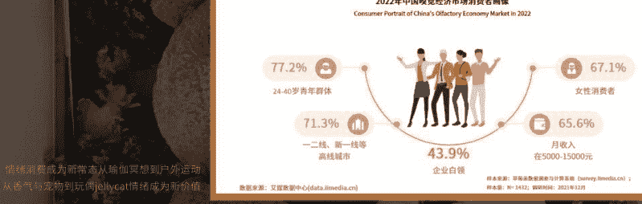

储蓄成为焦虑的避风港，它成为我们所的寄托，从养宠物到食物消费都是为了寻找慰藉。

### 解析：
- 在过去，“富起来的中产需要用物质证明自己已经过了更好的生活。他们相信，通过拥有的这些物品，可以让自己看起来更像理想中的生活方式。然而，在今天，ta们发现失去了“意义世界”？”
- 反思花费时间的后，不再信任环境塑造的路，未来，转变为追求“我要什么”的精神探索。反而专注，我所想要的，是ta们试图找到自己思考的坐标和独特性的发展。

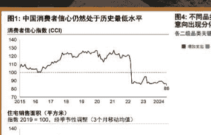

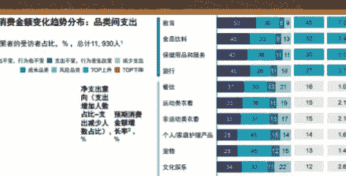

| 类别 | 占比 | 趋势 |
|---|---|--|
| 住房支出 | 37% | ↘ |
| 餐饮支出 | 36% | ↓ |
| 交通支出 | 16% | ↓ |
| 娱乐支出 | 15% | ↘ |
| 医疗支出 | 14% | ↘ |
| 购物支出 | 14% | ↘ |
| 教育支出 | 10% | ↘ |
| 服务支出 | 8% | ↘ |
| 其他支出 | 6% | ↘ |

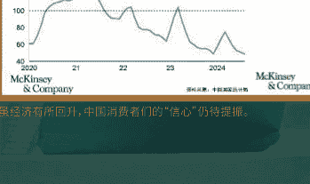

# 中产们等一个“反丛林法则”的悦纳社会

在社会似乎进入凝结的固化流动状态中，我们看到了中产们试图“安顿自己”也试图“生长”。

过去宏大叙事大家共同的价值体系被打破（如成为新一代跨越阶层的企业家、成为自己的教育工作者、或成为科学家），我们看到了高度离散的一个一个主体性价值的个体正在出现，寻求的不再是外求的自治，而是内生的尺度。

社会评价体系并未完全顺畅调整，而迷迷惘、衰颓、出走、迎旧依旧在发生，我们仍在等待，等一个多元与悦纳的“反丛林法则”的社会空间。

## 中产内部「三分化」
## 意识形态与原生身份的偏差

我们将中产群体的分化总结为其心态分化的三种上中下游相分化

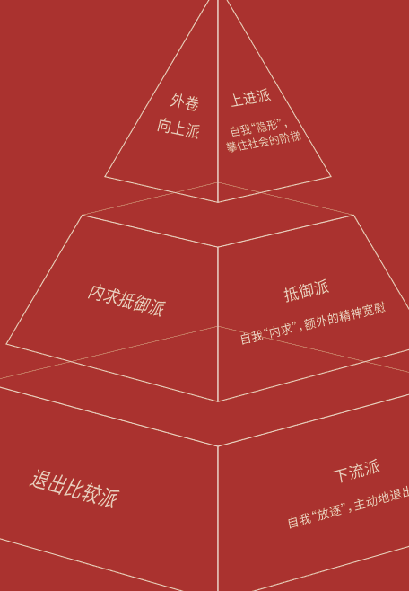

中产三分化金字塔的三种相

> 原先似乎不可推的中产阶层也表现出了“上”“下”两极分化的倾向。——三浦浦

中产三分化金字塔——面相1:

### “抵御”派 —— 维持收支秩序，无奈卷内在在“佛系”，节流
与低欲望成为生活主旋律

带着跌出中的危机感，以维持现状的“忍耐”心态应对下行的焦虑，无法坦然接受“不平等、没机会”的现实，挣扎着“渴望”。

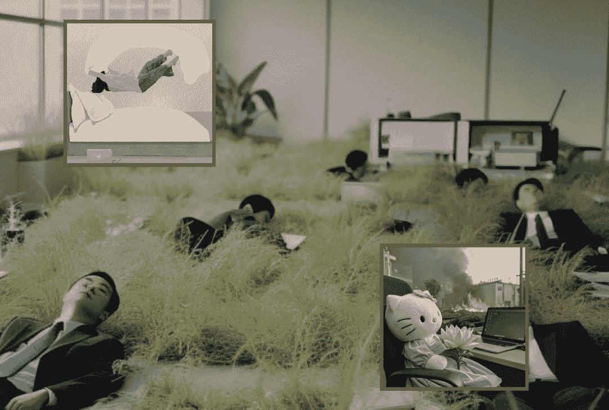

接受过很好的教育，学经历让使得的经济效应大打折扣，工作机会，收入增长面临着不可预测的性，他们被夹在不目，主动调整了自己的生活选择和消费行为；开始变得更宅（以减少出行带来的可能），开始变得很佛系（对结婚生子抱暂缓态度），开始变得节约（消费实现自我价值），开始寻求消费之外的东西

20 KNOWHOW

中产三分化金字塔——面相

### “下流”派 — 顺应群体内部下流潮汐，寻找社会阶梯之外的新个人价值体系

发现就算稳定在中产中流，也无于通勤上下班、背负房贷负重前行、素性放弃社会比较、捍弃社会社会标签。（类似大理旅居的一群人）

没有归属感和寄托处，只能去挖掘自己的兴趣爱好，比如成为流连在各项文化营、“精神探索”的社群的训练学习流，他们渴望将自己价值、生活价值、物质价值连成一串，以相同的“味爱好”形成赚钱、消费、日常的主线。

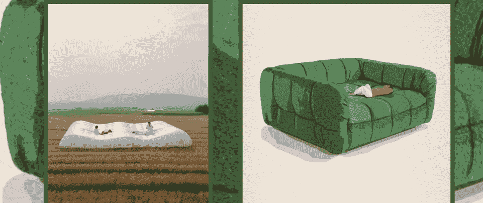

“努力还有什么”想到“生活还有意义”。网络成为重度依赖，享受“免费”的户外自然也“免费”的宅。

21 KNOWHOW

中产三分化金字塔——面相3:

### “上进”派—做题家的惯性，主动顺应规划，攀登、稳住

上进他们是一群“自来卷”的中产阶级，或者延续过去“小镇做题家”的性，选择顺应周围的氛围（让他们感受到压力的外部现实）而异化，主动顺应规划。

> “Young—一代”，是指年轻人拼命从家里借自己的房子。“Young—一代”代表了一代由于房价上涨而无法在未来买自己的房子。

后续中产话题对“三分化中产”在不同城市、不同处境、不同画像进行拆解与描写。关注弄好knowhow小红书与公众号获取后续

## 四. 中产生存
### “微光”和

基于中国生活观“回归型叙事”
回归型叙事，关注生活里细微美好的和。过去信赖的社会阶层与理想等价值将发生重构，尝试使用“私人化”的视角，重新审视和衡量个人与企业与社会的关系。试图重新改写“世俗”的幸福与成功的意义，关注生活里最小的和。公园、草坡、近郊成为了新的“美好生活载体”。去公园捡叶子陪伴家人，去周边的小镇当地吃“低绿”料理，进更具性价比的周末享受热门城市的昂贵酒店。摒弃“表演性”的喧闹，对商品式的崇拜，反思宗教化的消费。以更务实和价值衡量的标尺看待日常的所有支出。以重视日常琐碎，平凡生活里值得庆祝与珍藏的瞬间，构成生活里的和。

### 成就记录01

数据统计我们偏好使用“智能软件”来追踪和记录运动活动，用于记录跑步、滑板等新兴运动的“每日成就”，也同步记录热量、消费支出。可见“强制”计划的中人们将“日常里程”式的小成就加入每日激励，奖励计划的小里程达到日常可控，也是将自己作为方法和抓手的“人化”取悦。

26 KNOWHOW

## 道德投票

践行由文化习得的人文关怀是构建自我价值体系的关键一环。无论是乡村关怀、还是关心地球、社会、环境的“存在”，都是我们恢复文化力的状态自愈，通过人文关怀的使命，我们感受在这个地球、社会、小环境里的“感”。我们也会“消费”选择品牌偏好的投票，选择与价值理念匹配的消费习惯。每一笔消费都是对人文关怀的价值投票。

27 KNOWHOW

### 抱树计划03

无论是搜寻jellycat或游戏办让它成为储藏精品，还是运动后一碗“酸奶果”和鲜榨果汁，或是在下班后自己的时间里“种植”、制作手工。我们都试着以更具生感、粗糙、自然的“慢流体验”拯救自己，以取代酒精与蹦迪音乐的刺激。

28 KNOWHOW

回家路上的“公园”也成为了替代大自然的通勤目的地，“20分钟”也成为日常各种、游游代名词。更多阅读：关注knowhow微信红书（公园里的情绪自救指南）↓

### “讨好”自己

基于中产观“动荡中求稳”延展品牌启示

近年卷“苟工工作”式的论调延伸，工作对人异化影响的存在被广大职业型中产们普遍认知，意识到社会内在下的“工作困境”是与其论对中产思想解放的关键启示。

与“居家式”娱乐相搏，同样的现实是债务与责任，无论个体还是家庭，我们对脑内侧遵循“卷”渐渐清醒，绝大多数中产无法躺平不卷，反之，反而进入了一种寻找体感的卷。需要的是清晰后的自主选择，如何处理工作与生活的关系、怎么看待事业带有“主体性”的选择。或认识到“平凡个体”的快乐、转成为“副业者”拥有斜杠职场、职业型转型，在主业之余开启留学或自由职人的生活。

品牌启示 >>>

### 投资

- 对外部时间的不可控，我们更关注个体成长的自我改造，寻求对我的掌控。被打破的外部计划，试图以自己为起点重新回到轨道。他们坚持自己的正当，“小镇做题家”的习惯，选择有限的时间在有用的事情上。如身体的改造，深度的知识型内容（如播客等），得到打的可以被中产拥抱、自然，将其主题定义为“成长空间”。

### 红色几何：杂志封面

### 祛精力

@阿莉每日设计

类型报告：学术阅读可以免费获得量资讯，想要感兴趣的可以关注哪一个？

* 木疆 18308 订阅

### 纵横四海人们在这里说谎。

* 玫瑰 94537 订阅

### 超级休假

作为最小控单元后，我们中产对场所规则进行自我治理以便清醒、理解规划，而不是“自我交”，转而把工作当作媒介以达成目标。“自己”作为方法，在主业之余寻求开拓，如离职博主、上班博主的遭遇，可见中产阶开始打造超级级的品牌。

32 KNOWHOW

### 内在小孩03

中产们开始转相反“逸游”自我放逐，过往我们总是武装成“大人”，而忽视了内在小孩的抚慰忘记了“慢一点，会更快”的道理。

- 近年，中产们成为户外品牌的拥挤者，这不见要获得户外运动上的专业成就，但旷野里抚慰心、短逃离、去到山里是我们平衡手段，在旷野里充电是中产们进入自然的目的。扩展阅读：小红书内容“户外为新奢”，2024策划月刊【关注养好how小红书】运动品牌从“英雄优位”到“自我叙事”

## 有闲“资本”

基于中产消费观“体面的节制”延品牌启

向上有为的底层跃动，膜拜“老钱”似乎为了阶路上的固定向往，也因此而“模仿”老钱。从追求“纯粹有钱”到“有闲”了一种向上的有闲阶级的生活。

“松弛感”几乎可算得上年度关键词。松弛似乎等同于低速节奏享受时间流逝，漫步与呼吸、阳光与沙滩、香薰与沐浴、酒店与下午茶、美美的身体甚至早起的良好节奏，都是松弛的特征。

对松弛的描摹是相对固定、稀缺性的物质对于更容易得到的。中产人们正在走“假装松弛”到“获得松弛”的路上。而降级，只是选择性的节奏缓慢，该花该省是新的消费准则。是理性审慎筛选哪些值得，哪些将的一种“体面的节制”。

品牌启示 >>>

### 身体资本01

身体体型，除了是一种对自律生活的投射，更是对有时间与投入关资本的表现。以健身、骑行、普卡、攀岩等为代表的运动，都在展示中产们对“身体塑造”的渴望，或许长期主义维持身体与内在资本就是一种对自主把握的时间资本。

### 感官体验02

WGSN关于疗愈爱好的市场预测

| 年度 | 五感疗愈趋势 |
| ------|---|
| 2023 | Emotional Trends | +27.4% +33.6% |
| 2022 | 觉醒 | -13.1% -17.8% |

### 生活中的美学

2031年全球艺术与手工产品的规模，较2021年大幅增长。

个人护理产品尤其是头部护理产品，及香薰、蜡烛这些被称为“废物”的产品在逆势增长。WGSN认为其发展的潜力。这些通过五感唤醒带来的快乐，正在中产对日常生活的微小。

### 饮食即我

- 轻食、果汁、植物性产品等“食物”为例，他们对于优质与健康的追求持续演进，如喜茶推出的“健康”，中产对“饮食阶级”的呈现。在这些阶段形成的关于身体的趣味，对身体也是一种的力量。甚至迪尼，“穿上”的时尚风格作为2025年热点。

### 精神奢侈

基于中产价值观“精神专注”延品牌启示

作为一群知识与技能生存跨越的群体，中产人始终渴望保持“反智”，意识到社会内在下的“工作困境”是与其论对中产思想解放的关键启示。

与“居家式”娱乐相搏，同样的现实是债务与责任，无论个体还是家庭，我们对脑内侧遵循“卷”渐渐清醒，绝大多数中产无法躺平不卷，反之，反而进入了一种寻找体感的卷。需要的是清晰后的自主选择，如何处理工作与生活的关系、怎么看待事业带有“主体性”的选择。或认识到“平凡个体”的快乐、成为“副业者”拥有斜杠职场、职业型转型，在主业之余开启留学或自由职人的生活。

品牌启示 >>>

### 复古记忆01

拍立得相纸、胶片相机一路飞涨，仿y2k时期“非主流”风格的拍立得自拍橱涌入各大商场，以及各式休闲空间对“”重塑，包括《小巷》火热。我们看到当下成为中产的人，开始回望童年过去，对记忆中的“符号元素”开始抓取，成为温暖的慰藉。

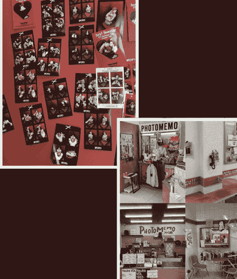

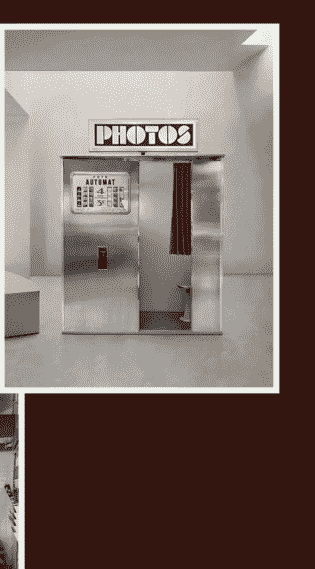

“过往”记忆的疗愈感

### 书美学

从Prada与MiuMiu品牌的逆势增长，可见奢侈品风格的塑造，源于一种能够蕴含诗歌的“呆呆形象”（Nerd Culture）。知识分子风格不再是刻板与无趣的代表，而是成为一种“酷”的标识。品牌们也尝试举办“书店快闪”，或将快闪融入入店。一线城市“社区图书馆”也在快速复制。

| 品牌 | 三季度营收增长对比 |
| :--- | :--- |
| HERMES | +10.2% |
| BOTTEGA VENETTA | +9.1% |
| PRADA | +5.0% |
| MONCLER | -2.3% |
| LVMH | -2.4. |
| Saint Laurent | -4.2% |
| TOM FORD | -10.2% |
| GUCCI | -12.3% |
| Fendi | -7.6% |

### 拓展阅读

2024洞察月刊【关注好how小红书】

## 女性学

以女性主义为索引，我们可见的是电影《好东西》引发不少故事的共情，也引发了一般“反老登”的风潮。品牌在叙事上转向寻求与消费者的“平等沟通”，讲述“我”的故事，不再是高高上的“教育”，也开始讲述那些被父权污名束缚的女性类的反抗与逃逸（如高跟鞋）。

互联网上论“中女时代”到来的趋势，以“大女主”的真实、自我、接纳的面向展示了未来可能的生活范本。

年度热片《好东西》成为“国产女性主题宣言”，豆瓣评分高达9.1，成为豆瓣2024年评分最高的影片

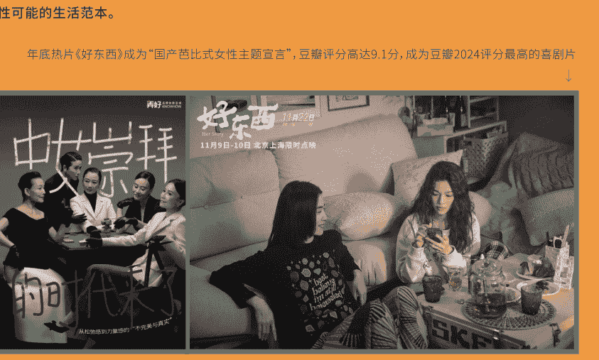

延伸阅读：好好Know小红书《中女真正的时代来了》

## Herstory

编剧/导演：邵艺辉

## 好东西

电影《爱情神话》平行篇

KNOWHOW 45

## 品牌启示总结

## “微光”总和

【基于中产生活的“回归型”消费叙事，关注生活中微小的美好】

回归型消费叙事，关注生活中微小的美好，我们尝试重新定义“按需消费”的奢侈与成功的意义。

Brand Inspiration 01

## 成就小记

Brand Inspiration 03

## 抱朴生活

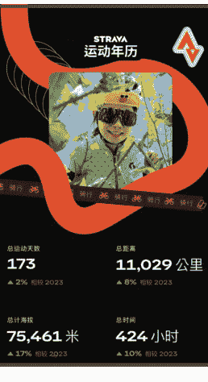

## 02

从跑步到乡村，从身体到别物，每周都是对品牌“人文细节”的每一次投票。

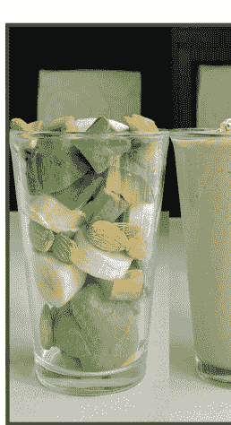

## Dreaming

宠物纪念骨盒
线上首次发售
2023.8.18

## 03

我们以更具原生感、积极感、自然感的“通愈液体”拯救自己，以取代各种刺激剂。

01：以日常小型程序的成就养成日常掌控性，将自己作为一种方法的“拟人化”观点。

Brand Inspiration 02

## 道德投票

46 KNOWHOW

## 品牌启示

## “凑好”随记

【基于产业事业“动中求格”延续品牌影响力】

我所想要的，是以清晰充实的自主选择，我想要如何处理工作与生活的关系、我如何看待事业并拥有“主体性”的选择。

## 超级个体

## 03

我们总是想要做成“大人”，却忽略了对内在小小的寻找。我们忘记了“慢”一点，还会快乐。

01：

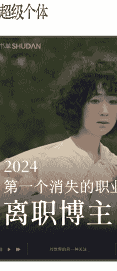

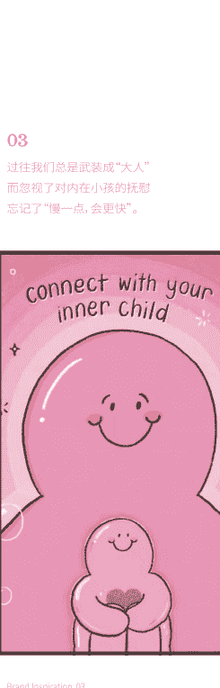

## 2024

第一个消失的职业：离职博主

## 02

清晰理解自己，将自己当作“自己”作为自己的事业的主体，而把公司当作媒介辅助自己。

## 内在小孩

## 主体投资

KNOWHOW 47

## 有闲“资本”

【基于中产文化的“精神专注”延续品牌标识】

向上与有有的底层驱动，从传统追求“精致有钱”到“有钱有闲”，是一种向上的有闲阶的生活。

## 身体资本

## 饮食即题

个人护肤产品，尤其是头部护肤产品各类，无上无。。这类“美用废物”在造势增长。

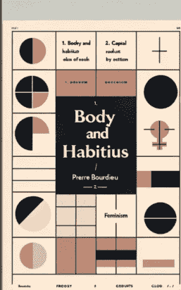

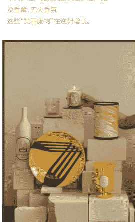

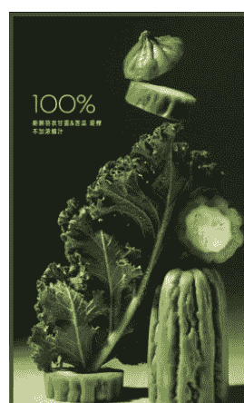

01：长期主义的身体形成，一种自律生活的投射，更有时间投入身体资本的表现。

03：“我吃什么我就变成什么”，我们对优质蛋白与健康消费的“食物阶级”追求持续递。

## 威馆悦悦

## 品牌启示总结

## 精神“精品”

【基于中产文化“精神专注”】

中产关注的是可持续的、独立性的内容，中产的“精神精品”。

Brand Inspiration 02

## 书籍学

## 03

01：我们开始回归过去，以女性主义为索引，品牌叙事不再高高上的“教育”，反抗与逃逸。

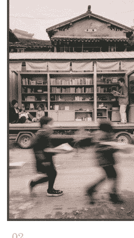

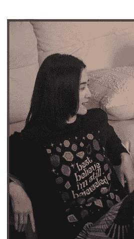

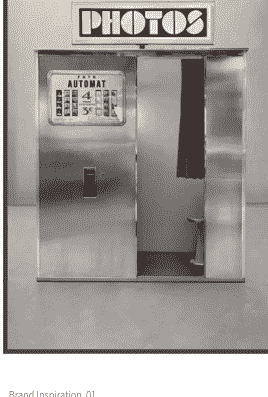

## 02

品牌与中产在于一种形象。

Brand Inspiration 03

Brand Inspiration 01

## 女性学

## 复古记忆

KNOWHOW 49

中产阶级正在一个成长与反思的关键节点，我们也在此可见了中产正处于大时代下的梦茧。2024年观察到中产尊重自身诉求的“向好”决策。虽然面临生存困境和消费淘汰的压力，这种趋势也推动了更深层的觉醒与成熟。中产的消费行为正从满足虚荣（如面子、虚荣）转向注重可持续、社会价值和真实需求，这种变化呼唤品牌重新审视自己的定位。中产作为消费主力军其变化也使商务市场进入新场域，品牌再迎合过度似乎不再是正义与道德，面子、虚荣、模板、网红等终将成为过去。“不能认为中产只是经济上的……他们应当参与更多公共生活承担更多社会责任……如果我们只用金钱来衡量中产阶级，那么我们培养的就是庸俗的阶级。”《当代中国中产阶级现状探析》

## 免费 价值 及时 专注

## 扫码加入 知识星球TOP 免费资源群

- 每日免费获取有价值资源
- 可提供各类资源搜索服务

| 热门付费文章 | 各行行业报告 |
| 精选图书资源 | 副业赚钱方法 |
| 职场实用资源 | AI经营自媒体 |

公众号: 知识星球TOP 微信信号: jntsg8 信号: jntsgj2

分享资料仅供个人学习，请及时删除，切勿商用传播
