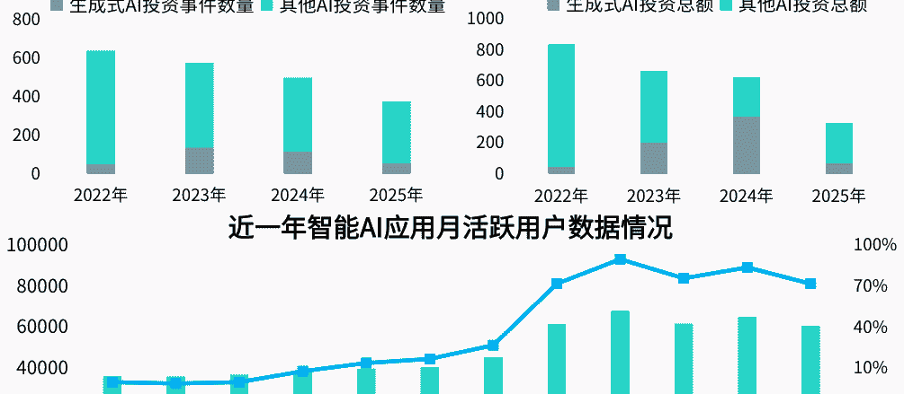
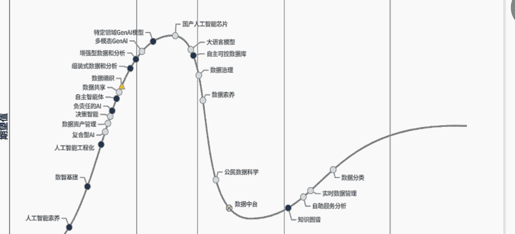
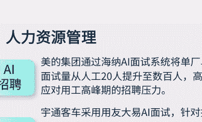
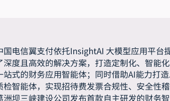
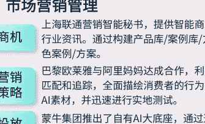
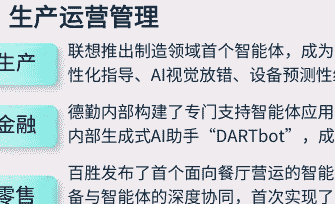

# 2025年中国企业AI应用进程
研究报告

# 知识星球TOP 资源分享群

公众号:知识星球TOP

汇聚全球高价值资源

打造一流资源分享群

微信信号:top28688

添加微信免费群

- ◆付费文章
- ◆付费社群
- ◆时政&国际
- ◆副业&搞钱
- ◆财经&市场
- ◆行业&科技

时政·历史·职场·体制·自媒体 学习·军事·软件·影音·社会学

微信信号:top28388

# CONTENTS

- 01 企业AI应用发展背景
- 02 企业AI应用进程评估
- 03 企业AI应用图谱及案例
- 04 企业AI应用发展趋势

# 第一章：企业AI应用发展背景

## 社会智能化发展现状：从社会宏观发展格局、资本市场走向与C端渗透率变化来看，中国社会智能化发展势在抬头

- 近年来，中国社会智能化发展迅速。5G网络、智能能力等基础设施提供了良好的基础，推动企业的数字化发展规模日益上升。在数字化的沃土下，Gartner预测，中国社会AI渗透率将在2030年达到50%。
- 从资本市场上来看，中国人工智能的创投热度正在增强，人工智能企业正在逐渐成熟。其中生成式AI领域持续火热，吸引资本市场关注。
- 从C端渗透来看，受生成式AI应用的影响，2025年AI应用的月活跃数据较去年同期时间实现了超70%的增长。

## 2022年-2025年中国人工智能融资事件数量与总额（亿元）

| 时间 | 生成式AI投资数量 | 其他AI投资事件数量 | 生成式AI投资总额 | 其他AI投资总额 |
|---|---|---|---|---|
| 2025年3月底 | 75.9% | | | |
| 2024年，智能能力在算力总规模中占 | 32% | | | |
| 2023年，产业数据化规模为43.84亿元，同比增长6.9%，GDP比重为 | 34.77% | | | |
| 企业软件整合型AI的比例将从2024年的不足1%跃升至2028年的 | 33% | | | |
| 到2030年，中国社会的AI占比及渗透率 | 50% | | | |

> 数据来源：光月APP数据，它量子，Gartner、《中国数字经济发展研究报告（2024年）》、《全国数据资源调查报告（2024年）》，光月鲸研究院整理

## AI政策：近两年大力发展“人工智能”，逐步为人工智能用数据建立指南与科学监管

### 企业应用发展背景

2024年1月31日
工业和信息化部、教育部、科学技术部、交通部等部门
《关于未来人工智能创新发展的实施意见》
明确人工智能，通过通用计算等技术精准引进和培养人才引领未来，支撑新型工业化。指出到2025年，人工智能技术和产业规模将显著增强，提升到领先水平；到2027年，实现自主可控，关键技术取得重大突破。

2024年3月5日
国务院
《政府工作报告》首次提到“人工智能”，深度落实，加强人工智能等研发开发，开展“人工智能+”行动，构建具有竞争竞争力的数据集。

2024年5月29日
中央信息部、市场监管局、工业和信息化部
《人工智能+行动指南（2024-2026年）》
要求加强协同，健全信息化标准体系，提升信息化发展能力，有利于人工智能建设。构建新型信息化标准工作，研制重点标准，聚焦重点攻关任务。

2024年6月5日
工业信息部、中央网络信息办公室、国家发展委员会、国家改革委员会
《人工智能产业标准体系（2024版）》
到2026年，实现自主可控，引领人工智能创新的基础，拟定标准50项以上，增强人工智能影响力，参与国际标准，促进全球发展。

2024年6月27日
工业信息化部、教育部
《人工智能人才培养指南（2024-2026年）》
加强人才培养基础工作，建设人才培养标准，构建课程，培养高素质人才，赋能人工智能引擎。为人工智能的人才评价赋予权威标准。

2024年9月9日
全国网络标准化委员会
《人工智能安全条例（1.0版）》
确立主要安全工作、人工智能安全管理机制、人工智能安全分类技术，结合治理措施、人工智能应用等六大领域。

2024年3月5日
国务院
《政府工作报告》推进“人工智能+”行动，将人工智能与技术、应用深度结合，大力发展人工智能连接汽车、手机、机器人等终端设备，智能制造。

2024年3月27日
国家信息部、公安部、国家广电局
《人工智能生成内容办法》
明确人工智能生成内容格式，规范人工智能生成内容传播，在使用时应主动声明并标识材料。

## AI技术成熟度：数字化技术接近成熟，大模型能力逐渐提升，大模型与轻量级解决方案并存

- 从技术发展状况看，技术的成熟接近全场景，获取高质量数据。随着时间的发展，大模型的文本处理能力、多模态处理能力、模型容量、推理能力以及训练部署都得到了完善。目前攻克的问题是AI幻觉、缺乏高质量数据集进行高精度应用。
- 超大模型拥有海量参数和强大的理解能力，能够处理复杂的自然语言任务，提供卓越性能。轻量级模型通过模型压缩、蒸馏等技术，将大模型的参数精简，使其能够在资源有限的设备上高效运行。

## 文本能力
大模型已发展至万亿级模型，为其语言能力奠定了基础，助力大模型精准捕捉复杂的语言。大模型上下文长度扩展到了160K，文本体量达TB-PB。

## 多模态能力
实时生成视频极秒级（Video 195ms），具有多类图像理解、图像生成、视频生成能力。2025年以DeepSeek-R1为代表的大模型架构迎来爆发，推动大模型从“知识密集”向“思维模型”转换。

## 推理能力
数据来源: Gartner, 中国互联网研究院, 光月鲸研究院

# 第二章：02 企业AI应用进程评估

## 企业管理体系：人力资源管理智能化流程发展情况

### 招聘流程

| 岗位分析 | 信息收集 | 生成招聘计划 | 招聘、宣传 | 简历初筛 | 多次面试 | 候选人淘汰 | 背调、资料审核 | 入职培训 | 绩效规划与试用期评估 | 制定考核标准 | 下发考核策略 | 记录 | 安排考核任务（线下） | 考核评估 | 人员职位、薪酬等调整 | 审批调整薪方案 | 通知用 | 规定考核制度 | 提交申请 | 多层审批 | 对职级等调整 |

### 考核管理

| 绩效规划与试用期 | AI拆解目标策略 | 采集多源员工数据 | 数据分析 | 动态决策、调整薪方案 | 审批执行 | 分析员执行 | 建立个性化培养方案 | 个性化发展路径 |

### 人员管理

| 传统流程 | 智能化流程 |
|---|---|
| AI防制制作 | 智能投放 | 模拟投放 | 面试 | AI生成动态数据 | 智能推荐 | 简历数据建模 |

- AI工具为招聘提供了精准、创新的方法，实现精准筛选简历，降低模拟测试成本。提供专业化培训。
- AI工具具有重型招聘流程，对招聘各环节提升了生产效率，以智能数据驱动解决难题，从单点智能到智能招聘，并提供高效的解决方案。

### 01 培训深度影响效果
企业需要在知识上增加培训，确保员工能够充分利用AI工具。智能化程度不同，开发、规划、培训等工作。

### 02 数据与安全
- AI工具简化了管理流程，基于数据实现规划。目前覆盖率有限，对考核仍依赖人工。
- 数据采集分析支持数据可靠性，在使用AI时可能面临隐私、数据泄露等问题。

## 企业管理体系：财务管理智能化流程发展情况

### 风险管理

### 费用控制

| 商业计划 | 数据 | 融资需求 | 撰写 | 金融机构 | 对接 | 合同签订 | 财务管理规划 | 策略制定 | 预算 | 申请 | 付款 | 监控 | 结算 |
|---|---|---|---|---|---|---|---|---|---|---|---|---|---|
| 智能化 | 全局数据分析 | 文件处理 | 对接协同 | 智能化调整 | 资金规划 | 智能监控 | 数据分析 | 自动化处理 | 风险识别 | 智能应对 |

- AI工具在流程过程中起到数据分析提高处理效率的作用。
- AI工具在费用过程中，实现文档规划、实时监控、自动化处理。
- AI在风险管理中进行预测和预警，为决策提供支持。

## 管理体系：技术研发管理智能化流程情况

### 需求分析

### 产品设计

### 产品开发

### 产品发布

| 需求观测与分析 | 需求评审 | 产生创意 | 市场调研 | 竞争分析与可行性 | 产品定位与功能需求 | 设计方案制定 | 开发规范和标准 | 原型设计 | 用户体验设计 | 寻找原料与合作 | 确定成本 | 确认为方案 | 产品测试 | 确定发布方案 | 准备产品说明 | 产品发布 | 用户数据监测 | 用户反馈 | 版本迭代 |
|---|---|---|---|---|---|---|---|---|---|---|---|---|---|---|---|---|---|---|
| 智能化 | 需求提取、智能分类与建模 | 需求评审 | AI创意生成 | 竞争分析与可行性 | 智能获取 | 产品画像生成 | 设计方案与智能使用 | 需求范围生成 | 智能设计 | 用户体验分析与预测 | 智能化流程 | 智能开发/迭代 | 虚拟测试 | 智能测试 | 智能生成与发布策划 | 发布监测与风险控制 | 回收数据分析与市场调研 |

- AI工具扩大市场需求与市场信息的抓取，提供高效市场需求分析，但可能存在差异化与定制化的局限。
- AI工具辅助设计，提升设计师能力，但无法完全生成全流程的智能重构。
- AI工具主要用于信息领域的产品开发，在代码编写与测试上实现全流程的解决方案，在实际产品中投入应用。

### 01 涉及发布，有版权风险
针对跨境发布，智能内容输出基于资料，在来源标注的情况下可能涉及版权的法律风险。

### 02 解决复杂内容与转化率问题
产品研发涉及较多感性、报告处理、文案写作，对于泛领域、创新性需求，方案质量严重，内容利用率低。

### 03 对行业类产品研发的助力有限
AI工具对于信息类、消费类产品的灵感设计、开发的助力有限，工业产品重点关注参与与成本控制，AI更多地依赖数据的分析。

## 企业管理体系：生产运营管理智能化发展情况

### 生产管理

### 质量管理

### 供应链管理

| 市场需求 | 历史数据 | 生产订单收集 | 生产需求预测 | 物料需求预测 | 资源任务分配 | 生产计划排程 | 外包生产管理 | 人员管理 | 设备管理与预防维护 | 物料管理 | 生产状态 | 质量状态 | 质量标准 | 过程标识管理 | 产品质量管理 | 采购需求 | 改进策略与生成 | 寻找供应商 | 采购申请 | 情报等维度评估 | 协调、合同创建 | 签署履约 | 物流计划与成本配置 | 物流过程监控 | 智能物流调度 | 分拣 | 仓储 | 智能库存 | 智能化规划 |
- AI工具在生产过程中对需求进行精准预测和动态调整，使生产计划整体流程符合要求，解决系统集成等问题。
- AI工具在质量范围内，机器检测、数据分析提供帮助，提升生产力，支持产品改进。
- AI工具可以简化供应商的选择，提供反馈支持。

### 01 质量
### 02 数据质量
数据质量差，影响生产决策。人工智能的应用依赖于高质量数据，数据质量深度得到提升。
- 基础设施投入高，前期成本影响，企业智能化回报率较低。

## 企业管理体系：市场管理智能化发展情况

| 市场策划 | 营销 | 资源管理 |
|---|---|---|
| 外部市场调研 | 战略、竞争与趋势 | 制定策略 |
| 内部市场调研 | 智能获取 | 确定销售目标 |
| 市场调研 | 智能化生成 | 建立策略 |
| 市场调研 | 自动化投放 | 确定营销渠道 |
| 市场调研 | 数据监测与优化 | 客户互动 |

- AI工具对数据的获取更为全面，结合数据分析能力能够形成完整的市场调研。
- AI工具简化营销流程，在各环节增强智能化生成，实现全流程落地。

### 01 策划内容同质化
市场策划需要更多数据支持，文档报告频繁，适用于广泛研究，创新性差，方案差异化。

### 02 营销分析结果偏差
人工智能算法优劣取决于训练数据，不完整的数据收集会导致结果偏差。

### 03 人工服务灵活性与人性化
营销方案灵活，客户服务等涉及定位，执行有更高的保障，但缺少价值输出。

## 企业AI应用进度评估

## 极光鲸研究院推出企业AI应用进度评价体系；物理基础支撑与数据全面化指标

- 基于企业管理体系智能化发展情况，极光鲸研究院结合基础研究与专家调研形成了如下企业AI应用进度体系，用以评估行业AI进程。
- 物理基础设施决定了企业智能化应用深度、扩展速度，在网络、计算、存储、智能感知等四个层面的布局直接影响落地效果。
- 数据全面化是智能化转型的核心驱动力，全场景数据为AI建模、智能决策提供完整支撑，支撑多场景落地。

| 序号 | 一级指标 | 编号 | 二级指标 | 指标解释 |
|---|---|---|---|---|
| 1 | 物理基础支撑 | 1.1 | 网络 | 确保连接力、适配性与安全、连接性能、运行效率及技术前瞻性。包含核心设备规格、内网与外网带宽、全覆盖范围、边界防护、数据传输、接入终端安全。 |
| | | 1.2 | 计算 | 确保数据处理能力、数据可靠性、架构适配性能和经济性，覆盖算力调度、数据存储与处理、计算架构先进性、成本控制、场景适配性等。 |
| | | 1.3 | 存储 | 确保数据存储容量、存储扩展性、数据流与管理、数据安全和可靠性、扩展前瞻性等效果。 |
| | | 1.4 | 智能感知 | 确保感知范围、感知精度、安全性、场景适配性，覆盖感知的范围、数据采集的实时性、安全防护水平、场景适配性等。 |
| 2 | 数据全面化 | 2.1 | 数据策略 | 衡量是否符合系统性、前瞻性的，以数据驱动的智能化转型方向为指引，数据策略的完备性、覆盖范围、落地可行性、指标架构规范、标准性、资源保障及落地性。 |
| | | 2.2 | 数据生命周期管理流程 | 确保数据从产生、采集、存储、处理、清洗、分析建模、应用服务到销毁的完整流程，涵盖各阶段的管理规范、效率及智能化应用。 |
| | | 2.3 | 数据质量 | 通过系统化管理确保数据的可靠性、适用性与持续性，内容包含质量标准、监控与改进机制、智能化应用、业务智能特性的四大核心能力。 |
| | | 2.4 | 数据技术支持 | 确保治理平台、数据仓库、数据质量工具、数据安全工具等应用覆盖度和智能化。 |
| | | 2.5 | 数据安全 | 确保安全覆盖及标准、技术防御、风险控制机制、智能化适配等指标。 |

## 极光月狐研究院推出企业AI应用进展指标体系：组织流程优化与应用创新发展指标

- 组织流程优化是反映企业智能化发展广度的关键指标，它反映了技术从孤立的触点应用，向企业管理全领域、全产业链渗透和融合的程度。
- 应用创新发展是反映企业智能化发展深度的关键指标，它反映了技术转为生产力、创造商业价值的能力。

| 序号 | 一级指标 | 级 | 二级指标 | 描述 |
| :--- | :--- | :--- | :--- | :--- |
| 3 | 组织流程化 | 3.1 | 效率提升 | 针对企业管理的人力、财务、研发、生产运营、营销等模块，评价流程耗时、资源效率、输出质量、协同效率等核心维度 |
| | | 3.2 | 成本控制 | 针对企业管理的人力、财务、研发、生产运营、营销等模块，评价其成本降低、智能化投资回报周期、单位成本变化、形成投入成本、企业可持续性等维度 |
| | | 3.3 | 员工体验 | 针对企业管理的人力、财务、研发、生产运营、营销等模块，评价其员工工作压力与工作负荷、对员工满意度评价、情绪变化影响等维度 |
| | | 3.4 | 灵活响应 | 针对企业管理的人力、财务、研发、生产运营、营销等模块，评价其响应速度提升、调整成本降低、适应满意度等维度 |
| 4 | 应用创新发展 | 4.1 | 技术应用创新 | 在企业发展过程中，通过应用创新实现业务专业化和竞争力提升的进展，包含企业AI应用、AI应用创新等 |
| | | 4.2 | 组织智能化替代 | 企业基于信息化转型，在组织中引入主导流程进行改进，对替代方案的有效性、范围性进行评价 |
| | | 4.3 | 决策智能化替代 | 针对企业管理的人力、财务、研发、生产运营、营销等模块，评价其战略级决策、运营级决策、执行级决策的适配性与效果等 |
| | | 4.4 | 产品与服务创新替代 | 企业对产品和服务市场实现的创新性替代，评价其智能产品收获、个性化服务替代、研发投入、用户粘性提升等进行评价 |
| | | 4.5 | 生态创新发展 | 企业通过智能化技术转型生产模式、增强智能化协同，具有包含企业合作伙伴的智能化程度、融入智能化企业生态、从多方构成的生态中发展 |

# 03 第三章：企业AI应用图谱及案例

## 企业AI应用工具盘点：AI工具应用于各模块效率优化与决策新，单点智能工具居多，部分模块形成全解决方案

| | 人力资源 | 财务 | 研发 | 营销 | 运营 |
| :--- | :--- | :--- | :--- | :--- | :--- |
| **应用决策创新** | AI招聘助手 | AI财务助理 | AI代码助手 | 营销全渠道AI平台 | AI员工/数字秘书 AI PLM |
| | AI调聘助手 | AI法务助手 | 智能研发管理工具 | AI内容创作工具 | AI经营助手 AI ERP |
| | AI面试试官 | AI薪酬助手 | | AI CRM平台 | 虚拟解决方案 AI MES |
| | AI培训助手 | AI控助手 | | AI投放工具 | AI工作流助手 AI WMS |
| | | AI合规审核助手 | | AI客服 | AI店长 AI视觉检测 |
| **组织流程优化** | AI简历助手 | AI投标工具 | 智能UI/UX设计工具 | AI搜索工具 | ChatBI工具 |
| | AI效能管理系统 | AI费控系统 | 需求文档生成助手 | AI资料整理工具 | AI办公工具 |
| | 人力资源信息管理系统 | AI商融助手 | AI设计工具与设计库 | AI市场情报平台 | |
| | | AI合同助手 | AI测试与BUG管理工具 | AI报价助手 | |
| | | AI报表工具 | | AI SDR工具 | |

## 数据全面化

AI人才库 AI财务知识库 智能数据开发平台 AI生产运营知识库

## 基础设施支撑

智能能力、云服务、智能物联网、机器人等人

## 企业AI应用图谱及案例

### 人力资源

AI招聘助手

AI简简历助手

AI面试官

AI培训辅助

AI全流程招聘助手

人效生命周期管理系统

AI代码助手

智能UI/UX设计工具

需求分析助手

AI设计工具与设计库

AI测试工具

智能数据平台

### 财务

AI财务助理

AI薪酬助手

效能管理系统

AI费用管控

AI报表工具

AI财务流程管理

AI招投标助手

AI风控助手

AI合同助手

AI合规检测

AI法务

## 企业AI应用图谱及案例

### 营销

AI内容创作
AI搜索工具
AI资料整理
AI文案助手
AI全渠道营销
AI CRM平台
AI SDR投放
AI投流助手
AI客服

文案
| 即谱AI | 可画AI | Midjourney | D.DESIGN | 绘友 |
|---|---|---|---|---|
| 妙写 | 义方相 | 美图设计 | Canva | 剪映 |
| HalluAI | 百画AI | 有趣 | 讯灵元AI | 舞替 |
| deepseek | KIMI | 吉灵万 | 文一设计 | 通义千问 |
| 译语控 | Notion | jasper | 广告助手 | 小灵通 |

| 秘境AI搜索 | 米纳AI | Quark | 智谱君 | perplexity |
|---|---|---|---|---|
| FileNat | AI市场情报 | AlphaSense | Pacific | SimilarWeb | Wind |

| 文库魔方 | WPS | APPT | 讯灵文 | GANIMA |
|---|---|---|---|---|
| 百度简历 | Marketingforce | 讯智企业 | 后盾科技 |
| kuaiizi | 灵感 | KokGen.AI | 复现 | 阿里 |

| 妙初客服 | 腾讯财经 | 企业聚客 | cCRM | 卫士科技 |
|---|---|---|---|---|
| 11x | claysense | 百腾智能 | |

| 灵迹千旦 | 极智营销 | bibulu | 新颜 | 一一智能 | 掘云出品 |
|---|---|---|---|---|---|
| 讯灵企业点 | 优趣聚点 | 微软 | GPTs.ai | 美团 | CleverYeah |
|---|---|---|---|---|---|

生产运营

AI员工/数字秘书
AI虚拟仿真
AI工作流搭建
GenBI工具
AI ERP
AI WMS
AI视觉
AI制造
AI办公文档
AI经营助手
AI店长
AI知识库

| 用法BIP | 百度智能云 | 智谱 | 小微插件 | 聚程 | Xiao.AI | ComQ |
|---|---|---|---|---|---|---|
| KNOWLEDGE_BASE | | | | | | |

| NVIDIA | Wisperco | 科技有限公司 | 百度智能云 | 腾讯助手 | 华流云 | MetaStudio |
|---|---|---|---|---|---|---|
| KNOWLEDGEGRAPH | | | | | | |

| 空知宇宙 | n8n | GPTs.ai | NebulaAI | make | BetterWay | |
|---|---|---|---|---|---|---|
| KNOWLEDGE_BASE2 | | | | | | |

| 腾讯数据 | 江财经 | 视界数据 | SMARTBI | 用法BIP | 金蝶 | nobleau |
|---|---|---|---|---|---|---|
| KNOWLEDGE_BASE3 | | | | | | |

| PLM | SIEMENS | Vertex | Kingdoee | | SIE 数字 | |
|---|---|---|---|---|---|---|
| ERP_SYSTEM | | | | | | |

| 犀聚网 | | | | | | |
|---|---|---|---|---|---|---|
| WMS_SYSTEM | | | | | | |

| MEGI | 飞腾 | 海康 | HIKVISION | | SmartWork | |
|---|---|---|---|---|---|---|
| VISION_SYSTEM | | | | | | |

| 千云 | 启了 | 美团AI运营 | 石脑云 | 游旅行 | 蝶店 |
|---|---|---|---|---|---|---|
| CRM | | | | | | |

| 汇讯 | 飞书 | 畅赢客服 | Tencent Meet | | 美团 | 生意长店 |
|---|---|---|---|---|---|---|
| STORE | | | | | | |

| 360云游 | BetterYeah | 捷客电商 | 数据万邦 | 天三云 | GetKit | |
|---|---|---|---|---|---|---|
| KNOWLEDGE | | | | | | |

| 悟空 | bestcorner | 飞书 | | | | |
|---|---|---|---|---|---|---|
| OFFICE | | | | | | |

| 讯灵会议 | 悟空 | 讯飞语 | 道进 | 见 | | 记忆笔记 |
|---|---|---|---|---|---|---|
| COMMUNICATION | | | | | | |

| Mapify | xmind AI | Feelo AI | TreeMind | | | 办公助手 |
|---|---|---|---|---|---|---|
| DESIGN | | | | | | |

| 技选 | 智库 | 浪游 | TDTK | 飞书 | 之心 |
|---|---|---|---|---|---|---|
| TECH | | | | | | |

## 企业级AI应用案例集

## 企业AI应用场景简览

### 人力资源管理

我们通过AI面试筛选，将单场面试量从20人提升至50人，高效应对高频招聘的招聘压力。

宇象通过AI面试，针对技术、物流、生产等不同岗位，实现快速筛选，让合适人才快速到位，使得入职率提升至70%，离职率降低至5%。

引入AI辅助教学，在项目复盘后，自动进行评审，推进落实与业务学习。目标达成率提升1%，部门效率提升60%。

AI招聘 AI面试 AI HR 绩效管理 智能客服

### 财务管理

三民银行通过自主构建财务智能体，通过自动化提升财务报表速度，数据处理效率提升35%，每月节省20工小时。中核集团引入大模型、RPA等智能技术，打造了财务共享中台，实现集中财务管理，智能问答。

### 营销管理

上海京东通过智能插件，提升高精、智能推荐助力行业运营，精准匹配潜在客户互动，提升活跃量。京东集团通过智能投放，优化了营销投入，减少流量浪费，提升回报率。

营销投放 智能调度

新方康与京东智家合作“圈”项目，通过CASE方法提升营销价值，通过智能体赋能营销，实现超出预期的跟进策略，服务响应效率率提升至82%。

### 生产运营

某制造企业通过智能制造技术，实现了全线智能化转型，引入AI视觉识别、设备预测维护，减少人才培养成本，降低成本3%。

### 研发管理

河南南电通过自主开发的AI智能助手，积累了多个安全领域专业知识，在提升研发效率的同时解决了IT部门的多重需求。中国南方某大型设计院设计了AI架构，实现了自动设计，提升软件设计效率和质量。国森某专注于AI助手的开发，助力代码生成、代码调试和机器人生成。

# 第四章：企业AI应用发展趋势

## 应用趋势：随着数据质量的提升与用户需求的出现，AI智能逐步投入细化工业场景

- 当前面上的工业智能产品大多是西子门、微软、英达等能全流程的应用，目前面临“大而全”及“数据质量参差不齐导致训练效能受限”等问题。未来需要应用于工业场景，为细分领域及中小生产企业开发低成本的智能体

### 数据质量

高精生产类组件需要大量高质量数据有效运行。传统的制造系统经常面临数据孤岛、碎片化和标准不一致等问题。

| 预测性维护 | 供应链优化 | AI库存预测 |
| :--- | :--- | :--- |
| 实时数据分析能够预测机器故障、安排预防性维护、减少停机时间，从而延长设备寿命和可靠性。 | 自主市场趋势、需求预测和物流限制，以优化库存管理、降低成本并增强对供应链中断的能力。 | 通过历史数据分析销售趋势、季节性模型和外部干扰因素，提高需求预测的准确性，自主调整库存水平。 |

### 部署成本

部署需要巨额的前期费用，包括设施升级、人才招聘和人员培训。需要生产智能的规模化落地。

### 人员问题

需要智能的工厂团队长期部署，同时对生产运营可能产生替代的员工情绪需重点关注。

| 质量控制与检测 | 智能机器人 | 能源与资源优化 |
| :--- | :--- | :--- |
| 人工驱动的视觉系统可以实时发现产品缺陷和偏差，减少人工检查并提高准确性。 | 智能机器人可以动态适应生产需求，独立执行从组装到完成成品的任务。 | 独立监控并调整能源使用和资源分配，减少浪费和运营成本。 |

# 附录：报告说明

## 1. 研究范畴

本报告主要聚焦国内的教育产业应用发展情况，分析当下AI教育产业发展背景、现状等内容，介绍标杆企业的优秀应用案例，帮助市场找到AI教育的发展趋势和机会。

报告侧研究内容主要为教育产业应用现状、标杆企业案例等。

## 2. 数据与来源

- 1）极光月狐iAPP（MoonFox iAPP），基于云服务平台行的行业数据及极光月狐iAPP平台对各类移动应用数据的挖掘，并结合大样本开展的数据统计与分析；
- 2）极光月狐Brand（MoonFox iBrand），基于全面品牌数据、门店访客、店铺数、销量、用户画像等多维度数据进行统计与分析；
- 3）极光月狐Marketing（MoonFox iMarketing），基于自动大数据和用户画像标签，对人群社会属性、地理位置、轨迹特征、线上行为等等多维度数据进行统计与分析;
- 4）极光月狐数据调研，通过极光月狐调研平台进行网络调研；
- 5）其他合法收集的数据。以上数据依据相关法律法规，经用户合法采取采集，同时对数据进行处理形成数据分析报告。

## 3. 数据周期及数据指标请参考各页标注。

## 4. 免责声明

极光月狐数据MoonFox提供的数据体系基于大样本抽样统计、小样本调研、数据模型预测及其他研究方法估算、分析得出。由于统计分析领域的任何数据来源与技术方法均存在局限性，极光月狐数据MoonFox Data也不例外。极光月狐数据MoonFox Data依据上述方法估算、分析的数据仅供参考，极光月狐数据MoonFox不对上述数据的精确性、完整性、适用性和非侵入性任何保证。任何机构或个人或基于上述数据信息所采取的任何行为后果均与我们无关。由此引发的相关争议或法律责任由行为人承担。

## 5. 报告说明

极光月狐数据报告后期将利用自身数据能力，在所有领域提供更详细的解析和商业咨询，期待合作。

## 6. 版权声明

本报告为极光月狐数据MoonFox Data制作，报告中所有的文字、图片、图表均受相关的商标和著作权的法律保护，部分内容采集自公开信息，所有权为原作者所有。未经公司书面许可，任何组织和个人不得以任何形式复制或传播。任何未经许可使用本报告的相关行业行为都将违反《中华人民共和国著作权法》及其他相关法律法规的规定。
