# 2025年中国宠物分阶营养与营养需求白皮书

#知识星球TOP 资源分享社群

公众号: 知识星球TOP
让更多人获取高价值信息
汇聚全网付费资源

微信号: jntsg8
添加微信免费进

- ◆付费文章
- ◆付费社群
- ◆付费课程
- ◆副业&搞钱
- ◆财经&股市
- ◆行业报告

时政·历史·职场·体制·自媒体
学习·军事·软件·影音·社会学

微信号: jntsg2

# 目录

- 01 宠物食品行业现状与养宠现状
- 02 各阶段宠物喂养与营养需求
- 03 宠物喂养趋势洞察
- 04 企业案例

## 01 中国宠物食品行业现状与养宠现状

## 中国宠物经济的体量与增速

宠物经济市场潜力巨大，2025年预计规模超过4000亿。

宠物行业的发展与国家经济的发展密切相关。随着国家经济的发展，人们的消费观念从物质消费转向精神消费、情感消费；消费升级推动宠物从“伴侣”升华为“家庭成员”；2024年，中国宠物市场同比增长10%以上，平稳增长。2025年宠物市场正加速扩容，服务场景多元化，从“衣食行住”到“生老病死”；健康管理精细化，医疗与营养升级；市场边界拓展，下沉市场等都将为2025年快速增长注入持续动力。

## 2019-2025中国宠物行业市场规模及增速

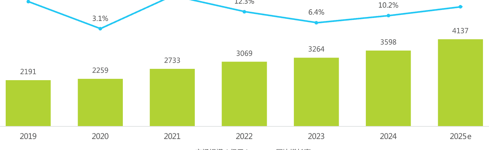

注：此处宠物行业市场规模包含宠物购买，测算维度为消费；测算逻辑：单年宠物食品/用品/医疗/服务消费支出*国内宠物产品/服务渗透率；n来源：消费者调研、专访调研、艾瑞咨询研究院自主调研及整合；
©2025 iResearch Inc.

## 中国宠物（犬猫）数量及品种类型

宠物猫数量快速增长，逆袭超越；宠物狗数量趋于平稳。

2021年以来，宠物猫数量大幅增长，一起超越了犬的数量，2024年宠物猫数量达7153万，近半数养家中中国田园，其次受受欢迎的英国短猫，占比近2%。而中华田犬是最常见的狗狗品种，其忠诚温顺、易于训练，是多宠主的选择。柯基、贵宾犬等活泼向外的中型犬，金毛、拉布拉多等大型犬，也被许多多猫宠主所喜爱。

| 品种 | 特征 |
| :--- | :--- |
| 中国田园 | 中国本土的大家族，毛色多样，尾巴丰富，体型中等，性格温顺，极受欢迎；常见种类有田花猫、三花猫等。 |
| 英国短猫 | 性格温顺，易于训练，是主人的爱，体型圆润，脸圆，毛发短密，一般体重为4-8kg。 |
| 贵宾犬 | 性格聪明，灵敏，活泼易于训练，性格外向，需要经常美容，毛色丰富，迷你，运动力强。 |
| 柯基犬 | 短的头部，耳朵大，体重为6-10kg，活泼、自豪，友爱俏皮，体型匀称，运动能力极强。 |
| 金毛 | 大型，金色的毛发，友爱、忠顺，适合与家庭相处，一般体重为25-30kg，运动活跃。 |
| 拉布拉多 | 性格友爱，聪明，毛发短直，体型中等偏大，一般体重为23-35kg，运动活跃。 |
| 布偶猫 | 性格活泼，和人类相似，性格健强；体型相长，寿命相当可活15到20年；一般体重为4-7kg。 |
| 波斯猫 | 性格安静，对环境适应，叫声小，爱安静，人们很喜欢，脸圆，毛发长密，一般体重为7-10kg。 |
| 美国短猫 | | |

2019-2024中国宠物（犬猫）数量

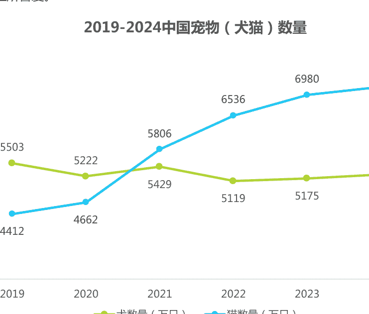

- 猫数量（万）
- 数量（万）

数据来源：《2025年中国宠物行业白皮书》
©2025 iResearch Inc.
数据来源：内部研究 备注：代表性按市场划分。

## 宠物食品市场布局

本土宠物食品品牌主导大众市场，特性驱动细分市场差异。

| 狗粮 | 零食 | 营养补充剂 |
| :--- | :--- | :--- |
| Royal Canin | 渴望 | Red提狗 |
| Choice | 沃士尔 | Horizon |
| 爱谱 | 萌萌 | Wellness |
| Royal Canin | 旺旺 | Golden Love |
| Pfizer | 普安 | BELINA |
| Trust | | |

注：图中展示内容仅供参考，图中所示的图标及大小不涉及排名。
©2025 iResearch.

## 宠主画像

更多女性选择养宠；高收入白领更喜欢养宠；养人群为26-35岁，高城市有稳定收入的白领。知识程度较高，超过六成有学历，在企业工作或从事专业岗位。家庭状态为已婚也有两成未婚或独居家庭。

- 性别
- 城市级
- 月收入
- 家庭人口
- 婚姻状态
- 年龄
- 月宠物食品花费
- 学历
- 职业

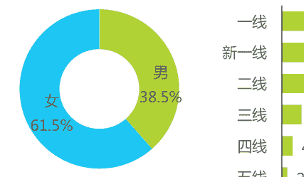
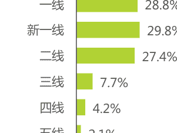
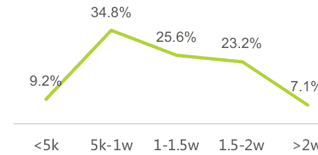
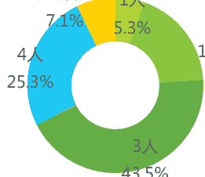
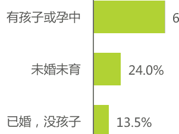
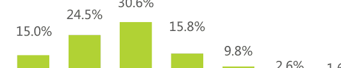
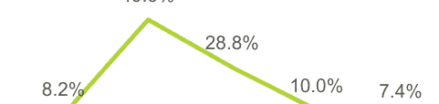
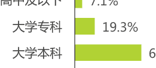
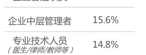

数据来源：艾瑞咨询2025年5月宠主定量调查，N=1000

## 养宠情况

多人只养一只猫/狗，养宠经验较为丰富。在本次调研中，在配额的控制下，养猫和养狗的人群显得较为平均的分布。养宠所需的空间较小，比较养狗人群，2只以上猫的人更多。各位主人对养宠已较为熟悉的阶段，多人有1以上的养宠经验。

| 物品类 | 养宠经验 |
| :--- | :--- |

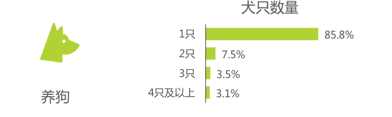
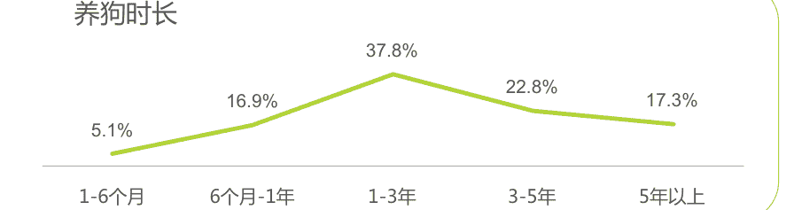
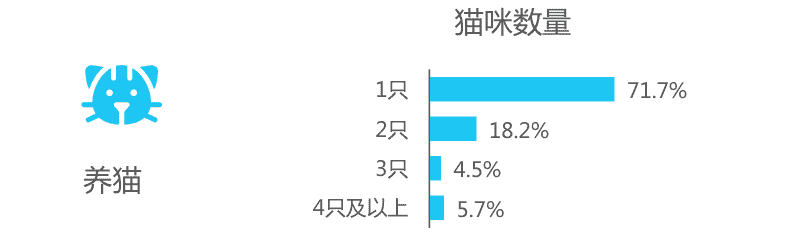
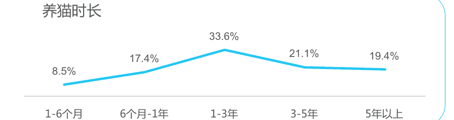

数据来源：艾瑞报告2025年5月主题定量调研，N=1000；其中养宠宠物N=730，养宠人数N=670
©2025.8 i Research.

## 宠主与宠物的情感联结

多数宠主与宠物情感深厚，觉得养宠是一种乐趣，认为宠物是伴随自己的家庭成员。

从养宠原因来看，宠主认为养宠是一种乐趣，增加了温馨的氛围及缓解了压力。宠物在宠主心中有重要的地位，宠主表示与宠物的情感深度程度达9%；对宠主而言，宠物不仅是家庭的一员，还是玩具。

| 养宠原因 | 情感深度 |
| :--- | :--- |
| 喜欢宠物，觉得宠物是一种乐趣 | 51.7% |
| 增加家庭的温馨和乐趣 | 48.8% |
| 宠物可以帮助缓解和焦虑 | 42.7% |
| 希望有宠物陪伴，减轻孤独 | 33.8% |
| 家人喜欢宠物，一起决定养 | 28.2% |
| 有较多时间，希望宠物丰富生活 | 23.5% |
| 希望宠物（如狗）增加户外和运动量 | 23.0% |
| 希望宠物成为孩子伴 | 22.7% |
| 希望通过教育责任感和爱 | 22.2% |

| 宠物角色 | 比例 |
| :--- | :--- |
| 合伙人：帮助我的小伙伴 | 16% |
| 家庭成员：就像孩子一样 | 21.4% |
| 守护者：给我带来安全 | 23.7% |
| 室友：一起的一份子 | 39.3% |
| 亲密朋友：可以倾诉、分享快乐 | 44.3% |
| 伙伴：一起玩、互动的对象 | |

数据来源：艾瑞调研2025年5月，N=1000
©2025.8 iResearch.
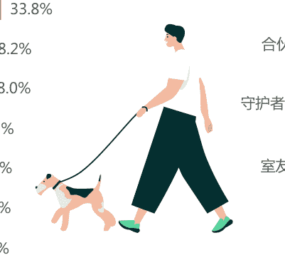

## 养宠生活痛点与应对策略

宠物会生活带来一些事情，宠主仍以负责和包容的态度对待。对于养宠的生活痛点，多数宠主表示日常护理、破坏家具让他们感到疼。增加了更多的不确定性，在宠物“捣蛋”时，多数宠主还是选择比较温和教育进行干预。如果遇到变动，六成的宠主还是选择克服困难，继续寻找可靠的处。

| 养宠生活痛点 | 生活变动的举措 |
| :--- | :--- |
| 抗拒日常护理 | 33.2% (63.30%) |
| 破坏家具 | 31.7% (21.10%) |
| 活动空间不足 | 26.6% (14.80%) |
| 对食物不适，挑食 | 23.7% (克服困难，继续寻找靠谱的机构) |
| 分离焦虑，主人离开时聚焦 | 21.9% (给朋友或亲戚照顾) |
| 乱拉尿，难以禁止 | 19.5% (来到现场，教育) |
| 缺乏环境 | 19.3% (事前引导，引导教育) |
| 惹人但不注意吃食物 | 17.9% (轻罚、捆、关起来让冷静) |
| 对环境和季节变化过于敏感 | 16.9% (快速验收，控制自己情绪) |
| 常遛出门天性 | 14.0% (不太在意，认为是宠物性) |
| 很生气，并且打它 | 4.2% |

数据来源：艾瑞咨询2025年5月定量调查，N=1000
©2025.8 iResearch.

## 养宠观念

宠主重视宠物的营养和健康，对科学养宠和分阶营养的认知程度高。从为宠物做的事情来看，宠物首先行动的是照顾好宠物的饮食和身体健康，其次才考虑衣物时尚等方面。更多人认可要用心照顾宠物，也认为需要科学地饲养，根据其不同的成长阶段和健康状态来调整喂养的方式。

### 为宠物做过的事情

| 为宠物做过的事情 | 比例 |
| :--- | :--- |
| 给宠物自制食物（如零食、肉干鱼等） | 62.0% |
| 为宠物选择特殊的食物（如益生菌等） | 61.7% |
| 定期体检和健康检查 | 61.5% |
| 为宠物购买的衣物配饰 | 49.1% |
| 给宠物拍照，记录成长 | 39.1% |
| 在宠物生日或特殊日子里，为其庆祝 | 37.7% |
| 购买宠物保险 | 28.8% |
| 带宠物参加宠物聚会或活动 | 25.6% |
| 考虑宠物的养老护理 | 17.9% |
| 带宠物参加专门的训犬课程 | 15.0% |

### 认可的养宠观念

| 认可的养宠观念 | 比例 |
| :--- | :--- |
| 宠物是我的家庭成员，用心照顾它，给足够的爱 | 55.1% |
| 根据宠物的年龄、品种和健康状况，科学地调整饮食 | 52.0% |
| 宠物的健康是最重要的，定期带它检，确保没有疾病 | 48.0% |
| 在科学养宠的前提下，尽可能选择性性的食物 | 42.7% |
| 我重视科学养宠，持续学习相关的知识 | 39.8% |

### 喂养观念

| 喂养观念 | 比例 |
| :--- | :--- |
| 根据成长的阶段，调整食物种类 | 52.5% |
| 根据宠物是否生病或健康状况，调整食物 | 49.3% |
| 根据宠物的口味，尝试让它 | 47.2% |
| 根据季节变化，调整宠物的饮食 | 42.5% |
| 根据体重调整份量 | 35.6% |

## 宠物主粮营养现状

湿粮、干粮是宠物食品中最大的品类，包括罐头/包装粮，而烘焙粮则是宠主的主要选择，反映出宠物对口味性和便利性的需求。另外，随着宠物主粮意识的提升，处方粮等功能性逐渐普及，猫倾向于选择湿粮。

| 主粮 | 喂食比例 | TGI |
| :--- | :--- | :--- |
| 罐头/包装粮 | 54.9% | 106 |
| 干粮 | 53.8% | 110 |
| 烘焙粮 | 49.6% | 98 |
| 专门定制的 | 43.5% | 101 |
| 特方粮 | 39.9% | 100 |
| 鲜食 | 28.5% | 117 |
| 膨化 | 28.0% | 109 |
| 生骨肉 | 26.1% | 110 |
| 人类营养 | 22.7% | 84 |

数据来源：艾瑞2025年5月宠物主粮调查，N=1000
注：类型粮并非针对疾病治疗的宠物群体，其占比大于100%，TGI数据显示购买宠物主粮的选择者考虑因素如下
©2025.8 iResearch

## 宠物零食

突破简单的奖励型零食，功能化方向发展，实现快乐与健康的双重价值。喂养宠物的食品类趋向多元化，猫/狗类以61.1%的比例成为最受欢迎的零食类型，肉干零食和冻干类占据主流，反映出主人对宠物零食高营养和便利性的双重需求。宠主更偏好小鱼（猫）和猫条，符合猫的嗜食习惯和消化需求。而虾、骨头和牙棒在狗中受欢迎，凸出对犬类口腔健康的重要性。整体而言，宠物零食从单一的奖励型转向功能型（如洁牙、美毛、消化）升级，宠物的饮食生活变得更加快乐又健康。

| 零食类 | 喂过的比例及TGI |
| :--- | :--- | :--- |
| 猫条/狗条 | 61.1% | 121 |
| 肉干 | 53.8% | 110 |
| 烘焙粮 | 49.6% | 98 |
| 专门定制的 | 43.5% | 101 |
| 特方粮 | 39.9% | 100 |
| 鲜食 | 28.5% | 117 |
| 膨化 | 28.0% | 109 |
| 生骨肉 | 26.1% | 110 |
| 人类营养 | 22.7% | 84 |

# 宠物益菌喂养策略

宠主关注益菌的配方及活性，宠物有益菌需求时，传统粉剂造成的喂食麻烦成为较大的使用阻碍。

适性对宠物益菌选择至关重要，是宠主选择益菌的关键考因素之一。喂养过程麻烦、宠物不吃，是宠主不愿尝试或不愿意继续喂益菌的主要原因。为减少宠物对益菌的抗拒，更多宠主愿意选择软颗粒形态的益菌，特别是老鼠类宠物。宠物益菌品牌积极研发益菌软颗粒，解决传统剂型的低口感与活性的问题。

## 购买过益菌的原因

## 未购买益菌的原因

## 受喜爱的宠物营养品形态

| 51% | 科学配方 | 39% |
|---|---|--|
| 46% | 益菌活性高 | 25% |
| 39% | 适口性 | 21% |
| 29% | 含有特定的菌株 | 20% |
| 15% | 高端级原料（进口菌） | 19% |

| 认为没必要吃营养品 |
| 担心产品的安全性 |
| 喂食过程麻烦 |
| 听后没效果 |
| 怀疑产品真实效果 |

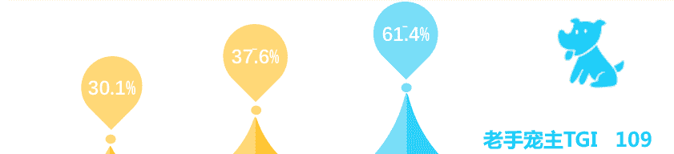

老鼠主 TGI 109
新鼠主 TGI 95

滴剂 骨剂 软颗粒

## 未购买/继续喂益菌的原因

## 剂型解决方案

| 47% | 品牌地位 |
|---|---|--|
| 23% | 认可生产工艺 |
| 47% | 真实用户口碑 |
| 29% | 专业人士推荐 |
| 28% | 销量排名靠后 |
| 39% | 价格太高 |

| 认为没必要吃营养品 45% |
| 症状状况改善 23% |
| 怀疑产品真实效果 18% |
| 食用后没有不良反应 16% |

益菌软颗粒
目前益菌多为粉剂型，通常散在鼠身上喂食。若宠物未准时喂食，粉粒暴露在空气中，益菌易受环境影响而失效。红伯软颗粒剂型，并参与科研、制定《宠物营养补充剂》团体标准。益菌软颗粒可直接一口喂服，即时进300亿菌。

配方 宠物不吃

## 宠物鱼油喂养决策

原料配方是主人在选购鱼油时的关注重点，配方需要兼顾全面的功效和喂养的适口性。

鱼油纯度高、种类多样、含有Omega-3 是主人关注的因素；同时鱼油的适口性也受重视，宠物不吃油部分会放弃鱼油。为了满足市场需求，品牌从添加鱼油角度增加鱼油的口感性和功能。

### 购买过鱼油的原因

### 未购买过鱼油的原因

### 宠物鱼油虾油声量

| 品牌 | 原料配方 | 原因 |
|---|---|--- |
| 45% | 鱼油值得信 | 认为没必要吃营养品 |
| 38% | 鱼油纯度高 | 宠物不吃 |
| 33% | 效果 | 没找到合适品牌/产品 |
| 32% | 原材料好 | 怀疑购买真实效果 |
| 32% | 份多样 | 喂食困难过程 |
| 29% | 适口性 | 17% |
| 29% | 含磷虾油 | 宠物不吃 |
| 36% | 真实用户口碑 | 认为没必要吃营养品 |
| 28% | 专业人士推荐 | 怀疑购买真实效果 |
| 27% | 排名靠前 | 症状未改善 |
| 32% | 价格 | 喂食困难过程 |

| 36% | 9000 | 300 |
| | 6000 | 200 |
| | 3000 | 100 |
| | | 0 |

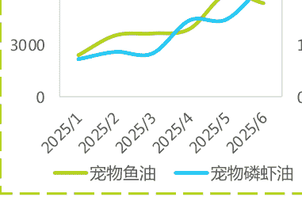

高纯度是宠主选择
鱼油的核心需求

丰富的营养成分是兼顾
功效与提升适口性的理想选择

品牌选用添加鱼油+磷虾鱼油的组合，让宠物更爱更美味

### 找到解决方案

### 红狗Omega深海鱼油

用户的需求可能是减少挑食、实现美丽，但狗狗对鱼油适口性要求极高，让宠物毛发健康至关重要。

红狗复配深海鱼油，低胆固、低脂肪，专研配方更美丽，满足主人对鱼油适口性与美丽的需求。

## 02 / 各阶段宠物喂养与营养需求

## 宠物年龄划分：参考标准

本次研究中，艾瑞将狗狗年龄阶段定义为：幼年期（小于1岁）、青年期（1至10岁）、老年期（大于10岁）。参考AAFP、AAHA生命阶段指南，猫的年龄阶段分为5个，其中1岁的猫处于老年期；狗的年龄阶段也可以分为5个，其中9个月的狗处于幼年期，老年期定义为“整个生命程的最后25%”。

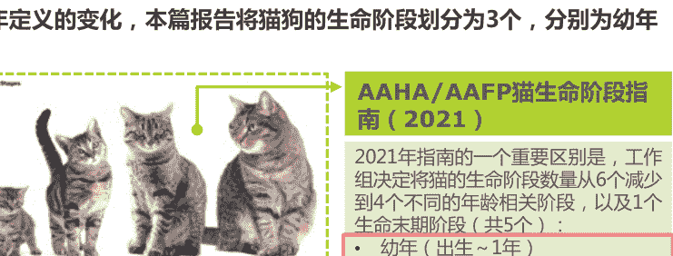

| Life stage | Age of cat | Human equivalent |
|---|---|---|
| Kitten (birth to 2 months) | 0-1 month |  year |
| Junior | 2-3 months | 4 years |
| Juvenile | 4-6 months | 6 years |
| Puppy (3 months old) | 7 months | 12 years |
| Adult (6 months to 2 years) | 9-12 months | 15 years |
| Prime | 3-5 years | 21 years |
| Mature | 6-8 years | 24 years |
| Senior | 9-12 years | 32 years |
| Senior | 13-14 years | 36 years |
| Geriatric | 15-18 years | 40 years |
| Older | 19-24 years | 48 years |
| Oldest | 25 years | 56 years |

## AAFP/AAHA生命阶段指南 (2010)

猫的幼年阶段（幼咪）尚未明确，由于个体和发育差异，需要引入不同的标准。此指南将猫的年龄阶段分为6个：
- 幼年（5~6个月）
- 青年（7个月~2岁）
- 成年（3~6岁）
- 中年（7~10岁）
- 老年（1~14岁）
- 高龄（15岁+）

## AAHA犬生命阶段指南 (2019)

2021年的重要工作是决定了狗狗年龄阶段从6个减少到4个不同的阶段，以及生命末期阶段（特殊）：
- 幼年（0~1岁）
- 青年（1~6岁）
- 成年（7~10岁）
- 老年（>10岁）

| Stage | Definition (Length of Time) |
|---|---|
| Puppy | Cessation of growth (around 6-9 months, breed and size) |
| Young adult | Cessation of growth and social maturation, which occurs in dog by 3-4 months |
| Adult | Cessation of physical and social maturation until the last 25% of lifespan (breed and size) |
| Senior | The last 25% of lifespan through end of life |
| End of life | Terminal stage (depends on the particular species) |

TABLE 1 Proposed Canine Life Definitions

由于狗狗的年龄阶段应该根据体重和品种来决定，而不是根据年龄的年限。此指南将狗狗年龄阶段分为5个具体阶段，考虑到品种和寿命的巨大差异：
- 幼年（5~9个月）
- 成年（1~6岁）
- 中年（7~10岁）
- 老年期（通常定义为“整个生命程的最后25%”）。

## AAHA犬老年护理指南 (2023)

参考2019年AAHA犬生命阶段指南、2021年/AAHA生命阶段指南的定义。

©2023 Research Inc. 艾瑞宠物医学协会（AAFP）、美国宠物健康协会（AAHA）

www.iresearch.com

## 幼年期狗的特点与健康需求

处于幼年期的狗狗成长快，补充营养、疾病防护、正确行为引导为重要。小于1岁的狗狗处于幼年期，正处于快速成长阶段，就需要充足的营养和适当的运动来支持发育，又免疫系统未发育完全，做好疾病防护；在日常生活中，主人需要细心照顾，并提供正向的行为引导，帮助它们养成良好的习惯。

### 生活中的痛点

### 幼年期阶段特点

- 缺乏锻炼
- 饮水不足
- 乱尿，难以禁止
- 趁人不注意时偷偷食物
- 训练困难，难以学会基本指令

成长快，需要营养饮食及适当运动支持生长
稚嫩懵懂，依赖主人爱心照顾及教导

好奇心强，开始探索意外之外的新事物

### 健康痛点

### 幼年期营养健康需求

- 免疫系统问题，易生病
- 寄生虫问题
- 行为问题，易易怒、攻击活跃

免疫力弱，需关注风险和疾病防护多互动，做正向引导数据来源：艾瑞调研2025年5月N=1000；其中幼年期狗N=148；小于1岁的狗处于幼年期。备注：TGI=特定人群选择的比例/全体人群选择的比例

## 幼年期猫的特点与健康需求

猫的幼年阶段（幼咪）尚未明确，由于个体和发育差异，需要引入不同的标准。此指南将猫的年龄阶段分为6个：
- 幼年（5~6个月）
- 青年（7个月~2岁）
- 成年（3~6岁）
- 中年（7~10岁）
- 老年（1~14岁）
- 高龄（15岁+）

青年期的猫咪较为独立，健康稳定；不喜欢环境变化，也不喜欢剪指甲、洗澡等破坏独立生态的行为。青年期的猫咪有独立照顾自己的能力，同时保持了活泼和好奇的特点，享受自己有控制感的安逸环境。青年猫对高蛋白食物的需求，也需摄入足够的水分避免泌方面的问题。需要关注它们的体重变化，避免影响身体机能。

### 青年期特点

- 对环境和季节变化过于敏感
- 抗拒日常护理，如洗澡

### 幼年期特点

- 饮水不足
- 与其他成员/相处
- 睡觉不好
- 训练困难，难以学会指令
- 乱尿，难以禁止
- 趁人不注意时偷偷食物
- 缺乏锻炼

### 幼年期需求

- 成长快，需要营养饮食及适当运动支持生长
- 稚嫩懵懂，依赖主人爱心照顾及教导
- 好奇心强，开始探索意外之外的新事物
- 免疫系统问题，易生病
- 寄生虫问题
- 行为问题，易易怒、攻击活跃
- 免疫力弱，需关注风险和疾病防护多互动，做正向引导，守护健康
- 营养均衡有助于骨骼生长

### 幼年期宠物食品习惯

幼年食物少且需求高，宠主购买频率低。同时宠主更倾向于选择品牌官网/APP/小程序，直播间等渠道，通过他人推荐和第三方渠道获取信息。从宠主来看，更多宠主看重营养成分，且专业背书增加了可能。

## 月食品花费

| 购买渠道 | 占比 | TGI |
|---|---|---|
| 线上购物平台 | 74.0% | |
| 200元以下 | | |
| 200-500元 | 39.4% | |
| 500-800元 | 34.6% | 106 |
| 800-1000元 | 33.7% | 159 |
| 1000元以上 | | |
| 直播间 | | |
| 品牌官网/APP/小程序 | 25.0% | 117 |

| 选购因素 | TGI |
|---|---|
| 促销活动吸引 | 114 |
| 成分与营养搭配 | 105 |
| 导购/客服介绍 | 119 |
| 专料术书 | 107 |

### 宠物食品购买频率

| 选购维度 | 占比 | TGI |
|---|---|---|
| 线下宠物店 | 49.0% | |
| 朋友或家人推荐 | 47.1% | 116 |
| 社交媒体 | 44.2% | |
| 商店 | 42.3% | |
| 新闻类/App网站 | 32.2% | 120 |

| 频率 | TGI |
|---|---|
| <半个月 | 154 |
| 每月 | 138 |
| 每季度 | |
| >每年 | |
| 不定期 | |

### 幼年期宠物饲养习惯（狗）

多数宠主每天饲养幼年期宠物3次主食，喂养零食及营养补充剂一次或自由采食，宠主对方粮的偏更高。针对主食需求，多数宠主每月花费50-300元，烘焙粮、处方为主要选择，相对于其他年龄宠物，宠主对方粮的更好。零食，多数宠主每月花费50-300元，猫条、狗条为主要选择，由于幼年期宠物零食需求相对较低，宠物种类无特殊偏好。补充剂，多数宠主每月花费50-300元，益菌、维生素类为主要选择。

| 主食 | 饲养费用 | 喂养频率 | 宠物种类 | 占比 |
|---|---|---|---|---|
| 50元以下 | 1.9% | 30.8% | 27.9% | 烘焙粮 | 46% |
| 50-100元 | 34.6% | | 处方粮 | 46% |
| 100-300元 | 7.7% | 3.8% | 3.8% | 罐头/包装罐 | 45% |
| 300-500元 | 15.4% | | | | 15% |
| 500元以上 | 1.9% | 1次天/3 | | | 10% |

| 零食 | 饲养费用 | 喂养频率 | 宠物种类 | 占比 |
|---|---|---|---|---|
| 50元以下 | 18.6% | | 猫条/狗条 | 52% |
| 50-100元 | 51.0% | 21.2% | 27.9% | 肉罐 | 43% |
| 100-300元 | 26.5% | 17.3% | 10.6% | 冻干 | 38% |
| 300-500元 | 2.9% | 3.8% | | |
| 500元以上 | 1.0% | | | 无特殊偏好 | |

| 营养补充剂 | 饲养费用 | 喂养频率 | 宠物种类 | 占比 |
|---|---|---|---|---|
| 50元以下 | 11.7% | 9.6% | 益菌类 | 50% |
| 50-100元 | 61.7% | 21.2% | 13.5% | 维生素类 | 49% |
| 100-300元 | 18.1% | 6.7% | 7.7% | 补充类 | 5.8% |
| 300-500元 | 3.2% | | 化毛膏/营养/补血 | |
| 500元以上 | 5.3% | 1次天/2次天/3次天/4次天+/自由采食 | 强化钙系统 | 46% |
| | | | 果滋营养 | 10% |
| | | | 保护免疫，预防疾病 | 12% |

## 青少年狗的特点与健康需求

处于青年期的狗狗精力旺盛，好玩好动；对主人的依赖性高。1-10岁的狗狗处于青少年期，它们有较高的运动需求，需要定期去户外巡视领地发精力；同时需要主人适当关注，关注它们营养的均衡摄入、符合体能的运动以及避免误食。

### 生活点

- 分离焦虑，主人离开时过度焦躁
- 破坏家具（抓挠、咬破等）
- 出行困难，抗拒（如坐车）
- 训练困难，难以学会基本指令
- 对环境和季节变化过于敏感

### 健康需求

- 心脏和循环系统问题，心脏、高血压等
- 肠胃问题，腹泻或肠胃虚
- 免疫系统问题，易生病
- 寄生虫问题
- 胖问题，体重超标

### 青少年期阶段特点

### 青少年期营养健康需求

### 青年期宠物饲养习惯

多数宠主每月花费在100-500元，干粮、湿粮为主要选择，对于青年期宠物，更多宠主将骨肉类为主食。零食，多数宠主每月花费50-300元，猫类/狗类为主要选择，并且希望通过零食补充营养以日常饲养。营养补充剂，多数宠主每月花费50-300元，益生菌、营养类为主要选择，且对鱼油、磷籽油的偏好更高。

| 主食 | 饲养月费 | 饲养频率 | 饲养种类 | 占比 | 原因 |
|---|---|---|---|---|--|
| 50元以下 | 1.5% | 34.7% 34.4% | 干粮 | 57% | |
| 50-100元 | 13.9% | 14.3% | 罐头/包装湿粮 11.2% | 57% | |
| 100-300元 | 47.5% | | 烘焙粮 5.0% 50% | 宠物维持生命所需 |
| 300-500元 | 25.1% | | 1次/天 2次天 3次天 4次+/天 自由自喂不固定喂 | TGI 111% | |
| 500元以上 | 12.0% | | | 生肉 罐头/包装湿粮 | 108% | |

| 零食 | 饲养月费 | 饲养频率 | 饲养种类 | 占比 | 原因 |
|---|---|---|---|---|--|
| 50元以下 | 16.4% | | 不良 0.8% | 补充营养日常饲养中可能需要的零食 |
| 50-100元 | 41.0% | 37.5% | 猫类/狗类 68% 肉肉类 59% | 52% | |
| 100-300元 | 34.0% | 19.7% 14.3% 20.1% | 干粮 55% | 增加与宠物的互动和感情交流、增加营养 |
| 300-500元 | 7.0% | | 5.0% 2.7% | TGI 112% | 补充营养日常饲养中可能需要的零食 |
| 500元以上 | 1.6% | 1次/天 2次天 3次天 4次+/天 自由自喂不固定喂 | 猫类/狗类 110% | TGI 107% | 增加与宠物的互动和感情交流、增加营养 |

| 营养补充剂 | 饲养月费 | 饲养频率 | 饲养种类 | 占比 | 原因 |
|---|---|---|---|---|--|
| 50元以下 | 13.1% | 45.6% | | 不良 11.6% | 益生菌 55% |
| 50-100元 | 43.2% | 11.6% 11.2% 16.2% | 化毛/骨营养/软骨等营养 52% | 支持骨骼发育、减少关节问题 |
| 100-300元 | 32.3% | 3.1% 0.4% | | 鱼油/磷籽油 51% | 补充营养日常饲养中可能需要的零食 |
| 300-500元 | 7.4% | | 1次/天 2次天 3次天 4次+/天 自由自喂不固定喂 | 鱼油/磷籽油 TGI 113% | 增加免疫力 56% |
| 500元以上 | 3.9% | | | 皮质胶/维生素/骨营养/软骨等营养 TGI 109% | 减少干燥和过敏、预防皮肤疾病 |

数据来源：艾瑞咨询2023年5月调研报告；N=1000；其中青年期饲养年数=6年；定义1-10岁的宠物为青年期
注：TGI=针对宠物选择的占比/群体整体选择的占比×100；>105表示该项选择比例远高于主体平均

©2023 | | iResearch

## 老狗的特点与健康需求

处于老年期的狗狗活力逐渐减，喜静少动，常睡眠，食改良调养身体状态。

大于10岁的狗狗处于老年期，外出意愿降低，偏居家休息，需多睡眠恢复体力；性敏感依赖主人，主人需陪伴安抚；同时需要补充抗氧化物质和关节营养素，选择低热量高纤维、易咀嚼的食物。

### 生活痛点

### 老年期阶段特点

- 脚部不便，行动不便 279
- 睡眠不好，失眠，多梦等 176
- 活动空间不足 132
- 社交需求未满足 129

对外界遛的喜爱程度降低，更倾向于在家休息。身体机能下降，通过更多睡眠恢复活力。心情变得敏感，依赖主人。

### 健康痛点
- 视力问题，视线模糊等 218
- 关节和骨骼问题，关节疼痛、行动不便 143
- 口腔问题，口臭、牙垢等 126
- 泌尿问题，尿频繁等补充抗氧化物质延缓视衰。低热量高纤维添加关节营养减肥。易咀嚼食物保护健康。

## 老年期猫的特点与健康需求

老年期的猫机能衰，食量活动下降，需休息，依赖环境。主人需补充泌尿及关键营养，选择易消化的食物，定期检查，保障老年的生活质量。

### 生活痛点

- 饮水不足
- 睡眠不足，失眠、多梦等
- 对新食物适应、挑食
- 对环境和季节变化敏感
- 抗拒日常护理，洗澡、梳毛、剪甲

### 老年期阶段特点

身体机能衰，食量减，需合理饮食。安静少动，作息以休息为主。倾向熟悉事物，难适应环境/外部干扰。

### 健康痛点

- 视力问题，视线模糊等
- 泌尿问题，尿急等
- 免疫系统问题，易生病
- 肠胃问题，腹泻或胃适
- 皮肤问题，掉毛、瘙痒等

### 老年期营养需求

强化营养，护眼，泌尿及免疫等关键营养。

注重易消化，选软食物，减肠适。

科学护理，定期检查毛状况干预。

数据来源：艾瑞咨询2023年5月调研报告；N=1000；其中老年猫主人N=30；定义：≥10岁的属于老年期 | 注：TGI=特定人群选择选项的比例/全体人群选择选项的比例*100，TGI>105，说明老年类人群的偏好显著高于群体

## 老年宠物购买习惯

老年宠物食欲及食量降低，宠主购买态度灵活，更倾向于选择实惠的产品。针对老年宠物，宠主在宠物食品上的花费更倾向经济。从购买渠道来看，宠主喜欢在线购物平台、线下宠物食品专卖店及宠物医院购买食品，顺线上购物平台的偏好，网商城成为其获取信息的渠道。购买时，重视包装适配及性价比，同时倾向品牌及他人建议。

### 月食品花费

- 200元以下 TGI=278
- 200-500元
- 500-800元
- 1000元以上

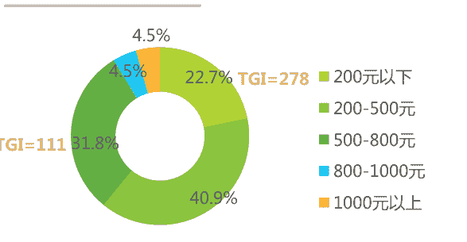

### 购买渠道

| 购买渠道 | 选择考虑因素 | TGI |
|---|---|---|---|
| 线上购物平台 | 100.0% TGI=121 | 包装大小宜 | 198 |
| 线下宠物食品专卖店 | 54.5% TGI=115 | 性价比高 | 136 |
| 直营 | 27.3% | 食品功效好，作用明显 | 133 |
| 宠物医院 | 27.3% TGI=128 | 品牌信任 | 128 |
| 超市 | 13.6% | 兽医推荐 | 128 |

### 信息渠道

| 信息渠道 | 选择评估维度 | TGI |
|---|---|---|---|
| 线上商城 | 63.6% TGI=147 | 身边朋友推荐 | 136 |
| 社交媒体 | 40.9% | 试吃试用体验性 | 118 |
| 朋友或家人推荐 | 40.9% | 品牌形象与知名度 | 115 |
| 品牌间 | 36.4% TGI=113 | 营养成分 | 105 |
| 线下宠物店 | 31.8% TGI=200 | | |

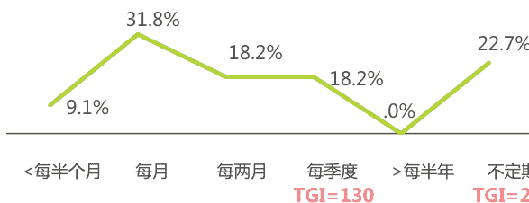
- 半个月一次
- 每月
- 季度一次
- 半年一次 TGI=130

## 老年宠物饲养习惯

多数宠主每天喂主食，多数宠主花费50-500元。零食上多数宠主花费50-300元。零食上多数宠主花费100元以内，针对老年宠物更多选择乳蛋白/益糖等产品让宠物保持活力。

| 宠物月费 | 饲养频率 | 占比 | 饲养原因 | 占比 |
|---|---|---|---|---|
| 50元以下 | 0.0% | 40.9% | 冻干 | 59% |
| 50-100元 | 27.3% | 27.3% | 烘焙粮 | 59% |
| 100-300元 | 31.8% | 4.5% | 罐头/包装湿 | 50% |
| 300-500元 | 27.3% | 0.0% | TGI | 44% |
| 500元以上 | 13.6% | 1次/天 2次天 3次天 4次+/天 自由自食不固定 | 处方粮 | 142% |
| | | | 烘焙粮 | 16% |

| 宠物月费 | 饲养频率 | 占比 | 饲养原因 | 占比 |
|---|---|---|---|---|
| 50元以下 | 14.3% | 31.8% | 不喂零食 | 洁牙棒/磨牙棒 | 67% |
| 50-100元 | 47.6% | 18.2% | 牛肉罐 | 62% |
| 100-300元 | 33.3% | 27.3% | 冻干 | 57% |
| 300-500元 | 0.0% | 4.5% | TGI | 43% |
| 500元以上 | 4.8% | 1次/天 2次天 3次天 4次+/天 自由自食不固定 | 羊奶 | 147% |
| | | | 洁牙棒/磨牙棒 | 193% |
| | | | 作为训练奖励、增加互动、互动 | 126% |

| 宠物月费 | 饲养频率 | 占比 | 饲养原因 | 占比 |
|---|---|---|---|---|
| 50元以下 | 25.0% | 36.4% | 不喂 27.3% | 生益菌 | 56% |
| 50-100元 | 37.5% | | 钙/矿质等各类补剂 | 69% |
| 100-300元 | 18.8% | 9.1% | 鱼油/鳕肝油 | 50% |
| 300-500元 | 6.3% | 0.1% | 0.0% | TGI | 44% |
| 500元以上 | 12.5% | 1次/天 2次天 3次天 4次+/天 自由自食不固定 | 乳蛋白蛋菌 | 141% |
| | | | 钙/矿质等各类补剂 | 251% |
| | | | 延长老年、保持宠物活力 | 116% |
| | | | 保护皮肤、预防腹部疾病 | |

数据来源：艾瑞咨询2023年5月调研报告；N=1000；其中老年宠物N=58；定义：10岁以上的宠物为老年
备注-TGI：根据宠物主选择的选项/群体选项/群体占比计算<TGI>100%，更多数据关于老年宠物的描述数据归艾瑞咨询所有

©2023 © iResearch

## 03 / 宠物喂养趋势洞察

## 行业发展趋势：消费侧

宠物“家庭成员化”驱动消费需求从基础到高阶升级
宠物角色转变，从“饲养对象”到“情感家庭成员”，核心需求的升级驱动行为向精细化健康转型注重品质、便捷与安全；进阶需求深化分阶段性精准养护、预防/针对性健康管理与适口性满足；高阶需求重视互动与全周期呵护

### 家庭成员化
### 高阶需求
### 情感互动
### 全周期呵护

- **“家庭成员”认同**：在特殊日子（如生日）为“宠物”准备‘精致喂养’，让宠物的快乐与主人的关注深度绑定
- **“消费升级”**：在可持续发展大趋势下，宠物食品行业探索原料替代
- **全周期管理**：生命周期延伸至幼年/成年/老年期就开始规划，通过科学配合，让长期关心的持续

### 生活伙伴化
### 进阶需求
### 阶段适配
### 健康营养
### 适口优化

- **营养配方**：关注蛋白质、脂肪、矿物质等功能性元素的平衡
- **强化功能**：充分利用天然食材，让宠物在不同阶段都能精准营养
- **预防性**：预防性营养成为行业共识，通过饮食调整缓解过敏
- **味觉**：满足人类味觉偏好的食物，如优质肉类，丰富宠物的摄入量
- **形态适应**：考虑到易嚼，增加产品的吸引力，解决挑食问题
- **品质化**：从“活要”升级为“好”，优质原料为核心原材料，减少人工色素、香精及防腐剂，包括无添加、无糖
- **多元化**：意识日益多元化产品，注重玩趣体验

### 基础需求
### 日常所需
### 饮食安全

- **安全检测**：进入市场的必备条件，是消费者的重点。重金属、色素、微生物残留
- **专业技术**：在食材控制、特殊功效配方方面，提供安全营养支持
- **多样化**：丰富的零食等第三方选择

数据来源：艾瑞咨询行业研究院

©2025 | iResearch

## 行业发展趋势：供给侧

宠物产业技术、生态、数据三维重建
宠物产业正从“单产品输出”向“经验驱动”转向“技术攻关+生态价值+数据闭环”的三维重构，技术驱动产品迭代与升级，生态协同绿色发展范式，数据赋能消费信任，宠物产业从总量增长向高质量发展阶段。

| 技术攻关痛点 | 低碳种植 | 全链追踪 |
|---|---|---|
| 联合攻关，提升宠物产业创新，加速成果落地 | 通过技术融合，减少农药使用，实现低碳种植 | 技术领先：美国品牌 Farmina执行“区块链管理”，消费者扫描即可查看生产生长监控，溯源到灌溉、土壤检测报告。 |
| 宠物药物联合研发中心：由药集团与中国保险合作成立，聚焦宠物药物与健康生态圈建设 | 山东农业的中草功能性宠物微种植基地，将技术与传统融合，推出“药剂”、接液技术高效应用，减少农药使用，提高产品质量，产豌、葡萄等饲草，对动物具有营养与药用价值，可调节、增强免疫等 | 防控策略升级：在领先技术的协同下，通过区块链深度整合物理与数据进行防控，并逐步提升。通过区块链实现产品的销售渠道，增强区域的防范，更高效管控通路。 |
| 研发中心 | | 全链数据驱动 |
| 从前沿理念到功能应用，前沿技术不断打破产品格局 | 在可持续发展大趋势下，宠物食品行业探索原料替代 | 临床功效转化为品牌建立信誉的手段 |
| 首选添加剂：五添加加“0”、粮、氧、0食肉、0蛋无源白”，从源料到配方精准无负担 | 昆虫蛋白：黄虫蛋白具有高消化率、口感独特，突出天然昆虫蛋白，改善胃肠功能。 | |
| | 蛋白质源：氨基酸、碳源蛋白等，因高消化和低过敏特性大受市场欢迎。 | |
| 爱A.A.E.BioStudent专业技术：作为牙结石克星，在投喂时让宠物进入肠道渗透性溶解，A.A.E.BioStudent通过肠道渗透代谢溶解。 | | |
| 技术突破 | | |

## 行业发展趋势：市场侧

渠道全面拓展实现全域覆盖，场景精准布局实现产品提升

从渠道拓展来看，品牌持续通过多渠道开发、精准触达实现品牌影响的全域覆盖。从市场景覆盖来看，品牌围绕不同生活场景精准布局，从食供给、精准健康管理，到术后康复、体重控制、体控制、情绪等细分场景，不断拓展产品，以场景适配性提升产品竞争力。

高端及与：渠道深度拓展，线下深度渗透

- 2025年2月，Solid Gold入驻京东会员会，成为京东领先渠道。
- 2024年3月，Solid Gold活跃在京东线下店，重点打造46个线下宠物连锁、美团小票等O2O渠道，持续完善宠物线下布局。

### 场景深度化，品类多维

| 场景 | 品牌 | 产品 | |
|---|---|---|---|
| 食供给 | 口袋师傅 | 羊奶乳全能配方 | 采用纯奶浓缩技术，80%+线蛋白占比 |
| 精细美容 | 红虹 | 金标高端系列 | 针对健康专项钙胶蛋白、牛奶、鱼油 |
| 术后康复 | 银健贝 | 康复蓝 | 以鱼源为主功能性 |
| 减肥模式 | | | 40%减糖无负担，添加天然代糖饮料 |
| 情绪安抚 | 皇家 | 小型型零食舒缓全方位配方 | 特别添加活性生物营养及L-色减少焦虑症状
| 夏日酷暑 | 醇醇 | 宠物水冰淇 | 精选咖啡与新西兰蓝肉，降温解暑无负担 |

# 企业案例：红狗

全链优势：做宠物科学营养专家

红狗深耕宠物科学营养，创新驱动产品开发。通过剂型+功能有效结合，红狗8合1维生素软颗粒上市即热卖。红狗发现宠物益生菌粉存在流失，创新开发益生菌软粒，让爱宠一口吃进330亿活菌。同时，红狗还推出叶黄素软颗粒等新品。

## 核心优势

### 核心科学形态——软颗粒

科研团队专注于功能性食品的研发，配方均经过科学配比，并进行临床研发转化。

采用专利工艺和先进技术，保留营养与新鲜度，提高产品成分含量。

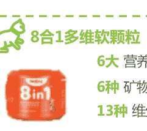

- 8合1多维生素
- 6大营养物质
- 天然营养源
- 93.1%高固料
- 6种矿物质
- 科学配比
- 8种健康功效
- 13种维生素

### 科学配比

对犬龄需包容，无转基因原料、色素、防腐剂、人工添加剂及无物添加剂。

### 科学工艺

只选择全球优质、可追溯的原料，与世界顶级原料公司合作，并对原料进行严格的筛选和有效性验证。

### 科学营养

主要原料单位

- 益生菌软颗粒
- 330亿活菌/粒
- 4效焕活肠道健康

- 养菌配6种专利益生菌
- 添加双益生菌
- 肠易缓解止泻消化
- 强护肠胃后恢复

### 叶黄素软颗粒

- 4种护眼黄金
- 5倍吸收率
- 99%高稳定性

红狗联合山东宠物行业协会等相关单位，共同制定并发布了《TSDIA 01-2025 宠物营养标准（软颗粒）》行业标准，标准在全国权威信息平台发布，为宠物行业内首部发布的宠物食品行业标准。

红狗研发剂、粉粒、粉剂、液剂、软颗粒多种形态产品，提高适用性，适应造型宠物饮食习惯。

宠物营养研究院不断探索宠物营养学的领先前沿，为宠物提供科学营养。

高含量叶黄素颗粒，爆发配方狗狗雪霜。

# 企业案例一：红狗

通过不断探索和配比，实现宠物所需营养的精准配比与高效发挥。

以比斗犬为例，红狗在传统鱼油的基础上，复制极地藻鱼油，低腥进口口感，联合华中农业大学实证7天可见控毛色素，毛光亮度提升，21天显著改善皮肤健康，满足了主人对鱼油适口性与宠物的需求。

## 科学营养——深海鱼油

- 抗肝脂：监控进口鱼油
- 40000mg/kg纳米磷鱼油，功效实证吸收效率提升1.3倍（对比鱼油）
- 黄金配比：Omega-3:Omega-6=1:4，促进营养吸收和生长，Omega-3含量EPA和DHA高。
- 权威认证：通过IFOS官方认证，EPA、DHA含量、纯度、安全性、稳定性、重金属等符合标准，品质更放心。
- 功效实证：7天柔顺度-75.50%。
- 南纬32°世界深海渔场捕捞小鱼、鳕鱼含优质营养，体内无污染物。
- 南极66°南极域配比深海磷油，富含营养素，增强皮肤抗氧化能力。
- DHA:EPA=2:3，DHA 2200mg/kg 助力脑好状态，EPA 3300mg/kg 助力胆固醇更健康。

未饲，7天，14天

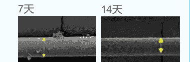

0% 5% 10%

14天皮肤含水量+83%，毛发光泽度提升。

未饲，已饲

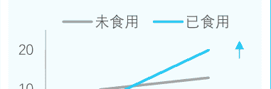

- 原料来源：所选深鳕，鳕鱼为深海生物，提取的鱼油更为纯净，腥味较少。
- 技术亮点：自研专利低温提炼工艺，在高配比的基础上再提升18%。
- 科学配方：鱼油配比藻草，提供Omega-6，含γ亚油酸，保护保湿，更美毛也更美味。

已饲

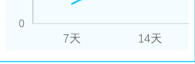

7天 14天

# 企业案例二：比乐

## 以技术与洞察铸高端宠食专家

比乐诞生于2006年，依托对宠物需求的精准把握与多年积累的深厚技术底蕴，成为“高端宠食专家”，让宠食变得更健康、更营养、更安全，更能满足宠物的需求，并让高端宠食有更多可能。

- 比乐创立于2006年，始终专注于宠物食品领域。品牌以用户需求为核心，围绕宠物全生命周期营养需求进行研究，针对宠物的不同生命阶段的基础营养和特殊需求定制了自有配方数据库，从营养到口感全面融合宠粮，切实回应宠物对营养的关键需求。
- 品牌专业研发团队与领先工艺形成高效联动，自有工厂为联动提供了硬件支撑，让“更健康、更营养、更安全、更能满足宠物口感与需求”成为品牌理念。

### 品牌概况

### 品牌故事

比乐品牌创立于2006年，致力于对宠物健康、营养、保健的研究。公司在上海成立，致力于宠物食品的研发、生产和销售，逐步建立了狗粮事业部、猫粮事业部、用品事业部、海外事业部。卓越的品质出口全球国家和地区，生产线严格按照FDA和欧盟标准制造。

- 2005年，比乐首次出口俄罗斯，开启了国际市场的开端。
- 2010年，浙江成立2.0工厂，开始构建智能工厂。
- 2014年，宣城成立4.0工厂，首创智造4.0时代，提高生产效率，行业环节可追溯。
- 2019年，上海4.0工厂，首创智造4.0时代。
- 2021年，比乐总部建立。
- 2022年，宣城工厂扩大。
- 2007年，通过了日本食品实验室检测，获得了欧盟注册（注册号：FA03），同时获得欧盟商标和出口许可，成为全球少数获得欧盟认证食品制造的企业。

数据来源：比乐官方，艾瑞咨询。©2025 iResearch.com。

# 企业案例：比乐

比乐以专业护宠，赢得消费者信任。针对老年犬提供精细化营养方案，重新定义了老年饮食的关注。

### 主要产品与竞争优势

| 主粮 | 解决方案 |
| :--- | :--- |
| 全龄段 | 初幼期 |
| 中老年 | 中老年 |
| 高老年 | 幼年期 |
| 分龄护养 | 成犬期 |
| 零食 | 老年期 |

### 行业SGS质检报告

作为宠物行业领先者，2019年3月至2025年7月，比乐产品报告已更新至最新。数据来源：比乐官方，艾瑞自主研究。©2023 iResearch, Inc.

# 企业案例三：皇家

## 以“猫宠优先”及“精准营养”铸皇家主粮专家

皇家宠物食品是宠物营养领域的全球性品牌，属于玛氏国际宠物护理部。皇家根据不同种类、体型、生命阶段，研发满足宠物营养所需的专业配方，并以线下零售、医院渠道等战略驱动业务发展。近年来，皇家在处方营养业务中处于领先地位。

- 公司概况：玛氏中国成立于1989年，玛氏护理是玛氏全球最大的宠物业务，由玛氏宠物业务单元和皇家宠物业务单元组成，共同研发包括皇家宠物食品在内的50余个宠物营养品牌。
- 品牌概况：自1968年以来，皇家宠物食品致力于为宠物量定制的猫犬营养食品。2002年，品牌被玛氏收购，此后，全球业务快速扩张。

- 代销渠道：皇家宠物食品业务专注推广精准营养，不断带来健康的宠物食品。皇家宠物食品的所有产品在法国内设计和配制，销售渠道集中在皇家医院和兽场。
- 市场表现——处方：
- 2022年皇家在猫咪处方品牌中的使用率。
- 2022年皇家在狗类处方品牌中的使用率。
- 2024年皇家处方在泌尿疾病领域的复购率。

| 时间 | 碑 |
| :--- | :--- |
| 1968年 | 针对肠胃疾病设计了大犬“黄肠”；幼犬设计的食品 |
| 1999-2002年 | 1999年，推出世界首款处方针对相同年龄的限制性（RCFI）；1997年，推出世界首款处方狗干（Royal Canin）；首款处方狗干（迷你营养粮） |
| 2003-2009年 | 2003年，推出处方营养系列（V Diet）；2009年，推出低能量粮类；2012年，推出超低能粮 |
| 2010s | 行业均值：猫78%，狗45% |

# 企业案例三：皇家

皇家处方积极满足宠物特定生理、病理状态下的营养需求。

### 主要产品与解决方案

| 定制粮 | 解决方案 |
| :--- | :--- |
| 品种定制 | 牙齿发炎/口臭等问题，采用易消化配方，方便狗狗咀嚼，添加更多多酚，守护肠胃健康 |
| 年龄定制 | 免疫力容易疲、运动后明显、心脏等问题，特别添加益生菌（含Q10），帮助老年心血管健康 |
| 功能定制 | 从老年起、关节磨损、牙石状况、无法出门，组合粮及湿粮，全方位守护 |
