## 2025年中国宠物行业市场报告

“它经济”的消费升级与市场洞察

## 免费 价值 及时 专注

## 扫码加入 知识星球TOP 免费资源群

- 每日免费获取价值资源
- 可提供各类资源搜索服务

| 热门付费文章 | 各行行业报告 |
| :--- | :--- |
| 精选图书资源 | 副业赚钱方法 |
| 职场实用资源 | AI政经自媒体 |

公众号: 知识星球TOP 微信号: jntsg8 微信号: jntsg2

分享资料仅供个人学习，请及时删除，切勿商用传播

# 目录

- 01 宏观经济环境与消费驱动因素 04
- 02 市场结构与价值链分析 13
- 03 消费者调研与渠道偏好洞察 32
- 04 2025 宠物经济：从趋势到实践，八大方向深度解析 48
- 05 宠物行业发展路径与战略解决方案 66

卷首语 03
结语 77
联系人 78

# 卷首语

2024年，随着全球经济的持续发展与人均生活水平的不断提升，我国经济总量首次超过1200万亿元，GDP同比增长5.0%左右，圆满完成年度初步设定的增速目标，实现了历史性的胜利，整体经济环境良好。消费内需对经济增长的贡献持续提升，成为经济增长的重要引擎。

在“消费升级”与“消费色彩”崛起的宏观背景下，实物消费正处于不可忽视的转型升级期，中国消费市场。2024年，我国预计中国宠物（家居）市场规模突破3000亿元，预计到2027年有望突破4000亿元。实物消费正逐步向“体验型”的角色转变，反映出中国消费市场具有足够的增长动力。与此同时，实物消费正以“价值”为核心，向商品、医疗、服务、科技等多个专业赛道倾斜，成为消费升级的主战场。

随着新一代年轻群体不断扩大，并逐渐成为消费主力军，推动消费群体结构趋年轻化、潮流化的趋势日益加强。这一群体在消费选择上更加倾向于“高性”与“功能性”产品，推动实物消费市场从“量”到“质”的转变，行业面临的持续，2025年中国市场将呈现多个不变量，主要体现在以下几个方面：消费升级与科技创新的融合、供应链与产品迭代的加速、跨界与消费的变革、“新消费”与“流市场”的融合以及经济的整合，为实物消费开启了更大的增长空间。

在此背景下，马华中国发布《2025年中国宠物市场报告》，深度解读当前市场现状。报告通过详尽的数据支撑和专业视角的深度分析，从消费者行为决策、行业发展趋势以及全球及国内市场的视角，与业内及行业人士共同探讨实物行业的趋势与发展预测。同时，马华中国在专业的服务领域为宠物行业的发展提供了至关重要的解决方案和建议，为宠物行业的发展提供了新路径并提供恰合适的指导思路。

宠物不仅是经济的“温度计”，更是情感连接的“镜像”。未来，宠物行业将迈向更加成熟与锐新的转型，为我国经济的发展注入活力。马华中国作为行业行为者与服务提供者以前瞻性的视角，我们将再次揭开这条“毛细镜”引发的消费潮。

零售及消费品行业主合伙人
马华中国
林岳森

# 宏观经济环境与消费驱动因素

## 宏观经济与消费驱动因素分析

随着社会的不断进步，人们的生活方式也趋多样化，宠物在人类生活中的地位发生了翻天覆地的变化。从最初的“工具动物”到如今的“家庭成员”，宠物与人类之间的关系延续了传统基因，被饲养的“孩子”逐渐变为一种深刻的情感。这种转变反映了现代社会在进步过程中，人们对精神慰藉和情感的强烈需求。

在节奏快的现代生活中，宠物成为了很多人排解孤独、缓解压力的重要伴侣。它们无条件的爱与陪伴，为人类提供了一种独特的情感链接。很多人将宠物视为自己的一员，无悔，甚至在经济上投入毫不犹豫来满足它们的需求。

在很长的时间里，人们更多地发现宠物的功能。例如，领养被称为“守护者”，猫则被视为“捕手”。然而，随着城市化进程的加速和生活方式的变化，宠物的功能性逐渐萎缩，却也增强了人们对陪伴和情感的渴望。

### 消费回升与助力宠物经济，强劲增长与价值影响

2024年，全球经济仍处于调整期，外部压力加大，内部复苏。中国经济和消费保持稳定，展现出韧性。2024年，中国经济面临挑战，增长20万亿元。作为“十四五”规划后的关键节点，2024年中国继续稳中求进，总量有效应对挑战，为高质量发展提供了有力。

2025年，中国经济延续稳定态势。一季度，国民经济运行平稳，GDP总量达到318万亿元，同比增长4%，与2024年第四季度相比，高质量发展显著。这一趋势得益于政策支撑，也反映了国内经济逐步增长。“十四五”规划的落实，2025年开局良好，高质量发展并呈现，为全年目标奠定了良好基础。

## “消费”复苏与转型

一系列政策下，2025年一季度消费零售总额同比增长4.3%，增速提升，消费拉动作用进一步增强，未来维持活力。当前，整体消费市场处于“修复期”，但结构性明显。宠物行业规模虽小，正成为消费领域。

图1 2014年—2025年一季度GDP及消费零售总额（单位：％）

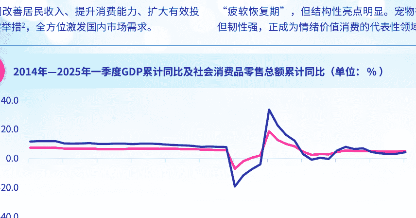

来源：国家统计局，马华分析

物价走势方面，2024年居民价格指数（CPI）同比增长0.2%，与2023年持平；2025年一季度CPI下降1%，整体物价维持稳定，通胀压力小。稳定的物价意味着消费者的购买力受显著影响，减少了通胀带来的不确定性，有助于增强消费者信心。

2025年一季度，核心CPI同比增长0.3%，其中核心CPI回升至0.6%。随着消费需求释放，结构行情有望提升，特别是在服务领域。宠物行业因其更强的刚需属性和情感价值特征，展现出增长潜力，为细分领域带来更多空间。

图2 2014年—2025年一季度居民价格指数（CPI）（单位：累计，％）

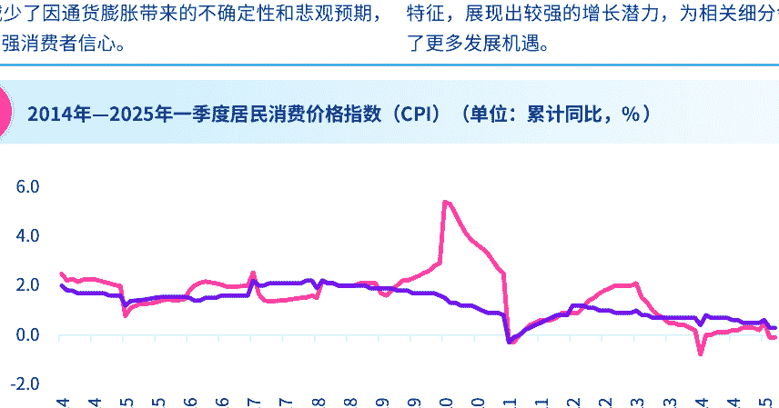

来源：国家统计局，马华分析

> © 2025 马华分析本报告特权所有。本文消费市场报告、企业会计咨询（中国）有限公司、中国注册会计事务所（香港）有限公司、香港注册会计事务所，均根据国家信息保护法有关法律成立。未经许可不得传播。

# 从宏观层面看经济：五大核心因素解析

- 经济的发展与居民消费水平密切相关
- 城镇化进程显著加速，为市场的发展注入巨大动力
- 银发经济增长带有属性，市场规模持续扩张
- 单身经济为行业发展带来新机遇
- 家庭人口结构的转变推动了对高质量物资的需求

当居民物质生活得到满足，精神需求随之增加。同时，高端消费服务（保险、医疗等）的市场渗透率将极大提高。对于一二城市，三线及以下城市市场仍处于初期，展现出更大的增长空间和潜力。

在“精细化养宠”理念的引领下，人们对宠物的态度已从“科学养”向精致化转变。随着人口增长，这一群体成为消费的重要动力。宠物作为家庭的成员，其重要性日益增加，尤其是已婚和独子家庭，物资不再匮缺，成为情感的重要依靠。

经济的发展与居民消费水平密切相关。当居民物质生活得到满足，精神需求随之增加。消费具有独特的情感和功能属性，进一步推进了市场的发展。根据国家统计局数据，2014年至2024年，我国人均GDP水平持续增长，至2024年达9.6万元，年均增长率7.2%。

城镇化进程显著加速，为市场注入动力。根据国家统计数据，我国人口城镇化率从2014年的55.8%提升至2024年的67.0%，这一进程带来了大量农村人口向一二线城市迁移，同时导致了四五线城市空巢人口数量增加。

这一基础为消费提供了支撑，促进了市场的快速发展。

然而，居民可支配收入整体呈上升，但增速放缓使得居民对未来增长的收入有所保留，这说明高端消费（保险、医疗等）的市场仍有极大提升空间。

> 8 本节介绍宏观因素对市场的影响，市场趋势分析将在第三章进一步展开。© 2025 马华分析本报告供使用——中国统计研究院。版权所有，不得传播。

## “消费”复苏与转型

一系列政策下，2025年一季度消费零售总额同比增长4.3%，增速提升，消费拉动作用进一步增强，未来维持活力。当前，整体消费市场处于“修复期”，但结构性明显。宠物行业规模虽小，正成为消费领域。

图1 2014年—2025年一季度GDP及消费零售总额（单位：％）

物价走势方面，2024年居民价格指数（CPI）同比增长0.2%，与2023年持平；2025年一季度CPI下降1%，整体物价维持稳定，通胀压力小。稳定的物价意味着消费者的购买力受显著影响，减少了通胀带来的不确定性，增强增强消费者信心。

2025年一季度，核心CPI同比增长0.3%，其中核心CPI回升至0.6%。随着消费需求释放，结构行情有望提升，特别是在服务领域。宠物行业因其更强的刚需属性和情感价值特征，展现出增长潜力，为细分领域带来更多空间。

图2 2014年—2025年一季度居民价格指数（CPI）（单位：累计，％）

来源：国家统计局，马华分析

## 银发经济驱动市场规模扩展

过去十年，我国老龄化程度显著。截至2024年，60岁及以上人数达3.1亿，占人口比例22.6%，较2023增长4.0%；65岁及以上人数达2.2亿，占人口比例15.6%，增长2.0%。我国进入中老龄化阶段，这一趋势将持续。在“优育”理念的引领下，老年群体对宠物的态度已从传统的“家养”转向更为家庭成员，追求更高品质。

图2 2014年—2024年人口老龄化趋势（单位：％）

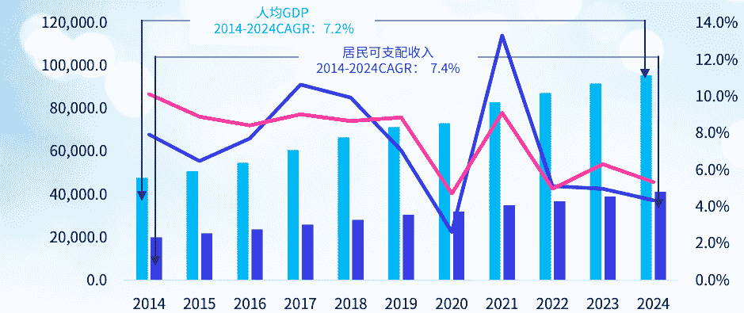

来源：国家统计局，马华分析

## 单身经济持续增长

国家统计局数据显示，近年来单身人口从286.6万增至610.6万，增长率。同时，数据显示，2019年至2023年，单身数量从6710万增至9046万，增长率7.7%。单身人口的持续增长成为市场的重要动力。

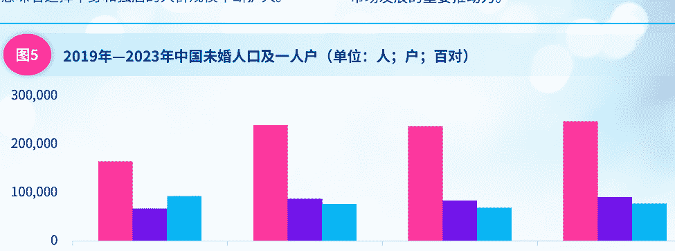

| | 2019 | 2020 | 2021 | 2022 | 2023 |
|---|---|---|---|---|---|
| 300,000 | | | | | |
| 200,000 | | | | | |
| 100,000 | | | | | |

来源：国家统计局，马华分析
数据均来自人口统计，2020年具体数据未提及。未婚人口是指15岁以上的人口中未结婚的；一人户是指家庭中只有未子女或老人户。

家庭结构的多元化孕了大机遇。如前所述，国家统计局显示2013年以来出生率下降，晚婚率持续增加，加之生育率维持，家庭结构从核心家庭向多元化转变。国家统计局数据显示，近年来我国出生率持续下降。2020年人口出生率为8.52%，下降1.96%；2021年出生率为1.09%；2023年出生率持续下降，创下1978年以来最低记录，出生率降至6.4%，全国新生人口仅有902万。其中，某一线城市上海的出生率低于3.5%，生育率为0.6%，是全球生育最低的城市之一。

受生育压力、各地生育政策落实以及家庭生活质量等因素影响，2023年新生婴儿增加了52万。这是自2017年以来出生率下降后的首次回升。然而，尽管如此数据显示，中国人口自然增长仍为0.99%，人口增长在减少。同时，城镇宠物数量较2023年增长了2.1%。在出生率持续低位的背景下，独居成为家庭结构的重要组成部分，尤其是在已婚家庭中，在某种程度上扮演着角色，填补了家庭空白，为家庭经济的重要趋势。

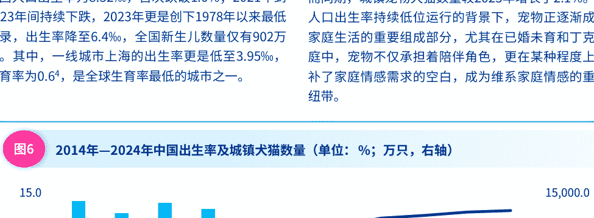

| | 2014 | 2015 | 2016 | 2017 | 2018 | 2019 | 2020 | 2021 | 2022 | 2023 | 2024 |
|---|---|---|---|---|---|---|---|---|---|---|---|
| 15,000 | | | | | | | | | | | |
| 10.0 | | | | | | | | | | | |
| 5,000 | | | | | | | | | | | |
| 0.0 | | | | | | | | | | | |

来源：国家统计局，马华分析
注：宠物数量从2017年开始

# 行业政策与监管环境

消费是拉动增长的引擎。一方面可以有效拓展、畅通市场；另一方面有利于改善民生消费。部门高度重视消费“舱石”作用，“十四五”以来为了激发活力。从消费趋势来看，财政、金融、产业等政策都要统一，加快消费的发展。通过增加居民收入，加大支持，扩大市场规模。多部门出台了《十四五》规划意见》、《关于扩大消费若干措施》等要求，促进消费持续升级。2025年3月，国务院发布的《消费专项方案》聚焦于核心任务，通过一系列政策加大需求侧，着力破解负担。从民生视角来看，将大量资金投入，宠物行业的发展。此外，地方政府也注重完善的人才培养机制，为产业提供实质保障，进一步推动宠物多样化发展。

# 2025年中国动物市场报告

表1 2024年—2025年各省市相关政策（部分）

| 主题 | 重点支持发展举措 |
| :--- | :--- |
| 消费 | 2025年2月，广东支持促进消费高质量发展，举办宠物活动，鼓励企业发布产品和服务。2025年3月，上海市《消费行动计划》支持商业文娱联动活动，举办亚洲宠物展，促进消费。 |
| 研发 | 2025年1月，广东省鼓励宠物业创新驱动，抢抓宠物市场快速发展，鼓励观赏、鱼类等宠物食品应用。2025年4月，深圳市全面支持宠物医疗器械研发，获得一、二万元的资金扶持，企业每年经费不超过500万元。 |
| 跨境电商 | 2024年7月，天津市《关于现代宠物行业发展实施方案》通知，培育宠物展会、电商商城等新兴企业。2024年12月，天津市鼓励电子商务服务，支持宠物经济产业的集群建设，培育电商商城品牌，支持各区域对跨境电商的需求。 |
| 人才 | 广州人才引进与培养，助力宠物产业发展，增强科研投入，促进服务升级，对高层次人才提供支持。 |

来源：公开信息收集，马华分析

## 推动动物行业高质量发展，实行行业规范化

图7 中国动物政策的演变

| “十一五”期间 (2001-2005) | “十二五”期间 (2011-2015) | “十四五”期间 (2021-2025) |
| :--- | :--- | :--- |
| 养殖规范开始，养殖需要遵循监管、年检制度 | 开始规范分销行业发展，从事动物医疗的机构需向主管部门申请许可证 | 逐步规范宠物食品、医药、用品等行业标准，为行业提供持续支持政策，培育宠物的消费增长点 |

| “六五”至“九五”期间 (1981-2000) | “十一五”期间 (2006-2010) | “十三五”期间 (2016-2020) |
| :--- | :--- | :--- |
| 养殖政策较为严格，明确部分地区禁止养殖 | 对养殖政策进行总量提升，明确养殖登记、活动管理等事项 | 统一宠物食品、用品行业标准，鼓励宠物饲料行业发展 |

来源：资料收集，马华分析

## 市场结构与价值链分析

© 2025 华诚会计师事务所（特殊普通）—中国联合会计师事务所有限公司、毕马会计师事务所（中国）—中国注册会计师事务所、毕马会计师事务所—厦门门殊行政区会计师事务所、毕马会计师事务所—重庆特殊地区会计师事务所。均为毕马与毕马国际集团有限公司通过相关协议建立的全球网络成员机构。保留所有权利，并在注册

## “它经济”的消费升级与市场洞察

宠物行业的成熟与繁荣，是社会经济和消费水平的重要缩影。以发达国家为例，宠物行业已拥有多年的历史积累，通过长期的市场变化，形成了完整多元化的供应链体系，涵盖宠物食品、医疗、服务、培训、保险等领域，能够全面满足宠物生命周期的需求。根据Euromonitor披露的数据，全球宠物产品零售市场（不含宠物食品）在2024年的规模为2,070亿美元，预计将以5.5%的年复合增长率增长至2029年的2,708亿美元，宠物经济发展趋势强劲。

全球宠物食品市场持续增长，国家收入排名彰显经济基础和行业成熟态度

宠物食品作为饲养的刚性需求，是宠物行业中非常重要的细分领域。根据Statista测算，全球宠物食品2024年的市场规模为1,511.1亿美元，预计将以5.5%的年复合增长率持续增长，到2030年将突破2,098.7亿美元。

### 图8 2018—2029年全球宠物食品市场领域收入（单位：亿美元）

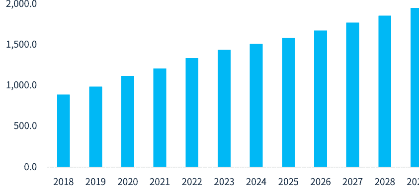

来源：Statista，华马数据分析

© 2025 华马会计师事务所（特许会计师协会）——中国合伙会计师事务所，华马企业会计事务所（中国）有限公司——中国有限责任公司，华马统计会计师事务所——澳门特别地区合伙会计师事务所，华马会计师事务所—香港地区合伙会计师事务所，与华马国际有限公司国际保险有限公司相关的成立独立法律实体的成员，版权所有。在中国

根据Statista数据，2024年美国597.4亿美元的宠物食品销售额位居全球首位，占TOP20销售额的45.5%；中国以82.0亿美元的销售额位居第二，约为美国宠物食品销售额的七分之一。注意的是，中国与美国在宠物食品市场规模上的差异，远大于两国GDP的差异。这说明宠物产业的成熟度、行业监管的完善程度以及国民消费观念等因素，是宠物食品行业发展的重要因素。

### 图9 2024年全球Top15宠物食品收入（单位：亿美元）

| 国家 | 收入 |
|---|---|
| 美国 | 597.4 |
| 中国 | 82.0 |
| 英国 | 74.6 |
| 巴西 | 68.8 |
| 德国 | 58.6 |
| 法国 | 51.2 |
| 土耳其 | 49.0 |
| 日本 | 46.9 |
| 意大利 | 39.2 |
| 加拿大 | 38.8 |
| 澳大利亚 | 30.6 |
| 墨西哥 | 26.0 |
| 西班牙 | 21.3 |
| 印度尼西亚 | 20.0 |
| 俄罗斯 | 19.9 |

来源：Statista，华马行威分析

### 全球宠物食品市场趋势持续增长

在美国，宠物文化非常盛行，家庭宠物渗透率极高，宠物被视为家庭成员之一，人们非常重视宠物的生活质量，因此形成了美国大类丰富的宠物消费市场。根据美国宠物用品协会（APPA）最新数据，截至2025年，美国家庭宠物数量将达到1.49亿，其中数量最多的狗和猫分别达到6800万和4900万，水类、爬类、小型动物也具有较大的规模。

作为全球宠物饲养数量最多、消费能力最强的国家，美国宠物食品行业呈现出的市场规模和成熟的产业结构。根据美国宠物用品协会（APPA）预测，美国宠物食品的销售额将增长3.3%；预计到2025年美国宠物食品销售额将保持增长态势，预计增长到1570亿美元，美国宠物行业将进入一个更快速的阶段。

### 2018年—2025年美国宠物行业消费总支出（单位：亿美元）

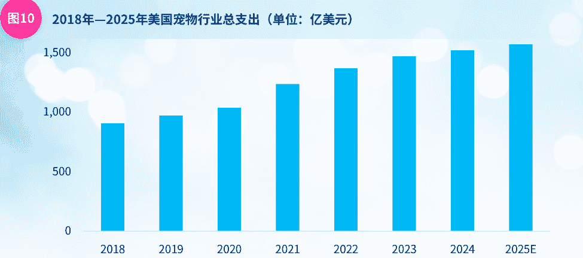

来源：美国宠物用品协会（APPA），毕马威分析

预计到2025年，随着人类对宠物品质生活需求的不断提升，宠物医疗护理和产品等传统的支出项目的市场份额将面临来自宠物用品、活宠物、非处方药以及其他新兴领域（如智能设备、宠物保险、宠物美容）的竞争压力，市场份额将调整，变化不大。

### 图11 2024年—第一季度美国行业消费结构（单位：%）

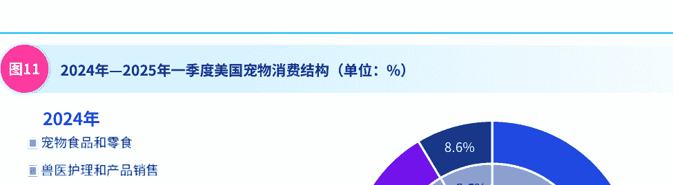

- 2024年
- 宠物食品和零食
- 宠物医疗护理和产品
- 宠物用品、活宠物和处方药
- 其他服务
- 2025年Q1
- 宠物食品和零食
- 宠物医疗护理和产品
- 宠物用品、活宠物和处方药
- 其他服务

来源：美国宠物用品协会（APPA），毕马威分析注：内含2024年数据，外为2025年预测。

# 2025年中国宠物行业报告

作为亚洲发达国家之一，其宠物行业发展已成熟。当前，日本宠物行业处于快速发展阶段，市场规模稳步扩大。根据Statista数据，日本宠物相关业务市场规模在2022年已达到122亿美元，预计在2026年将达到126亿美元，年复合增长率为2.8%。此外，截至2023年，日本宠物家庭渗透率为40.0%，是我国的两倍余。

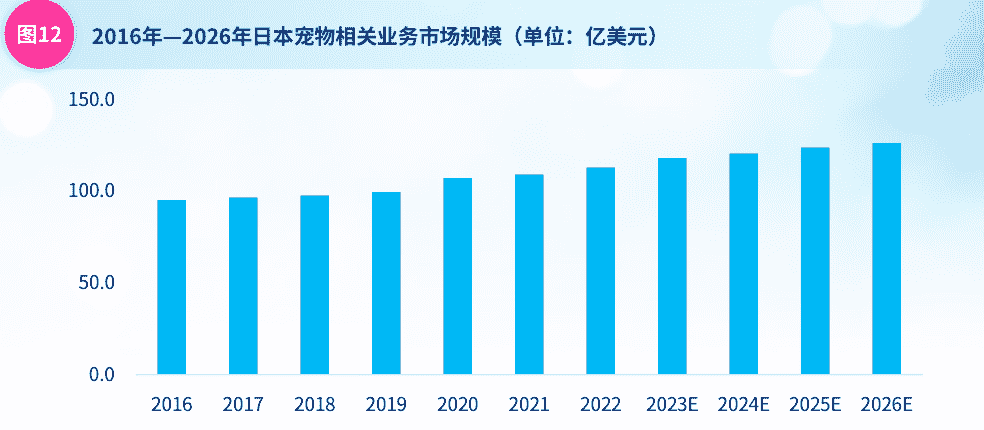

来源：Statista，华马分析

随着东南亚地区庞大的人口和快速城市化进程推动，饲养文化兴起、人口结构优化以及经济稳步发展的多重因素，东南亚地区的宠物行业迎来蓬勃发展的黄金期。根据《2025年东南亚宠物行业白皮书》，东南亚宠物行业市场规模在2022年为32亿美元，预计在2030年将达到20亿美元，期间复合增长率高达24.7%，是全球增长最快的市场之一。

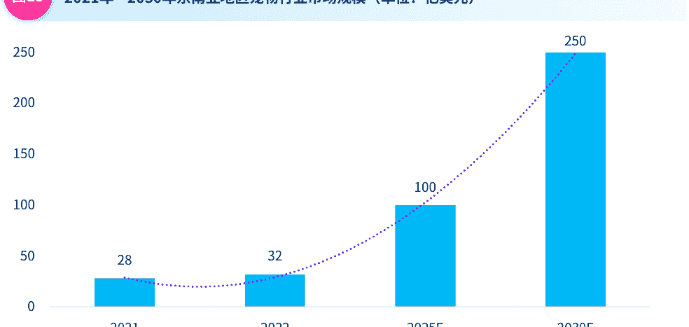 （注：此处为逻辑对应）

### 国内宠物行业发展概况

中国宠物行业起步时间相比发达国家确实晚，但凭借世界最大的中产阶级群体，已具备宠物行业发展的完善条件。居民收入增长，消费观念持续转变，人们对宠物的需求日益增长，宠物也从最初的看护防范等功能性转向情感需求本身。在行业经营上，多类行业协会相继成立，监管和政策逐步到位，消费者的权益得到保障。宠物行业向更加规范，在技术方面预计在未来五年内以5.8%的复合年增长率持续增长，最终达到57亿。巨大的宠物基数及其持续增长的趋势，基于电子商务的成熟发展，让各种宠物产品变得触手可及。同时，社交媒体的影响促进了宠传播和相关知识的推广，使得宠物具有更多的社交属性，进一步提升了宠物的价值内涵。

### 中国宠物相关业务市场规模稳步提升，中国经济前景良好

近年来，中国宠物相关业务市场规模呈现良好增长趋势。根据Statista数据，2015年中国宠物市场规模随着社会升级和宠物产业生态日益完善，中国宠物市场进入高速增长，2023年已突破5928亿，复合增长率高达25.4%。预计到2025年，中国宠物市场规模将一步步升至8114亿。

Statista的数据显示，中国宠物数量在2024年中国宠物相关业务的市场（单位：人民币）

| | 10,000 |
| 8,000 |
| 6,000 |
| 4,000 |
| 2,000 |
| 2015 | 2016 | 2017 | 2018 | 2019 | 2020 | 2021 | 2022 | 2023 | 2024 | 2025 |

来源：华马分析

© 2025 华马行业咨询报告中国宠物行业快讯—中国宠物行业行业咨询报告、华马咨询企业（中国）有限公司—中国有限责任公司—华马会计师事务所—香港地区合制会计师报告、华马会计师事务所—香港特区合制会计师报告，均为华马国际有限公司国家集团保险保护物权利的设立成立的。

## 2023年中国宠物行业市场报告

从行业细分来看，中国宠物行业呈现出明显的结构性特征。根据Statista发布的2023年统计数据显示，宠物食品作为品类，占据了最大的市场份额，达到了52.2%，宠物主粮和零食等消费是宠物行业的核心驱动力。与此同时，宠物医疗作为两大细分领域之一，凸出人们对宠物健康和医疗保障的高度重视，这一趋势反映了“宠物化”趋势。在其他细分中，宠物用品占据12.5%的市场份额第三，养宠者对生活品质的追求不可忽视，玩具、垫、服装等多样化产品的需求持续增长。然而，宠物用品占比相对小，但市场潜力逐步释放。

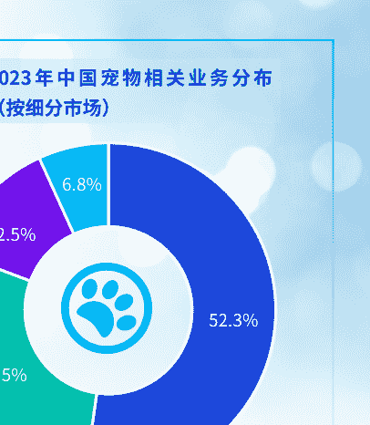

### 新增企业数量爆发，行业趋于成熟

在宠物经济发展的背景下，中国宠物行业快速扩张，特别是在企业数量方面呈现显著增长。根据Statista数据，中国新注册的宠物相关业务的企业从2014年的2.5万增加到2023年的18.5万。注意的是，2023年相关企业数量接近六倍，行业已进入一个快速增长阶段。

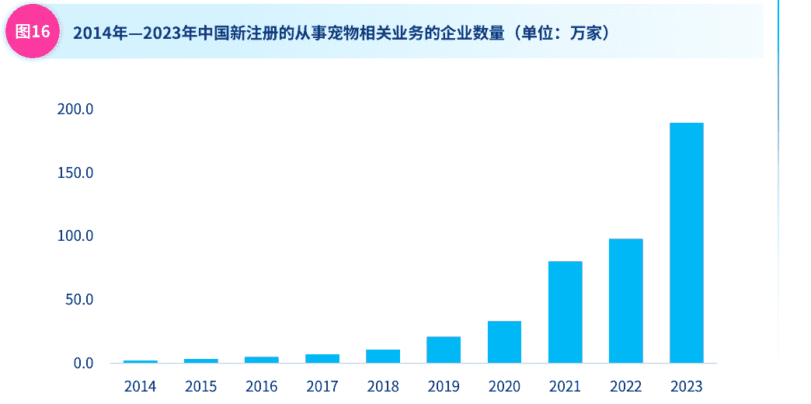

来源：Statista，毕马威分析©2025 毕马威行业报告数据来源：中国联合会计师事务所，宠物统计事务所（中国）有限责任公司，毕马威会计师事务所—厦门地区合伙会计师事务所，由宠物统计事务所，与宠物用品相关的业务成立成为行业报告。

## 自品牌推动宠物食品高质量发展

中国本土宠物企业最初是以OEM/ODM模式为国外品牌提供代工服务的。随着宠物行业的发展以及外部环境的变化，国内企业凭借代工积累的经验以及不断的研发投入，逐步成长为具有竞争力的自品牌。这一转型不仅提升了国内企业的竞争力，为自品牌的崛起奠定了坚实基础。根据Statista数据，2023年中国宠物食品市场表现良好，全年收入总额达1900亿元，预计2028年将达到3800亿元，期间复合增长率为14.9%，宠物经济持续增长。

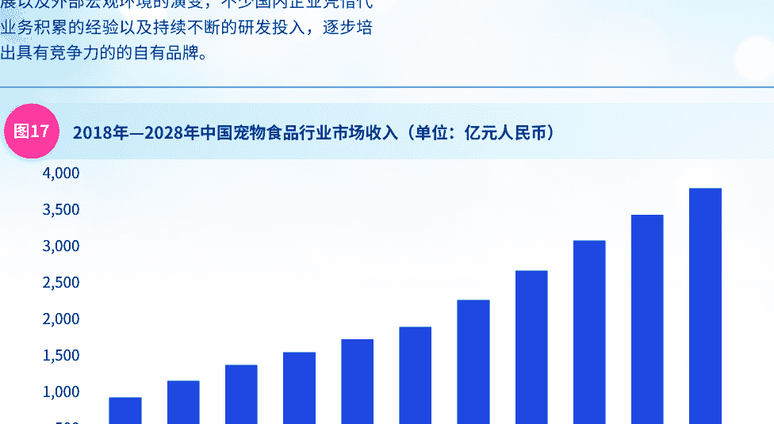

来源：Statista,华马资讯

### 宠物用品智能化稳定发展、利润增长

近年来，中国宠物用品市场也在持续增长。Statista数据显示，宠物用品市场规模从2018年的214.9亿元增加到2023年的407亿元，期间复合增长率为13.6%，预计2025年市场规模将达到484亿元，2023-2025年复合增长率为9.1%。

作为宠物用品市场的重要细分领域，智能宠物用品的增长速度令人瞩目，市场规模从2018年的31.5亿元增长到2024年的69.9亿元。尽管目前智能宠物用品的市场渗透率较低，消费者对智能化、便利化宠物用品的需求不断提升，为这一细分市场的发展注入了强劲动力。随着越来越多的品牌加入智能宠物用品的阵列，市场竞争的加剧推动了这一细分市场的快速成熟。

### 图18 2018—2025年中国宠物用品市场规模&智能宠物用品规模（单位：亿元）

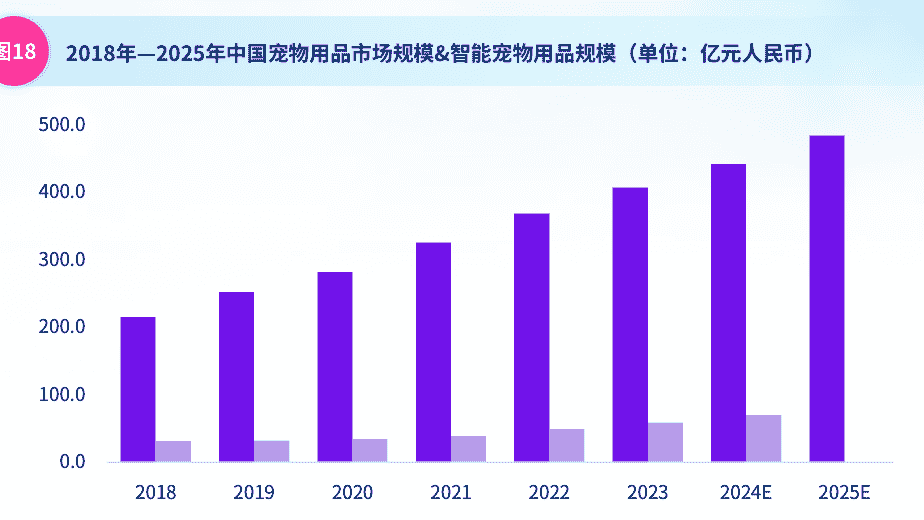

■ 宠物用品 ■ 智能宠物用品

来源：Statista，毕马威分析注：2025年智能宠物用品市场规模未披露。充分的竞争为消费者提供了更多的选择，也让相关产品的价格平民化，达到普及化的条件。乐观来看，未来智能宠物用品市场将迎来更大的发展空间。随着消费者对智能产品的接受度不断提高，部分智能宠物用品有望逐步替代传统宠物用品，成为现代宠物的标配。这一趋势意味着宠物用品行业的升级迭代，反映了宠物经济向智能化、科技化的发展趋势。

## 宠物健康受重视，专业机构加速布局

随着城市化进程的加速以及消费升级的不断深入，养宠人的科学营养与健康管理意识显著增强，宠物的健康需求随之升级。作为宠物健康的重要领域，宠物医药具有其高技术壁垒、市场迫需求以及独特的消费属性，成为推动宠物行业向高层次发展的核心动力。

根据沙利文的预测，2024年宠物医药市场规模为209.5亿元，预计2025年增长至354亿元，复合增长率为10.4%，进入高速发展阶段。

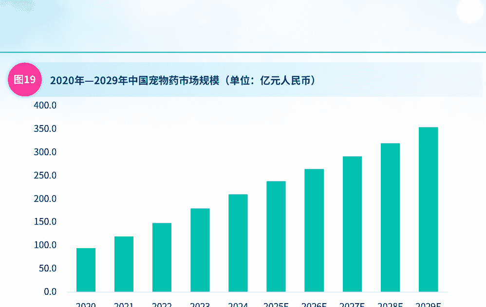

来源：沙利文，毕马威分析

## 市场格局与价值分析

宠物食品的上游以原材料为主，负责生产所需的材料；下游涵盖品牌、零售及线上平台等终端连接。由于原料依赖外部采购，价格波动对生产带来直接影响。因此企业需采取一系列措施，积极开发供应商、优化采购流程，从而降低成本和潜在风险。在国内宠物行业中，很多企业最初是以OEM/ODM模式起步，为国外品牌提供代工服务。随着行业的发展，目前大部分企业逐渐转向品牌开发，消费者对产品品质认同感不断提升，加大对自品牌的投入，预计收入中的比例逐步提高。在销售市场中，线上和线下渠道均占主导地位。根据Euromonitor的数据，线下渠道占了68.3%。

| 上游 | 中游 | 下游 |
|---|---|---|
| 农产品供应 | 宠物主粮制造 | 品牌运营 |
| 其他营养品供应 | 宠物零食制造 | 线上销售 |
| | 功能性食品制造 | 线下零售 |

来源：毕马威分析

### 资本加码，促进宠物医疗行业发展

宠物健康行业由多个环节构成，中上游由宠物医疗检测设备和器械的生产商以及宠物疫苗、药物、耗材的生产商构成。宠物医疗机构位于产业链的下游，直接面向消费者的终端服务方。目前，各宠物医疗机构竞争愈发激烈，尤其是在市场中程度较低的区域。然而，随着行业整合的加速，领先宠物医疗连锁机构正加紧进行规模化，通过开设门店和品牌加盟推动行业稳步增长。随着宠物医疗行业连锁化速度提升，连锁宠物医疗机构有望将效率不断提高。这不仅有助于宠物医疗服务的标准化进程，还能有效降低医疗服务成本，推动宠物健康行业向规范化、高效化和持续发展。

### 图22 宠物医疗产业链图

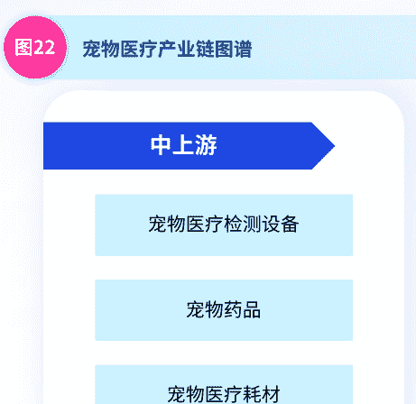

来源：华马数据分析

### 宠物服务渗透率不断提高，行业亟需“宠物+”共赢整合

宠物服务机构处于产业链下游，主要为消费者提供一体式服务。完全的宠物服务市场尚待开发。宠物服务机构涵盖宠物医疗、宠物寄养和宠物日常用品零售，旨在满足消费者在不同场景下的多样化需求。宠物服务市场上的游由同类机构组成：第一类是宠物服务经营日常服务的制造商（如工厂等）；第二类是宠物实体的运营单位，如宠物医院和代理商构成的零售网络。

在销售渠道中，流通主要依赖宠物企业、动物医院以及贸易渠道。这些渠道通过线下门店为消费者提供产品，还通过线上销售应对日益增长的互联网渠道。根据Euromonitor的数据，由于宠物用品在销售领域具有天然优势，2024年宠物销售仍由线下渠道为主，贡献了销售额中的52.8%，但线上渠道的快速发展为行业带来了新的增长机。

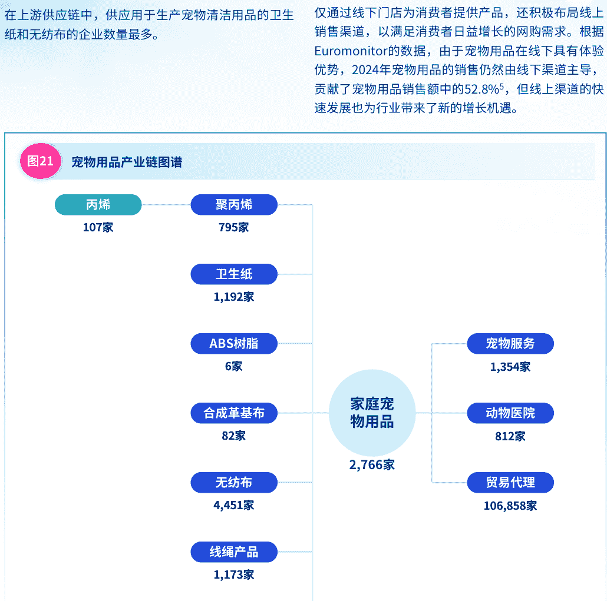

来源：远

# 投融资及二级市场动态简析

## 一级市场行业投资分析：细分赛道、区域分布与海外布局

根据CV数据显示，截至2025年第一季度，宠物行业发生634次PEVC融资事件。从细分赛道来看，宠物线上白牌赛道占比最高，共发生173次PEVC事件，占比27.3%，其次是宠物医疗和宠物用品，分别为160起和121起，占比25.2%和19.1%。

此外，沃尔食品、宠物与宠物交易等赛道合计占比28.3%。涉及的细分领域包括宠物供应链企业服务平台、传统宠物食品消费及零售业务、医疗医药、电子商务平台、文娱用品供应商、人工智能大数据、信息化化企业、宠物金融类等多个行业。

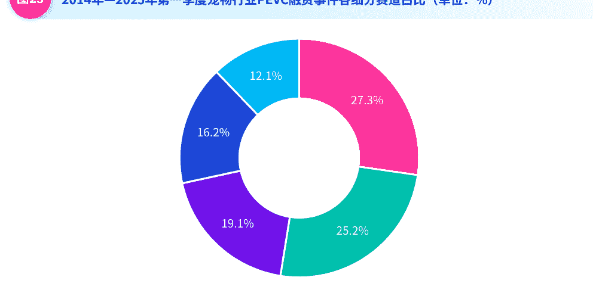

- 宠物线上白牌
- 宠物医疗
- 宠物用品
- 宠物食品
- 宠物服务与流交易

来源：CV Source，华孚分析

## 2025年中国物业行业市场报告

从近些趋势来看，物业行业融资事件呈现领先高后回落的态势，大抵可以分为增速增长期，繁荣发展期，资本冷静期。2014年至2018年属于增速增长期，期间共发生289起PEVC融资事件，其中，2014年的融资事件25起，到2018年达到81起，年均复合增长率为34.2%。

2019至2021年物业资本活跃较高，物业行业持续受到投资者青睐，年均融资事件数量保持在70起以上，三年共发生217起融资事件，占样本总量的75.5%。2022年后，融资事件数量显著减少，2024年仅为8起，跌破十年以前。截至2025年第一季度，业内发生66起融资事件，预计物业资本数量将维持低位或实现微幅回升。

### 图24 2025年第一季度物业PEVC融资事件数量（单位：起）

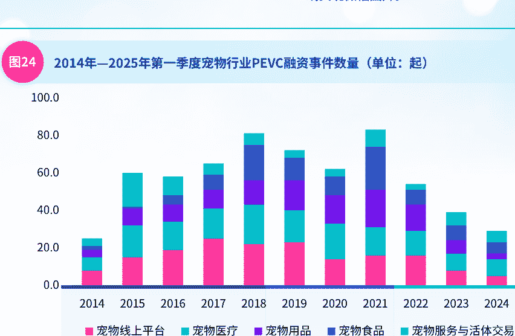

#### 快速发展期

以“物业线上平台”为主赛道，2016年至2018年期间，融资事件数量持续保持在约20起左右。重点权重关注大型项目型，且垂直物业服务与线下交易的融资活跃度达到了近十年新值。

各赛道均受到资本青睐，物业市场呈现一片繁荣景象。其中，医疗、物业食品和用品等刚需表现尤为突出，占据大比例。

#### 资本冷静期

整体行业进入调整期，医疗领域表现相对稳定，保持较高活跃度。“线上平台”赛道的融资活跃度回落，而垂直物业服务与线下交易的融资活跃度在2024年后出现小幅回升，反映出市场对相关的关注的提升。

来源：CV Source，华尔街分析

融资金额，在2014年至2017年，物业行业融资金额大多在万亿元级；从2018年开始，千万级的融资事件数量超过了百亿，占据主力地位并持续增长；而亿元级融资，从2015年后开始持续出现。

然而物业行业融资事件在2021年后便开始减少，且融资金额的总规模有所缩减，但从结构来看，亿元级的融资事件占比占据绝对大部分，并在两年内仅有5次出现。目前行业内能够发展的企业尚未出现，这些企业能够

b 时间在2014年至2025年第一季度的物业PEVC融资数据基础

27 2025年中国物业行业市场报告 来源：华尔街咨询有限公司*华尔街咨询有限公司（中国）国家注册公司有限公司*华尔街咨询有限公司-酒店及物业行业报告快速服务报告*华尔街咨询有限公司（香港）行业咨询协会注册事务所*华尔街咨询有限公司（国家注册公司（香港）注册事务所）信息，版权所有，未经转载。

### 图25 2014—2025年第一季度物业行业融资金额级别PEVC数量分布（单位：起）

| | 2025Q1 | 2024 | 2023 | 2022 | 2021 | 2020 | 2019 | 2018 | 2017 | 2016 | 2015 | 2014 |
|---|---|---|---|---|---|---|---|---|---|---|---|---|
| 十万 | | | | | | | | | | | | |
| 百万 | | | | | | | | | | | | |
| 亿元 | | | | | | | | | | | | |

来源：CV Source，华募浦分析
注：统计范围不包括未披露的具体金额及未明确金额单位的债券。

从地区分布来看，长江下游的行业融资活动最为活跃。2014年至2025年第一季度，该地区融资案件有241起，占全国的42.1%（未披露地区除外），累计金额超过24亿元。华地区融资规模最大，累计金额达31亿元。华南地区（含香港澳大湾区）共有95起融资案例，涉及金额21亿元。其中，香港行政区完成了一笔500万元的融资。此外，华地区和西部地区完成了25起融资案例，累计金额为7.6亿元和500万元。

### 图26 2014—2025年第一季度物业行业PEVC金额分布（单位：亿元）

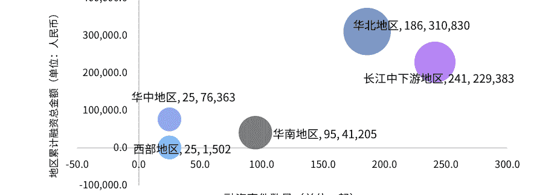

来源：CV Source，华募浦分析
注：统计范围不包括未披露的具体金额及未明确金额。

## 2025年中国宠物行业市场报告

从具体省来看，宠物行业的融资项目主要集中在上海、北京和广东，规模最大。其中上海有36起融资事件列第一，北京列第二，两地的主要渠道中，线上平台占大比例，其次就是线下交易。此外，北京、天津等地的宠物较为活跃，分别有30起和18起，显示出宠物企业聚集较高。值得注意的是，融资数量不及上海，因为2020年资本对某食品企业的一笔13亿元投资，使其总资金达到了17亿元，成为全国第一，超过其他省。

### 2014—2025年第一季度宠物行业融资分布（单位：亿元）

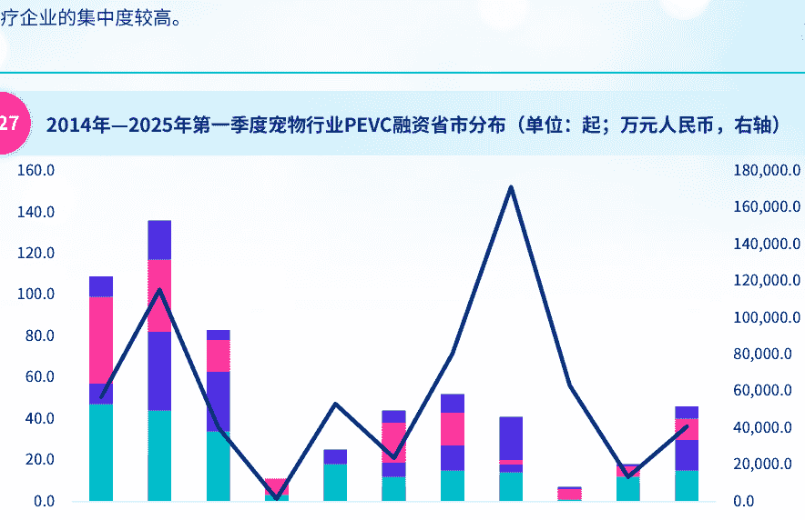

来源：CV Source，华马威分析
注：统计范围不包括未披露金额。2.其他省包括吉林、四川、内蒙古、江苏、江西、辽宁、陕西、安徽以及香港行政区。

## 消费升级与市场

海外市场方面，美洲地区占比高达56.7%，超过海外的一半，主要包括美国、开曼群岛和加拿大。其中，美国贡献了11起融资事件，主要集中在食物领域、医疗服务领域；开曼群岛吸引了许多企业进入，其融资规模为13.9亿，主要集中在购物平台；加拿大贡献了4.6亿元的融资。欧洲地区占比40.0%，主要分布在英国、波兰和瑞典等地。其中，瑞典的一起融资事件规模达2.4亿，涉及宠物医疗服务商。

### 图28 2014年—2025年第一季度海外宠物融资分布（单位：%）

| 美洲地区 | 欧洲地区 | |
| --- | --- | --- |
| 美国, 36.7% | 美国, 30.0% | |
| 开曼群岛, 16.7% | 波兰, 6.7% | 瑞典, 3.3% |
| 加拿大, 3.3% | 印度, 3.3% | |

来源：CV Source，毕马威数据分析
注：1.统计范围不包括未披露地区。2.海外市场融资规模以人民币计算，按照前一年相同外币兑人民币的平均汇率计算。

## 宠物行业二级市场表现优异，持续

与一级市场相比，宠物行业二级市场的表现更令人一新。2024年9月24日，在美联储降息、行业调整利好以及推出一系列增加市场流动性的影响下，A股市场以及相关性较高的港股市场迎来全面反弹。在经历了长期的非理性上涨后，部分股票遭遇透支涨幅，最高点落在10月8日，而宠物行业并没有在经历一次大浪淘沙中消失，而是在投资者退出后的回落后，股价表现创新高。

根据Wind数据进行分析，当前涉及宠物业务的上市公司共有25家，其中宠物用品企业12家，宠物医药企业7家，其中5家宠物食品企业和1家电商运营企业。其中，宠物食品板块的表现最优，涨幅超过80.0%；宠物用品板块表现优第二，涨幅超过10.0%；宠物医药二级市场表现平稳，涨幅仅1%，这可能与行业尚处于发展初期，叠加短期业绩压力、缺乏龙头企业以及市场估值较高等因素有关，但整体表现优于深300（-8.6%）。

### 图29 2024年10月-2025年5月宠物行业各分板块同期表现

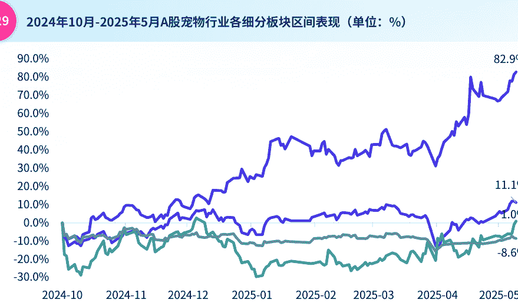

- 宠物用品
- 宠物医药
- 宠物食品
- 深沪300

来源：Wind，华美财富分析
注：1. 基于2025年3月31日的总市值，按各分领域企业市值权重，并计算2024年10日至2025年5月的涨幅。2.电商运营板块仅有一家企业，不具备代表性，未纳入。

## 消费者调研与渠道偏好洞察

随着经济快速发展和生活水平显著提升，宠物逐渐成为一种时尚方式。越来越多年轻人将宠物视为成员，对宠物的健康、教育和福利投入越来越高，这种趋势体现了人们对精神需求的重视。随着观念转变，养宠群体呈现明显的年轻化、高质化趋势。养宠行为向多元化发展，为市场带来了新机遇。随着宠物市场的发展，我国宠物数量从高速增长到稳步增长。2024年，城镇猫数量达到2.2亿，较去年增长1%。从养宠爱好来看，狗和猫占据主导地位，分别占城镇57%和64.3%。注意的是，自2019年起，三线及以下城市宠物人群占比回升（增幅30%），甚至超过了一线城市，这表明下沉市场并非线性下降，而是受到多重因素影响，包括后期需求的增加、社交活跃的反弹以及下沉市场电商的快速发展。以头部电商平台为例，2024年宠物行业的商品交易总额同比增长53.0%，其中食品和营养品是最受欢迎的类别，这进一步证明了下沉市场的巨大潜力。

## 宠物经济在城市中的分布与发展：二线城市主导，下沉市场活跃

从城市等级来看，二线城市一直是宠物经济的核心区域。由于生活节奏快、社会压力大，“吸宠”成为人们缓解压力的方式。数据显示，2020年至2024年间，二线城市的宠物占比稳定在7%以上，二线城市表现尤为突出，年增长率高达4%；而一线城市在2022年至2024年间实现了8.7%的年增长率。相比之下，三线及以下城市属于价格较为敏感的市场，近来的波动主要由于外部环境变化引起。注意的是，2023年三线及以下城市宠物人群占比回升（增幅30%），甚至超过了一线城市。

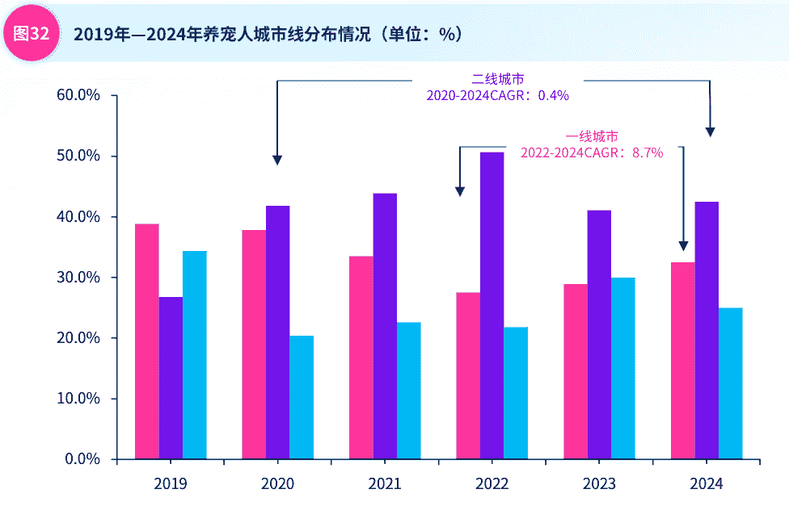

来源：宠物行业大数据，华马分析

## 90后与00后引领宠物市场升级：主力消费群体占比超六成

从消费群体来看，当前宠物市场的主力消费群体主要由90后和00后构成。从2019年后已经是主流群体，尽管在2022年后有所回落，但2024年占养宠群体的41.2%，而00后作为新增力量，占比比例提升至25.6%，表现出明显的增长势头。年轻消费者因为更加注重宠物的生活质量与个性化需求，愿意在宠物周围消费，如医疗、美容、IP名等投入更多资金，从而推动宠物消费观念升级。截至2024年，90后和00后合计占比67.7%的市场份额，预计持续延续宠物消费市场。此外，老年群体在宠物人群中的比例逐渐减少，他们易于复购且具有情感功能的宠物产品存在一定需求，为企业提供了新的市场机遇。

### 2019—2024年养宠人年龄结构（单位：%）

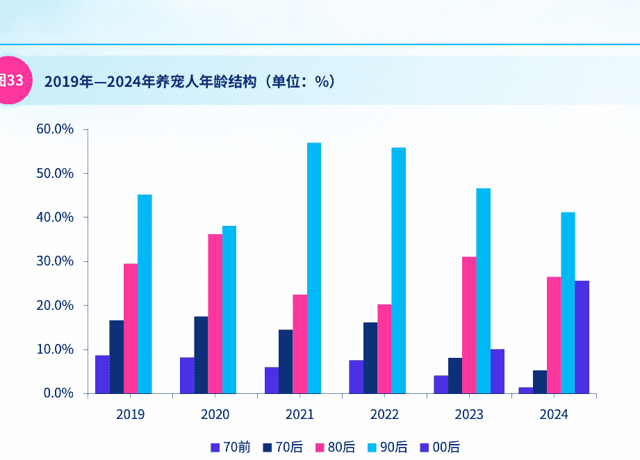

来源：宠物行业大数据，华马分析

## 高学历与高收入人群引领消费

从学历来看，养宠人口中大专以上占比23.6%，而2024年达到25.5%，远高于平均水平。由于高学历普遍具有晚婚、单身时间长、收入充足的特点，更愿意在宠物身上投入情感，并在消费方面表现出更高的能力。从收入水平来看，养宠人经济实力不断增强。2024年月收入4000元以下的群体占比减少了2.7%，而月收入10000元以上的群体增加了6.6个百分点，其中月收入15000元以上的群体规模明显，提升了5.6个百分点。未来，随着老龄化、高收入人群有望迎来更广的发展。

### 图34 2019—2024年养宠人学历分布（单位：%）

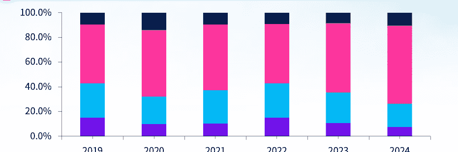

来源：宠物行业大数据，华马分析

## 社交媒体重塑养宠决策

社交媒体正在改变养宠的传播方式。抖音为例，以“内容+电商”为核心模式，通过短视频和直播实现流量转化，内容成为宠物消费的重要动力。短视频平台和小红书是养宠人选择最多的平台，占比分别为73.5%和66.1%。其次是微博和电商平台，占比分别为41.2%和29.3%。具体来看，短视频平台、小红书和微博是养宠人的核心触点。

| 短视频平台 | 小红书 | 微博 |
| --- | --- | --- |
| 2022年、2024年短视频依然是养宠人选择最多的平台 | 73.5% | 66.1% | 41.2% |

根据抖音发布的《萌宠流量清单》，2023年内内容与直播带动的成交同比增长67.0%。根据《2024年宠物行业调查报告》，超过52.0%的用户表示在小红书搜索过宠物产品和服务，其中小红书搜索后的种草热最高。89.0%的消费者向电商平台购买，41.0%的用户则到线下购买，一个月内全域转化率达91.0%。

| 电商平台 | 电视广告 | 网页广告 | 其他 |
| | | | |

来源：读懂电商、麦瑞分析

## 2025年中国行业市场报告

注意的是，无论是2022年还是2024年，不同年龄段的养宠人对短视频偏好度普遍较高。具体来说，80后对微博的关注度偏低，90后对小红书的关注度相对持续保持在50.0%左右。进入2024年，不同年龄段的养宠人短视频偏好度进一步提升，均达到了70.0%左右。

其中，小红书作为新兴平台，表现突出。2024年00后和90后对小红书的偏好度较高，占比69.5%。此外，值得注意的是2024年80后和80前对电商平台广告的偏好度较高，分别为32.0%和26.3%。这一数据反映出不同年龄段养宠人在选择平台上的差异化特征，同时也体现了短视频平台和电商平台在宠物行业中的重要地位。

### 图36 2022年、2024年不同年龄段养人偏好（单位：%）

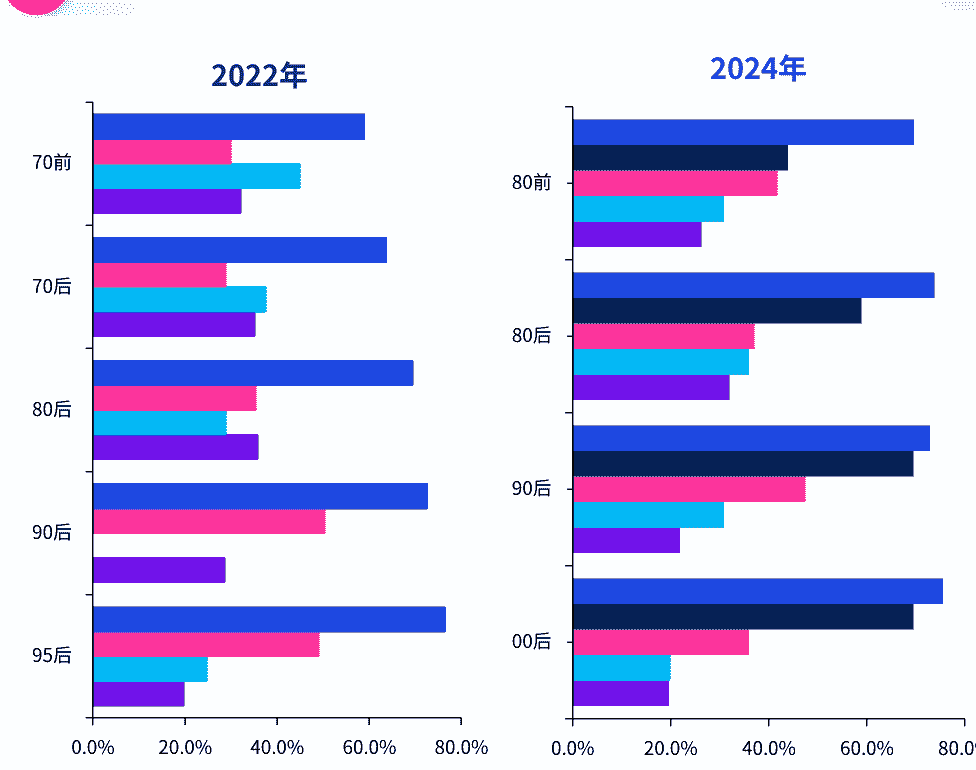

- 短视频平台
- 小红书
- 微博
- 电商广告

来源：宠物行业大数据，华马分析
注：题目为多选，数据之超过100%

## “它经济”的趋势与宠物市场

值得注意的是，近年来新兴的电商平台展现出强劲增长潜力。2024年宠物类全平台销售额达502.31亿元，同比增长10.0%。其中，天猫有286亿元的销售额位居第一，同比增长10.0%。京东以106亿元的销售额位居第二，同比增长5.0%。抖音则销售额达110亿元。这一趋势与抖音在2023年5月发布的“宠宠清单”报告显示，2024年“双十一”期间，宠物的商品商家和数量在增加。

在品牌方面，竞争是养宠人最为关注的因素，在2024年表现尤为明显。相比2022年，养性宠物占比虽然有所下降，但占比仍超过50.0%。同时，消费者对品牌信誉和品牌标识方面的关注也所增加，分别增加了6.3个百分点和7.8个百分点。养宠人不再仅仅关注产品的技术细节，而是在这方面，亲友推荐、宠物店/宠物医院推荐以及宠品牌的占比均有所增加，口碑传播和专业推荐在养宠人决策过程中扮演了越来越重要的角色。值得注意的是，2024年消费者对品牌的创新产品有了新的需求，尤其在满足宠物个性化需求方面，创新的产品更易接受。

## 作为宠物的必需品，具有很高的品牌属性和粘性

随着流量化观念的普及以及企业的加入，养宠人比以往更注重选择适合自家的主粮品牌，而由于更换需要宠物事物引起，宠物奢侈品相比宠物食品等必需品更具品牌忠诚度。

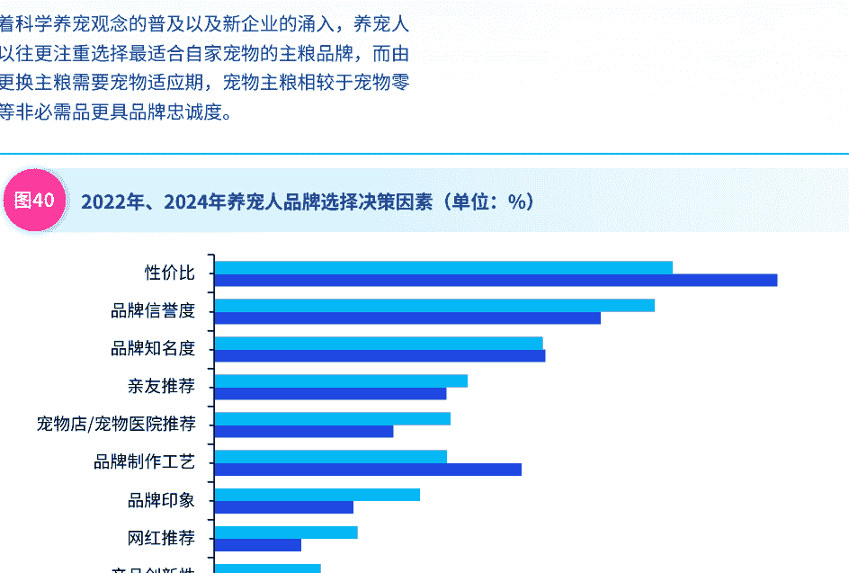

来源：读懂宠物行业大数据，艾马浦分析

注：多项选择，数据之和超过100%

## 养老年人在选择产品时更加注重产品的实际效果和透明度

在消费需求和行为日益多元化的当下，养老年人的消费决策路径增加，从决策因素来看，营养配比、组成和品牌知名度仍然是老年人在选择产品时关注的核心因素，占比59.3%、49.2%和29.0%。

值得注意的是，与2023年相比，养老年人对口感性、口碑值、成分可追溯性和具有特殊功能的关注度有所提升，占比25.0%、24.6%、15.2%和14.7%。反映了养老年人在选择产品时更加注重产品的实际效果和透明度。

### 图41 2019—2024年养老年人购买消费决策因素（单位：%）

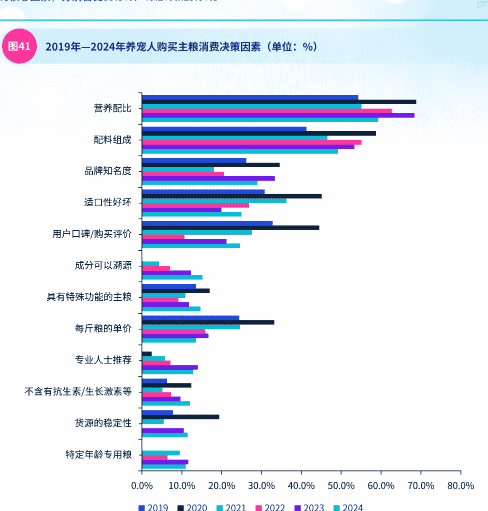

来源：派诺孚行业数据、麦肯锡分析

注：题目为多选，数据和超过100%

## 消费理念演化与消费者痛点捕捉

随着宠物人群的不断扩大和科学养宠理念的深入，购物市场正从“温型”转向“品质型”消费，宠物的日常饲养和健康管理朝着精细化、智能化升级。

## 消费升级推动宠物用品开拓新蓝海

随着对宠物生活质量的不断追求，“科学养宠”和“精细化养宠”逐渐成为主流。在此背景下，宠物用品需求日益丰富，功能性和健康特性不断增强，正逐步成为养宠的重要需求。根据艾咨询数据，2023年中国智能宠物用品市场规模预计达102亿元，显示出巨大增长力。京东数据显示，2023年至2024年，宠物电器销售额分别同比增长28.0%和29.0%，其中智能饮水机和智能喂食器等产品销售增长较快。

2024年“618”期间，天猫平台宠物智能喂食器和宠物猫监控销售分别同比增长230.0%和140.0%，实现了智能宠物用品市场的稳健增长。

从智能用品的品类最好来看，智能饮水机和智能摄像头仍主要购买的三大品类，2024年占比分别为59.8%、57.5%和51.2%。这些产品涵盖了宠物的基本生存需求，还让养宠有了更加智能化的宠物用品。这一趋势为家长的便利和宠物的使用提供了保障，表明智能宠物用品在不同地区的宠物群体中具有较高的接受度。

然而，随着很多宠物市场开始涉足宠物用品领域，带来了更多选择，但也导致消费者在面对不同价格时难以甄别品质和质量的差异。因此，价格因素在消费者决策中占据重要地位。

© 2025 永道会计师事务所（特殊普通合伙有限公司）—中国合伙会计事务所、中国企业合伙会计事务所（中国）有限责任公司—中国合伙会计事务所—香港特别行政区合伙制会计事务所，及永道会计师事务所—香港特别行政区合伙制会计事务所，均与永道有限公司（香港）集团所有成员有关。所有权利，不得传播。在中国

### 图42 2020—2024年宠物智能用电器偏好（单位：％）

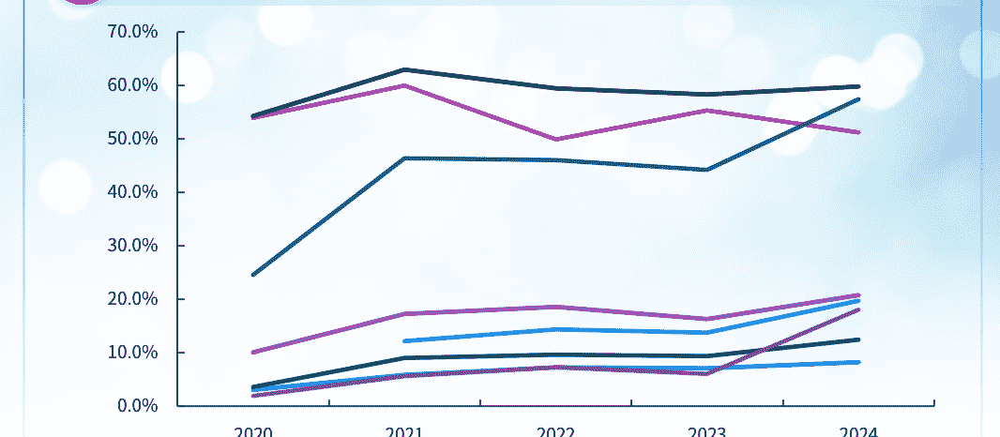

- 智能猫粮罐
- 智能猫盆
- 智能定位设备
- 智能喂食器
- 智能饮水机

来源：宠物行业大数据，华马分析

注：题目为多选，数据和超过100%

随着企业生产能力的不断增强，各类宠物产品将进一步丰富，智能化、精细化的养宠需求持续推动宠物用品市场发展。预计到2025年，我国宠物用品市场规模达到484亿元。

## 宠物食品状况与消费者痛点：竞争加剧与食品安全

随着宠物食品市场的快速增长，吸引了大量创业企业。然而，随着市场竞争加剧，消费者对产品的需求不断增加，这些问题损害了消费者的信任，也构成了威胁。数据显示，许多养宠人在需要时反馈效率低下，且未能符合预期。近年来，食品安全事件频繁，包括违规添加剂、食品标准异常等问题。截至2022年1月，黑猫平台收到宠物食品相关投诉超过500件，其中质量问题占比19.9%。

### 图43 2024年主要消费痛点（单位：%）

| 食品安全 | 价格上涨 | 适用性不好 | 售后维权困难 | |
| :--- | :--- | :--- | :--- | :--- |
| 25.9% | 18.0% | 16.9% | 10.2% | 8.0% | 5.2% |
| 产品选择困难 | 可靠国产产品少 | 难以辨别真伪 | 进口源不稳定 |

来源：宠物行业大数据，华马分析

注：数据为多选，数据和超过100%

## 宠物保险热度提升，驱动宠物经济高质量发展

医疗和保险后期服务日益成为养宠关注的重点。2023年，国内宠物保险规模约为735亿元。截至2023年9月，全国共有宠物保险机构232家。因此，宠物市场迎来了爆发。2024年，宠物保险总规模同比增长29.5%，显示出市场的巨大活力。从消费层面来看，宠物保险存在“不知道如何选择产品”、“理赔流程复杂”、“条款复杂”等问题，关注度下降，说明保险行业在服务便利性方面取得了一定进展。目前，国内宠物保险主要为疾病险、意外险、责任险，已有保险、大地保险、中国平安等公司入局。

| | 2021 | 2022 | 2023 | 2024 |
| :--- | :--- | :--- | :--- | :--- |
| 医疗险（准） | 19.3% | 24.4% | 25.7% | 27.7% |
| 意外险 | 20.1% | 23.8% | 26.2% | 31.2% |
| 责任险 | 16.8% | 11.0% | 28.0% | 39.8% |
| 疾病险 | 17.8% | 10.2% | 26.7% | 47.3% |
| 其他 | 16.7% | 19.4% | 23.5% | 55.3% |
| 理赔难 | | | | |
| 办理手续繁杂 | | | | |
| 保险价格高昂 | | | | |
| 保限过于严格 | | | | |
| 高发疾病不保 | | | | |
| 如何挑选 | | | | |
| 保险产品少 | | | | |
| 可选宠物保险公司太少 | | | | |

来源：读懂宠物行业数据，华马分析

注：数据为估值，增长超过100%

针对这些问题，监管层也采取了相应的措施。例如，在2024年会期间，人大代表关注宠物保险市场的建议，包括建议保险产品选择具有资质的医疗公司合作，并建立数字化宠物护理管理系统。随着监管政策的逐步完善和实施，宠物保险市场有望迎来更加规范和成熟的发展。

## 2025宠物经济：从趋势到实践，八大方向深度解析

© 2025 普华会计师联合网络 — 中国锦永会计师事务所有限公司（华永道（中国）会计师事务所有限公司，华永地域会计师事务所 — 专门执业区业务部。华永会计师事务所 — 中国宠物咨询有限公司建立关系的关系）服务中心。所有权利。

## 趋势推动宠物行业发展的双引擎：供应链重构与国产替代

### 方向一：供应链重构：拓展东盟、拉美等新市场，减少对欧美单一市场的依赖

根据海关总署数据，2024年中国宠物出口达42.7亿美元，同比增长7.8%。供应链全球化布局，2025年第一季度出口达38.4亿美元，接近去年水平。从主要贸易伙伴来看，中国出口市场主要集中在东盟、欧洲和三大经济体，2024年对欧美出口达12.2亿美元，居首；新兴市场方面，印度、拉丁、非洲等地区基数小，增长态势强劲。2024年，这三个地区的出口增速提升到1.8%、31.5%和30.8%，其中印度表现尤为突出，2022年至2024年持续增长，并在2025年第一季度进一步提升至2.1%。

### 2019年—2024年主要贸易伙伴统计中国货物出口额情况（单位：亿美元）

| | 东盟 | 中国香港 | 俄罗斯 | 印度 | 拉丁美洲 | 日本 | 欧盟 | 非洲 | 韩国 |
| :--- | :--- | :--- | :--- | :--- | :--- | :--- | :--- | :--- | :--- |
| 2019 | | | | | | | | | |
| 2020 | | | | | | | | | |
| 2021 | | | | | | | | | |
| 2022 | | | | | | | | | |
| 2023 | | | | | | | | | |
| 2024 | | | | | | | | | |

来源：海关总署、华马分析

注：占比变化是指占比相比前值

东盟作为全球行业的重要战略地，对于美国等成熟市场，东盟对进口资质要求较低，入门门槛和关税政策更具优势。2019年到2024年，对东盟出口总额增长率达16.9%，占比达21.5%，呈现稳定增长。新兴市场方面，印度、拉丁非洲等地区基数小，增长态势强劲。2024年，这三个地区的出口增速提升到1.8%、31.5%和30.8%，其中印度表现尤为突出，2022年至2024年持续增长，并在2025年第一季度进一步提升至2.1%。

### 2020年—2024年主要贸易伙伴统计中国货物出口占比变化（单位：%）

| | 东盟 | 中国香港 | 俄罗斯 | 印度 | 拉丁美洲 | 日本 | 欧盟 | 非洲 | 韩国 |
| :--- | :--- | :--- | :--- | :--- | :--- | :--- | :--- | :--- | :--- |
| 2020 | | | | | | | | | | |
| 2021 | | | | | | | | | | |
| 2022 | | | | | | | | | | |
| 2023 | | | | | | | | | | |
| 2024 | | | | | | | | | | |

来源：海关总署、华马分析

注：占比变化是指占比相比前期值

## 2025中国宠物行业市场报告

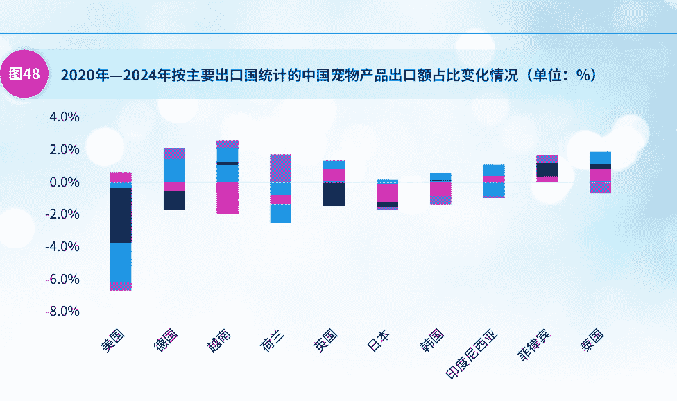

来源：海关总署，毕马威分析

■ 2020 2021 2023 2024

从美国来看，美国是全球最大的宠物市场，也是中国宠物出口的第一大市场。2024年，中国宠物对美国出口占比已处于16.4%维持位，但仍较去年呈现下降趋势。展望未来，受限于美国市场的频繁波动，短期内中国宠物产品市场将面临较多挑战，跨国企业需做好准备以应对需求波动。

2025年上半年，企业正处于市场波动与经营压力的考验期。由于大环境带来的市场波动，企业不仅遭受了成本的影响，宠物市场竞争也更加激烈。贸易政策的调整对出口造成了不利影响，同时也使得市场竞争更加激烈。这种环境下使得中国宠物产品面临巨大的挑战。表现为：

- 从单一市场到全球市场，供应链亟需逐步实现优化

中国宠物产品正逐步从单一市场向全球市场拓展，市场有望除美国以外的其他新兴市场，如东南亚、拉美、印度等地。这些新兴市场的需求有助于企业寻求快速发展，同时也面临着差异化和本地化的挑战，深耕海外市场。

## 优化海外布局，降低关税壁垒带来的影响

为应对关税壁垒，一些中国宠物企业正积极优化海外布局，降低关税壁垒的影响。尚未发布具体的行业报告，本节针对以下四类宠物产品：手工制的饲料、各类材料的宠物玩具（各种）、零售包装的狗食和猫粮，以及宠物益。

## 图50 2022年—2024年猫、狗购买品类偏好（单位：%）

## 犬
## 猫

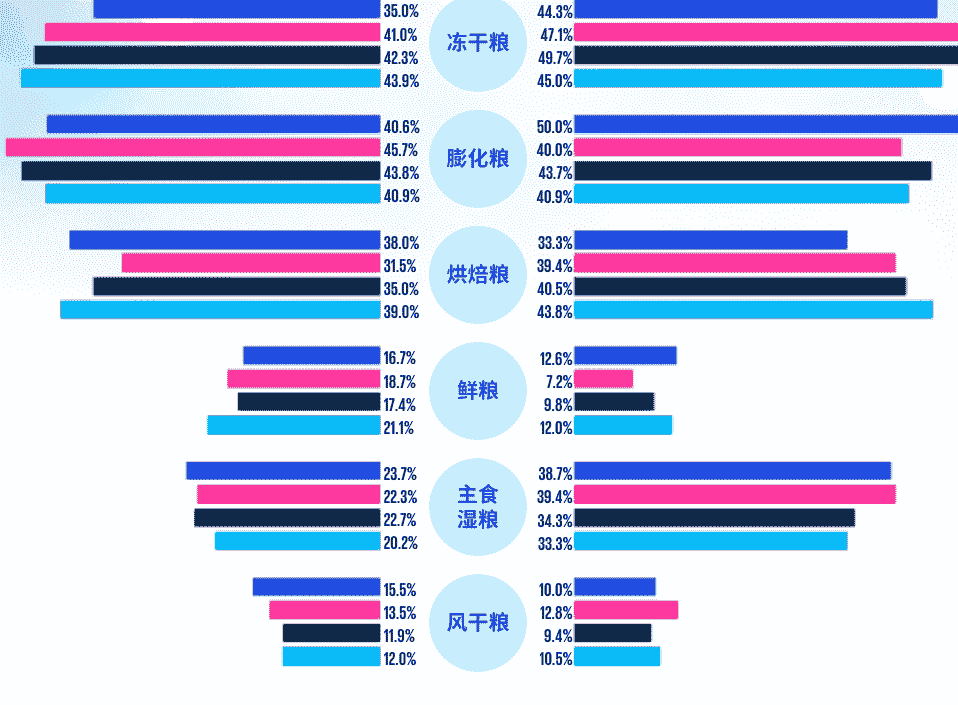

来源：派读宠物行业大数据，华马威分析

## 2025年中国宠物行业市场报告

此外，养宠人对洗美美容、专业服务和预约便捷性的关注度显著提升。数据显示，选择宠物店进行洗澡的养宠偏好持续上升，均超过50%，且2021年增长了190%。同时，上门服务的养宠人数量也增加，尤其节假日上门养宠新方式的人数较多。相比之下，选择上门服务的养宠人占比有所下降，选择洗美美容的养宠人群在2024年仅占29.2%，较两年减少了19个百分点。随着养宠人对专业服务和舒适环境的关注度提升，上门服务、专业美容机构和宠物酒店奢宠服务逐渐成为新选择，预计未来将成为热门服务之一。

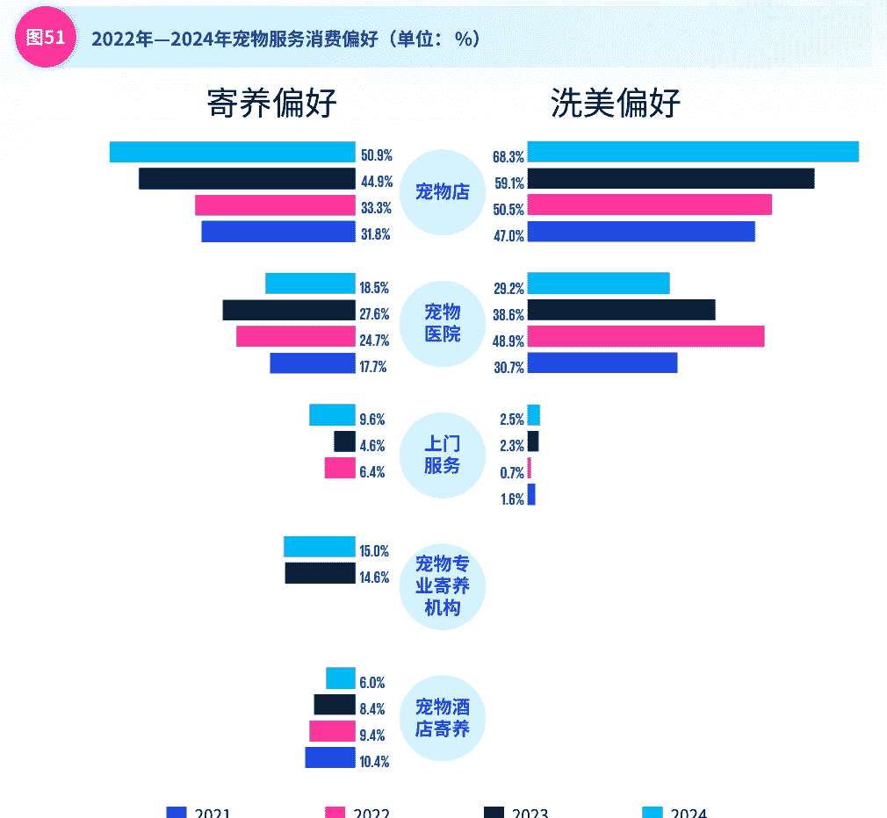

来源：源沃宠物行业数据，华马威分析

## 科技创新：智能硬件与宠物健康管理的深度融合

随着大数据和人工智能时代的到来，信息的快速普及使得宠物主对宠物健康的关注度显著提升。数据显示，2024年中国宠物（猫狗）市场规模突破3000亿元，同比增长7.5%，其中宠物健康消费占比持续增长。宠物的肠胃健康、关节健康、皮肤健康等细分领域逐渐成为市场关注焦点，推动了宠物健康管理的精细化。

从出生到去世，宠物犬会经历幼年期、青少年期、成年期、中期以及老年期五阶段，不同时期的宠物对健康的需求各不相同。数据显示，我国猫少年期数量最多，占市场规模巨大，且呈现明显的龄化特征。其中，犬类老年化趋势更为显著，2024年老年犬占比达27.6%，2021年为6.4%；猫类老年化占比从2021年的3.3%升至2024年的10.1%。

## 图52 2021年-2024年宠物年龄分布（单位：%）

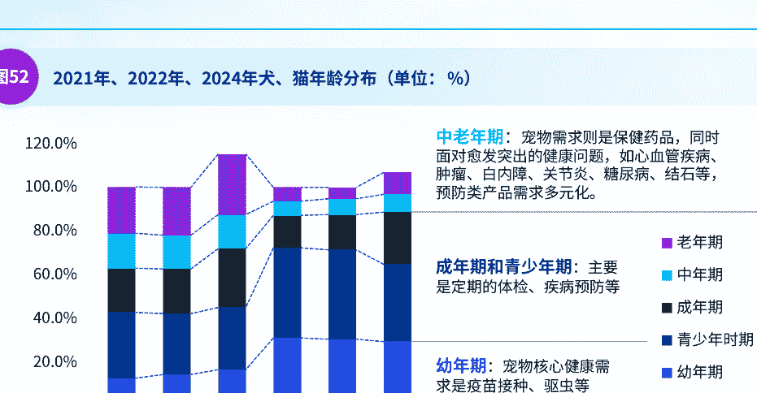

- 老年期
- 中年期
- 成年期
- 青少年期
- 幼年期

**老年期**：宠物需求需保健品，面对突发的健康问题，如心血管疾病、肝脏、关节、糖尿病、结石等，预防性产品多元化。

**幼年期**：宠物核心健康需要疫苗、驱虫等。

来源：派读宠物行业数据、赛马芬分析
1. 数据统计了人饲养宠物及狗，健康涵盖这些问题，数据之和不大于100%
2. 宠物年龄段按照宠物主实际年龄划分，分年龄段存在差异情况

随着宠物数量的增加和宠物主对宠物健康的关注不断持续，AI+宠物医疗技术的深度融合助力宠物医疗行业转型升级、精准化运营。智能硬件与宠物健康服务的提升使得宠物医疗市场规模持续扩大，通过先进医疗和科学医学的应用，宠物医疗从传统的诊疗向精准诊疗模式转型。

公开数据显示，一线城市中超过七成的宠物已引入辅助诊断工具，使检测门槛降低，效率得到提升。与此同时，宠物医院管理系统（PIMS）的普及日益增长，其核心功能涵盖疾病管理、药物储备和自动诊断系统等，为小型宠物医院提供了技术支持，帮助优化资源配置，提升服务效率。

此外，智能影像等可穿戴设备能够监测宠物健康状况，通过数据连接及时发现潜在健康风险，避免宠物处于危险。《2025年中国宠物行业报告显示，近年来人们对宠物健康监测设备的意愿度提升，从2023年的9.4%增长到2024年的12.5%。

## 2025年中国定制宠物行业趋势报告

## AI 识别与行为监测的智能化应用

## 在线医疗服务与用户粘性提升

## 图53 “AI+宠物健康”实际应用领域热点词

## 科技“抗衰”与健康干预

来源：华马研究院分析

另一方面，在“人爱同源”的理念下，宠物医药的研发和应用正在走向专业化和规模化。这一理念强调人类与宠物在生理结构、疾病机制等方面的相似性，使得许多宠物医药研发可以参考人类的技术和经验。例如人用药物通过调整剂量或适应症后可以转化为宠物医药。这种技术极大缩短了研发周期，为宠物医药带来了巨大的活力。

与此同时，养宠人对宠物健康的重视不断提高，他们愿意为健康投入。这一趋势随着报告显示，需求明确，尤其是在等地，宠物用药通常经过严格监管，由专业的医疗机构提供相关服务。这种高标准的体系能够确保宠物用药的安全性和有效性。根据文献发布的《2025年中国宠物药物》，目前宠物给药方式以内为主、外用为主。此外，雾化吸入和注射等方式也在逐步普及，主要集中在驱虫药物、感染药物、心血管免疫调节剂、病毒药物、止痛药物等等领域。近年来，这些方法引入到宠物治疗中，从医学角度为健康提供了解决方案。这些治疗方式能够受到许多养宠人的关注，未来也将成为一种趋势。

## 中国国产宠物线下分布及分类（单位：%）

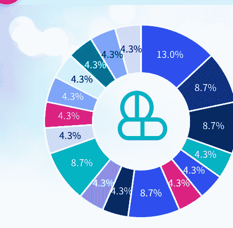

| 品牌A | 品牌B | 品牌C | 品牌D |
| :--- | :--- | :--- | :--- |
| 抗炎止痛药物 | | | Y |
| 抗感药物 | | | Y |
| 血管及免疫调节剂 | | | Y |
| 利尿剂 | | | Y |
| 止泻剂 | | | |
| 耳用药 | | | |
| 解热止痛抗炎药物 | | | |
| 心血管疾病药物 | | | Y |
| 抗细菌药物 | | | Y |
| 麻醉剂 | | | |
| 皮肤用药 | | | Y |
| 眼用药 | | | Y |
| 肝用药物 | | | Y |
| 心脏用药 | | | Y |
| 通道用药 | | | |
| 门店覆盖率 | ~65% | ~55% | ~20% | ~10% |

来源：《2025年中国宠物白皮书》，注：本数据基于宠物市场定位，选取部分代表性品牌。

## 趋势：跨越社交与经济的创新转型

## 方向五：社交经济与私域流量：宠物友好空间的商业经营

近年来，宠物经济的快速发展，宠物已不再是单纯的“家庭成员”，而是成为一种社交媒介和生活方式的重要部分。宠物的独特互动和社交不仅活跃了消费市场，也让行业关注了“宠物朋友”理念。作为一种新型城市空间形态，宠物友好空间具有独特的社交属性和流量价值，成为连接流量与私域流量的关键。

### 宠物友好空间的社交属性与流量价值
宠物不是简单的伴侣，更是情感的润滑剂。在宠物友好空间中，通过宠人的互动和交流，这种社交行为不再局限于人，它能够引起其他人的出现或者参与，从而改变社交格局。例如，如今许多城市都在范围内打造“宠物友好空间”，越来越多的宠物主人愿意加入，这些空间往往成为热门“打卡网红”，让更多人和家庭聚集其中，形成了一种新的社交范态。

在社交媒体的时代，宠物友好空间的内容传播具有显著的流量价值。例如，宠物公园、宠物友好餐厅、厅等场景被频繁拍摄短视频或图片，并广泛传播。“网红效应”不仅提升了空间的知名度，同时也为经济发展带来了巨大的流量注入。

### 线下场景的赋能：从流量到私域流量池的构建
宠物友好空间作为流量入口，通过独特的特性吸引主人打卡、消费，成为品牌与消费者建立联系的一步。通过线下活动引导用户关注公众号、社交媒体、加入社群、下载APP等，将流量转化为私域流量。在线场景下，品牌可以通过线下触点、会员注册等方式获取用户信息，建立线下数据体系（如消费记录、活动参与等），实现精准运营。

此时，品牌通过社交媒体等线上平台进行活动互动、分享、福利发放，引导用户关注、参与粉丝。这一过程不断增加品牌与用户的亲密度和粘性，线下活动为线上流量池提供了丰富的素材，线下流量池中的用户可能会引导回线下场景，形成了流量的闭环。

宠物友好空间通过线下场景引流，通过数据复用、内容运营、线上联动等方式，将用户引导至私域流量。这种模式不仅提升品牌的知名度，增强用户忠诚度，最终实现流量的高效转化。

## 方向六：融合与场景创新：宠物经济的多元化

近年来，宠物经济在中国市场呈现蓬勃态势，随着市场规模扩大，消费升级逐渐从单一宠物用品向多元化、场景化发展。随着“宠物友好”理念的普及，越来越多的企业开始探索跨界融合，这种多元化探索满足了养宠人的增长需求，为行业提供了新的增长点。

| 企业（主要业务范围） | 某健康品牌 | 某乳制品品牌 | 某食品品牌 | 某休闲食品品牌 |
| :--- | :--- | :--- | :--- | :--- |
| 跨界动作 | 专注于宠物蛋糕 | 涵盖宠物粮、零食 | 专注宠物食品 | 涵盖宠物粮、零食 |

来源：公开资料整理，行业意见。

## 2025年中国宠物食品市场

## 宠物经营：宠物友好的创新实践

数据显示，宠物住宿的需求呈现显著增长趋势。根据预测，从2025年开始，宠物友好订单量增长了一倍。随着养宠价值日益提高，宠物友好虽是理想，但关键在于专业服务尚未瓶颈。未来，随着智能化、场景化服务的普及，宠物友好可以寻求新潮流，满足宠物基本住宿需求到提供更为全方的宠物服务。

## 快食品的创新：从传统美食到宠物市场的拓展

在宠物养趋势下，养宠人对食物的需求不仅留在基础营养层面，而是更加关注健康、安全以及全方位。越来越多的人选择健康食品、天然宠物食品，推动了食品高端化、定制化产品。凭借优秀的品牌影响力，通过垂直管理等跨界经营，快食品企业正凭借自身与宠物食品的跨界合作，抢住了赛道的利润。

从品牌来说，跨界入局的食品企业正在加速进入宠物市场，通过品牌化、定制化等方式加速市场拓展。例如，某知名集团推出的宠物食品，凭借食品管理的优势和丰富的经验，迅速在细分市场占据一席之地。快食品企业的加入，为宠物食品行业注入了新的活力，通过在创新、研发和体验方面的持续投入，这些企业正向宠物市场边界。快食品企业的产品并不是传统赛道的王者，而是对新宠物市场的积极拓展。通过高端化、功能性、定制化的产品创新，快食品企业正在重新定义食品的市场格局。未来，随着消费者需求日益多样化和科技的发展，食品市场将迎来更多化的发展。

## 趋势四：“银发经济”与“它经济”：宠物经济的新增长极

## 方向七：适老化需求推动供给侧创新

国家统计局数据显示，自1982年以来，我国65岁及以上人口占比呈上升趋势。进入21世纪后，我国65岁及以上人口占总人口的3.7%，进入老龄化社会；到2024年，我国60岁及以上人口将达到3.2亿，占全国总人口的22.0%，65岁及以上人口已达到15.6%，我国已进入深度老龄化社会。许多老年人由于子女不在身边，生活比较孤独，对宠物的陪伴需求日益强烈。宠物逐渐成为他们生活中不可或缺的情感寄托，他们带来了精神上的慰藉和生活中的快乐。

根据相关数据，预计到2028年，中国银发经济市场规模将达到12.3万亿人民币，2019年至2028年间的复合增长率约为12.4%，这一预测彰显了中国银发经济的发展潜力巨大。

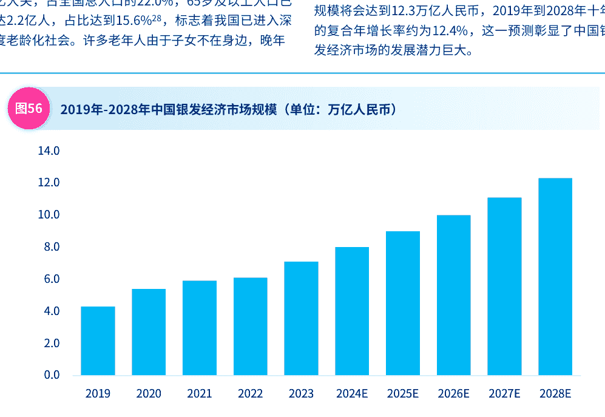

## 2025年中国老年市场报告

根据调研数据，老年群体的关注度不断提升，老年养老市场不容忽视。值得注意的是，老年市场具有巨大的发展空间。这不仅能帮助老年人缓解孤独、提升生活质量，研究显示，老年人的心理状况普遍优于同龄人。随着老龄化进程的加速，老年人的精神需求增长，银发市场正在成为一个蓝海。对于行业而言，能够深耕并满足老年人特殊需求的领域是先机。

## 图57 银发养老消费需求（单位：%）

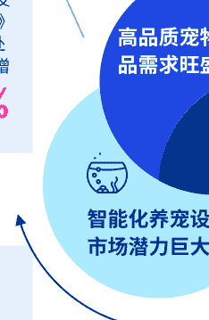

| 需求需求 | 2021年 | 2022年 | 2023年 | 2024年 |
| :--- | :--- | :--- | :--- | :--- |
| 宠物食品 | | | | |
| 宠物用品 | | | | |
| 医疗器械 | | | | |

来源：京东研究院，公开数据。

## 方向八：宠物经济在下沉市场的新机遇

随着宠物经济的持续增长，县城逐渐成为新的增长场。与一、二线城市相比，三线及以下城市的宠物市场仍处于初期阶段，主要在传统的宠物医院和基础服务领域。然而，宠物相关系列的变化为品牌带来了新机遇。

数据显示，2022-2023年三线及以下城市人口占比出现负增长（-16.7%），但2021-2022年整体增长率为3.4%，为三类城市中一类增长最真实的。这一趋势表明，下沉市场宠物经济正在加速，宠物作为情感寄藉的需求得到了释放。

未来，一线城市宠物经济的增长更多依赖于“高端创新”的消费模式。具体来说：

- 高端食品：随着宠主对宠物健康关注的不断提升，高端宠粮、宠物食品成为市场主要需求。
- 智能科技：穿戴设备、宠物互动玩具等创新产品将满足年轻宠主的消费升级需求。
- 情感经济：宠物医疗、保险、防护等服务需求加速增长，在健康背景下，相关服务将逐步形成。

二线城市宠物经济的增长将注重“增长转化值”的逻辑：

- 产品结构调整：从功能性产品向情感、健康产品转型，例如宠物健康管理（营养、运动）、宠物保险等服务将成为新的增长点。
- 社区运营与私域流量：通过渗透社区运营能力，提升渗透率，构建以宠物为核心的本地圈生态。
- 精细化运营：通过数字化转型，优化服务体系，提升效率和用户生命周期。

## 2025年中国宠物行业市场报告

下沉市场宠物经济的增长主要依赖于以下几个方面：

- 下沉市场电商赋能：通过加强抖音、小红书、拼多多等平台的推广本地化运营，推动宠物产品和服务的深度渗透。
- 高性价比产品布局：针对下沉市场消费持续持续，推出低客单价、高性价比的产品，满足当地消费者的多样化需求。
- 服务网络建设：在城市市场布局宠物医院、寄养、美容等服务终端，完善宠物经济的全产业链。

三线及以下城市养宠群体在宠物食品上更倾向于实惠的选择，如装粮和自制饭；在宠物医疗方面投入，消费模式从功能性向情感化转变，为下沉城市宠物市场带来潜力。基于这一趋势，品牌可以从宠物粮、零食、玩具等细分领域切入，并通过线上模式、社区服务和本地代理，提供灵活的需求，实现精准投放，涵盖多样化需求。

总体来看，下沉市场宠人的消费驱动、情感化养宠趋势以及下沉市场的巨大潜力，为三线及以下城市宠物经济发展提供了广阔的空间。品牌和企业应把握住这一趋势，转变思路，通过产品创新、服务优化和渠道下沉，抢占下沉市场的先机，寻求新的增长点。

© 2025 年华马会计师事务所（特殊普通会计事务所）——中国华马会计师事务所、中国企业咨询（中国）有限公司、有限责任公司、华马会计师事务所——澳门注册会计师协会执业事务所，以及华马会计师事务所——香港注册会计师事务所，均与华马国际有限公司联同拥有该报告的独立成立或相关的全球版权所有。

# 05 宠物行业发展路径与战略解决方案

© 2023 毕威会计师事务所（特殊普通合体）－中国企业会计师事务所，毕威企业集团（中国）有限责任公司，毕马德会计师事务所－中国行政会计师事务所－专门针对地区会计师事务所，华泰会计师事务所－ 均与毕马德国际有限公司（普华信保险有限公司）相关的业务成立的普通合体中的成员。版权所有，请勿转印。在中国

## 2025年中国宠物行业市场报告

## 审计与上市：风险防范与解决方案的整合路径

在行业加剧与同质化竞争引发的双重压力下，宠物行业亟待通过资本突破快速发展。面对现金流压力与增长压力，引入战略融资、布局股权融资及上市融资成为突破瓶颈。资本不仅能带来资金压力，更能赋能技术升级，并将重塑和产业供应链加速行业集中化进程。

目前国内宠物行业面临很大的发展空间，但企业普遍面临以下风险：

- 1. 国内市场竞争加剧：国内宠物市场增长迅速，新品频繁，大量企业资本不断加入国内市场竞争，宠物行业未来竞争将持续激烈。如何进一步提升和落实企业自身的竞争力将尤为重要。
- 2. 新产品研发及风险：新产品从项目研发到发现利润需要一个周期，在此期间需要充足稳定的资金和资源投入，新产品的市场认可度低，前期投入无法收回。在需要充足资金投入经营的前提下，同时有足够稳定的资金投入新产品研发并能承受一定的结果。

## 行业常见风险

## 行业生命周期

| 企业生命周期 | 初创期 | 成长期 | 成熟期 |
| :--- | :--- | :--- | :--- |
| | 1.引入投资者 | 2.快速发展 | 3.启动上市准备 | 4.成功上市 | 5.再融资 |
| | - 财务模型和估值提供帮助 | - 财务健康状况、搭建上市架构、审阅税务影响并优化出税务策略 | - 发售、资产证券化分析市场 |
| | - 寻找投资者 | 上市筹划 | |
| | - 财务、税务及并购帮助 | - 与有关关注、社会和环境履行准备评估及其他承诺及报告 | - 年度审计 |
| | | - 税务合规与风险管理 担任内部风险控制，并提供相关建议 |
| | - 聚焦集团资源、组建核心团队 协助战略型设计和落地、建立模拟模型 | | - 协助审计委员会和董事会治理机制 |
| | - 提供融资渠道（包括股权、企业订单） | | |
| | - 资产优化：通过分析和并购、管理引入、退出、评估、转型 | | |

来源：麦瑞分析

© 2025 麦瑞分析宠物行业市场报告。报告所有权利属于麦瑞分析。宠物行业市场报告由麦瑞咨询有限公司（中国）制作-麦瑞注册会计师事务所（厦门）-麦瑞注册会计师事务所（厦门）-厦门市注册会计师协会提供支持。注册瑞麦瑞国际有限公司知识产权保护有限公司相关权益的成立成为本报告中的成员。所有权保留。在中国

- 3) 原材料价格波动风险：宠物食品主要原料肉类、产品等属于大宗商品，价格变动或公司成本与存货存在一定影响。原材料价格上涨，可能导致蛋白质价格水平下降，企业将出现报价贬值的风险。
- 4) 汇率波动风险：业务收入、海外采购多次受汇率影响。全球环境、经济环境及各国政策的变化，企业面临汇率波动的风险。
- 2) 上游过程企业构建垂直化管理体系，从供应、制造到架构结构化，系统提升经营规范性，与宠物食品市场向品质化、标准化要求相符。
- 3) 品牌带来的溢价效应，不仅强化消费者信任、提升市场份额，可通过品牌激励绑定核心人才，形成持续创新动力。

但需警惕的是，IPO涉及长达3年的筹备期，平均超过千万的直接成本，以及以商业重构、税务规划等同级风险。建议企业引入专业机构进行上市可行性诊断（如财务健康检查），通过前期梳理业务数据、业务合规性及内控体系，精准识别关键要点，分阶段。对于不符合直接上市条件的企业，可先通过战略融资引入资产，获取现有资金，有助于投资的资金加速市场扩张，后通过后续资本化奠基础。在行业竞争加剧的背景下，分层、分阶段的战略布局将成为宠物食品行业构建核心竞争力的关键变量。

## 融资上市的好处

在宠物行业转型升级的关键路径，融资上市（IPO）作为资本运作的核心路径，成为企业拓展发展规模的战略选择。通过融资上市：

- 1) 企业可以获得规模化资金支持，研发、供应链建设及转型所需投入，同时降低对融资的依赖，优化财务结构。

## 上市优劣对比

列出了三大市场（香港、境内、美国）的主要优劣对比：

| 考虑因素 | 香港市场 | 境内 | 美国 |
| :--- | :--- | :--- | :--- |
| 上市门槛与财务标准 | **** | **** | **** |
| 上市机制及上市时间 | **** | **** | **** |
| 再融资能力 | **** | **** | **** |
| 估值水平 | **** | **** | **** |
| 监管环境与合规要求 | **** | **** | **** |
| 研究覆盖 | **** | **** | **** |
| 投资者构成 | **** | **** | **** |

- 美国市场门槛低，允许初创企业。
- 香港市场标准较高，适合中大型企业。
- 境内市场标准较高，但表现良好，适合国际化布局。
- 香港市场上市流程标准化，申请只需要3-4个月。
- 境内市场上市速度最快，平均超过2年。
- 美国市场上市制度严格，耗时较长。
- 香港市场再融资相对较高，审批速度快。
- 境内市场再融资容易，灵活较多。
- 美国市场再融资执行严格，溢价明显。

来源：麦瑞分析
注：****为推荐，***为次。

## 税务战略与优化：集团税务管理、海外税务布局及防控

## 宠物企业常见税务风险

- 关联交易：宠物企业发展过程中不断产生，集团内许多公司负责不同的环节，可能不可避免。某些情况外，集团内公司可能享受不同的优惠政策、法律法规等。
- 跨境交易管理：定价规则可能导致利润转移，公司之间进行转移，从而引起国家税收减少。

## 高技术企业及研发费用加扣除的风险

- 宠物企业开展产品开发相关的研发活动，申请享受高技术技术优惠。
- 然而，随着税务监管环境的变化，相关政策对企业提出了更清晰、更高的要求，例如人员薪酬、高技术研发、研发费用的归集和资料等。
- 企业因高新技术政策和研发费用不适用可能导致税务风险。

## 电商业务涉及的风险

- 宠物企业通过京东、淘宝、小红书等平台开展业务，从电商业务来看企业将面临一系列税务风险。例如技术服务费、平台服务费/佣金、个人税代扣缴、销售收入申报或申报不及时导致发生风险。
- 随着电商税务监管的加强，上述风险带来的实际影响将超出预期。

## 出口业务涉及的风险

- 美国市场是全球宠物最发达的市场之一，人们认为其资金将用于购买优质的食品、用品以及服务，寻找更广阔。

# 2025年中国税务报告

随着国际监管形势的趋势，出口业务所面临的风险也可能引起企业关注。一方面，通过跨境电商平台经营业务的企业，需要关注地区或国家的流转风险，且近期，各国在相关的法律允许避免税源的流失和促进税的公平性。另一方面，随着国际政治形势的变化，关税政策为企业带来了额外的税负担。

## 规税务咨询

- 为企业提供及时、高质量的咨询服务，解答日常税务问题。
- 提高集团税务合规度，提升集团税务管理水平。

## 税务健康检查

- 发现历史税务风险，提出对税务合规事项的方向，并对未来提供框架建议。

## 海外投资税务咨询

- 根据集团业务发展需求，提供有关海外投资架构搭建和重组、跨境关联交易、海外税务合规咨询、关税咨询等服务。

## 我们的解决方案

## 集团供应链咨询

- 帮助集团进行全供应链税务规划，优化税务效率。

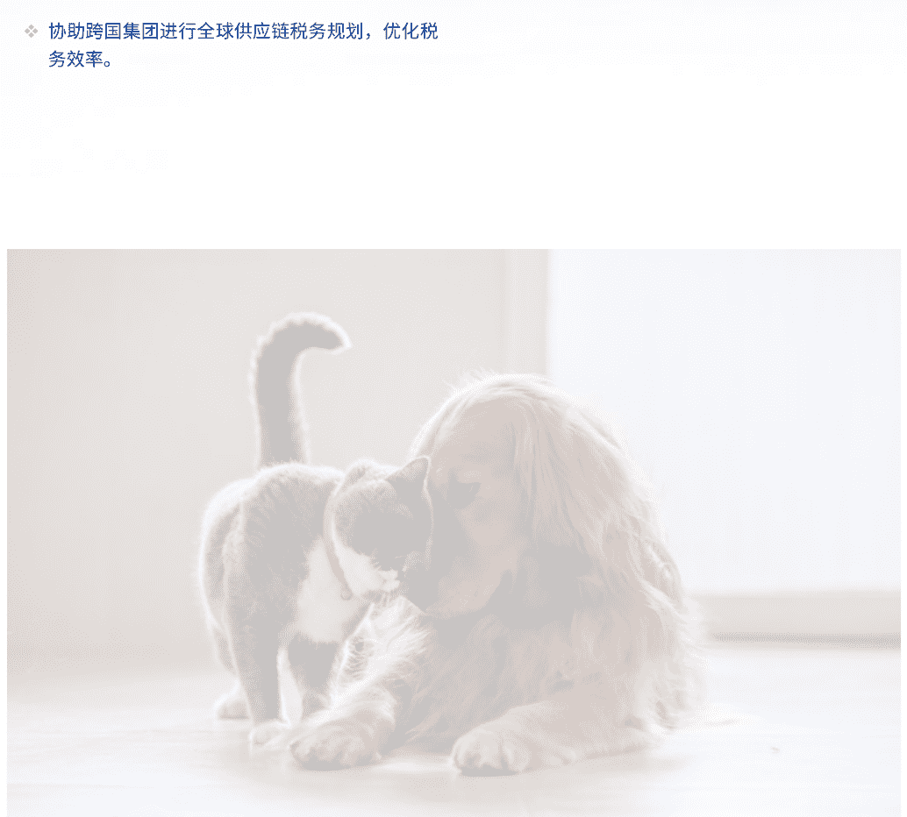

© 2025 毕马威会计师事务所（特许注册合伙）－中国合会计师事务所，毕马威亚太企业（中国）有限公司，具有共同责任，毕马威会计师事务所－澳门特区注册会计师联合事务所，及毕马威会计师事务所与毕马威国际德华士集团有限公司相关的成立或全球网络中的成员。所有权，未经不得转印。在中国印刷。

# “四位一体”：咨询解决方案的战略框架与变革路径

随着全球经济经历“情绪消费”向“平台化生产”的加速，行业在国产替代、消费升级、科技赋能与人口结构变化等诸多的深度重塑、行业变革、技术革新与生态转型下。毕马中国推出面向行业的“四位一体”咨询服务框架，聚焦“助力、驱动、发展、创新”四大核心维度，助力企业构建化的战略路径与持续的变革能力。

快速增长，但产品与服务质量同质化，使得初创企业在增长能力上遭遇瓶颈；另一方面，头部企业凭借资金、渠道等综合优势，逐步扩大与企业的差距，呈现明显的“效应”。在此背景下，企业需要通过系统性战略与清晰的路径实现可能的竞争优势。

## 助力：匹配成长阶段

精准市场定位需要建立在市场快速扩张的基础上，对消费者的深度理解。通过宠物市场的构建、消费者行为细分及多类的交叉分析，帮助客户制定差异化的策略。在市场环境中，行业竞争剧烈碰撞，活跃玩家。

## 驱动：匹配成长阶段

维持持续增长能力，新技术，拓展服务边界。

## 发展：匹配成熟阶段

夯实管理基础，运营持续增长。

来源：麦瑞分析
© 2023 毕威会计师事务所（特殊普通合体）－中国企业会计师事务所，毕威企业集团（中国）有限责任公司，毕马德会计师事务所－中国行政会计师事务所－专门针对地区会计师事务所

## 2025年中国宠物行业市场报告

## 审计与上市：风险防范与解决方案的整合路径

（此处内容重复前文，已按逻辑合并）

# 宠物生命周期

- 核心创期：引入投资者，获得融资资金支持。
- 成长期：由于市场快速扩张，建立持续的增长。
- 成熟期：资源配置，同步提升投入出效率。
- 成功上市：实现持续的增长。

## 创新：释放生态价值，构建跨界场景

- 商业+养老：营造宠物陪伴的和谐社区。华马威中国提出“宠物”跨界同跑站，依托商业地产、养老服务、快零售、物资文旅等多个生态资源，助力企业打破行业边界，与多场景形成协同“化学反应”，共生生态级增长曲线。
- 商业+养老：场景融合与空间运营。
- 快消+文旅：品牌IP共创与社交传播。华马威中国可以助力企业与跨界行业的合作，在行业综合体、社区住宅、酒店文旅等等空间中推动宠物主题活动，并建立跨界联名的运营机制，推动“宠物+商业”融合场景的落地。

基于内容传播优势，华马威中国帮助企业打造独特的宠物IP形象，联动平台、文旅品牌与MCN资源进行跨界共创。通过打造社区互动、打卡联动等机制，增强用户参与和品牌认可，实现增长驱动下的可持续增长。

## 引文

| 序号 | 文章标题 | 发文单位 | 发文日期 |
| :--- | :--- | :--- | :--- |
| 1 | 政府工作报告 | 国务院 | 2024年3月 |
| 2 | 中央经济工作会议上学习习近平重要讲话 | 国务院 | 2024年12月 |
| 3 | 2023年经济运行中主要工作完成目标实现 | 国务院 | 2025年1月 |
| 4 | 2023年上海人口监测统计报告主要数据汇编 | 上海市卫生健康委员会 | 2024年 |
| 5 | 2025年中国宠物行业市场报告 | 麦瑞分析 | 2025年 |

2025年中国宠物行业市场报告

## 结语

在即将来进入“十四五”规划期间，我国有望在2035年实现发展的宏观目标。在社会经济高速发展与消费者需求持续变化的背景下，宠物市场迎来巨大转折，同时也面临诸多挑战。在此背景下，宠物经济作为消费经济的重要一环，正通过优化供给侧、创新消费场景、数字化转型与“A+宠物”等多元维度提升，激发人类的消费活力，助力行业价值的持续释放。随着宠物消费行业“围墙”向“质升”的转型升级，宠物经济将迎来更加广泛的发展前景。

未来，宠物行业将迎来发展黄金期。在消费升级与消费替代的推动下，消费市场呈现多元化发展、行业趋向成熟、集中提升。宠物行业将经历模式重塑，向平台化、产业化方向发展；小规模、低质的宠物企业将被市场淘汰，宠物市场趋于饱和，企业面临同质化竞争与转型压力。行业企业需要通过资本运作实现突破。在本次报告中，毕马威中国站在专业视角，从审计、税务与营销方面对行业常见规律进行分析，并认为为宠物行业提供资本运作解决方案与企业战略规划，助力企业缓解资金压力并完成数字化转型，成为行业发展的守护者。

“天道酬勤，力不辍”，把握时机，秉持初心，我们相信，中国宠物行业的未来将广阔如河。毕马威中国与企业并肩同行，运用专业服务，助力企业为消费者带来美好、高质量的生活体验，在行业的历程中留下卓越的一笔！

毕马威中国零售及消费品行业合伙人
2025年中国宠物行业市场报告组委会主席
刘梓婷

© 2025 毕马威会计师事务所（特殊普通合会计师事务所）–中国注册会计师事务所，毕马威国际会计有限公司（中国）有限责任公司–中国注册会计师事务所–门市会计师行业合伙服务有限公司，毕马威会计师事务所–华者注册会计师合制制事务所，毕马威国际有限公司集团知识产权保护相关权利的成立所注册地为中国或海外，所有权利均不得转让，在中国境内

## 关于毕马威

毕马威在中国三十一个城市设有办事机构，合伙人及员工超过1400名，分布北京、长春、长沙、成都、重庆、大连、东莞、福州、广州、海口、杭州、合肥、济南、南京、南通、宁波、青岛、沈阳、深圳、苏州、太原、天津、无锡、厦门、西安、香港特别行政区和澳门特别行政区。在这些办事机构紧密合作下，毕马威能够高效和迅速调动各种资源，为客户提供高质量的服务。

毕马威是一个由独立的专业会计员组成的全球性组织，提供审计、税务和咨询等专业服务。毕马威国际有限公司（“毕马威国际”）的成员以毕马威为品牌开展业务运营，并提供专业服务。“毕马威”可以指毕马威全球性组织的独立成员，也可以指一家或多家毕马威成员。

毕马威成员遍布全球142国家和地区，拥有超过275,000名合伙人及员工。各成员均为各自独立的法律主体，但其法律关系如所示。各毕马威成员独立承担自身义务与责任。

毕马威国际有限公司是一家英国国际信保有限责任公司。毕马威国际及其关联实体不提供任何客户服务。

1992年，毕马威在中国境内成为首家中外合作开展的国际会计事务所。2012年8月1日，毕马威成长为四大会计事务所之一家中从中外合作转为普通合伙制的事务所。毕马威香港的事务所成立于1945年，率先抢入市场的先机以及以质量的不懈追求，使我们积累了丰富的行业经验，许多中国知名企业长期聘请毕马威提供广泛领域的专业服务（包括审计、税务和咨询），也反映了毕马威的领导地位。

## 联系我们 (1/2)

### 林启华
毕马威中国零售及消费品行业主管合伙人
毕马威中国零售及消费品行业审计税务主管合伙人
电话: +86 (20) 3813 8388, +86 (755) 2547 4388
邮箱: raymond.lam@kpmg.com

### 爵晖
毕马威中国零售及消费品行业税务服务主管合伙人
电话: +86 (21) 2212 3431
邮箱: jennifer.weng@kpmg.com

### 彦豪
毕马威中国零售及消费品行业咨询事务主管合伙人
毕马威中国华东及华西零售及消费品行业主管合伙人
电话: +86 (21) 2212 3740
邮箱: willi.sun@kpmg.com

### 吴绪
毕马威中国北方区域零售及消费品行业主管合伙人
电话: +86 (10) 8508 5131
邮箱: jeff.wu@kpmg.com

### 周永明
毕马威中国华南零售及消费品行业主管合伙人
电话: +86 (20) 3813 8322
邮箱: raymond.zhou@kpmg.com

### 叶嘉明
毕马威中国零售及消费品行业主管合伙人
电话: +86 (852) 2978 8152
邮箱: alice.yip@kpmg.com

### 刘婉嵘
毕马威中国零售及消费品行业市场经理
电话: +86 (20) 3813 7449
邮箱: sherry.lu@kpmg.com

## 联系我们 (2/2)

### 张诗颖
毕马威中国零售及消费品行业市场经理
电话: +86 (20) 3813 8974
邮箱: cherry.s@kpmg.com

### 王彦莎
毕马威中国零售及消费品行业助理经理
电话: +86 (20) 3813 7503
邮箱: beth.wang@kpmg.com

## START YOUR FINANCE

起点财经，网罗天下报告
