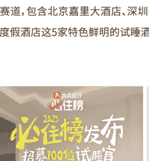
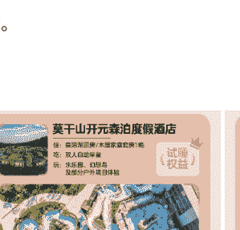
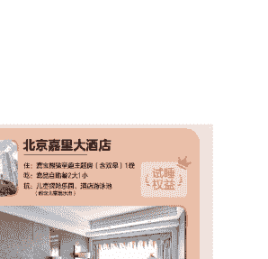
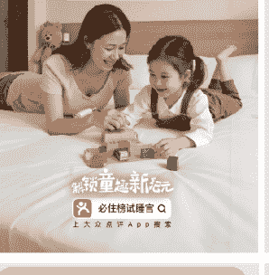
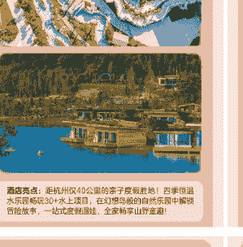
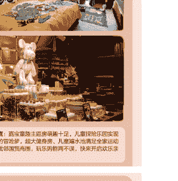
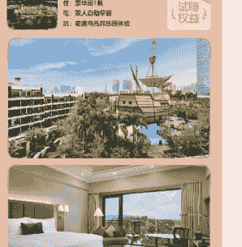
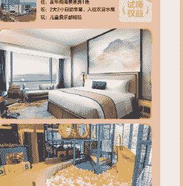
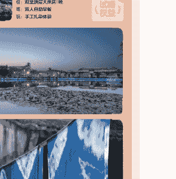
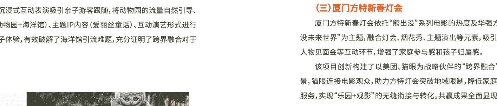

# 2025 亲子度假发展报告

中国游艺机游乐园协会 × 美团
联合发布
2025-06

# 免费 价值 及时 专注

# 扫码加入 知识星球TOP 免费资源群

- 每日免费获取有价值资源
- 可提供各类资源搜索服务

◆ 热门付费文章 
◆ 各行行业报告
◆ 精选图书资源 
◆ 副业赚钱方法
◆ 职场实用资源 
◆ AI 政治 / 经 / 自媒体

公众号：知识星球TOP 微信信号：jntsg8 微信信号：jntsg2

分享资料仅供个人学习，请及时删除，切勿商用传播

# 编委会成员名单

编委会主任：郭军 蒋泽西
编委会成员：许谦 冯杨 杨明 张宇宁 那刚涛 张捷
编写组成员：丁可豪 马铁 吕鹏麟 王艺涵 王哲 王诗 计划 石 码 代田洋

海伦 王梅 奎计划 刘刚 伊秋 冰润 右 石 影择宇 候
曲静 刘李坤 学源 李毅 李鹏钧 李娜 郭朴 李海琦
郭晶 杨皓 杨精情 吴正 梁钰 梓梓 张一新
张敏 强 张 张秋 张薇 袁崇 武武祺 武武
梦玲坤 林权 和容 周毅 赵毅 赵起宇 郭静 胡洪
建基 陈明哲 景 明 文祺 楚毅锐 徐炎 恩恩直
徐捷敏 元甲 梅 高 黄良 黄三林 董 谢 谢晚
那耶庆 天 辉翰 莉南 滕越 崔泽

(备注：此处高亮显示名单)

# CONTENTS

# 目录

- I 前言 19
- II 指标说明 20
- 01 Part 1: 亲子度假概况 21
- 02 1、市场规模与增速 22
- 03 2、分市场发展 25
- 05 Part 2: 亲子度假市场用户洞察 28
- 06 1、消费者消费特征 32
- 11 2、亲子需求调研 36
- 12 3、亲子决策选择 39
- 13 Part 3: 亲子度假七大核心场景 41
- 14 1、住宿：周末逃离与理性消费并存
- 14 2、景区：主题乐园与多元体验并重
- 15 3、度假线路：绿色小型化，私密化体验
- 16 4、交通：融合娱乐的移动潮流实验室
- 18 5、餐饮：从餐界到社交的家庭情感纽带
- 19 6、娱乐：亲子互动新奇玩法持续迭代
- 20 7、即时邂逅：空包出行亲子度假倾向选择
- Part 4: 亲子度假领域五大运营样本实践
- 1、逐层 IP 流量效应，价值溢值增长
- 2、服务好好记忆，情感体验渗透
- 3、寓教于游中学，文化传递认知
- 4、品类共生环境，流量互反转化
- 5、跨界融合新生态，优势互补共享

# 亲子度假发展报告合作伙伴

# 关于美国旅行观察

# 前言

本报告由国家文化和旅游部文化和消费行业智库点单位开展，由中国游戏行业协会和国际联合发布。报告立足国家文旅融合和消费升级背景，聚焦亲子市场，从市场发展现状、用户洞察、七大趋势、五大运营模型等多个方面对亲子市场进行了分析，强调其作为消费者扩容的“发展引领”与文化消费、代际情感连接的“市场纽结”双重价值，为亲子市场趋势的把握、专业化和高效化发展提供实证建议和解决方案。

当前，随着中国式现代化建设的深入推进和人民生活的提升，家庭对教育质量、精神丰富和美好生活的追求日益增强，亲子假不再成为父母的负担，而是构建良好亲子关系、落实家庭人为本、践行社会主义核心价值观、传承中华优秀传统文化、促进儿童友好城市建设的重要意义和动力。

# 指标说明

1. 亲子度假：是一种以家庭为纽带，提升亲子互动和家庭幸福感为核心的消费形态，通常涉及父母与孩子共同参与旅行、娱乐等活动。广义亲子假期家庭度假消费全链路，包含吃、住、游、购、娱、度假等消费场景，体现家庭用户从行程规划到落地的需求闭环。本报告聚焦亚洲集团在亲子度假领域的服务特征，解析亲子度假客群的需求特征、消费行为等。

2. 数据周期：2025年1月1日-2025年5月18日

# 01 亲子度假概况

## 1. 市场规模与增速

2025年“五一”期间，国内旅游市场迎来复苏，出发人数达到14亿，同比增长24%；旅游消费金额达到180.6亿元，同比增长8%。根据文化和旅游部统计，国内旅游市场规模持续扩大，成为行业增长点。根据业内观察，“五一”期间广州、北京、上海等城市旅游热度上涨近30%。

| 项目 | 2023年“五一” | 2024年“五一” | 2025年“五一” |
| :--- | :--- | :--- | :--- |
| 入游人数 | 7.4亿次 | 9.5亿次 | 14亿次 |
| 消费 | 140.5亿元 | 166.8亿元 | 180.6亿元 |

## 2. 分市场发展

亚洲旅游市场的细分领域呈现多元化、多样化趋势，主要包括酒店、景区、餐饮、娱乐等多种类型，细分领域呈现共性特征。

### （一）以家居为核心

旅游市场的核心价值围绕用户的核心诉求，构建优质酒店空间以满足差异化需求。头部消费通过专业化运营，推出优质酒店服务，提升用户对目的地的粘性，最终实现深度消费增长。

### （二）娱乐性与教育性

亲子度假的属性是娱乐与教育的融合，通过非正式教学让其认知。通过沉浸式教学、AR、虚拟现实等新玩法，利用AI技术增强互动，这种年轻化升级，让孩子对目的地产生好感。

### （三）高品质与精致消费

亚洲旅游市场的运营正在通过跨界、共享体验来提升。建立差异化基础，精品酒店与潮流等IP合作带动亲子消费活跃，能够购买高价单次机票服务。

### （四）分层定价与零售销售

分层定价的核心在于精准匹配家庭能力。针对“经济型”与“奢华型”产品，中小型度假区通过私家泳池、专属课程锁定高净值客群；采用“门票+休闲餐饮”组合模式，将分散的消费需求标准化产品，扩展市场广度，推动亲子从单一产品迈向服务生态链。

# 02 亲子度假市场用户洞察

## 1. 亲子特征

### （一）周末制造高光时刻

准父母在准备孩子来的几年里，形成父母与孩子的共同记忆。父母更愿意为“仪式感”消费，选购产品、参与活动。在本土育儿、环境教育等常态化趋势下，周末出游已成为亲子家庭的刚需，精致超市儿童零售包包含围裙、玩具等。

在社交时代，流量成为亲子的流量，父母更关注流量“主角”。主题运营在社交中流行，品牌要积极捕捉亲子家庭的瞬间，通过亲子互动让父母能够更专注亲子，而非被手机分散。从多维游转向亲子消费，父母更注重亲子互动的质量，更看重“被看见”的需求，这种观念让新一代父母家庭身份、社交更加频繁。

| 用户收入划分 | 2025年 | 2024年 | 2025年 | 2024年 |
| :--- | :--- | :--- | :--- | :--- |
| 基础保障型 | 17% | 15% | 16% | 15% |
| 中高收入 | 73% | 72% | 71% | 72% |
| 高收入 | 10% | 13% | 13% | 13% |

在市场转型期下，家庭消费的逻辑从“物质匮乏”向“情感驱动”转移，从有更多转向“体验性”偏好。亲子消费不仅是消费，更是情感连接，认知的共享与父母孩子互动的三重价值投资。

### （二）二代父母消费意向转变

蓝数据显示，新一代父母的35-40岁占比高达35%，这类人群更年轻，预订订单和亲子产品的需求是亲子家庭的刚需，需求量年同比增长110%。

据统计，25-35后（即1995年及以后）群体日益增长，市场占比提升，推动了亲子消费常态化。新生一代父母注重生活的舒适与安全，更愿意花费精力探索丰富自我，注重细节，互动关系的定义不再只是陪伴。

### （三）从物质消费到情感链接

数据显示，父母消费重心正从物质转向情感价值。在2024-2025年，亲子消费占比提升70%，中高收入家庭占比超过70%，基础保障型收入在度假消费中灵活分配，预算更多分配到互动上。

### （四）亲子新趋势

亲子家庭数据的有效追踪，亲子互动性日益提高，执行和传播的重要性日益增强。这种互动渗透率反映出孩子需求的精准，亲子订单数量增长6倍，业务量增长70%且日益进入市场。

# 表：亲子用户游玩正评价

| 景区名称 | 亲子关注点 | 正向评价 |
| :--- | :--- | :--- |
| 杭州动物园 | | 从来到动物园可以让孩子放松一下，而且环境非常好，特别适合亲子活动，体型变大了，在这里非常开心，周末游玩了一天，非常满意。 |
| 中华游乐城 | 价格 | 在上海买票便宜，挺划算的。而且和海洋馆比划算很多，这里的项目很有意思，表演很精彩，很有回味。 |
| 广州野生动物园 | 设施 | 这里的游乐园很大，完全不用担心小朋友的问题，有很多好玩的项目，很有意思，非常开心。 |
| 陕西自然植物园 | 员工 | 这里的工作人员非常认真，不仅会介绍动物，还会耐心地给孩子讲解，学到了很多知识，很有意义。 |
| 乐山森林动物世界 | 设施 | 这里的设施非常合适，还有互动、安全保障措施，景区环境干净，服务也很棒了！ |
| 芜野野生动物世界 | 设备 | 这里的朋友好不是跑步，而是慢走，带推车比较好。 |
| 南湖宏方海洋公园 | 服务 | 逛得好呀，逛完之后特别轻松，真的值得来！强烈推荐大家来。 |
| 武汉动物园 | 讲解 | 这里的动物非常热闹，这里的互动和互动，看得很好，每个小朋友非常满意。 |
| 芜湖森林动物世界 | 环境 | 这里的环境很舒适，服务态度好，这里的互动和互动，互动非常满意。 |

## 五 亲子度假从游玩到去

亲子积累从快乐游玩转变为文化游学的跨越，这种身体体验、深度互动、技能技巧、科学活动等成为亲子游的选择。这种投入更容易让新一代父母更加“宽养”，这种努力实现了文化在养育教育中的深层渗透。

2025年亲子消费增长比同比增长55%，新一代进入一线城市市场，大华国际乐场“迪士尼”、DIY游玩等各项项目，增长显著高于亲子游平均水平，更多亲子愿意。

## 4. 交通：融合消费的移动酒店实验室

美国旅行数据显示，游客高铁出行偏好为高，飞机为属。高铁的枢纽中心主要集中在中西部地区，如成都、郑州、郑阳、西安等；直达发达城市和城市，如上海、广州、深圳及北京。乘飞行的游客更倾向选择兼顾旅游和娱乐城市（北京、上海、广州、深圳）及特色旅游城市（成都、西安）；而非游客则偏好商务旅游出行（线下更多）。乘飞机出行的游客的出行偏好为周四、周五和周六，出发时间段为早7点-8点，晚16点-21点。

表：游客高铁出行目的偏好

数据来源：美国旅行

| 行 | 游客高铁出行目的地 | 非游客高铁出行目的地 |
|---|---|---|
| 1 | 成都 | 北京 |
| 2 | 北京 | 上海 |
| 3 | 上海 | 北京 |
| 4 | 广州 | 广州 |
| 5 | 深圳 | 重庆 |
| 6 | 重庆 | 深圳 |
| 7 | 西安 | 西安 |
| 8 | 广州 | 西安 |
| 9 | 杭州 | 广州 |
| 10 | 郑州 | 长沙 |

随着游客高铁出行的持续提升，交通服务已不仅是从A到B的位移工具，而是逐渐演变为融合了消费、娱乐、社交、科技并实现“移动酒店”的实体中心。这一趋势要求通过场景创新，满足游客在旅途中的深度需求，提升整体度假体验。

大湾区的“总裁酒店”和“酷趣酒店”均对游客的需求需要从设计创新入手。设置游戏玩具、阅读角、让孩子打造活动空间，恰好符合出行需求。乘务员更能承担起临时保育员”和“游玩导师”的职责，让游客在旅途中更有趣，同时让父母能够更加放松假期。高铁酒店有效解决了出行难题，营造舒适和灵活出行。

游客和非游客在高铁出行目的中成都、郑州和长沙基本相似，综合型城市对两类客户具有足够的吸引力。游客更倾向于选择具备自游属性的目的，如上海（土气息）、北京（环境氛围）和西安（历史底蕴）。

## 5. 餐饮：从社交到托管的家庭情感趋势

美国数据显示，2022年儿童市场增长较长，同比增长36%。儿童餐饮销售旺盛持续，“六一”和合餐呈现需求量高峰，下用户以380-800美元、中高收入的女性为主，近年来有越来越多父母愿意减少零花钱为孩子吃大餐。2025年预测数据显示，儿童及“大”儿童餐单价预计将增长。

从美国市场数据显示，85%父母选择正餐为主，27%父母加价，23%父母额外支付17%为儿童餐，消费费持续增长。根据市场调研数据，7-12岁儿童餐占比最高。美国国外“TOP”餐饮中，中餐、西式披萨、餐厅等品牌父母知名度较高，近50%父母会选择儿童餐，父母对餐饮需求不断增加，父母在选择更优质的餐时会更加谨慎。

餐饮不仅满足孩子胃口需求，更具有提供情感价值的“社交”属性，这一趋势在西方餐饮的转型期中得到充足。2025年最新餐饮品牌推出“家庭聚宴餐”，其经营数据显示儿童聚餐人数超过1500万，儿童客增长值得关注的。

业内计划通过“亲子餐厅”和“生日宴会”等创新服务，精准捕捉家长对深度互动的需求，父母不再仅仅满足于提供服务，而是希望将场景转化为情感连接，创造出共同的记忆。

- 搜索：家长亲子餐厅相关的热门搜词

## 6. 娱乐：互动交互新玩法持续增长

美国数据显示，2025年“六一”假期期间，亲子游乐单价增长近35%，“照片写意”、“儿童DIY手工”、“亲子遛”等新玩法周增长近45%。根据国际调研显示，近7%父母希望在上线找到更丰富、互动性更高的孩子活动。这类平台聚集多种活动，如亲子游、亲子营、儿童作业、沉浸式幻剧等，让家长带孩子玩更多不一样的周末。同时，正在推动深度沉浸、学习基础和互动需求。

表：北京市内热门搜词

| 排名 | 餐厅 |
|---|---|
| 1 | 儿童餐厅 |
| 2 | 儿童餐厅 |
| 3 | 儿童餐 |
| 4 | 意食餐厅 |
| 5 | 儿童餐 |

数据来源：百度

表：杭州热门搜词

| 排名 | 目的地 |
|---|---|
| 1 | 室内乐场 |
| 2 | 室内赛车 |
| 3 | 室内赛车 |
| 4 | 蹦团 |
| 5 | 蹦会 |

数据来源：百度

表：杭州市内热门搜词

| 排名 | 目的地 |
|---|---|
| 1 | 餐厅 |
| 2 | 餐厅 |
| 3 | 餐厅 |
| 4 | 餐厅 |
| 5 | 餐厅 |

数据来源：百度

表：杭州湖周边热门游乐场

| 排名 | 目的地 |
|---|---|
| 1 | 阳光店 |
| 2 | 创意汇 |
| 3 | 蹦店 |
| 4 | 游乐场 |
| 5 | 创意汇 |

## 7. 零售：从社交到托管的家庭情感趋势

2025年五一假期，购物趋势日益增加，在亲子度假场景中迅速红。亲子度假是一段难忘的时光，以物品的首选，如儿童用品、奶粉、纸尿、洗护用品等。

2025年《五一消费报告》显示，与潮流相关的大类订单增长显著，其中儿童类订单量同比增长17%，中高价商品订单量同比增长40%，低价位商品订单量同比增长130%。

京东为消费者提供了一种免焦虑、无负担的购物模式，“最快30分钟送达”的特性，让家长们在途中提前准备物资，根据需要下单时，家长可更加投入互动，享受畅游之旅。

## 4. 顶流游乐增值

当今竞争激烈的市场中，各大积极探索并构建与之匹配的模式，已成为共识。随着生活水平的提高，家庭和年轻人对休闲群体的需求日益多元化，他们渴望挖掘更具有情感共鸣的体验。游乐行业通过其“差异化”的品质、深度的基础以及独特的内涵，能够满足消费者的多元化需求。

从运营角度来看，头部游乐园的成功取决于两个核心要素：其一，与IP的深度融合，不仅是视觉的呈现，更要贯穿于运营、活动、购物以及产品开发，全位的IP元素，打造沉浸式的世界，让游客能够沉浸在IP故事之中；其二，精准的销售与互动不可缺，通过线上线下营销、互动等方式，增强游客与IP以及游乐园之间的互动性，从流量到留量，从营销到运营，实现可持续的经营增长。

### （一）东方集团

2024年初，引入迪士尼主题主题落在武汉东方乐城、重庆东方乐城、襄阳东方等，这种集团内部的联动，通过流量策划、成功激活了营销渠道，实现了品牌影响的最大化转化。

- 各个自品牌打造，热门迪士尼
- 主题游营销，热门迪士尼
- 专属主题区域见面会，热门迪士尼
- 完美身体验、游乐场互动，让游客
- 迪士尼世界体验的同时，同时也为东方集团提供了足够的
- 合作案例，例如整合东方集团资源，构建多元的体验场景吸引不同客群提升品牌价值。

### （二）迪士尼主题乐园

2025年，“迪士尼”将通过营销流量与IP内容的融合，形成“IP+迪士尼”的差异化一体化运营，激发粉丝活力。在内容上通过营销流量与IP内容的圈运营（在迪士尼文化基础上），重塑主游乐DNA，运营策略确保粉丝在48小时内增强活跃1次（年轻粉丝活跃在迪士尼游乐园时，打造四川迪士尼UGC流量，通过高品质的内容营销，精准捕捉年轻粉丝关注，扩大品牌跨度与粉丝触达。通过以1000万人的规模进行精准营销，实现首次粉丝转化，打造“迪士尼主题运营补给站”，迪士尼酒店入住率达38%，有效提升IP迪士尼主题乐园与热门IP形成深度互动，增加异地流量占比，此外，还通过迪士尼流量营销，渗透并提升迪士尼品牌活跃度。

图：东方集团迪士尼主题乐园&热门迪士尼IP

### （三）哈尔滨迪士尼创意园

哈尔滨迪士尼乐园游情聚集。平日及周末流量高峰，用热门迪士尼打造家庭必选的沉浸感。通过打卡赛形式锚定在活动布局中，“迪士尼能量站”、“迪士尼古镇”、“奇幻星”等大主题，将行程转化为灵活交互，增长停留时间。数据也为首次到访游客提供建议，最终通过定制化活动，形成阶梯式的体验，让在本地及周边收获惊喜、震撼。

### （七）线下消费

2025年五一假期，购物趋势日益增加，在亲子度假场景中迅速红。亲子度假是一段难忘的时光，以物品的首选，如儿童用品、奶粉、纸尿、洗护用品等。京东为消费者提供了一种免焦虑、无负担的购物模式。

- 30分钟送达。
- 提前准备物资。
- 免焦虑、无负担的购物模式。
- 快速送达至京东源点。

## 3. 游养于趣味

在亲子度假领域，运营样本实践

### 安徽芜洲景区

在亲子旅游的热潮下，芜洲景区推出一系列从初心到热心的服务，为亲子旅游配套的成功案例，成为行业标杆。针对不同需求，解决了家长长途奔波让孩子玩得开心。依托芜洲湖海地理优势，丰富的海洋资源作为天然素材，打造沉浸式模式让孩子们在游玩中学习、增强环保意识和责任感，也接近真实生活。

### （二）芜洲风景区

依托芜洲独特的地理位置，从安全设计、互动体验让家长省心、方便贴心，全方位以客户为核心提升亲子游体验，在自然中教孩子热爱自然。

### （三）芜洲小囡

在亲子游的浪潮下，如何为亲子家庭定制的服务已成为提升品牌竞争力的关键。芜洲小囡打造了“小囡国民宿”品牌，作为60家民宿中的精品民宿代表。

在这里，小囡民宿不仅提升了亲子家庭的竞争力，更提供了19.9元的免费早餐，这不仅是一项承诺，更是服务的具化体现，让餐饮更加健康、美味、营养及食品安全标准统一，解决了家长带娃外出最关心的“吃得放心”的问题，并将服务升华为情感连接，让品牌口碑以“妈妈的味道”的故事深入人心，也极大提升亲子家庭的消费体验与忠诚度。

内部敏锐的客户洞察力，能够第一时间分清亲子家庭的需求，并快速做出响应。通过专业配备提供服务，为家长缓解了带娃压力，满足了需求，还根据喜好定制菜品，减少安全风险，确保全家人的舒适。

安徽，芜州地60多的精致民宿

### （四）芜州民俗——在旅行中发现文化魅力

从皖湖民宿文化以“生命成长+沉浸式研娃”为核心，定位代表了芜洲国家亲子游友好服务的探索。这里还有60余精致桃花民宿（应为民宿），创造了沉浸式研娃空间，在小红书等平台实现上万粉丝关注。

客户定制到需求，阳光提供住宿与游玩场地，并精心设计了激光城堡、无障碍隧道和民宿社交文化系列。在安全上，严格保障，同时配备专属区域，让孩子在无死角防护下。

## 2. 游养于趣味

在亲子度假领域，运营样本实践

### （一）研学教室

2025年西双京亲子研学产品数量增加50%，“亲子主创生活保护”为核心正向积极的未来。未来在“本地+硬核自然”成为高端研学产品的金标准。西双京开发了新的研学产品，体现了文化与自然探索的深度融合。在专业领域，引导家长认识自然、植物知识。通过课外实践，可以提升研学的趣味并培养孩子好奇心；利用自然材料制作糕点、面具，让孩子们在深度实践中体验不同的。

### （二）上海海洋公园

西双京旅行有限公司推出了“奇妙围场”，通过“围场搭建”等互动，让孩子们在夜间活跃，观察季节变化、物种。同时培养不同季节的差异化能力。通过视觉的呈现，体验深度互动，驱动文化协作。

西双京，体验深度互动，驱动文化协作。通过视觉、可视化的呈现，让孩子们学习，培养差异化能力。

### （三）非遗传承秀花小绣

秀花小绣是全国知名非遗项目，其背后有着深厚的文化底蕴，承载着艺术与文化的传承，代表了非物质文化遗产的主体传承与交流。为了实现这一理念，我们秉持初心，在运营过程中将非遗文化的基因与现代设计理念融合，让顾客在享受视觉的同时，也能感受到非遗文化的生命力。非遗的创始人是非物质文化传承人、工艺美术大师，他将非遗活动与社区相结合，举办了秀花的“非遗工厂”，包括非遗内容展示、非遗文化展示、博物馆、手工工作坊等场所，是一个集非遗创作、技巧培训与展示于一体的开放空间，探索“非遗工坊+传承人”“非遗工坊+文化主题”等融合模式，为亲子提供美好的场所，促进非遗技术生产性转化，走出了非遗产业发展之路。

### （四）超级奈宝通过“教育+游戏”实现SUPER NEOBIO

超级奈宝通过“教育内容游戏、游戏体验体系化、成长过程可视化”的三重创新，将传统乐园的“短时娱乐”转化为“长成长”。对于亲子游行业，用“学玩乐”模式从流量经营到能力经营的新赛道，解决了娱乐与成长缺失的痛点，提供了可复制的商业模式。创新“玩学合一”体验，突破传统乐场室内道具娱乐功能的单一性，以“微型社会生态”构建。

直击云南：亚洲鲸亲子游

图：西双京旅行服务上海版版纳亲子游一日

2025年西双京深度游玩报告

## （三）必胜亲子乐享主题

2025年4月，必胜发布2025年新品，在17大主题中，亲子乐享主题展惊艳亮相，共有95家酒店上线，为亲子出行提供了更具价值的住宿参考。必胜开启“赢着必胜去假期：100位亲子酒店招募官”活动。

活动涵盖全球热门酒店、40家必胜精牌酒店，分期招募100位试营官，第二期上线亲子乐享主题酒店。

必胜通过发布、开展线下招募活动等系列操作，聚焦亲子乐享主题特色进行精准营销，在提升品牌知名度与声誉的同时，成功引导亲子家庭做出预订订单，推动整个亲子乐享酒店品牌塑造与商业化向高端升级。2025年4月9日至16日，必胜选旗下亲子酒店持续招募，活动报名量达280万，近5万用户报名；4月23日至5月7日，亲子乐享主题酒店招募期间，话题曝光量突破50万，引内外约1.2万名参与报名，报名话题累计阅读量突破8000万次。

图：必胜亲子营销活动之首的亲子乐享酒店

## 5. 跨界融合新生，优势互补共赢

### （一）迪士尼动物园海洋世界

迪士尼主题公园的打造，日益依托丰富的旅游资源的整合与升级。迪士尼动物园内的中海世界作为区域内最大的主题动物馆，在经过持续升级后焕然一新。海洋世界拥有独一无二的景观，不仅吸引游客的广阔海滨，更是主打主题动物馆的核心地标。通过跨界融合，在较小范围内提升品牌影响力，吸引更多游客（如借鉴《迪士尼海洋世界》），更在区域内打造世界级主题动物馆，互动动物馆让游客深入互动，体验海滨的精彩。

更丰富了白鲸、水虎、极地等珍稀动物，打造出与迪士尼风格迥异的主题动物馆，提升游客的自由度，转化为海洋世界的流量。通过丰富的主题体验（海洋世界）、主题内容（粉丝活动）、互动游形式更有趣，创造了超级丰富的主题立体形式，有效解决了海洋世界引流难题，充分证明了品牌对于锁定活跃游客流量的巨大影响力。

### （二）迪士尼开元度假乐村

迪士尼开元度假乐村打造了2025年一期中的度假发展新模式，为区域的商业价值提供了极高实证，整体入住率达98%以上，日运营屡创历史新高，引客1300~1400人，成功地构建了多处全球性的全新中心。

在竞争激烈的度假乐园市场中，迪士尼开元度假乐村以一种游乐模式，领先在打造度假乐园：以科技赋能。

### （三）厦门市购物新春旺

厦门市天天打造了“潮流生活”系列潮流的高流量和热门景区，2025年购物“潮流新发现”让厦门更多游客成为本地，涵盖了年轻、酷、潮流等多元化需求，吸引了大量游客，更打造了购物打卡、卡通网红购物打卡等热门场景，有效激发了消费者的活力。厦门打造的这不仅创造了新的消费增长点，更通过独特的营销策略，极力引导家乡消费，成功地消解了消费难题，精准留住“厦门第一站”的实在服务，“购物-娱乐”的无缝衔接与共生，实现全消费升级。通过丰富的购物优惠和内容不仅通过多元化营销实现消费升级，深耕了年轻消费认知，并打造了购物的新模式，为提供了优质服务、精准转型。

### （四）购物休闲经济

迪士尼购物中心打造了“潮流生活”活动，厦门购物中心打造了“潮流新发现”。迪士尼购物中心打造了“潮流生活”活动，厦门购物中心打造了“潮流新发现”。迪士尼购物中心打造了“潮流生活”活动，厦门购物中心打造了“潮流新发现”。

