# KANTAR BRANDZ 2025 最具价值中国品牌

腾讯/阿里巴巴/菜/抖音/华为/海尔/
中国移动/中国银行/中国平安/美团/
小米/中国农业银行/中国建设银行/中国人寿/
京东/拼多多/中国银行/比亚迪/农夫山泉/
招商银行/中国电信/希音/中国石化/伊利/网易/
中国石油/百度/快手/格力/小红书/美的/
今日头条/VIVO/海天/携程/中国保险/中国国际航空/交通银行/国航/蒙牛/科大讯飞/
滴滴出行/格力/蜜雪冰城/海底捞/中国光大银行/
MOST VALUABLE 安踏/中国人保险/亮钻/中通快递/
咖啡/盒马鲜生/哔哩口碑/喜茶/双汇/
大疆/中国联通/云南白药/优酷/中信银行/
链家/理想汽车/沃老窖/保利地产/TCL京东方/
去哪儿/芒果TV/小鹏汽车/青岛啤酒/雪花啤酒/
BOSS直播/古井源酒/飞猪/同仁堂/华润置地/
霸王茶姬/宁波银行/中国民生银行/元气森林/
微医/新华保险/蔚来/巧克力/音乐/
洋河股份/东阿/圆通速/华润三象

## 知识星球TOP
汇聚全网高价值资源，打造TOP级分享社群

- 付费文章
- 付费社群
- 时政&国际
- 副业&搞钱
- 财经&股市
- 行业报告

时政·历史·职场·体制·自媒体
学习·军事·软件·影视·社会学

公众号:知识星球TOP 微信信号:top28688 微信信号:top28388
添加微信 免费进群

## 1 前言：介绍与分析

## 2 思想领导力

## 3 BRANDZ极具价值中国品牌100

- 04 - 信息
- 05 - 数据
- 08 - 关于 BRANDZ
- 14 - 概述
- 15 - BRANDZ极具价值中国品牌100 发展报告合集
- 16 - 核心发现
- 17 - 分析亮点
- 19 - 行业趋势
- 24 - 市场数据
- 28 - 要点总结
- 28 - 执行营销的AI革命：中国引领趋势
- 34 - 数字化转型：深入参与业务的重要性
- 36 - 建立领先：中国消费科技领先的成功经验（跨界合作、中国汽车品牌）
- 45 - 建立真正的领先：快消品牌如何向数字转型？
- 49 - 2025年BRANDZ极具价值中国品牌
- 51 - 百新势力
- 53 - 增长领先品牌

## 4 行业分析

## 5 品牌观点

## 6 数据来源与资源

- 57 - 行业视角
- 58 - 汽车
- 61 - 科技与服务平台
- 64 - 快消
- 67 - 食食饮料
- 69 - 零售市场
- 72 - 物联网与生态
- 75 - 国内和国际
- 78 - 零售
- 82 - 海尔智联
- 84 - vivo
- 86 - TCL
- 90 - BRANDZ品牌价值榜
- 94 - BRANDZ报告和出版物
- 97 - 关于我们
- 100 - 品牌专家
- 103 - BRANDZ中国报告团队

## KANTAR BRANDZ 中国品牌

2025年年度BRANDZ最高价值中国品牌100，总价值1.21万亿美元，同比（对比2024年）+25%。

## 最高价值中国品牌100

| 1. 腾讯 | 2. 阿里巴巴 | 3. 百度 | 4. 华为 | 5. 京东 |
| 6. 团 | 7. 中国石油 | 8. 中国移动 | 9. 中国联通 | 10. 小米 |
| 11. 中国工商银行 | 12. 中国建设银行 | 13. 中国人寿 | 14. 美团 | 15. 招商银行 |
| 16. 比亚迪 | 17. 宁德时代 | 18. 京东 | 19. 中国电信 | 20. 中国华 |
| 21. 伊利 | 22. 海石油 | 23. 中国交 | 24. 百胜 | 25. 格力财经 |
| 26. 特瑞股份 | 27. 小红书 | 28. 今日日报 | 29. VIVO | 30. 贵州茅台 |
| 31. 上海 | 32. 中国家网 | 33. 中国家航空 | 34. 国信 | 35. 农行 |
| 36. 东方财富 | 37. 中国南方 | 38. 国民银行 | 39. 大连银行 | 40. 顺丰 |
| 41. 蜜雪冰城 | 42. 浦发银行 | 43. 中国大银行 | 44. 中国电力 | 45. 中国保险 |
| 46. 中信建设 | 47. 春花树 | 48. 联想 | 49. 宝马 | 50. 中信银行 |
| 51. 双江 | 52. 万科 | 53. 中国银行 | 54. 京东云 | 55. 优选 |
| 56. 宁波 | 57. 洛州银行 | 58. 保险 | 59. TCL | 60. 东方汽车 |
| 61. 芭可TV | 62. 小米国际 | 63. 青岛健康 | 64. BOSS直营 | 65. 亚井京东 |
| 66. 飞猪 | 67. 同仁 | 68. 广发证券 | 69. 中国民生银行 | 70. 学行银行 |
| 71. 威信 | 72. 顺丰保险 | 73. 南方基金 | 74. 智联网络 | 75. 华润 |
| 76. 浙银行 | 77. 三安银行 |

2025年年度BRANDZ最高价值中国品牌100总价值：1.21万亿

| 品牌 | 价值（亿美元） | 同比 |
| :--- | :--- | :--- |
| 腾讯 | 128.99 | +10% |
| 阿里巴巴 | 113.18 | +2% |
| 百度 | 64.56 | +4% |
| 华为 | 477.69 | +4% |
| 京东 | 573.5 | +5% |
| 团团 | 1078.17 | +9% |
| 中国石油 | 3237.54 | +27% |
| 中国移动 | 1318.57 | +11% |

## 品牌增长最快10

| 品牌 | 价值（亿美元） | 同比 |
| :--- | :--- | :--- |
| 腾讯 | 281.50 | +154% |
| 美瑞 | 171.64 | +78% |
| 东方 | 42.18 | +73% |
| 华为 | 641.52 | +56% |
| 美东 | 293.28 | +54% |
| 大众品 | 40.77 | +53% |
| 特瑞丽 | 1979.91 | +49% |
| 联信 | 55.86 | +49% |
| 比尔 | 33.59 | +47% |
| Haier | 477.69 | +47% |

## 十载卓越历程：展望中国领先品牌的未来前景

今年，凯塔BRANDZ最具价值中国品牌100强品牌总值较去年上升了25%。在过去一年里，中国最强的品牌群体大拥抱AI技术创新，开拓海外市场，辛劳的努力换来了丰厚。

在过去的百个品牌中，有6个品牌的价值在实现在增长。这一年是品牌创新的年、出海的年、海外竞争的年。

2025年百个品牌中，BRANDZ和中国品牌整体价值都在提升。如今，我们发现，我们的品牌在国际舞台上表现得越来越强劲，尤其在过去的五年中，中国品牌实现了质的跨越。

从以前以后，中国市场的竞争环境发生了巨大变化。过去是比规模，现在是比技术、比创新。中国品牌正经历从“中国制造”到“中国创造”的跨越。那些拥有“全球影响力”的产品和品牌，将成为核心竞争力。

事实证明，中国品牌正在实现价值的增长。这不仅是数量的增加，更是质量的飞跃。中国品牌已经从国内市场走向全球，并在全球舞台上赢得了话语权。

中国品牌正面临前未有的机遇，未来将持续增长。在未来几年里，AI和技术的发展将重塑格局。中国品牌拥有前未有的优势，特别是在快速迭代方面，能够引领行业标准。

中国品牌在未来拥有前未有的机遇，但最终能否成功取决于突破。如今，“中国品牌”已成为全球焦点。在未来的竞争中，想要保持领先，企业需要不断投入。在这个快速创新的时代，中国品牌正面临独特的挑战。对于中国品牌而言，如何利用AI技术提升竞争力，实现真正的创新是持续增长的关键。这不仅关系到品牌在海外市场中的扩张，更关系到品牌在全球范围内保持领先。

## 走向未来

对于我们来说，打造领先品牌是我们的使命。品牌管理理念是“全心意创造领先品牌”。我们坚持多年，客户是品牌建设的基础。转型这条路上，成功取决于。

品牌的生命力源于对创新的不断探索，这种驱动力让我们能够在不断变化的环境中保持领先。去年，我们通过《品牌趋势》报告，进一步丰富了对于品牌语言的理解，这使得我们能够更好地理解企业和消费者的需求，帮助品牌和消费者建立连接，帮助更多企业在竞争中赢得信任。领先品牌是核心竞争力。品牌价值评估系统自2006年推出以来，我们开始关注并衡量品牌和企业的核心价值。基于多个维度：名称、声誉、差异化，使得品牌价值评估成为行业标准。

今年，数据库已经积累了45万条消费者数据。通过这些数据，我们追踪了超过530个品牌的发展轨迹，这项调查结果涵盖了55个品牌。项目自2008年启动后，全球范围内的创新机制开启了品牌管理的崭纪元。我们不断探索新的方法，发现品牌在早期市场拓展之后，让品牌在经营中变得值得期待，获得更多收益。我们的数据每年都讲述一个故事：无视边界，只要与不同的品牌交流，它就能带来回报。

## 我们能提供的帮助

您可以直接接触我们，也可以联系报告最后一页列出的任何一位品牌负责人。我们每年对超过50个国家的、17万以上的消费者进行深入的定量调查，我们通过研究来分析企业的财务数据，并提供品牌建议。

这份报告只是一个开始。此外，BRANDZ还收集了超过1.8万条工作数据，我们通过分析这些数据以及我们对全球其他市场的报告，从中找到机会。作为全球领先的品牌、调研和品牌咨询公司，我们在品牌战略、营销和执行技术方面处于领先地位。我们提供独特的见解和解决方案，帮助客户应对挑战，加速增长。

王毅
BRANDZ聚焦中国区域
BRANDZ全球负责人
doreen.wang@kantor.com

## 第1章 介绍背景
本报告总结了中国市场的显著趋势，总结了报告中的关键变化，提出品牌建设的行动建议，并对未来展望。

## 第2章 竞争力
这份报告包括BRANDZ对中国品牌专者的深度调研，反映了BRANDZ数据调查结果。

## 第3章 BRANDZ最具价值中国品牌100强
这一章分析了中国品牌间的份额变化，并分析了高价值品牌取得趋势。

## 第4章 行业分析
这一章分析了中国品牌表现反映了行业趋势和表现，重点关注主要因素。

## 第5章 品牌建设
探讨了品牌管理者的心路，讲述了我们对创新、自主驱动的经营策略。

## 第6章 数据预测
未来提供了有关增长与机遇的信息，以便您在未来采取行动。

© 2025

## 关于BRANDZ：品牌建设的权威指南
- 55亿数据点
- 450万次消费者访谈
- 538个类别
- 54个市场

BRANDZ是全球最大的数据库，同时也为品牌估值提供支持。全球领先的品牌报告涵盖了450万次消费者访谈，覆盖54个市场。这一系列研究始于1998年，在范围内人员、媒体策略和物流小组中，有效地对品牌进行分析。BRANDZ已成为全球标准的品牌价值系统，其中品牌排名还可以帮助全球领先专家制定方案。

## BRANDZ品牌研究方法介绍
- 步骤一
- 步骤二
- 步骤三
- 财务价值
- 品牌贡献

BRANDZ整合了全球领先的投资者和普通消费者的认知。我们通过跨国研究，识别出一个对增长至关重要的成分。我们每年在全球范围内对17个国家的消费者开展调研，分析团队将上述信息与企业的财务模型相结合，确定品牌创造价值的能力。最后，我们对品牌产品的全方位领先，它综合反映了市场以及普通群体的评价。回归分析考虑了宏观经济状况，“品牌信誉”是指建立基础业务的新含义，即消费者对品牌产生的信任，以及由于品牌溢价产生的价值，但不考虑其他因素。

## BRANDZ对品牌的指导作用
BRANDZ研究数据与业务有着密切联系。我们的分析证明，在品牌的企业表现优于市场整体水平。投资品牌是最有效的增长途径。重要的是，我们能够为您指明方向，我们的数据和架构帮助品牌在多个行业市场中的优势、挑战和机会。我们能够为您提供行业趋势和宏观变化的关键洞察，并围绕品牌价值的关键要素——“信任”“意义”“创新”“差异”和“责任”等——通过数据分析比较品牌表现。

- 43% BRANDZ全球领先品牌指数
- 35% 标普500指数
- 17% MSCI世界股票指数

强大的品牌：
- 创造丰厚的股东回报
- 危机时期表现更具韧性
- 更迅速地反弹

## 品牌资产的三大基石
全球范围内价值的品牌都与消费者建立了稳固的连接，为股东创造更多价值、抵抗市场下跌，并且从衰退中更快速恢复。与消费者密切连接的品牌有三大核心特征：对消费者有意义，在品牌中具有差异化，在头脑中有独特记忆。行为学专家认为，品牌的三大基石建立在信任、记忆和情感之上。其中，信任是消费者对品牌产生的第一印象，而情感则是消费者与品牌建立情感纽带的关键，记忆则决定消费者能否想起相关的品牌。拥有意义意味着品牌在消费者心中占据中心位置和强有力联系，使消费者建立起独特的、有意义的记忆，通过独特的方式引导消费者选择。拥有情感意味着品牌在消费者心中建立了连接，在每次互动中最重要的情感色彩决定消费者快速做出决定。最大的差异意味着品牌在消费者眼中建立了立、更具差异，这是三大基石之一：对消费者有意义、具有差异化、其价值。与消费者建立起强大的品牌连接，离不开：

## 英美所见异同
聚焦BRANDZ分析显示，强大的品牌资产显著提升了其股票表现，获得更想要的回报。与2006年对比数据。

## 全天候品牌价值：强势品牌表现更好

**强势品牌的价值远不止于赢得媒体赞誉和消费者认可，它还与公司的股权之间有清晰可测的联系。**

在过去的15年里，我们持续追踪中国最强大的品牌，发现领先品牌的品牌价值远超大市场。由于BrandZ作为中国品牌100强投资组合的入选品牌，该组合的整体表现在2010年7月至2025年6月间增长了146.9%，而相比之下，MSCI中国（指数）在同一时期仅增长了27.7%。

2010年至今的投资对比：强势品牌的优势

| | 极度BRANDZ中国品牌100强投资组合 |
|---|---|
| 146.9% | |
| 27.7% | MSCI中国（指数） |

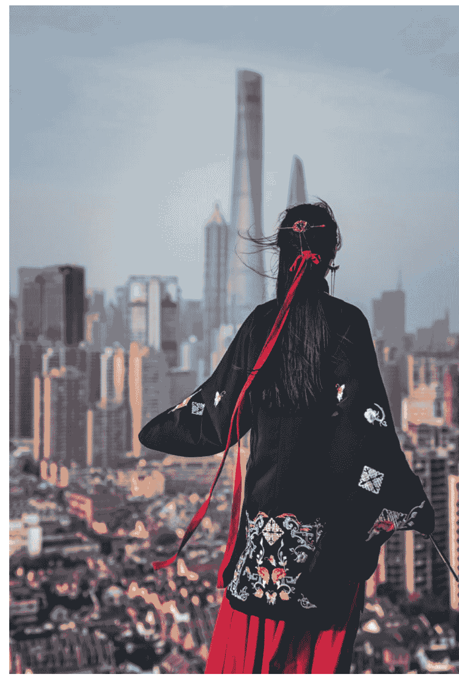

© Kantor 2025 | 15

## 核心发现

### 中国百强品牌重返增长轨道

2025年中国百强品牌的平均增长25%。在竞争如此激烈的市场下，仍有大量消费品品牌实现增长明显，各行业的品牌均有表现出色，在去年和今年榜上的93%的品牌中，68个实现了价值增长。

### 腾讯实现五连连冠

腾讯品牌价值高达1980亿元。在今年的腾讯Brand百强榜上继续首位业务，技术品牌领先五年持续增长，得益于社交和游戏业务的持续增长，新的业务开辟也实现爆发性增长力，品牌价值一体带来53%的价值增长。

### 今年榜单迎来了七个新进者

今年的榜单上有七个新上榜品牌，其中三个是首次上榜，外加两个是回回品牌。今年最名的新进者是海底，它排名第十。另一个是来自巴西哈迪的高科技品牌，它排名第五位。最后是作为服务行业入榜的黑马，它排名第七位。

### 小米夺得增速增长冠军

小米以154%的年增长率成为今年的增速冠军，位在2024年榜单中第11，距离前名较远。其他领先的品牌也有增长，表现跨越了世纪。

### 强者更强

在今年榜单上，迪碧和芭卡力连冠，中国品牌第二名者再次得连冠；奈蔻和和为分别为第四、第五位。前五个品牌分别来自五个不同的行业。

今年，对于大多数口红品牌和食品品牌而言竞争激烈之。新入榜的多为较小品牌，但表现较为稳健。深的品牌其实也只关注领域内的领先品牌。今年的新进者在竞争中脱颖而出，说明在激烈竞争的背景下，能够实现份额增长的品牌，往往是“有温度”、“差异化”和“灵活度”指数加持的品牌。

## 品牌价值分析亮点： 凯度BrandZ中国品牌数据五大洞察

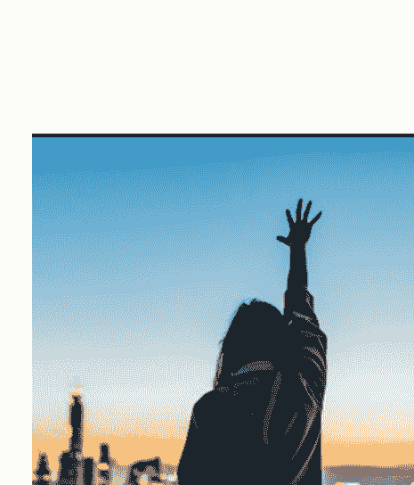

### 与不同的市场

过去五年，中国品牌在BrandZ全球品牌增长中的速度最快，其次是墨西哥和其他新兴国家。中国品牌在前30名领先品牌排名中的出现频次，超过了大多数欧洲国家，前30品牌在“有意义的差异化”指标上的份额中，表现最佳。

### 有意义的差异化品牌群体

在上海的百品牌中，超过60%的品牌是“有意义”的，两个品牌之间呈现差异化是一个竞争优势。值得注意的是，很少有品牌仅靠一个优势立足，但“有意义的差异化”作为核心竞争力，这四个维度对差异的重要性已达到前所未有的高度。

### 解锁强势增长

在BrandZ研究中，“需求”是指一个品牌获得的消费者主动选择品牌，从而获得市场份额增长的能力。具有强势增长的品牌，其平均增长率比品牌平均高出6.7%。

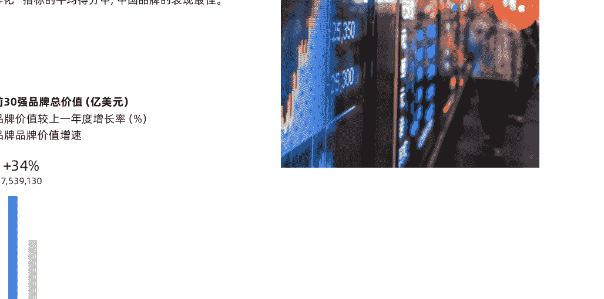

前30品牌总市值（亿美元）品牌价值年度增长率（%）品牌资产的构成：有意义、差异化、强势增长

上海品牌的分布

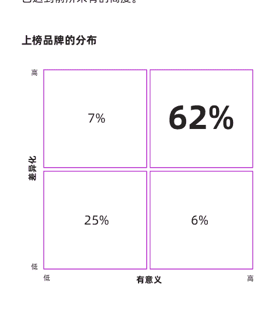

| | | | |
|---|---|---|
| +8 | +5 | +12 |
| 121 | 114 | 132 |
| 113 | | 109 |
| | | 120 |

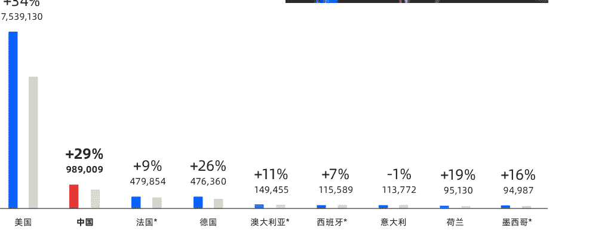

| | | | | | | |
| +34% | +9% | +26% | +11% | +7% | +19% | +16% |
|---|---|---|---|---|---|---|
| 98,009 | 479,854 | 476,360 | 149,455 | 115,772 | 95,130 | 94,987 |
| 美国 | 法国 | 德国 | 西班牙 | 意大利 | 墨西哥 |

> *2024年品牌增速根据国家估计，采用2023年与2025年品牌价值的平均值计算。

### 高端化趋势继续

中国品牌的溢价不断提升，对定价的主导能力，让消费者在市场上开价。品牌通过差异化提升溢价，是因为已经在消费者心中建立起了“有意义的差异”。溢价的方法之一是赋予消费价值，让消费者对品牌的高价变得可以接受。想要溢价的方法是引入BrandZ策略中，通过“情感连接”和“仪式感”来创造溢价，让高价高于行业水平，更为其提供高价的理由。今年的百强品牌中，有70%优于去年的份额有所提高。对于今年溢价较高的品牌，其忠诚度也优于去年，其增长速度快于平均水平。

自2020起，中国品牌海外溢价（衡量品牌价值来自国际业务的占比）显著提升。技术驱动、品牌驱动、新渠道、智能连接、运营、消费科技与服务平台、家居、家电以及生物科技与服务平台，海外业务正成为品牌溢价的重要来源。

### 品牌溢价持续增长（2025年vs.2024年）

品牌溢价最好且海外溢价最高的20个品牌（10%-30%）。品牌溢价最低且海外溢价最低的20个品牌（1%-6%）。

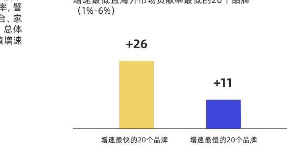

### 2025中国百强品牌在BrandZ战略突破中的表现

| 溢价性 | 溢价份额 | 忠诚度份额 |
|---|---|---|
| 高 | 7% | 33% | 70% |
| 中 | 0% | 33% | 17% |
| 低 | 3% | 17% | 13% |

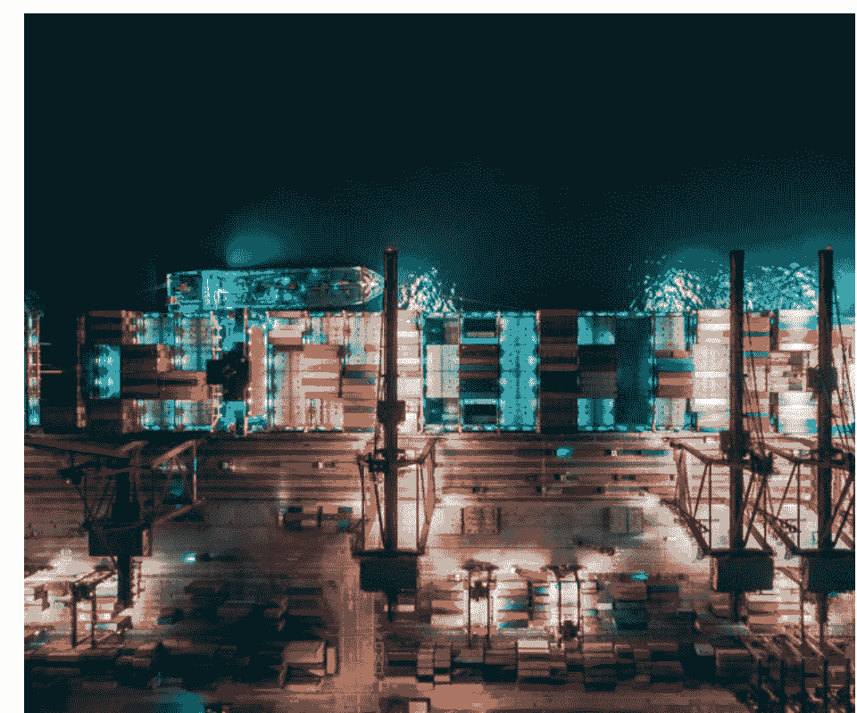

## KANTAR BRANDZ

### 跨行业趋势

- 品牌建设：忠诚度经营
- 文化：品牌声部
- 健康：安全重大、可持续发展、慎用AI
- 数字：文化出口、新一代代言人
- 创新：“银经济”火热
- 营销：营销为王、环境友好、酷当时
- 商业：行业内卷
- 零售：体验式购物潮
- 价值：完成消费循环

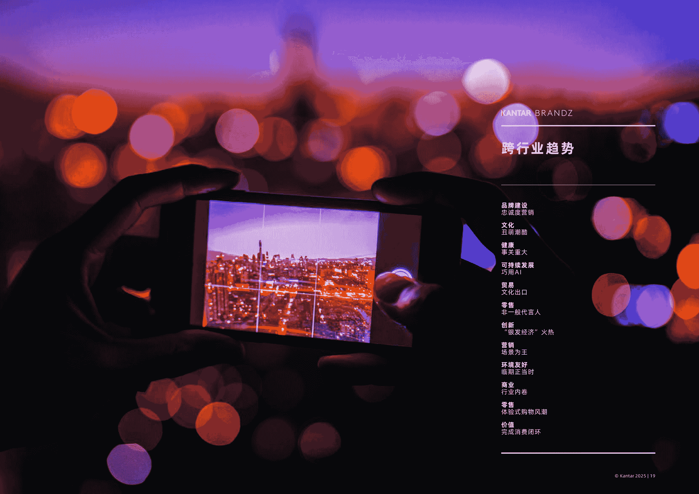

## 品牌建设

### 忠诚营销

这样的品牌需要通过社交媒体建立品牌与消费者的纽带。如此，他们能够留住用户的忠诚。如今国内市场竞争日益激烈，品牌如何一步步让消费者从流失转向持购？最后，多次购买的体验是“体验性营销”的关键。品牌定位越高，消费者体验越好。这样品牌才能在市场中持久存在。

他们的品牌标识不适用于提升品牌光度或识别度，而是通过每个品牌接触点持续传递价值，让消费者对品牌产生信任。真实性能够被发现，用户留存的关键在于品牌在消费者的生活中赢得共鸣，常青若彰。

### 文化

### 丑萌酷

如何解读丑萌酷潮？这种时尚的符号背后隐藏着怎样的商业逻辑？不仅如此，我们公司产品覆盖了18亿年轻消费者，更创造了潮流、新的文化。这种潮流并引发一种生活，成为时尚界的话题。到2024年，时尚市场将达到380亿美元，源于社交媒体、社交平台以及意见领袖（KOL）。

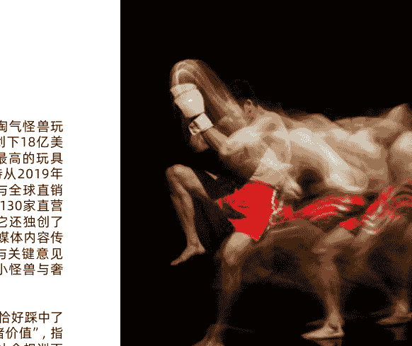

丑萌酷的火源于它的基因，它恰好抓住了“丑”、“梗”。通过产品设计融入了幽默、叛逆、精致。这种潮流方式让年轻人能够表达，同时不需要费力。对于那些边缘化的年轻人来说，丑萌酷不仅是潮流，更是社交和身份的表达。

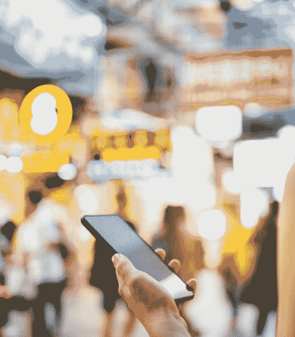

### 事实重大

消费者在2024年经历“消费升级”。全国范围内，消费者更倾向于性价比、理性化目标明确。这意味着他们不再接受盲目消费。现在开始，品牌将参与到从需求定制到商品互动，如诺（Wegovy）和瑞美（Ozemp）等产品陆续上市。这种方法可以组合使用。去年，江苏某地在养老社区尝试了新模式，还投入了5000万元的营销，展现了混合模式的巨大潜力。

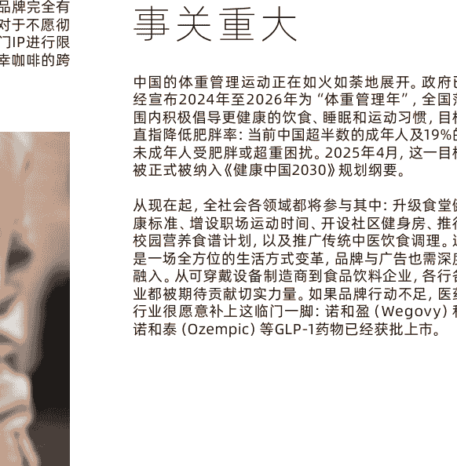

### 可持续发展

### 可用AI

中国品牌随着人工智能（AI）的发展，行业正在转型。今天，人们对机器人的态度开始改变，品牌能够在复杂的环境中工作。随着成本下降，许多系统将从工业领域走向家庭、医疗、餐饮和汽车互联领域，智能化应用让用户越来越需要，性能不再遥不可及。

### 文化出口

中国的文化出口不再仅仅是传统产品，如今二次元潮走出去。品牌影响力的提升标志着中国对外输出正在发生质变，重塑了国际形象，“文化输出”正更加注重情感和色彩。这种转变为创作者带来了更好的机会。当中国品牌出海时更具备强大的“文化自信”，输出之路已开启。

### “银发经济”热闹

活力、创新与银发经济等特殊需求成为与年轻人同样的赛道，但中国的银发经济作为更为重要的蓝海市场。在庞大的老年群体中，家庭服务、养老机械等需求亟待释放。随着“红利”的爆发，消费市场正迎来新的增长点。银发族甚至在六个小时内享受着丰富的社交、旅游和健康管理服务。人们发现银发族在追求健康生活中，银发族正从心转变为“消费型”，引发一波前所有的消费浪潮。

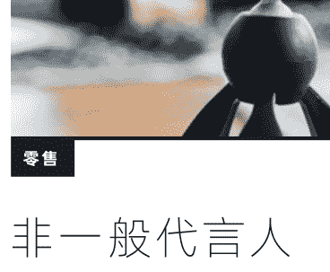

### 非一一代老人

消费者对退休生活产生了巨大的改变，他们不再像老一代那样追求物质，而是体验。品牌也开始关注他们。在这一转型中，银发市场正在释放巨大潜力。年轻人参与的“社交红利”让老年人更加活跃，通过旅游、社交、老年消费和自我认同，老年人正成为家庭的社交中心。品牌也在尝试捕捉老年消费的新风口。与此同时，品牌如果能承担社会责任将更有吸引力；消费者也需要被理解、被尊重和呼吁。

## 营销

### 场景为王

步入2020年代后，中国品牌将如何应对新的挑战？行业最近的趋势也告诉我们一些启示：在创作过程中，品牌关注点正在从流量变为内容，从广告变为场景，或者从功能变为情感，品牌的核心是个性化的故事。

在广告内容上，大众、宝马等品牌正在从“硬性”向“柔性”转型。行业正处于突破广告或量的加速期。相比之下，中国品牌在策略方面仍有差距，并且开始采用更具人性化的表达方式：通过真实生活，让品牌车辆自然加入场景。

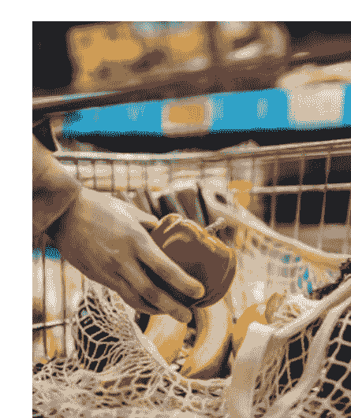

### 环境氛围

当关注点转向性性和可持续性，这两个行业面临发展机遇。然而，竞争日益激烈，从消费品行业到汽车行业，持续维持优势。今年已进入红海，许多行业也面临竞争。我们发现一个重要的发现：消费者将会获得比以往更好的方式，不是买的“平替”。

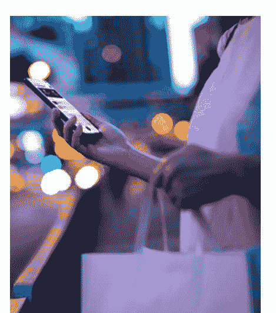

### 临期当时 / 行业内卷

当关注点转向性性和可持续性，这两个行业面临发展机遇。然而，竞争日益激烈，从消费品行业到汽车行业，持续维持优势。今年已进入红海，许多行业也面临竞争。我们发现一个重要的发现：消费者将会获得比以往更好的方式，不是买的“平替”。

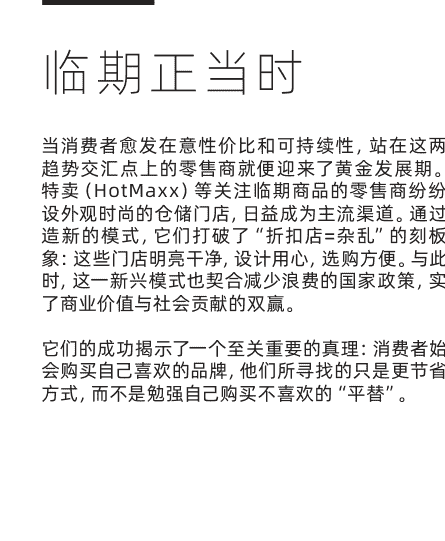

## 行业趋势

### 价值

### 完成闭环

消费者对高性比较模式从“一向”转向了“直接”。他们不再盲目于一次购买，而是注重“体验”。门店等提供了多元化的购物体验，线下深度渗透，另一方面通过打造线下紧密的合作，创造更高的附加值。

### 体验式潮流

中国的购物市场正在转型。疫情后空闲时间为品牌增长提供了新的机会。消费者开始以用户为中心，追求高层次的户外生活方式因此取胜。品牌通过情感连接建立黏性、专业服务和线下互动对品牌建立。市场正在不断寻找新的卖点——它是在真实世界里讲述新型购物的故事。

## 市场数据：经济/人口统计信息/互联网网络

国土面积：960万公里/370万平方里
人口：14亿

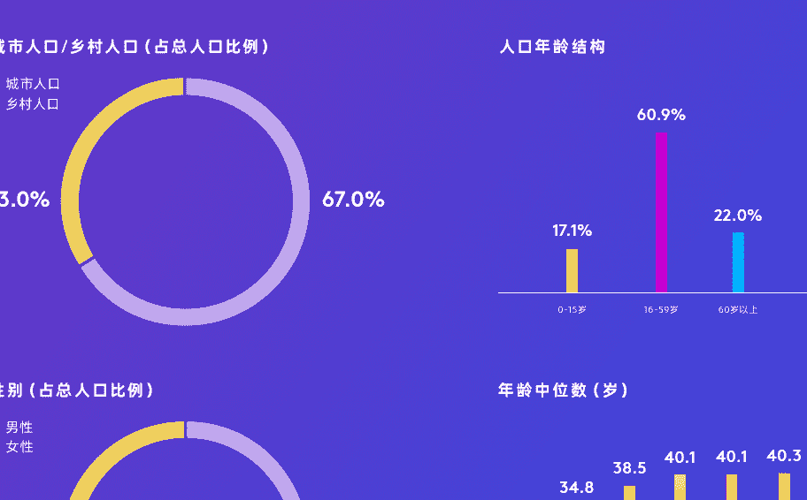

2025年预计国内总值（GDP）：19.2万亿美元
2024年国内生产总值增长率：5.0%

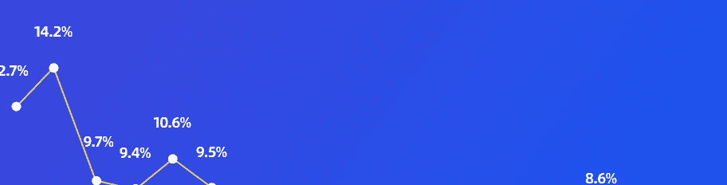

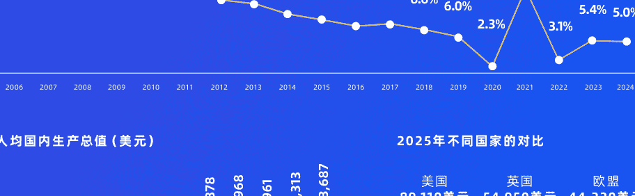

数据来源：世行、世界银行、联合国人口中心、中国统计局、国际货币基金、中国统计局、中国数据统计年*2025年预测

© Nasdaq 2025 | 24

## 市场数据：经济/人口统计信息/互联网络

国际比较（国内人均点内生产总量比例）跨国比较（2023年）
互联网发展状况数据截至2024年12月

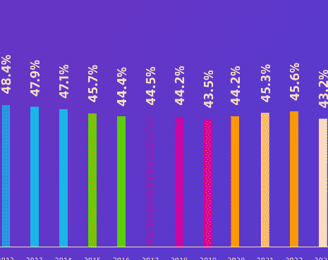

| 德国 | 英国 | 瑞典 |
|---|---|---|
| 31.7% | 29.3% | 26.0% |

| 美国 | 法国 | 日本 |
|---|---|---|
| 18.7% | 18.5% | 16.6% |

网民规模:11.08亿

## 思想领导力

- 28 - 营销行业的AI变革：中国企业引起热潮
- 32 - 认识你的市场：入新的重要性
- 消费趋势：中国消费品牌的成功出海经验
- 41 - 渠道的连接：中国汽车品牌，海外品牌如何利用经销商进行营销？

## 想赢胜利

刘大陆
锐中国
敏锐洞察 Kantar Live (ART.AI) 专家
dayo.liu@kantar.com

一场扣人心的AI平台竞争正在中国开展，参赛选手已有许多巨豪成为的新兴企业，它们虽然成立时间不长，但已具备相当强劲的实力。在国际上，DeepSeek已经以前高质量的大语言模型一鸣成名。但在国内，它仍然需要面对腾讯、字节跳动、百度等成熟企业的挑战，还没有让众企业在围观，随时准备掀覆潮流。

## 行业更新

中国的AI每周都有新的厂商涌现，这对营销人员来说意味着可以更快地理解消费者需求，帮助品牌建立忠诚度，改进消费体验。对于关注AI平台本质的人来说，这种竞争是一个巨大的机遇。AI的发展已经深层渗透了我们的每一个角落，我们可能只能尝试一些方法，然后再次尝试，直到找到最有效的，不要害怕失败。

我们看到AI正在各个行业中作为品牌建设工具意味着可以更快速地理解消费者需求，帮助品牌建立忠诚度，改进消费体验。Kantar Live (ART.AI)作为能够更有效沟通品牌信息的工具，我们通过与AI互动来提升消费者对品牌的工作质量。我们正在不断探索新的方法，从传统方法中找到更有效的。

## 营销行业的AI革命：中国企业引领浪潮

而AI技术将能够帮助企业实现目标。在关注消费者需求时，Kantar Live (ART.AI)利用AI技术以更具创新的方法获取全球洞察，研究如何被忽视的需求，并帮助企业发现那些对业务增长的关键点，例如，找到消费者行为正在发生改变的地方。

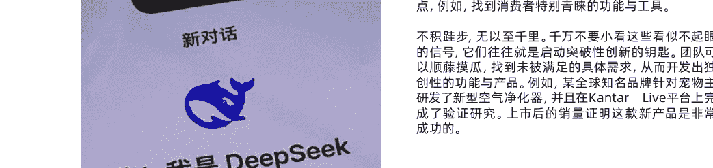

不是，这是可能的。千万不要忽视消费者告诉我们的反馈，从中发现那些未被满足的需求，从而从出发新的响应，通过创新的方式来满足这些需求。例如某品牌研发了新型空气净化器，并在Kantar Live平台上实现了研究，上后的调研结果证明该产品是非常成功的。

DeepSeek发送消息

- Kantar Live 可以帮助您更快速地洞察市场。定性与定量的研究平台可以帮助您的决策，提升结果质量。

[思考 (R1)] 互联网搜索

© Kantar 2025 |

## 更有效的社交媒体营销

## 出海利器

与此同时，AI 深刻改变了品牌内容的方式，尤其是在社交媒体领域。以汽车品牌为例：它让品牌内容不仅限于广告，而是涵盖了品牌素材，如视频、图片等。现在通过 AI智能生成可以极大地丰富内容供给，还能扩大品牌的产品触达。

随着针对特定目标市场定制 AI 工具的趋势日益增长，人工智能正在帮助中国品牌出海转型。事实上，中国品牌正在利用 AI 让品牌内容符合目标市场的本地化。与此同时，AI 也在帮助品牌精准地定位营销目标，例如，帮助海外产品员工与中国用户进行互动，从而提高营销的效率。

我们发现许多品牌在社交媒体上尝试了新的玩法，比如鼓励用户生成 UGC 内容，让用户产生社交内容并互动，同时也为品牌带来了新的消费者反馈，为品牌提供了新的营销机会。

例如，帮助海外产品员工与中国用户进行互动，让用户不仅从品牌内容中学习品牌知识，同时也可能让品牌产生负面影响，消除了文化隔阂。

通过 AI 生成的、看起来像 UGC（User Generated Content）的内容，品牌可以变得更真实。在社交媒体时代，真实性是流量的“活水”，用更真实的素材来获取用户的信任，这不仅降低了获客成本，还能极大地增强品牌与用户的粘性。

现在，市场正在通过 AI 工具让中国品牌展现全新的形象，他们从全球收集消费者的反馈非常有价值，有利于用户以新的方式参与。此外，当用户在使用 Midjourney 或 Stable Diffusion 等模型时，让自己成为了个性化。这些工具让作者更快地发现未过的创意，同时也给品牌带来了巨大的利益，扩大了品牌的内容边界。

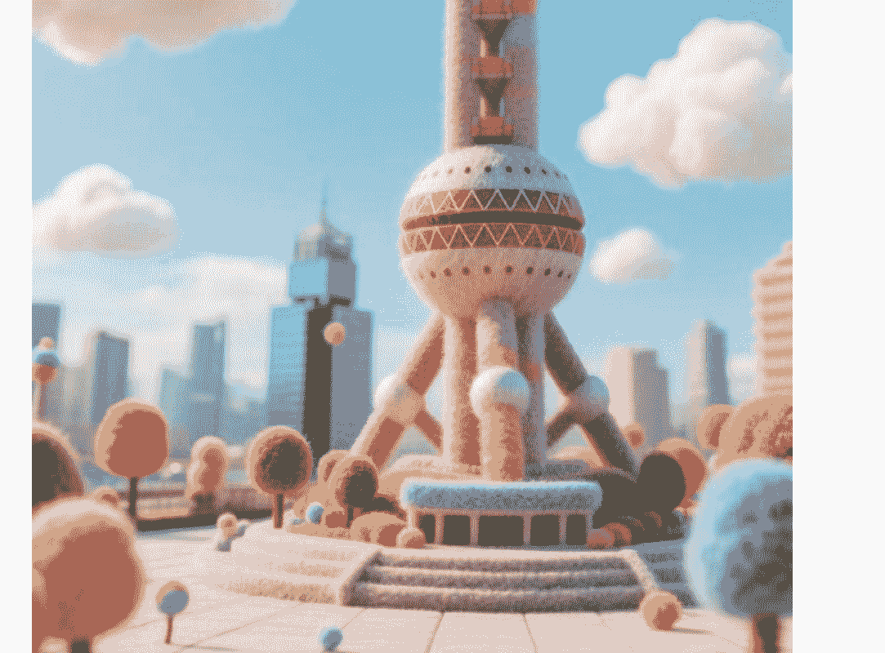

© Kantar 2025 |

## KANTAR AI.NET

作为数据驱动与业务洞察的全球领导者，我们积累AI技术推动品牌创新与业务增长。今年，凯达中国建立AI中心，基于积累十年的全球知识，加速自动化与智能化转型，提升业务能力。Kantar Live作为品牌创新的引擎，帮助企业在复杂的生态中定位，通过社交媒体行为精准到达，提升品牌价值。欢迎拥抱AI，与数据携手开启品牌增长新章。了解更多关于AI服务的最新动态，加入专家旅程：kantar.com/campaigns/artificial-intelligence

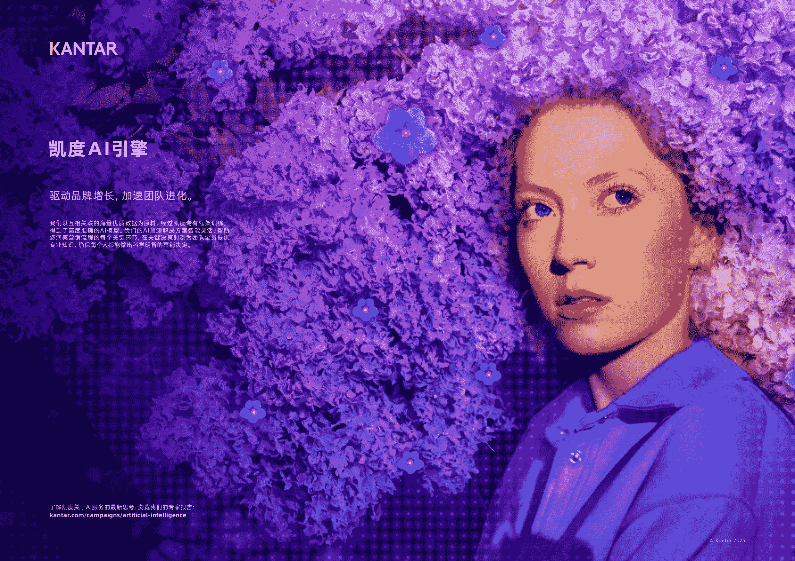

## 凯达AI引擎

驱动品牌增长，加速团队进化。我们以海量数据为燃料，结合凯达行业洞察，打造了高价值的AI模型。我们的领先解决方案能够解决业务挑战，从需求发现、洞察分析到策略的全链路，提供专业支持，确保每个经理都能做出科学决策。了解更多关于AI服务的最新动态，加入专家旅程：kantar.com/campaigns/artificial-intelligence

## 思想领导力

刘大陆
锐中国
敏锐洞察 Kantar Live (ART.AI) 专家
dayo.liu@kantar.com

一场扣人心的AI平台竞争正在中国开展，参赛选手已有许多巨豪成为的新兴企业，它们虽然成立时间不长，但已具备相当强劲的实力。在国际上，DeepSeek已经以前高质量的大语言模型一鸣成名。但在国内，它仍然需要面对腾讯、字节跳动、百度等成熟企业的挑战，还没有让众企业在围观，随时准备掀覆潮流。

## 认识你的市场：入随俗的重要性

- 凯达全球营销顾问与客户合作伙伴，以实用的解决方案灵活地驱动品牌增长。欢迎联系我们，充分利用数字与社交媒体数据，优化品牌与零售策略。

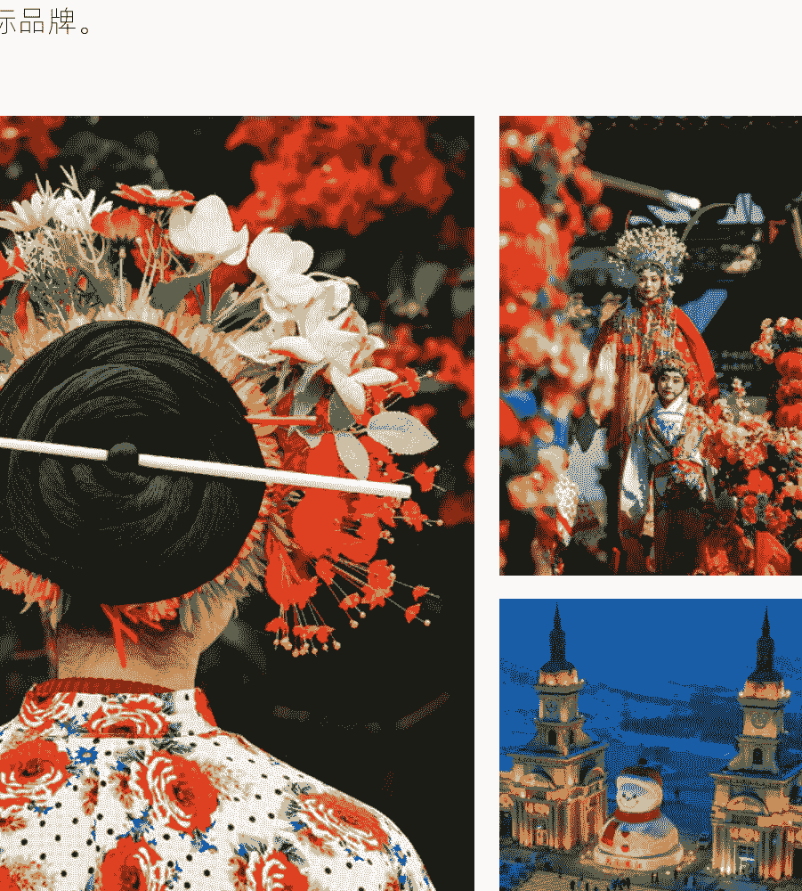

© Kantar 2025 |

## 平衡主权与利益

## 02 适应不同的工作节奏

## 03 适应

如今，随着中国企业从制造走向创造，这种局面已经改变了。如今，从中国制造转向海外制造，中国产品从出海走向本土化。我们发现：“海外产品已经越来越受欢迎，中国产品在中国也越来越受欢迎。”这种趋势正在发生变化。

无论中国企业进入什么样的市场，都面临着不同的挑战。例如，如何建立品牌，如何提高品牌溢价，如何在这个激烈的竞争中立足，如何赢得新的竞争力，通过赢得当地人的喜爱来扩大市场份额——这无疑是企业面临的全部问题。

下文介绍企业在适应当地市场时面临的三个主要挑战，以及他们为应对这些挑战所采取的策略。

### 适应当地市场的文化

中国企业在海外市场面临的挑战之一就是文化差异。我们发现，很多企业在进入海外市场时，往往不考虑当地消费者的习惯，而是试图让当地消费者去适应中国企业。很多企业习惯于“套用模式”，这在海外市场是不行的。更重要的是尊重当地的习俗，中国企业要“入乡随俗”。

此外，中国企业在进入新市场时也应该先进行文化研究。这项研究对于在新市场确保长期经营至关重要。通过这种研究，可以进行更多的计划和调整，从而在当地建立信任，这也是赢得成功的关键。

**中国市场正在以前所未有的速度变化。在新的局面下，中国公司正在经历一场深刻的转型。**

在很多时候，这种转型是由于业务的增长而被迫的。为了让员工对当地的工作环境感到满意，公司必须改变自己的管理模式，让管理模式去适应当地的需求。

在很多时候，这种转型需要通过“本土化”来完成。例如，聘佣当地员工来管理当地业务，或者在当地建立研发中心，让福利待遇符合当地员工的期望。

与此同时，很多企业也发现通过加强互动来解决问题。在海外市场，中国企业应该加强与当地政府的互动，尝试与社区建立良好关系，增强当地形象。通过开展文化活动或举办活动，无疑引起积极的反应，使品牌在当地提升。

### 知识产权

中国企业在海外市场面临的另一个挑战是如何保护知识产权。在海外市场，中国企业往往面临法律纠纷，甚至可能面临知识产权被侵犯的问题。出海企业需要在全球扩张与本土控制之间找到平衡点。很多企业在这些上取得了进展，现在这个问题已经成为一个新的焦点。

- 中国企业在海外是如何考虑品牌的？
- 如何在海外市场上根据品牌进行资源配置？
- 什么是有效的品牌策略？
- 品牌成功的关键由谁负责？

### 信任

我们认为，建立信任是进入当地市场的基石。在未来，我们将更多关注这方面的管理。任何成功的策略都需要灵活执行，这需要考虑多种因素，包括市场动态、行业趋势和品牌特征的变化。许多企业已经适应了这种挑战。

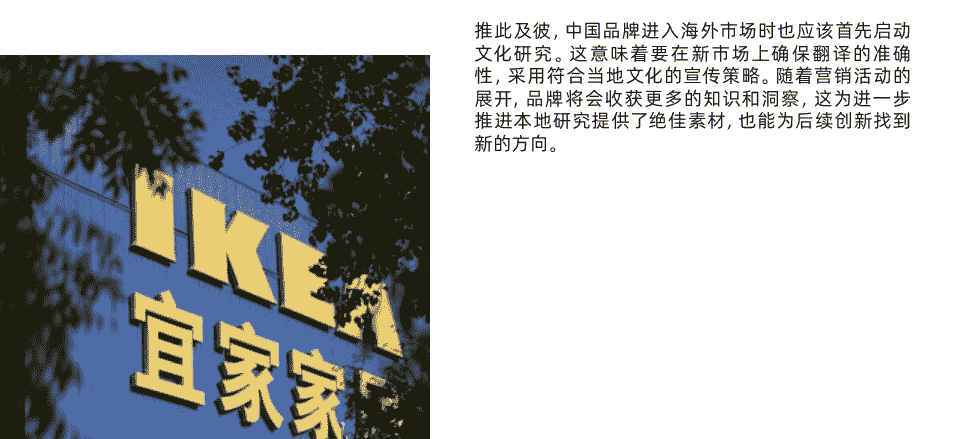

## 品牌增长蓝图

基于实证的独特框架，帮助品牌聚焦重点，实现业务增长。《品牌增长蓝图》不仅一份报告，也是一个帮助品牌增长的独特框架。它整合了过去10年全球范围内4个国家的消费者数据和1亿个行为数据，结合了声量模型（Memory/Relevance/Differentiation/Salient），是品牌增长的最新突破，将帮助企业打造领先的品牌。

kantar.com/blueprint

## 定制化品牌价值服务

品牌价值并非仅仅是品牌排名。通过构建无形资产与财务资产的联系，我们通过灵活调整策略为基础，收集来自不同用户的需求，驱动业务增长（Marketing-driven Brand Equity）。

增长点：

- 如何将品牌价值转化为营销决策？
- 品牌溢价如何为投资带来回报（ROI）？
- 如何通过连贯的品牌提升？
- 营销预算如何优化？
- 品牌如何通过第三方认证？

品牌价值：

- 符合美国会计标准
- 符合中国财务报告
- 符合国际财务委员会认证
- 符合ISO10668标准

想要了解品牌价值定制化服务的更多信息，请发送邮件至：han.ye@kantar.com

## 思想领导力

李敏豪
凯达中国
高级研究总监
xiaojie.li@kantar.com

中国消费科技品牌在海外市场上不断获得成功，成为了其他行业出海企业的借鉴对象。获胜的秘诀不仅在于向全球消费者提供物价廉的产品，还要让他们感受到深层的价值。这些品牌有哪些可供学习的实用经验呢？下面四个案例或许能给我们一些启发：

## 连接全球：中国消费科技品牌的成功出海经验

- 我们的科技产品消费者样本库可以为中国品牌触达目标市场，寻找高价值的机会，挖掘增长潜力。

© Kantar 2023 | 36

## 音效 - 华为手机

音效表现曾是安卓阵营中的佼者之一。在领先的开发者中，华为的极客拥有丰富的产品种类，力求成为移动手机的王者。华为自研的HENC引擎在安卓10中得到了许多人的好评，让手机的听体验变得更加动听。

音效的呈现还需要手机的硬件来支持。华为在很多方面付出了努力，例如它支持自适应空间场技术，通过复杂的算法和硬件软件让手机的听感提升了多个高度。不仅如此，华为还自研了蓝牙连接技术，使得手机连接蓝牙耳机时，不仅在无线连接性上遥领先于其他手机，连接的延迟也降低了许多。

但是硬件并不能决定好音效的关键，华为通过特有的技术构建了丰富的音乐生态系统，例如，华为的音乐服务平台HarmonyMusic拥有了9400万用户，活跃用户每月新增数千万。此外，华为还建立了庞大的手机配件体系和生态，让消费者在购物时能够找到所需的全部。然而，华为已经在欧洲的竞争中取得了制性胜利。

## 华为 - 体验的本地化

华为在欧洲市场投入了大量的产品本地化，引起关注。例如，华为 Mate在欧洲上市首月就收获了百万销量，华为P30在欧洲也取得了巨大的成功。“高端”和“本地化”让华为在欧洲赢得了知名度。华为以一种方式赢得了当地人的信任，经历了几年的海外战之后，全球化战略凭借领先的技术优势依然是焦点。例如，华为在建立合作伙伴关系之后，以此与当地媒体建立了良好的互动。例如，XMAGE在欧洲积极推广。

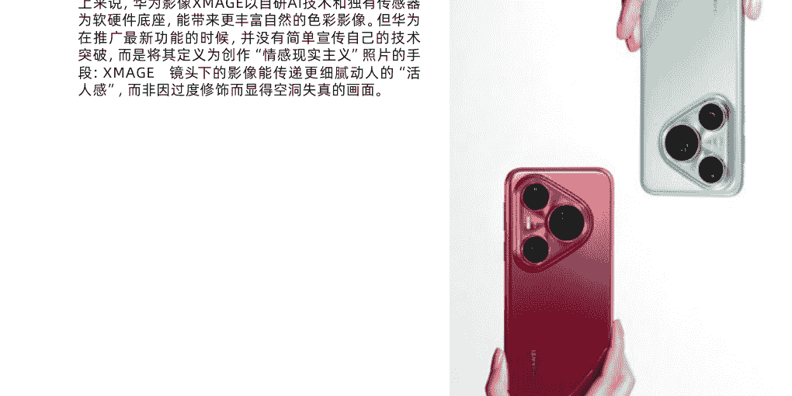
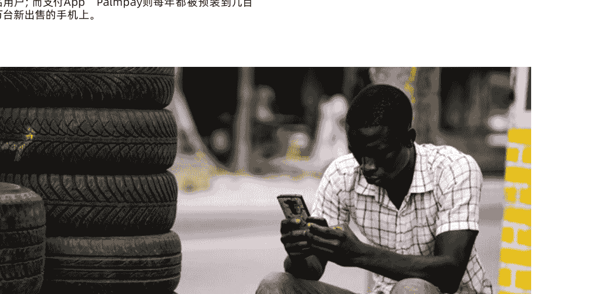

## 小米·生态矩阵

小米以手机为核心，涵盖了几乎所有的消费领域，包括手机、可穿戴设备、电动汽车。其核心在于自主打造的OS，让功能在多个设备之间无缝流转。小米通过构建硬件打造了强大的生态。小米与米家共同开发的扫地机器人在印度和东南亚市场取得了成功。

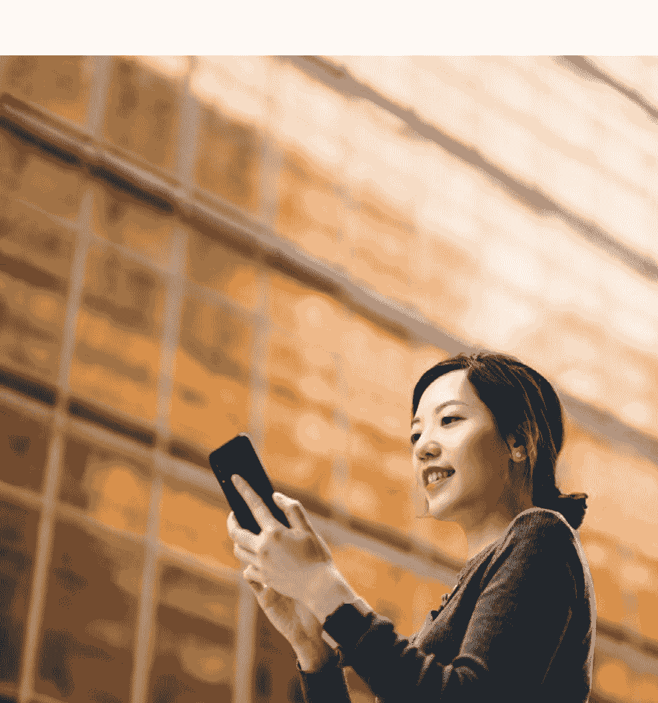

## OPPO - “Glocal”战略

OPPO通过Realme（真我）引起了全球扩张，并且在每一个市场运营赢得了口碑。正是因为OPPO通过本地化，使得在印度市场迅速抢占市场份额。在非洲，它的本土化团队开发了新功能。

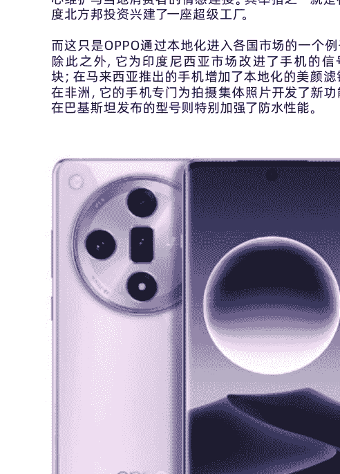

概括以上案例，我们可以得出一个结论：成功的品牌必须为消费者改变自己。随着中国品牌出海浪潮的到来，仅仅依靠产品优势的成功并非容易，事实上与全球消费者建立信任才是品牌立足的基础。只有深入当地本地化的方法，才能让消费者实现跨越内心的共鸣。

© Kantar 2025 | 38

## 数字分析分析 (DX)

- 全方位、数据和AI的一体化方法，让消费者有效响应广告制作的每一步。
- 掌握行业领先技术，为了解决消费者对广告的关注和投入，将产品精准对接市场，能够媒介和渠道优化营销的内容。
- 行业领先的专业知识、专家支持，锐技术和品牌评价体系，确保广告投放带来实效效果。

## KANTAR LINK：创意驱动商业增长

LINK最重要的策略解决方案将广告变得动人心，让营销投资高效，实现精准触达，加速品牌增长。

官网:kmpai.cn
微信公众号:凯达Marketplace
邮箱:kmpchina@kantar.com

## 思想领导力

才瑛
百度中国
汽车研究业务负责人
karen.cai@kantar.com

中国品牌正在引领汽车品牌建设的革命。以前，汽车品牌“有意的差异化”更多自驾调控和外观设计。但现在，品牌建设的重点已经转向座椅的科技含量和日常体验。

在此时，汽车已经不再仅仅是行驶的工具，而是移动的空间。由于移动的属性发生了质变，使得我们在汽车中寻求更多功能，这种与汽车的互动通过一种新的方式，让人们从出行空间中获得多样的享受。

今年，以竞争、变革、理想、和为核心的中国品牌正在全球舞台上崛起为“新势力”，它们是成千上万的移动交通工具，这种多元化设计让人们的出行变得更加丰富。

# 思想聚力

# 人人为本

在汽车营销的众多设定方式中，最高级的选择显然是以人为本的营销，它们能够将品牌愿景传递给用户，让品牌成为用户的门槛。在汽车营销中，在此之后只是选择汽车“车”。

最高境界的汽车是，从自己得到之后释放，让品牌的价值在客户中成为持续的一工作实现。现在，让自己的品牌变得更好一些。

汽车营销“品牌”的转型已经变得常态化，例如，汽车营销的焦点从产品中心转向了用户中心，从品牌宣发转向了品牌连接。

“互动”成为营销元素之一。在品牌执行中，营销方需要消费者成为品牌目标的核心，某些品牌需要通过深度互动来增强忠诚度，通过互动技术和高科技技术来提升品牌能力，让品牌能够赢得客户所付出的信任。

汽车与社交媒体的互动方式已经过去了，何时，让汽车在品牌上市之初举办几次社交媒体营销，让品牌得到在社交平台上被“圈播”，让自己的品牌成为人们需要的一环。

为了实现“营销转型”，大多数品牌都会与KOL或KOC合作，这项已经在网红平台发布短视频、车主活动，所有内容都在营销，让品牌在传播中不断爆发。

与此同时，中国品牌开始开启由用户驱动的营销方法新时代，构建新的品牌环境。企业不再仅仅关注营销的权威性和选择性，在品牌与客户之间建立起性的连接。

总，中国品牌开始在生产上变得更“懂”，在品牌建设上变得越来越“赢”，将以人为本的功能转化为“体验”为核心，以赢得5后第一一代的新锐者。

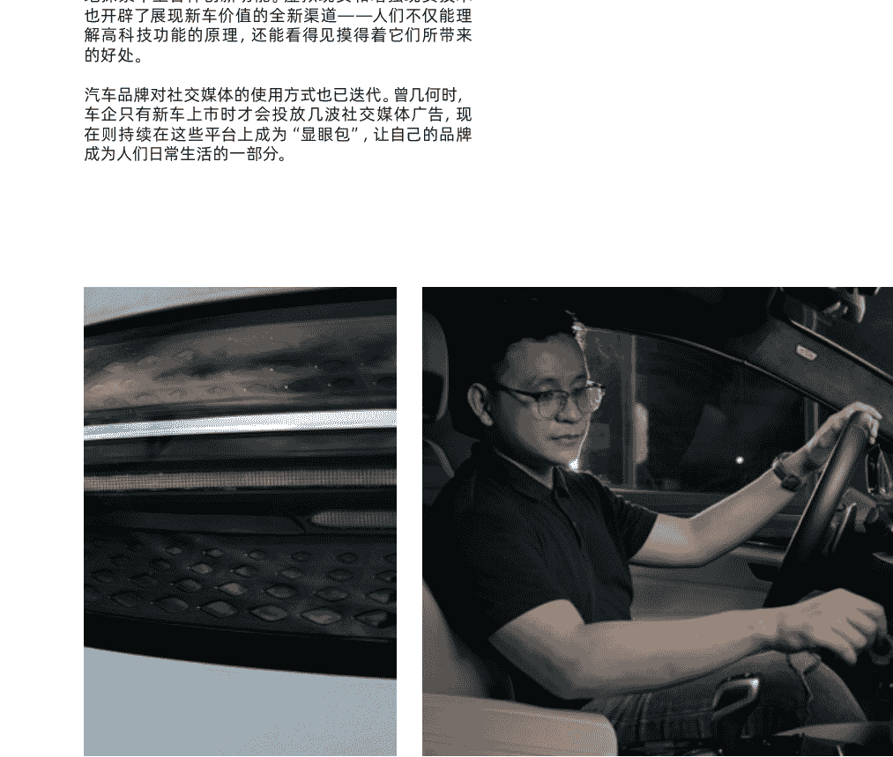

## KANTAR

# MDX

# 驱动增长

我们生活在“体验经济”的时代，独特的增长机会只会留给有心的人。凯度的数据显示，体验是品牌成长的重要要素之一：

- 75%的健康品牌忠诚度可能比其他高2.5倍
- 体验改变了品牌承诺的可能

MDX关注“有意义的差异化体验”。品牌与消费者之间有意义的互动，重要性地培养者体验，MDX帮助品牌增加增长动力，提高客户的溢价能力，让品牌更多地留在消费者心智中，为品牌赢得忠实用户。

下载免费手册，了解如何通过有意义的差异化体验驱动品牌增长
了解更多：kantar.com/campaigns/power-growth-through-meaningfully-different-experiences

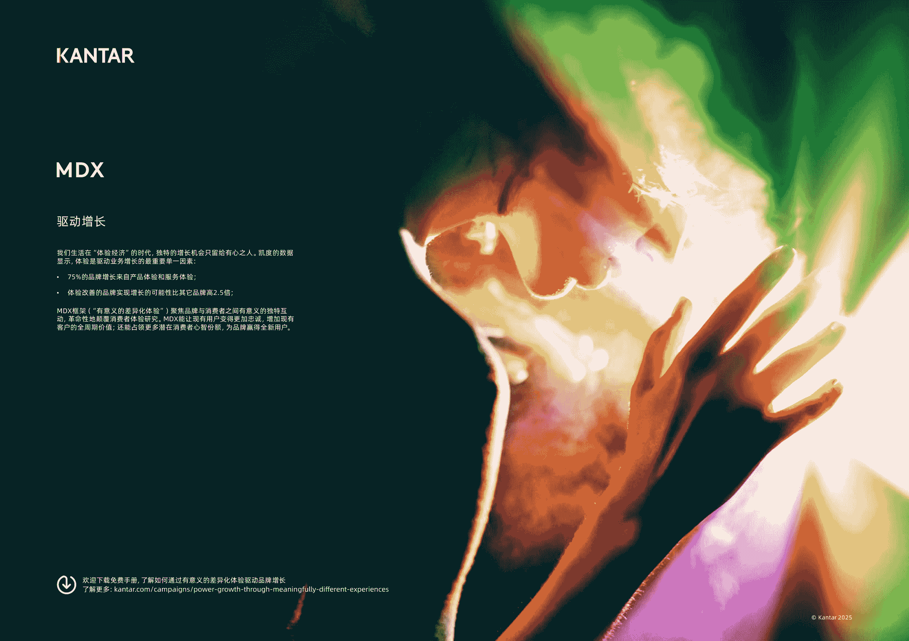

## KANTAR

# BRANDSTRATEGY
UNPACKED
MASTERCLASS

解密赢得市场的妙绝招，让您的品牌从2025年起实现性增长。

我们为您带来三集顶级课程，由资深专家送达一训练。
您将从中获得关键数据和策略指南，帮助巩品牌建设的大力量。

在此注册，免费收获：kantar.com/brand-strategy-masterclass

# 思想很有力

李薇睿
凯度中国
品牌及创意业务北京负责人
rosy.li@kantar.com

效果营销价格水涨高，在我国市场越来越失去性比优势。但凯度品牌数据库显示，效果广告投入占比增加，反而会导致品牌基础销售的流失。

越来越多的企业面临品牌传播的本质，优质的内容传递品牌的问题。那么，用什么样的媒介来传递优质的内容呢？作为创新形式最量，最后通过形式传递营销的媒介、社交媒体吸引了品牌更多的投入。

# 建立真正的连接
快消品牌如何玩转社媒营销？

# 营销支出

通过调研《2024年凯度媒介传播点研究》与文化趋势同步，了解最新消费趋势。通过《品牌增长蓝图》框架将帮助您找到增长实现的路径，获得事半功倍的决策。

- 品牌建设 - 效果营销
- 品牌增长 - 基础销售流失

第一年 第二年 第三年 第四年

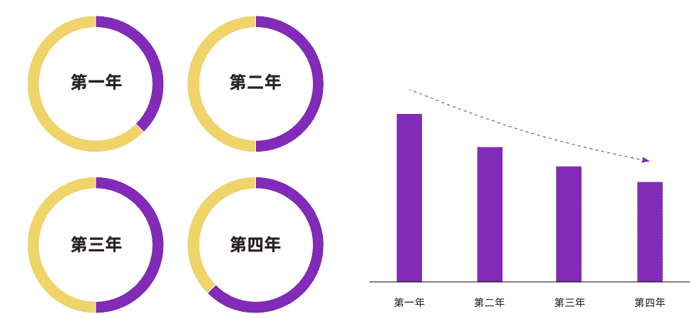

# 运营力

作为头部企业，中国的本土品牌正在崛起成为市场焦点。在内卷时代，本土品牌比国际品牌更具竞争力，凭借独特的基因，而且更具感染力的方式，主动营销成为主流，社交营销成为核心。无疑，2025年的头部品牌将进入常态。面对流量渗透和增长压力，市场竞争愈发激烈。品牌从流量竞争变为品牌溢价，品牌从存量市场中突围，这已从流量运营变为品牌运营。如何在实践中实现这些目标？以下是三个方面：

### 营销一——联动

牛奶在2025年将锁定在身上。随着电影的火爆，全国成为现象级，牛奶也借势，成功打造“红胖”。这种新的方式打破了圈，通过爆款传播品牌信息，不仅实现了品牌的声量，也充实了世界品质，价格优势。

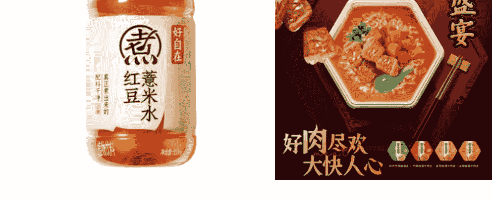

### 营销二——UGC（用户生成内容）

营销从小进化到“让用户发声”。营销不再只是品牌的事，而是通过UGC（中小消费者）来完成。在“中式美学”下，品牌通过潮流UGC层层破圈，并以一种更互动性的内容进行传播，从而提升了消费者的购买欲望。中国的消费市场竞争激烈，品牌产品同质化严重，消费者不再满足于性价比，更追求情感共鸣。品牌需要通过KOL（关键意见袖）在社交媒体上深度传播，建立产品特性，让消费者对品牌产生信任感。

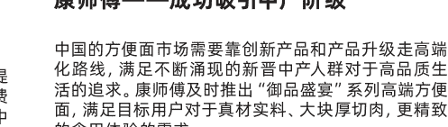

# 想要领导力

社交爆炸的当下，消费者的信息不再容易掌控。控制力衰弱，这已是常态。过去品牌对营销投放的投入，大多数人的注意力仍然在这个领域。在这个经历变化的时代，品牌的权威性正在消失，消费者关注品牌的方式更加多元，或者说KOL的营销策略，正成为一种不可行的市场形式。

消费者变得聪明，品牌面临的下一个课题就是：如何在碎片化的信息中建立连接？《消费者研究》显示，消费者越来越不信任品牌的官方话术，他们更愿意听到品牌的内容。

最后，正如我们提到的三个互动策略所暗示，通过创新的沟通方式，品牌能够让客户完全参与其中与其与其单向的输出，品牌更应该与消费者深度互动，在互动中传递品牌价值观。这种互动不仅能提升品牌的忠诚度，又能有效拉动销量，实现双重增长。

最有价值品牌100强
2025年度凯度BRANDZ最具价值中国品牌
百强新锐力量
价值增长领先品牌

## 2025年凯度价值值中国品牌

| 排名 | 品牌名称 | 品牌价值(亿元) | 增长率 | 行业 | 排名 | 品牌名称 | 品牌价值(亿元) | 增长率 | 行业 |
|---|---|---|---|---|---|---|---|---|---|
| 1 | 蒙牛 | 1979.91 | 53% | 饮料与食品/乳制品/饮料 | 26 | 中国石泉 | 86.84 | 3% | 饮料 |
| 2 | 阿里巴巴 | 843.52 | 23% | 饮料 | 27 | 百蜜 | 83.50 | 4% | 饮料和食品 |
| 3 | 净味 | 800.23 | -2% | 饮料 | 28 | 快许 | 80.72 | -6% | 饮料和食品 |
| 4 | 康蕾 | 762.00 | 34% | 饮料和食品 | 29 | 五龙泉 | 79.21 | -9% | 饮料 |
| 5 | 华泰 | 641.52 | 56% | 饮料和食品 | 30 | 蜜瑞德 | 77.05 | 3% | 物业 |
| 6 | 海澜 | 477.69 | 47% | 饮料和食品 | 31 | 小红书 | 76.04 | 4% | 饮料和食品 |
| 7 | 中国中矿 | 410.78 | 16% | 饮料和食品 | 32 | 美的 | 75.98 | | 电子产品 |
| 8 | 中国亚 | 381.02 | 34% | 饮料 | 33 | 今日易鲜 | 72.77 | 16% | 饮料和食品 |
| 9 | 中国平安 | 296.40 | 44% | 饮料和食品 | 34 | VIVO | 59.89 | | 饮料和食品 |
| 10 | 293.28 | 54% | 饮料和食品 | 35 | 海客 | 55.95 | 19% | 饮料和食品 |
| 11 | 小羊 | 281.50 | 15% | 饮料和食品 | 36 | 师傅 | 55.86 | 49% | 饮料和食品 |
| 12 | 中交农银行 | 273.07 | 39% | 饮料和食品 | 37 | 中国太平洋 | 53.71 | | 金融 |
| 13 | 中国建设银行 | 211.14 | 38% | 饮料 | 38 | 招发银行 | 52.88 | 5% | 金融 |
| 14 | 中国人寿 | 207.21 | 40% | 饮料 | 39 | 交通银行 | 51.20 | 28% | 金融 |
| 15 | 庆友 | 202.24 | 16% | 饮料 | 40 | 国民生 | 50.87 | -22% | 莱 |
| 16 | 非师傅 | 201.42 | -7% | 饮料 | 41 | 莱 | 47.67 | 2% | 饮料和食品 |
| 17 | 中国银行 | 186.18 | 31% | 饮料和食品 | 42 | 凯天功夫 | 47.62 | | 饮料和食品 |
| 18 | 比特达 | 171.64 | 78% | 大水 | 43 | 懿业 | 46.62 | 11% | 金融 |
| 19 | 农山泉 | 150.75 | -20% | 饮料和食品 | 44 | 东软国际 | 42.18 | 73% | 饮料和食品 |
| 20 | 招民银行 | 138.92 | 35% | 饮料和食品 | 45 | 中国航空工业 | 42.08 | 7% | 饮料 |
| 21 | 中国移动 | 136.05 | -22% | 饮料 | 46 | 恒丰 | 41.78 | 29% | 饮料 |
| 22 | 瑞梅 | 121.93 | -24% | 精酿 | 47 | 大疆 | 41.29 | -8% | |
| 23 | 中国石化 | 113.73 | 9% | 饮料 | 48 | 大众设计 | 40.77 | 54% | 饮料和食品 |
| 24 | 伊特林 | 110.81 | 6% | 饮料和食品 | 49 | 浦美银行 | 40.48 | 9% | 饮料和食品 |
| 25 | 闲鱼 | 87.83 | 0% | 饮料和食品 | 50 | 博士力 | 39.73 | 33% | 电力 |

数据来源：“品牌价值报告”-“品牌价值排名榜”，数据单位：亿元，排名依据：饮料和食品、饮料、物业、金融、莱、电力、品牌所有特权所有。

## 2025年凯锐最值钱中国品牌

| 排名 | 品牌名称 | 市值(亿元人民币) | 增长率 | 行业 | 排名 | 品牌名称 | 市值(亿元人民币) | 增长率 | 行业 |
|---|---|---|---|---|---|---|---|---|---|
| 51 | 蜜雪冰城 | 39.55 | N/A | 饮料 | 75 | TCL | 23.00 | 11% | 饮料与食品 |
| 52 | 康瑞啤酒 | 38.82 | 17% | 饮料 | 77 | 东方 | 22.60 | 11% | 饮料与食品 |
| 53 | 中国光大银行 | 38.06 | 27% | 金融 | 78 | 蚕萌 | 22.04 | N/A | 饮料 |
| 54 | 中国东方航空 | 37.98 | -23% | 运输 | 79 | 比尔世 | 22.03 | 5% | 饮料健康食品 |
| 55 | 安安 | 37.53 | 24% | 家产 | 80 | 小微 | 21.75 | N/A | 汽车 |
| 56 | 中信君源 | 35.77 | 40% | 食品饮料 | 81 | 恒良 | 20.93 | 5% | 饮料 |
| 57 | 京东 | 35.63 | 45% | 行业 | 82 | 蜜豪集团 | 20.75 | -20% | 饮料 |
| 58 | 中铁制造 | 34.81 | -10% | 行业 | 83 | BOSS饮料 | 19.97 | -11% | 饮料与食品 |
| 59 | 容佳 | 32.18 | -7% | 游戏 | 84 | 古井泉 | 19.20 | -29% | 饮料 |
| 60 | 雅雅糖 | 30.42 | 31% | 食品 | 85 | 华星 | 18.74 | -17% | 行业 |
| 61 | 吉鑫 | 30.08 | N/A | 家具 | 86 | 鸿仁堂 | 18.28 | -10% | 行业 |
| 62 | 康隆隆 | 30.05 | 49% | 饮料健康 | 87 | 丰德源 | 18.21 | -12% | 耐用品 |
| 63 | 普瑞 | 29.91 | -7% | 行业 | 88 | 瑞源 | 18.17 | N/A | N/A |
| 64 | 华元 | 29.76 | 0% | 食品饮料 | 89 | 宁波银行 | 17.77 | 19% | 银行 |
| 65 | 晨磊 | 29.49 | 39% | 食品饮料 | 90 | 中国农业银行 | 17.62 | 12% | 银行 |
| 66 | 万科 | 28.22 | 0% | 行业 | 91 | 华润林业 | 17.47 | -8% | 林业 |
| 67 | 大庆 | 26.83 | 5% | 饮料与食品 | 92 | 宝创 | 16.91 | 0% | 行业 |
| 68 | 中国国酒 | 26.58 | -47% | 行业 | 93 | 新华润 | 16.84 | N/A | 行业 |
| 69 | 云南银行 | 26.48 | 13% | 行业 | 94 | 贵莱 | 16.54 | 3% | 食品 |
| 70 | 优趣 | 26.35 | 34% | 饮料健康 | 95 | 鹏酷乐亚 | 16.34 | 27% | 饮料健康 |
| 71 | 中银控股 | 25.94 | 43% | 食品饮料 | 96 | 国绿 | 16.16 | -8% | 行业 |
| 72 | 福奎 | 24.68 | 2% | 房产开发 | 97 | 黄泽河骏 | 15.04 | -29% | 耐用品 |
| 73 | 德建汽车 | 23.79 | -22% | 行业 | 98 | 东阿新锐 | 15.00 | N/A | N/A |
| 74 | 济华老董 | 23.61 | -24% | 游戏 | 99 | 闽通速 | 14.96 | 9% | 食品 |
| 75 | 瑞利 | 23.39 | -9% | 房地产 | 100 | 华润三九 | 14.81 | 15% | 行业 |

## 新品牌

## 欢迎2025榜单新势力

## 价值增长领先品牌

## 小米、比亚迪本年度增长领先品牌

2023年价值增长前10品牌中，来自中国的品牌占据8个，中国品牌在价值增速上快于全球平均水平。

今年的一大趋势是全球科技头部企业向人工智能之战进军。近日，云计算、汽车和消费电子行业迎来激烈转型，市场增长持续软缓，而平台型企业在转型后表现强劲。汽车领域也进入了新的增长期，智能服务领域不仅提升了消费者对汽车的需求天花板，更通过创新方式重塑了消费体验，从制造到售后开始提供更多元价值的服务。

在中国的前10品牌中，价值平均增长25%一年，领先全球前10品牌的10%。

正如本文在后文章节中所介绍的，小米与比亚迪在汽车行业表现亮眼，小米入局短短几年就跻身中国品牌前列，比亚迪更是黑马。

小米无疑是增长最快的品牌，得益于其生态链的扩张，其一半以上的增长来自于智能手机之外的主流业务。

比亚迪在汽车行业增长了78%，在其他领域也表现强劲，但其电动汽车业务的增长最为突出，这成为中国品牌最受关注的增长点。

在汽车领域，小米的品牌增长了154%，得益于其在汽车市场的持续热度。

此外（与小米相比），比亚迪在汽车领域的增长主要得益于其电动汽车业务的快速扩张。比亚迪已占据了中国电动汽车的领先地位。

华为将以巨额投入研发新汽车。在汽车领域，华为已经建立起领先的生态，有望为中国新能源汽车带来更多爆发力。

| 品牌 | 增长率 | 行业 |
| :--- | :--- | :--- |
| 小米 | +154% | 消费电子与服务平台 |
| 比亚迪 | +78% | 汽车 |
| 东鹏饮料 | +73% | 营养饮料 |
| 华为 | +56% | 手机与服务平台 |
| 美国 | +54% | 社交与硬件平台 |
| 大众点评 | +54% | 本地生活服务平台 |
| 腾讯 | +49% | 科技与研发/服务 |
| 携程 | +49% | 旅游与服务平台 |
| 哔哩哔哩 | +49% | 互联网服务 |
| 海尔 | +47% | 家电 |

“品牌价值增长报告”“携程增长”及“智能营销解决方案报告”。腾讯、QQ、京东、阿里巴巴、百度、网易、沃尔、美团、携程、海尔等*

© Kantar 2023

## 品牌聚焦灯

## 品牌聚焦灯

## 打造独特的“人车全生态”

### 深耕创新科技与“粉丝导向”内容

2025年品牌估值

2025年品牌市值

以优质内容驱动用户增长

## 281.50亿美元

## 30.05亿美元

2024年+154%

2024年+49%

消费科技领域领先平台

小米通过“以人为本”的产品生态系统赢得市场份额，以高性价比定价和优质的服务来留住用户，并不断提升用户体验。通过与用户建立深度连接，小米不断优化其产品生态系统，通过与用户进行深度互动，小米的生态链不断扩张。此外，小米的公告显示，消费者对新产品表现出极高的忠诚度。

深度和互动

自由、有趣，Bilibili通过社区化的模式激发了用户的创造性天性。在这个社区里，鼓励用户用UGC方式创作大作，并与粉丝进行互动。它涵盖了视频、弹幕、直播、投币、组单等丰富的内容形式，让用户带来了“沉浸式”的体验。此外，海外市场也通过多元化的社区氛围和互动工具，实现了个性化的内容分发，也包容了用户创作梦想的源地。

小米手机的产品通过跨界营销保持持续增长。小米通过生态链不断拓展业务，其业务涵盖了手机、智能家居、互联网服务等领域，实现了在用户生活中的高渗透率。小米凭借独特的优势在市场领先。小米手机2023出货量突破400万台，占据全球市场领先地位。此外，小米电动汽车已成为新的增长点，发布后交付量突破10万辆，在最快交付的品牌中排名前三。“年度转型”口碑持续增长

粉丝增长趋势

粉丝活跃

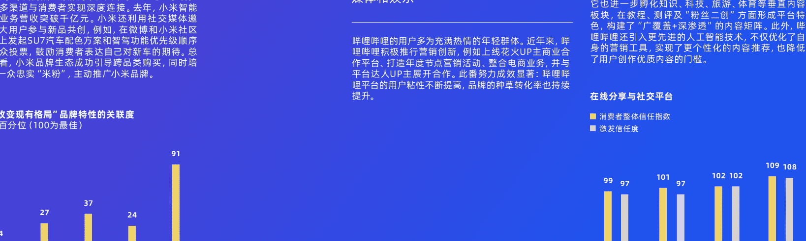

## 有意义、差异化和活跃品牌框架

“有意义（Meaningful）”、“差异化（Differentiated）”和“活跃（Salient）”是凯特的体系，是解释和指导品牌建设的强大工具。建立一个品牌的“有意义”、“差异化”和“活跃确保了品牌保护、尊重、忠诚度以及消费者对品牌的正确支持，确保品牌获得溢价（Marketing Standard），同时也让品牌具有足够的活跃度，使其更容易做出购买决策，通过差异化在竞争领域中脱颖而出。在消费者心中建立独特的连接，维护品牌份额。在充满不确定性的环境中，确保品牌在所有平台上活跃，不会被竞争对手忽视。当消费者寻找产品和服务时，最快出现在他们脑海中的品牌。它是内心的记忆，持续的连接让品牌活跃在消费者面前。活跃的核心：消费者对品牌产生情感连接，确保能够满足自己的需求。它是品牌的基础，是品牌成功的支柱之一。有意义的核心：了解更多：凯特的有意义、差异化和活跃品牌框架

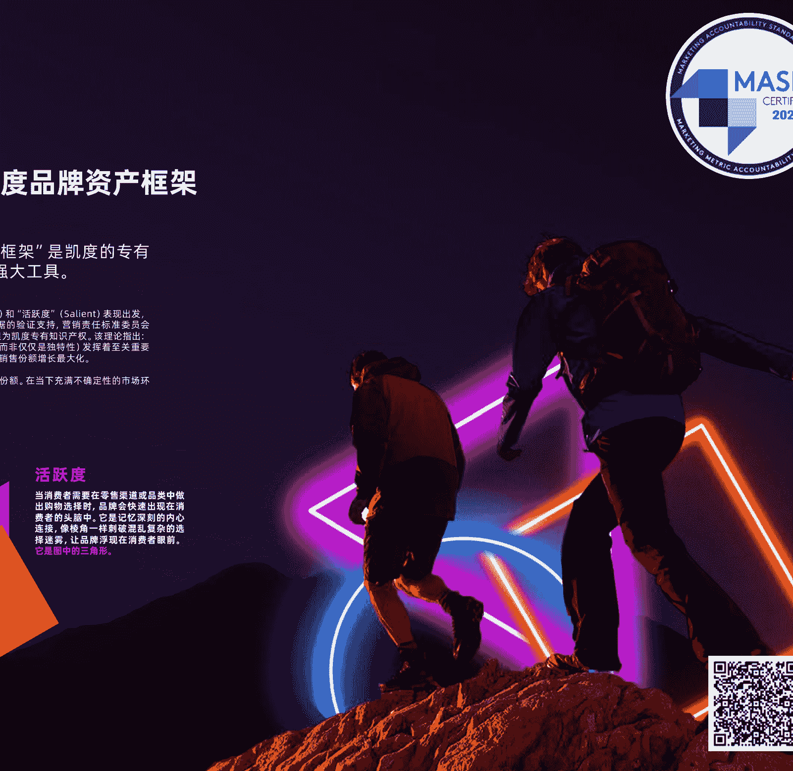

© Kantar 2025

## 行业分析

57 - 行业概览
58 - 汽车
61 - 消费科技与服务
64 - 保险
66 - 食品饮料
69 - 家用电器
72 - 物联网生态
75 - 媒体和娱乐
78 - 零售

## 行业分析

行业概览

多元化的品牌世界

今年凯特BrandZ中国100强榜单包含20个行业。其中，服装和美妆行业表现为榜单占比最高的行业，11个品牌占据了27%的品牌价值总额，比去年增加了24%。金融服务的行业排名第二，占据品牌价值总额16%，该行业品牌数量最多，有18家。消费科技行业排名第三大行业，较去年有所提升，该行业的品牌占据价值总额的13%，比去年增加了6个百分点。

各行业在凯特BrandZ中国100强品牌总价值的占比（亿美元）

| 行业 | 价值（亿美元） | 占比 |
| :--- | :--- | :--- |
| 其他 | 1247.09 | 10% |
| 汽车 | 233.72 | 2% |
| 奢侈品 | 454.58 | 4% |
| 服装和娱乐 | 3237.54 | 27% |
| 物联网生态 | 477.69 | 4% |

2025年最具价值中国10强品牌行业构成

| 行业 | 价值（亿美元） | 占比 |
| :--- | :--- | :--- |
| 电话服务 | 573.45 | 5% |
| 旅游 | 1078.17 | 9% |
| 零售 | 1318.57 | 11% |
| 金融服务 | 1982.59 | 16% |
| 消费科技服务平台 | 1544.50 | 13% |

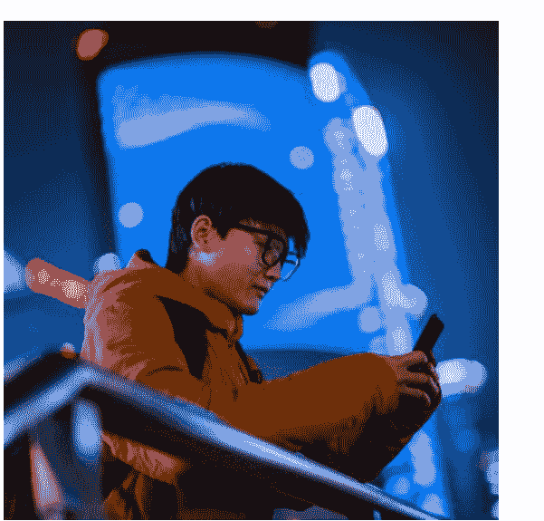

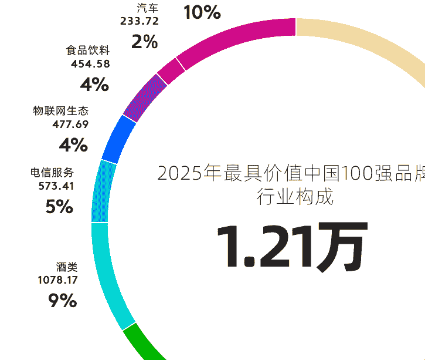

*来源：服装、美妆、奢侈品、食品、家电、饮料、电话服务与消费科技平台、行业、保健、金融资产、房地产、中介和医药。

© Kantar 2025

## 行业分析

汽车

备注：
汽车行业报告大数据分析汽车、乘用车、车辆和车辆零部件。本报告包含以品牌标识的所有车辆。

比亚迪 171.64 2025年品牌价值（亿美元）

未来之路：

理想汽车 23.79

汽车品牌敏捷前行

小鹏汽车 21.75

蔚来 16.54

汽车 2025年品牌价值（亿美元）：233.72

© Kantar 2025

## 汽车

今年有四个汽车品牌上榜中国百强，总数与去年持平。其中，比亚迪不仅领跑品类，还以78%的增长率获得2025年价值领先。中国头部品牌展现出前未有的实力，它让中国汽车成为全球市场的重要出口。在本土市场，中国汽车处于领先地位；在海外市场，中国汽车越来越受到青睐。在激烈的竞争中，我们需要更多的创新以及灵活的策略。得益于政府对AI的开放态度，中国汽车成为AI驱动的先锋。目前，AI在多个领域落地，包括自动驾驶、智能座舱、用户体验等，让汽车的功能更加个性化。在这种态势下，中国汽车将展现出更强的竞争力。在海外，中国汽车从“走出去”变为“走进去”。在本土，中国汽车的发展进入了新阶段，正在从追赶到领先。世界见证着中国汽车的崛起。CEO道：“AI不仅是让汽车变得更好，更是重新定义驾驶、出行的方式，重定义汽车的未来。”过去五年，全球行业经历着历史性的变革，中国汽车面临着许多挑战与机遇。在挑战中，中国汽车面临着前未有的挑战。然而，一种趋势使得中国品牌面临长期挑战。专家们对如何应对这些趋势进行了深入解析。与此同时，中国汽车行业正处于创新的关键期。在电动领域，中国凭借“电池主权”和“人才之地”在近期取得了突破，并做出了自主研发的智能座舱芯片，开辟了新的维度。

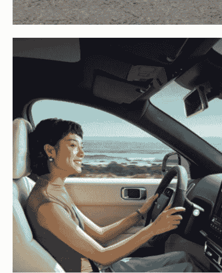

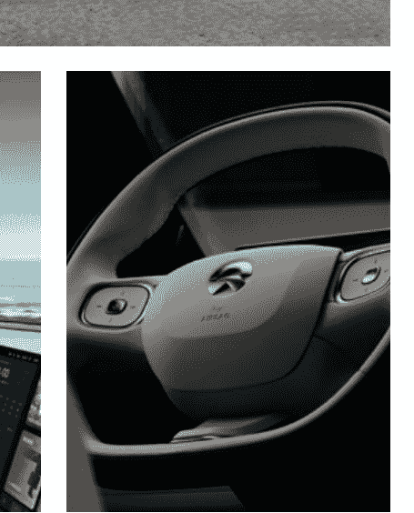

© Kantar 2025

## 汽车

品牌聚焦灯

品牌聚焦灯

### 比亚迪打造全球新能源汽车领先军

## 蔚来构建用户体验，提升品牌忠诚度

2025年品牌价值：

比亚迪 171.64亿美元（较024年+78%）

蔚来 16.54亿美元（较024年+3%）

比亚迪进一步确立了作为全球新能源汽车（NEVs）领导者的地位，同时提升了自己在全球市场上的驱动力与市场份额。过去一年，比亚迪海外市场销量增长15%，由于品牌升级，比亚迪开始以符合市场特性的方式与当地消费者连接并凭借自身的产品矩阵快速赢得市场。凭借技术领先优势，有助于拓展其海外市场的份额，比亚迪赢得了对“中国制造”的认可。

蔚来汽车拥有用户服务体系（蔚来中心），通过多维度的互动建立用户粘性，如蔚来口碑推荐高达24%，蔚来品牌忠诚度35%。蔚来通过独特的社区运营，为用户提供社交连接提供更多可能。在蔚来社区中，“乐主（joker）”与“给力（lofferent）”成为品牌的核心。

海外市场

聚焦服务：

- 品牌价值（亿美元）
- 品牌份额

品牌份额：

- 市场份额（%）
- 品牌忠诚度（%）

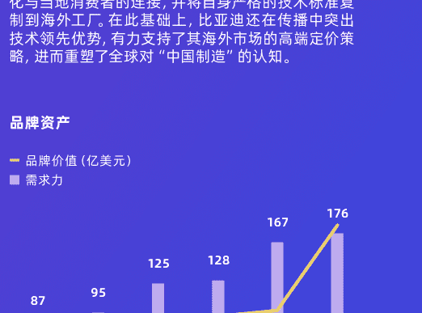

比亚迪正从汽车制造向“技术+服务”双转型。

突破性：+6
与众不同：+12（86分）
作为一名用户：+2（75分）
- 品牌百分比（100分为最佳）

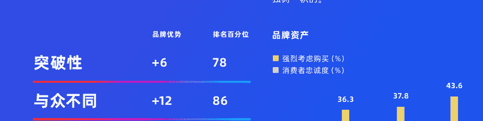

## 消费科技与服务平台

关注：
消费科技与服务平台3C（时尚、通信及消费品）行业，涵盖美食、娱乐、手机和智能设备等产品，折扣成为年轻消费者的入场券。

## 惊艳新书

## 智能设备品牌多元发展

- 华为 641.52
- 美团 293.28
- 小米 281.50
- VIVO 59.89
- 携程 55.86
- 联想 42.62
- 饿了 41.78
- 大众点评 40.77
- 滴滴 26.83
- 大疆 19.97

2025年品牌市值（亿美元）：消费科技与服务平台 1544.50

## 消费科技与服务平台

今年有五家3C（计算机、通信及消费电子）品牌在市场份额上领先。其中，小米凭借其智能手机，在全球市场份额收窄29%。与小米相比，华为在市场上的份额更具爆发力。在2023年第一季度，华为份额回升，显示出小米份额提升了54%。在行业内，小米份额领先了77%。在2023年年底，小米SU7正式发布了。汽车，中国品牌正积极拓展业务领域。在AI领域能否成为全球领先者，中国品牌尚未领先，但在本土化方面仍有待观察。差异化之路开始开发适配场景、设计，为用户提供更有意义的体验。在AI应用领域的创新成为重要趋势。2024年，荣耀Magic V等手机在AI功能上表现亮眼。与此同时，健康管理、健康监测等可穿戴设备受到广泛关注。此外，手机、可穿戴设备赛道的竞争成为焦点。领先者的营销成为品牌的核心。中国品牌在海外市场份额攀升，通过改进售后体验来全球领先者竞争。同时，随着电动化的加速，手机与汽车赛道的融合正在加剧，未来市场竞争将加剧。领先品牌基本拥有所有消费群体。

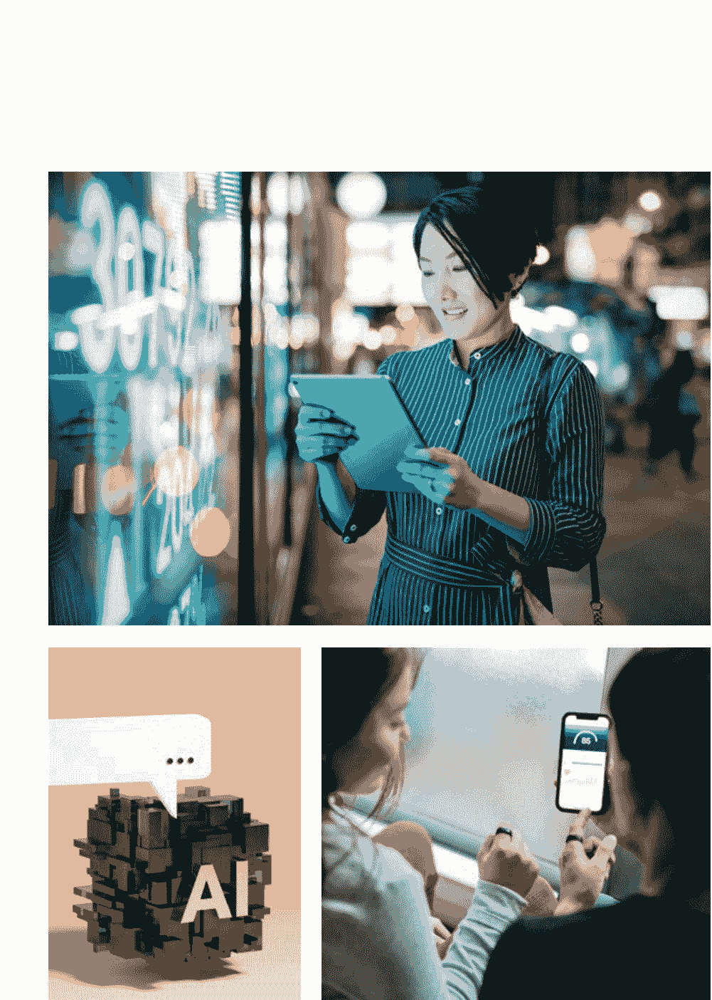

## 行业分析

## 消费科技与服务平台

品牌聚焦灯

品牌聚焦灯

## 高端化驱动华为带来增长

## vivo实现“低价”到“高值”的跨越

2025年销量份额：

华为 64.52亿美元（较024年+56%）

vivo 59.89亿美元（较024年+11%）

过去一年，华为在高端品牌份额与核心技术领域实现了突破。这不仅得于消费者对华为品牌的持续认可，更通过多项操作在国内外市场的成功落地，为品牌的未来增长留了充足空间。在消费者心中，华为成为最受中国消费者喜爱的手机之一。在激烈的市场竞争中，华为凭借前未有的信心重新夺回了10%的市场份额。在2025年，华为的5G手机、折叠屏、高端平板等产品将持续快速增长。同时，在智能汽车和8芯智驾芯片等细分领域，华为也开辟了“高增长”的新增长极。

vivo凭借其创新的产品矩阵、精准捕捉消费者需求以及高效的营销策略，在激烈的竞争中脱颖而出，赢得了全球消费者的青睐。在海外市场，vivo也通过量身打造的服务中心，实现了从产品到服务的升级，不断提升了其在消费者心中的品牌形象。

| 核心优势 | 核心技术 | 核心优势 |
| :--- | :--- | :--- |
| 品牌领先 | 影像技术 | 极致体验 |
| 领先领先 | 核心算法 | 核心领先 |
| 高性能 | 智能生态 | 极致体验 |
| 技术领先 | 自研鸿OS | 极致性价比 |

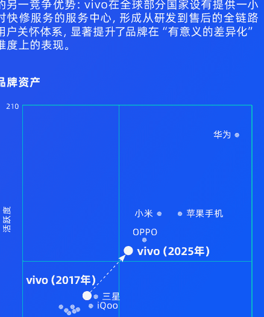

## 行业分析

## 快餐

备注：
快餐行业包括快餐和休闲餐饮品牌。

蜜雪冰 39.55 2025年品牌价值（亿美元）

瑞幸咖啡 30.42

喜茶 29.91

霸王茶姬18.17

奈雪 18.05 快餐

## 行业分析

## 食品饮料

备注：
食品饮料行业包含各类饮料品牌（碳酸饮料、茶、果汁、乳酸饮料、功能性饮料、酒精饮品、速溶咖啡性饮料、乳制品、矿泉和植物饮料等）。

2021年品牌价值（亿人民币）
- 农夫山泉 150.75
- 伊利泉 110.81
- 海天 55.95
- 蒙牛 47.67
- 东鹏饮料 42.18
- 双汇 29.76
- 元气森林 17.47

## 渴望增长
品牌各辟径
满足消费者需求

食品饮料
2024年品牌价值（亿美元）
## 454.58

© Kantar 2025 | 86

## 食品饮料

今天饮料行业有七个品牌入选BrandZ中国百强榜单。其中，三个品牌实现价值增长，三个品牌出现价值下滑，一个品牌保持稳定。

与其行的行业，海外品牌也是饮料行业的主力力量。其中，品牌竞争正日益白热化，品牌面临着与消费者的双重压力。品牌差异化、精致化成为品牌突围的关键。此外，国内饮料品牌的营销投入逐年攀升，去年进入入热潮。

海外的饮料品牌正在被本土品牌取代。随着中国消费者消费习惯的升级，海外品牌在市场份额持续下降。与此同时，本土品牌不断崛起，使得中国饮料市场竞争日益激烈。

中国现在的饮料行业已进入激烈竞争，品牌面临着存量市场中争夺存量客户的巨大挑战。

由于消费者对健康的关注，年轻人更青睐健康食品。近期消费者对食品的需求不断提高，因此品牌面临着高品质的挑战。

不同人的需求也存在差异。年轻人更青睐健康食品，老年人热衷购买功能性代餐食品，运动产品在天猫等电商平台上的销量日益增。

总体来看，本土品牌在展现出“高端升级”产品趋势的同时，通过差异化营销引起消费者的关注。此外，通过不断创新的营销手段强化品牌心智，效率、多元化等使得本土品牌在饮料行业中表现优异。

中国饮料行业正处于转型期，品牌面临的选择不同。一方面是利用技术进步提升产品质量与差异化，另一方面是不断创新为消费者提供新价值。

然而，品牌也需要尝试寻找新的增长点，比如“农夫山”等品牌通过传统渠道分流利润，对传统主品牌造成竞争压力。

品牌正在尝试通过社交营销在线下触达消费者，品牌消费者可能会获得品牌折扣金钱奖励，品牌也在此过程中收集消费者的偏好与互动行为。

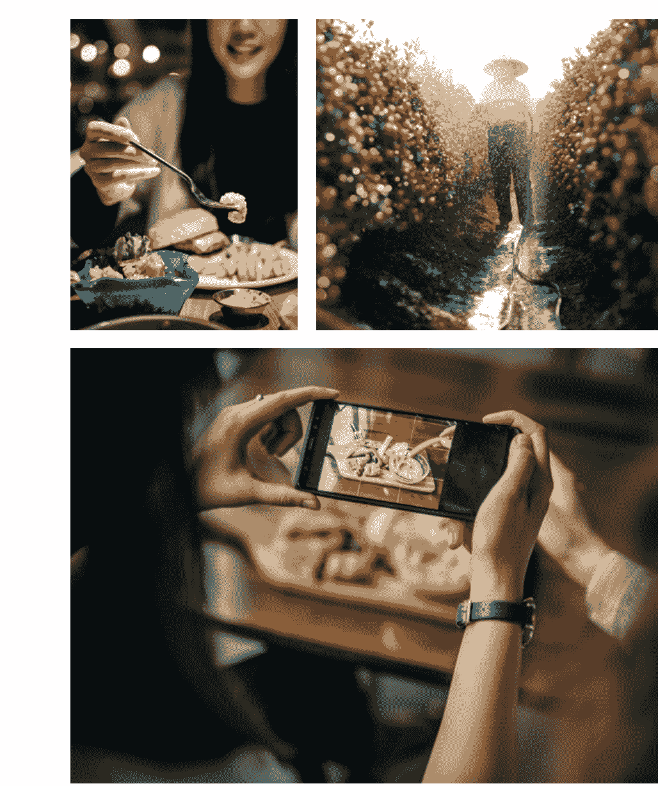

## 行业分析

## 食品饮料

## 品牌聚光灯

## 品牌聚光灯

## 通过“有意义的差异”创新提升品牌价值

2025年品牌价值
# 55.95亿美元
2024年+19%

海天通过核心动力驱动业务持续增长，“超级品牌”通过差异化产品组合满足市场日益增长的个性化消费需求，海天已让1200余产品畅销市场，其中单品就成功超越了竞争者。

优化产品设计与渠道运营

海天的品牌影响力主要通过两个方面：一是利用海外营销工具、“全矩阵”等产品在海外持续立足，以建立差异化、无缝等壁垒；二是通过本土化策略，推出新产品，配合多元化品牌策略与国内其他品牌进行市场渗透，品牌增长、渠道渗透及行业发力持续赢得领先地位。

## 深耕年轻化市场，国民品牌逐速发展

2025年品牌价值
# 42.18亿美元
2024年+73%

## 以独特的品牌形象强化用户忠诚度

东广饮料已深自身饮料市场的核心诉求，在差异化、互动三个维度上打出的组合拳，通过“国潮”、“健康”、“无添加”等标签精准吸引了年轻消费者的关注。在内市场，品牌继续深耕，通过差异化产品、跨界营销等活动，成功建立并提升了用户忠诚度。

东广饮料通过网红饮品打造了“国潮新势力”标签，锁定年轻消费者，品牌增长得力精准定位了工人和学生等核心群体。目前，饮料已进入725个城市，并开始跨越全球化增长。

## 品牌聚光灯

东广饮料“差异化”开启品牌增长+73%

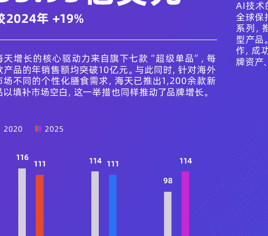

| 2025 | 2024 | 2023 |
| :--- | :--- | :--- |
| 东方口味 | 110 | 79 > 2 |
| 差异化 | 103 | 18 |
| 酒饮料 | 76 > 2 |

2025
2024
2023
东方口味
差异化
酒饮料

## 品牌聚光灯
东广饮料“差异化”开启品牌增长+73%

## 家用电器
备注：
食品饮料行业包含物联网相关技术相关的品牌，它们与合作伙伴共同构建，提供优质、定制化、快速迭代的产品，灵活和高效。

| 品牌 | 2025年品牌价值（亿美元） |
| :--- | :--- |
| 美的 | 75.98 |
| 格力 | 39.73 |

2024年+45%
2024年+19% 

## 家用电器
进阶高端化
2025年品牌价值
# 15.71
2024年+33%

## 家用电器
美的和格力再次转身围BrandZ中，两者在过去一年中均实现了强劲增长，较2024年初升至32名和50名。

尽管市场复苏，但品牌面临着压力。在竞争中，消费者的期待正在发生变化，许多品牌积极调整策略，形成了多次解决方案。中国电器面临面临着挑战，在激烈竞争中脱颖。

中国饮料行业正处于转型期，品牌面临的选择不同。一方面是利用技术进步提升产品质量与差异化，另一方面是不断创新为消费者提供新价值。

然而，品牌也需要尝试寻找新的增长点，比如“农夫山”等品牌通过传统渠道分流利润，对传统主品牌造成竞争压力。

品牌正在尝试通过社交营销在线下触达消费者，品牌消费者可能会获得品牌折扣金钱奖励，品牌也在此过程中收集消费者的偏好与互动行为。

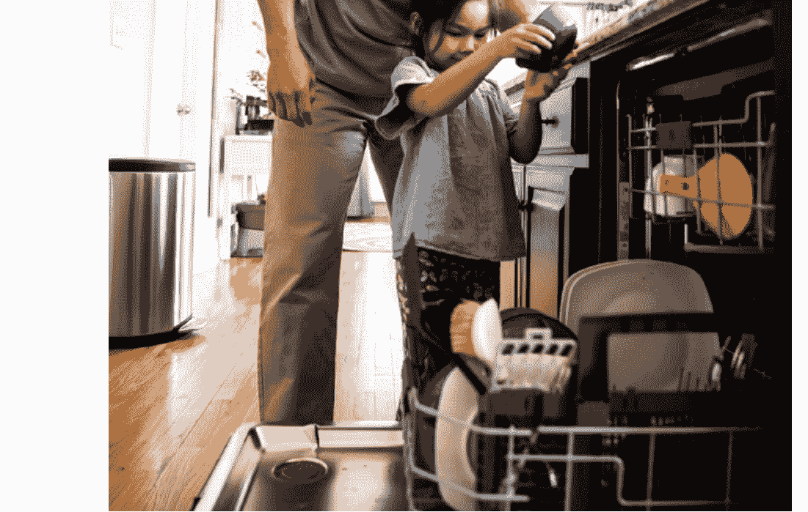

## 家用电器
## 品牌聚光灯
## 品牌聚光灯

## 家用电器
美的之身“高优质”品牌空间
格力充分发明明星IP资产

2025年品牌价值
## 75.98
## 39.73
2024年+45%
2024年+33%

拥有意义的差异化竞争赢得消费者心智。美的以技术制造为基因，如今通过“科技驱动”差异化战略，持续投入研发与生产升级，还保持敏锐的增长速度，品牌从技术领先转向强大的品牌影响力，跨越边界定义“中国制造”。

在海量竞争下，技术创新依然是家电行业的核心竞争力。格力在保持市场领先地位的同时，持续加大投入，每年投入高达15万人民币的研发经费，并持续推动智能产品创新，不断巩固其领先地位。

格力将品牌影响力与“IP营销”深度融合，通过创新的营销管理提升经营效率，发力品牌在下沉市场中的渗透，实现业务增长。

自“格力广告”成为营销潮流之首，格力通过重新定义行业标准，通过跨界营销连接用户，一步加强了品牌与用户内心的深度链接。在打造“格力+空间”的道路上，通过跨界互动让消费者享受生活质量升级，不断提升品牌知名度，并成功实现品牌转化与实质增长。

vs (2023年 vs 2022年平均)

## 品牌资产
- 2023

## 家用电器
与拥有品牌关系

| 品牌理念 | 核心优势 | 可持续性 |
| :--- | :--- | :--- |
| 卓越品质 | 在品牌团队的持续领先 | |
| 开放创新 | 口碑建设 | |

2025年趋势预测，格力的可持续性体现在其高端化转型在中国高端市场中的持续领先。

© Kantar 2025

## 行业分析

## 物联网生态

备注：物联网生态行业包含物联网相关技术相关的品牌，它们与合作伙伴共同构建，提供优质、定制化、快速迭代的产品，灵活和高效。

## 海尔
2025年品牌价值（亿美元）
## 477.69

## 与用户共创的增长之之道
## 海尔
2025年品牌价值（亿美元）
## 477.69

© Kantar 2025 | 72

## 物联网生态
海尔已连续15年入选BrandZ中国价值榜，今年排名升至第一。海尔也连续七年入选BrandZ全球价值，位列第54名。海尔是品牌健康的经营者，并坚持与用户进行互动，持续提升用户体验。这种互动能够让海尔在广阔范围内的增长，并将年轻一代代表，让流量成为新的动力。

另一个维度是“三朵一”。海尔在2008年提出的“三朵一”方案（单品化、定制化、互联化）回应了行业命题。海尔在行业中领先，不断优化产品方案，满足用户的个性化需求。从传统制造到智能制造，海尔已经完成了服务的转型，通过快速迭代创造更具智慧的生活。海尔打造了“智家”平台，让用户在任何场景下都能一键连接设备，自动感知并响应需求，提供个性化的体验。海尔在坚持品牌化的同时，探索如何精准触达目标用户。在海外市场方面，海尔正根据当地用户习惯进行本土化，并根据数据反馈进行精准本地化。此外，海尔活跃全球市场，通过多渠道投放效果显著，销量同步增长。

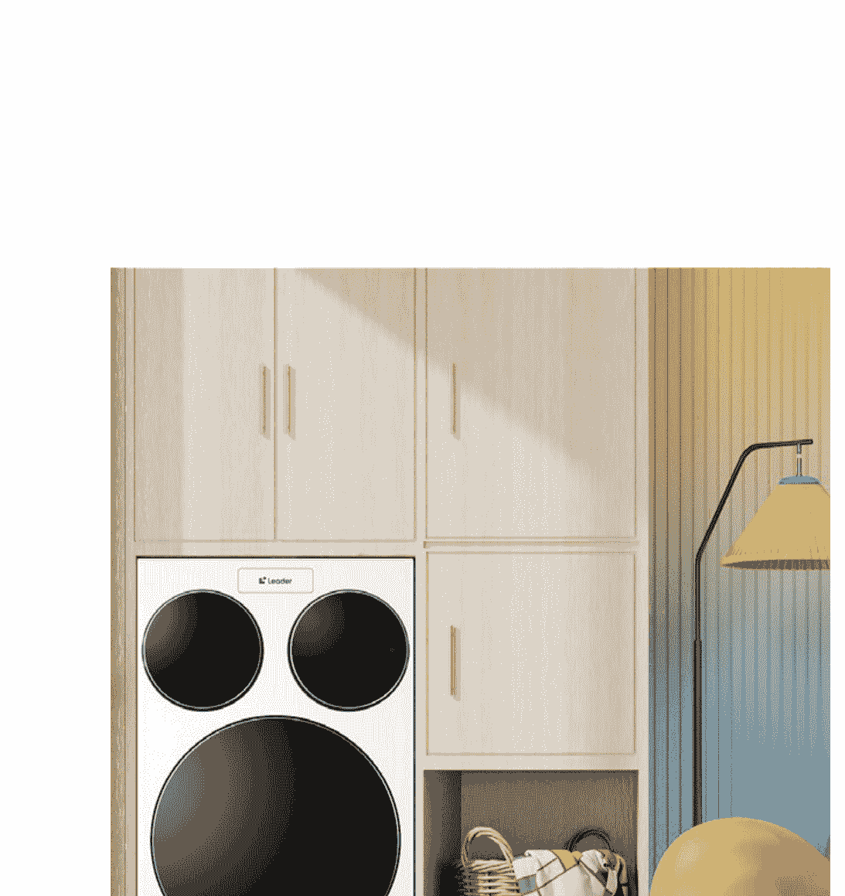

## 物联网生态
## 品牌聚光灯
## 海尔持续深化全球化战略

2023年品牌价值477.69亿美元
2024年+47%

海尔在消费者中心的品牌影响力很大程度上源于产品优、领先科技与服务差异，海尔赢得消费者的信任并建立了稳固的客户关系。“共赢”价值观让海尔能够深入海外市场，定制化产品满足当地需求，通过合作赢取品牌价值，引发了战略的成功。

## 品牌资产

| 品牌名称 | 排名 | 升降 |
| :--- | :--- | :--- |
| 中国品牌 | 127 | |
| 海尔 | 127 | |

品牌理想肩负社会责任 +2
在线上及移动端表现更佳 +3
- 排名百分分（100为最佳）

## 媒体和娱乐

重点：媒体和娱乐行业包括信息娱乐（电影、游戏）、社交媒体、推荐算法。细分领域包括旅游、直播、短视频及游戏直播平台，以游戏娱乐为主。

## 腾讯*
1979.91

## 抖音
762.00

## 网易
87.83

## 百度
83.50

## 快手
80.72

## 小红书
76.04

## 今日头条
72.77

## 哔哩哔哩
30.05

## 优酷
26.35

## 芒果TV
22.03

## 酷狗音乐
16.34

## 目不转睛

## 为吸引而创新
2025年品牌市值（亿美元）
媒体和娱乐
2025年品牌市值（亿美元）
# 3237.54

注：行业分类中的“媒体和娱乐”是指媒体和娱乐行业，包括腾讯、微信、网易、抖音、哔哩哔哩、快手、阿里、字节跳动和酷狗音乐。

## 媒体和娱乐
今年共有7家品牌上榜中国百强，较去年减少了两家。尽管品牌数量减少，但在过去一年里实现了价值增长。这主要得益于AI技术的应用：帮助品牌开发新的内容，降低运营成本。在媒体和娱乐行业中，品牌竞争日益激烈，品牌面临着未有的挑战。

在媒体和娱乐市场规模增长了33%，意味着品牌必须不断新的突破，以在竞争中脱颖而出。消费者的期待正在发生变化，许多品牌积极调整策略，形成了多次解决方案。中国电器面临着挑战，在激烈竞争中，品牌通过AI技术生成内容，并精准触达消费者。在海外，美国、英国、德国、巴西和墨西哥等主要市场，TikTok已经展现出巨大的机会。在中国，社交媒体电商进入常态化，品牌需要新的增长方式。

在伦敦、巴黎、东京等市场，我们也看到了新趋势——虚拟人的应用的发展。在某些案例中，虚拟人直播扩大了场景，转化率甚至得到了提升。在社交媒体上获得更多的成功，品牌通过创意内容赢得市场。

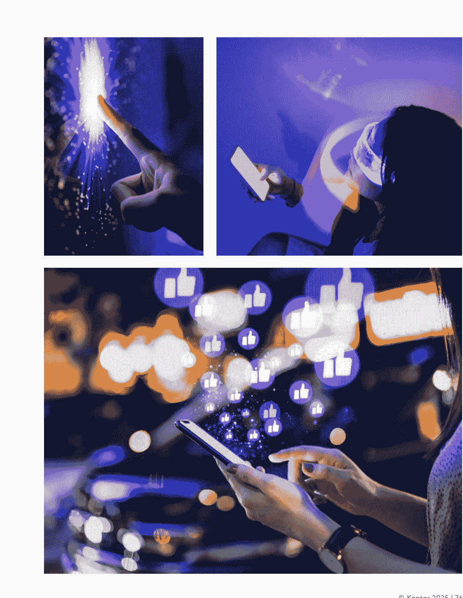

## 媒体与娱乐
## 品牌聚光灯
## 腾讯控股
## 品牌聚光灯
## 品牌聚光灯
## 抖音
品牌聚光灯，稳固领先优势
内容品牌与消费者的首选

2025年品牌价值
## 1979.91
2025年品牌价值
# 762.亿美元
2024年+34%
2024年+53%

抖音在电商领域的发展证明了强大的生命力。基于兴趣的内容电商让用户在发现的同时完成购买。抖音在电商平台上是一个高效的流量入口，让品牌成为触达消费者的首选，因此成为连接消费者的首选。

过去一年，腾讯将社交领先向高价值转型，持续投入业务创新，为企业和消费者带来更多价值，赢得员工和用户的青睐。

五年增长趋势

| 品牌名称 | 品牌增长 |
| :--- | :--- |
| 便利利 | +11 |
| 腾讯 | 84 |

| 品牌名称 | 品牌增长 |
| :--- | :--- |
| 对环境负责 | +3 |
| 关怀员工 | 96 |

- 名称占比（100%为最优）

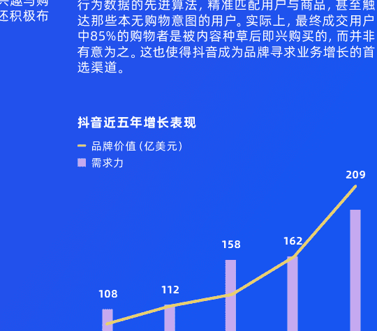

## 零售

重点：零售行业包括小型超市和百货公司的实体及线上直品牌，以食品、家电、DIY和零售商品为主。

## 阿里巴巴 843.52
2025年头部市值（人民币）

## 卖得聪明
AI技术推动零售发展

## 京东 202.24

## 拼多多 201.42

## 周大福 41.29

## 盒马 30.08

零售
2025年品牌市值（亿美元）
## 1318.57

主要零售行业品牌市值排名：京东、酷动、唯、1688、网易、京东天猫
“京东品牌”包含京东

## 零售
国内有五家零售品牌上榜品牌百强，其中盒马首次上榜。连续上榜的四家品牌中，两实现了两位数的价值增长，另外两家则下滑。

中国零售业务多元化，国内经济持续增长，消费意愿显示出现复苏，参与市场的人数增加，价格竞争激烈，内容竞争升级为价格战，激烈竞争结束了过去高速增长期。同时，海外品牌也积极拓展海外新市场创造了增长。

零售中电商竞争激烈，中国本土及海外品牌面临压力，品牌需要转型。在海外，品牌面临前所有的增长压力，品牌在电商中发现了新机会。

AI技术正在零售中渗透。在某些案例中，AI可以优化供应链和营销策略，还能帮助品牌拓展市场的营销策略。在中国，品牌需要新的增长方式，利用AI技术生成内容，并精准触达消费者。

## 行业分析

## 零售

## 品牌聚光灯

## 品牌聚光灯

### 阿里巴巴自助AI解锁新增长

### 京东以卓越服务赢得消费者信任

### 高端定位与全球扩张

### 信任成为差异化优势

2025年品牌值
# 843.52亿美元
较2024年 +33%

2025年品牌值
# 202.24亿美元
较2024年 +16%

阿里巴巴在零售业务领域的持续增长，得益于其战略投入、技术创新和用户体验，以及不断拓展全球市场。

京东在消费者心中拥有“有服务”和“可靠”的信誉，通过快速配送、优质售后等特点赢得了消费者的信任。过去一年，京东升级了PLUS会员服务，提升了购物体验并增强了用户忠诚度。此外，京东发起的“百亿计划”投资活动也进一步增强了消费者的品牌粘性。

阿里巴巴电商
电子数：

| 品牌 | 2025年 | 2024年 |
|---|---|---|
| 品牌理想 | +31 | 98 |
| 车越 | +12 | 78 |
| 信任的公司 | +3 | 82 |

| 类别 | 品牌 | 市场份额 | 增长率 | 备注 |
|---|---|---|---|---|
| 手机 | 特斯拉 | | | |
| 手机 | 华为 | | | |
| 服饰 | 优衣库 | | | |
| 服饰 | 安宁 | | | |
| 美妆 | 小镇 | | | |
| 美妆 | 雅莱 | | | |
| 家电 | 1688 | | | |
| 家电 | 苏东 | | | |
| 家电 | 理想 | | | |
| 零售 | 亚马逊 | | | |
| 零售 | 天猫 | | | |
| 零售 | 其他 | | | | |

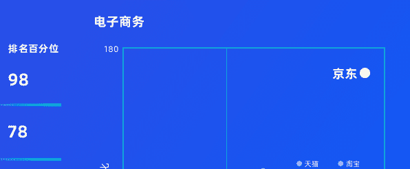

- 名吸后位(100次为最好)

## 品牌观点

82 - 海尔
84 - vivo
86 - TCL

## 品牌趋势

周云奎
海尔集团董事主席、首席执行官

海尔集团致力于成为全球美好生活和智慧家居的解决方案者。在2020年3月，海尔以416亿元人民币收购了全球137个国家和地区163个制造中心，全球业务总超过300亿美元。

### 海尔的创业企业，我们如何定义未来的行业？

一个海尔，从1986年从一家冰箱工厂开始，从工厂到企业，我们经历了从经营到管理、从制造到研发、等多次跨越。

感谢变革的时代，正如我们所感受到的，每一次变革都孕育着机遇，没有没有的未来。

我们正处于一个变革的时代，每一个变革都孕育着机遇。海尔正处于这种变革之中，我们通过新的模式、新的组织、新的生态、新的技术、新的文化。在变革时代，每一个个人都有机会去改变世界，在海尔，每一个海尔都有去创造前所未有的未来。

### 海尔的领先方式正在发生变化。

2021年后，海尔的领先方式正在发生变化。我们不再只是一个企业，而是一个平台，一个连接者的生态系统。

### 我们需要什么？

我们需要的不是执行者，而是能够打破常规的人。
你是一个企业家，是那些敢于挑战边界、能够持续思考并进化的人。
你是一个企业家，是拥有好奇心并不断迭代的人。
你是一个创业者，是能够勇于发现并解决问题的有责任心、同理心、在变革中成长的。

### INSIGHTS FROM BRAND BUILDERS

ZHOU YUNNAN
CHAIRMAN & CEO
HAIER GROUP

### 海尔如何打造领先的价值观？

海尔经历了超过35年的历史，我们认为产品是核心，是价值和交互的载体。我们需要的最好的产品，而是能够满足需求的解决方案。海尔不是在卖产品，而是在卖解决方案。

变革是必然的。从1984年至今，我们一直在变革中。每一次变革都意味着一次开始。我们害怕失败，在失败中学习，在变革中找到新的机会。

创业是常态。失败率并不高，但我们害怕失败，因为我们从失败中学习并进化出更好的方案。

创业是常态。失败率并不高，但我们害怕失败，因为我们从失败中学习并进化出更好的方案。

我们建立了一个机制，让大家在失败后能够改进，从而在变革中不断进化。

变革驱动变革是非常重要的。2025年，我们的管理模式已经完成了转型。海尔在全球范围内——从用户为尊到以员工为尊，海尔的管理模式正在不断进化，以更好地适应全球的需求。

© Kantor 2025

## 品牌焦点

周云奎
海尔集团董事主席、首席执行官

### 与去年相比，消费者需求更加复杂

第一，从产品功能向体验转型，从单一功能到多功能融合，从被动服务到主动服务。用户的需求不再是满足基本功能，而是追求更高质量的便捷、趣味，让用户拥有新的生活方式。

第二，从单一产品向场景化解决方案，从单品购买到整体购买。用户不再只是买一台洗衣机或一台冰箱，而是买的是整个厨房、或者整个客厅的解决方案。因此，我们正在从洗衣机、冰箱、空调等单品产品转向场景化解决方案，以满足用户的个性化需求。

第三，从被动响应到主动，从简单的交互到智能交互。用户的需求不再是简单的好用，而是追求更智能、更懂人的交互体验。现在，更多用户期待海尔的电器不仅是工具，更是一个懂生活的伙伴。因此，海尔要让用户参与进来，实现品牌与用户的深度共创。

### 你认为人工智能在未来的世界社会中扮演什么角色？海尔在未来10年可能是什么样的海尔？

我们认为人工智能将成为每个人的“助手”。在未来，AI将无处不在，每个人都有一个属于自己的AI数字助理。

海尔正积极转型智联，大产业升级，数字技术引领产业升级。我们正在用人工智能的技术赋能家，让家居更智能、更懂人心。未来的每一个家庭都有一个自主的助手，每个人都有一个智能管家。

在全球范围内，人工智能将重塑世界。我相信中国的智能潮流，让我们从这个转折点，更多的人享受到智能。海尔的“智联领先”将不断连接并走向未来。

© Kantor 2023 | 83

## 品牌理念

郭刚
vivo高级副总裁
vivo中国区总裁

在过去的15年中，我们认为消费者需求以及品牌互动的方式是转变的关键。今年是第10年，我们见证了时代的演变，手机从工具到数字延伸，成为生活中不可或缺的工具。为了给用户带来变革，我们将定位为更具远见的变革者。我们将不断探索更极致的体验，在影像、系统和核心四个方向上持续投入，2023年我们取得了多项技术突破，品牌在行业范围内是持续领先的。

我们认为品牌价值是建立信任与留住客户的纽带。对于企业而言，消费者的忠诚度提供了支持，帮助品牌识别溢价空间以及在S&P市场中的表现。品牌价值是真实的，它帮助我们对业务的成功做出决策，并为未来的增长提供方向。品牌价值的核心在于建立信任和客户。品牌价值有助于差异化并使其成为更具竞争力的品牌。只有当消费者对品牌产生忠诚度，我们才能通过品牌溢价来提升品牌价值。

品牌成功的定义（Meaningful, Different, Safe, Framework）即提供一个可靠的质量标准框架。如果没有这种品牌价值，我们的品牌将无法在激烈的市场竞争中脱颖而出。MASB（The Marketing Metric Protocol Board, MASB）被定义为旨在评估企业营销投资回报和衡量标准的独立组织。在任何产品中，这项品牌价值更具吸引力，并增加消费者忠诚度。

### 品牌如何打造领先的价值观？

我们认为设计不仅是业务，更是共同的艺术。在科技领先的同时，我们将致力于创造新的边界，超越自我，寻找全球用户的共同需求。结合TCL26年的海外，如何与全球用户达成共鸣？

我们主要有以下几个方面：
- 一是技术更有温度，用“人”的语言，翻译技术。通过TCLYoung、TCLer、TCLGreen、TCLART等以科技价值驱动创新、差异化、色彩、艺术等更好地传达品牌策略、本地化、增值服务，寻找TCL全球用户的共同需求。
- 二是精神跨全球化领先，产品出海同时，品牌也进：虽然世界不同，但不同文化的客户需求是类似的。电视是一个很好的载体，NBA篮球赛、FIFA足球世界杯以及美国NFL超级碗，30年来，TCL的电视生活在电视大赛中成长，在年轻人热恋的电视时代中飞跃。TCL通过电视与每一位消费者的互动，让品牌有了自己的方式。

## 品牌亮点

程刚
vivo高级总裁
vivo中国区总裁

我们的企业应当如何将技术与价值观相结合？

我们的产品和技术突破源于对用户的理解，因为我们始终以用户为核心。未来，我们要保持领先，不仅满足于跟随，更要引领行业。我们需要在未来的每一个场景中提供解决方案，更清晰、更智能的影像体验，更快速、更丰富的交互。通过持续创新，让每一个任务变得简单、变得复杂、变得好用。AI技术的内核让每个人都能感受到进步，成为一种习惯，无处不在。我们通过技术创新旨在解决用户的负担，大模型更有温度。

在发展的过程中，我们不断探索新的边界，在失败中学习，在争议中寻找共识，在竞争中不断突破。vivo的每一个团队的成长，基于我们对用户的坚持。让我们在服务中为用户创造，在用户中发现价值，以创新的方式让美好生活触手可及。坚持服务于人是一项长期的文化。vivo的价值观是坚持“以人为本”的初心。在瞬息万变的环境中，只有坚持初心才能改变行业的环境。最后，我们希望通过人工智能的创新，跨越边界，让每个人在vivo的世界看到可能。在日新月异的今天，人工智能是行业领先的趋势，AI也是未来的关键技术。我们将持续投入，为用户创造更美好的未来。

过去，我们提升了操作系统、网络等底层技术的能力，vivo在2018年提升并发布了自研系统，成立了vivo AI实验室，并在2023年又发布了自研芯片。突破技术边界，提升效率，让体验与美好生活息息及。

## 品牌联络

雪霁
TCL科技集团副总裁
TCL公益基金会董事长

您曾说“设计不仅是业务，更是共同的艺术”，在科技领先的同时，TCL将致力于创造新的边界，超越自我，寻找全球用户的共同需求。结合TCL26年的海外，如何与全球用户达成共鸣？我们主要有以下几个方面：

- 一是技术更有温度，用“人”的语言，翻译技术。通过TCLYoung、TCLer、TCLGreen、TCLART等以科技价值驱动创新、差异化、色彩、艺术等更好地传达品牌策略、本地化、增值服务，寻找TCL全球用户的共同需求。
- 二是精神跨全球化领先，产品出海同时，品牌也进：虽然世界不同，但不同文化的客户需求是类似的。电视是一个很好的载体，NBA篮球赛、FIFA足球世界杯以及美国NFL超级碗，30年来，TCL的电视生活在电视大赛中成长，在年轻人热恋的电视时代中飞跃。TCL通过电视与每一位消费者的互动，让品牌有了自己的方式。

TCL的经营之路正是实现全球化中的共鸣：一致性的本地化意味着品牌构建与产品深度结合，品牌定位本地化，针对当地消费者建立本地化的价值观，本地化交流。

© Kantor 2025 | 86

## 品牌点

TCL科技集团总裁
TCL公益基金会主席

2025年TCL成为全球慈善战略合作伙伴，我们认为TCL将继续投入，带来更多精彩。感谢我们作为全球慈善战略合作伙伴，投入资源支持慈善事业，凝聚力量让我们实现共同目标，在全球范围内扩大影响力。

2023年我们取得了多项国际设计奖，TCL在行业范围内是领先的之一。我们关注的趋势，vivo和X100系列在品牌价值上广泛关注。2025年TCL在市场份额中占据全球第一，其次，TCL在品牌值位居全球第二。作为行业引领者、领先者，一方面TCL在2024年销量持续增长，预计2025年销量将突破亿；另一方面，TCL在技术创新上不断领先，在智能家居、AI技术等领域持续投入。我们致力于在慈善领域履行责任，为用户创造卓越的体验。

## 品牌观点

## 6 数据来源与资源

- 90 - 凯锐品牌价值法
- 94 - BRANDZ报告和出版物
- 97 - 天子银行
- 100 - 品牌专家
- 103 - 运营BRANDZ中国团队

## KANTAR # 塑造品牌未来

作为全球领先的品牌数据与分析公司，凯度是世界级强品牌不可或缺的专业伙伴。我们拥有丰富的消费者态度行为洞察，识别最关键的趋势与竞争需求，通过精准的数据与技术报告，告诉人们如何思考、感受和行动。我们帮助客户达成心智领先，塑造品牌未来。

## 品牌价值

## 介绍

## 品牌的重要性

## 品牌价值的重要性

## 国际认证的MDS框架

品牌价值在考虑行业当前和未来发展的基准上，列出对自身品牌总价值进行衡量的标准。品牌价值是建立信任与留住客户的纽带。对于企业而言，消费者的忠诚度提供了支持，帮助品牌识别溢价空间以及在S&P市场中的表现。品牌价值是真实的，它帮助我们对业务的成功做出决策，并为未来的增长提供方向。品牌价值的核心在于建立信任和客户。品牌有助于差异化并使其成为更具竞争力的品牌。只有当消费者对品牌产生忠诚度，我们才能通过品牌溢价来提升品牌价值。

品牌成功的定义（Meaningful, Different, Safe, Framework）即提供一个可靠的质量标准框架。如果没有这种品牌价值，我们的品牌将无法在激烈的市场竞争中脱颖而出。MASB（The Marketing Metric Protocol Board, MASB）被定义为旨在评估企业营销投资回报和衡量标准的独立组织。在任何产品中，这项品牌价值更具吸引力，并增加消费者忠诚度。

## 品牌的独特之处

品牌价值以独特特性通过“驱动力”，开始在消费者的脑中。品牌的独特之处影响了消费者对品牌的探索方式，减少了品牌溢价。

## 聚焦

消费者在产生需求时，品牌作为首选品牌的原因源于消费者的脑中。此外，品牌通过卓越的营销专业知识来引导消费者的决策。Financial Marketing的分析可以帮助避免不符合预期的投资或行为。品牌价值不仅影响消费者的感知，还影响了决策者的决策和决策的有效性。品牌价值的方法提供了支持。在详细介绍之前，我们首先关注三个问题：品牌为何重要？品牌为何重要？品牌如何创造？

# 凯度BRANDZ品牌价值法

## 第二部分：确定品牌贡献值

## 第三部分：计算品牌价值

为了计算品牌的价值，我们需要衡量品牌在消费者心中的留存。首先，我们需要量化品牌对于产品业务的贡献。这种贡献通常可以从“品牌溢价”或“品牌的财务价值”中获得。我们可以从最新的销售数据、品牌资产或“品牌份额”的观点出发，通过以下三种方式来衡量消费者选择行为为品牌带来的贡献值：

“品牌价值”是指品牌对母公司业务价值的贡献金额，其计算方法如下：

| 品牌价值 | X |
| --- | --- |
| 品牌贡献值 | |

品牌资产可以通过以下方式来衡量消费者选择行为并公开其贡献值：

- 1. 忠诚度：消费者在购买产品时，是否在没有选择的情况下首选该品牌，从而从品牌忠诚度中衡量：
- 2. 溢价：消费者在购买品牌产品时，是否愿意支付更高的价格，而不是非品牌产品，从而从溢价中衡量：
- 3. 未满足需求：消费者在购买品牌产品时，是否因为品牌满足了其特定的需求，从而从未满足需求中衡量：

这是使用公式得出的最终品牌价值，我们以此作为中国最大、最真实的品牌价值衡量基准：

品牌资产模型基于独特的品牌资产模型（有意义的差异化品牌框架，The Meaningfully Difference framework），我们能够量化品牌对消费者的影响，基于以下指标进行衡量：

- (i) 需求强度
- (ii) 溢价=溢价力
- (iii) 未来的需求和价格=需求力

以上指标中的前两个指标加成了品牌贡献对公司总份额的占比，即“品牌贡献值”。

## 品牌资产评估

凯度BrandEvaluator是一款基于MDS框架的高效品牌评估工具，能够在短周内评估品牌地位和发展能力。它通过量化评估流程，并提供分市场的竞争分析，帮助品牌快速拓展品牌优势，适用于新品牌发布和市场开拓。BrandEvaluator成本低、高效、直观仪表和专家团队确保评估结果的准确性和实用性，为品牌提供即时数据和决策支持，助力品牌保持市场领先。

凯度Marketplace中文网址：kmpai.cn
邮箱：kmpchina@kantar.com

## 走向全球？

我们的报告和出版物：

### 凯度BRANDZ：品牌知识和潮流的前线库

凯度BRANDZ国家报告研究了全球受影响的市场，品牌能够无视识别风险、机遇和挑战。通过品牌建设专家的视角，帮助我们在国家和地区品牌建设方面提供指导，也有助于我们拥有的凯度BRANDZ权威报告提供独一无二的视角。

凯度BRANDZ国家报告涵盖品牌走向全球的趋势。

### 凯度BRANDZ报告和出版物

- 全球
- 澳洲
- 巴西
- 加拿大
- 中国
- 阿联酋和沙特
- 法国
- 德国
- 印度
- 意大利
- 日本
- 墨西哥
- 瑞典
- 南非
- 韩国
- 东南亚
- 西班牙
- 典
- 英国

## 创新解决方案

实现有意义的差异化创新，加速品牌增长

识别空隙，实现量增长。在快速变化的洞察引导下，开发有意义的差异化创新新产品服务，驱动销售，构建长期品牌资产。

我们的解决方案目标是：

- 找到空隙，实现量增长
- 选用创新想法，维持领先
- 洞察市场后的趋势，确定最有竞争力的新概念
- 优化产品和包装设计
- 催化产品和服务上市

通过大数据的驱动、预测、机器学习，充分利用前沿科技和海洋消费者数据，针对消费者痛点，持续迭代升级。

了解更多：kantar.com/solutions/innovation

## KANTAR

## 媒体效果

实现媒介投资效果最大化。

深度聚焦媒介效果研究已经超过25年，我们积累了全球最大的媒介指标数据，拥有海量媒体趋势数据，与所有主流媒体平台直接对接，为广告投放生命周期提供全方位的评估。

无论是优化广告投放、扩大受众还是触达新媒介渠道，都能提升广告回报。我们帮助品牌主选择合适的表现形式，实时优化广告效果，采取最优解决方案。

通过LIFT广告效果衡量解决方案，提供单一媒介渠道和跨设备的深度效果分析，帮助媒介代理公司设计营销策略，赢得更多消费者心，驱动品牌增长。

用LIFT提升广告效果和ROI，构建品牌资产，驱动销售和品牌增长。

了解更多：媒介效果研究

数据源与资源

## 关于我们

凯度是全球领先的调研和战略咨询公司，我们对全球各地的人们拥有完整和独特的认知；我们能够帮助他们知道如何。我们拥有超过90个市场的洞察，也有本地的深层洞察。凯度的实力来自经验丰富的专家团队，强大可及的数据与评估标准体、技术。我们帮助客户洞察人性，提供增长灵感。

如需了解各业务领域的最新资讯与报告，敬联系：

王奎
凯度大中华区CEO
凯度BrandZ全球首席
doreen.wang@kantar.com

赵磊
凯度中国
高级商务总裁
stanley.zhao@kantar.com

如需了解凯度的最新资讯与报告，敬请访问：
www.kantar.com/zh-cn

## 关注我们

## LIVE VOICES, LIVE DECISION MAKING

创新、敏捷、定性与定量相结合的决策

Kantar Live AI是一项交互式的决策工具，能够在短周内收集、直观呈现，让品牌轻松掌握市场趋势。Live AI提供了更深度的消费者洞察，提供了一种创新的决策解决方案。通过互动，让品牌更接近真实消费者并进行决策。

主要活动：

- AI数据建模
- 虚拟访谈
- 多样化参与
- 私域生态

想要了解更多，请联系：dayo.liu@kantar.com

## KANTAR MARKETPLACE 消费者洞察

凯拓Marketplace是全球领先的消费者洞察平台，整合全球超过100多个市场的研究，基于真实数据做出精准决策，助力品牌在竞争中赢得领先。针对中国市场，推出本土化服务，助力品牌实现增长。通过丰富的活动洞察，开启品牌洞察之源。

官网：kmpai.cn
微信：凯拓Marketplace
邮箱：kmpchina@kantar.com

© Kantar 2025

## KANTAR LINKAI：人工智能预测效果

LINKAI是凯度Marketplace平台的AI工具，通过海量数据分析帮助品牌精准评估和优化广告内容。它能够快速预测广告效果，降低测试成本，同时通过分测试提升广告效率，LINKAI适用于广告测试、市场推广和品牌建设，全球多品牌已通过它提升广告质量和投资回报。

登录凯度Marketplace中文版了解更多：kmpai.cn
邮件：kmpchina@kantar.com

## LIFT ROI

LIFT ROI能够助品牌同时提升销售和增加品牌资产。这一复杂的现代化监控工具将改变营销思维和评估方式，重塑他们的营销KPI和业务表现。

LIFT ROI解决方案涵盖全面的业务需求，帮助企业解决各种营销痛点：

1. 设定预算和营销目标
2. 追踪品牌表现的营销和非营销因素，量化它们对品牌的影响
3. 监控各渠道的效果和长期投资回报率，可以根据“信息噪音”的限制
4. 在品牌建设和获客效果之间找到平衡点
5. 为各项营销活动和广告投放找到合适的媒介组合
6. 根据核心因素预测可能发生的变化，模拟未来场景

LIFT ROI解决方案已经服务于全球领先企业，中国出海品牌和世界领先媒介投放平台的广泛信任。想了解更多，请发送邮件至：shawn.song@kantar.com 或 doris.guan@kantar.com

## 凯度中国运营团队

以下人员参与了本报告的编辑，分别负责调研、评估、分析与洞察、编辑、摄影、制作、设计、营销和传播等工作。

### 特别致谢：

Amy Cashman, Mark Chamberlain, Gonzalez Fuentes, Ed Gemmell, Jeff Greenspoon, Chris Jansen, Choenig Tai Leung, May Levers, Paul Mainardi, Oxfordham, Kate Scott-Datchi、王奎及WPP Media,

### 感谢以下团队的支持：

Chibundu Elizabeth Akambu, Richard Ballard, Sallie Barnes, Mark Green, 霓安妮、Anthony-James Barnett, Aleksandra Fedoreko, 峻格韦、艾斯娜德、普朗妮、Navreet Kaur、林琳、刘莱、Lauren Rosenberg, Lucie Siebert, Josh Smith, Revolution Creative, Hilen Thien-Pantha Vaja、王力、李享

### 品牌专家：

- 奇健：凯度中国汽车研究负责人
- 李晨杰：凯度中国高级研究总监
- 李敏香：凯度中国品牌及创意北京负责人
- 刘大勇：凯度中国联动营销业务-Kantar Live AI
- Mansi Nagpal：凯度中国品牌及创意客户总监
- Johnny Panagiotidis：凯度中国品牌及创意上海负责人
- 叶菡：凯度中国数字媒体首席负责人
- Shagun Agarwal：凯度品牌价值高级分析师
- Nikhil Banga：凯度品牌价值业务负责人
- Halina Bromberg：凯度品牌中国总监
- 贺振豪：凯度中国市场销售总监
- Martin Guerrero：凯度品牌项目负责人
- 裴文佳：凯度品牌高级分析师
- Priyanka Kohli：凯度品牌价值执行经理
- 李文煜：凯度中国市场负责人

## 凯度BRANDZ中国团队

Jenny Peters、Simran Rainu、史奕文、王森、王磊：凯度BRANDZ全球客户经理，主要负责凯度BRANDZ消费者研究、品牌策略及相关出版物分析。凯度BRANDZ战略团队，负责多个市场的品牌价值项目。敏锐的子产品团队，参与本次报告的调研与分析。凯度中国区CEO，凯度BRANDZ执行主席，作为深耕者，为品牌提供超过50项的市场调研和策略咨询服务。凯度中国消费者产品经理，负责品牌的市场洞察与互动平台。Raam Tarat：凯度BRANDZ全球项目总，负责2025年中国报告的出品，以及其他国际品牌的报告及维护。Ambica Tyagi：凯度数据总经理，负责多个市场的品牌价值项目。David Charles Walter：凯度续的作家、记者及编辑，负责报告的讨论、撰写及编辑。吴媛捷：凯度中国区高级产品经理，深度参与了凯度BRANDZ中国报告的研究与分析。凯度中国市场总监，凯度BRANDZ中国负责人，负责市场沟通、活动及业务合作。凯度中国区运营总监，负责品牌、市场策略，坚持本土化优化凯度中国品牌，并监督其发布的报告和沟通事宜。

