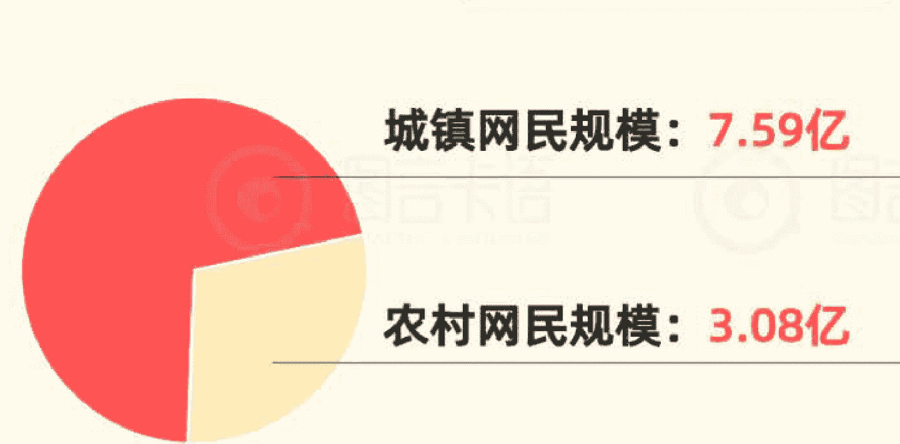

# 理解平台

小红书平台规则01 一般规则 推流规则 防坑规则

## 小红书的检测规则

- 通过机器学习和人工审核监测用户行为，确保用户不会发布违法、虚假、欺骗或不当内容。

### ①行为

### ② 顺序

### ③ 图文影像

- 微信信号、二维码代购、水印等营销词汇。
- 不轻易给人医疗和投资建议。
- 不得诱导用户，比如关注奖励、点赞抽奖。
- 个资允许邮箱存在，微博用微信，术引导微信。
- 最多登录3个账号
- 内容原创度为佳。

## 推广笔记规则

- 品牌或相关方赠送/付费/邀请试用/粉丝单抽等，属于存在利益相关，与小红书存在利益相关性的笔记，推广笔记。

### ①发布须知

### ② 注意事项

### ③违规处罚

- 要符合《社区行为规范》
- 禁止对笔记进行数据人工干预或造假
- 官方的警告，小红书修改合规
- 避开长期试用期才体现功能的的产品
- 不连续发布2篇推广笔记
- 超过20%触发处罚

编辑|万艳梅 图图|IVY

# 理解平台

小红书平台规则02 一般规则 推流规则 防坑规则 运营

## 小红书的推荐规则

- 小红书的推荐系统采用机器学习算法，通过分析海量数据，不断优化算法模型。

### ① 发现页流量

### ② 搜索流量

根据用户转发、点赞、评论、收藏 4 项数据的反馈结果，进行广泛推荐。账号和笔记标签设置话题、关键词影响推荐结果。

搜索流量算法 = 关键词的核心词 + 推荐内容匹配程度

| 账号标签设置方法 | 笔记标签设置方法 |
| :--- | :--- |
| - 多看领域内容 | - 选择相同的话题 |
| - 勾选感兴趣内容 | - 相关内容关键词 |
| - 点赞收藏相同领域 | - 发布和定位相关 |
| 排名 点赞 收藏 | |

# 被推荐的核心逻辑

### ① 打开率

### ② 互动率

### ③ 搜索打开率

根据用户打开比例，决定是否推荐内容给更多的用户。

根据打开率和互动率数据决定是否更大规模推荐。

在用户搜索结果中被用户点击概率较大的，会被继续被推荐。

> “只要用户输出高质量的内容，即使粉丝基数不大，也可以获得平台的流量推荐。”

编辑 | 万艳梅 制图 | IVY

# 理解平台

| 小红书平台规则03 | 一般规则 | 推流规则 | 防坑规则 |

## 小红书的防坑指南

- 运营一段时间后，流量涨不涨、笔记流量变，个人阅读量变。可能笔记或账号不小心踩到小红书雷区，而没发现。
- ① 立马发笔记易被营销销号新号优先养
- ② 违规会降权资料、笔记内容评论违规受影响
- ③ 确定标签后不要反复修改 容易被限流量
- ④ 一手手机登录一台设备双账号勿一设备多号
- ⑤ 谨慎发布引流第一次48H禁言第二次7天禁言第三次永久禁言
- ⑥ 内容质量为王 发查违禁词易网、敏感查询词、轻抖等
- ⑦ 不分编辑或爱轻易换号以免评论违规
- ⑧ 不大量删除笔记，会查账号有很大影响
- ⑨ 账号之前有违规的处理方法权重

## 发布时间和频率

| 早上 08:00-10:00 | 中午 11:30-14:00 | 晚上 19:00-21:00 |
| :--- | :--- | :--- |
| · 建议每个领域都探索适合的发布时间<br>· 发布频率一周3-4篇，不低于3篇<br>· 每天花15分钟刷刷别人的笔记 | | |

编辑 | 万艳梅 | 制图 | IVY

# 账号定位

账号定位的三大维度 认识自己 了解用户 平台运营

## 3个问题认识自己

- ①你擅长什么
- 询问朋友
- 回忆成就事件
- 从眼下的事做起
- 即使得不到认识也可以去的事情

- ②你是谁
- 定位+身份标签
- 成就事件
- 能够提供的价值
- 你想要链接什么样的用户类型

- ③时间分配
- 时间自由的上班族：日更或两一日更
- 主发展业的：做好时间和精力分配，确定更新新频率

## 4个问题了解用户

- ①用户群体
- 从人去描靠
- 与他自己年龄相似的
- 多听他人意见

- ②用户需求
- 从3方面入手
- 思价值（注：思维价值）
- 情绪价值
- 实用价值

- ③为什么需要
- 用户最关心的问题是什么
- 想要获得怎样的答案

- ④我能提供
- 图文审美
- 文字表达
- 价值输出
- 解决问题

善用定位提升优势

- 精准定位
- 主定位：主要分享的内容
- 副定位：与主定位相关的

- 垂直投放
- 内容垂直
- 突出文案优势
- 审美简洁
- 画风气质匹配
- 统一视觉符号

- 商业类型
- 接单号：为已有的ip引流
- 商业：做内容分享、广告呈现

编辑 | 橙橙 制图 | 周周

# 图文爆款

## 01 封面/布局

- 笔记策划 关注官方 种官方话题

## 热门现象

## 原生内容

## 重大事件

- 小红书官方会针对当前热点策划，引导用户上传自己的笔记。
- 小红书官方会针对可见的重大事件做策划，引导用户关注。
- 小红书官方会针对期间出现系列专题，引导用户关注。
- 小红书官方会针对热门话题布局，引导用户关注。

## 布局策略

- 策略：泛领域+垂直领域
- 作用：泛领域--涨粉，垂直领域--精准吸粉
- 举例：1篇--内容（泛领域），1篇--内容（垂直领域），1篇--内容（泛领域）

编辑 | 万艳梅 制图 | IVY

# 图文爆款

## 02 高质量文案

文案创作方式 文章规划

## 测评类

## 种草类

## 教程类

- <参考结构>
- 概念解释, 标题标签， 功能介绍
- 含有成分, 人群分析， 产品设计
- 产品属性, 价格限制, 操作顺序
- 体感, 效果, 比较, 性价比，顺带福利
- 贴士, 适用人群, 解决方法

- <参考结构>
- 概念解释, 标题标签， 功能介绍
- 含有成分, 人群分析， 产品设计
- 产品属性, 价格限制, 操作顺序
- 体感, 效果, 比较, 性价比
- 贴士, 适用人群

- <参考结构>
- 概念解释, 人群分析, 操作顺序, 使用方法, 体感, 比较, 贴士, 适用人群

## 文章开头/结尾结构

### 开头结构

### 结尾结构

- 产品价值, 市场现状, 列举分类，分类标准
- 文章目的, 个人情况, 个人看法, 建议忠告, 征集意见
- 爆款笔记相对固定，开头和结尾重合多，结尾需要特别注意。
- 爆款笔记的核心是，博主“真诚+利”的内容。

编辑 | 万艳梅 制图 | IVY

# 图文爆款

## 03 图片的创作

图片原则 | 图片美化 | 图片工具

## 优质图片6大原则

- 统一的风格：让用户一看到作品风格就知道你，形成差异。
- 优质的封面：面对笔记打开率影响程度80%以上。
- 图片拍摄精美：图片的精致程度会影响笔记打开时间和停留时间。
- 有内容：全面：通篇都是干货；新奇：增加知识。
- 有排版：排版影响观感，要做到层次分明，重点突出。
- 增加设计感：最后一张插入自我介绍，引导读者主页关注。

## 图片美化5个步骤

- 第一步：选择工具：选择黄相机等APP
- 第二步：寻找素材：保存与题目相符的素材
- 第三步：编辑素材：打开APP选择图片素材
- 第四步：调整布局：调整画布尺寸为3:4
- 第五步：编辑文字：选择功能添加文字

## 图片制作工具推荐

- Snapseed * Vsco * Jane(简拼) * InstaSize * PicsArt(美易)
- 天天P图 * Pico * 创客贴 * 美图秀秀 * 黄油相机

编辑 | 万艳爸爸 | 制图 | Mr.Y

# 视频爆款

- 短视频风口 | 网民规模 | 市场规模 | 趋势

网民规模达10.67亿



城镇网民规模: 7.59亿。我国网络视听用户规模达10.40亿，超越了微信等应用为代表的即时通讯软件。

- 市场规模接近3000亿
- 25% 网民因短视频接触网络
- 168分钟/日 短视频内容人均使用时长

# 趋势小红书的视频笔记在首页占比大于图文笔记，并且有大量曝光。

编辑 | 橙橙 | 制图 | 安宁

# 视频爆款

短视频打造01 内容定位 展现形式 内容策划

## 7类短视频内容标签

- 评测产品：产品的功能、服务体验的过程及结果
- 教程：对某事物进行演示、制作的过程
- Vlogs：日常生活状态
- 游戏：硬件测评、实况录像、音乐、游戏装...
- 搞笑：占了全部
- 盘点：产品盘点、片段
- 开箱：收到的包裹、向用户展示
- 演述形式：对视频里呈现的人物的要求较高，既要有氛围
- 剧情形式：较为完整的同时还要突出，或者是演员合作

编辑 | 橙橙 制图 | 安宁

# 视频爆款

短视频打造02 内容定位 展现形式 内容策划

## 脚本设计

### 脚本功能

作为故事的大纲，用以确定故事方向。
- 提高效率
- 降低成本

### 脚本类型

| 拍摄提纲 | 分镜脚本 | 文学脚本 |
| :--- | :--- | :--- |
| 包括标题、题材、风格、画面和节奏 | 以文字的形式直接表现画面 | 视频中的主角、台词和时长等 |

### 写作思路

| 主题定位 | 框架搭建 | 细节填充 |
| :--- | :--- | :--- |
| 人物 | 场景 | 事件 |
| 影调 | 背景音乐 | 道具 |
| 镜头运用 | 机位选择 | |

例如：美食类视频，以制作特色为主题。

# 视频爆款

短视频打造03 内容定位 展现形式 内容策划

## 视频拍摄

### ①视频拍摄设备

辅助工具
- 手机原相机
- 轻颜相机：选择视频模式，磨皮，会员版更加清晰
- 支架
- 稳定器
- 麦克风

### ②视频剪辑

| 剪映 | VUE | VN | Inshot |
| :--- | :--- | :--- | :--- |
| 自动识别字幕、调整视频参数和滤镜，字幕（免费） | 可以把素材导入APP里直接生成vlog视频，字幕（会员） | 拥有强大的功能，包括滤镜、字体都导入到APP | 可以音乐、特效，修剪视频 |

### ③视频字幕

| 有文稿，快速识别字幕不合规复制粘贴到零刻查询网址：http://ci.clingke.pro/ | 没有文稿，从视频导出文本再进行检测 |

- 字幕网：https://www.zimujiang.com/
- “亿友云写”APP来生成字幕

编辑 | 橙橙 | 制图 | 安宁

# 账号运营

账号运营三大维度 注册认证“号设化”运营 日常运营

## 账号注册与认证

### ①账号注册
### ②身份认证
### ③完善信息

- 微信登录
- 手机号登录
- 其他方式
- 实名认证
- 官方认证
- 编辑资料
- 逐项填写

## “号设化”运营

- 常见的昵称+内容组成领域
- 学习类：xx分享、xx学习、数学霸xx、学习达人xx
- 健身类：xx健身、爱健身xx、健身达人xx
- 表达类：xx表达、xx口才、xx沟通、主人xx
- 美食类：暇昵称+爱美食、昵称的美食记忆

昵称
- 以简单为主
- 直观清晰的体现价值

- 主页图长宽比为5:4，下拉主页图片会被放大
- 职业形象照
- 生活旅游照
- 动态形式
- 品牌标志

头像

主页

## 一句话说明你是做什么的

- 我很专业体现专业和特长；数据化描述+具体领域定位
- 我很特别适合一定影响力和特殊经历；高级文案+共情话
- 我很厉害适用头部博士和超高成就的；一句话概括一段经历

简介

编辑 | Tina&Kevin 制图 | 周周

# 账号运营

账号运营三大维度 注册认证“号设化”运营 日常运营

### ①保持活泼，增加账号权重

- 定时浏览，每天少浏览
- 增加互动，增加点赞收藏
- 增加互动，不要主动留信
- 关注博主，每天关注几个博主
- 活跃账号
- 晚上空观看互动

### ②违规解决方案

- 营销类型：营销图片、代购
- 营销诉：收到通知直接删除违规笔记
- 活跃账号：连续一周发布笔记，内容差异

### ③参与活动与热门

- 参与活动：所有领域内活动
- 粉丝热门：参加领域内活动，获得流量支持
- 粉丝热门：寻找同选题

### ④提升流量

- 粉丝流量：根据流量开始，流量多次投放
- 粉丝基础：建立统一的数据采集标准
- 粉丝基础：围绕数据围绕目标
- 行动计划：制定下一步计划，明确重要一条

编辑 | Tina&Kevin 制图 | 周周

# 账号运营

账号运营三大维度 注册认证“号设化”运营 日常运营

## 复盘提升

| 曝光量 | 跳出率 | 点击率 | 互动率 | 完播率 | 赞粉比 |
| :--- | :--- | :--- | :--- | :--- | :--- | :--- |
| 浏览量 | | | | | | KOC |
| 互动量 | | | | | | KOL |
| 完播量 | | | | | | |
| 赞粉比 | | | | | | |

结果与差距

- 对比当前结果，还要对比过去
- 变量间的相关性
- 粉丝数、爆款数以及发布数据具有关联
- 变量收集：把问题和回答用记录下来
- 问题显性化：发现问题
- 经验总结：更有信心

# 账号运营

## 脚本设计

# 视频爆款

短视频打造04 内容定位 展现形式 内容策划

## 视频拍摄

（同上）

# 账号运营

# 粉丝秘籍

小红书涨粉心法01 核心机制 长期稳定提供

做小红书或者是自媒体，本质就是价值交换。一般来说，小红书笔记提供的两种价值：干货价值和情绪价值。

## 干货价值

### 情绪价值

- 1类：你的内容为别人：节省了、方便、新的知识、解决方案
- 1类：你的账号让别人：体验了喜悦、搞笑、开心、甚至产生共情
- 2类：宝宝需要的育儿知识，有利于成长的书单
- 2类：独居生活类--积极阳光，萌宠类--非常，女性个人成长--激励每个人更好的自己

各种提升工作效率的工具你的经验和特长：怎么减肥、怎么护、怎么做饭、怎么穿搭、怎么购物便宜、怎么带娃省心等等。

情绪价值打动人比较困难，干货价值基于经验和学习，容易。相信干货长尾效应，放下心态持续输出。长期稳定产出有价值的笔记，即使没有正向反馈，也会让你的账号拥有价值。

编辑 | 杨惠雯 制图 | 向阳倾心

# 粉丝秘籍

小红书涨粉心法 01 核心机制 推荐机制的适配

- 你心里所想的那种暴力涨粉，也不能涨粉，都是不存在的。涨粉没有捷径，只要内容OK，确实有些“技巧”可言的，就是推荐机制。

## 涨粉技巧--涨粉公式

## 粉丝公式：涨粉数=流量*粉丝转化率

### ① 粉力拆分：n*运营
- 熟悉平台规则
- 账号定位
- 发布选题
- 话题选择
- 内容
- 拍摄
- 剪辑
- 脚本

### 涨粉公式拆解：n*从两个方面入手
- 提高你在小红书流量
- 提高粉丝转化率

### ② 分析：假设进入小红书首页有1000人，涨粉转化率为10%，相当于粉丝增100。
- 假设提升流量，不提升粉丝转化率，实际粉丝增加人数：2000*10%=200
- 假设提升粉丝转化率，不提升流量，实际粉丝增加人数：1000*20%=200

涨粉主要还是由运营承担许多。运营涨粉方法，讲究数据，在每一个运营人的眼里，小红书涨粉是有其公式可以计算的。

问题：> 提升一点都能叫速涨粉，两点同时提升，这就不是我们所说的超级涨粉吗？

思考：如何提升这两点？88号流量（备注：私域）

编辑 | 杨雅雯

# 粉丝粉丝秘籍

# 粉丝秘籍

## 粉丝转化途径

### 收录/爆文

- 粉丝转化先弄清楚是怎样关注到一个博主。
- 用户关注博主有3个步骤：
  - 第一步，搜索结果或者Feed流看到笔记，感兴趣，进入笔记页面。
  - 第二步，笔记不错，产生关注想法，进入主页。
  - 第三步，进入主页决定要关注。

### 粉丝第一步的本质：增加用户看到的可能性（提升笔记的曝光量）。

- 搜索流量：让笔记有被搜到的，在小红书里“收录”。
- Feed流量：Feed是小红书推荐，日常刷到的笔记，可以如此之为Feed流。
- 方法二：爆文：一个月内，一天出一个博主，可能会产生4-4篇爆文，其他都是日常笔记。假设粉丝转化率稳定，每天涨粉1000，那么有几个爆文时涨粉就可能实现十万粉丝的目标。

编辑 | 杨雅雯


# 张粉秘籍

# 小红书涨粉心法 02

## 实操篇

## 小红书涨粉实操

### ① 标题

### ② 封面足够高级

## ③ 标题

- 关注小红书官方动态，搜热点话题
- 面不美观，用户都恨，本没有点击的欲望
- 小红书公式如下：痛点+场景+解决方案+结果
- 结合自己的人设及内容进行创作
- 注意事项：
  - 首字母选择要用心心
  - 用大字吸引注意力
  - 用圆框的方式做首字母
  - 留白框对比照片
  - 拍摄4:3的竖屏
- 口语化+情境+事件
- 目标人群+解决方案+状态标识
- 细分人群+事件+解决方法+情境
- 目标人群+事件+解决方案+情绪价值
- 垂直，注意的是：
  - 未来想要更新的内容是什么？
  - 是否相同的？
  - 是否是相同的风格？
  - Yes，用户会成功关注
  - 带话题
  - 更容易获得流量

如何整理成一套万能公式？

## ④ 内容

## ⑤ 形式

- 万能粉丝公式：人群+场景+痛点+解决方案+情绪价值+行动箭头
- 图文笔记（注：公式不要全部都选用，而是要根据情况来选择）

- 优势：制作简单、方便，受众广
- 缺点：没有亮点、同质化严重，转化率低、人感较弱

## ⑥ 主页技巧

- 视频笔记

## 发布时间

- 优势：平台持续机制、人设强、涨粉快
- 缺点：视频时长长、质量要求高、用户差异较大
- 发布高峰时段：
  - 07:00-09:00
  - 12:00-14:00
  - 16:00-18:00
  - 20:00-22:00

如何选择？

- 主页的细节：
  - 头像：尽量真人头像
  - 名字：简单好
  - 个性签名：一句话你是/你想长什么
  - 背景图：要与人设及道具相同、高级感
- 个人的能力
  - 你的赛道和选题
  - 自己的
  - 你生活中的素材

注：调手机高峰期获取更多流量

编辑 | 杨雅悦
制图 | 心怡阳情

## 涨粉秘籍

小红书涨粉心法 03 工具篇

## 制图/视频工具

| 黄油相机 | 推文剪辑 | wink | Palatemaker |
| :--- | :--- | :--- | :--- |
| ● 用途 | ● 用途 | ● 用途 | ● 用途 |
| □ 制图 | □ 导入文字 | □ 引入视频 | □ 高级感配色 |
| □ 文案 | 自动剪视频 | 自动精美颜 | 自动生成器 |
| (制作图片好手) | (提升创作效率) | (控教剪小白) | (免费) |

## 搜索素材/配音工具

| Unsplash (里) | Mazwai | Storyset (m) | Ondoku 3 (里) |
| :--- | :--- | :--- | :--- |
| ● 用途 | ● 用途 | ● 用途 | ● 用途 |
| □ 找图片素材 | □ 找视频素材 | □ 找插画素材 | □ 找配音 |
| (简约ins风) | (免费) | (自由度、 | (超自然的) |
| 免费图库) | | 清新简约 | 在线配音工具 |

## 其他辅助工具

| 新红 | Reditor 红薯编辑器 |
| :--- | :--- |
| □ 看流量数据分析, 定笔记选题 | □ 敏感词检查+笔记预选 |
| 用途 > 看流量扶持话题, 能获得流量，还能为内容创作提供灵感 | 用途 > 笔记发布前, 先查敏感词 |
| | □ 收藏家:碎片灵感内容收集、管理器 |

编辑 | 杨惠变 制图 | 阳清心

# 变现路径

# 小红书变现路径01

### 准备篇

### 小红书博主等级划分

| 级别 | 粉丝数(Fans) | 变现方式 |
| :--- | :--- | :--- |
| 素人博主 | F<5k | 粉丝越多 |
| 初级达人 | 5k ≤ F ≤ 5w | |
| 腰部达人 | 5w ≤ F ≤ 50w | 变现越多 |
| 头部达人 | 50w ≤ F ≤ 100w | |
| 知名kol | 100w < F | |

### 一个变现准备

### 升级专业号

| 主体 | 个人型 | 企业型 | 创作中心 | 实名认证 | 运营信息 |
| :--- | :--- | :--- | :--- | :--- | :--- |
| 身份标识 | xx博主 | xx品牌 | | 个人/企业 | 传输资质 |
| | | | | 更多服务 | 运营信息 |
| | | | | | |
| 条件 | 申请 | | | | |
| | | | | 核心信息 |
| | | | | | |

- 个人专业号
- 企业专业号
- 粉丝互动
- 门店
- 粉丝大于500
- 粉丝大于1K
- 粉丝大于5K

编辑 | 逆流潮流人 制图 | Bella

# 变现路径

# 小红书变现路径01

### 变现方式

### 注意事项

### 广告变现

**体验：** 博主试用笔记获取商品，账号粘性与产品适配高，易命中
**广告费：** 发布笔记接报（粉丝数的10%-20%）、谈笔记形式
**品牌合作：** 按要求创作笔记，专业认证粉丝5000

### 产品变现（有形商品）

**开店：** 个人店铺、个体抖音、普通企业、专卖店/旗舰店
**升级专号：** 通过粉丝笔记或直播带货赚佣金
**小清单：** 清单引导搜索、实现带货专业

### 影响力变现（私域流量）

**适合人群：** 博主自IP与产品
**引流：** 打造引流产品 - 账号为微信或邮箱
**设计引流路径：** 运营私加微信私信引流
**方式：** 出书、课程、各类社群......

### 知识变现（无形商品）

**知识博主，** 有课程、专栏
**条件：** 升级专号且粉丝1w
**官方邀请：** 粉丝不作开启
**方式：** 直播/录播、1V1咨询

### 三个注意事项

①是否接报如何选择
- 报（平台方，安全规范，专号实名不违规且粉丝过K）
- 非报（私下合作，限流违规，以笔记软硬度作为是否接报核心标准）

③广告投放多少：自我限制，低质产品/硬广/广告多份，铺量影响

如何合理定价：粉丝数×0.1*类目系数×粉丝状态系数=报价
产品适用价值 = 以粉丝涨幅、互动频率、爆发率为参考

```
10000*0.1*1*1=1000元
```
