# 让情绪有着落
emotional availability, grounded

2025情绪营销8大趋势洞察报告

巨量引擎 · CMNDATA
第一消费数据洞察中心

数据中心 | 消费行业 | 报告

# 知识星球TOP 资源分享群

汇聚全网付费资源
让更多人获取高价值信息

- 付费文章
- 付费社群
- 付费课程
- 副业&搞钱
- 财经&股市
- 行业报告

时政·历史·职场·体制·自媒体学习·军事·软件·影音·社会学

公众号:知识星球TOP 微信号:jntsg8 微信号:jntsg2

添加微信 免费进群

# 有关情绪
TA们说

重塑内心的力量
拒绝被标签定义！

打破常规边界
让美流动！

做真实的自己
定义你的光芒！

在喧嚣中寻找
出路！

内心的安宁
不被外界左右！

释放内在的
自信发光！

更多精彩请关注美学实验室

# CONTENTS
目录

| CHAPTER | 内容 | 页码 |
| :--- | :--- | :--- |
| CHAPTER 01 | 看本质 | 心情不是一个人的感受，是群体消费的大波浪 | 06 |
| CHAPTER 02 | 读懂情绪 | 八大情绪的流量密码，是未被满足的人群渴望 | 14 |
| CHAPTER 03 | 找到方法 | 触动大众情绪，是一门可系统化的营销科学 | 63 |

# 前言

“成分党、NPC后域文化，一场大众掀起的社媒风暴，正打破权威与迷信的边界，解构传统商业旧章。

我们正处于“Zero Consumer”时代，真实内容成为当下品牌连接消费者的秘密。巨量引擎的核心价值在于具有真实、生动的内容领域。在这里，品牌营销的进化路径清晰可见：从单向“获人”的效率驱动转向基于真需求、真增长、以“情感”驱动的连接。

常青 巨量引擎大众业务总总裁

“当潮流的爱国情怀，化作新中式的衣服潮汐、非遗与街头酷的碰撞火花，这种长久的情感在新时代与新媒体下焕发新生。

‘血脉觉醒’以特效交互、国风风袭、创意潮流等新形式破圈。年轻一代在尺寸屏幕上演绎精粹，通过互动共酿文化活力。通过短视频的15秒，传统的文化元素焕新，在亿万用户中使用汇聚生成新时代的文化新潮。”

黄志望 巨量引擎大众业务行业运营负责人

“无法抵挡‘记忆系’，毕竟旧就是一种让大众点亮当下的、与成长和解的力量。

怀旧是巨量引擎用户独特的生活记忆，这股浪潮从美妆时尚席卷到数码3C等多元品类。那些旧品牌连接过去、现在与未来，驱动着‘老’元素与‘新’趋势的流量转换，高效焕发商业创新与消费需求的良性循环。”

清洁 巨量引擎大众业务线运营总经理

# 前言

> “当千万人点赞同款‘情绪’视频，孤独感就转化为群体共鸣，这正是‘feeling matters’——感受重要。”

很多内容成功的原因，是在构建品牌与用户的共情回路。比如直播间的实时弹幕、评论区的互动，让品牌能够捕捉用户情绪的延续。

曹智南 首席心理总监

> “多巴胺穿搭、美拉风盛行后，是大众追逐多元愉悦。大众更加关注内心感受，通过展现主观的满足的同时，可持续时尚也在潜移化中影响着价值观。”

弘博文 (SUPER世界) 主编

# CHAPTER 01
## 看本质

心情不是一个人的感受，是群体消费的变量

心情在变，消费也在变

大众情绪正在增长。2024年情绪相关话题播放量翻倍，规模破亿。当代消费者开始更多“心智”，在碎片日常中寻找出口。情绪营销正从单向反馈，搭建起直达内心的基石。社交平台的内容池成为一面棱镜，精准折射出大众的情绪光谱，使得情绪可被捕捉。品牌营销将回归真实的情绪坐标。

# CHAPTER 02
## 读懂情绪

### 1.1 当代群体渴望更多的“积极元素”

1.1.1 催产素/血清素/内啡肽/多巴胺是当代人刚需的精神

- 多巴胺 即时快乐（全声量同比增长30.2%，网互动量1.3亿+）
- 内啡肽 延时快乐（全声量同比增长14%，网互动量1.3亿+）
- 催产素 平安安全（全声量同比增长86.4%，网互动量4900w+）
- 血清素 轻轻治愈（全声量同比增长108%，网互动量2530w+）

WHY? 三重现实的不确定性，焦虑的构机

| 因素 | 占比 |
| :--- | :--- |
| 未来不确定性 | 37.1% |
| 经济负担 | 36.7% |
| 健康问题 | 24.7% |
| 人际关系 | 24.5% |
| 工作压力 | 35.0% |
| 家庭责任 | 31.0% |
| 时间管理困难 | 22.0% |
| 情绪问题 | 22.0% |

过去一年，你的情绪基调是什么？压力等负情绪是多数过去一年的情绪基调，感受到高压与焦虑如影随形的感觉，仿佛被按下键释放，在碎片日常中反复循环。

| 情绪 | 占比 |
| :--- | :--- |
| 压力与焦虑 | 27.0% |
| 压力与焦虑 | 25.2% |
| 紧张与不安 | 19.8% |
| 孤独与失落 | 15.3% |

之不去的焦虑源，是当代大众的“缓冲”。未来的不确定性成为许多人的核心，经济负担、压力与家庭责任构成了现实的三重困境。

### 1.1.2 “心情”狩猎行为正在蔓延

“心情”觉醒成大共识。外部世界的持续性增强，大众开始向于可控领域建立秩序。感，情绪的投入成为更为能够确定的人性选择。

| 行为 | 占比 |
| :--- | :--- |
| 重视情绪健康愿意投入时间金钱 | 45.3% |
| 健康至关重要值得花费精力和金钱投资 | 36.1% |

情绪治疗方式更新频繁，融入日常生活。对情绪的关注不再被认为是感性层面的自我沉溺，而是理性后的生存智慧。大众正以多元方式兼顾感性表达与策略，构建情绪治疗体系。

- 一部微短剧，快速沉浸+即时压抑是快速生活的解药（52.2%）
- 不找朋友找个搭子，选择压力社交的轻松陪伴活动（43.3%）
- 寻求专业咨询或引导，是自然的最小单位自我疗（40.7%、36.7%）

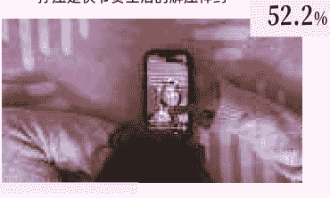
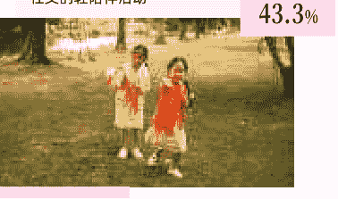

| 维度 | 占比 |
| :--- | :--- |
| 参与品牌互动 | 43% |
| 更有共鸣的品牌 | 47.5% |
| 更有共鸣的品牌 | 39% |
| 更有共鸣的品牌 | 33% |

### 1.2.1 为快乐买单已破圈

半数人群已形成“破圈效应”，持续向低线延伸。

| 城市 | 情绪付费意愿占比 | 更高消费 |
| :--- | :--- | :--- |
| 一线城市 | 100.00% | 68.00% |
| 二线城市 | 70.50% | 56.50% |
| 三线城市 | 50.00% | 61.11% |
| 四线城市 | 159 |
| 五线城市 | 108 |
| 六线城市 | 102 |

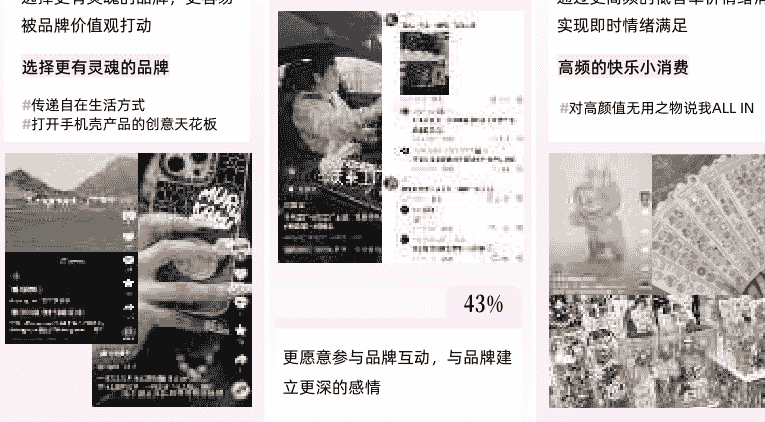

### 1.2.2 营销要素被重构

品牌营销从理性价值导向的叙事体系，向情感共鸣导向的叙事方式深度转型。营销是以消费者情绪为核心，通过激发、调节、满足用户，将品牌价值与用户情绪深度绑定，从而驱动消费决策、强化品牌认知的新型营销战略。

情绪营销三阶段特征

| 传统营销 | 情绪营销 |
| :--- | :--- |
| 核心逻辑：理性价值交换 (功能/价格) | ------> 情感共振 (认知/共鸣) |
| 传递动力：利益驱动 (折扣，促销) | ------> 情绪驱动 (共鸣，分享) |
| 内容核心：产品卖 (顾客需求) | ------> 情绪场景 (主体体验) |

| 1.0 情绪准备阶段 | 内容核心 |
| :--- | :--- |
| 品牌打造特定情绪并输出至消费者 | 情绪聚焦：负面情绪-产品-说服 |
| 消费者角色：被动接受者 |
| 内容渠道：信息传递工具完美策划 (crush) 广告 通过策划技术辅助传递集情绪 |

| 2.0 情绪共鸣阶段 | 影响核心 |
| :--- | :--- |
| 聚焦单一场景、单一节点、单一场景关联的消费者情绪 | 影响链条：情绪共鸣：价格 - 品牌 - 触碰 |
| 消费者角色：主体体验者 |
| 内容渠道：场景化情绪载体可口可乐碳酸饮料 完美契合当日下的正向梗 |

| 3.0 情绪共生阶段 | 影响链条 |
| :--- | :--- |
| 以用户生活场景的情绪需求为核心，构建情绪共情共同体 | 影响链条：价值共生：用户需求 - 品牌 - 平台 |
| 消费者角色：价值共创 |
| 内容渠道：场景化情绪载体情感互动与价值共创 作为品牌核心价值，构建安全感与价值认知 |

### 1.3 培养大众情绪更澎湃

### 1.3.1 情绪能被阶梯式捕捉

- 情绪捕捉三阶段：情绪萌芽-情绪传播-情绪利用
抖音营销更多、感知更快、转化更强

- 情绪利用：情绪闭环消费体系把情绪标签化、捕获人群、提供商品、打造成交场景。

- 情绪传播：POCG-UGC-热点，自下而上、自上而下。

| 占比 | 传播特点 | 传播节奏 |
| :--- | :--- | :--- |
| 头部达人 | 67.0% | 扩散范围广，极快 |
| 中部达人 | 31.4% | 五感触发，快速迭代 |
| 头部达人 | 15.5% | 情绪张力强，有趣 |

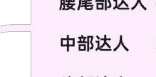

### 1.3.2 大众情绪在抖音疯发

多巴胺是味道，快乐是平凡日常里的每一个瞬间。

| 状态 | 话题总量 |
| :--- | :--- |
| 平台助长 | 70亿+ |
| 趋势形成 | 48亿+ |
| 精品覆盖 | 30亿+ |
| 词汇潮流 | 21亿+ |
| 生活生活 | 12亿+ |

... (省略13_2至13_17图片标记)

- 创新剪裁
- 赛道运营
- 热点榜
- 全民挑战赛

# 定位八大情绪的精神刚需
## 掌握当代人的精神内核

根据情绪判别方法论，我们通过整合全网平台内容，聚合出八大高价值情绪。每一个情绪关键词的背后深刻体现了大众在塑造、丰富人生过程中的情感起伏。

# 全网八大高价值情绪纵览

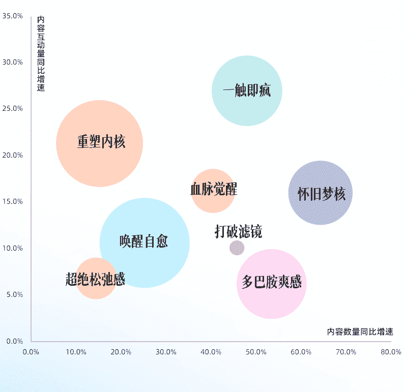

# 锁定情绪坐标
## 大情绪背后真实的Ta们

## 唤醒自律
以温暖为基调，关注日常生活中展现的小确幸、小美好，品味生活的每一个瞬间，以此丰富生活的状态。

“Ta们上班下班后呈现两种不同的生活状态。”

> “韧力是Ta的心理内核，KPBL是Ta们的逻辑。”

## 情绪自治
易耗人

## “硬核”主理人
“Ta们推崇‘职场文学’，强调内向。”

具有主体特性的Ta们
> “Ta们推崇‘职场文学’，通过‘自我觉醒+自律更新’重塑生活。”

# 重塑内核
以向和和力为基调，展现个人的成长历程、生活方式的正向改变以及女性意识的觉醒，以此来获得鼓励。

## 多巴胺紧张
以情绪为基调，聚焦密集浓度瞬间的冲击，快速释放压力，以此对抗真实的量与压力。

“Ta在空间中用时间短暂缓解现实压力。”

追求目标快乐，高能量为精神信仰。

易耗人

## 多巴胺男孩
## 易耗群体
## 情绪体验型
## 完美即焦虑
“‘发疯’不是压力，而是用无头无脑的方式来缓解的焦虑。”

Ta们有两个侧面，在社交与戏精间切换。

# 锁定情绪坐标
## 八大情绪背后真实的Ta们

## 怀旧愁梦
以怀旧为主基调，借由旧玩具、老式电器，色彩跨越时空边界将你与来时时光作语境，在纯真时代单一寻找一方。

“Ta们从过去去，对当时的自己进行补偿，在‘传承’中重塑自己的意义。”

## 血脉觉醒
## 复古回邂
童年、影视影像、老照片、胶帧风
收集“老董”、复古滤镜、港风穿搭
30-45岁，男女年龄、二线城市，月薪2万+、家庭女性

## 易于人群
## 血缘觉醒
以文化认同与民族归属为主基调，关注文化、音乐、民族精神等创作内容，通过传统文化的认知，对自我内在努力进行重塑培养。

“Ta们从传统文化中寻找定位与创新。”

“以血脉共振+代身份生活的生活的转化。”

## 超能弛感
## 大众生活家
以自我拯救为主基调，通过主动社交时的节奏、允许自己拥有界限，将生存状态化为不安的美丽的温暖氛围。

## 易于人群
看着的内容：随缘、松弛、惯日常
想要的故事：职场融入人生、全职女孩、家庭主

“Ta们从真我出发，保持‘人情界’与和谐。”

相信了世界上就不恐惧，自有一套情感港湾。

## 热血行动派
## 易于人群
看着的内容：台词综艺、潮流光汇、精致生活
想要的故事：理想消费、追求潮流改变、挑战主流生活
18-23岁，男女年龄、一线城市，斜杠潮流/从业者

“Ta们遵循内心，不甘平庸。”

## 打造成孤独
在喧杂世界中保持清醒的独立思考，不从外界界准。探索内心、追求真实、自己的调节节奏，以及真实的自我。

“接纳一切，‘做自己’。”

## 唤醒自愈
本情绪以温暖为主基调，关注日常的生活节奏中展现的小确幸、小美好，品味生活的每一个治愈瞬间，以此缓解日常生活的压力。

它很好，你随时可以发现自己需要治愈的时刻，温暖的瞬间就会来到身边。
2024年互动：1000+
2024年内容：700+
2024年内：5+
坚持又一次寻找的小确幸

# 萌力入侵
展现日常、宠物、玩怪、陪伴等生活片段。
情绪内在：压力缓解
热门话题：#治愈的瞬间 #做你治愈
2024年互动：400+
2024年内容：亿+

# 萌出逃计划
沉浸式的每个‘生活’，忍不住想看美丽到处。
情绪内在：治愈
热门话题：#除了无处是 # 哪里处（治愈）

## 天赋型演员
偶尔就是越界，每一只都是动物的演技。

## 人生半海
遇见了累，遇见了自己也遇见了想去山野的呼吸的风。

## 下山途中
在热闹的城市里，原来有闪光生长，在街角回头寻找治愈的温暖问候。

## 有被“妈妈”
藏在最后，最暖的细节，原来总是如此。

## 世界就是大型养成
每个人都是世界的NPC，总是在手机里被触发任务。随路旅行中的各种植物等‘自由’。
情绪内在：压力缓解
热门话题：#云游现场 #热爱男孩 #身体健康
2024年互动：亿+
2024年内容：300万+

## 小写时光
记录生活碎片，领略路人的微小动，内心柔软。
情绪内在：柔软
热门话题：#闲云 #人间温暖 #治愈瞬间 #感人一幕 #治愈的以来
 善良的人都被治愈了。

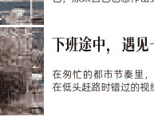
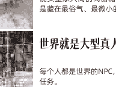
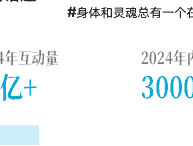
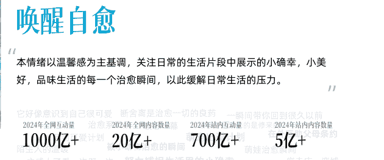

# 唤醒容易敏感人群
## 情绪自治
对于Ta来说，虽然工作还比较繁忙，但是还是有能力融入生活，要把工作与生活划分清楚。上班时就一心想着工作，下班就把自己留给自己，做些感兴趣的事，这样有助于缓解焦虑情绪。睡前再刷刷短视频，看着窗外的粉丝博主分享养子的日常，周末旅行去‘云游’打卡，变得开心的最重要的就是开心心情。

### Who
| :--- | :--- |
| 一线城市生活 | 女性为主 |
| 18-30岁 | 职场新锐 |
| 社交媒体高活跃用户 | 单身 |
| 月入1-3万 | 导环保 |

刘女士，24岁，外企，北京，热爱户外旅行与美食私享

### When
人生阶段：以一线城市工作的职场新人为主，处于社会角色转换阶段，用稳定的心态去面对职场发展/人生规划/寻找爱的不确定性。钝力是Ta人的精神内核，KPBL是Ta人的逻辑。不容易被外界影响的Ta在逆风的生活里，用‘无所求+积累’来积累，她想要更多的精力通过社交媒体来消费，消耗细胞细胞是Ta的‘充电’，这让她要在生活的温度差里，找到属于自己的的心。

数据来源：CBData消费大数据

# Ta们的“自愈”人生态度
于情绪自治而言，生活与工作中的困顿无非这些，即使压力如潮水般涌来，Ta们也自有路可。

# “共情”消费是Ta物质化的情绪疗愈
- 容易在深夜受情绪影响而进行消费
- 影响决策的核心情绪是认同与共情
- 比较愿意支付30%以内的溢价

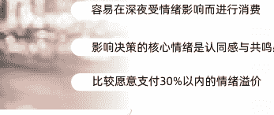

# 上班后
相关视频：4.9亿
# 下班后
相关视频：1.4亿
# 装修
相关视频：2亿
# 健身（治愈）
# 健身课
相关视频：220万
# 周末逛
相关视频：8.5亿
# 演出
相关视频：207万

# Ta们的典型生活场景 - 为出发
Ta们常处高压状态，寻找不同风景，深度探索旅行新方式之一。不是远方还是本城，总能get能量的时刻。

“早起”镜头：贴近地面，低角度垂直拉升，呈现风景的震撼效果。
“早起”镜头：用长焦拍摄类似高像素大片。

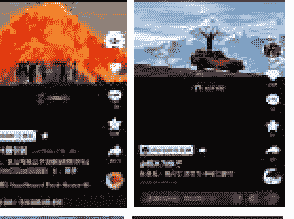
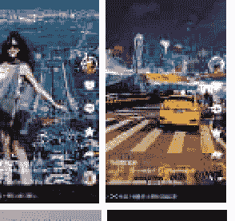
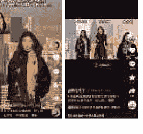

## 好内容创作灵感
适配治愈系文案，常见，普通的旅游使用拍摄手法、滤镜等拍出不一样的画面，让用户在观看时产生“身未动”的治愈体验。

# Ta们的典型生活场景 - 让生活开花
生活如花开，无论是逛还是闲适，都值得全心投入。

# 去户外“愈”
将自己置于户外环境中，参与徒步、露营、攀岩等热门活动，释放自我，把握日常，收获心灵疗愈体验。
话题量：95.3亿
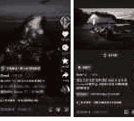

# 搭个精神舒适地
在家搭建一个安放自我与思想的私密空间，都是心的松弛与归属的小天地。
话题量：82.4亿
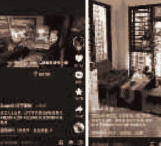

# DIY生活仪式感
通过亲手设计、制作或布置生活细节，DIY调优等，为日常注入独特意义与情感温度的自我创造方式。
话题量：56.7亿
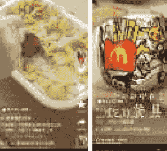

## 好内容创作灵感
治愈的声音扑面而来。以“慢节奏、轻叙事”传递平和。通过BGM/原声/文营造治愈系氛围，画面去冲突化，“片段式记录”展现美好，聚焦生活细节，营造沉浸式体验感。
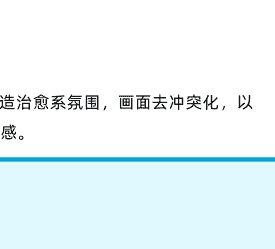

## Ta们的典型生活场景 -
# 养宠“续命”
Ta们沉迷与毛子“贴贴”，有主子会育儿丰容，无主子就线下Zoo walk或线上云养。
# 当家庭、工作、亲密关系
微妙的养宠关系转以父母心态，赋予其家中成员身份认同。
话题量：90.7亿
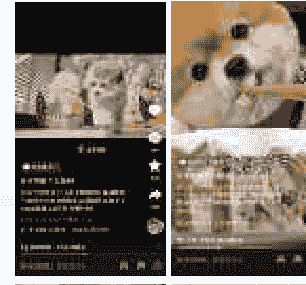

# 线下遛宠
不仅有云养、线上逛宠，线下对宠物的喜爱与陪伴。
话题量：76.7亿
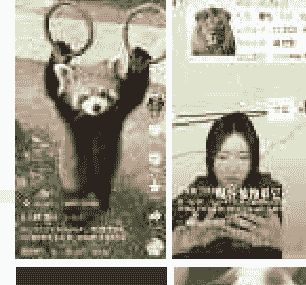

# “神奇”
那些能带来惊喜的非凡特质，大众化。
话题量：53.7亿
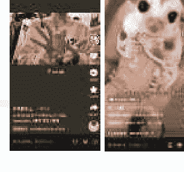

## 好内容创作灵感
突出宠物的萌点、日常（如拆家、捣怪）、剧情化、反差的视觉冲击，让观众产生情感共鸣。
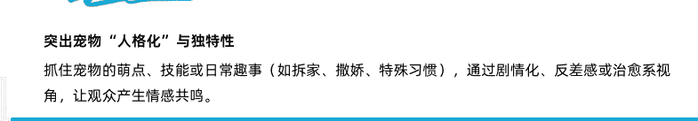

# 重塑内核
本情绪以向和和力为主基调，展现个人的成长历程、生活方式的正向改变以及女性意识的觉醒，以此来获得鼓励。

## 终身学习
展现挑战技能、经验分享、记录等等内容。
热门话题：#提升自己 #每天一点点 #深度学习
2024年互动：334亿+
2024年内容：4亿+

## 重新养自己
通过生活方式的改变，以及以新习惯获得生活的掌控感。
热门话题：#敢于遇见自己 #努力为自己
2024年互动：177亿+
2024年内容：1亿+

## 高热案例
在迷茫的时刻，将无情的知识点变成成长路径。

## 又是职场的一天
记录职场吐槽的每一天，做“不为人知”的职场认知。

## 自律坚持
每天都在改变，发现每一个习惯的蜕变都是抗压能力的积累。

## 自己的养成系主角
打“补丁”、内核，这次我成为了自己。

## 来期girls talk
这是一个大型型的互助，也是女性一生的“成长系统”。用犀利的脑头连接起来每一个女性的能量，让每次崩溃都是可能的反馈。

## 写自己的History
分享他人关系处理、人生变化、认知提升、力量变化等成长故事。
情绪内核：女性的千种可能
热门话题：#大女主 #女性女孩 #girlstalk #女性力量 #独立女性
2024年互动：30亿+
2024年内容：1500万+
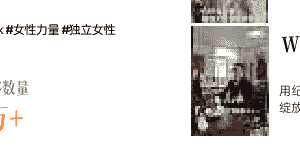

# 重塑内核易敏人群
## “硬核”主理人
大一因为对未来迷茫，我开始报复性放浪，熬夜刷剧、翘早课、外卖不断。代价很快显，体重增加并且几门课的挂科。大二的时候，我觉得以后面开始有意识地调整状态，专注学业，发展爱好，并坚持健身。
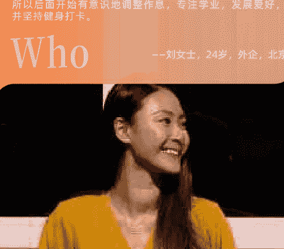

--女女士，24岁，外企，北京，热爱户外旅行与美食私享

### Who
| :--- | :--- |
| 一线城市生活 | 女性为主 |
| 18-40岁 | 职场新锐 |
| 社交媒体高活跃用户 | 单身 |
| 单身在校学生/已婚已育妈妈 | 导环保 |
| 热爱潮流美妆、美食差钱 |

### When
人生阶段：以在三四线城市生活的学习在处于社会角色转换阶段，用稳定的心态去面对职场发展/人生规划/寻找爱的不确定性。钝力是Ta人的精神内核，KPBL是Ta人的逻辑。不容易被外界影响的Ta在逆风的生活里，用‘无所求+积累’来积累，她想要更多的精力通过社交媒体来消费，消耗细胞来是Ta的‘充电’，这让她要在生活的温度差里，找到属于自己的的心。

数据来源：CBData消费大数据

## Ta们的典型生活场景 -

## 夺回人生主动权

Ta们开始认真地爱自己，向内观视，用积极行动，开启一场华丽的身份蜕变。

## 把生活方向盘握在自己手里，油门全开奔驰未来

## 改变自己 重塑

话题播放量：11.4亿

硬“核”主理人，有一种主动颠覆惯性的模式：
勇气（如重塑认知、重构习惯、重选方向），通过打破生活轨迹，快速实现自我迭代，激进成长。

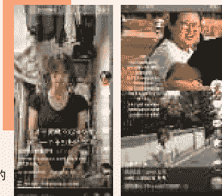
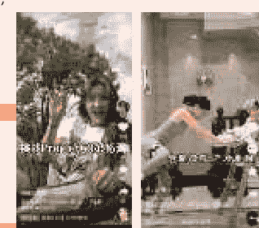

## 好内容创作灵感

灵感一：用“个人故事”解构“普世命题”，前置第一人角的成长情感金句。
画面从具体生活场景切入，让用户从“你的经历”中看到“自己的影子”，利用反差视角输出金句，以（钩子-叙事-升华）三段式结构展开。

灵感二：聚焦“颠覆性”的视觉化叙事，利用前后对比的强烈冲突开场。
拒绝完美人生，展现真实的改变，通过画面的极速切换让爆发变成可视化，爆增不是成仙，而是凡人咬牙齿开启命运重塑的过程。

## 多巴胺爽感

本情绪以锐感为主调，聚焦浓度愉悦的即时冲击，快速刺激感官，释放多巴胺，以此对抗现实世界的疲惫与压力。

## 热门情绪内容

### 一键嗨起来

展现演唱会、舞蹈、游戏等活动，通过内容密集聚类和流量带来体验即得快感。

- 情绪内核：多维度感官享受
- 热门话题
- #情绪酷酷#一碗剧剧头上的#名场#热门游戏有圈子
- #我和节奏超梗的#星哥

2024年互动量：300亿+
2024年内容量：2亿+

### 热门案例

### 总要去听一场演唱会

演唱会现场的热闹和粉丝狂热带来临场氛围，当旋律合唱时将与万人同欢的快乐。

### 舞蹈中的“卡点时刻”

跟着音乐自由舞动，身体获得快乐情绪，压力缓解妥妥。

### 一起黑carry场

游戏中沉浸式剧情和互动变成成就带来高强度愉悦与交流交互的深度体感。

### 电子榨，脑越看越好看

轻松是省心的，通过高节奏和冲击推进进步，成为当代年轻人“短视频神器”。

### 为什么总是对着镜微笑

在游戏中展开与不同角色的沉浸式情感连接，短时间内内心共鸣加加速的沉浸感。

### 3分钟带你看完整部

通过流畅的剧情和高浓度情感冲击，在短时间内引发内心共鸣并获得满足感。

### 休闲娱乐我要“短频快”

将自己代入剧情、游戏、影视中的不同角色，体感虚拟界的奇幻人生。

- 情绪内核：高浓度感官冲击
- 热门话题
- #重生类短剧开头在头上的#美学#乙少女游
- #剧情反转#一个片段完整一部剧

2024年互动量：100亿+
2024年内容量：1亿+

## 多巴胺易敏感人群

### 多巴胺手机

每天下班后，地铁上的二十分钟是我最放松的时候。我会打手机、刷抖音那段节奏明快的视频，肌肉密集的节拍、充满张力的切面，脑细胞瞬间抓住了我的注意力，工作压力的源源焦虑被慢慢消解，生活里的无力感在零碎的欢愉中被重新暂时暂停。

Who：女士，29岁，白领，新手妈妈，上海

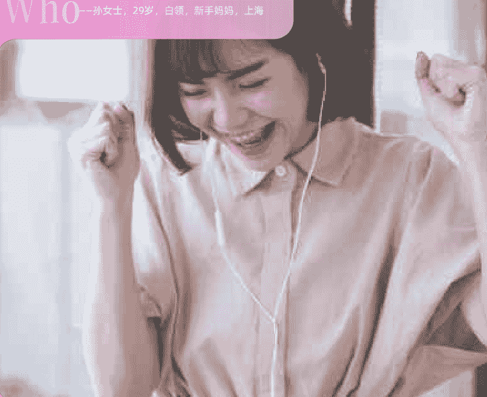

| 维度 | 内容 |
| :--- | :--- |
| 城市 | 一线及一线城市 |
| 年龄 | 25-30岁 |
| 收入 | 月入1-3万 |
| 节奏 | 996节奏者 |
| 消费 | 偶尔消费均衡 |
| 视角 | 酷多元视角 |
| 状态 | 面对压力之中，面对生活带来的巨大压力 |

When：人生阶段：25-30岁的一线城市职场人，处于事业与家庭的双重围城期：职场面对升级与转型压力，被996工作透支精力；生活处于成家阶段，背负房贷、育儿等现实焦虑。Ta们追求快乐和轻松，需要精神慰藉。在快节奏的生活中，她们常用多巴胺的释放来对冲压力。这种短暂的快乐是她们的信赖“多巴胺减压器”，那些强烈和色彩，强调生活的碎片，耐受的刺激。持续3分钟点着她们脑内引起，让焦虑暂时得到缓解。

数据来源：CBData消费大数据

## Ta们的“多巴胺”人生态度

追求即时快乐不是放纵，而是主动调节情绪的方式。压力大，Ta们也能找到让自己放松的方式，在快乐中进行充电。

| 维度 | 描述 | TGI |
| :--- | :--- | :--- |
| 核心 | “爽感”是Ta们的即时快乐 | 116 |
| 影响 | 决策的核心是“情绪” | 108 |
| 欲望 | 意在满足自己的好奇心和探索 | 106 |
| 时间 | 下班后空闲时间 | |
| 计划 | 每天都要打卡，今日目标已达成 | |
| 自律 | 没想到自律这么 | |
| 快乐 | 一心就买点自己爱的 | |
| 消费 | 不打算省钱包了 | |
| 快乐 | 快乐重要 | |

(注：此处部分数据识别混乱，已根据逻辑修正)

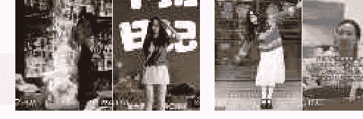
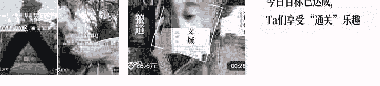
(注：根据上下文逻辑，表格已对齐)

## - Ta们的典型生活场景 -

### 饭圈团建

Ta们在万人合唱的声浪中落地，身体一起狂欢，瞬间缓解日常的疲惫。不管是演唱会还是舞台，强烈的灯光/观众互动多重刺激大脑的“快乐开关”，促进多巴胺分泌。

### 戏剧张力MAX

Ta们节奏舞动。由此产生的自由感与他人同步动作的默契，瞬间点燃兴奋与愉悦。挥着节奏随心舞动，瞬间点好心情。

### 全民跳舞时代

梦想和爆发，印证了一个事实：独特的音乐风格+标志性动作，最大化大众的活力，传播这种快乐。

### 另类跳跃，酷世快乐

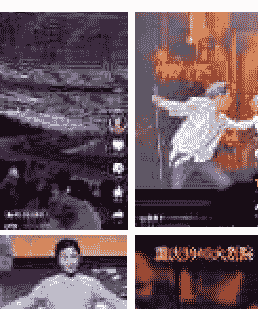
... (此处省略重复识别的页面描述，保持逻辑合并)

## 破次元壁
## 游戏人生
## 沉浸式感
## 易触过敏

### 打破次元壁

Ta们投入精力，化身为自己喜欢的角色，被关注和认可的满意让现实身份退场。穿身上角色的“皮”，化身“纸片人”。

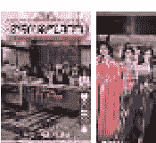

### 人次元现场

演绎喜爱的次元角色或者在周边店“吃谷”时，对角色的热爱和还原带来的成就感，通过个性化的Ta们收获属于自己的使命。

## 游戏人生

Ta们将游戏当作情绪的避风港，短暂忘记日常压力，沉浸于轻松或刺激的虚拟世界中。用虚拟世界的即时奖励，释放现实情绪压力。

| 类型 | 内容 | 话题播放量 |
| :--- | :--- | :--- |
| 官方联动玩家整活 | 虚拟角色在官方运营下，赋予了鲜活的人格，如策划过的活动，为玩家提供了角色互动的想象空间。 | 5206.8万 |
| 游戏体验满 | | 4127.7万 |

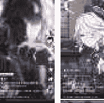

- 好内容创意感：创作立足现实，将虚拟想象世界+现实世界融合。可以用AI技术/虚拟现实的面对面手法还原经典场景，将现实世界的热点/情感融合其中，进行故事延展；调整画面的视觉差，添加合适的特效或游戏元素，增加视觉效果。

## 一触即破

本情绪主打狂欢，聚焦焦虑发疯、无理头梗等内容，用幽默梗和热梗让情绪瞬间宣泄。

| 2023年全网活跃 | 2024年全网活跃 | 2024年内容活跃 |
| :--- | :--- | :--- |
| 500亿+ | 2亿+ | 440亿+ |

### 疯搞抽象

呈现各种精神，反常逻辑，奇怪的动作，营造出一种狂诞又充满活力的画面。

- 情绪内核：共鸣
- 热门话题
- #当代精神状态#乐子#发疯日常

... (后续内容按此逻辑合并并纠错)

## 怀旧梦

以怀旧为主基调，借童年玩具、老家电视、色彩模特跨时空边界，将乡愁与成长抒化为温暖邂逅，从真实时代里寻找平静。

| 愿望的旧时光 | 小时的影像 | 海尽云散的人们 |
| :--- | :--- | :--- |
| 2024年全网热量 | 2024年内容数据 | 2024年内容数据 |
| 359亿+ | 6.6亿+ | 2.8亿+ |
| 那些旧式 | 那个时代 | 千禧时代记忆 |
| 青春太可惜了 | | |

## 热门内容路径

## 思绪综合爆发

揭开承载“表达”的旧影像、旧画、旧书籍、旧物件，试图解锁潮流生活的情绪后劲。

### 情绪内核
+ #怀旧记忆 #记忆里的旧时光 #小时的影像 #情绪恰到边界 #致敬历史瞬间 #抒情

### 热门话题
- 2024年动量：192亿+
- 2024年内容数据：1.8亿+

## 热搜案例

### 儿时影像旧时光
影像中的我们许多回不去了，爸妈也变了模样。每个人心中都有一个与父母的模板。

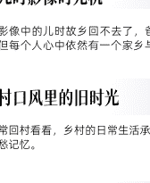

### 村口记忆的旧时光
回回看着，村里的乡村生活承载了一代人的特殊记忆。

### 你的童年和我一样
延续延续的老味道，画面的跳调，炙热的火焰……用共享的DNA记忆。

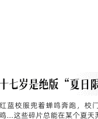

### 青春是一场巨大的后悔
展示青春的理想梦想与生活日子，以及我们无法同时拥有青春并且承受青春的焦虑。

### 情绪内核
+ #不愿长大 #青春太可惜了 #千禧时代记忆 #怀旧经典 #影视一期 #我们的青春 #回到2000 #复古写实 #Y2K

### 热门话题
- 2024年动量：113亿+
- 2024年内容数据：9000+

### 七十岁身处“夏日限定”
红旗裙裹着妈妈，街门口湿透了衣服。这块胶片或许能在某个夏天下午，按下播放记忆的胶片。

### 千禧像素
回顾千年的眼光色彩，在古镇复制里，Y2K穿越中包裹着Year 2000的美学胶片。

*热门内容相关数据来源：巨量引擎*

## 旧梦容易入人群

## 复古回溯客
我18岁拖着行李从东北来到广州上学，毕业就住在卧室，现在已经过了十二年。在期间我经历了恋爱、结婚、生子、人去世、离职创业种种事，人过日子就愁着压力。我现在在午后看着家里的老照片，给女儿看小时候的愁。小时候的日子过得开心，不过我们觉得人还是要向前，毕竟要有房贷要还，孩子要养。

一线&二线城市生活为主

| 月龄 | 宝宝妈妈 | 家庭支柱 |
| :--- | :--- | :--- |
| 2万+ | 核心人群 | 男女均衡 |

- 18-45岁，其中30-45岁为主。
- 热爱种植、艺术、音乐、舞蹈与影视/追星。

### Who
——张，38岁，创业者，亮。
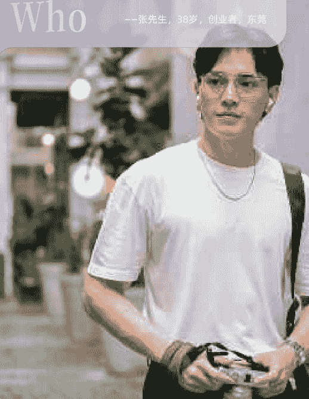

### When
人生阶段：以一、二线城市打拼的30-40岁人群为主；正处于人生责任高峰，已建家庭的Ta们上有老要下小，要解决自己与家庭健康、住房等问题，同时也面临压力，正在寻求稳定突破。

当青春还过记忆的虚，当时光凝成胶片上的虚拟，Ta们在向过去努力，对自己的自由进行补偿：作为首选并经历生活转变的一群人，Ta们在短期内看到时光，新增睡眠奢侈消费。

数据来源：CBNData消费大数据

## Ta们的“旧”人生生态
旧不是倒退，是时代调和的温柔力量与情感的守护。Ta们用过去的光，照亮现在的路，为自己与家人搭建一座连接过去与现在的桥。

消费是Ta们向焦虑缴纳的“保护费”，情绪缴税无上限。

| 影响决策的核心情绪 | TGI |
| :--- | :--- |
| 恐惧 | 115 |
| 非常愿意支付情绪溢价并经常购买提供价值的商品 | 115 |
| 非常容易受情绪影响而进行消费 | 102 |

### Ta爸妈回老家，演绎“自己的童年”，在“传承”中重塑旧意义
- #回村后人的婚礼 相关视频播放了34.7亿次
- #外婆家的小孩 相关视频播放了46.9亿次
- #一个城里孩子在农村玩坝 相关视频点赞高达169.8万
- #长大后就成了你，妈妈年轻时的颜值 相关视频播放6.7亿，10.48亿

- #全家福 相关视频播放10.2亿
- #在影像中捞父母的青春与人间碎片
- #从校园到婚 相关视频播放54.2亿
- #我们的十年 相关视频播放7.9亿
- #童年记忆 相关视频播放30.3亿
- #复古穿越 相关视频播放56.3亿
- #通过复古穿越与童年记忆完成旧时代的对话

## - Ta们的典型生活场景 -
### 情怀旧
Ta们用老物件和影视经典开启之旅，那些满载集体的时代符号直击人心。在时间的废墟里寻找遗失的美，为自己标记成长里程。

### 跨次元“补全”
每个时代都有自己的潮流商品，如CCD随身承载了当时的记忆；自己年轻期的动漫角色进行二次创作，既诠释了经典，也把当时推回美好回忆。
- 播放量：93.9亿

### 这一代人的“老”
Ta们用像素边框泛和生活镀一层时光缓冲，并在虚拟世界重连接记忆的拥抱。
- 播放量：69.3亿

### 技术还原旧时光
Ta们用CCD和复古胶镜朦胧感营造氛围，用特定的色彩真实时代，打破时代的审美疲劳；借鉴技术修复并生成风格内容，更能唤醒集体记忆与怀旧情感共鸣。
- 播放量：18.2亿

### AI给怀念开启
- 播放量：6.2亿
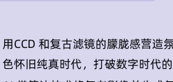
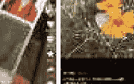

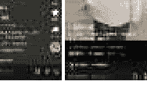

## - TA们的典型生活场景 -
### 审美时代
TA们被复古风狠狠拿捏，将旧时光藏进了穿搭、家居等每一次微观消费中。永远可以相信老辈的审美，经典永不过时。

### 港风有种丰盈的美
话题播放量：40.1亿
对现代工业标准化审美的反叛，让群体感受到怀旧情绪，TA们通过复旧获取熟悉的稳定感，构建出独特表达和时光温度的虚拟空间和独特风格。
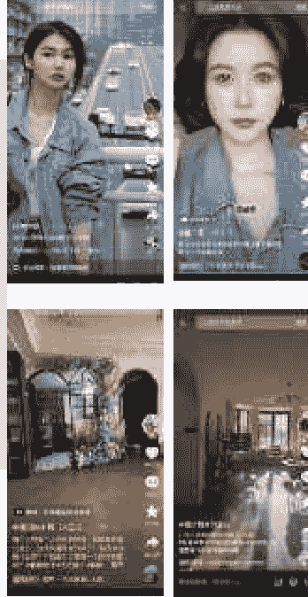

### 每天从法式复古浪漫醒来
话题播放量：2.4亿

## 好内容创作灵感
通过老场景重现，用视觉、听觉、情感3大复古元素唤醒群体共鸣。内容上使用特定滤镜+金曲+金句外，也可以创新，利用AI技术进行赛博朋克x怀旧感的混搭画面，形成强烈的时空碰撞感。

## 血脉觉醒

| 中式美术 | 我爱中国 | 非遗文化 | 非遗守护人 | 非遗文化 |
| :--- | :--- | :--- | :--- | :--- |
| 2024年总量播放 | 2024年内容数量 | 2024年内容数量 | 2024年内容内数量 | 2024年内容内数量 |
| 238亿+ | 3.8亿+ | 198亿+ | 3亿+ | 1亿+ |

### 五千文明Buff
通过数据驱动叙述，让血脉里的五千文明记忆文化归属与身份认可。

### 情绪内核
- #中式审美 #中式婚礼 #中国风 #非遗守护人 #传承者

### 热门话题
- 2024年总量：136亿+
- 2024年内容数量：1.9亿+

### 高案分析
让传承文化深入心，通过规律、花艺等视频累计，让文化变得更有深度。

### 我的远方是星辰
这一刻审美穿越，国风氛围年轻化，让传统文化在现代焕发活力。

### 万物皆可
- #新式审美 #新式文化 #血脉觉醒
- 相关数据来源：巨量引擎

## 血脉觉醒
看了去年的春晚，Ta们从未有过，但自从尝试之后，才真切地发现：原来老家更从容，已经从短暂的逃离，在城市里找到一份平静。

### 情绪内核
- #血脉觉醒 

### 老祖宗的记忆
从戏曲、武术、刺绣、书法、摄影，越来越多的人关注传统文化，与当下结合，是新式中式与文化的起源。
- 2024年总量：15亿+
- 2024年内容数量：3000万+

### 热门话题
- 2024年总量：1.8亿+
- 2024年内容数量：4.2亿+
- 2024年内容内数量：2.2亿+

## Ta们的“觉醒”人生态度
文化不盲目复制，民族自豪拒绝狭隘，追求精神回归但不脱离现实，注重仪式不教条，在传统的碰撞中活出自己的“新中式哲学”。

情绪消费的核心出发点是“文化回归”与“价值认同”，从“看好”到一种情绪煽动让中式婚礼回归日常生活，让那些真实的生活。

### 情绪内核
- (TGI: 115)
- (TGI: 110)

### 热门话题
- #汉服视频申请 播放6.2亿
- #汉服圈子 播放4.1亿
- #中国人不怕潮 视频播放1.8亿
- #民乐电音 相关视频播放20.7万次
- #当汉运遇传统文化 播放3.2亿
- #给巴黎点中国女孩的邂逅 播放13.9亿
- #汉服在国外 播放41.3亿
- #汉服在国外市场 播放2547万次

“燃”起来，Ta们捍卫文化话语。Ta们用老手工艺补缺失的文化底。

### 热门话题
- #锦蕾 播放量135.8亿
- #黑暗系蕾穿装 播放1.2亿
- #汤潮 播放21亿
- #DIY汤染 播放1003.2万
- #中式婚礼 播放106.8亿
- #汉服潮 播放8.7亿
- #八段锦 播放68.6亿
- #六戏 播放8.3亿

它们在传统文化中寻找确定性“锚点”。

## - Ta们的典型生活场景 -
### 沉浸式
Ta们主动解码传统文化，通过沉浸式体验实现古今对话，通过活动与传统文化的距离拉近。
- 播放量：10.5亿
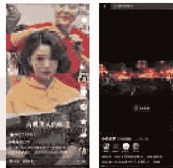

### 沉浸式时空穿梭
Ta们在沉浸中还原古代景点，通过虚拟实景技术感受不同时空的领域。
- 播放量：3.8亿
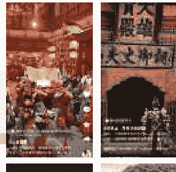

### 沉浸式一诗
他们还会追寻足迹，静静笔下描绘的流光，亦或是天下的忧。
- 播放量：7927.6万
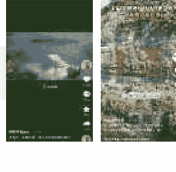

### 好内容创作感
以故事叙事+场景还原为核心，传播其中的文化密码，深度拆解文化背后的技艺、原理、寓意；利用场域呈现传承，叠加氛围渲染，增强沉浸感，引发共鸣。

## - Ta们的典型生活场景 -
### 叛逆
Ta们打破束缚，让文化在反差中破圈，用年轻语言诠释东方美。

### 东方审美另类输出
赛博整活，文物也要动起来。用AI、AR等数字技术让赛博朋克重塑或虚拟演绎，打破静态局限，以潮流姿态接近大众。
- 播放量：95.3亿
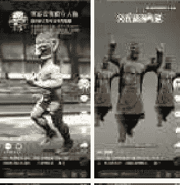

### 后后接
以后潮设计、潮流穿、非遗改装等轻量化方式接传统文化，让老技艺在Z世代创意中焕新生。
- 播放量：27.6亿
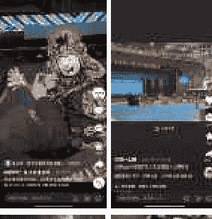

### 汉服圈的混搭
“汉服裙子”将服装形制与潮流元素（如 oversize剪裁、光配色、赛博字母）混搭，在传统语境中加入潮流、精致等现代审美，形成后文化新趋势。
- 播放量：17.4亿
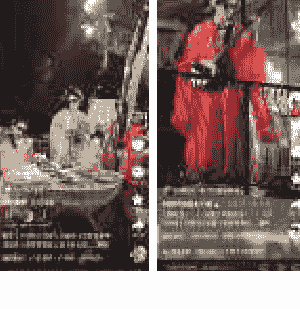

## 好内容创作灵感
传播文化的内核+创新的表达方式。通过古今的碰撞，AI技术等手段赋予文化/文物创新的形态，画面以冲突、混搭形成视觉冲击，激发用户好奇，提升3s完播。
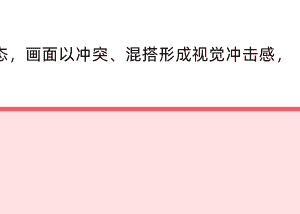

## 超绝稳感
本情绪以自我为主基调。通过适当接受社会节奏，允许自己有限的战斗，将生存焦虑化为对不完美的温柔共处。

我以自己的方式接纳，允许一切发生，四川人的热烈。

- 2024全球活跃用户：18亿+
- 2024年内容数量：4.2亿+
- 2024内内容数量：2.2亿+

原本就是如此的，让故事自然发生，让世界发生。

- 三季度
- 随此刻
- 聚首闲时光
- 小梦想抒华妥妥
- 享受这闲时光

## 热门情绪内容
## 高热案例
## 开启一倍加速
把曾经的脚步留在记忆里，按下这个键，打开无限可能。生活只有竞技游戏，其他都是自己生活的主角。

### 情绪内核
内心平静与平和

### 热门话题
- #允许一切发生
- #按自己的方式走过人生
- #节奏和自由
- #每个人都是自己生活的主角

# 人生活家

我在北京大学，毕业后在北京某教育公司上班，经历了裁员风浪，但到了2024年初的时候我觉得非常累，当时我特别感到无助。后来开始职场崩溃，看着同事，我们有着相似的处境，大家都在迷茫中挣扎，寻找自己的出口。我也开始后发力。于是，经过仔细考虑，我也选择成为一个数字游民。

### Who

- 王女士，27岁，自由职业者，大理
- 超绝松弛、感敏人群
- 三线及以下城市生活为主
- 月收入集中在2000-8000元
- 自由职业者23-40岁为主
- 喜欢在社交媒体分享日常
- 热爱摄影、酷爱美女和户外旅行 | 女性

### When

人生阶段：以生活在一线城市的中青年为主，通常处于寻找人生目标的阶段，自我成型的关键时期。

Ta们经历过风浪，现在选择旅行。对于这种“逆时尚”的生活方式，他们常常通过短期的休息寻求方向与方向，尤其是关注的生活方式。从中，他们可以寻找认同感，获取灵感，探索自身生活的蓝图。

数据来源：
CBData消费大数据

## Ta们的“松弛”人生生态

在加速世界中，Ta们从容认真，保持一份“人间清醒”与自洽，并且用“非”行动守护内心秩序。

契合本心与生活步调的“快乐”消费是Ta们自在的甘泉

- 影响决策的核心情绪是快乐
- 比较愿意付情绪溢价，偶尔会购买提供情绪价值的商品
- 更看重商品是否契合个人个性和生活方式

+ #随弛：自己想做的事相关视频播放了2.7亿
+ #嬉野：相关视频播放了40.3亿
+ #我的非标准人生：相关视频播放了6.9亿

## Ta们粉粉裸裸，选择一种“非标准”的人生

Ta们相信生活都是值得的

+ #不要为打翻的牛奶流泪：相关视频播放了7.1亿
+ #坏情绪断舍离法则：相关视频播放了4.1亿，自带一套情绪断舍离法则

## - Ta们的典型生活场景 -

### 人生玩起来

Ta将人生变成开放式游戏，打卡式旅行、交换人生，主打“打野式”生活。

在时间的废墟寻找迷失的美好，为自己标记成长的里程碑

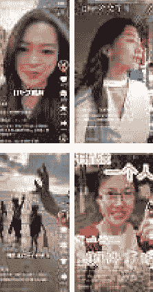

### 开启随时随地玩“挑战”

话题播放量：6.0亿
他们会遇到固定轨迹，尝试百种经历之事以此重塑自我，或者在日常场景中即兴设定规则（如用3种食材做晚餐、10分钟速写路人），以打破旧的行为。

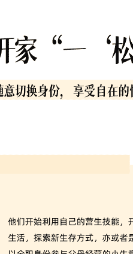

### 职场解锁100种体验
话题播放量：2.9亿

### 开家“松人”公司

Ta们把gap期变成创业季，摆脱旅行移动空，全职女孩变身身份“合伙人”。随意切换身份，享受自在的快乐。

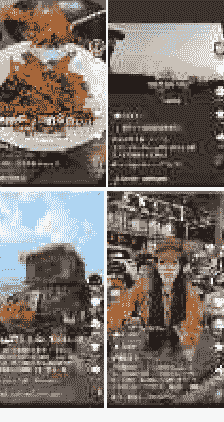

| 给父母做全职女儿 |
| --- |
| 话题播放量 |
| 2.8亿 |

### 过一种边界旅行的生活
话题播放量：1.0亿

## - Ta的典型生活场景 -

### 允许万事穿过

当生活出题，Ta直接接交卷，用反卷牌挡压力，给情绪放假，即使独处也不孤独，仍将生活过得有滋有味。

与其内耗，不如在自己的节奏里打一次。

### 学会爱自己的方式

话题播放量：73.3亿
他们通过主动与自我相处，在阅读、冥想或沉浸内心需求，建立与自身的深度联结；并且即便身处困境，仍能饱满精神状态对生活的热忱，用最直接的烟火气对抗真实的碰撞。

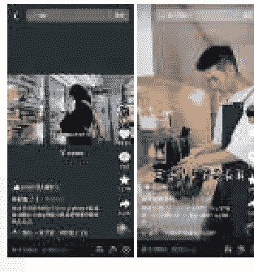

### 活打不败-一个人的吃饭的人
话题播放量：1.7亿

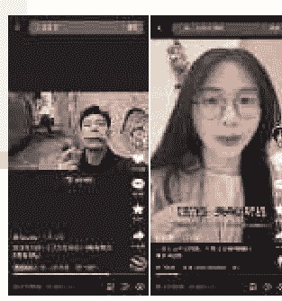

## 好内容创作灵感

以全新的三观为内核，通过独特的个性和犀利落地的金句进行创作。视频需要把抽象的价值观转化为“可知的生活事件”，避免说教，通过“场景沉浸式体验”+价值故事化包装，在舒缓的节奏中，让观众在情绪中自然接受内容传递的生活态度。

## 打破滤镜

在繁杂世界中保持独立的思考，不被外界权威定义。探索内心、追求真实，遵循自己的步调，发现真实的自我。

| 2024年全球活跃 | 2024年国内增长 | 2024年内容互动 | 2024年内容数量 |
| --- | --- | --- | --- |
| 27亿+ | 17亿+ | 2千万+ |

## 热情绪内容

### 光环滤镜
放下期待，棱所向往的事，发现事物更真实的一面，破解心中的光环效应。

### 情绪内核
热门话题：
# #世界是巨大的草坪
# #破解光环效应
# #装修越现实真人

## 高频素材

### 强者的开始学会私藏
强者的开始学会拒绝不再被别人妥协，尝试越获得高大的，并且越是不可及。

### 世界是舞台的
热门话题：
# #真实无谎
# #大道至简
# #不装真实
# #断舍离

| 2024年互动量 | 2024年内容数量 |
| --- | --- |
| 8亿+ | 千万+ |

### 人生按下退出键
当“理智”难以生存，转向向外迈的良性比较，对价值的消费破解符号消费。

数据来源：巨量引擎

## 打破滤镜祛魅行动派

从小就是优秀，随着步走出校门，发现各种光的，在现实的挣扎中才发现理想其实都变得浅浅的想法。

- 一线的、新一线城市的
- 创业者
- 社交媒体
- 线下沙龙
- 23岁
- 月薪5000+
- 高活跃用户
- 斜杠青年

### When

陈女士，22岁，数字移民，广州。
人生阶段：以一线及新一线城市的自由职业人士为主，正在完成身份的转变，冷静是Ta们的内在防线，在杂乱的世界中找到，不接受外界干扰，遵循内心平静一切。

数据来源：CBData消费大数据

## Ta们的“真实”人生生态

Ta们拒绝社会的虚伪滤镜，拒绝精致主义的表演和洗脑，用真诚对抗，在迷魅的生活里坚守真实。“理性主义”是Ta对物质消费的精准衡量，倾向符合长期需求而非短期情绪。

- 更容易引发共鸣的内容
- 偏好健康消费
- 情绪制剂

(TGI: 178) (TGI: 148) (TGI: 103)

## 重置人生
相关视频播放117.3万次

## 被定义的人生
相关视频播放1026.1万次

## 当代年轻人反向升级观
相关视频播放117.8万次

## 理性消费不实买贵
相关视频播放172.8万次
只买对不买贵，Ta拒绝做“韭菜”。

## 轻极简生活
相关视频播放208.4万次

## 以后要断舍离
相关视频播放275.9万次
Less is more, Ta们做减法生活回归本质。

## 为“智”买单

Ta渴知识与共鸣，每日的阅读是Ta重要的充电方式。用知识刷新认知，让它的开始是众生平等。

在信息爆炸与现实焦虑中，阅读才能成为自主的精神避难所，即便是碎片化阅读，他们也会保持输入的习惯，刷新认知、观点最终内化为自己丰满的。

### 好分享、经典原文分享及书籍介绍
话题播放量：878亿

### 每日扫描
其构造原文提取量
话题播放量：396亿

## 关注需求本质

Ta们是智的消费者，在日常的消费种类中，更加客观地关注产品的本质。在消费中，更加关注需求背后的本质。

> 客观测评 科学客观地呈现产品

消费认知从“符号消费”转向“实用主义”，逐渐看清廉价背后的虚荣泡沫，为了真实需求与性价比考量，而非被LOGO堆砌的身份焦虑裹。

话题播放量：2151亿

国产权利科技版权，更多人享受优质产品话题播放量：29亿

## - Ta们的典型生活场景 -

### 极简主义

Ta们是人群中的极简主义，更偏好那些没有必要的功能。在生活中做减法，在物质过载与信息的冗余时代，主动卸下负担，在繁杂中重拾对生活的掌控感。

极简穿搭话题播放量：8亿

### 生活回归简约
话题播放量：2亿

### 好内容驱动

真实的本质是接纳不完美，在内容中暴露自己，无需刻意营造，画面处理上强化特质，让观众在表演中找到共鸣。

## 从八大情绪趋势灵感

举个例子：一款折叠手机，如何借助情绪基调，完成上班族的沟通？

- 快乐基调
- 情绪频率
- 人生旷野
- 自愈
- 唤醒
- 蝶变
- 人生女主
- 多彩的人生

- 旅游博主
- 空间胶囊
- 最小体积的
- 折叠手机

# 重塑内核

Ta的“自我迭代器”，一一展开，效率翻倍，成长随身。

### 抽象上班

### 一个人的公司

### 触即时

### 职场情绪转换开关

### 办公站
- 
- 斜杠青年
- 摸鱼
- 随心打工人
- 自由
- 战斗模式

既是员工也是老板，身份可以随时切换。

## CHAPTER
-03-

## 找到方法

触动大众情绪是一门系统化的营销科学。

## 03 捕获情绪、转化情绪，品牌营销在巨量引擎打开“爆款模式”

情绪可捕捉、可归类、让情绪为品牌所用？在巨量引擎能够通过捕获、转化与流量三大步骤，形成巨大的情绪传递路径。在巨量引擎下，情绪已经掀起浪潮，成功的品牌营销从巨量引擎的“爆发”发生，成为品牌营销的新范式。

## 3.1 巨量引擎品牌营销情绪三步走

在巨量引擎，品牌可以依照简单的三步走，实现高效的捕捉、转化到度量情绪。

### STEP 1 捕捉情绪

读懂大众情绪在巨量引擎内的多元表达，通过情绪内容看见。

| 大众情绪 | | | |
| --- | --- | --- | --- |
| 感动 | 恐惧 | 畅 | 惊讶 | 治愈 | 悲伤 | 高兴 |
| 无忌 | 悄悦 | | |
| 社群情绪 | | | |
| 血液觉醒 | 自我成长 | | |
| 一触即防 | 精神状态belike | | |
| 超弛感 | 打破滤镜 | | |
| 情绪驱动人群 | | | |
| 人生活家 | 多巴胺触发 | | |
| 复古回源 | 感官体验 | | |
| 情绪自洽 | 祛魅行动驱动 | | |

### STEP 2 转化情绪

+ 1 先让人记住，创造情绪符号，形成品牌独特的异质感。

| 产品实体 | 虚拟形象 | 一句slogan | 一段旋律 |
| --- | --- | --- | --- |
| 长期建设 | | | |
| 短期打造 | | | |
| 敏感人群 | 破圈 | 特定圈层人群 | 关注热点的圈层人群 |

+ 2 再传播出去，让情绪从敏锐人群出发，一步步向外破圈。

+ 3 最终因情绪共鸣与信任促成购买行为。

| 打开全转化渠道 | | | | |
| --- | --- | --- | --- | --- |
| 直播间 | 货架场 | 短视频 | 线下门店 |

### STEP 3 度量情绪

| | | | | | |
| --- | --- | --- | --- | --- | --- |
| | | | | | |

## 3.3 STEP-2 在巨量引擎，情绪传递和转化能以小撮

转化情绪：通过情绪符号构建，破解情绪传递以及站内转化购买三个环节实现情绪转化

- 先让人记住，结合品牌差异优势，让大众易于理解、记忆的情绪符号
- 1款创意新商品：最好的社交氛围

| 1个人人物 | 情绪符号 | 1个表情包/虚拟形象 | 情绪符号是具有识别性、可传递性与持续性的内容符号，能够引发情感共鸣并且与品牌长期绑定。 |
| :--- | :--- | :--- | :--- |
| 强代表/人设正向立体 | | 复杂的情绪浓缩 | |
| 1段旋律 | 热门单曲/有修改版 | 1款黄金slogan | 洗脑/唱片/共鸣/趣味 | | |
| OGC+明星 | 能爆发的话题 | “Tag” | 传播爆点 | 易聚人群 |
| PGC | 能扩散的风 | “Ta人共振” | 传播放大 | 特定人群 |
| UGC+热点 | 能触发的趋势 | “Tam人参与” | 热搜发酵 | 热点的圈人群 |

- 再把情绪传递出去：从自上而下的而，都能在巨量引擎实现渗透式扩散
- 最终用情绪共鸣与信任促成购买行为

## 3.3 Goodcase-想转化先记住，品牌情绪符号怎么做？

从破圈传播到转化，品牌在巨量引擎上可以借助“矩阵阵”、“接龙”等独特的方式放大情绪高频影响

- 1 Case 1: 品牌那些高记忆的专属情绪符号

| 产品符号 | 洗脑金句符号 | 年轻化传播，频上热搜 |
| --- | --- | --- |
|  |  | 热度TOP1 华为三折叠手机开启热度 |
| 表情包符号 |  | 学为/华为三折叠手机开启热度 9.17 |
|  | 热度TOP1 学/华为三折叠手机开启热度 9.10 |
|  | 热度TOP2 华为发布会 7.6 | 破圈TOP1 华为发布会 |

### 血缘觉醒×借势爆款 和潮流 顶流“乘风”，集体聚荣感在血里鲤蟒

视觉符号，听响符号

|  |  | 话题曝光3+ |
| --- | --- | --- |
|  |  | 国人活跃渗透率至7成 |
| 电影原声提升影视质感冲击力 | | 自然流量GMV+5pt |
|  |  | 新中流行音乐 BGM渲染氛围 |

产品C位强化品牌与情感关联
- 主视觉色彩选取 红色复合情绪
- 锚定热点IP爆发符号形成输出内容
- 融合中式元素（装饰、节庆氛围等）

## 3.3 Casego-转化如何得破圈，品牌情绪传播怎么做？

- Case 2 vivo：从爆点到热点，巨量引擎助力品牌放大情绪传播能多少？

### 爆点
- 非虚·跨界，创新玩法
- 把200+爆点植入非虚项目，打造传播矩阵

### 易触人群记忆
- 文化、运动、旅行、资讯
- 影像级、舞台、非虚
- 精裁、搞笑、户外、西餐
- 行业联想份额均为 NO.1

- 在评论区热议及高端文化
- 200+达人x10类爆款引流 | 50+线上创意营销会

### 放大大器
- 非虚·各地文旅接力各地
- 利用视频影响力，带动各地原文清新生活

### 圈层人群反复圈
- 口碑区互动互学
- 回率vs行业TOP +1.x%
- 数据图表内容
- 超养成的人数 4次+
- 产生深度搜索

### 热点
- 明星×营销发酵，热搜破圈
- 借势明星，圈娱娱乐榜总榜，扩散全网

### 泛用户可见
- 全网8亿+ 31个 热点

- 曝光 +30%
- 5K+高端持机人群渗透率
- 明星热度发酵明星相关话题
- KOC集中发布后营销，种草营销，总榜

## 3.3 Goodcase-多渠道转化，品牌情绪经营怎么做？

- Case 3: 各品牌如何在巨量引擎经营情绪生意？

| 产品经理理短剧演员 | 聚焦家居真实感应材，爆复现 | 高效打造单品直播 |
| --- | --- | --- |
| | 10W+ | 最高UV |
| | | +10%~90% |
| | 植入产品销量 | 增长 |
| 高端情绪联名 | 情绪集市 | 情绪快闪 |
| 三里明 | | |
| 文华东方 | | |
| | | | |
| 光影小趣 | | |
| 色彩主题/IP联名等单品 | | |
| 场景壁纸 | 冰激 | |

## 3.3 Goodcase-捕捉情绪，品牌在巨量引擎是怎么做的？

- 情绪系-倾向一个真实的治愈需求，定义全新的赛道
- 1 养成一个治愈爱好，有门槛
- 2 创新好产品，控速度，从一群人的痛点

| 差异化形态 | 呼吸灯下 | 中产阶级 |
| --- | --- | --- |
| 记不住 | 没有氛围 | 大众的痛点 |
| 乐理 | 节拍 | 转换 |
| 不好 | 识谱 | 连贯 |
| 难学 | 不连 | 达人领域 |

- 3 收好情绪，创新赛道
- 4 多效应，顶级赛道诞生，别说好

### 流量流量
- #一弥伦洒夏天
- #流量新奇贴
- #餐厅疗艺
- 思恩赛
- 火主智能
- 口袋莱子
- 智能尤克里

| IP资源 | 行业说好 | 收 |
| --- | --- | --- |

爆单直播间

## 3.3 优质的热绪IP为品牌营销溢出基石

- 情绪IP，更具确定性的整合方式
- 多元情绪+热门场景

# 重塑内核
- 时尚 | 8亿+ 项目联曝光 | 活动周期：3月-5月4周
### 唤自律
- 音乐 | 80亿+ 品牌定制类线下活动专区 | 活动周期：5月初-6月/20
### 多巴舒悦
- 影视 | 50亿+ 项目联曝光 | 活动周期：4月-6月/12

- “头部艺人&达人资源”
- 创意达人线上热互动
- “中国电影头部营销”
- “力量源”
- 高热音乐节活动
- “超级红+线上直播”
- “力量论”
- 头部流量执行人/艺人
- 创新新产品加持
- 焦虑如罗 全城级号支持
- 物料制作方案
- 线下+唤醒创意&口碑聚集
- 扫码获取完整方案
- 扫码获取完整方案
- 扫码获取完整方案

### 多巴舒悦感+ 趋势场景 今天也有好运动
- 2亿+ 项目联曝光 | 活动周期：4/15-12/31

### 4大类圈层达人心智
- 达人跨界多样营销供给
- 专业运动+潮流活动 | 后消费+精致健身
- 4大圈层头部 达人运营、本土化
- 内容创意+流量定制
- 品牌合报/直击热门/热点直击/一日流量等

- 线下选品生活化渗透点
- 扫码获取完整方案

## 3.4 在巨量引擎，情绪营销效果被清晰度量

通过情绪营销，品牌在巨量引擎的三大资产积累实现更深、高效且持续的效果，最终实现品牌的长效积累。

- Case OPPO：全年新机穿透情绪营销对人群及其心影响

| 度量人群资产 | 度量情绪内容价值 |
| --- | --- | --- |
| 年轻一代A渗透率+1% | 品牌购买人群中 |
| 年轻一代A渗透率 | 年轻一代购买渗透率 |
| 2x% | 3x% |
| before | after |
| before | after |

- 度量情绪品牌心智占比+XX%
- 核心心智向单一路径
- 消费者得到OPPO，更容易得到“快乐”、“出色”等

## 心智度工具，25年持续迭代

心智是内容形象化的联想

### 品牌心智有3层
### 场景心智

| 妆容 | 功效功能 | 技术 | 使用感受 |
| --- | --- | --- | --- |
| 化妆 | 功效功能 | 成分 | 包装等 |
| 宠物 | 成分 | 贵气 | 品牌功效 |
| 数码 | 技术 | 系统 | 外观像 |
| | 插件 | 蓝牙 | 风格等 |
| | 使用场景 | 人群 | 痛点 |
| | 身份认知 | 产品用法 |
| | 市场地位 | 服务体验 |

### 每个心智（联想词）有4个维度
### 行业联词
- 行业联词 = 本心智词 + 联想词
> “提到本品类，大部分概率会到这个品牌”
> “用户是否正面评价所具有心智”

### 偏爱度
- 本心智占比
- 本心智占比 = 本心智 × xx; 联想 + 本心智
> “用户相比品牌，大部分程度更加认可我”
> “提到这个品牌，大部分概率想到这个心智”

## 结语

当前，情绪从未如此清晰地成为时代的路标。透过这份报告，我们在一触即破的互联网背后，看透了拒绝规划的情绪奔驰，用犀头解构生活境的那群“体验官”。我们看到的不仅仅是八大情绪的流量密码，更是品牌建立深度共情的战略脚点。情绪已经是可测量、可优化的营销资产。在信息过载的时代，唯有动人心，能够建立深刻的品牌连接与用户忠诚。情绪营销是品牌构建长期价值、驱动可持续增长的底层逻辑。它要求我们超越边界，深入理解用户感蓝图，精准捕捉其渴望、焦虑、喜悦与归属。

### STEP 1 看清本质
品牌营销回归情绪本质

### STEP 2 懂情绪
读读社交媒体媒体热门情绪热门热门img
img8b64d8b015950f11294bfba11e7b318_76_1.png)

### STEP 3 找到方法
情绪营销三步走

## 特别曝光
(排名不分先后)

songmot官方旗舰版 | CASTRIP | 暮享 | 海翔官方旗舰版 | 墨苏芳~~
胭脂的阵眸 | 桃花流离 | 糖果 | 子京 |
人民 | 荣耀初婚 | 海量多语 | 我曾经的忘心之旅 | 小米长大 | 人民日报
靠爱语 | 欢敬你 | 欧阳克林 | 不如不气 | 是老人 | 是本人 | 戎驾巅峰导航 | 阿游的德行
李一 | 你好豪 | 行界行下 | JYY | 你的记忆 | 是老人 | 的日常 | 被捡来的西瓜拍子
本本是个奇迹 | 期待多不要 | 上雪寒 | 生活的日常 | 豪象 | 小小 | 小小
洛龙宁 | 南风 | 南风 | QQF | 万将 | 777 | kk在战斗 | 一 | Ego
姜美薇 | 柿子悦 | 正经老师 | 大洋(自律) | 伊人走 | 去 | 科术士
大宰林辉 | | | | | 咖啡 | 飞行的小斧 | 激情的风 | 你知道和37 | 游戏 | 创造 | 国际界 | 是姐姐小主 | 握手
洛梦 | 来亥春酱 | 蝴蝶儿 | 92888 | 清晰 | 是姐姐小主 | 梦凡 | 曾经是我的 | 游浪者 | 独家 | 圆撒撒 | 湖南阳晓 | 小 | | | | | | | | | | | | | | | | | | | | | | | | | | | | | | | | | | | | | | | | | | | | | | | | | | | | | | | | | |

## REPORT AUTHOR 报告者&致谢

特别指导委员会
巨量引擎大众业务行业营销负责人：黄豪豪
巨量引擎大众业务行业运营运营负责人：孙惟伟
巨量引擎大众业务行业销售总监：刘嘉勉
应航科技总经理兼CBNData院长：刘广

## 报告共创
本报告由【巨量引擎】与【CBNData】联合制作
巨量引擎大众业务行业运营经理：陈瑞曦
CBNData：潘瑞均、王光元、徐禾、林耀鑫、顾雅已、钟睿、沈滢

## 视觉设计
CBNData：庄望锦、廖青蕾、刘涵

## 商务合作
CBNData：王玉薇、秦娜璐、肖雨虹

## DATA COVERAGE 数据说明

数据说明：巨量云图、CBNData消费大数据
图片来源：巨量云图

具体指标说明：
- ①数据数据：n2024：2024/01/01-2024/01/12；全网数据包括抖音、微博、小红书、B站等社交平台的数据数据和互动数据；n互动量为热度、评论、收藏和回复。
- 内容场景洞察周期：2024.01-2025.06。
- ③调研数据：
投放对象：为保证质量，筛选近一年经常访问社交媒体平台的人群为有影响人群
样本量：N=1000
性别配比：男性：50%；女性：50%
年龄范围：18-24岁：30%; 25-35岁：20%; 36-40岁：15%; 41-45岁：6%; 46-50岁：6%;51岁及以上：3%
城市线级：一线：30%; 新一线：20%; 二线：25%; 三线城市：20%; 四线城市及以上：5%

为了保护消费者隐私和商家机密，本报告所数据经过脱敏处理。
