# 海外投资白皮书

成为合格的海外投资者

2025年4月

# 免费 价值 及时 专注

# 扫码加入 知识星球TOP 免费资源群

- 每日免费获取有价值资源
- 可提供各类资源搜索服务

| 热门付费文章 | 各行行业报告 |
| 精选图书资源 | 副业赚钱方法 |
| 职场实用资源 | AI政经自媒体 |

公众号: 知识星球TOP 微信信号: jntsg8 微信信号: jntsgg2

分享资料仅供个人学习，请及时删除，切勿商用传播

# 目录

修订前言 1

简介 2

一、海外资产投资的作用和意义 3

+ 1.1 海外资产是个个人资产配置的整体 5

+ 1.2 投资海外市场的两大原因 7

+ 1.3 海外投资案例：全国社保基金理事会 11

二、海外投资通道和目标 12

+ 2.1 海外股票市场 12

+ 2.2 美国股票风险收益特征 15

+ 2.3 投资美国股市、优选指数基金 17

+ 2.4 美国股票市场择时的有效性 20

+ 2.5 配置美国国债券、分散风险 21

+ 2.6 投资通道：QDII 基金和互联互 24

三、一个符合境内投资者海外投资需求的方案 27

+ 3.1 合理的股债配置 27

+ 3.2 好资产 27

+ 3.3 汇率变化对海外投资的影响 33

+ 3.4 未来提高空间 35

后记 37

参考资料 39

# 修订前言

本次新修订的《海外投资白皮书》，发布于 2025 年 4 月。距离第一版发布的 2023 年 7 月，已经过去了近两年的时间。在这段时间里，美股展现出了强劲的增长势头。标普500指数累计收益率为26%，纳斯达克100指数累计收益率为27%，超过了历史平均水平。海外债券市场表现良好。（统计为2023.07.31-2025.03.31）

对于中国投资者而言，海外资产不仅提供了可视的回报，更验证了国内资产和海外资产配置中的分散作用。海外资产提升了整体组合的长期收益，降低了风险。对于未来，海外资产分散的作用还会生效，投资者应坚持一部分资产投资。当然，投资海外在这两年间也面临了小的挑战。尽管如此，我们看到坚持低成本的指数策略，以及股债配置的核心理念，良好完成了目标。在新修订的《海外投资白皮书》中，我们将数据更新到最新，增加了投资类别分析，这份白皮书能继续在海外投资道路上，为你提供有力的支持和引。

# 简介

过去三十年，中国经济经历了快速发展。我们可以感知到工资增长、优质商品和服务这背后其实是经济的发展。截至2024年，中国GDP位居世界第二，占世界经济的16.6%。而在1980年，中国的GDP占世界经济的1.6%（数据来源：世界银行）。快速发展让我们享受了经济增长，以前曾有的需求：对于中国人来说，资产配置在国内更合理？我们如何有效提高回报？从熟悉程度来说，这非常合理。从风险角度来看，配置海外也可以帮助分散风险，提升整体组合收益是非常有效的。这篇白皮书将介绍海外投资相关的知识，希望大家在配置好资产的同时，还能当地配置海外资产，分散风险并从中国中直接享受经济增长带来的实。白皮书将从三个部分介绍：第一部分，我们将介绍海外投资对个人资产配置的作用和意义；第二部分，我们将介绍境内投资者应该如何投资海外；

# 一、海外投资的作用和意义

我们相信投资的长期收益来源于经济发展。境内市场带来的长期收益和中国增长密切相关。即便如此，站在全球发展的视角来看，世界上大多数经济产出发生境外。这是一个正常的现象，即使第一经济体美国也有75%的经济产出发生境外。所以无论哪个国家，全球投资都是参与世界发展的重要方式。

图 1：2024 年主要国家/地区经济对比

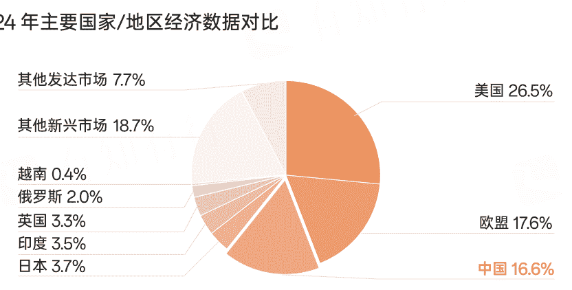

| 国家/地区 | 美国 | 欧盟 | 日本 | 英国 | 其他发达国家 | 总计 |
| :--- | :--- | :--- | :--- | :--- | :--- | :--- |
| 名义GDP (万亿美元) | 29.17 | 19.40 | 4.07 | 3.59 | 8.45 | 64.68 |
| 名义GDP占比 | 26.5% | 17.6% | 3.7% | 3.3% | 7.7% | 58.8% |

新兴市场

| 国家/地区 | 中国 | 印度 | 俄罗斯 | 越南 | 其他新兴市场 | 总计 |
| :--- | :--- | :--- | :--- | :--- | :--- | :--- |
| 名义GDP (万亿美元) | 18.27 | 3.89 | 2.18 | 0.47 | 20.57 | 45.38 |
| 名义GDP占比 | 16.6% | 3.5% | 2.0% | 0.4% | 18.7% | 41.2% |

注：为数据分析目的，区分中国内地市场和中国香港市场，“中国”指中国内地，台湾港澳包含在“其他新兴市场”中
数据截至：2024年10月
数据来源：IMF、知行研究

### 图2: 2024 主要国家/地区权益市场对比

- 其他发达市场 3.8%
- 其他新兴市场 10.9%
- 俄罗斯 0.1%
- 越南 0.1%
- 英国 2.7%
- 印度 4.3%
- 日本 5.1%
- 中国 11.5%

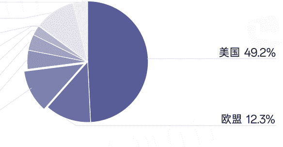

美国 49.2%

欧盟 12.3%

发达市场

| 国家/地区 | 美国 | 欧盟 | 日本 | 英国 | 其他发达市场 | 总计 |
|---|---|---|---|---|--|
| 权益总额（万美元） | 60.07 | 14.99 | 6.20 | 3.27 | 4.68 | 89.21 |
| 权益占比 | 49.2% | 12.3% | | 2.7% | | 73.1% |

新兴市场

| 国家/地区 | 中国 | 印度 | 越南 | 俄罗斯 | 其他新兴市场 | 总计 |
|---|---|---|---|---|--|
| 权益总额（万美元） | 14.02 | 5.20 | 0.17 | 0.12 | 13.31 | 32.82 |
| 权益占比 | 11.5% | 4.3% | 1% | 10.9% | 26.9% |

注：为本表目的，区分中国内地市场和香港市场，“中国”指中国内地，台湾港澳包含在“其他新兴市场”中数据截至：202412月
来源：World Federation of Exchanges, Aswath Damodaran，知行研究

# 图3:2024 主要国家/地区债券对比

- 其他发达市场 6.7%
- 其他新兴市场 7.6%
- 英国 4.3%
- 中国 16.9%

美国 38.7%

欧盟 18.0%

发达市场

| 国家/地区 | 美国 | 欧盟 | 日本 | 英国 | 其他发达国家 | 总计 |
|---|---|---|---|---|---|
| 债券总额（万美元） | 57.42 | 26.70 | 11.56 | 6.32 | 9.92 | 111.92 |
| 债券占比 | 38.7% | 18.0% | 7.8% | 4.3% | 6.7% | 75.5% |

新兴市场

| 国家/地区 | 中国 | 印度 | 越南 | 俄罗斯 | 其他新兴市场 | 总计 |
|---|---|---|---|---|---|
| 债券总额（万美元） | 25.08 | | | 11.31 | 36.39 |
| 债券占比 | | | 16.9% | | 7.6% | 24.5% |

## 1.1 海外资产配置是整体配置的一部分

如果你现在有一笔钱可以投资，你会选择哪呢？国内有很多丰富的投资产品供选择：股票、债券、现金、房地产等。你可以根据自己的需求，在众多的资产产品里进行配置。这种行为就是做出资产配置。

资产配置以不同资产类别的风险收益和预期收益，以及投资者个人的风险偏好为基础，决定不同资产类别在投资组合中的比重。资产配置的目的是降低风险，提高投资收益，尽可能在承担的风险范围内获得更高的收益。此资产类别的种类和特征，会对投资者资产配置造成极大影响。目前中国个人投资者的资产配置，有一个共同的特征是，绝大部分配置在中国境内资产（境内上市企业、国债、房地产等）。例如投资的股票型基金、债券型基金，绝大部分投资于境内资产。

为什么会出现这种现象呢？客观原因是，国家的资本市场正在逐步开放，个人投资者直接投资海外资产的渠道不够。主观原因是投资者普遍存在本土偏好。本土偏好是倾向于投资自己比较熟悉的国内资产而相对少的配置海外市场的现象。本土偏好并不是发生在中国，这在全球范围内都是普遍存在的。晨星在2022年10月发布全球投资者组合报告》，用数据说明了这样一个现象。它统计了2022年9月30日，全球市场主要股票型基金投资本地企业的比例（橙色柱子），以及各市场在晨星全球股票指数中的占比（灰色柱子）。后者想要说明的是，如果你直接投资晨星全球股票指数，该指数对各市场的分配比例如何。

图4:各市场股票型基金投资本地的占比 VS 各市场在晨星全球指数中的占比

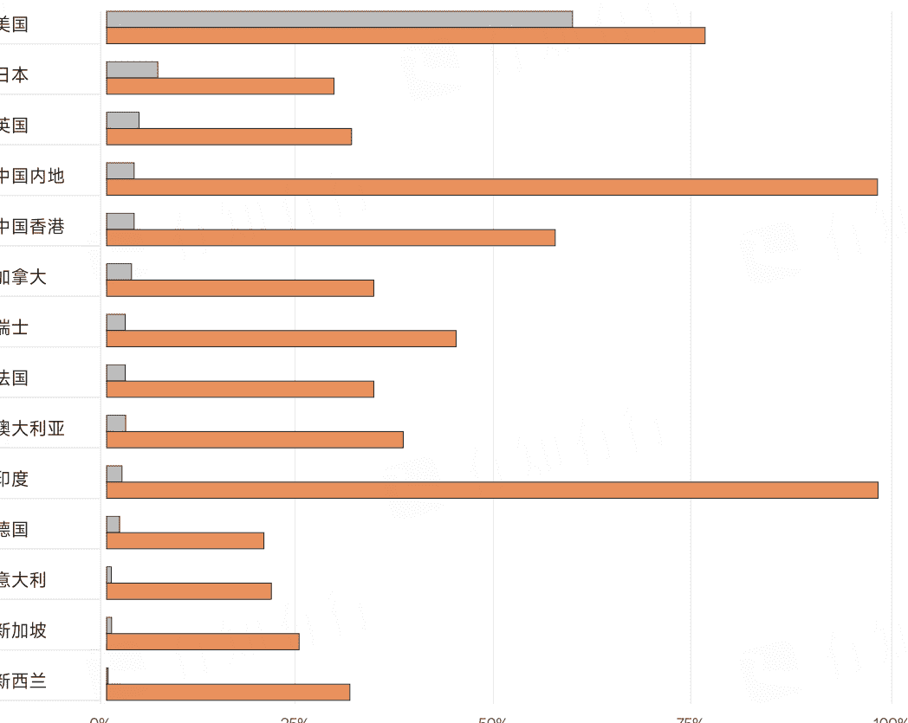

注：该数据在一定程度上低估了中国股市在全球的占比
数据截至：2022年9月30日
数据来源：晨星Morningstar

从图中明显看出，本地偏差是普遍现象。对于中国个人投资者来说，这种现象格外突出，比如中国境内股票型基金投资A股企业的比例基本上是100%。

许多个人投资者构建投资组合的工具，这个数据在一定程度上说明了中国境内投资者的绝大部分投资都在国内。投资者存在本土偏好是非常正常的现象，自己的大部分资产以及生活与当地的货币、经济、金融市场紧紧挂钩，对本土市场更为熟悉，投资本土市场更为便利等都可以成为本土偏好的原因。考虑到中国个人投资者的本土偏好，海外投资也会风险分散提高收益的效果。

## 1.2 投资海外市场的两个原因

### 海外资产有助于整体组合的长期收益，降低风险

当我们把资产配置的视角从国内转向全球时，我们首先关心的是，海外投资带来哪些影响？以A股、美股投资进行说明。用万指指数作为A股市场的表现，从1995年到2024年的时间里，年化收益是9.45%，年化波动率为49.62%，最大回撤是70.82%。在1995年年初，一直到2024年底，就会获得9.45%的回报。图5：1995-2024资产组合

| 投资组合 | 年化收益率 | 年化波动率 | 最大回撤 |
|---|---|---|---|
| 100% A股 | 9.45% | 49.62% | -70.82% |
| 100% 美股 | 10.99% | 17.43% | -54.80% |
| 80% A股 + 20% 美股 | 10.70% | 39.52% | -65.09% |
| 70% A股 + 30% 美股 | 11.16% | 34.95% | -62.43% |
| 60% A股 + 40% 美股 | 11.49% | 30.74% | -59.69% |
| 50% A股 + 50% 美股 | 11.71% | 26.94% | -56.90% |

注：A股用万指A代表，美股用标普500全收益指数代表，组合每年再平衡数据范围：1995-2024 数据来源：Wind、知行研究

用标普500指数作为美股的表现来说说明海外投资的效果。如果你从1995年初开始投资标普500指数，一直到2024年底，年化收益率是10.99%。美股的波动要小，所以年化波动和最大回撤大于A股。

与只投资A股相比，分散投资A股和美股，对投资收益和风险会带来改变。图5显示了不同比例A股和美股的资产组合的表现情况。我们以“80% A股 + 20% 美股”为例，假设在1995年初，长期投资80%买入万指A，20%买入标普500，每年底再平衡，一直持有到2024年底，年化收益率是10.70%，相比于投资A股，收益率得到了提升。神奇的是，在收益提升的同时，“80% A股 + 20% 美股”的资产组合，相比于投资A股，年化波动率和最大回撤都降低了。个人投资者将20%的资产比例投资美股，就提高了投资收益的同时，降低了风险。为什么如此呢？主要原因是A股和美股的相关性较低。下图展示了万指A和标普500从1995年至2024每五年的表现。可以看出，二者在不同期的表现会有不同。例如2005年至2009年，万指A年化收益率高达30.62%，同期标普500年化收益率只有0.42%。从2010年后，一直到2024年末这15年间，美股的表现远好于A股。由于市场周期不同，长期来看，分散投资A股、美股更有助于提高投资回报。

### 图6: 1995-2024 年A股和美股的风险收益对比

#### 年化收益率对比

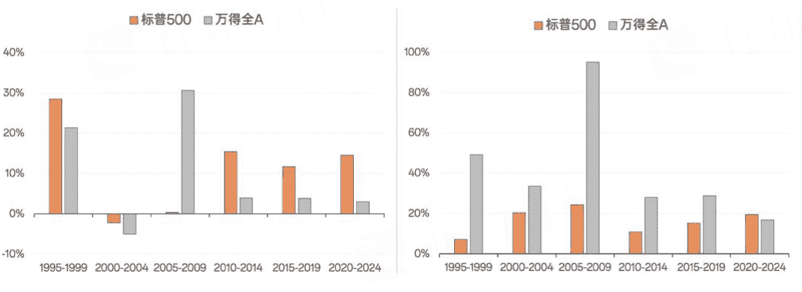

#### 年化波动率对比

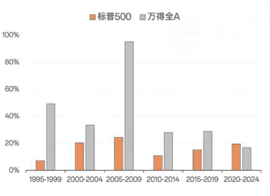

注：标普500采用全收益指数 数据来源：Wind、知行研究

除此之外，A股和美股的风险也不同。作为相对成熟的发达国家经济体，美股的波动率相比A股要小一些。在A股的基础上投资美股，长期来看，有助于降低风险。相关系数也可以说明两个市场的不同。

# 二、海外投资通道和标准

### 2.1 海外股票市场

作为中国境内投资者，当我们考虑投资海外市场时，美国市场是最大的，也是首要需要考虑的。

美国作为世界第一大经济体，经济产出是海外国家占比最大的，从分享经济成果的角度上，美国市场具有较高性价比的。同时，美国金融市场充分发达，投资者通过金融资产分享经济成果更为方便。

2024年，全球股市市场总值约122万亿美元，其中美国股市占比49%，中国股市占比11.5%（可见图2）。可以发现，美国股市是目前世界上量最大的股票市场，美国股市的体量约海外股市的一半左右。之所以我们选择海外股票投资时，美国股票市场是不可忽视的。

图8：2024年中美两国在世界经济和资本市场占比

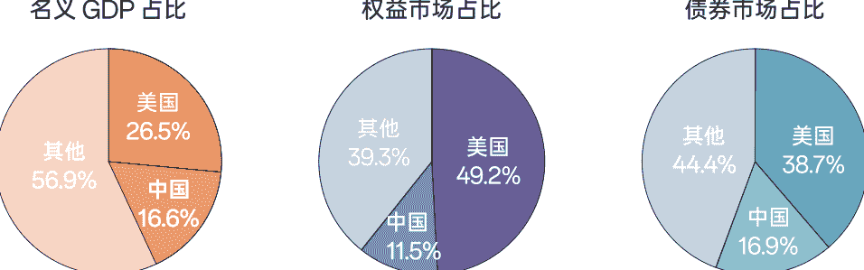

注：为本图所示之目的，区分中国境内市场和中国香港市场，“中国”仅指中国境内股市和债券市场，中国香港股市和债券市场包含在“其他”中。数据来源于名义GDP、权益市场占比数据截至2024年12月；债券市场数据截至2024年3季度。数据来源：IMF, World Federation of Exchanges, Aswatham Damaran, BIS, 知行研究院

此外，许多美国的上市公司业务遍及全球，营业收入和利润并不局限于单一的美国市场。图9展示了2024年标普500和全A指数包含的所有成分公司，国内收入与海外收入的对比情况。与中国上市公司收入88%来自国内，标普500内包含的上市公司有约19%的营业收入来自海外境外（这一比例在十年前曾经达到过50%）。

#### 图9：2024 年中美主要上市公司海外收入占比对比

美国（标普500）海外收入占比
中国（万得全A）海外收入占比

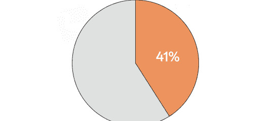

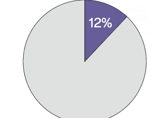

数据截至：标普500海外营收数据截至2024年末，万得全A海外营收数据截至2023年报。
数据来源：Factset, Wind, 知行研究

如果把标普500成分股按照行业分类进行细分，发现信息科技和材料行业有超过一半的收入来自境外。从某种意义上来说，配置了美国股票市场，很大程度上也是配置了全球范围内很多国家和地区。

#### 图10：标普500成分股按行业分类海外收入占比

| 海外收入占比 | 国内收入占比 | |
|---|---|---|---|---|---|
| 信息技术 | 材料 | 通信 | 必需消费 | 能源 | 可选消费 | 医疗健康 | 工业 | 金融 | 房地产 | 公用事业 |
| 56% | 52% | 49% | 39% | 37% | 35% | 34% | 34% | 28% | 18% | 1% |

数据截至：2024年
数据来源：Factset, 知行研究

除了美国股市外，海外其他市场还有哪些关注呢？

#### 图11：2024 全球权益市场市值占比

- 其他发达市场 3.8%
- 其他新兴市场 7.2%
- 英国 2.7%
- 中国香港 3.7%
- 印度 4.3%
- 日本 5.1%
- 中国内地 11.5%
- 美国 49.2%
- 欧盟 12.3%

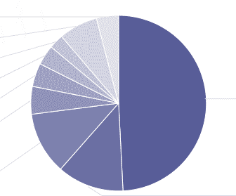

数据截至：2024年12月
数据来源：WFE, Aswath Damodaran, 知行

图11展示了海外市场在总量市值中的分布情况，除了美国市场，我们也能看到欧洲（除英国）股市占比 12.3%，英国股市占比 2.7%……这些国家和地区也存在投资机会。从规模来说，这些海外市场的规模相对较小。

另外，中国境内个人投资者能够购买的除美国市场之外的投资产品很少。拿大家熟悉的 QDII股票型基金为例，截至 2024 年末，投资欧洲股市、日本股市、印度股市、越南股市的基金数量很少，基金规模也很小，目前很难找到非常适合境内个人投资者的投资标的。

#### 图12：投资不同市场的QDII股票型基金数量和规模

| 市场 | QDII基金数量（只） | QDII基金规模 | QDII基金占比 |
|---|---|---|---|
| 中国香港股市 | 54 | 1668.91 | 38.63% |
| 美国股市 | 46 | 1591.72 | 36.85% |
| 越南股市 | 1 | 48.2 | 1.12% |
| 欧洲股市 | 5 | 20.54 | 0.48% |
| 印度股市 | 2 | 41.87 | 0.97% |
| 日本股市 | 6 | 64.14 | 1.48% |
| 沙特阿拉伯股市 | 2 | 5.4 | 0.13% |
| 其他（全球） | 44 | 879.04 | 20.35% |

数据截至：2024季度
数据来源：Wind, 知行研究

对于中国境内投资者来说，海外投资整体组合的比重太高，分配到除美国以外市场的权重就少了。考虑到投资目标，海外市场的长期投资，未来有合适的全球股票，就可以增加其他市场。这里说明：我们的海外投资并不包括香港市场，基本原因是虽然美国市场，但大部分底层资产还是中国内。

根据数据显示，截至2024年2月，中国股市（包括H股、A股）总市值约为80%。H股在香港注册，A股在内地注册，中股在香港上市，但与内地相关性较高。对于中国境内投资者来说，考虑全球配置时，中国股市并不是一个合适的。

#### 2. 美国股票风险收益

从1926年到2024年，美国股市的实际表现上符合现代金融框架。根据SPIVA的数据，标普500指数在过去99年里73%的时间取得了正收益，意味着26%的时间为负。考虑无风险率，标普500指数在69%的时间里胜了无风险率。

#### 图13：1926-2024 年标普500指数正收益占比

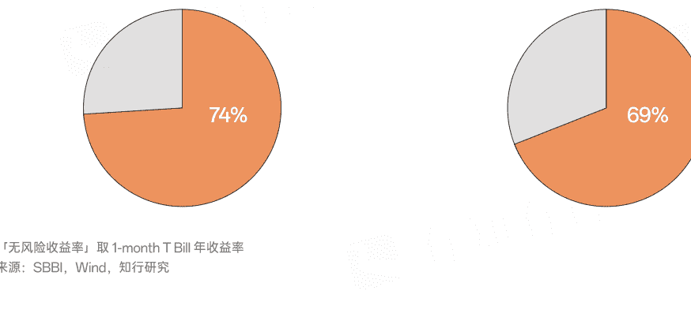

注：“无风险收益”取Bill利率
数据来源：SPIVA, Wind

同时我们也一看风险的长期情况。二十世纪以来，美国股市发生过几次严重的下跌，或是由大衰引起的，或是政治事件引发的恐慌，或是泡沫破裂导致的，或是近来的疫情影响。

#### 图14：危机下的美国股市

| 事件 | 发生时间 | 标普500最大回撤 | 回到高点的时间 |
|---|---|---|---|
| 经济大萧条 | 1929年10月 ~ 1933年3月 | -86.00% | 25年 |
| 石油危机 | 1973年9月 ~ 1974年9月 | -46.30% | 7个月 |
| 黑色星期一 | 1987年8月 ~ 1987年12月 | -30.10% | 1年4个月 |
| 互联网泡沫 | 2000年9月 ~ 2003年2月 | -47.40% | 6年 |
| 次贷危机 | 2007年7月 ~ 2009年3月 | -55.20% | 5个月 |
| 新冠肺炎 | 2020年2月 ~ 2020年3月 | -33.80% | 3个月 |

数据来源：multpl, Mr.Market 行业研究

50%左右的最大回撤，代表了过去美国股市带来的系统性风险。投资任何股市都会有风险，而且其它股票市场的风险（包括中国A股）理论和历史上都会比美国股市高。原因是美国股市的整体量最大，成分更加分散。美股日常波动要比A股一些，最近20年的平均年化波动率在18%左右，同期中国万得A的平均年化波动率在50%左右。

我们将介绍中美股市自然配置，所以适当地进行配置增强收益、降低风险，这里就不赘述了。

### 2.3 投资美国股市，优选指数基金

了解美国股市市场的风险收益特征，让我们来看一下美国股票市场的特点。

#### 图15：美股交易量中个人投资者占比

| 占比 |
|---|---|
| 23% |
| 20% |
| 15% |
| 16% |
| 15% |
| 15% |
| 16% |
| 15% |
| 14% |
| 13% |
| 10% |
| 5% |
| 0% |

从交易量来说，美国股市是以机构投资者为主。根据SPIVA报告，美国市场的个人投资者的交易量占总交易量的20%以下。机构投资者往往拥有更多的知识和经验，不容易被情绪影响，更加理性，很难击败市场额额收益。

收益获取的难度，我们可以通过主动基金能否战胜基准。每个季度，SPIVA统计显示，每年有65%的主动基金无法赢标普500指数，比例逐渐增加。

#### 图16：每年标普500指数战胜主动型基金

数据来源：SPIVA U.S. Year-End-2024

#### 图17：多少比例的美国基金赢基准？

| 基金类型 | 基准指数 | 1 年 | 3 年 | 5 年 | 10 年 | 20 年 |
|---|---|---|---|---|---|---|
| 美国基金 | 标普500 | 78.65% | 87.65% | 84.69% | 89.70% | 92.23% | 94.11% |
| 美国盘基金 | 标普500 | 65.24% | 84.96% | 76.26% | 84.34% | 89.50% | 91.99% |
| 中国盘基金 | 标普400 | 62.00% | 74.64% | 80.00% | 77.32% | 87.50% | 90.93% |
| 美国小盘基金 | 标普600 | 29.69% | 53.03% | 60.37% | 82.22% | 90.68% | 90.80% |
| 美国混合基金 | 标普1500 | 78.45% | 86.13% | 82.93% | 87.44% | 91.52% | 93.41% |
| 大盘成长基金 | 标普500 | 92.03% | 57.02% | 81.08% | 84.44% | 95.91% | 96.90% |
| 大盘平衡基金 | 标普500 | 75.89% | 82.30% | 90.37% | 96.62% | 97.07% | 93.27% |
| 大盘价值基金 | 标普500价值 | 38.58% | 88.99% | 78.91% | 89.61% | 95.08% | 87.78% |
| 中盘成长基金 | 标普中400 | 63.08% | 85.95% | 74.26% | 65.12% | 82.49% | 83.30% |
| 中盘平衡基金 | 标普400 | 66.67 | 65.58 | 81.48 | 88.80 | 92.81 | 96.75 |
| 中盘价值基金 | 标普中400价值 | 68.00 | 78.57 | 80.36 | 92.75 | 92.16 | 94.19 |
| 小盘成长基金 | 标普小600 | 23.12% | 68.14% | 66.17% | 77.34% | 87.34% | 91.46% |
| 小盘平衡基金 | 标普600 | 33.22% | 39.58% | 56.49% | 86.54% | 94.10% | 92.48% |
| 小盘价值基金 | 标普小600价值 | 42.55% | 35.82% | 48.05% | 81.15% | 93.38% | 92.78% |

### 图 20: 不同美国股组合风险收益特征

| 投资组合 | 年化收益率 | 年化波动率 |
|---|---|---|
| 100% 标普500 | 10.21% | 19.47% |
| 70% 标普500+30% 美国长期国债 | 8.97% | 13.89% |
| 50% 标普500+50% 美国长期国债 | 7.93% | 10.59% |

时间跨度:1926-2024
数据来源:SBBI, FRED, 知行财经

我们使用 SBBI 1926 年至 2024 年标普500 全收益指数和美国长期国债的收益数据，回测了不同的股债组合，来看引入债券的效果如何。相比满仓标普500，70/30的股债组合在不降低收益的前提下，可以显著降低风险。

为什么会有如此效果？因为债券与股票本身属于相关性较低的两类资产，相关性较低有利于降低风险。另外，美国债券和美国股票，还存在一定的风险对冲作用。

例如：美国国债在股票市场出现恐慌的特殊时期，往往成为市场资金的避险之处，使得两者之间存在对冲风险的可能。二战后美国股市和债市，大部分股市下跌的时候，美国长期国债的表现不错。当2018年和2022年出现过股票和债券同时下跌的情况下，但大部分情况下，美国股票表现不好的年份里，美国国债可以充当一定稳定的器。

### 图 21: 二战后美国股票和债券收益率

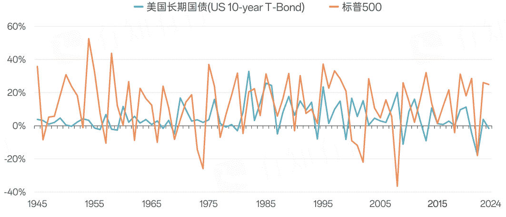

海外投资白皮书 22

### 年份 标普500 美国长期国债

| 年份 | 标普500 | 美国长期国债 | 年份 | 标普500 | 美国长期国债 | 年份 | 标普500 | 美国长期国债 |
|---|---|---|---|---|---|---|---|---|
| 1945 | 35.82% | 3.80% | 1972 | 18.76% | 2.82% | 1999 | 20.89% | -8.25% |
| 1946 | -8.43% | 3.13% | 1973 | -14.31% | 3.66% | 2000 | -9.03% | 16.66% |
| 1947 | 5.20% | 0.92% | 1974 | -25.90% | 1.99% | 2001 | -11.85% | 5.57% |
| 1948 | 5.70% | 1.95% | 1975 | 37.00% | 3.61% | 2002 | -21.97% | 15.12% |
| 1949 | 18.30% | 4.65% | 1976 | 23.83% | 15.98% | 2003 | 28.36% | 0.38% |
| 1950 | 30.81% | 0.43% | 1977 | -6.98% | 1.29% | 2004 | 10.74% | 4.49% |
| 1951 | 23.68% | -0.30% | 1978 | 6.51% | -0.78% | 2005 | 4.83% | 2.87% |
| 1952 | 18.15% | 2.27% | 1979 | 18.52% | 0.67% | 2006 | 15.61% | 1.96% |
| 1953 | -1.21% | 4.14% | 1980 | 31.74% | -2.99% | 2007 | 5.48% | 10.21% |
| 1954 | 52.56% | 3.29% | 1981 | -4.70% | 8.20% | 2008 | -36.55% | 20.10% |
| 1955 | 32.60% | -1.34% | 1982 | 20.42% | 8.22% | 2009 | 25.94% | -11.12% |
| 1956 | 7.44% | -2.26% | 1983 | 22.34% | 3.20% | 2010 | 14.82% | 8.46% |
| 1957 | -10.46% | 6.80% | 1984 | 6.15% | 13.73% | 2011 | 2.10% | 16.04% |
| 1958 | 43.72% | -2.10% | 1985 | 31.24% | 25.71% | 2012 | 15.89% | 2.97% |
| 1959 | 12.06% | -2.65% | 1986 | 14.28% | 24.28% | 2013 | 32.15% | -9.10% |
| 1960 | 0.34% | 11.64% | 1987 | 5.81% | -4.96% | 2014 | 13.52% | 10.75% |
| 1961 | 26.64% | 2.06% | 1988 | 16.54% | 8.22% | 2015 | 1.38% | 1.28% |
| 1962 | -8.81% | 5.69% | 1989 | 31.48% | 17.69% | 2016 | 11.77% | 0.69% |
| 1963 | 22.61% | 1.68% | 1990 | -3.06% | 6.24% | 2017 | 21.61% | 2.80% |
| 1964 | 16.42% | 3.73% | 1991 | 30.23% | 15.00% | 2018 | -4.23% | -0.02% |
| 1965 | 12.40% | 0.72% | 1992 | 7.99% | 9.36% | 2019 | 31.21% | 9.64% |
| 1966 | -9.97% | 2.91% | 1993 | 9.97% | 14.21% | 2020 | 18.02% | 11.33% |
| 1967 | 23.80% | -1.58% | 1994 | 1.33% | -8.04% | 2021 | 28.47% | -4.42% |
| 1968 | 10.81% | 3.27% | 1995 | 37.20% | 23.48% | 2022 | -18.01% | -17.83% |
| 1969 | -8.24% | -5.01% | 1996 | 22.68% | 1.43% | 2023 | 26.06% | 3.88% |
| 1970 | 3.56% | 16.75% | 1997 | 33.10% | 9.94% | 2024 | 24.88% | -1.64% |
| 1971 | 14.22% | 9.79% | 1998 | 28.34% | 14.92% | | | |

基于此，美国长期债是海外投资配置中以美股指数或全球债券基金为主。

我们需要提醒一下投资者：美债与国内债券相比，影响的因素不一样，除了收益带来的风险的同时，还有汇率影响，所以美债的波动大一些。历史上，美国债券的主力者是银行和一些低偏好的资金，这类资金配置是为了避险或获取较高收益，此后随着市场环境的变化，美债的波动较小。

## QDII基金和香港互认基金

对于大多数国内投资者来说，直接使用美元进行投资的方式较为繁琐，QDII基金和香港互认基金都是便捷的海外投资通道。QDII的全称是“Qualified Domestic Institutional Investor”，中文翻译为“合格境内投资者”。香港互认基金是指依照中华人民共和国特别行政区（称“香港”）法律设立、运作并公开销售的基金，即“跨境基金”。

QDII基金和香港互认基金的主要区别在于：香港互认基金依照香港法律设立、运作并公开销售，受香港证监会监管；QDII基金则是依照国内法律设立、运作并公开销售，经中国证监会批准。

### 1. 额度限制

香港互认基金有总额度限制。所有香港基金在内地募集资金净入规模等值3000亿元人民币时，互认基金将暂停内地投资者的申请。最新《香港互认基金管理规定》明确规定，香港互认基金在内地销售规模占总资产的比例不得高于80%，也就是说，当内地销售规模接近80%上限时，基金将暂停内地销售直到此比例下降到足够后再重新开放。

QDII基金也会受到额度限制。国务院规定金融监管部门（国家金融监督总局、证监会）负责审核QDII资质，规定境外范围和种类对机构提出的管理要求等；外汇局给基金管理人发放外汇额度。若额度使用完毕，基金管理人无法增加海外投资份额。

2025年2月，国家外汇管理局发放的基金累计QDII额度为921.7亿美元。这一额度涵盖了所有公募及专产品，当然包括港股QDII基金产品，此实际对海外产品的规模有限。正如，当市场对海外投资的热情升温时，QDII基金的额度往往供不应求。为了有效管理额度的使用，基金公司采取限额措施，以延长开放时间。作为投资者，我们在通过QDII基金进行海外投资，可能会遇到这类限额情况，这也是基金公司为确保额度合理而采取的措施。

### 2. 销售效率差异

普通公募基金于T日（即交易日）有效申请的交易，一般在T+1个工作日确认，T+2工作日查询。

对于QDII基金来说，资金托管行在境外，现金交付时间会更长，对于T日有效申请的交易，一般在T+2个工作日确认，T+3个工作日查询。

香港互认基金在内地有基金代理，因为内地基金代理的事务，互认基金的申报时间与普通公募基金一致，对于T有效申请的交易，一般在T+1个工作日确认，T+2工作日查询。赎回流程中，普通公基金对于T有效申请的赎回，一般在T+1个工作日确认，赎回款通常在T+2个工作日到账。QDII基金涉及跨境交付，对于T日提出的赎回申请，赎回通常在T+7日但不超过T+10日内往赎回人指定的银行账户。香港互认基金因为境内基金代理人的存在，赎回项通常在T+5日但不超过T+9日内往赎回人指定的银行账户。

QDII基金和香港互认基金，由于普通赎回到账时间较长，投资者需要做好相应的资金安排。

### 3. QDII基金收益的境外税收

中国境内个人投资者通过QDII基金投资，也会面临一些外税收。特别是美股部分，QDII基金注册地为美国，税务部门征收10%的个人所得税。此外，上述税收针对“非居民”投资者，由基金统一代缴，不会收取不同的税率。

# 三、一个符合海外投资需求的方案

当我们确定海外资产配置时，我们可以从两个方面进行考虑：一个是股债比例，二是从具体的标的的选取。

### 1. 合理的股债比例

标普500指数被广泛认为是代表美国市场的平均收益，之所以如此，是因为它采用了市值加权方法，涵盖了500家顶尖上市公司。根据2025年2月28数据显示，标普500成分股的中位数是358亿美元，最小市值为46亿美元（约330亿以上）。

标普500指数采用市值加权，意味着规模大的股在指数中占据更大的比例。目前标普500指数的第一权重是苹果公司，占总市值的7.3%。从历史看，标普500十大股权重约为20%-40%之间。经过2023到2024年，“科技巨头”强势上涨，目前标普500十大股权重已经来到35%左右。

### 图 22：标普500指数成分股规模及占比

| 成分股数量 | 503 只 |
|---|---|
| 平均总市值 | 105,227.77 (百万美元) |
| 最大总市值 | 3,655,610.63 |
| 最小总市值 | 4,606.45 |
| 总市值中位数 | 35,792.75 |
| 最大成分股占比 | 7.3% |
| 十大成分股占比 | 34.9% |

数据截至：2025年2月28日
数据来源：标普官网

### 此外，标普500指数在行业上进行了分散，涵盖了每个GICS主要行业。其中信息技术行业是最大的部分，占比30%。其次是金融行业占比14.5%，医疗保健占比10.8%，可选消费占比10.5%。因此标普500指数是一个中性指数，不偏向某种风格（价值或成长），也不偏向某个行业，能够地代表美国市场的整体表现。

### 图 23：标普500指数成分分市场平均收益

原材料2.0%
房地产2.2%
公用事业2.4%
能源3.3%
必需消费5.9%
工业8.3%
通信服务9.5%
可选消费10.5%

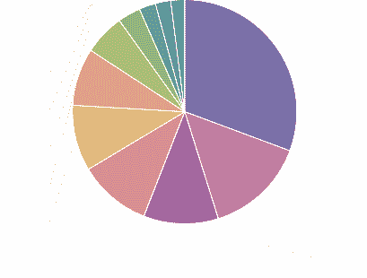

信息技术 30.7%
金融 14.5%
医疗保健 10.8%

数据截至:2025年2月28日
数据来源:标普官网

标普500指数在一定程度上代表了美国股票长期平均收益。在此基础上，我们可以通过其他方式获取超额收益或者更好的风险溢价。诺贝尔奖获得者尤金·法马（Eugene Fama）和肯尼·弗伦·弗奇（Kenneth French）在1992年的文中提到，小盘股和市值价值在长期存在明显的风险溢价。适当配置一些价值股和小盘股，对整个组合的表现起到提高收益的作用。

标普500等权指数是一个比较标普500偏差和小盘股的指数。它和标普500拥有相同的成分股，不同的是，相比市值加权的标普500指数，等权指数给予每个成分股相同的权重。这意味着相比市值加权指数，等权指数给予更多权重在规模较小的股票上。并且由于标普500指数成分中大多为价值股，所以等权指数相比市值加权指数配置了更多的价值股。小盘股和市值价值理论上和收益表现均超过大盘。

可以看到，根据2025年2月28日的标普500等权指数成分股数据，标普500等权指数第一大权重股苹果公司，占整体权重的0.3%，前十大成分股占比2.5%，而标普500指数（市值加权），前十大成分股占比35%。

### 图 24: 标普500等指数成分股规模分布及占比

| 成分股数量 | 503 只 |
|---|---|
| 平均总市值 | 105,227.77 (百万美元) |
| 最大总市值 | 3,655,610.63 |
| 最小总市值 | 4,606.45 |
| 总市值中位数 | 35,792.75 |
| 最大成分股占比 | 0.3% |
| 十大成分股占比 | 2.5% |

数据截至:2025年2月28日
数据来源:标普官网

从行业分布来看，标普500等指数的行业分布也更为均衡。信息技术行业的比重显著下降，占比在13%左右。工业行业占比显著提升，成为第一大权重行业，占比15.2%。接下来金融行业占比11.5%，医疗保健占比12%。

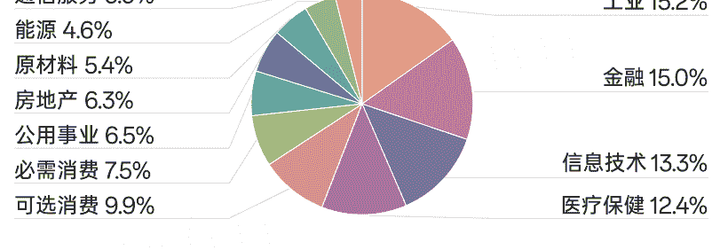

数据截至：2025年2月28日
数据来源：标普官网

纳斯达克100指数中科技行业占比60%，左右可选消费占比20%。

美国债券市场是目前规模最大、品种最多、流动性最好的市场。同时，美国债券市场的定价对全球的金融市场都有着重大影响。从构建投资人的角度，我们可以更好地理解美国债券在国际债券组合的重要性。

全球的央行，大部分资产是在各国政府债券之间进行配置，下图中展示了全球各国央行的平均资产配置。美元资产约60%，欧元占20%，日元和英镑占5%，人民币大概占3%。可以发现，各国央行在配置债券和货币时，首选的是美国债券市场。当我们选择海外外债债券市场时，也会首选美国债券市场。

图 28：各央行外汇储备中币种占比

| 外汇储备中币种的比例 | 非传统货币的细分比例 |
| :--- | :--- |
| 美元, 欧元, 日元, 英镑, 非传统货币 | 澳元, 加元, 人民币, 其他 |

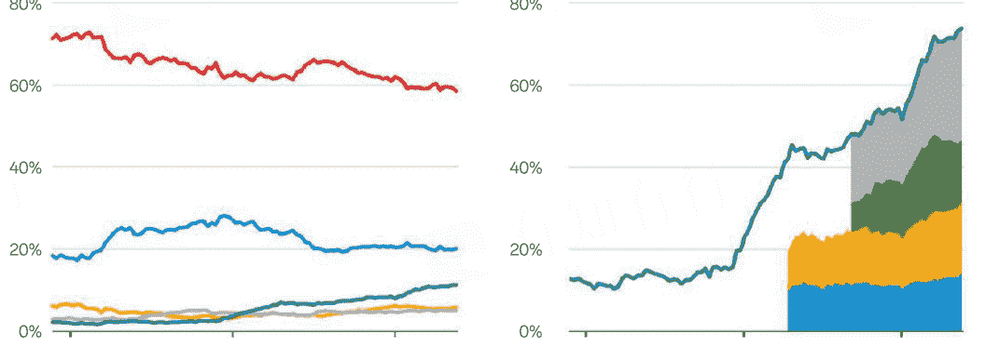

注：“四大”货币指美元、日元和英镑。非传统货币指其他货币。AUD=美元，CAD=加元，RMB=人民币。2015年至2018年期间，中国为了COFER披露了这些。
数据来源：IMF COFER 数据库：Arslanal、Elchengreen和Simpson-Bell（2022年，已更新）。

目前面上没有投资债券指数的 QDII基金或是互认基金，所以对于中国境内投资者来说，海外债券部分的选择要考虑主动管理的海外债产品。

一般来说，海外债产品的持仓，普通投资者不太容易看懂。且 QDII 基金的海外债产品只公布前五大债券的持仓，对持仓分散的海外债产品来说，很难从公开的信息中得知全貌的。

海外投资白皮书

一方面，我们可以通过基金的信息披露来了解基金的持仓概况，和基金经理的行为。信息披露包括基金的业绩基准、持仓以及基金经理的访谈等。

另一方面，在挑选海外股票和债券基金时，我们需要第三方信息来综合考量每个基金管理团队。具体来说，定性分析方面我们可以考虑这五个方面：管理公司、管理团队、投资理念、整体费率和第三方基金评级。

管理公司和管理团队代表这个基金经理人在海外市场投入了多少投资资源，管理团队有多少海外投资的经验。

投资理念可以帮助我们了解，这个海外基金主要要投资哪些市场，投资长期的限制，会不会做信用下等的关键信息。

整体费率直接用，高额的管理和交易费用会侵蚀投资者的收益。

第三方基金评级可以帮助投资者补全一部分外部信息，可作为挑选时的参考。

总结来说，在海外投资部分，尽量寻找投资债券种类以美德和欧为主，投资风格稳定、业绩优实、团队稳定、有验证的经验、费率合理，并且长期以投资者利益为中心的基金经理和基金公司。

## 3.3 汇率变化对海外投资的影响

讨论投资方案时，我们需要提醒各位投资者在海外投资中不可忽视的汇率风险因素。

作为境内投资者，使用人民币投资海外资产时，需要经历换汇、购买证券的过程，赎回时也需要经历卖出证券、换汇的流程。当我们使用QDII基金或互认基金海外资产时，基金经理及其团队完成了这个过程。我们只需要注意到汇率会对我们的收益产生影响。

下图展示了1995年以来，分别以美元、人民币为计价单位投资标普500指数的收益表现。

图 29：汇率对标普500的影响年化收益率波动对比

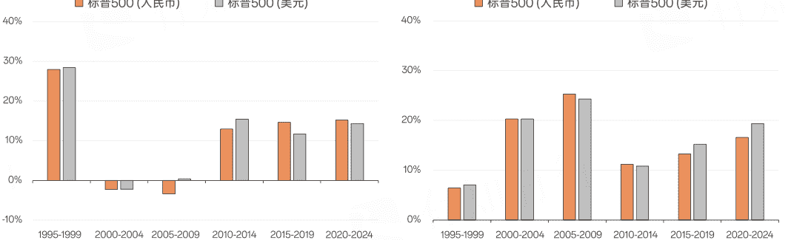

标普500 (人民币) 标普500 (美元)
数据来源：Wind, 中国银行研究

可见1995到2005年，使用人民币或美元作为计价，标普500的收益差异很大。因为这段期间中国为了亚洲金融危机，USD/CNY维持在8左右，没有巨大的波动。直到2005年，中国深化汇率改革，将单一美元盯住改为参考篮子，汇率开始变化。2005年至2015年，人民币对美元升值，USD/CNY从8左右下降到6.5左右，这段期间使用人民币投资普500收益低于美元。2015年至2025年初，人民币对美元贬值，USD/CNY从6.5左右提升到7左右，期间使用人民币投资标普500收益率高于美元。

汇率风险是客观存在的，我们无法预测汇率的变化，所以进行海外投资的投资者需要知道除了底层收益外，汇率因素也会影响投资。同时，汇率对不同资产的影响程度不同。图30展示了从2014年以来，分别使用美元、人民币作为计价单位投资美国长期债的的表现。可以发现汇率对债券的影响非常显著。

图 30：使用不同货币投资美国长期债收益率对比

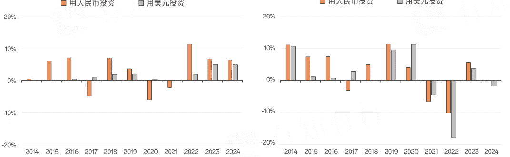

数据来源：Wind, FRED, 中国人民银行研究

海外股票属于高风险资产，本身波动较高，虽然也会受到利率、市场走向和经济周期的影响，对收益来说更大。总结，汇率对于债券的影响最大，对股票的影响最小。

## 3.4 未来提高空间

如上所述，海外投资首选美国市场。目前面上欧洲市场、日本股市、印度股市基金很少，规模低，很难找到合适的投资标。越南市场规模还小，和中国一样属于新兴市场，所以配置越南市场的性价比不高。可以覆盖其它市场。目前面上没有海外债指数产品，只能选择主动管理型产品，即便如此，受限于海外债产品的规模和QDII额度。保持关注，留意市场上是否好的海外债产品，特别是费用更低的指数产品，也是可以提高的地方。

增加其他资产类别：市场上缺少小盘股、价值股相关的黄金、REITs等此类资产，也是丰富资产组合的选项。另类资产与传统市场（股票、债券）的相关性较低，在市场波动时提供分散风险的作用。但此类资产自身波动较为大，市场可选产品也较少。保持关注，留意市场上是否出现值得投资的另类产品，也可以努力提高的地方。

根据自己的情况，选择更适合自己的资产配置：投资海外市场，是一个长期的行为。我们跟大家分享了海外投资对个人资产配置的作用、海外市场的特点、中国境内投资海外投资的通道，以及如何搭建长期投资的框架，希望能够帮助为你海外长期投资做好准备。同时，我们也非常理解，合适的资产配置比例还需要结合个体的情况。如果你准备好了，不妨先试起来，在实践中了解自己的需求，逐步优化自己的资产配置比例（如海外资产占个人的比例、股债比例等）。对很多人来说，海外市场是一个陌生的市场。我们会加强对海外市场的研究，希望帮助大家了解海外逻辑，了解自己是否适合海外投资，以及做好充分的准备。

# 后记

在2025年4月发布新修订的《海外投资白皮书》之时，恰逢全球金融市场动荡之时。白皮书团队特别在文的后记部分写下了这个特殊的事件和我们的观点。

随着美国总统特朗普于2025年4月2日宣布实施关税政策，标普500指数在两天内跌幅超过10%，全球其他市场也显得相似走势。接下来，4月9日特朗普突然决定对绝大多数国家征税，全球股市又强力反弹。然而，全球金融市场面临着年来所未有的不确定性。

这种不确定性来源于多种因素：

1. 特朗普政策改革的广度与深度，其政策在重塑全球经济与贸易格局；
2. 地缘政治紧张局势：此政策将涉及传统盟友；
3. 美国国内通胀上行的风险；
4. 人工智能对基础设施的变革和冲击。

这些风险具有特殊性，导致其影响难以精准判断。国际贸易对全球经济至关重要。
