# 2025 职场健康需求报告

## 更贴心的福利，造就更强大的团队

亚洲洞察
Businesses of Marsh McLennan

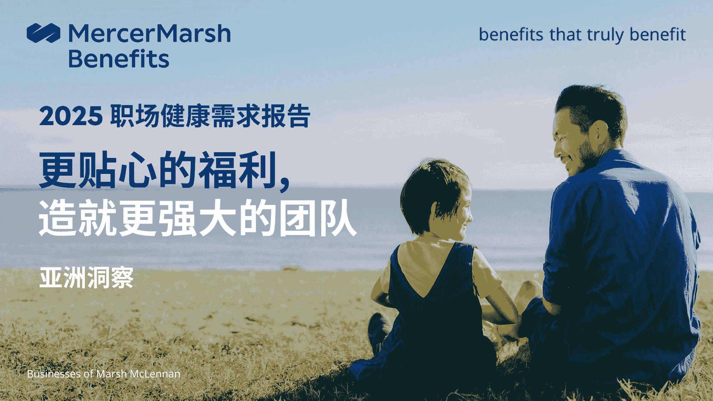

## 知识星球TOP 资源分享

让更多人获取高价值信息
汇聚网络付费资源

公众号: 知识星球TOP

微信信号: jntsg8

微信信号: jntsg2

添加微信免费群

- ◆付费文章
- ◆付费社群
- ◆付费课程
- ◆副业&搞钱
- ◆财经&股市
- ◆行业报告

时政·历史·职场·体制·自媒体
学习·军事·软件·影音·社会学

## 您的企业福利是否能够帮助员工蓬勃发展?

### 提升医疗服务可负担性
### 因需而设，个性化定制
### 应对气候变化
### 为长寿社会做好准备
### 守护心理健康
### 探索新的医疗服务获取方式

对员工健康和福利的投资不仅仅仅是一项支出，它体现了您对员工的重视，更是一对企业未来的承诺。

健康就是财富
健康需求因人而异
健康就是保障

虞炜 Steven Yu
美世达信员工福利亚洲区总经理

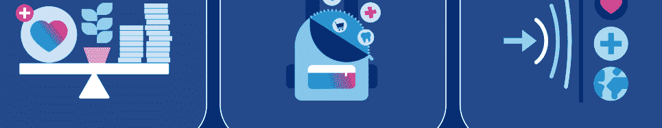

## 亚洲员工填补医疗负担方面的缺口

2025年预测数据显示，不同市场在医疗通胀与工资涨幅方面存在差距

- 1/5的亚洲员工对自己能否负担医疗服务费用缺乏信心，导致就医延误
- 亚洲地区的医疗通胀率升至13%，是总体通胀率的5倍。员工面临医疗服务可负担性的压力和不断扩大的健康缺口，而越来越担心自己的健康和财务安全

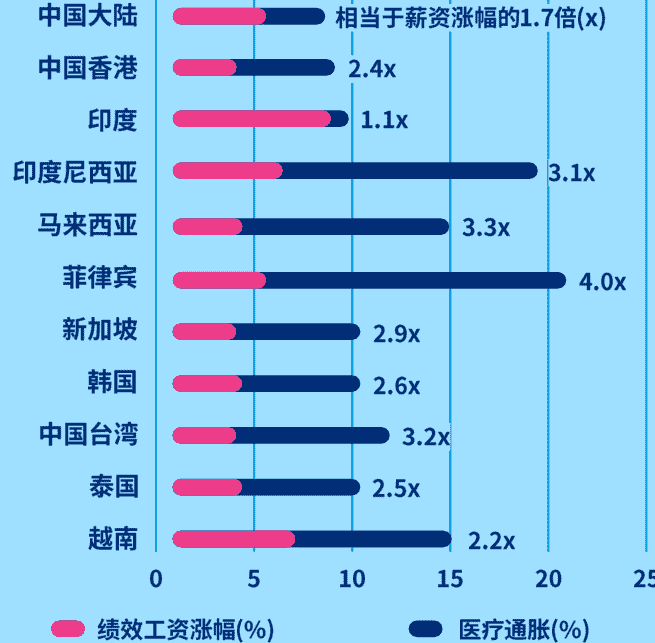

对负担自己或家人的医疗服务费用缺乏信心

| 年份 | 比例 |
| :--- | :--- |
| 2025 | 21% |
| 2023 | 20% / 21% |

数据来源：美世，Mercer 员工预算调研-2024年6月（中国大陆数据基于上海）美世达信员工福利，《2025年全球员工福利趋势报告》

Mercer Marsh Benefits

## 亚洲员工的健康水平下降了10%，全球降幅8%的情况更严峻

## 亚洲员工对雇主关怀的水平降低了4%

## 对比“关怀型”企业与“非关怀型”企业，员工福利的满意度存在差异

- 我自己身心健康
-我是雇主关怀的健康和福利（表示“非常满意”和“满意”的员工比例）

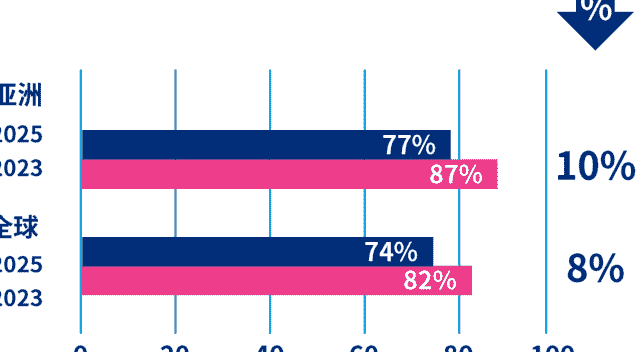

亚洲
2025 77%
2023 87%

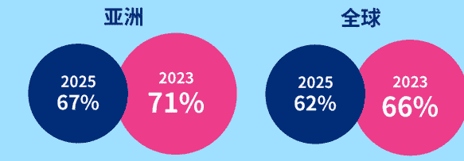

全球
2025 74%
2023 82%

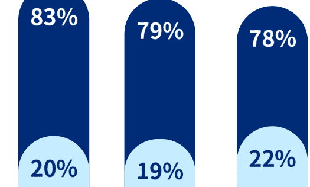

亚洲的雇主可以通过独特的机遇来填补服务缺口，帮助企业实现稳健发展，因为员工信任能够为他们提供及时的医疗服务。

- 在紧急或困难时，我相信雇主会给我提供支持
- 我的雇主提供的福利满足了我的需求
- 我的雇主提供的福利与业内其他企业相比，显著更好

Matt Zafra,
美世达信员工福利亚洲区咨询业务总经理

- 我是雇主关怀的健康和福利
-我是雇主不关心的健康和福利

Mercer Marsh Benefits

## 市场聚焦 | 中国大陆

## 健康即财富
- 中国大陆面临老龄化问题，男性平均年龄为75岁，女性为81岁。
- 随着生活成本上升，人们越来越担忧退休的财务保障，尤其是Z世代群体和婴儿潮一代以及以上群体
- 这两个群体对身心健康水平的衰退感到担忧，企业应更加重视对不同群体的医疗福利支持
- 雇主可以通过扩大保险覆盖范围至更多群体，提升健康公平

## 健康需求因人而异
- 就压力水平来说，中国大陆员工心理安全排名全球第三，但较于2023年，员工的心理安全水平有所上升
- Z世代对吸引力的福利非常通，主流企业采用游戏化、互动和全渠道策略
- 个性化福利提高了员工对雇主的信任。然而，只有63%的中国员工认为他们可以自己的福利

## 健康即保障
- 70%的员工过去两年内受到环境影响，例如生活成本上升、心理健康出现差异
- 约70%的员工因工作时间长而延迟就医。企业考虑远程医疗、弹性工作时间和专属福利，帮助员工及时获取服务
- 家庭照顾者就医可能更高，因为他们往往优先照顾他人忽视自己

| 中国大陆 | 亚洲 |
| :--- | :--- |
| 总体而言，我的身健康良好 | 75% | 77% |
| 我的雇主关怀的健康与福利 | 65% | 67% |
| 我有信心负担起自己或家人需要的医疗费用 | 85% | 79% |
| 我担心退休后的经济能力 | 25% | 53% |
| 我可以定制福利满足需求 | 63% | 65% |
| 我在日常生活中感受到压力 | 53% | 48% |
| 我或家人感受到环境的影响（除外） | 73% | 81% |
| 在过去两年中，我曾延迟就医 | 69% | 78% |

Mercer Marsh Benefits

## 健康即财富
### 提升医疗服务可负担性
### 为长寿社会做好准备

Mercer Marsh Benefits

## 解决影响医疗服务获取的障碍
### 1/3家庭低于中位数的员工对其能负担医疗服务缺乏信心

在亚洲地区，收入低于中位数的员工中，更多人对负担医疗费用缺乏信心
调研显示，在医疗服务可负担性方面，不同性别和代际的信心存在差异

雇主可以通过提升医疗福利，更好地满足员工的需求

千禧一代对负担医疗服务最缺乏信心

| | 2025 | 2023 |
| :--- | :--- | :--- |
| 收入低于中位数 | 亚洲 37% | 亚洲 31% |
| 全球 33% | 全球 31% |
| 收入高于中位数 | 亚洲 17% | 亚洲 16% |
| 全球 15% | 全球 15% |
| 25% 千禧一代 | 22% Z世代 | 19% X世代 |
| 15% 婴儿潮及以上 | | |

常规就医的保险覆盖或费用优惠
预防性癌症筛查
女性在负担医疗服务方面的信心低于男性，女性:1/4

- 对我对我的家人有帮助 (%)
- 已由雇主提供 (%)

## 财富差距的扩大，让收入低于中数的员工面临日益严重的医疗保障缺口

在收入低于中位数的员工中，更多的人无法任何渠道获得以下福利：
- 退休计划 /养老方案
- 重症保险
- 人寿保险
- 个人意外伤害保险
- 医疗保险

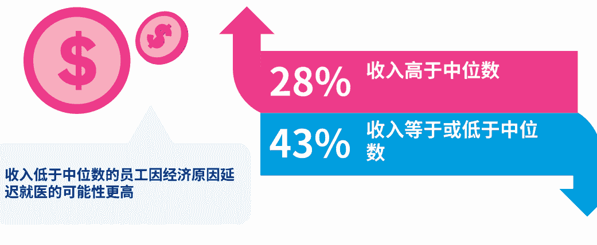

医疗服务的可用性和可负担性不足，不仅影响个人健康，也会对企业造成不利影响，因为它会让员工延迟就医，导致患病概率和缺勤率上升

> 主雇行动建议：提供负担得起必需的福利，从而提升员工健康水平和工作效率

收入低于中数的(%) 收入高于中数的(%)

## 符合医疗保险计划资格的员工
### 所有员工

审核员工反馈和符合条件的开支，优先考虑未满足的需求
- 为日常医疗支出提供知识和固定账户
- 涉及医疗系统知识和社区资源
- 提供财务教育与应急储备计划
- 处理影响健康的问题，如食品安全、住房和交通
- 提供带薪病假，方便员工就医
- 考虑实施预防性的排班制度和保障同事制度
- 提供非保险服务，例如员工补助计划、预防性医疗和远程医疗等
- 扩大现场服务范围，如体检、疫苗接种、物理治疗和疾病管理

评估现有福利水平是否充足，包括免赔额和最高限额

制定癌症和重大疾病应对策略

与保险公司合作，提高医疗的质量、可能的成本效益（以价值为导向的医疗、远程医疗服务、解决欺诈/浪费/滥用问题）

> 让企业的所有员工都能承担起医疗服务，而不仅仅是符合医疗保险计划资格的员工

Mercer Marsh Benefits

## 促进多代际员工团队的财务、健康与认知水平的可持续发展

1/2的亚洲员工对其退休能力表示忧虑，尤其是在延迟退休已常化的背景下

亚洲不同代际员工有关龄化意愿的三个主要方面：

| 维度 | 意愿最大的群体 | 意愿最小的群体 |
| :--- | :--- | :--- |
| 退休后的经济能力 | Z世代 56% | 51% |
| 身体健康状况变化 | 婴儿潮一代及以上 56% | 千禧一代 |
| 认知能力衰退（记忆力或思维能力） | 婴儿潮一代及以上 57% | 千禧一代 46% |

尽管员工担忧以上，但雇主并未解决他们的需求，只有：
- 37% 雇主提供了退休计划
- 25% 雇主提供了财务项目
- 24% 雇主提供了健身营养支持

## 婴儿潮一代及以上的亚洲员工在职场蓬勃发展优于其他世代

帮助婴儿潮一代以上的员工实现蓬勃发展的关键福利：

| 维度 | 婴儿潮一代及以上 | Z世代 | 千禧一代 | X世代 |
| :--- | :--- | :--- | :--- | :--- |
| 总体而言，我的健康状态良好 | 80% | 73% | 76% | 78% |
| 弹性工作安排 | | | 34% | |
| 灵活退休选项延长工作年限 | | | 29% | |
| 远程/混合工作模式 | | | 26% | |
| 帮助医疗费的保险覆盖 | | | 23% | |

然而，婴儿潮一代以上的员工最担忧以下问题：
- 57% 获得可负担且高质量的服务
- 53% 认知能力衰退
- 心理健康衰退

不同世代拥有各自独特的价值观、沟通风格和期望。忽视这些个性化需求，可能会降低员工敬业度、最终导致离职率

> 雇主主动建议：重新考虑招聘、培训和支持，从而提升多代际员工的健康水平与财务韧性

Mercer Marsh Benefits

## 应对长寿社会对职场的影响

### 财务韧性与退休支持
- 提供便捷的储蓄与保险工具，并确保这些对所有员工公平
- 融入灵活机制与自动化功能
- 提供长寿社会相关的财务教育与指导

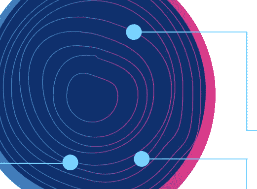

### 身心健康福利
- 有效管理医疗和健康福利，为员工带来更高价值
- 提供适龄的、高质量的医疗福利
- 为家庭照顾责任的员工提供财务支持
- 推广能够提升福利水平的方案，如预防性健康检查、重大疾病保险覆盖及心理健康福利

### 建立联系、促进包容并提升社区参与度
- 帮助员工维持联系
- 提供正式与非正式的导师辅导
- 积极应对职场年龄歧视

### 职业路径
- 打造包容性文化与灵活机制
- 提倡终身学习，重启发展技能
- 为体力/脑力要求的岗位进行工作适配
- 鼓励重返职场，并为家庭照顾者提供护理方案

来源：美世，《全球劳动力长寿调研报告》，2025

## 案例研究 | 新加坡

### 多管齐下，提升员工的可持续发展能力

行动
- 改善碎片化医疗模式：鼓励员工优先使用企业内部诊服务，以便早期发现慢性疾病并提高成本效率
- 照顾员工的特殊需求：面向以40岁以上女性为主的团队，提供针对性的健康检查与科普材料
- 解决沟通障碍：鉴于员工使用电脑和企业邮箱的机会有限，公司将医疗信息展示在人员流动频繁的区域

挑战
一家酒店企业有大量40岁及以上的员工，这一群体患慢性可能的其他年龄群体的五倍，从而导致医疗成本上升

公司面临两个问题：
- 员工不积极参与定期健康检查
- 很多人不了解享有的福利，因此选择外部医疗服务，导致企业内部诊所的使用率低，治疗连续性中断

成果
- 使用企业内部诊服务的慢性病患者数量增加，提升了治疗连续性，并实现个性化治疗方案
- 疾病的早期发现率提高，强调了主动筛查对治疗结果的重要性
- 公司同时强化了员工对预防性健康策略的认知与理解

## 健康需求因人而异

因需而设，个性化定制
守护心理健康

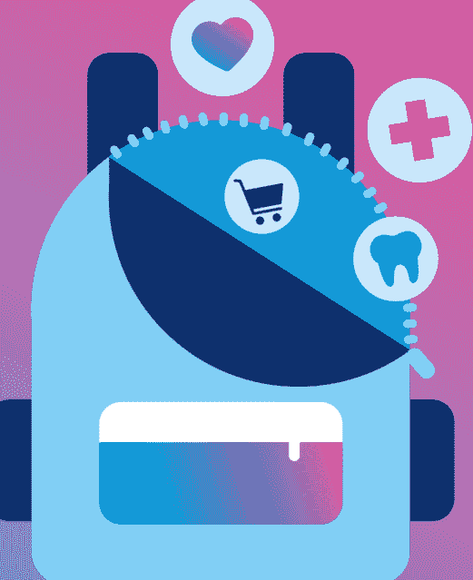

Mercer Marsh Benefits

## 健康需求因人异：因需而定制，个性化定制

## 雇主需关注员工在不同人生阶段的独特需求

36%的亚洲员工表示雇主提供的福利无法满足需求。提供个性化福利有助于增强员工对雇主的信任

亚洲地区员工最在意的福利是什么？
- 多元、公平、包容与归属感
- 权益与公平待遇
- 健康与福利
- 残障人士或神经多样性群体的公平待遇

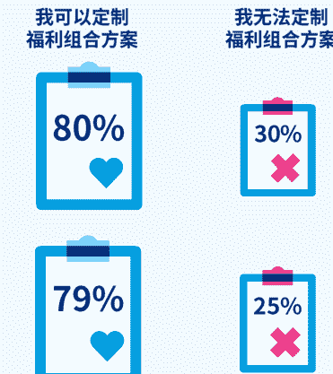

我是雇主关怀的健康和福利（“满意”和“非常满意”）
我是雇主提供的福利与业内其他行业相当，甚至更好（“满意”和“非常满意”）

通过专属平台，雇主能以高效的方式提供个性化福利，但只有30%的亚洲员工能够此类平台。65%的亚洲员工能够享受个性化福利。

虞炜 Steven Yu
美世达信员工福利亚洲区总经理
Mercer Marsh Benefits

## 在亚洲，家庭照顾者面临更大的压力

在日常生活中承受更多压力

尽管许多家庭照顾者表示自己健康，但仍有1/2的人担心经济状况、工作保障和健康

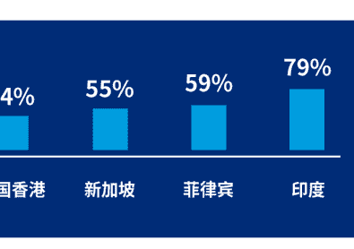

### 承担家庭照顾责任员工的愿望
获得高质量的照顾服务

| | 2025 | 2023 |
| :--- | :--- | :--- |
| 中国大陆 | 53% | 51% |
| 中国香港 | 58% | 55% |
| 印度 | 42% | 50% |
| 菲律宾 | 43% | - |
| 新加坡 | 45% | 40% |

提供心理健康调查，发现潜在风险
提供相关保险覆盖或方案，降低员工治疗心理问题的经济负担

## 男性的心理健康问题

49%的亚洲亚洲员工在工作中压力太大，且有50%的男性正寻找工作机会（女性比例为47%）

心理健康福利仍存在缺口

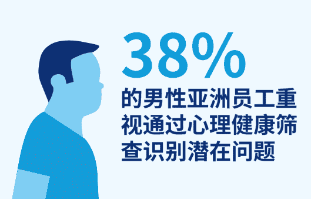
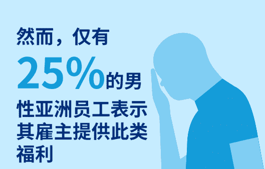

> 如果员工在心理健康方面得不到足够支持，可能会影响企业文化，降低生产力

主动行动建议
- 重新评估企业为员工提供的心理健康支持，实施以下针对性的策略：
- 心理健康筛查服务
- 灵活多样的健康教育策略
- 在职场营造安全的文化氛围

## 工作相关因素影响员工健康

- 合理的工作要求
- 有计划的排班与合理的工时
- 充足的退休金保障
- 企业的价值观与公平性
- 工作保障
- 负担得医疗保险
- 基本生活工资
- 管理层的支持
- 社会和社区支持

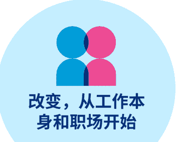

## 健康需求因人而异：因需而设，个性化定制 | 注意事项

个人经历与所处行业
家庭照顾状态/单亲家长
社会经济地位
性别
退伍军人/遭遇冲突群体/难民
年龄/人生阶段
民族/种族宗教信仰
思维方式/神经多样性
残障人士
地理位置
双性人/彩虹族 (LGBTQ+)

## 考虑影响员工体验的多种因素

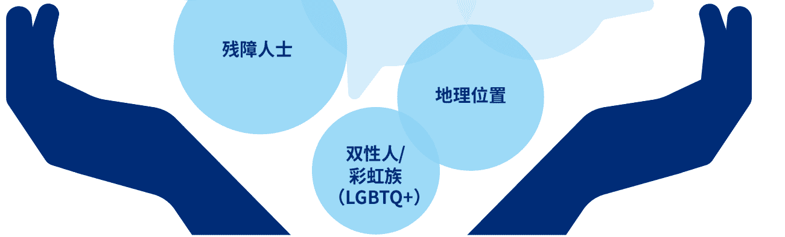

## 心理健康问题不仅持续影响员工本身，还会影响企业

在亚洲，近半员工表示日常生活压力过大，64%的员工在寻找工作机会

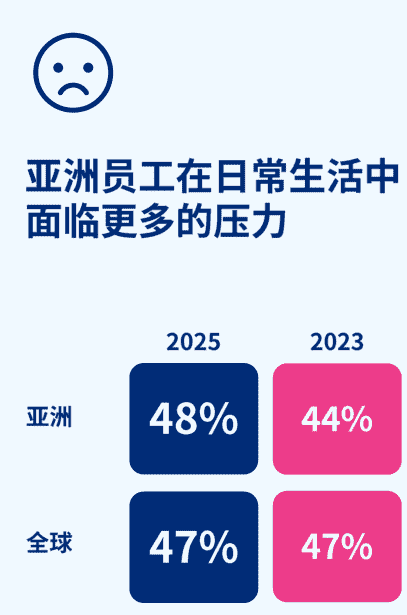

## 亚洲员工在日常生活中面临更多的压力

亚洲各市场中，中国香港面临压力的员工最多

企业可以通过以下有益的福利措施，帮助员工改善心理健康：
- 开启培训课程，帮助员工识别并解决自己及他人的心理健康问题

| | 2025 | 2023 |
| :--- | :--- | :--- |
| 中国大陆 | 53% | 51% |
| 中国香港 | 58% | 55% |
| 印度 | 42% | 50% |
| 菲律宾 | 43% | - |
| 新加坡 | 45% | 40% |

提供心理健康调查，发现潜在风险
提供相关保险覆盖或方案，降低员工治疗心理问题的经济负担

## 案例研究 | 中国大陆

### 多管齐下，提升员工的可持续发展能力

行动
- 改善碎片化医疗模式：鼓励员工优先使用企业内部诊服务，以便早期发现慢性疾病并提高成本效率
- 照顾员工的特殊需求：面向以40岁以上女性为主的团队，提供针对性的健康检查与科普材料
- 解决沟通障碍：鉴于员工使用电脑和企业邮箱的机会有限，公司将医疗信息展示在人员流动频繁的区域

挑战
一家酒店企业有大量40岁及以上的员工，这一群体患慢性病的可能是其他年龄群体的五倍，从而导致医疗成本上升

公司面临两个问题：
- 员工不积极参与定期健康检查
- 很多人不了解享有的福利，因此选择外部医疗服务，导致企业内部诊所的使用率低，治疗连续性中断

成果
- 使用企业内部诊服务的慢性病患者数量增加，提升了治疗连续性，并实现个性化治疗方案
- 疾病的早期发现率提高，强调了主动筛查对治疗结果的重要性
- 公司同时强化了员工对预防性健康策略的认知与理解

对于仍采用“一切”福利方案的雇主，在吸引和留住人才方面处于劣势

雇主行动建议
- 根据员工所处的人生阶段，重新评估其福利需求，并相应调整福利组合，允许员工根据自身需求定制福利方案

# 健康即是保障

应对气候变化

探索新的医疗服务获取方式

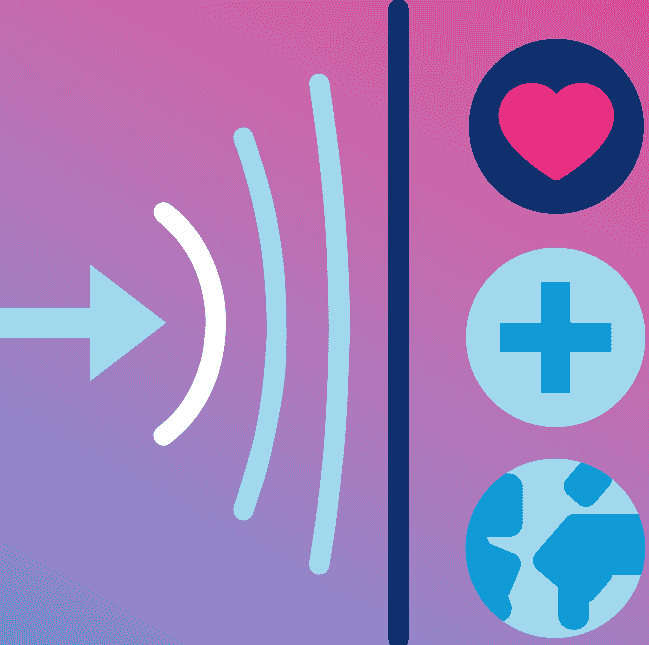

Mercer Marsh Benefits

## 亚洲地区受极端天气影响最为严重

4/5的亚洲员工或其家人曾受到气候变化与极端天气事件的影响

81%的亚洲员工表示，他们或其家人曾受到气候变化的影响

| 全球 | 亚洲 | 菲律宾 | 印度 | 中国香港 | 新加坡 | 中国大陆 |
| --- | --- | --- | --- | --- | --- | --- |
| 77% | 81% | 91% | 87% | 77% | 75% | 73% |

气候变化与极端天气事件的主要影响：

| 41%的员工感受到生活成本上升 | 30%的员工由于高温导致身体健康状况变差、睡眠困难 | 27%的员工对极端天气有焦虑情绪 |

## 气候变化对多代员工团队的影响

### 生活成本上升

| Z世代 44% | 千禧一代 44% | X世代 38% | 婴儿潮一代及以上 33% |

### 身体健康状况变差

| 千禧一代 32% | Z世代 30% | X世代 28% | 婴儿潮世代及以上 27% |

## 帮助面临气候风险的员工构建健康韧性

42%的亚洲员工担心心脏疾病的医疗福利或政府提供的医疗福利不足以应对气候相关的健康问题

户外工作的员工更易受到气候风险的影响

户外工作者享受的气候相关福利存在差异

- 应急储蓄/贷款款项
- 90% 的员工曾受到气候变化的影响
- 支持推行更环保的生活方式（如提供太阳能电池的补贴）
- 34% 的员工对极端天气感到焦虑
- 为极端天气影响的员工提供带薪假期

极端天气事件的频率和强度对某些岗位的影响尤为显著，尤其是户外工作者，同时极端天气事件会导致更严重的焦虑、压力和抑郁

+ 雇主主动建议
- 增加与气候风险相关的福利，如贷款和健康保障方案
- 提供灵活的工作时间安排
- 为极端天气影响的员工提供带薪假期

员工期望的福利 (%) 雇主实际提供的福利 (%)

## 健康即保障：应对气候变化 | 注意事项

### 无雨绸缪——为员工供应应对灾难的福利

#### 了解你的风险
- 分享可靠的灾难应对资源

#### 储蓄使用渠道
- 提供应急储备计划，在员工动用其他资金进行投资时，提供专业建议

#### 预防措施
- 提供流行疾病的疫苗接种服务

#### 救助基金
- 提供贷款或补助，通过参与保险预先筹资。
- 为帮助困难同事的员工提供健康慈善捐赠通道

#### 心理健康支持
- 确保通过多种渠道获取心理支持，包括员工援助计划

#### 请假政策
- 制定请假计划，供个人损失或需要照顾他人（受抚养人、年长属）而无法工作的员工

#### 工作使用
- 数字健康/远程医疗服务：确定远程医疗服务提供者，以提供医疗服务或帮助员工获取所需治疗

#### 零工/合同工支持
- 制定支持这些群体（相对于全员工）专项计划

#### 管理人员培训
- 提供有关如何在灾难中最大保护员工、以及信息获取渠道的培训

#### 沟通机制
- 明确紧急情况下主可提供的支持。通过应急通路渠道在紧急事件发生前、中、后与员工保持联系

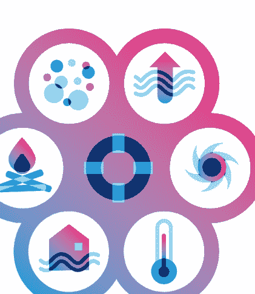

## 医疗服务获取难题影响员工工作效率

1/4的员工不知道哪里获取福利信息，导致难以获得医疗服务

## 就医障碍

- 信任雇主能及时提供可负担的优质医疗服务

### 亚洲：46% vs 全球：44%

- 23% 预约治疗的等待时间过长
- 21% 无法请假

有效的福利沟通有助于提升员工对雇主的信任

我信任我的雇主能够：

| 沟通有效 | 沟通无效 |
| --- | --- |
| 及时提供可负担的优质医疗服务 | 54% | 27% |
| 分享改善员工健康的信息和建议 | 52% | 20% |
| 为复杂疾病推荐就诊地点 | 50% | 19% |
| 提供慢性病管理的应用程序 | 43% | 15% |

- 20% 不熟悉医疗服务体系或找不到合适的治疗方案
- 20% 担忧医疗服务质量

## 亟需解决 Z一代在医疗福利获取方面的障碍

过去两年中，有 86% 的 Z世代群体曾推迟就医，是各代推迟就医人数之最

各代推迟就医的情况：

+ 亚洲整体
- Z世代
- 千禧一代
- X世代
- 婴儿潮一代及以上

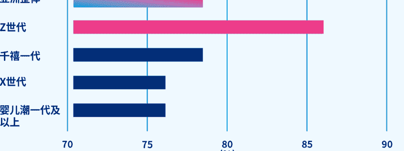

> 在亚洲，有40%的员工表示愿意使用远程医疗就医，是使用医疗服务人数最低的代际

医疗服务获取方面的障碍造成78%的员工推迟就医，可能导致治疗过程复杂化以及费用上涨

Z世代群体推迟就医的主要原因：
- 25% 因健康问题感到尴尬、焦虑或畏惧、无法请假

雇主行动建议

+ 引入新的医疗服务模式，如企业内部诊所、远程医疗服务和灵活就诊安排，通过更具吸引力的方式传递信息，促进员工理解及使用医疗服务

## 开启获取医疗服务的新途径

企业的医疗与福利沟通是否足够？

未来

+ 明确信息、摘要、一致、容易理解

+ 信息发布时机恰当、做出明智决策、突出重点

雇主与保险机构在推动高质量医疗服务创新方面发挥关键作用，这些创新不仅提升医疗服务可视性，且重塑医疗服务模式

相关性

+ 与品牌价值观一致、真实、充满共情、反馈导向
审核供应商，确保能力满足公司预期，提升企业内部诊所服务的标准
- 在进行供应商分析后，公司选择了一家高端企业内部诊所提供商，成本有所上升，改善医疗服务体验

## 案例研究 | 菲律宾

通过优化企业内部诊所，提升医疗服务的可用性

行动

+ 严格审核供应商，确保能力满足公司预期
- 在进行供应商分析后，公司选择了一家高端企业内部诊所提供商，成本有所上升，改善医疗服务体验
- 新供应商引入了审查与筛选

挑战

一家业务外包公司希望优化企业内部诊所，以协助维护健康组织（HMO），提升理赔管理，原因如下：

- 员工反复遇到服务标准差
- 由于护士或医生缺勤，服务经常中断
- 诊断报告信息不完整，导致员工福利难以获得数据支持

成果

+ 使用率九个月内提高了4%，直接节省200万菲律宾门诊费用；急诊率下降了58%，外部节省230万菲律宾费用
- 员工满意度显著提升，新供应商获得了89%的满意评分；
- 所有场所均配备了自动设备，在一次急危事件中成功救了一条生命

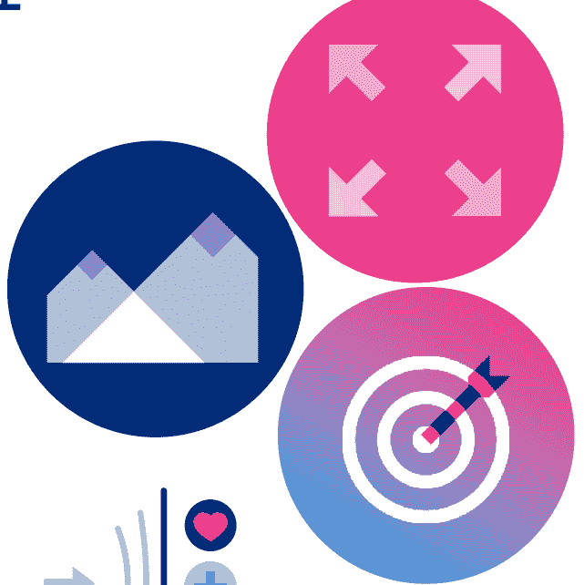

Mercer Marsh Benefits

## 通过聚焦全面的福利策略，动员员工升级，提升企业团队的韧性

立即阅读美世《2025职场需求报告》，了解更多信息

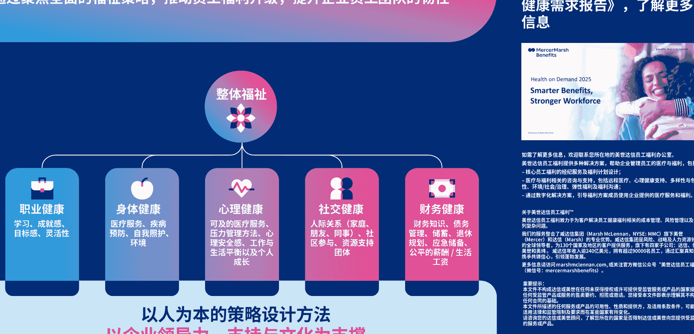

Mercer Marsh Benefits

Health on Demand 2025

## Smart Benefits, Stronger Workforce

如果您需要更多信息，请联系您所在地区的美世员工福利办公室。
美世员工福利计划提供多种解决方案，帮助企业管理医疗与福利，包括：
- 评估员工的健康状况及福利计划；
- 调整和优化员工福利计划，涵盖健康、心理健康、多样性与包容性、环境/社会责任、应急储备及福利设计；
通过数据驱动福利决策，确保员工满意度并提升绩效。

> 关于美世员工健康报告
美世员工健康报告是全球企业管理员工相关问题的权威报告，涵盖管理及未来趋势。
该报告涵盖了全球超过5000名员工（Mercer, McNennan, HWP 等）的调查，涵盖了30个国家和地区、20个不同行业。
调查探讨了员工对工作与健康的看法，包括身体健康、多样性与包容性以及工作环境对健康支持的影响。
报告还探讨了心理健康支持。

欲了解更多信息，请访问 www.mclennan.com 或联系您所在地区的美世《2025职场需求报告》

备注：
本报告包含对未来业务趋势的预测，信息仅供参考，不构成任何形式的保证。
美世对本报告内容的准确性、完整性不受保证。
对于本报告可能产生的结果，美世不责任向影响客户提供任何服务。

## 整体福利

### 职业健康
学习、成就感、目标感、活性

### 身体健康
医疗服务、疾病预防、自我照顾、环境

### 心理健康
可及的医疗服务、压力管理方法、心理安全感、工作与生活平衡以及个人成长

### 社区健康
人际关系（家庭、朋友、同事）、社区参与、资源支持团体

### 财务健康
财务知识、债务管理、储蓄、退休规划、公平的薪酬

## 以人为本的方法

以企业领导、文化为支撑

Mercer Marsh Benefits

Health on Demand 2025 © 2025 McLennan. All Rights Reserved.
